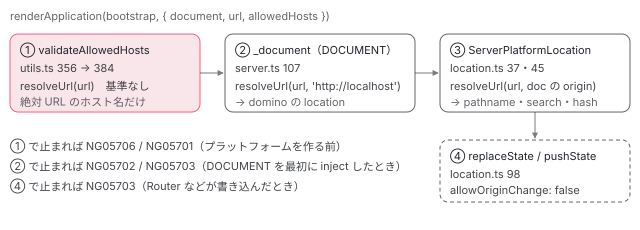

[目次](../README.md) › [SSR の守りと細部](README.md) › 第 2 回 / 全 10 回

# document と location の初期化：allowedHosts と origin の検査

> renderApplication と renderModule に渡した url と document から、サーバーの document.location と ServerPlatformLocation が作られる行。allowedHosts の option（60552a73e82）、origin の末尾のスラッシュ（2a6b6fafb03）、location の origin の検査を固くした修正（cf9d7fa0f80）と、document の初期化の SSRF とパスの乗っ取りを防ぐ修正（1307ff355c9）。

angular/angular · 読了 約 13 分 · 発展 · [サイトで読む（デモが動きます）](https://angular-deep-dive-cyan.vercel.app/chapter/ssrx-location-allowed-hosts)

---

`renderApplication` に渡した `url` は、サーバーの中で **3 回** 解析されます。1 回目は `allowedHosts` の検査、2 回目は domino（サーバーで HTML を DOM にするライブラリ）の文書の `location` を作るとき、3 回目は `ServerPlatformLocation`（サーバー版の `PlatformLocation`）が `pathname` などに分けるときです。この章では、その 3 回がどの行で、どの順に、どの呼び方の `resolveUrl` で行われるかを追い、そこに入った 4 本の修正を `git show` で読みます。最後に、本物の `renderApplication`（このサイトの依存の 22.1.6）に `url` と `allowedHosts` を変えて渡した記録を見ます。

読む対象は `packages/platform-server/src/` の `utils.ts`・`server.ts`・`location.ts` と、spec の `platform_location_spec.ts`・`utils_spec.ts` です。`renderApplication` の全体の流れと `allowedHosts` の検査の 3 ステップは [renderApplication の章](../platform/02-ssr-render-application.md)（11 節）に、`_document` と `ServerPlatformLocation` の役割は [platform-server の章](../platform/03-ssr-platform-server.md)（4 節・6 節）にあります。`resolveUrl` そのものは[第 1 回](01-ssrx-resolve-url.md)です。

1. [1. resolveUrl](01-ssrx-resolve-url.md)
2. **2. location と allowedHosts**（この章）
3. [3. サーバーの HttpClient](03-ssrx-server-http.md)
4. [4. ホストとヘッダーの検査](04-ssrx-host-validation.md)
5. [5. プロキシのヘッダー](05-ssrx-proxy-headers.md)
6. [6. リダイレクトと URL の照合](06-ssrx-redirects.md)
7. [7. ロケールの選び方](07-ssrx-i18n-locale.md)
8. [8. Node のリクエストとレスポンス](08-ssrx-node-streams.md)
9. [9. アセットと重要 CSS](09-ssrx-assets-css.md)
10. [10. spec と issue](10-ssrx-tests-issues.md)



*url が通る 3 回の解析。左から右へ、1 回のリクエストの描画の中で順に起きる。*

## 1. 1 回目：プラットフォームを作る前の allowedHosts の検査

📄 `angular/packages/platform-server/src/utils.ts` L350–356 （▶ の行: 354, 356）

```ts
350 │ ): Promise<string> {
351 │   const renderAppLabel = 'renderApplication';
352 │   const bootstrapLabel = 'bootstrap';
353 │   const _renderLabel = '_render';
354 ▶   const {url, allowedHosts} = options;
355 │ 
356 ▶   validateAllowedHosts(url, allowedHosts);
```
*renderApplication の先頭*

354 行目で `url` と `allowedHosts` を取り出し、356 行目で、**プラットフォームを作る（このすぐ後の `createServerPlatform`）より前**に検査します。ここで投げれば、注入器も DOM も作られません。`createServerPlatform` が `INITIAL_CONFIG` に入れるのは `document` と `url` だけで、`allowedHosts` はこの検査にしか使われません（[renderApplication の章](../platform/02-ssr-render-application.md)）。`renderModule` も同じ順番です。

📄 `angular/packages/platform-server/src/utils.ts` L382–388 （▶ の行: 383–388）

```ts
382 │ function validateAllowedHosts(url: string | undefined, allowedHosts: string[] | undefined) {
383 ▶   if (typeof url === 'string') {
384 ▶     const parsedUrl = resolveUrl(url);
385 ▶     if (parsedUrl !== null) {
386 ▶       const hostname = parsedUrl.hostname;
387 ▶       const allowedHostsSet: ReadonlySet<string> = new Set(allowedHosts);
388 ▶       if (!isHostAllowed(hostname, allowedHostsSet)) {
```

1. **384 行目：基準なしの `resolveUrl(url)`**

   [第 1 回](01-ssrx-resolve-url.md)の 4 つの呼び方の「基準なし」です。`/deep/path` のような相対 URL は `null`、`http://evil.com:80:80/` のような壊れた絶対 URL は 5701 を投げます。`http:/evil.example/x` は基準なしなので `http://evil.example/x` と解析され、`evil.example` で検査されます（記録の `no-auth`）。
2. **385〜388 行目：`null` でなければ、ホスト名を Set と照合する**

   387 行目、`allowedHosts` を渡さなければ `new Set(undefined)` で空です。空の Set に当たるホスト名は無いので、**絶対 URL を渡すなら `allowedHosts` も必ず要る**ことになります（記録の `abs-no-hosts`）。

📄 `angular/packages/platform-server/src/utils.ts` L413–419 （▶ の行: 414, 418–419）

```ts
413 │   for (const allowedHost of allowedHosts) {
414 ▶     if (!allowedHost.startsWith('*.')) {
415 │       continue;
416 │     }
417 │ 
418 ▶     const domain = allowedHost.slice(1);
419 ▶     if (hostname.endsWith(domain)) {
```
*isHostAllowed のワイルドカード*

418 行目は `'*.example.com'.slice(1)` で `'.example.com'` を作り、419 行目でホスト名がそれで終わるかを見ます。先頭の点が残るので、`app.example.com` は当たり、`evil-example.com` も **`example.com` そのものも当たりません**（記録の `wild-apex`）。親のドメインも許すなら、`'example.com'` を別に書きます。

### 60552a73e82（05-05）：allowedHosts が入ったときの形

本文は「`renderModule` や `renderApplication` にリクエストの URL をそのまま渡すと、絶対形式（absolute-form）のリクエスト URL によって SSRF や Host ヘッダーの差し込みにさらされる」と書き、#68436 を閉じています。HTTP のリクエスト行には `GET /path` のほかに `GET http://other.host/path` という絶対形式も書けるので、Express などの `req.url` が絶対 URL になることがあるからです。入ったときの `validateAllowedHosts` は `URL.canParse(url)` で絶対 URL かを見て `new URL(url).hostname` を照合する形で、3 週間後の 1307ff355c9 が今の `resolveUrl(url)` の形（壊れた絶対 URL を投げる）に置き換えました。

📄 `git show 60552a73e82 -- packages/platform-server/src/utils.ts`

```ts
commit 60552a73e82
Date:   2026-05-05

    fix(platform-server): add `allowedHosts` option to `renderModule` and `renderApplication`

diff --git a/packages/platform-server/src/utils.ts b/packages/platform-server/src/utils.ts
index 92baf0b6038..0199afd83fa 100644
--- a/packages/platform-server/src/utils.ts
+++ b/packages/platform-server/src/utils.ts
@@ -26,7 +26,7 @@ import {BootstrapContext} from '@angular/platform-browser';
 
 import {platformServer} from './server';
 import {PlatformState} from './platform_state';
-import {BEFORE_APP_SERIALIZED, INITIAL_CONFIG} from './tokens';
+import {BEFORE_APP_SERIALIZED, INITIAL_CONFIG, PlatformConfig} from './tokens';
 import {createScript} from './transfer_state';
 
 /**
@@ -39,9 +39,8 @@ import {createScript} from './transfer_state';
  */
 export const EVENT_DISPATCH_SCRIPT_ID = 'ng-event-dispatch-contract';
 
-interface PlatformOptions {
+interface PlatformOptions extends Omit<PlatformConfig, 'document'> {
   document?: string | Document;
-  url?: string;
   platformProviders?: Provider[];
 }
 
@@ -53,9 +52,16 @@ function createServerPlatform(options: PlatformOptions): PlatformRef {
   const extraProviders = options.platformProviders ?? [];
   const measuringLabel = 'createServerPlatform';
   startMeasuring(measuringLabel);
+  const {document, url} = options;
 
   const platform = platformServer([
-    {provide: INITIAL_CONFIG, useValue: {document: options.document, url: options.url}},
+    {
+      provide: INITIAL_CONFIG,
+      useValue: {
+        document,
+        url,
+      },
+    },
     extraProviders,
   ]);
 
@@ -265,14 +271,20 @@ function sanitizeServerContext(serverContext: string): string {
  *                 as a reference to the `document` instance.
  *  - `url` - the URL for the current render request.
  *  - `extraProviders` - set of platform level providers for the current render request.
- *
+ *  - `allowedHosts` - the allowed hosts list for host validation in server-side rendering.
  * @publicApi
  */
 export async function renderModule<T>(
   moduleType: Type<T>,
-  options: {document?: string | Document; url?: string; extraProviders?: StaticProvider[]},
+  options: {
+    document?: string | Document;
+    url?: string;
+    extraProviders?: StaticProvider[];
+    allowedHosts?: Readonly<string>[];
+  },
 ): Promise<string> {
-  const {document, url, extraProviders: platformProviders} = options;
+  const {document, url, extraProviders: platformProviders, allowedHosts} = options;
+  validateAllowedHosts(url, allowedHosts);
   const platformRef = createServerPlatform({document, url, platformProviders});
   try {
     const moduleRef = await platformRef.bootstrapModule(moduleType);
@@ -315,6 +327,7 @@ export async function renderModule<T>(
  *                 as a reference to the `document` instance.
  *  - `url` - the URL for the current render request.
  *  - `platformProviders` - the platform level providers for the current render request.
+ *  - `allowedHosts` - the allowed hosts list for host validation in server-side rendering.
  *
  * @returns A Promise, that returns serialized (to a string) rendered page, once resolved.
  *
@@ -322,11 +335,19 @@ export async function renderModule<T>(
  */
 export async function renderApplication(
   bootstrap: (context: BootstrapContext) => Promise<ApplicationRef>,
-  options: {document?: string | Document; url?: string; platformProviders?: Provider[]},
+  options: {
+    document?: string | Document;
+    url?: string;
+    platformProviders?: Provider[];
+    allowedHosts?: Readonly<string>[];
+  },
 ): Promise<string> {
   const renderAppLabel = 'renderApplication';
   const bootstrapLabel = 'bootstrap';
   const _renderLabel = '_render';
+  const {url, allowedHosts} = options;
+
+  validateAllowedHosts(url, allowedHosts);
 
   startMeasuring(renderAppLabel);
   const platformRef = createServerPlatform(options);
@@ -351,3 +372,40 @@ export async function renderApplication(
     stopMeasuring(renderAppLabel);
   }
 }
+
+function validateAllowedHosts(url: string | undefined, allowedHosts: string[] | undefined) {
+  if (typeof url === 'string' && URL.canParse(url)) {
+    const hostname = new URL(url).hostname;
+    const allowedHostsSet: ReadonlySet<string> = new Set(allowedHosts);
+    if (!isHostAllowed(hostname, allowedHostsSet)) {
+      throw new Error(`Host ${url} is not allowed. You can configure \`allowedHosts\` option.`);
+    }
+  }
+}
+
+/**
+ * Checks if the hostname is allowed.
+ * @param hostname - The hostname to check.
+ * @param allowedHosts - A set of allowed hostnames.
+ * @returns `true` if the hostname is allowed, `false` otherwise.
+ * @note Used also in `@angular/ssr`.
+ * @private
+ */
+export function isHostAllowed(hostname: string, allowedHosts: ReadonlySet<string>): boolean {
+  if (allowedHosts.has('*') || allowedHosts.has(hostname)) {
+    return true;
+  }
+
+  for (const allowedHost of allowedHosts) {
+    if (!allowedHost.startsWith('*.')) {
+      continue;
+    }
+
+    const domain = allowedHost.slice(1);
+    if (hostname.endsWith(domain)) {
+      return true;
+    }
+  }
+
+  return false;
+}
```

## 2. 2 回目：\_document が domino の文書に URL を渡す

📄 `angular/packages/platform-server/src/server.ts` L101–107 （▶ の行: 104, 106–107）

```ts
101 │     document =
102 │       typeof config.document === 'string'
103 │         ? _enableDomEmulation
104 ▶           ? parseDocument(
105 │               config.document,
106 ▶               config.url !== undefined
107 ▶                 ? resolveUrl(config.url, 'http://localhost').href
```
*server.ts の \_document（DOCUMENT の factory）の中*

107 行目、`config.url` を `'http://localhost'` を基準に解決し、その `href` を 104 行目の `parseDocument` に渡します。基準があるので、`//evil.example/x` は 5702、`/\evil.example/x` は 5703 で、ここで止まります（記録の `proto-rel`・`slash-bs`。止まったときのスタックの先頭は `_document` でした）。相対の `/deep/path` は `http://localhost/deep/path` になります。

📄 `angular/packages/platform-server/src/domino_adapter.ts` L26–32 （▶ の行: 28–29）

```ts
26 │  * Parses a document string to a Document object.
27 │  */
28 ▶ export function parseDocument(html: string, url = '/') {
29 ▶   let window = domino.createWindow(html, url);
30 │   let doc = window.document;
31 │   return doc;
32 │ }
```

28 行目、`url` を渡さなければ `'/'`。29 行目の `domino.createWindow(html, url)` が、その URL を `window.location` にします。記録の `none`（`url` を渡さない）では、`document.location.href` は `/`、`origin` は `undefined://` でした。domino の `origin` の getter は、スキームが無いとき `スキーム + '://' + ホスト` をそのまま文字列にするからです（同梱の bundled-domino.mjs）。

### 1307ff355c9（05-27）：生の url を domino に渡さない

この修正の前、107 行目は `parseDocument(config.document, config.url)` で、**検査していない生の `url`** を domino に渡していました。本文の 3 つ目の箇条は「`parseDocument` に、解析と正規化を済ませた URL を渡し、仮想の文書がホスト名を取り込んで origin を乗っ取られるのを防ぐ」です。domino は WHATWG より緩く URL を受け入れるので、`allowedHosts`（WHATWG で解析）と文書の `location`（domino で解析）が別のホストを見ることがあり得ました。今は 3 か所とも同じ `resolveUrl` を通します。

📄 `git show 1307ff355c9 -- packages/platform-server/src/server.ts`

```ts
commit 1307ff355c9
Date:   2026-05-27

    fix(platform-server): secure location and document initialization against SSRF and path hijack

diff --git a/packages/platform-server/src/server.ts b/packages/platform-server/src/server.ts
index 78b54dafe04..be938da1c65 100644
--- a/packages/platform-server/src/server.ts
+++ b/packages/platform-server/src/server.ts
@@ -37,6 +37,7 @@ import {
 
 import {DominoAdapter, parseDocument} from './domino_adapter';
 import {SERVER_HTTP_PROVIDERS} from './http';
+import {parseUrl} from './url';
 import {ServerPlatformLocation} from './location';
 import {enableDomEmulation, PlatformState} from './platform_state';
 import {ServerEventManagerPlugin} from './server_events';
@@ -100,7 +101,10 @@ function _document() {
     document =
       typeof config.document === 'string'
         ? _enableDomEmulation
-          ? parseDocument(config.document, config.url)
+          ? parseDocument(
+              config.document,
+              config.url !== undefined ? parseUrl(config.url, 'http://localhost').href : undefined,
+            )
           : window.document
         : config.document;
   } else {
```

## 3. 3 回目：ServerPlatformLocation が origin を受け取る

📄 `angular/packages/platform-server/src/location.ts` L36–42 （▶ の行: 36–37, 40–41）

```ts
36 ▶   private readonly _doc = inject(DOCUMENT);
37 ▶   private readonly origin = this._doc.location.origin;
38 │ 
39 │   constructor() {
40 ▶     const config = inject(INITIAL_CONFIG, {optional: true});
41 ▶     if (!config) {
42 │       return;
```

36 行目で `DOCUMENT` を inject するので、**2 節の `_document` はここより先に必ず走ります**。37 行目の `origin` は、その文書の `location.origin`（2 節で解決した URL の origin）です。40 行目の `INITIAL_CONFIG` が無ければ 41〜42 行目で何もせずに戻り、フィールドは初期値の `'/'` のままになります。このあと constructor の続きで `resolveUrl(config.url, this.origin)` を呼んで `pathname` などに分けます（[platform-server の章](../platform/03-ssr-platform-server.md)の 6 節）。2 節と同じ `url` を、2 節の結果の origin を基準にもう一度解決するので、結果は 2 節と同じ URL になります。

### cf9d7fa0f80（06-05）：origin をフィールドに持ち、replaceState で使う

本文は「`ResolveUrlOptions` に `allowOriginChange` を足して、解決した URL を同じ origin に限る。`false` なら http/https の URL でも origin の変更を許さず、サーバーで真似ている `location` をブラウザの安全の決まりに合わせる」と書いています。ブラウザの `history.replaceState` は、ほかの origin の URL を渡すと例外を投げます。サーバーの `replaceState` もそれに合わせた、ということです。差分では、37 行目の `origin` フィールドができ、constructor で解決した `origin` をそこに入れ直し（差分の `+ this.origin = origin;`）、`replaceState` の基準がそのフィールドになりました。本文の 2 段落目には「手での比較の代わりに `allowOriginChange: false` を使う」とありますが、この差分の前の `replaceState` に比較の行はありません（`git show cf9d7fa0f80^:packages/platform-server/src/location.ts` で確かめました）。PR（#69184）の途中の版を指した書き方です。

📄 `git show cf9d7fa0f80 -- packages/platform-server/src/location.ts`

```ts
commit cf9d7fa0f80
Date:   2026-06-05

    fix(platform-server): harden platform location origin validation during SSR (#69184)

diff --git a/packages/platform-server/src/location.ts b/packages/platform-server/src/location.ts
index 66c2e91816d..f5af5ec7e4d 100644
--- a/packages/platform-server/src/location.ts
+++ b/packages/platform-server/src/location.ts
@@ -33,7 +33,8 @@ export class ServerPlatformLocation implements PlatformLocation {
   public readonly search: string = '';
   public readonly hash: string = '';
   private _hashUpdate = new Subject<LocationChangeEvent>();
-  private _doc = inject(DOCUMENT);
+  private readonly _doc = inject(DOCUMENT);
+  private readonly origin = this._doc.location.origin;
 
   constructor() {
     const config = inject(INITIAL_CONFIG, {optional: true});
@@ -41,9 +42,9 @@ export class ServerPlatformLocation implements PlatformLocation {
       return;
     }
     if (config.url) {
-      const {protocol, hostname, port, pathname, search, hash, href} = resolveUrl(
+      const {protocol, hostname, port, pathname, search, hash, href, origin} = resolveUrl(
         config.url,
-        this._doc.location.origin,
+        this.origin,
       );
       this.protocol = protocol;
       this.hostname = hostname;
@@ -52,6 +53,7 @@ export class ServerPlatformLocation implements PlatformLocation {
       this.search = search;
       this.hash = hash;
       this.href = href;
+      this.origin = origin;
     }
   }
 
@@ -93,7 +95,9 @@ export class ServerPlatformLocation implements PlatformLocation {
 
   replaceState(state: any, title: string, newUrl: string): void {
     const oldUrl = this.url;
-    const {pathname, search, hash, href, protocol} = resolveUrl(newUrl, this._doc.location.origin);
+    const {pathname, search, hash, href, protocol} = resolveUrl(newUrl, this.origin, {
+      allowOriginChange: false,
+    });
     const writableThis = this as Writable<this>;
     writableThis.pathname = pathname;
     writableThis.search = search;
```

## 4. 引用されていない真ん中：location.ts 59〜95 行目

📄 `angular/packages/platform-server/src/location.ts` L59–95 （▶ の行: 60–61, 64, 67, 70–71, 75–76, 80, 84, 86–87）

```ts
59 │ 
60 ▶   getBaseHrefFromDOM(): string {
61 ▶     return getDOM().getBaseHref(this._doc)!;
62 │   }
63 │ 
64 ▶   onPopState(fn: LocationChangeListener): VoidFunction {
65 │     // No-op: a state stack is not implemented, so
66 │     // no events will ever come.
67 ▶     return () => {};
68 │   }
69 │ 
70 ▶   onHashChange(fn: LocationChangeListener): VoidFunction {
71 ▶     const subscription = this._hashUpdate.subscribe(fn);
72 │     return () => subscription.unsubscribe();
73 │   }
74 │ 
75 ▶   get url(): string {
76 ▶     return `${this.pathname}${this.search}${this.hash}`;
77 │   }
78 │ 
79 │   private setHash(value: string, oldUrl: string) {
80 ▶     if (this.hash === value) {
81 │       // Don't fire events if the hash has not changed.
82 │       return;
83 │     }
84 ▶     (this as Writable<this>).hash = value;
85 │     const newUrl = this.url;
86 ▶     queueMicrotask(() =>
87 ▶       this._hashUpdate.next({
88 │         type: 'hashchange',
89 │         state: null,
90 │         oldUrl,
91 │         newUrl,
92 │       } as LocationChangeEvent),
93 │     );
94 │   }
95 │ 
```

1. **60〜62 行目：`getBaseHrefFromDOM` は文書の `<base href>`**

   `getDOM()` は `DominoAdapter` で、文書の `<base>` 要素の `href` を返します。サーバーの `HttpClient` のインターセプタが相対 URL の基準にするのはこの値です（[第 3 回](03-ssrx-server-http.md)）。ここは `resolveUrl` を通らない、**HTML の中に書かれた値**です。
2. **64〜68 行目：`onPopState` は何もしない**

   65〜66 行目のコメントのとおり、履歴（戻る・進むの積み上げ）を持たないので、`popstate` は決して来ません。返すのは何もしない解除関数です。
3. **70〜73 行目：`onHashChange` は Subject を購読するだけ**

   フィールドの `_hashUpdate`（rxjs の `Subject`）に購読を足し、71 行目の購読を解除する関数を返します。
4. **75〜77 行目：`url` は `pathname + search + hash`**

   origin を含みません。Router は `Location` を通してこの形を読みます。だから d7d81e189d2 の前は、`pathname` が `//evil.example/x` になると、`url` も `//` で始まり、リダイレクトに使えばプロトコル相対になりました（#71076、記録の `dot-proto`）。
5. **79〜94 行目：`setHash` は、ハッシュが変わったときだけ microtask で知らせる**

   80 行目で同じなら何もしない。84 行目で書き換え、86〜93 行目で `queueMicrotask` の中で `hashchange` の形のイベントを流します。ブラウザの `hashchange` も非同期に来るので、それに合わせています。`replaceState` の最後から呼ばれます（[platform-server の章](../platform/03-ssr-platform-server.md)の 6 節）。

## 5. 4 回目：replaceState は origin の変更を許さない

📄 `angular/packages/platform-server/src/location.ts` L96–102 （▶ の行: 98–99）

```ts
 96 │   replaceState(state: any, title: string, newUrl: string): void {
 97 │     const oldUrl = this.url;
 98 ▶     const {pathname, search, hash, href, protocol} = resolveUrl(newUrl, this.origin, {
 99 ▶       allowOriginChange: false,
100 │     });
101 │     const writableThis = this as Writable<this>;
102 │     writableThis.pathname = pathname;
```

98〜99 行目、基準は 3 節の `this.origin`、オプションは `allowOriginChange: false` です。`/next?x=1` は通り、`http://other.example/next` は 5703 です（記録のどのケースでも同じ）。`pushState` は `replaceState` を呼ぶだけなので同じです（[platform-server の章](../platform/03-ssr-platform-server.md)）。

### 2a6b6fafb03（04-22）：ハッシュだけの URL（#68322）

`withHashLocation()` を使うアプリをサーバーで描くと、Router が `replaceState(…, '#/')` を呼び、`TypeError: Invalid URL` で止まる、という issue です。当時の `parseUrl` は「空か `/` で始まるなら `origin + urlStr`、それ以外は絶対 URL」として `new URL(urlToParse)` を呼んでいたので、`'#/'` は基準なしで解析されて失敗しました。直しは「解析できる絶対 URL ならそのまま、そうでなければ先頭に `/` を補って `origin` につなぐ」で、本文は「origin に末尾のスラッシュが無く、相対 URL の解析で問題が起きていた」の 1 文です。今は `resolveUrl` の相対 URL の解決（[第 1 回](01-ssrx-resolve-url.md)の `new URL(urlStr, origin)`）がそのまま扱い、記録の `path` では `http://localhost/#/` になります。

📄 `git show 2a6b6fafb03 -- packages/platform-server/src/location.ts`

```ts
commit 2a6b6fafb03
Date:   2026-04-22

    fix(platform-server): ensure origin has a trailing slash when parsing url

diff --git a/packages/platform-server/src/location.ts b/packages/platform-server/src/location.ts
index 936c4f6a81a..0034b47a31d 100644
--- a/packages/platform-server/src/location.ts
+++ b/packages/platform-server/src/location.ts
@@ -24,12 +24,16 @@ import {INITIAL_CONFIG} from './tokens';
  * @param origin The origin to use for resolving the URL.
  * @returns The parsed URL.
  */
-function parseUrl(urlStr: string, origin: string): URL {
-  // If the URL is empty or start with a `/` it is a pathname relative to the origin
-  // otherwise it's an absolute URL.
-  const urlToParse = urlStr.length === 0 || urlStr[0] === '/' ? origin + urlStr : urlStr;
+export function parseUrl(urlStr: string, origin: string): URL {
+  if (URL.canParse(urlStr)) {
+    return new URL(urlStr);
+  }
+
+  if (urlStr && urlStr[0] !== '/') {
+    urlStr = `/${urlStr}`;
+  }
 
-  return new URL(urlToParse);
+  return new URL(origin + urlStr);
 }
 
 /**
```

## 6. DEMO：本物の renderApplication に url と allowedHosts を渡した記録

> **🧪 DEMO — ケースを選ぶと、描画された HTML の中身か、投げられたエラーが出ます（記録の再生）**
>
> これは Node で動かした記録です（v24.22.1、@angular/platform-server 22.1.6。22.1.6 の url.ts・location.ts・utils.ts・server.ts の該当の関数は 8576f161ae4 と同じ中身であることを配布物の `_server-chunk.mjs` で確かめました）。アプリは、`PlatformLocation` と `DOCUMENT` を inject して値を書き出し、`replaceState` を 3 回試すだけのコンポーネント 1 つです。
>
> ▶ [このデモはサイトで動かせます](https://angular-deep-dive-cyan.vercel.app/chapter/ssrx-location-allowed-hosts)

📄 `scratchpad/ssrx-demo/ssrx-location-allowed-hosts/record.ts`

```ts
// このサイトの依存の @angular/platform-server 22.1.6 の renderApplication を Node で呼び、
// url と allowedHosts を変えたときの、描画された HTML の一部か、投げられたエラーのコードを書き留める。
// ネットワークには出ない（HttpClient も使わない）。
import { writeFileSync } from 'node:fs';
import '@angular/compiler'; // テンプレートを JIT でコンパイルするため
import { DOCUMENT, PlatformLocation } from '@angular/common';
import { Component, inject, VERSION } from '@angular/core';
import { bootstrapApplication, type BootstrapContext } from '@angular/platform-browser';
import { provideServerRendering, renderApplication } from '@angular/platform-server';

@Component({
  selector: 'app-root',
  template: `<pre id="loc">{{ lines }}</pre>`,
})
class LocationProbe {
  private readonly loc = inject(PlatformLocation);
  private readonly doc = inject(DOCUMENT);
  protected readonly lines: string;

  constructor() {
    const out = [
      `document.location.href = ${this.doc.location.href}  origin = ${this.doc.location.origin}`,
      `PlatformLocation.href = ${this.loc.href}`,
      `hostname = ${this.loc.hostname}  port = ${this.loc.port}  pathname = ${this.loc.pathname}`,
      `search = ${this.loc.search}  hash = ${this.loc.hash}`,
    ];
    // Router がナビゲーションのたびに呼ぶ replaceState を、同じ origin・ハッシュだけ（withHashLocation の形、#68322）・違う origin で 1 回ずつ。
    for (const next of ['/next?x=1', '#/', 'http://other.example/next']) {
      try {
        this.loc.replaceState(null, '', next);
        out.push(`replaceState('${next}') → href = ${this.loc.href}`);
      } catch (e: any) {
        out.push(`replaceState('${next}') → ${code(e)}`);
      }
    }
    this.lines = out.join('\n');
  }
}

function code(e: any): string {
  const m = /^(NG0\d+)/.exec(e?.message ?? '');
  return m ? m[1] : `${e?.name}: ${e?.message}`;
}

const bootstrap = (context: BootstrapContext) =>
  bootstrapApplication(LocationProbe, { providers: [provideServerRendering()] }, context);

const DOC = '<html><head></head><body><app-root></app-root></body></html>';

const CASES: Array<{ id: string; url?: string; allowedHosts?: string[] }> = [
  { id: 'none' },
  { id: 'path', url: '/deep/path?q=1#top' },
  { id: 'abs-no-hosts', url: 'http://localhost:4000/deep/path' },
  { id: 'abs-allowed', url: 'http://localhost:4000/deep/path', allowedHosts: ['localhost'] },
  { id: 'abs-other', url: 'http://evil.example/deep/path', allowedHosts: ['localhost'] },
  { id: 'wild-sub', url: 'https://app.example.com/a', allowedHosts: ['*.example.com'] },
  { id: 'wild-apex', url: 'https://example.com/a', allowedHosts: ['*.example.com'] },
  { id: 'star', url: 'https://anything.test/a', allowedHosts: ['*'] },
  { id: 'no-auth', url: 'http:/evil.example/deep/path', allowedHosts: ['localhost'] },
  { id: 'proto-rel', url: '//evil.example/deep/path' },
  { id: 'slash-bs', url: '/\\evil.example/deep/path' },
  { id: 'double-port', url: 'http://evil.example:80:80/path', allowedHosts: ['localhost'] },
  { id: 'dot-proto', url: '/.//evil.example/deep/path' },
];

const results = [];
for (const c of CASES) {
  let output: string;
  try {
    const html = await renderApplication(bootstrap, { document: DOC, url: c.url, allowedHosts: c.allowedHosts });
    output = /<pre id="loc">([\s\S]*?)<\/pre>/.exec(html)![1].replaceAll('&amp;', '&');
  } catch (e: any) {
    output = `${code(e)}（${e?.message?.split('\n')[0]}）`;
  }
  results.push({ ...c, output });
}

// "Angular is running in development mode." も標準出力に出るので、記録はファイルに書く。
writeFileSync('record.json', JSON.stringify({ node: process.version, angular: VERSION.full, results }, null, 1));

```
*記録を取ったスクリプトの全文*

📄 `scratchpad/ssrx-demo/_shared-a/build.mjs`

```js
// 使い方: RESEARCH_ROOT=<angular-research の場所> node build.mjs <記録のスクリプト.ts> <出力.mjs>
// 記録のスクリプトと、そこから import した ../angular（8576f161ae4）・../angular-main（74961c66242）の
// ソースを 1 つの ESM に束ねる。ソースのファイルは読むだけ（書き換えない）。
// '@angular/*' と 'rxjs' は、どのファイルから import されても angular-deep-dive/node_modules（22.1.6）から読む。
import { createRequire } from 'node:module';
const ROOT = process.env.RESEARCH_ROOT;
const SITE = `${ROOT}/angular-deep-dive`;
const { build } = createRequire(`${SITE}/package.json`)('esbuild');
const [entry, out] = process.argv.slice(2);
const sitePackages = {
  name: 'site-packages',
  setup(b) {
    // 'ng-src/…' → ../angular/…、'ng-main/…' → ../angular-main/…
    b.onResolve({ filter: /^ng-(src|main)\// }, (args) => {
      const [head, ...rest] = args.path.split('/');
      const repo = head === 'ng-src' ? 'angular' : 'angular-main';
      return { path: `${ROOT}/${repo}/${rest.join('/')}.ts` };
    });
    b.onResolve({ filter: /^(@angular\/|rxjs)/ }, async (args) => {
      if (args.pluginData === 'site') return undefined;
      const r = await b.resolve(args.path, { kind: args.kind, resolveDir: SITE, pluginData: 'site' });
      return r.errors.length ? undefined : r;
    });
  },
};
await build({
  entryPoints: [entry], outfile: out, bundle: true, platform: 'node', format: 'esm', target: 'es2022',
  plugins: [sitePackages], logLevel: 'warning',
  tsconfigRaw: { compilerOptions: { experimentalDecorators: true, useDefineForClassFields: false } },
  banner: { js: "import { createRequire as __cr } from 'module'; const require = __cr(import.meta.url);" },
});

```
*束ねるスクリプトの全文（このケースでは ../angular のソースは使わず、node\_modules の 22.1.6 だけを束ねる）*

## ここまでの呼び出し

- 👤 `renderApplication(bootstrap, { document, url, allowedHosts })` — あなたの server.ts
  - `validateAllowedHosts(url, allowedHosts)` — utils.ts 356 → 382 — *resolveUrl(url) → isHostAllowed。だめなら NG05706*
  - `createServerPlatform(options)` — utils.ts 359 — *INITIAL\_CONFIG に document と url*
  - `bootstrap({ platformRef })` — utils.ts 362
    - `inject(PlatformLocation)` → `new ServerPlatformLocation()` — location.ts 36
      - `inject(DOCUMENT)` → `_document()` — server.ts 95 — *resolveUrl(url, 'http://localhost') → parseDocument*
      - `resolveUrl(config.url, this.origin)` — location.ts 45 — *pathname・search・hash・origin*
    - `location.replaceState(…, newUrl)` — location.ts 96 — *allowOriginChange: false。だめなら NG05703*

## テストと直し方

### spec と it

| it | ファイルと行 | この章のどこ |
| --- | --- | --- |
| `is configurable via INITIAL_CONFIG`・`parses component pieces of a URL` | platform\_location\_spec.ts 35・52 | 3 節 |
| `should throw on hostname hijack attempts to prevent origin hijack`・`should throw on protocol-relative URLs in INITIAL_CONFIG` | platform\_location\_spec.ts 138・153 | 2 節（server.ts 107 行目） |
| `should throw on replaceState with different origin`・`… pushState …`・`should allow replaceState/pushState with same origin` | platform\_location\_spec.ts 168・186・204 | 5 節 |
| describe `isHostAllowed` の 4 つ | utils\_spec.ts 27 | 1 節の 413〜419 行目 |
| `should reject URLs with wrong host`・`should throw an error for malformed absolute URLs (SSRF bypass attempt)` | utils\_spec.ts 63・95（renderModule は 131・153） | 1 節 |

📄 `angular/packages/platform-server/test/platform_location_spec.ts` L138–166 （▶ の行: 144, 149, 159, 164）

```ts
138 │     it('should throw on hostname hijack attempts to prevent origin hijack', async () => {
139 │       const platform = platformServer([
140 │         {
141 │           provide: INITIAL_CONFIG,
142 │           useValue: {
143 │             document: '<html><head></head><body></body></html>',
144 ▶             url: '/\\attacker.com/deep/path',
145 │           },
146 │         },
147 │       ]);
148 │ 
149 ▶       expect(() => platform.injector.get(DOCUMENT)).toThrowError(/NG05703/);
150 │       platform.destroy();
151 │     });
152 │ 
153 │     it('should throw on protocol-relative URLs in INITIAL_CONFIG', async () => {
154 │       const platform = platformServer([
155 │         {
156 │           provide: INITIAL_CONFIG,
157 │           useValue: {
158 │             document: '<html><head></head><body></body></html>',
159 ▶             url: '//attacker.com/deep/path',
160 │           },
161 │         },
162 │       ]);
163 │ 
164 ▶       expect(() => platform.injector.get(DOCUMENT)).toThrowError(/NG05702/);
165 │       platform.destroy();
166 │     });
```

149 行目と 164 行目は `PlatformLocation` ではなく **`DOCUMENT`** を取り出して投げることを確かめています。2 節のとおり、止まるのは `_document`（server.ts 107 行目）だからです。platformServer だけを作り、アプリは起動しません。

📄 `angular/packages/platform-server/test/platform_location_spec.ts` L168–184 （▶ の行: 174, 179–181）

```ts
168 │     it('should throw on replaceState with different origin', async () => {
169 │       const platform = platformServer([
170 │         {
171 │           provide: INITIAL_CONFIG,
172 │           useValue: {
173 │             document: '<html><head></head><body></body></html>',
174 ▶             url: 'http://test.com/deep/path',
175 │           },
176 │         },
177 │       ]);
178 │ 
179 ▶       const location = platform.injector.get(PlatformLocation);
180 ▶       expect(() => location.replaceState(null, 'Title', 'http://attacker.com/foo')).toThrowError(
181 ▶         /NG05703/,
182 │       );
183 │       platform.destroy();
184 │     });
```

📄 `angular/packages/platform-server/test/utils_spec.ts` L63–93 （▶ の行: 65–67, 75, 79, 87–88, 90–91）

```ts
63 │   it('should reject URLs with wrong host', async () => {
64 │     const relativeUrls = [
65 ▶       'http://evil.com/deep/path',
66 ▶       'http:/evil.com/deep/path',
67 ▶       'ht\ttp://evil.com/deep/path',
68 │     ];
69 │ 
70 │     for (const url of relativeUrls) {
71 │       await expectAsync(
72 │         renderApplication(bootstrap, {
73 │           document: '<app></app>',
74 │           url,
75 ▶           allowedHosts: ['test.com', 'localhost'],
76 │         }),
77 │       )
78 │         .withContext(`URL: ${url}`)
79 ▶         .toBeRejectedWithError(/Host .+ is not allowed/);
80 │     }
81 │   });
82 │ 
83 │   it('should not throw a host validation error on bootstrap if host is allowed', async () => {
84 │     try {
85 │       await renderApplication(bootstrap, {
86 │         document: '<app></app>',
87 ▶         url: 'http://test.com/deep/path',
88 ▶         allowedHosts: ['test.com', '*.example.com'],
89 │       });
90 ▶     } catch (error: any) {
91 ▶       expect(error.message).not.toContain('is not allowed');
92 │     }
93 │   });
```

64 行目の変数名は `relativeUrls` ですが、中身は 3 つとも基準なしでは絶対 URL として解析されます（66 行目の `http:/evil.com` は b3bb36ad873 が足した入力）。83〜93 行目の it は、`try` の中で投げられなければ `expect` が 1 つも走らない書き方です（jasmine は expect の無い it を既定で失敗にしません）。`bootstrap` は describe の先頭で作った作り物の `ApplicationRef` を返すので、許可されたときにどこまで進むかは、この it では確かめていません。

### 手元で走らせた結果

../angular で `pnpm bazel test //packages/platform-server/test:test --nocache_test_results --test_output=all "--test_arg=--filter=PlatformLocation|allowedHosts|isHostAllowed"` は 「Ran 22 of 399 specs / 22 specs, 0 failures」でした（platform\_location\_spec.ts の 12 個、utils\_spec.ts の 10 個。2026-11-06、scratchpad/ssrx-logs/a-filter-PlatformLocation\_all.log）。全体は 399 specs, 0 failures です。

### 直すとしたら

- ホストの照合なら utils.ts の `isHostAllowed`、検査の入口なら同じファイルの `validateAllowedHosts`。spec は utils\_spec.ts の 3 つの describe。
- ページの URL の分解なら `ServerPlatformLocation` の constructor と `replaceState`（location.ts）、文書の URL なら `_document`（server.ts）。spec は platform\_location\_spec.ts の describe `PlatformLocation` に足します。
- #71076 の直し（d7d81e189d2）は `resolveUrl` の側で、location.ts は変えていません（[第 1 回](01-ssrx-resolve-url.md)）。
- @angular/ssr の `AngularNodeAppEngine` 側の `allowedHosts`（リクエストの Host ヘッダーの検査）は別の実装で、[第 4 回](04-ssrx-host-validation.md)です。issue の一覧は[第 10 回](10-ssrx-tests-issues.md)。

## 聞かれそうな質問

**Q. renderApplication に絶対 URL を渡したら NG05706 になりました。**

`allowedHosts` を渡していないからです。387 行目で `new Set(undefined)` は空なので、どの絶対 URL のホスト名も当たりません。`allowedHosts: ['example.com']` のようにホスト名を書くか、`url` に `req.originalUrl` のような相対 URL（パスとクエリ）を渡します。相対 URL は 384 行目で `null` になり、検査されません。

**Q. '\*.example.com' を書いたのに example.com が通りません。**

418 行目で先頭の `*` だけを取るので、比べるのは `'.example.com'` で終わるかです。`example.com` は点で始まる部分が無いので当たりません。`'example.com'` も並べて書きます（`allowedHosts.has(hostname)` の完全一致で当たります）。

**Q. url に //evil.example/x を渡すと、どこで止まりますか？**

1 回目の `validateAllowedHosts` では相対なので `null`（検査しない）、2 回目の `_document`（server.ts 107 行目、基準 `http://localhost`）で 5702 です。spec の 153〜166 行目が、`DOCUMENT` を取り出したときに投げることを確かめています。

**Q. サーバーで Router が外部の URL に replaceState すると？**

98〜99 行目の `allowOriginChange: false` で 5703 です。ブラウザの `history.replaceState` がほかの origin を拒むのと同じ振る舞いにしてあります（cf9d7fa0f80）。同じ origin なら絶対 URL でも通ります（spec の `should allow replaceState/pushState with same origin`）。

**Q. url を渡さないと location はどうなりますか？**

41〜42 行目で何もせず、`pathname` などは初期値の `'/'` のままです。文書は 28 行目の既定の `'/'` で作られ、記録では domino の `origin` が `undefined://` でした。そのため `replaceState('/next?x=1')` のあとの `href` は `undefined:///next?x=1` になります。`pathname` は `/next` なので Router は動きますが、`href` を使う処理には絶対 URL か相対 URL の `url` を渡しておくのが確実です。

## 読み終えて

- `url` は ① `validateAllowedHosts`（基準なし）② `_document`（基準 `http://localhost`）③ `ServerPlatformLocation`（基準は②の origin）の順に、同じ `resolveUrl` で 3 回解析される
- `allowedHosts` の検査は絶対 URL のホスト名だけ。相対 URL の守りは②③の基準ありの呼び方にある
- 1307ff355c9 で domino に生の `url` を渡すのをやめ、3 か所が同じ解析を見るようになった
- cf9d7fa0f80 で `replaceState` はほかの origin を拒む。ブラウザの `history` と同じ決まり

---

← 前: [resolveUrl：サーバーで URL を解決する 1 つの関数と、SSRF の修正](01-ssrx-resolve-url.md)  
次: [サーバーの HttpClient：相対 URL の解決と、応答の大きさの上限](03-ssrx-server-http.md) →
