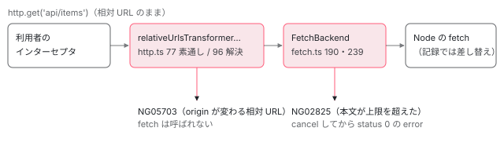

[目次](../README.md) › [SSR の守りと細部](README.md) › 第 3 回 / 全 10 回

# サーバーの HttpClient：相対 URL の解決と、応答の大きさの上限

> platform-server の http.ts のインターセプタが、相対の URL を location の origin で絶対にする行と、バックスラッシュの URL で外へ出ないようにした修正（140c4d04cb3）。SSR の fetch の応答に上限を付けた修正（2acca1165d7）。HttpClient の大きな流れは http の章へ。

angular/angular · 読了 約 12 分 · 発展 · [サイトで読む（デモが動きます）](https://angular-deep-dive-cyan.vercel.app/chapter/ssrx-server-http)

---

サーバーで描くとき、コンポーネントが `http.get('/api/items')` と書くと、その相対 URL はサーバーの中で絶対 URL に直されてから Node の `fetch` に渡ります。この章では、直す役の `relativeUrlsTransformerInterceptorFn` が**どの URL を直し、どの URL を素通しし、どの URL で止めるか**を行で確かめ、その行を変えた修正（140c4d04cb3・b3bb36ad873、../angular-main の 44355181e25）を読みます。後半は、サーバーの `fetch` の応答に付いた大きさの上限（2acca1165d7・1a006a8f979）が、どこで数え、どう失敗させるかです。

読む対象は `packages/platform-server/src/http.ts`・`provide_server.ts` と `packages/common/http/src/fetch.ts` の上限の行、spec は `integration_spec.ts` の HttpClient の describe と `fetch_spec.ts` の `response buffering limits` です。インターセプタの全体の 4 ステップは [platform-server の章](../platform/03-ssr-platform-server.md)（7 節）に、`FetchBackend` が本文を読む流れと上限の行の通し読みは [FetchBackend の章](../http/06-http-backend-fetch.md)（5・6 節）に、同じルートのインターセプタに入る転送キャッシュは [転送キャッシュの章](../http/11-http-transfer-cache.md)と [キャッシュのキーの章](../httpx/05-httpx-transfer-cache-key.md)にあります。ここではそれらが通り過ぎた細部と、守りの修正だけを書きます。

1. [1. resolveUrl](01-ssrx-resolve-url.md)
2. [2. location と allowedHosts](02-ssrx-location-allowed-hosts.md)
3. **3. サーバーの HttpClient**（この章）
4. [4. ホストとヘッダーの検査](04-ssrx-host-validation.md)
5. [5. プロキシのヘッダー](05-ssrx-proxy-headers.md)
6. [6. リダイレクトと URL の照合](06-ssrx-redirects.md)
7. [7. ロケールの選び方](07-ssrx-i18n-locale.md)
8. [8. Node のリクエストとレスポンス](08-ssrx-node-streams.md)
9. [9. アセットと重要 CSS](09-ssrx-assets-css.md)
10. [10. spec と issue](10-ssrx-tests-issues.md)



*サーバーの http.get の URL が通る道。止まる場所は 2 つ（インターセプタの NG05703 と、本文の上限の NG02825）。*

## 1. 素通しする URL：スキームのある URL

📄 `angular/packages/platform-server/src/http.ts` L65–78 （▶ の行: 70, 76–78）

```ts
65 │ }
66 │ 
67 │ /**
68 │  * Regex to match a URL schema.
69 │  */
70 ▶ const URL_SCHEMA_REGEXP = /^(?:[a-zA-Z][a-zA-Z0-9+\-.]*:)/;
71 │ 
72 │ function relativeUrlsTransformerInterceptorFn(
73 │   request: HttpRequest<unknown>,
74 │   next: HttpHandlerFn,
75 │ ): Observable<HttpEvent<unknown>> {
76 ▶   const trimmedUrl = request.url.trim();
77 ▶   if (URL_SCHEMA_REGEXP.test(trimmedUrl) && !HTTP_OR_HTTPS_NO_AUTHORITY_REGEXP.test(trimmedUrl)) {
78 ▶     // URLs with a schema (and an authority for http(s)) should be left unchanged.
```

1. **70 行目：`URL_SCHEMA_REGEXP` は「英字で始まり、英数字と `+ - .` が続いて `:`」**

   URL の決まりでのスキーム（`https:`・`data:`・`blob:` など）の形です。140c4d04cb3 で足されました。
2. **76 行目：判定のためだけに `trim()` した文字列を作る**

   77 行目の判定に使うのは `trimmedUrl` ですが、このあと解決に渡すのは **元の `request.url`**（96 行目）です。判定と解決で違う文字列を見ていることが、3 節の 44355181e25 の話につながります。
3. **77〜78 行目：スキームがあり、`http:foo` の形でなければ、そのまま次へ**

   条件が真なら、次の行で `next(request)` を返し、URL には触りません。`https://api.example.com/items` や `data:text/plain,hi` は、ここで素通しです（記録）。b3bb36ad873 で、`HTTP_OR_HTTPS_NO_AUTHORITY_REGEXP`（[第 1 回](01-ssrx-resolve-url.md)で読んだ url.ts の正規表現）に当たる `http:/localhost:9999/steal-a` のような URL は素通しをやめ、下の解決へ回るようになりました。

このインターセプタは `HTTP_ROOT_INTERCEPTOR_FNS` に入るので、**利用者のインターセプタより後**に走ります（`HttpInterceptorHandler.handle` が `HTTP_INTERCEPTOR_FNS` のあとにルートの関数を並べる。[HttpClient の章](../http/05-http.md)）。利用者のインターセプタが見る `req.url` は、まだ相対のままです。

## 2. 直す URL：基準を作って resolveUrl に渡す

📄 `angular/packages/platform-server/src/http.ts` L93–99 （▶ の行: 93–94, 96–97）

```ts
93 ▶   const baseHref = platformLocation.getBaseHrefFromDOM() || href;
94 ▶   const baseUrl = new URL(baseHref, urlPrefix);
95 │ 
96 ▶   const parsedUrl = resolveUrl(request.url, baseUrl, {
97 ▶     allowProtocolRelative: true,
98 │   });
99 │ 
```

1. **93 行目：基準は `<base href>`、無ければページの URL**

   `getBaseHrefFromDOM()` は、サーバーの文書の `<base href="/app/">` の値です（[第 2 回](02-ssrx-location-allowed-hosts.md)の 4 節）。94 行目で、`ServerPlatformLocation` の `protocol`・`hostname`・`port` から作った `http://localhost:4000` を基準に、`http://localhost:4000/app/` のような `URL` にします。
2. **96〜98 行目：`allowProtocolRelative: true` で解決する**

   [第 1 回](01-ssrx-resolve-url.md)の 4 つの呼び方のうち「プロトコル相対を許す」です。`//cdn.example.com/lib.js` は CDN へのリクエストとして `http://cdn.example.com/lib.js` になります。基準を `URL` オブジェクトで渡すので、url.ts の「文字列の基準は `new URL('/', origin)` で根に直す」行が働かず、`api/items` は `/app/api/items` になります（記録）。`/\evil.example/api` と `\\evil.example/api` は 5703 で止まり、**`fetch` は呼ばれません**。

## 3. この行を変えた修正を git show で読む

### 140c4d04cb3（05-27）：バックスラッシュの URL で外へ出ない

この修正の前、インターセプタの解決は `new URL(request.url, baseUrl).toString()` の 1 行でした。`/\attacker.com` は WHATWG の URL ではホストの指定なので、`http://attacker.com/` にリクエストが飛びました。差分は 2 つの守りを足しています。スキームのある URL は先に素通しにする（今の 77 行目の前半）、解決した origin が変わったら、`//` の次が `/` でも `\` でもない正しいプロトコル相対のときだけ許し、それ以外は先頭の `/` と `\` をまとめて 1 つの `/` にした**パスとして**解決し直す、です。spec には 6 つの壊れた入力（`' /\\attacker.com'`・`'\r\n/\\attacker.com'` など）がすべて `http://localhost:4000/attacker.com` になる it が足されました。

コミットの本文は「バックスラッシュを**エンコード**して、スラッシュに正規化されないようにする」の 1 文ですが、差分にエンコード（`%5C` にする処理）はありません。やっているのは上のとおり、まとめて `/` にすることです。2 日後の e14d34e9eec がこの手書きの検査を `resolveUrl(…, {allowProtocolRelative: true})` に置き換え、同じ日の 0b19c92d44f で「パスにして通す」は「5703 で投げる」に変わりました。spec も `expectOne('http://localhost:4000/attacker.com')` から `mock.verify()`（リクエストが 1 つも無いこと）に書き換わっています（[第 1 回](01-ssrx-resolve-url.md)の 4 節）。

📄 `git show 140c4d04cb3 -- packages/platform-server/src/http.ts`

```ts
commit 140c4d04cb3
Date:   2026-05-27

    fix(platform-server): prevent SSRF bypasses via backslash URLs in HttpClient

diff --git a/packages/platform-server/src/http.ts b/packages/platform-server/src/http.ts
index d0c2f88060b..e6381b1a9f9 100644
--- a/packages/platform-server/src/http.ts
+++ b/packages/platform-server/src/http.ts
@@ -8,10 +8,10 @@
 
 import {PlatformLocation, XhrFactory} from '@angular/common';
 import {
+  ɵHTTP_ROOT_INTERCEPTOR_FNS as HTTP_ROOT_INTERCEPTOR_FNS,
   HttpEvent,
   HttpHandlerFn,
   HttpRequest,
-  ɵHTTP_ROOT_INTERCEPTOR_FNS as HTTP_ROOT_INTERCEPTOR_FNS,
 } from '@angular/common/http';
 import {inject, Injectable, Provider} from '@angular/core';
 import {Observable} from 'rxjs';
@@ -41,10 +41,21 @@ export class ServerXhr implements XhrFactory {
   }
 }
 
+/**
+ * Regex to match a URL schema.
+ */
+const URL_SCHEMA_REGEXP = /^(?:[a-zA-Z][a-zA-Z0-9+\-.]*:)/;
+
 function relativeUrlsTransformerInterceptorFn(
   request: HttpRequest<unknown>,
   next: HttpHandlerFn,
 ): Observable<HttpEvent<unknown>> {
+  const trimmedUrl = request.url.trim();
+  if (URL_SCHEMA_REGEXP.test(trimmedUrl)) {
+    // URLs with a schema should be left unchanged.
+    return next(request);
+  }
+
   const platformLocation = inject(PlatformLocation);
   const {href, protocol, hostname, port} = platformLocation;
   if (!protocol.startsWith('http')) {
@@ -58,9 +69,21 @@ function relativeUrlsTransformerInterceptorFn(
 
   const baseHref = platformLocation.getBaseHrefFromDOM() || href;
   const baseUrl = new URL(baseHref, urlPrefix);
-  const newUrl = new URL(request.url, baseUrl).toString();
 
-  return next(request.clone({url: newUrl}));
+  let parsedUrl = new URL(request.url, baseUrl);
+
+  if (parsedUrl.origin !== baseUrl.origin) {
+    // If the request changed the origin, we check if it was authorized to do so.
+    // Legitimate absolute URLs start with a scheme (e.g. http://) or are protocol-relative (//).
+    // SSRF bypasses via backslashes (e.g. `/\attacker.com`, `\\attacker.com`) evade naive checks.
+    const isProtocolRelative = /^\/\/[^/\\]/.test(trimmedUrl);
+    if (!isProtocolRelative) {
+      // Unrecognized structure that changed origin. Force it to be a local path.
+      parsedUrl = new URL(trimmedUrl.replace(/^[/\\]+/, '/'), baseUrl);
+    }
+  }
+
+  return next(request.clone({url: parsedUrl.toString()}));
 }
 
 export const SERVER_HTTP_PROVIDERS: Provider[] = [
```

### b3bb36ad873（08-28）：http:/host を素通ししない（#70447）

本文の 2 段落目は「これまで `relativeUrlsTransformerInterceptorFn` はスキームのある URL をすべて絶対 URL として扱い、基準での解決を飛ばしていた。そのため Node の `fetch` がパスの部分をほかの origin のホストとして解析した」です。Node の `fetch` は渡された文字列を基準なしで解析するので、`http:/localhost:9999/steal-a` は `http://localhost:9999/steal-a` になります（[第 1 回](01-ssrx-resolve-url.md)の記録の「基準なし」の列）。http.ts の差分は 77 行目の条件に 1 つ足しただけで、解決そのものは url.ts の側（70 行目で近道しない）が受け持ちます。

📄 `git show b3bb36ad873 -- packages/platform-server/src/http.ts`

```ts
commit b3bb36ad873
Date:   2026-08-28

    fix(platform-server): resolve HTTP(S) URLs without authority as relative during SSR

diff --git a/packages/platform-server/src/http.ts b/packages/platform-server/src/http.ts
index 6a0e8c06a60..176a7eeb303 100644
--- a/packages/platform-server/src/http.ts
+++ b/packages/platform-server/src/http.ts
@@ -17,7 +17,7 @@ import {inject, Injectable, Provider, ɵRuntimeError as RuntimeError} from '@ang
 import {Observable} from 'rxjs';
 
 import {RuntimeErrorCode} from './errors';
-import {resolveUrl} from './url';
+import {HTTP_OR_HTTPS_NO_AUTHORITY_REGEXP, resolveUrl} from './url';
 
 @Injectable()
 /**
@@ -74,8 +74,8 @@ function relativeUrlsTransformerInterceptorFn(
   next: HttpHandlerFn,
 ): Observable<HttpEvent<unknown>> {
   const trimmedUrl = request.url.trim();
-  if (URL_SCHEMA_REGEXP.test(trimmedUrl)) {
-    // URLs with a schema should be left unchanged.
+  if (URL_SCHEMA_REGEXP.test(trimmedUrl) && !HTTP_OR_HTTPS_NO_AUTHORITY_REGEXP.test(trimmedUrl)) {
+    // URLs with a schema (and an authority for http(s)) should be left unchanged.
     return next(request);
   }
```

### 44355181e25（09-02、../angular-main だけ）：判定にも trim() を使わない（#70540）

[第 1 回](01-ssrx-resolve-url.md)の 3e924cc8dbb は url.ts から `trim()` を除きましたが、http.ts の 76 行目には `trim()` が残っていました。本文は「`trim()` は WHATWG の URL の解析ではパスの文字として残る Unicode の空白を削る。そのずれで、xhr2 がアプリの認めたのとは別の origin に資格情報を送ることがある」と書き、判定を加工していない `request.url` で行うようにしました。../angular（8576f161ae4）と 22.1.6 には入っておらず、`git tag --contains` では 22.2 系の v22.2.0 と、22.1 系への取り込み（330083f250f）の v22.1.8 に入っています。

📄 `git show 44355181e25 -- packages/platform-server/src/http.ts（../angular-main）`

```
commit 44355181e25
Date:   2026-09-02

    fix(platform-server): preserve Unicode whitespace in ServerXhr URLs

diff --git a/packages/platform-server/src/http.ts b/packages/platform-server/src/http.ts
index 176a7eeb303..16e0eb4994e 100644
--- a/packages/platform-server/src/http.ts
+++ b/packages/platform-server/src/http.ts
@@ -73,8 +73,7 @@ function relativeUrlsTransformerInterceptorFn(
   request: HttpRequest<unknown>,
   next: HttpHandlerFn,
 ): Observable<HttpEvent<unknown>> {
-  const trimmedUrl = request.url.trim();
-  if (URL_SCHEMA_REGEXP.test(trimmedUrl) && !HTTP_OR_HTTPS_NO_AUTHORITY_REGEXP.test(trimmedUrl)) {
+  if (URL_SCHEMA_REGEXP.test(request.url) && !HTTP_OR_HTTPS_NO_AUTHORITY_REGEXP.test(request.url)) {
     // URLs with a schema (and an authority for http(s)) should be left unchanged.
     return next(request);
   }
```

22.1.6 で `" http://attacker.example/collect"` を渡した記録では、76 行目の `trim()` のあとの文字列がスキームで始まるので素通しになり、`fetch` には先頭に U+00A0 の付いた文字列がそのまま届きました。この文字列は基準なしでは URL として解析できない（記録の「解析できるか」が `false`）ので、Node の `fetch` を使う `FetchBackend` ではリクエストになりません。本文が名指ししているのは xhr2（`ServerXhr`。http.ts の `@deprecated` のコメントに、Angular 23 で消す予定とある）の側です。

## 4. 応答の大きさの上限：どこで数え、どう失敗させるか

📄 `angular/packages/common/http/src/fetch.ts` L52–58 （▶ の行: 52, 55–58）

```ts
52 ▶ export const HTTP_FETCH_MAX_RESPONSE_SIZE = new InjectionToken<number | null>(
53 │   typeof ngDevMode !== 'undefined' && ngDevMode ? 'HTTP_FETCH_MAX_RESPONSE_SIZE' : '',
54 │   {
55 ▶     factory: () =>
56 ▶       typeof ngServerMode !== 'undefined' && ngServerMode
57 ▶         ? DEFAULT_SSR_MAX_RESPONSE_BODY_SIZE
58 ▶         : null,
```

52 行目の `HTTP_FETCH_MAX_RESPONSE_SIZE` の既定値は、55〜58 行目のとおり `ngServerMode`（サーバー用のビルドで `true` になる大域の印）なら `DEFAULT_SSR_MAX_RESPONSE_BODY_SIZE`（`1024 * 1024`、1 MB）、ブラウザでは `null`（上限なし）です。トークンの説明のコメントは「終わらない応答の本文を際限なくためないよう、既定では SSR のときだけ上限を有効にする。`null` で外せる」と書いています。

📄 `angular/packages/platform-server/src/provide_server.ts` L39–42 （▶ の行: 40–41）

```ts
39 │   const providers = [...PLATFORM_SERVER_PROVIDERS];
40 ▶   if (options?.maxResponseBodySize) {
41 ▶     providers.push({provide: HTTP_FETCH_MAX_RESPONSE_SIZE, useValue: options.maxResponseBodySize});
42 │   }
```
*platform-server の provideServerRendering*

利用者が値を変える公開の入口は `provideServerRendering({ maxResponseBodySize })` です。40 行目は `options?.maxResponseBodySize` が**真のときだけ**トークンを provide するので、`0` を渡しても既定の 1 MB のままです（記録の 3 つ目の注入器で、トークンの値は 1048576 でした）。上限を外す `null` は、型（`maxResponseBodySize: number`）の上で渡せません。外すには `ɵHTTP_FETCH_MAX_RESPONSE_SIZE` を直接 `useValue: null` で provide します（fetch\_spec.ts の `allows disabling the size limit via dependency injection` の it の形）。

### 数える場所は 2 つ

📄 `angular/packages/common/http/src/fetch.ts` L189–195 （▶ の行: 190–192, 194–195）

```ts
189 │       if (
190 ▶         this.maxResponseSize !== null &&
191 ▶         Number.isFinite(contentLengthValue) &&
192 ▶         contentLengthValue > this.maxResponseSize
193 │       ) {
194 ▶         await response.body.cancel();
195 ▶         throwBodyTooLargeError(this.maxResponseSize);
```
*1 つ目：読む前に、宣言された長さを見る*

📄 `angular/packages/common/http/src/fetch.ts` L236–242 （▶ の行: 236–237, 239–241）

```ts
236 ▶           chunks.push(value);
237 ▶           receivedLength += value.length;
238 │ 
239 ▶           if (this.maxResponseSize !== null && receivedLength > this.maxResponseSize) {
240 ▶             await reader.cancel();
241 ▶             throwBodyTooLargeError(this.maxResponseSize);
242 │           }
```
*2 つ目：読みながら、実際に受け取った量を数える*

1. **190〜192 行目：`Content-Length` が数で、上限を超えていれば読まない**

   194 行目で本文を `cancel()` してから 195 行目で投げます。この `cancel()` が 1a006a8f979 で足された行です（下の差分）。本文は「宣言された `Content-Length` が上限を超えたとき、NG02825 を報告する前に読んでいない本文を cancel する。cancel しないと、SSR が終わっても下の接続が開いたままになる」です。
2. **237・239 行目：`Content-Length` が無くても、嘘でも、実際の量で止まる**

   `receivedLength` は `reader.read()` で受け取ったバイト数の合計です。超えたら 240 行目で `reader.cancel()`、241 行目で投げます。記録では、`Content-Length: 4096` と宣言しながら終わらない本文を返す応答を、上限 1 MB で取ると、宣言は上限より小さいので 190〜192 行目は通り、pull が 1026 回になったところで 239 行目に止められました（1 MB を超えるまで読んだ）。

📄 `git show 1a006a8f979 -- packages/common/http/src/fetch.ts`

```ts
commit 1a006a8f979
Date:   2026-08-14

    fix(http): cancel oversized fetch response bodies

diff --git a/packages/common/http/src/fetch.ts b/packages/common/http/src/fetch.ts
index 81632ccc79c..e4c263529c7 100644
--- a/packages/common/http/src/fetch.ts
+++ b/packages/common/http/src/fetch.ts
@@ -191,6 +191,7 @@ export class FetchBackend implements HttpBackend {
         Number.isFinite(contentLengthValue) &&
         contentLengthValue > this.maxResponseSize
       ) {
+        await response.body.cancel();
         throwBodyTooLargeError(this.maxResponseSize);
       }
```

### 投げたあと：status 0 の HttpErrorResponse

📄 `angular/packages/common/http/src/fetch.ts` L470–476 （▶ の行: 472–474）

```ts
470 │ function throwBodyTooLargeError(maxResponseSize: number): never {
471 │   throw new RuntimeError(
472 ▶     RuntimeErrorCode.FETCH_RESPONSE_BODY_TOO_LARGE,
473 ▶     ngDevMode &&
474 ▶       `Fetch response body exceeded the configured buffer limit (${maxResponseSize} bytes).`,
475 │   );
476 │ }
```

📄 `angular/packages/common/http/src/fetch.ts` L105–107 （▶ の行: 105–106）

```ts
105 ▶       this.doRequest(request, aborter.signal, wrappedObserver).then(noop, (error) =>
106 ▶         wrappedObserver.error(new HttpErrorResponse({error})),
107 │       );
```

472 行目のコードは `FETCH_RESPONSE_BODY_TOO_LARGE`（-2825、画面には NG02825）。473 行目、開発モードでなければ文章は付きません。`doRequest` は `async` 関数なので、195 行目や 241 行目の `throw` は Promise の reject になり、106 行目で `new HttpErrorResponse({error})` に包まれて流れます。`status` を渡していないので 0 です（記録の `status` の列）。呼び出し側から見ると、ネットワークのエラーと同じ形で、`error.error.code`（または `error.error.message` の `NG02825`）で見分けます。

### 2acca1165d7（05-26）：上限が入ったときの本文

本文は「SSR の `FetchBackend` は既定で応答の本文を **10 MB** に制限する。`provideServerRendering` の `maxResponseBodySize` で変えられる。大きなファイルを読むときのサーバーへの DoS を防ぐため」です。ところが同じコミットの fetch.ts の差分は `// 1 MB by default` と `1024 * 1024` で、**本文の 10 MB と差分の 1 MB が食い違っています**。動くのは差分のほうで、記録のトークンの値も 1048576（1 MB）でした。開いている #69388 は、上限に近づいたことを知らせる仕組みの提案で、そこでも既定は 1 MB と書かれています。

📄 `git show 2acca1165d7 -- packages/platform-server/src/provide_server.ts`

```ts
commit 2acca1165d7
Date:   2026-05-26

    fix(http): Introduce a max buffer size for fetch requests on SSR

diff --git a/packages/platform-server/src/provide_server.ts b/packages/platform-server/src/provide_server.ts
index 83e1adfb1af..961bcc6d151 100644
--- a/packages/platform-server/src/provide_server.ts
+++ b/packages/platform-server/src/provide_server.ts
@@ -8,11 +8,15 @@
 
 import {EnvironmentProviders, makeEnvironmentProviders} from '@angular/core';
 
+import {ɵHTTP_FETCH_MAX_RESPONSE_SIZE as HTTP_FETCH_MAX_RESPONSE_SIZE} from '@angular/common/http';
 import {PLATFORM_SERVER_PROVIDERS} from './server';
 
 /**
  * Sets up providers necessary to enable server rendering functionality for the application.
  *
+ * @param options An object to configure the server providers. Currently supports the following options:
+ * - `maxResponseBodySize`: The maximum allowed response body size when using the Fetch API.
+ *
  * @usageNotes
  *
  * Basic example of how you can add server support to your application:
@@ -25,10 +29,17 @@ import {PLATFORM_SERVER_PROVIDERS} from './server';
  * @publicApi
  * @returns A set of providers to setup the server.
  */
-export function provideServerRendering(): EnvironmentProviders {
+export function provideServerRendering(options?: {
+  maxResponseBodySize: number;
+}): EnvironmentProviders {
   if (typeof ngServerMode === 'undefined') {
     globalThis['ngServerMode'] = true;
   }
 
-  return makeEnvironmentProviders([...PLATFORM_SERVER_PROVIDERS]);
+  const providers = [...PLATFORM_SERVER_PROVIDERS];
+  if (options?.maxResponseBodySize) {
+    providers.push({provide: HTTP_FETCH_MAX_RESPONSE_SIZE, useValue: options.maxResponseBodySize});
+  }
+
+  return makeEnvironmentProviders(providers);
 }
```

## 5. DEMO：サーバーの HttpClient に URL と応答を渡した記録

> **🧪 DEMO — 入力を選ぶと、fetch に届いた URL かエラーが出ます（記録の再生）**
>
> これは Node で動かした記録です（v24.22.1、@angular/platform-server と @angular/common 22.1.6）。`platformServer` に `url: 'http://localhost:4000/app/page'` と `<base href="/app/">` の文書を渡し、`provideServerRendering()` と `provideHttpClient()` でアプリを起動しました。`globalThis.fetch` を「届いた URL を書き留めて作り物の応答を返す関数」に差し替えたので、本物の `FetchBackend` がそれを呼び、ネットワークには出ていません。
>
> ▶ [このデモはサイトで動かせます](https://angular-deep-dive-cyan.vercel.app/chapter/ssrx-server-http)

同じスクリプトで、上限を変えた 3 つの注入器に、作り物の 3 種類の応答（Node の `ReadableStream` で作った本文）を返した記録です。

| 注入器 | トークンの値 | 応答 | 結果 | status | pull の回数 | cancel の回数 |
| --- | --- | --- | --- | --- | --- | --- |
| `provideServerRendering()` | 1048576 | `/stream/small` | 成功（2 文字） | — | 0 | 0 |
| `provideServerRendering()` | 1048576 | `/stream/declared` | NG02825 | 0 | 1026 | 1 |
| `provideServerRendering({"maxResponseBodySize":2048})` | 2048 | `/stream/small` | 成功（2 文字） | — | 0 | 0 |
| `provideServerRendering({"maxResponseBodySize":2048})` | 2048 | `/stream/declared` | NG02825 | 0 | 1 | 1 |
| `provideServerRendering({"maxResponseBodySize":2048})` | 2048 | `/stream/infinite` | NG02825 | 0 | 4 | 1 |
| `provideServerRendering({"maxResponseBodySize":0})` | 1048576 | `/stream/small` | 成功（2 文字） | — | 0 | 0 |
| `provideServerRendering({"maxResponseBodySize":0})` | 1048576 | `/stream/declared` | NG02825 | 0 | 1026 | 1 |
| `provideServerRendering({"maxResponseBodySize":0})` | 1048576 | `/stream/infinite` | NG02825 | 0 | 1026 | 1 |

- `/stream/small` は本文 `ok` だけ。`/stream/declared` は `Content-Length: 4096` を宣言して 1024 バイトを出し続ける本文、`/stream/infinite` は宣言なしで出し続ける本文です。「pull の回数」は `ReadableStream` が本文を求めた回数です（最初の 1 回は、読む前に `ReadableStream` が先に 1 つためるためのもの）。
- 上限 2048 の `declared` は、pull が 1 回（読む前のためだけ）で cancel されました。190〜194 行目です。`infinite` は 3 回読んで 3072 バイトになったところで 239〜240 行目に止められました。
- 上限 1 MB では `declared` も pull が 1026 回になるまで読んでから止まります。宣言が上限より小さくても、239 行目が実際の量で止めます。
- `maxResponseBodySize: 0` は、トークンが 1048576 のままです（provide\_server.ts 40 行目）。

📄 `scratchpad/ssrx-demo/ssrx-server-http/record.ts`

```ts
// このサイトの依存の @angular/platform-server・@angular/common 22.1.6 を Node で動かし、
// サーバーの HttpClient に URL を渡したとき「fetch に届いた URL」か「投げられたエラー」を書き留める。
// globalThis.fetch を差し替えるので、ネットワークには出ない。本物の FetchBackend がその fetch を呼ぶ。
import { writeFileSync } from 'node:fs';
import '@angular/compiler';
import { HttpClient, provideHttpClient, ɵHTTP_FETCH_MAX_RESPONSE_SIZE as MAX } from '@angular/common/http';
import { Component, VERSION, type ApplicationRef } from '@angular/core';
import { bootstrapApplication } from '@angular/platform-browser';
import { INITIAL_CONFIG, platformServer, provideServerRendering } from '@angular/platform-server';
import { firstValueFrom } from 'rxjs';

@Component({ selector: 'app-root', template: '' })
class Empty {}

// 差し替えの fetch。届いた URL を書き留め、パスに応じて Node の ReadableStream で作った応答を返す。
let received: string[] = [];
const stream = { pulls: 0, cancels: 0 };
globalThis.fetch = (async (input: RequestInfo | URL) => {
  const url = String(input);
  received.push(url);
  const path = URL.canParse(url) ? new URL(url).pathname : '';
  const body = (declared?: number) => {
    const headers: Record<string, string> = { 'Content-Type': 'text/plain' };
    if (declared !== undefined) headers['Content-Length'] = String(declared);
    const s = new ReadableStream<Uint8Array>({
      pull: (c) => { stream.pulls++; c.enqueue(new Uint8Array(1024)); }, // 終わらない本文（1024 バイトずつ）
      cancel: () => { stream.cancels++; },
    });
    return new Response(s, { status: 200, headers });
  };
  if (path === '/stream/infinite') return body();
  if (path === '/stream/declared') return body(4096);
  return new Response('ok', { status: 200, headers: { 'Content-Type': 'text/plain' } });
}) as typeof fetch;

const DOC = '<html><head><base href="/app/"></head><body><app-root></app-root></body></html>';
const PAGE = 'http://localhost:4000/app/page';

async function withApp<T>(serverOptions: { maxResponseBodySize: number } | undefined, fn: (app: ApplicationRef) => Promise<T>) {
  const platformRef = platformServer([{ provide: INITIAL_CONFIG, useValue: { document: DOC, url: PAGE } }]);
  try {
    const app = await bootstrapApplication(Empty, { providers: [provideServerRendering(serverOptions), provideHttpClient()] }, { platformRef });
    return await fn(app);
  } finally {
    platformRef.destroy();
  }
}

function code(e: any): string {
  const inner = e?.error ?? e; // HttpErrorResponse なら .error に元の例外
  const m = /^(NG0\d+)/.exec(inner?.message ?? '');
  return m ? m[1] : `${inner?.name}: ${inner?.message}`;
}

// 1) URL の解決（http.ts の relativeUrlsTransformerInterceptorFn）
const URLS = [
  '/api/items', 'api/items', '../api/items', 'https://api.example.com/items', '//cdn.example.com/lib.js',
  '/\\evil.example/api', '\\\\evil.example/api', '\\testing', '/foo\\bar',
  'http:/localhost:9999/steal-a', 'http:localhost:9999/steal-b',
  '  /api/items', ' //attacker.example/collect', ' http://attacker.example/collect',
  'ht\rtps://evil.example/path', 'data:text/plain,hi',
];
const urls = await withApp(undefined, async (app) => {
  const http = app.injector.get(HttpClient);
  const out = [];
  for (const u of URLS) {
    received = [];
    let result: string;
    try {
      await firstValueFrom(http.get(u, { responseType: 'text' }));
      result = received[0];
    } catch (e) {
      result = code(e);
    }
    // 本物の Node の fetch は、届いた文字列を基準なしの URL として解析する。解析できるかも書く。
    const parsable = received[0] === undefined ? null : URL.canParse(received[0]);
    out.push({ input: JSON.stringify(u), fetched: received[0] ?? '（fetch は呼ばれない）', parsable, result });
  }
  return out;
});

// 2) 応答の大きさの上限（fetch.ts の HTTP_FETCH_MAX_RESPONSE_SIZE）
const limits = [];
for (const opt of [undefined, { maxResponseBodySize: 2048 }, { maxResponseBodySize: 0 }]) {
  limits.push(await withApp(opt, async (app) => {
    const http = app.injector.get(HttpClient);
    const runs = [];
    for (const path of ['/stream/small', '/stream/declared', '/stream/infinite']) {
      if (opt === undefined && path === '/stream/infinite') continue; // 1 MB まで 1024 回読むだけなので省く
      stream.pulls = 0; stream.cancels = 0;
      let result: string, status: number | undefined;
      try {
        const body = await firstValueFrom(http.get(path, { responseType: 'text' }));
        result = `成功（${body.length} 文字）`;
      } catch (e: any) {
        result = code(e); status = e?.status;
      }
      runs.push({ path, result, status, pulls: stream.pulls, cancels: stream.cancels });
    }
    return { option: opt === undefined ? 'provideServerRendering()' : `provideServerRendering(${JSON.stringify(opt)})`, token: app.injector.get(MAX), runs };
  }));
}

writeFileSync('record.json', JSON.stringify({ node: process.version, angular: VERSION.full, page: PAGE, urls, limits }, null, 1));

```
*記録を取ったスクリプトの全文*

📄 `scratchpad/ssrx-demo/_shared-a/build.mjs`

```js
// 使い方: RESEARCH_ROOT=<angular-research の場所> node build.mjs <記録のスクリプト.ts> <出力.mjs>
// 記録のスクリプトと、そこから import した ../angular（8576f161ae4）・../angular-main（74961c66242）の
// ソースを 1 つの ESM に束ねる。ソースのファイルは読むだけ（書き換えない）。
// '@angular/*' と 'rxjs' は、どのファイルから import されても angular-deep-dive/node_modules（22.1.6）から読む。
import { createRequire } from 'node:module';
const ROOT = process.env.RESEARCH_ROOT;
const SITE = `${ROOT}/angular-deep-dive`;
const { build } = createRequire(`${SITE}/package.json`)('esbuild');
const [entry, out] = process.argv.slice(2);
const sitePackages = {
  name: 'site-packages',
  setup(b) {
    // 'ng-src/…' → ../angular/…、'ng-main/…' → ../angular-main/…
    b.onResolve({ filter: /^ng-(src|main)\// }, (args) => {
      const [head, ...rest] = args.path.split('/');
      const repo = head === 'ng-src' ? 'angular' : 'angular-main';
      return { path: `${ROOT}/${repo}/${rest.join('/')}.ts` };
    });
    b.onResolve({ filter: /^(@angular\/|rxjs)/ }, async (args) => {
      if (args.pluginData === 'site') return undefined;
      const r = await b.resolve(args.path, { kind: args.kind, resolveDir: SITE, pluginData: 'site' });
      return r.errors.length ? undefined : r;
    });
  },
};
await build({
  entryPoints: [entry], outfile: out, bundle: true, platform: 'node', format: 'esm', target: 'es2022',
  plugins: [sitePackages], logLevel: 'warning',
  tsconfigRaw: { compilerOptions: { experimentalDecorators: true, useDefineForClassFields: false } },
  banner: { js: "import { createRequire as __cr } from 'module'; const require = __cr(import.meta.url);" },
});

```
*束ねるスクリプトの全文（このケースでは node\_modules の 22.1.6 だけを束ねる）*

## ここまでの呼び出し

- 👤 `http.get('api/items')` — あなたのコンポーネント（サーバーで描画中）
  - `HttpInterceptorHandler.handle(req)` — common/http/src/backend.ts — *利用者のインターセプタ → ルートのインターセプタの順*
    - `relativeUrlsTransformerInterceptorFn(req, next)` — platform-server/src/http.ts 72 — *スキームがあれば素通し（77）*
      - `resolveUrl(request.url, baseUrl, { allowProtocolRelative: true })` — url.ts 56 — *だめなら NG05703 で止まる*
    - `FetchBackend.handle(req)` → `doRequest` — common/http/src/fetch.ts 84
      - `fetch(url, init)` — Node の fetch
      - `Content-Length > maxResponseSize` → `cancel()` → throw — fetch.ts 189〜195
      - `receivedLength > maxResponseSize` → `reader.cancel()` → throw — fetch.ts 239〜241
    - `new HttpErrorResponse({ error })` — fetch.ts 106 — *status 0、error.error が NG02825*

## テストと直し方

### spec と it

| it | ファイルと行 | この章のどこ |
| --- | --- | --- |
| `prevents SSRF bypasses via backslash URLs in HttpClient by throwing a suspicious origin error` | integration\_spec.ts 1459 | 2 節・3 節（140c4d04cb3 → 0b19c92d44f） |
| `should resolve relative request URLs to absolute`・`should not replace the baseUrl of a request when it's absolute` | integration\_spec.ts 1558・1567 | 1・2 節 |
| `should allow legitimate protocol-relative URLs`・`should resolve non-breaking space prefixed URLs …` | integration\_spec.ts 1576・1585 | 2 節・3e924cc8dbb |
| `should resolve scheme URLs without authority as relative paths on the same origin` | integration\_spec.ts 1596 | b3bb36ad873 |
| `should reject backslash bypass SSRF attempts …`・`should reject obfuscated protocal SSRF attempts …` | integration\_spec.ts 1610・1632 | 2 節 |
| `should configure max response body size when specified` | integration\_spec.ts 1713 | 4 節の provide\_server.ts |
| describe `response buffering limits` の 3 つ | fetch\_spec.ts 683 | 4 節の fetch.ts |

📄 `angular/packages/platform-server/test/integration_spec.ts` L1537–1556 （▶ の行: 1537, 1547–1548, 1553–1554）

```ts
1537 ▶       describe(`given 'url' is provided in 'INITIAL_CONFIG'`, () => {
1538 │         let mock: HttpTestingController;
1539 │         let ref: NgModuleRef<HttpInterceptorExampleModule>;
1540 │         let http: HttpClient;
1541 │ 
1542 │         beforeEach(async () => {
1543 │           const platform = platformServer([
1544 │             {
1545 │               provide: INITIAL_CONFIG,
1546 │               useValue: {
1547 ▶                 document: '<app></app>',
1548 ▶                 url: 'http://localhost:4000/foo',
1549 │               },
1550 │             },
1551 │           ]);
1552 │ 
1553 ▶           ref = await platform.bootstrapModule(HttpInterceptorExampleModule);
1554 ▶           mock = ref.injector.get(HttpTestingController);
1555 │           http = ref.injector.get(HttpClient);
1556 │         });
```

この describe のテストは、1548 行目のページの URL で `platformServer` を作り、1554 行目の `HttpTestingController`（届いたリクエストを捕まえる作り物のバックエンド）で、インターセプタが直したあとの URL を確かめます。1547 行目の文書には `<base>` が無いので、基準はページの URL です。

📄 `angular/packages/platform-server/test/integration_spec.ts` L1576–1594 （▶ の行: 1578, 1581, 1587, 1591）

```ts
1576 │         it('should allow legitimate protocol-relative URLs', async () => {
1577 │           ref.injector.get(NgZone).run(() => {
1578 ▶             http.get('//example.com/testing').subscribe((body) => {
1579 │               expect(body).toEqual('success!');
1580 │             });
1581 ▶             mock.expectOne('http://example.com/testing').flush('success!');
1582 │           });
1583 │         });
1584 │ 
1585 │         it('should resolve non-breaking space prefixed URLs as relative paths on the same origin', async () => {
1586 │           ref.injector.get(NgZone).run(() => {
1587 ▶             http.get('\u00A0//attacker.example/collect').subscribe((body) => {
1588 │               expect(body).toEqual('success!');
1589 │             });
1590 │             mock
1591 ▶               .expectOne('http://localhost:4000/%C2%A0//attacker.example/collect')
1592 │               .flush('success!');
1593 │           });
1594 │         });
```

📄 `angular/packages/platform-server/test/integration_spec.ts` L1596–1630 （▶ の行: 1598, 1601, 1603, 1606, 1612, 1614–1615, 1623, 1628）

```ts
1596 │         it('should resolve scheme URLs without authority as relative paths on the same origin', async () => {
1597 │           ref.injector.get(NgZone).run(() => {
1598 ▶             http.get('http:/localhost:9999/steal-a').subscribe((body) => {
1599 │               expect(body).toEqual('success!');
1600 │             });
1601 ▶             mock.expectOne('http://localhost:4000/localhost:9999/steal-a').flush('success!');
1602 │ 
1603 ▶             http.get('http:localhost:9999/steal-b').subscribe((body) => {
1604 │               expect(body).toEqual('success!');
1605 │             });
1606 ▶             mock.expectOne('http://localhost:4000/localhost:9999/steal-b').flush('success!');
1607 │           });
1608 │         });
1609 │ 
1610 │         it('should reject backslash bypass SSRF attempts in relative requests and throw a suspicious origin error', async () => {
1611 │           const badUrls = [
1612 ▶             '/\\attacker.com',
1613 │             '\\\\attacker.com',
1614 ▶             '  /\\attacker.com',
1615 ▶             '\r\n/\\attacker.com',
1616 │           ];
1617 │ 
1618 │           ref.injector.get(NgZone).run(() => {
1619 │             for (const badUrl of badUrls) {
1620 │               http.get(badUrl).subscribe({
1621 │                 next: () => fail(`Expected request for ${badUrl} to fail, but it succeeded.`),
1622 │                 error: (err) => {
1623 ▶                   expect(err.message).toMatch(/NG05703/);
1624 │                 },
1625 │               });
1626 │             }
1627 │ 
1628 ▶             mock.verify();
1629 │           });
1630 │         });
```

1606 行目は `http:localhost:9999/steal-b` が `/localhost:9999/steal-b` になることを確かめます。記録では文書に `<base href="/app/">` があるので、同じ入力が `/app/localhost:9999/steal-b` になりました（`http:` のあとが `/` で始まらないので、相対パスとして基準のディレクトリに付く）。1610〜1630 行目の it は、1623 行目で 5703 を、1628 行目の `mock.verify()` でリクエストが 1 つも出ていないことを確かめます。

📄 `angular/packages/platform-server/test/integration_spec.ts` L1713–1721 （▶ の行: 1717, 1720）

```ts
1713 │     it('should configure max response body size when specified', () => {
1714 │       const maxResponseBodySize = 2048;
1715 │ 
1716 │       TestBed.configureTestingModule({
1717 ▶         providers: [provideServerRendering({maxResponseBodySize})],
1718 │       });
1719 │ 
1720 ▶       expect(TestBed.inject(HTTP_FETCH_MAX_RESPONSE_SIZE)).toBe(maxResponseBodySize);
1721 │     });
```

📄 `angular/packages/common/http/test/fetch_spec.ts` L683–722 （▶ の行: 690–691, 700, 707–708, 711–712, 720–721）

```ts
683 │   describe('response buffering limits', () => {
684 │     let infiniteStreamFactory: InfiniteStreamFetchFactory = null!;
685 │ 
686 │     beforeEach(() => {
687 │       TestBed.resetTestingModule();
688 │       TestBed.configureTestingModule({
689 │         providers: [
690 ▶           {provide: FetchFactory, useClass: InfiniteStreamFetchFactory},
691 ▶           {provide: HTTP_FETCH_MAX_RESPONSE_SIZE, useValue: 2048},
692 │           FetchBackend,
693 │         ],
694 │       });
695 │ 
696 │       backend = TestBed.inject(FetchBackend);
697 │       infiniteStreamFactory = TestBed.inject(FetchFactory) as InfiniteStreamFetchFactory;
698 │     });
699 │ 
700 ▶     it('aborts a never-ending response stream once the configured size limit is exceeded', async () => {
701 │       const req = new HttpRequest('GET', '/test', {responseType: 'text'});
702 │       const events = await trackEvents(backend.handle(req));
703 │       const error = events[1] as HttpErrorResponse;
704 │ 
705 │       expect(events.length).toBe(2);
706 │       expect(error instanceof HttpErrorResponse).toBeTrue();
707 ▶       expect(error.error.code).toBe(RuntimeErrorCode.FETCH_RESPONSE_BODY_TOO_LARGE);
708 ▶       expect(infiniteStreamFactory.cancelCount).toBe(1);
709 │     });
710 │ 
711 ▶     it('cancels an unread response stream when the declared size exceeds the limit', async () => {
712 ▶       infiniteStreamFactory.declaredContentLength = 2049;
713 │ 
714 │       const req = new HttpRequest('GET', '/test', {responseType: 'text'});
715 │       const events = await trackEvents(backend.handle(req));
716 │       const error = events[1] as HttpErrorResponse;
717 │ 
718 │       expect(events.length).toBe(2);
719 │       expect(error instanceof HttpErrorResponse).toBeTrue();
720 ▶       expect(error.error.code).toBe(RuntimeErrorCode.FETCH_RESPONSE_BODY_TOO_LARGE);
721 ▶       expect(infiniteStreamFactory.cancelCount).toBe(1);
722 │     });
```

fetch\_spec.ts の 3 つの it は `FetchBackend` を直接作り、691 行目で上限を 2048 にします。711 行目の it が 1a006a8f979 で足されたもので、712 行目で `Content-Length` を 2049 と宣言させ、721 行目で cancel が 1 回呼ばれたことを確かめます。1713〜1721 行目の it はトークンの値しか見ないので、**サーバーのアプリの中で上限が効くこと（platform-server と FetchBackend をつないだ形）を確かめる it はありません**。5 節の記録の表がその形です。`maxResponseBodySize: 0` の扱いを確かめる it もありません。

### 手元で走らせた結果

- ../angular で `pnpm bazel test //packages/platform-server/test:test --nocache_test_results --test_output=all "--test_arg=--filter=HttpClient|max response body"`：「Ran 18 of 399 specs / 18 specs, 0 failures」（2026-11-06、scratchpad/ssrx-logs/a-filter-HttpClient\_max\_respo.log）。
- `pnpm bazel test //packages/common/http/test:test --nocache_test_results --test_output=all "--test_arg=--filter=response buffering limits"`：「Ran 3 of 410 specs / 3 specs, 0 failures」（scratchpad/ssrx-logs/a-http-limit.log）。

### 直すとしたら

- URL の素通しの判定は `relativeUrlsTransformerInterceptorFn`（http.ts）の 76〜77 行目。spec は integration\_spec.ts の describe `given 'url' is provided in 'INITIAL_CONFIG'`（1537 行目）に it を足します。../angular-main の 44355181e25 が足した `should resolve unicode whitespace prefixed scheme URLs …` がその形です。
- 上限の既定値と数え方は fetch.ts の `HTTP_FETCH_MAX_RESPONSE_SIZE` と `doRequest`、公開の入口は provide\_server.ts の `provideServerRendering`。spec は fetch\_spec.ts の `response buffering limits`。
- 2acca1165d7 の本文（10 MB）と実物（1 MB）の食い違いは、コミットの本文なので直せません。ドキュメントやコメントに書くときは実物（fetch.ts の 1 MB）に合わせます。
- 開いている #69388（上限に近づいたら知らせる）は機能の提案です。issue の一覧は[第 10 回](10-ssrx-tests-issues.md)。

## 聞かれそうな質問

**Q. サーバーで http.get('/api') が http://localhost:4000/api になるのはなぜですか？**

http.ts の 94 行目で、`ServerPlatformLocation` の `protocol`・`hostname`・`port`（`renderApplication` に渡した `url` から作ったもの、[第 2 回](02-ssrx-location-allowed-hosts.md)）を基準にし、96 行目の `resolveUrl` で解決するからです。`<base href>` があれば 93 行目でそれを使います。

**Q. 利用者のインターセプタで req.url を書き換えたら、どちらが先ですか？**

利用者のインターセプタが先です。このインターセプタはルートの関数（`HTTP_ROOT_INTERCEPTOR_FNS`）なので、`HttpInterceptorHandler` が利用者の関数のあとに並べます。利用者が相対 URL を返せば、それがここで直されます。

**Q. //cdn.example.com/x はサーバーで通りますか？**

通ります。96〜98 行目が `allowProtocolRelative: true` で呼ぶので、`http://cdn.example.com/x`（スキームはページの URL のもの）になります。ページの URL や文書の URL の解決（[第 2 回](02-ssrx-location-allowed-hosts.md)）では同じ入力が 5702 になるのと対照的です。

**Q. SSR で大きな JSON を取ると NG02825 になります。**

サーバーでは本文の上限が既定で 1 MB だからです（fetch.ts 55〜58 行目）。`provideServerRendering({ maxResponseBodySize: 5 * 1024 * 1024 })` のように大きくします（provide\_server.ts 40〜41 行目）。`0` は「既定のまま」になる点に注意します。エラーは status 0 の `HttpErrorResponse` で、`error.error` が NG02825 の `RuntimeError` です（106 行目）。

**Q. Content-Length を付けない応答なら上限をすり抜けますか？**

すり抜けません。190〜192 行目は `Content-Length` が数のときだけの早めの検査で、本当の守りは読みながら数える 237・239 行目です。記録の `/stream/infinite` は宣言なしで、3072 バイトで止まりました。

## 読み終えて

- サーバーの `HttpClient` は、スキームのある URL を素通しし（77 行目）、それ以外を `<base href>` かページの URL を基準に `resolveUrl(…, {allowProtocolRelative: true})` で解決する（93〜98 行目）
- 140c4d04cb3 の「パスに直して通す」は、2 日後に「5703 で止めて fetch を呼ばない」に変わった。`http:/host` の素通しは b3bb36ad873 で、判定の `trim()` は ../angular-main の 44355181e25 で直った
- サーバーの `fetch` の本文は既定で 1 MB まで。宣言（190〜192 行目）と実際の量（239 行目）の 2 か所で数え、cancel してから NG02825 を投げ、status 0 の error になる
- コミットの本文と差分が食い違うことがある（140c4d04cb3 の「エンコード」、2acca1165d7 の「10 MB」）。動くのは差分

---

← 前: [document と location の初期化：allowedHosts と origin の検査](02-ssrx-location-allowed-hosts.md)  
次: [ホストとヘッダーの検査：validateRequest と allowedHosts](04-ssrx-host-validation.md) →
