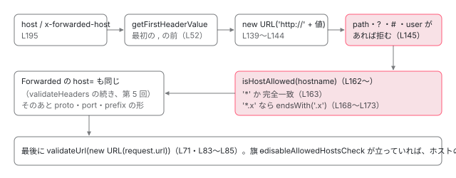

[目次](../README.md) › [SSR の守りと細部](README.md) › 第 4 回 / 全 10 回

# ホストとヘッダーの検査：validateRequest と allowedHosts

> @angular/ssr の validation.ts が、Host と X-Forwarded-Host の最初の値を URL に入れて分け、allowedHosts（完全一致・\*.example.com・\*）と照らす行と、外れたときに AngularAppEngine が返す 400 の中身。下線を許した修正（e7e434ca3d）、\* を許して警告を出す修正（3b99ee140d）、不正なホストで CSR に逃げるのをやめた変更（27cd355619）、開発サーバーで検査を止める旗（13902292e7）、正規表現をやめた 5adc925414。環境変数 NG\_ALLOWED\_HOSTS と options の優先（5875b6024f）。

angular/angular-cli · 読了 約 13 分 · 発展 · [サイトで読む（デモが動きます）](https://angular-deep-dive-cyan.vercel.app/chapter/ssrx-host-validation)

---

`@angular/ssr` は、リクエストの `Host` から作った URL をもとに、サーバーの `HttpClient` が相対 URL を解決したり、リダイレクト先を組み立てたりします。だから最初に「このホストは本当に自分のものか」を調べます。この章では、その検査 `validateRequest` を 1 行ずつ追い、**どのヘッダーを、どの順で、どう分解して、何と比べ、外れたら何を返すか**を確かめます。あわせて `allowedHosts` の 3 つの書き方（完全一致・`*.example.com`・`*`）、開発サーバーで検査を止める旗、環境変数 `NG_ALLOWED_HOSTS` と options の優先、2026 年に入った 6 本の修正を、本物のコードを Node で動かした記録と並べて読みます。

読む対象は `packages/angular/ssr/src/utils/validation.ts`（前半）、`src/app-engine.ts` の検査を呼ぶ行、`node/src/environment-options.ts` です。`AngularAppEngine.handle` の全体（検査のあと入口を選び、`AngularServerApp` に任せる流れ）は [ssr-app-engine の章](../platform/04-ssr-app-engine.md)の 1・2 節にあります。そこで引用した行はここでは短く切って使い、繰り返しません。

1. [1. resolveUrl](01-ssrx-resolve-url.md)
2. [2. location と allowedHosts](02-ssrx-location-allowed-hosts.md)
3. [3. サーバーの HttpClient](03-ssrx-server-http.md)
4. **4. ホストとヘッダーの検査**（この章）
5. [5. プロキシのヘッダー](05-ssrx-proxy-headers.md)
6. [6. リダイレクトと URL の照合](06-ssrx-redirects.md)
7. [7. ロケールの選び方](07-ssrx-i18n-locale.md)
8. [8. Node のリクエストとレスポンス](08-ssrx-node-streams.md)
9. [9. アセットと重要 CSS](09-ssrx-assets-css.md)
10. [10. spec と issue](10-ssrx-tests-issues.md)

> [!TIP]
> **新卒エンジニアへ**
>
> **SSRF**（Server-Side Request Forgery）は、「サーバーに、攻撃者の選んだ宛先へリクエストを出させる」攻撃の名前です。SSR では、サーバーの `HttpClient` が `/api/items` のような相対 URL を「リクエストの URL のホスト」に対して解決するので（[第 3 回](03-ssrx-server-http.md)）、偽の `Host` を通すと、宛先を外から選ばせることになります。この章の検査は、その入口を閉じるためのものです。

## 1. どこで呼ばれ、外れたら何が返るか

📄 `angular-cli/packages/angular/ssr/src/app-engine.ts` L162–168 （▶ の行: 163, 166, 168）

```ts
162 │     const allowedHost = this.allowedHosts;
163 ▶     const securedRequest = sanitizeRequestHeaders(request, this.trustProxyHeaders);
164 │ 
165 │     try {
166 ▶       validateRequest(securedRequest, allowedHost, AngularAppEngine.ɵdisableAllowedHostsCheck);
167 │     } catch (error) {
168 ▶       return this.handleValidationError(securedRequest.url, error as Error);
```

1. **163 行目：先にプロキシのヘッダーを掃除する**

   `trustProxyHeaders` で許していない `Forwarded`・`X-Forwarded-*` を捨てた `Request` を作ります。捨て方は[第 5 回](05-ssrx-proxy-headers.md)で読みます。ここで大事なのは、**検査はその掃除のあとの `securedRequest` にかかる**ことです。許していない `X-Forwarded-Host` は、検査より前に消えています。
2. **166 行目：`validateRequest` に 3 つを渡す**

   掃除したリクエスト、許すホストの Set（162 行目の `this.allowedHosts`）、検査を止める旗 `AngularAppEngine.ɵdisableAllowedHostsCheck`（6 節）。`validateRequest` は戻り値を持たず、外れたら `Error` を投げます。
3. **168 行目：投げられたら `handleValidationError` の戻り値をそのまま返す**

   Angular のアプリは起動しません。このあとの入口を選ぶ処理にも進みません。

📄 `angular-cli/packages/angular/ssr/src/app-engine.ts` L304–325 （▶ の行: 312, 314–317, 320–323）

```ts
304 │   /**
305 │    * Handles validation errors by logging the error and returning an appropriate response.
306 │    *
307 │    * @param url - The URL of the request.
308 │    * @param error - The validation error to handle.
309 │    * @returns A `Response` object with a 400 status code.
310 │    */
311 │   private handleValidationError(url: string, error: Error): Response {
312 ▶     const errorMessage = error.message;
313 │     // eslint-disable-next-line no-console
314 ▶     console.error(
315 ▶       `ERROR: Bad Request ("${url}").\n` +
316 ▶         errorMessage +
317 ▶         '\n\nFor more information, see https://angular.dev/best-practices/security#preventing-server-side-request-forgery-ssrf',
318 │     );
319 │ 
320 ▶     return new Response(errorMessage, {
321 ▶       status: 400,
322 ▶       statusText: 'Bad Request',
323 ▶       headers: { 'Content-Type': 'text/plain' },
324 │     });
325 │   }
```

312 行目でエラーの文を取り、314〜318 行目でサーバーのログに `ERROR: Bad Request ("URL")` とその文を出します。320〜324 行目で返すのは、**状態コード 400、`Content-Type: text/plain`、本文はエラーの文そのもの**です。たとえば `Host: evil.com` なら、本文は `Header "host" with value "evil.com" is not allowed.` になります（9 節の記録）。利用者のブラウザにも、この文がそのまま見えます。

## 2. validateRequest：ヘッダーを見て、次に URL を見る

📄 `angular-cli/packages/angular/ssr/src/utils/validation.ts` L66–72 （▶ の行: 68, 70–71）

```ts
66 │   disableHostCheck: boolean,
67 │ ): void {
68 ▶   validateHeaders(request, allowedHosts, disableHostCheck);
69 │ 
70 ▶   if (!disableHostCheck) {
71 ▶     validateUrl(new URL(request.url), allowedHosts);
72 │   }
```

📄 `angular-cli/packages/angular/ssr/src/utils/validation.ts` L80–86 （▶ の行: 83–85）

```ts
80 │  * @throws Error if the hostname is not in the allowlist.
81 │  */
82 │ export function validateUrl(url: URL, allowedHosts: ReadonlySet<string>): void {
83 ▶   const { hostname } = url;
84 ▶   if (!isHostAllowed(hostname, allowedHosts)) {
85 ▶     throw new Error(`URL with hostname "${hostname}" is not allowed.`);
86 │   }
```

1. **68 行目：`validateHeaders`（3 節）**

   旗を一緒に渡します。旗が立っていればホストの検査は飛ばしますが、`X-Forwarded-Proto` や `X-Forwarded-Prefix` の形の検査は**旗に関係なく**行います（[第 5 回](05-ssrx-proxy-headers.md)）。
2. **70・71 行目：旗が立っていなければ、`request.url` のホスト名も調べる**

   83 行目で `new URL(request.url)` の `hostname`（ポートを含まない、小文字のホスト名）を取り、84・85 行目で許されていなければ `URL with hostname "…" is not allowed.` を投げます。

なぜヘッダーと URL の 2 回なのでしょうか。Node では `request.url` 自体が `Host`（と許したプロキシのヘッダー）から作られるので（[ssr-app-engine](../platform/04-ssr-app-engine.md) の 1 節）、2 つは同じものを見ます。一方、`AngularAppEngine` を Node 以外（Web の `Request` を受け取る実行環境）で使うと、URL は実行環境が決め、`Host` ヘッダーは別に付いてきます。どちらか片方だけを信じると、もう片方から偽のホストが入り得ます。だから両方を見ます。

## 3. どのヘッダーを見るか

📄 `angular-cli/packages/angular/ssr/src/utils/validation.ts` L14–27 （▶ の行: 17）

```ts
14 │ /**
15 │  * The set of headers that should be validated for host header injection attacks.
16 │  */
17 ▶ const HOST_HEADERS_TO_VALIDATE: ReadonlyArray<string> = ['host', 'x-forwarded-host'];
18 │ 
19 │ /**
20 │  * Regular expression to validate that the port is a numeric value.
21 │  */
22 │ const VALID_PORT_REGEX = /^\d+$/;
23 │ 
24 │ /**
25 │  * Regular expression to validate that the protocol is either http or https (case-insensitive).
26 │  */
27 │ const VALID_PROTO_REGEX = /^https?$/i;
```

📄 `angular-cli/packages/angular/ssr/src/utils/validation.ts` L193–199 （▶ の行: 195–198）

```ts
193 │ ): void {
194 │   const headers = request.headers;
195 ▶   for (const headerName of HOST_HEADERS_TO_VALIDATE) {
196 ▶     const headerValue = getFirstHeaderValue(headers.get(headerName));
197 ▶     if (headerValue && !disableHostCheck) {
198 ▶       verifyHostAllowed(headerName, headerValue, allowedHosts);
199 │     }
```

1. **17 行目・195 行目：`host` と `x-forwarded-host` の 2 つを順に**

   標準の `Forwarded` ヘッダーの `host=` も、この少しあとで同じ `verifyHostAllowed` にかかります（分解の仕方と一緒に[第 5 回](05-ssrx-proxy-headers.md)で読みます）。
2. **196 行目：`headers.get` の値の「最初の 1 つ」だけ**

   同じ名前のヘッダーが 2 つ来ると、Web の `Headers.get` は `, ` でつないだ 1 つの文字列を返します。その先頭だけを取るのが次の `getFirstHeaderValue` です。
3. **197・198 行目：値があって、旗が立っていなければ `verifyHostAllowed`**

   ヘッダーが無いとき（`X-Forwarded-Host` を使わない構成など）は何もしません。

📄 `angular-cli/packages/angular/ssr/src/utils/validation.ts` L35–53 （▶ の行: 49–50, 52）

````ts
35 │ /**
36 │  * Extracts the first value from a multi-value header string.
37 │  *
38 │  * @param value - A string or an array of strings representing the header values.
39 │  *                If it's a string, values are expected to be comma-separated.
40 │  * @returns The first trimmed value from the multi-value header, or `undefined` if the input is invalid or empty.
41 │  *
42 │  * @example
43 │  * ```typescript
44 │  * getFirstHeaderValue("value1, value2, value3"); // "value1"
45 │  * getFirstHeaderValue(["value1", "value2"]); // "value1"
46 │  * getFirstHeaderValue(undefined); // undefined
47 │  * ```
48 │  */
49 ▶ export function getFirstHeaderValue(
50 ▶   value: string | string[] | undefined | null,
51 │ ): string | undefined {
52 ▶   return value?.toString().split(',', 1)[0]?.trim();
53 │ }
````

52 行目の 1 行がすべてです。`toString()` で配列も文字列にし（配列の `toString` は `,` でつなぐ）、`split(',', 1)` で最初の `,` の前だけを取り、`trim()` で前後の空白を落とします。`split` の 2 つ目の引数 `1` は「最大 1 個まで」なので、長い値でも残りを分けません。記録ではこうなりました。

| getFirstHeaderValue に渡した値 | 返った値 |
| --- | --- |
| "a, b, c" | "a" |
| " a ,b" | "a" |
| \["x","y"\] | "x" |
| "" | "" |
| undefined | undefined |
| null | undefined |

`""` は `""` のまま返り、197 行目の `headerValue &&` で「無い」と同じ扱いになります。`null` は 52 行目の `?.` で `undefined` になります。

## 4. verifyHostAllowed：値を URL に入れてから分ける

📄 `angular-cli/packages/angular/ssr/src/utils/validation.ts` L126–154 （▶ の行: 139–141, 144–147, 151–152）

```ts
126 │ /**
127 │  * Validates a specific host header value against the allowed hosts.
128 │  *
129 │  * @param headerName - The name of the header to validate (e.g., 'host', 'x-forwarded-host').
130 │  * @param headerValue - The value of the header to validate.
131 │  * @param allowedHosts - A set of allowed hostnames.
132 │  * @throws Error if the header value is invalid or the hostname is not in the allowlist.
133 │  */
134 │ function verifyHostAllowed(
135 │   headerName: string,
136 │   headerValue: string,
137 │   allowedHosts: ReadonlySet<string>,
138 │ ): void {
139 ▶   const url = `http://${headerValue}`;
140 ▶   if (!URL.canParse(url)) {
141 ▶     throw new Error(`Header "${headerName}" contains an invalid value and cannot be parsed.`);
142 │   }
143 │ 
144 ▶   const { hostname, pathname, search, hash, username, password } = new URL(url);
145 ▶   if (pathname !== '/' || search || hash || username || password) {
146 ▶     throw new Error(
147 ▶       `Header "${headerName}" with value "${headerValue}" contains characters that are not allowed.`,
148 │     );
149 │   }
150 │ 
151 ▶   if (!isHostAllowed(hostname, allowedHosts)) {
152 ▶     throw new Error(`Header "${headerName}" with value "${headerValue}" is not allowed.`);
153 │   }
154 │ }
```

1. **139 行目：`http://` を前に付けて、URL の文字列にする**

   `Host` の値はホスト名とポート（`example.com:8080`）のはずです。それを `http://example.com:8080` にすると、WHATWG の URL の仕様（ブラウザと Node が共通で使う URL の読み方）で分解できます。
2. **140・141 行目：URL として読めなければ投げる**

   `URL.canParse` は例外を投げずに `true`／`false` を返す関数です。空白の入った `exa mple.com` は読めないので、`Header "host" contains an invalid value and cannot be parsed.` です。
3. **144〜149 行目：ホスト名以外のものが混じっていたら投げる**

   ホストだけの値なら、URL にしたとき `pathname` は `/`、`search`・`hash`・`username`・`password` は空です。`example.com/bad` は `pathname` が `/bad`、`example.com?q=1` は `search` が `?q=1`、`user@example.com` は `username` が `user` になるので、どれも `contains characters that are not allowed.` です。
4. **151・152 行目：分けたホスト名を許可の Set と比べる（5 節）**

   比べるのは 144 行目で取り出した `hostname` です。URL の仕様で**小文字にされ、ポートを外した**値なので、`EXAMPLE.COM:4200` は `example.com` として比べられます。エラーの文に入るのは、元の `headerValue` です。

この形になったのは 5adc925414（2026-04-24、「プロキシのヘッダーを明示して許したときだけ使う」）からです。それまでは、3 節の 196 行目の値を正規表現 `VALID_HOST_REGEX` で調べ、別の場所で URL にしていました。

📄 `git show 5adc925414 -- validation.ts（2 つの hunk）`

```
# 5adc925414 2026-04-24 fix(@angular/ssr): enforce explicit opt-in for proxy headers
--- a/packages/angular/ssr/src/utils/validation.ts
+++ b/packages/angular/ssr/src/utils/validation.ts
@@ -214,19 +142,20 @@ function verifyHostAllowed(
   headerValue: string,
   allowedHosts: ReadonlySet<string>,
 ): void {
-  const value = getFirstHeaderValue(headerValue);
-  if (!value) {
-    return;
-  }
-
-  const url = `http://${value}`;
+  const url = `http://${headerValue}`;
   if (!URL.canParse(url)) {
     throw new Error(`Header "${headerName}" contains an invalid value and cannot be parsed.`);
   }
 
-  const { hostname } = new URL(url);
+  const { hostname, pathname, search, hash, username, password } = new URL(url);
+  if (pathname !== '/' || search || hash || username || password) {
+    throw new Error(
+      `Header "${headerName}" with value "${headerValue}" contains characters that are not allowed.`,
+    );
+  }
+
   if (!isHostAllowed(hostname, allowedHosts)) {
-    throw new Error(`Header "${headerName}" with value "${value}" is not allowed.`);
+    throw new Error(`Header "${headerName}" with value "${headerValue}" is not allowed.`);
   }
 }
 
@@ -259,14 +188,20 @@ function isHostAllowed(hostname: string, allowedHosts: ReadonlySet<string>): boo
  * Validates the headers of an incoming request.
  *
  * @param request - The incoming `Request` object containing the headers to validate.
+ * @param allowedHosts - A set of allowed hostnames.
+ * @param disableHostCheck - Whether to disable the host check.
  * @throws Error if any of the validated headers contain invalid values.
  */
-function validateHeaders(request: Request): void {
+function validateHeaders(
+  request: Request,
+  allowedHosts: ReadonlySet<string>,
+  disableHostCheck: boolean,
+): void {
   const headers = request.headers;
   for (const headerName of HOST_HEADERS_TO_VALIDATE) {
     const headerValue = getFirstHeaderValue(headers.get(headerName));
-    if (headerValue && !VALID_HOST_REGEX.test(headerValue)) {
-      throw new Error(`Header "${headerName}" contains characters that are not allowed.`);
+    if (headerValue && !disableHostCheck) {
+      verifyHostAllowed(headerName, headerValue, allowedHosts);
     }
   }
 
```
*正規表現をやめ、URL に入れて分けた結果だけを見る形にした差分*

コミットの本文はこう書いています。「URL のコンストラクタが暗黙に decode するので、素朴な正規表現の検査は、ある種のパーセントエンコードされた入力に効かなくなり得る」。つまり、**検査する文字列と、実際に使われる文字列（URL にしたあとのもの）がずれる**のが問題でした。今は 144 行目で、使われるのと同じ URL の読み方で分けた結果を比べるので、ずれようがありません。

その前の正規表現の歴史も 1 本あります。e7e434ca3d（2026-03-26、#32835「`my-site_1.localhost` の形のホストを許せない」）は、正規表現に `_` を足しました。

📄 `git show e7e434ca3d`

```
# e7e434ca3d 2026-03-26 fix(@angular/ssr): allow underscores in host validation
--- a/packages/angular/ssr/src/utils/validation.ts
+++ b/packages/angular/ssr/src/utils/validation.ts
@@ -24,7 +24,7 @@ const VALID_PROTO_REGEX = /^https?$/i;
 /**
  * Regular expression to validate that the host is a valid hostname.
  */
-const VALID_HOST_REGEX = /^[a-z0-9.:-]+$/i;
+const VALID_HOST_REGEX = /^[a-z0-9_.-]+(:[0-9]+)?$/i;
 
 /**
  * Regular expression to validate that the prefix is valid.
```
*下線を許した 1 行（この正規表現は 1 か月後の 5adc925414 で消えた）*

今の 139〜144 行目では、WHATWG の URL がホスト名に `_` を許すので、正規表現が無くても `my-site_1.localhost` は通ります（9 節の記録の 2 行目）。ただし、それを確かめる spec は今ありません（テストと直し方）。

## 5. allowedHosts の 3 つの書き方

📄 `angular-cli/packages/angular/ssr/src/utils/validation.ts` L160–166 （▶ の行: 163–164）

```ts
160 │  * @returns `true` if the hostname is allowed, `false` otherwise.
161 │  */
162 │ function isHostAllowed(hostname: string, allowedHosts: ReadonlySet<string>): boolean {
163 ▶   if (allowedHosts.has('*') || allowedHosts.has(hostname)) {
164 ▶     return true;
165 │   }
166 │ 
```

📄 `angular-cli/packages/angular/ssr/src/utils/validation.ts` L167–173 （▶ の行: 168, 172–173）

```ts
167 │   for (const allowedHost of allowedHosts) {
168 ▶     if (!allowedHost.startsWith('*.')) {
169 │       continue;
170 │     }
171 │ 
172 ▶     const domain = allowedHost.slice(1);
173 ▶     if (hostname.endsWith(domain)) {
```

1. **163 行目：`'*'` があれば、なんでも通す**

   3b99ee140d（2026-03-25）が足した条件です。下の差分を見てください。
2. **163 行目：完全に同じ名前があれば通す**

   `Set.has` なので大文字と小文字を区別します。比べる `hostname` は小文字にされているので、**`allowedHosts` に `Example.COM` と書くと、どの `Host` とも一致しません**（記録の「allowedHosts に 'Example.COM'」の行は 400）。
3. **168 行目：`*.` で始まるものだけを、もう一度見る**

   172 行目で先頭の `*` だけを削って `.example.com` にし、173 行目で `hostname.endsWith('.example.com')` を調べます。`.` も含めて比べるので、`evilexample.com` は通らず、`example.com` そのものも通りません。`a.b.example.com` は何段でも通ります。

📄 `git show 3b99ee140d -- validation.ts / dev-server/vite/index.ts`

```ts
# 3b99ee140d 2026-03-25 fix(@angular/ssr): support '*' in allowedHosts and warn about security risks
--- a/packages/angular/ssr/src/utils/validation.ts
+++ b/packages/angular/ssr/src/utils/validation.ts
@@ -224,7 +224,7 @@ function verifyHostAllowed(
  * @returns `true` if the hostname is allowed, `false` otherwise.
  */
 function isHostAllowed(hostname: string, allowedHosts: ReadonlySet<string>): boolean {
-  if (allowedHosts.has(hostname)) {
+  if (allowedHosts.has('*') || allowedHosts.has(hostname)) {
     return true;
   }
 

# 3b99ee140d 2026-03-25 fix(@angular/ssr): support '*' in allowedHosts and warn about security risks
--- a/packages/angular/build/src/builders/dev-server/vite/index.ts
+++ b/packages/angular/build/src/builders/dev-server/vite/index.ts
@@ -101,7 +101,9 @@ export async function* serveWithVite(
   // Angular SSR supports `*.`.
   const allowedHosts = Array.isArray(serverOptions.allowedHosts)
     ? serverOptions.allowedHosts.map((host) => (host[0] === '.' ? '*' + host : host))
-    : [];
+    : serverOptions.allowedHosts === true
+      ? ['*']
+      : [];
 
   // Always allow the dev server host
   allowedHosts.push(serverOptions.host);
```
*'\*' を許した 1 行と、開発サーバーの allowedHosts: true を \['\*'\] にする行*

同じコミットは、`'*'` が入っていると警告を出す行も足しました。それが今の `getAllowedHosts` です。

📄 `angular-cli/packages/angular/ssr/src/app-engine.ts` L123–129 （▶ の行: 124, 126, 128–129）

```ts
123 │   private getAllowedHosts(options: AngularAppEngineOptions | undefined): ReadonlySet<string> {
124 ▶     const allowedHosts = new Set([...(options?.allowedHosts ?? []), ...this.manifest.allowedHosts]);
125 │ 
126 ▶     if (allowedHosts.has('*')) {
127 │       // eslint-disable-next-line no-console
128 ▶       console.warn(
129 ▶         'Allowing all hosts via "*" is a security risk. This configuration should only be used when ' +
```

124 行目で、コンストラクタに渡した `allowedHosts` と、マニフェストの `allowedHosts` を**合わせた** Set を作ります。126〜129 行目で `'*'` があれば、「すべてのホストを許すのは危険。ロードバランサーなど別の層で `Host` と `X-Forwarded-Host` を調べているときだけ使う」という警告を 1 回出します（エンジンを作るとき 1 回。リクエストごとではありません）。マニフェストの分は、ビルドが `angular.json` の `security.allowedHosts` から書き出します。

📄 `angular-cli/packages/angular/build/src/utils/server-rendering/manifest.ts` L102–106 （▶ の行: 105）

```ts
102 │   const manifestContent = `
103 │ export default {
104 │   basePath: '${basePath}',
105 ▶   allowedHosts: ${JSON.stringify(allowedHosts, undefined, 2)},
106 │   supportedLocales: ${JSON.stringify(supportedLocales, undefined, 2)},
```

105 行目で配列を JSON のまま埋め込んでいます。ビルドのときに決まるので、リクエストごとに変えることはできません（動的に変えたいという #32910 は「予定なし」で閉じています）。



*validateRequest の判定の順。上から順に調べ、どこかで外れたら Error を投げ、handle が 400 にする。*

## 6. 開発サーバーで検査を止める旗（13902292e7）

📄 `angular-cli/packages/angular/ssr/src/app-engine.ts` L69–76 （▶ の行: 76）

```ts
69 │   /**
70 │    * A flag to enable or disable the allowed hosts check.
71 │    *
72 │    * Typically used during development to avoid the allowed hosts check.
73 │    *
74 │    * @private
75 │    */
76 ▶   static ɵdisableAllowedHostsCheck = false;
```

📄 `angular-cli/packages/angular/build/src/tools/vite/middlewares/ssr-middleware.ts` L95–97 （▶ の行: 96–97）

```ts
95 │   // Disable host check if allowed hosts is true meaning allow all hosts.
96 ▶   const { allowedHosts } = server.config.server;
97 ▶   const disableAllowedHostsCheck = allowedHosts === true;
```

📄 `angular-cli/packages/angular/build/src/tools/vite/middlewares/ssr-middleware.ts` L131–133 （▶ の行: 132）

```ts
131 │       if (cachedAngularAppEngine !== AngularAppEngine) {
132 ▶         AngularAppEngine.ɵdisableAllowedHostsCheck = disableAllowedHostsCheck;
133 │         AngularAppEngine.ɵallowStaticRouteRender = true;
```

76 行目は `static` の旗で、既定は `false`。`@angular/build` の開発サーバー（Vite）の SSR のミドルウェアだけが、これを立てます。96・97 行目で Vite の設定 `server.allowedHosts` が `true`（「どのホストも許す」）のときだけ `disableAllowedHostsCheck` を `true` にし、132 行目でエンジンのクラスに書きます。`ng serve --allowed-hosts` のような開発の設定と、SSR の検査を揃えるための旗です。

📄 `git show 13902292e7`

```
# 13902292e7 2026-02-27 fix(@angular/ssr): improve header validation logic
--- a/packages/angular/build/src/tools/vite/middlewares/ssr-middleware.ts
+++ b/packages/angular/build/src/tools/vite/middlewares/ssr-middleware.ts
@@ -90,6 +90,10 @@ export async function createAngularSsrExternalMiddleware(
     '@angular/ssr/node' as string
   )) as typeof import('@angular/ssr/node', { with: { 'resolution-mode': 'import' } });
 
+  // Disable host check if allowed hosts is true meaning allow all hosts.
+  const { allowedHosts } = server.config.server;
+  const disableAllowedHostsCheck = allowedHosts === true;
+
   return function angularSsrExternalMiddleware(
     req: Connect.IncomingMessage,
     res: ServerResponse,
@@ -123,6 +127,7 @@ export async function createAngularSsrExternalMiddleware(
       }
 
       if (cachedAngularAppEngine !== AngularAppEngine) {
+        AngularAppEngine.ɵdisableAllowedHostsCheck = disableAllowedHostsCheck;
         AngularAppEngine.ɵallowStaticRouteRender = true;
         AngularAppEngine.ɵhooks.on('html:transform:pre', async ({ html, url }) => {
           const processedHtml = await server.transformIndexHtml(url.pathname, html);

# 13902292e7 2026-02-27 fix(@angular/ssr): improve header validation logic
--- a/packages/angular/ssr/src/utils/validation.ts
+++ b/packages/angular/ssr/src/utils/validation.ts
@@ -56,11 +56,19 @@ export function getFirstHeaderValue(
  *
  * @param request - The incoming `Request` object to validate.
  * @param allowedHosts - A set of allowed hostnames.
+ * @param disableHostCheck - Whether to disable the host check.
  * @throws Error if any of the validated headers contain invalid values.
  */
-export function validateRequest(request: Request, allowedHosts: ReadonlySet<string>): void {
+export function validateRequest(
+  request: Request,
+  allowedHosts: ReadonlySet<string>,
+  disableHostCheck: boolean,
+): void {
   validateHeaders(request);
-  validateUrl(new URL(request.url), allowedHosts);
+
+  if (!disableHostCheck) {
+    validateUrl(new URL(request.url), allowedHosts);
+  }
 }
 
 /**
```
*旗を足した差分。validateRequest に 3 つ目の引数ができた*

本文は 1 文だけ「`allowedHost=true` の option を正しく扱うように `validateRequest` を直す」です。spec には `should pass for valid request when disableHostCheck is true`（`new Request('http://evil.com')` が通る）が足されました。5 節の差分の `dev-server/vite/index.ts` の行（`allowedHosts === true` なら `['*']`）は、開発サーバーが自分でレンダリングするときの別の経路です。

## 7. 「CSR に逃げる」のをやめ、「あとで調べる」のもやめた

6cf621c905（2026-02-23、「ヘッダーによる SSRF を防ぐためにホストのヘッダーを調べる」）がこの検査を入れたとき、外れたリクエストを、`allowedHosts` が空なら 400 にせず **クライアントで描く版の HTML（CSR）**で返していました。既存のアプリを急に壊さないための移行の道です。2 日後の 27cd355619 がそれを消しました。

📄 `git show 27cd355619 -- app-engine.ts（handleValidationError の hunk）`

```
# 27cd355619 2026-02-25 refactor(@angular/ssr): remove CSR fallback for invalid hosts
--- a/packages/angular/ssr/src/app-engine.ts
+++ b/packages/angular/ssr/src/app-engine.ts
@@ -255,38 +257,23 @@ export class AngularAppEngine {
   /**
    * Handles validation errors by logging the error and returning an appropriate response.
    *
+   * @param url - The URL of the request.
    * @param error - The validation error to handle.
-   * @param request - The HTTP request that caused the validation error.
-   * @returns A promise that resolves to a `Response` object with a 400 status code if allowed hosts are configured,
-   * or `null` if allowed hosts are not configured (in which case the request is served client-side).
+   * @returns A `Response` object with a 400 status code.
    */
-  private async handleValidationError(error: Error, request: Request): Promise<Response | null> {
-    const isAllowedHostConfigured = this.allowedHosts.size > 0;
+  private handleValidationError(url: string, error: Error): Response {
     const errorMessage = error.message;
-
     // eslint-disable-next-line no-console
     console.error(
-      `ERROR: Bad Request ("${request.url}").\n` +
+      `ERROR: Bad Request ("${url}").\n` +
         errorMessage +
-        (isAllowedHostConfigured
-          ? ''
-          : '\nFalling back to client side rendering. This will become a 400 Bad Request in a future major version.') +
         '\n\nFor more information, see https://angular.dev/best-practices/security#preventing-server-side-request-forgery-ssrf',
     );
 
-    if (isAllowedHostConfigured) {
-      // Allowed hosts has been configured incorrectly, thus we can return a 400 bad request.
-      return new Response(errorMessage, {
-        status: 400,
-        statusText: 'Bad Request',
-        headers: { 'Content-Type': 'text/plain' },
-      });
-    }
-
-    // Fallback to CSR to avoid a breaking change.
-    // TODO(alanagius): Return a 400 and remove this fallback in the next major version (v22).
-    const serverApp = await this.getAngularServerAppForRequest(request);
-
-    return serverApp?.serveClientSidePage() ?? null;
+    return new Response(errorMessage, {
+      status: 400,
+      statusText: 'Bad Request',
+      headers: { 'Content-Type': 'text/plain' },
+    });
   }
 }
```
*CSR に逃げる分岐を消し、いつも 400 にした差分*

消えた行の `// TODO(alanagius): Return a 400 and remove this fallback in the next major version (v22).` のとおり、v22 で入った**破壊的変更**です。コミットの本文の `BREAKING CHANGE:` の段落に「`allowedHosts` に正しいホストをすべて書くこと」とあります。

もう 1 つ、消えた仕組みがあります。6cf621c905 は、`request.headers` の `get`・`values`・`entries` を差し替え、**アプリがヘッダーを読んだ瞬間に**調べる `cloneRequestAndPatchHeaders` も入れていました。bcd99f944e（2026-03-25）は、`forEach` で回すと調べられない抜けを埋めました。

📄 `git show bcd99f944e`

```
# bcd99f944e 2026-03-25 fix(@angular/ssr): patch Headers.forEach in cloneRequestAndPatchHeaders
--- a/packages/angular/ssr/src/utils/validation.ts
+++ b/packages/angular/ssr/src/utils/validation.ts
@@ -151,6 +151,19 @@ export function cloneRequestAndPatchHeaders(
     };
   };
 
+  const originalForEach = headers.forEach;
+  // eslint-disable-next-line @typescript-eslint/no-unnecessary-type-assertion
+  (headers.forEach as typeof originalForEach) = function (callback, thisArg) {
+    originalForEach.call(
+      headers,
+      (value, key, parent) => {
+        validateHeader(key, value, allowedHosts, onError);
+        callback.call(thisArg, value, key, parent);
+      },
+      thisArg,
+    );
+  };
+
   // Ensure for...of loops use the new patched entries
   (headers[Symbol.iterator] as typeof originalEntries) = headers.entries;
 
```
*forEach も差し替えた差分（この関数ごと 5adc925414 で消えた）*

「読み方が 1 つ増えるたびに差し替えを足す」形は、抜けが出やすいものです。5adc925414 はこの関数を丸ごと消し、**最初に 1 回掃除して（163 行目）、1 回調べる（166 行目）**形にしました。今の 1 節の 2 行がそれです。

## 8. NG\_ALLOWED\_HOSTS と options：どちらが勝つか

📄 `angular-cli/packages/angular/ssr/node/src/environment-options.ts` L9–40 （▶ の行: 14, 26–28, 32–35, 39）

```ts
 9 │ /**
10 │  * Retrieves the list of allowed hosts from the environment variable `NG_ALLOWED_HOSTS`.
11 │  * @returns An array of allowed hosts.
12 │  */
13 │ export function getAllowedHostsFromEnv(): ReadonlyArray<string> | undefined {
14 ▶   return getArrayFromEnv('NG_ALLOWED_HOSTS');
15 │ }
16 │ 
17 │ /**
18 │  * Retrieves the list of trusted proxy headers from the environment variable `NG_TRUST_PROXY_HEADERS`.
19 │  * @returns An array of trusted proxy headers.
20 │  */
21 │ export function getTrustProxyHeadersFromEnv(): ReadonlyArray<string> | undefined {
22 │   return getArrayFromEnv('NG_TRUST_PROXY_HEADERS');
23 │ }
24 │ 
25 │ function getArrayFromEnv(envName: string): ReadonlyArray<string> | undefined {
26 ▶   const envValue = process.env[envName];
27 ▶   if (!envValue) {
28 ▶     return undefined;
29 │   }
30 │ 
31 │   const values: string[] = [];
32 ▶   for (const value of envValue.split(',')) {
33 ▶     const trimmed = value.trim();
34 ▶     if (trimmed.length > 0) {
35 ▶       values.push(trimmed);
36 │     }
37 │   }
38 │ 
39 ▶   return values;
40 │ }
```

1. **26〜28 行目：環境変数が無いか空なら `undefined`**

   空の配列ではなく `undefined` を返すのが大事です。次の `??` で「無い」と判断させるためです。
2. **32〜36 行目：`,` で分けて、前後の空白を落とし、空のものは捨てる**

   `NG_ALLOWED_HOSTS=" , "` は 2 つとも空なので、39 行目は空の配列を返します（記録の 4 行目）。

📄 `angular-cli/packages/angular/ssr/node/src/app-engine.ts` L38–44 （▶ の行: 41）

```ts
38 │   constructor(options?: AngularNodeAppEngineOptions) {
39 │     const appEngineOptions: AngularAppEngineOptions = {
40 │       ...options,
41 ▶       allowedHosts: options?.allowedHosts ?? getAllowedHostsFromEnv(),
42 │       trustProxyHeaders: options?.trustProxyHeaders ?? getTrustProxyHeadersFromEnv(),
43 │     };
44 │ 
```

41 行目、`options?.allowedHosts ?? getAllowedHostsFromEnv()`。**コンストラクタの options が勝ち、環境変数は options が無いときだけ**使われます。`??` は `null` と `undefined` のときだけ右に行くので、`allowedHosts: []` と空の配列を渡すと、環境変数は読まれません。なお、この行は Node 用の `AngularNodeAppEngine` だけにあります。`AngularAppEngine` を直接使うと環境変数は読まれません。

この順は 2 回変わっています。

📄 `git show 126b19b9c7 -- node/src/app-engine.ts`

```ts
# 126b19b9c7 2026-04-27 fix(@angular/ssr): add support for configuring trusted proxy headers via environment variable
--- a/packages/angular/ssr/node/src/app-engine.ts
+++ b/packages/angular/ssr/node/src/app-engine.ts
@@ -36,11 +36,14 @@ export class AngularNodeAppEngine {
    * @param options Options for the Angular Node.js server application engine.
    */
   constructor(options?: AngularNodeAppEngineOptions) {
-    this.angularAppEngine = new AngularAppEngine({
+    const appEngineOptions: AngularAppEngineOptions = {
       ...options,
-      allowedHosts: [...getAllowedHostsFromEnv(), ...(options?.allowedHosts ?? [])],
-    });
-    this.trustProxyHeaders = options?.trustProxyHeaders;
+      allowedHosts: getAllowedHostsFromEnv() ?? options?.allowedHosts,
+      trustProxyHeaders: getTrustProxyHeadersFromEnv() ?? options?.trustProxyHeaders,
+    };
+
+    this.angularAppEngine = new AngularAppEngine(appEngineOptions);
+    this.trustProxyHeaders = appEngineOptions.trustProxyHeaders;
 
     attachNodeGlobalErrorHandlers();
   }
```
*2026-04-27：足し合わせ → 環境変数が勝つ*

📄 `git show 5875b6024f`

```
# 5875b6024f 2026-06-11 fix(@angular/ssr): prioritize options over environment variables in AngularNodeAppEngine
--- a/packages/angular/ssr/node/src/app-engine.ts
+++ b/packages/angular/ssr/node/src/app-engine.ts
@@ -38,8 +38,8 @@ export class AngularNodeAppEngine {
   constructor(options?: AngularNodeAppEngineOptions) {
     const appEngineOptions: AngularAppEngineOptions = {
       ...options,
-      allowedHosts: getAllowedHostsFromEnv() ?? options?.allowedHosts,
-      trustProxyHeaders: getTrustProxyHeadersFromEnv() ?? options?.trustProxyHeaders,
+      allowedHosts: options?.allowedHosts ?? getAllowedHostsFromEnv(),
+      trustProxyHeaders: options?.trustProxyHeaders ?? getTrustProxyHeadersFromEnv(),
     };
 
     this.angularAppEngine = new AngularAppEngine(appEngineOptions);
```
*2026-06-11：環境変数が勝つ → options が勝つ*

5adc925414 のときは `[...env, ...options]` の**足し合わせ**でした。126b19b9c7（`NG_TRUST_PROXY_HEADERS` を足したコミット）が「環境変数が勝つ」にし、5875b6024f の本文が「環境変数が、コンストラクタの options を黙って上書きしていた。今は明示した options が上書きし、環境変数は予備」と書いて逆にしました。v22 の途中の版を使っていると、同じ設定でも結果が違います。下の記録は 44129f66a3 のソースのものです。

| NG\_ALLOWED\_HOSTS | new AngularNodeAppEngine({ allowedHosts }) | エンジンが持つ allowedHosts |
| --- | --- | --- |
| （無し） | （無し） | （空） |
| a.example, b.example | （無し） | a.example, b.example |
| a.example, b.example | \["c.example"\] | c.example |
| , | （無し） | （空） |
| （無し） | \[\] | （空） |
| a.example, b.example | \[\] | （空） |

## 9. DEMO と記録

> **🧪 DEMO — allowedHosts と Host の組み合わせ（記録の再生）**
>
> これは Node で動かした記録です。ページの上では検査は走りません。本物の `createWebRequestFromNodeRequest` に本物の `IncomingMessage`（つながっていない `Socket` で作り、`headers` と `url: '/'` を入れたもの）を渡して `Request` を作り、本物の `AngularAppEngine.handle` に渡しました。マニフェストには入口を 1 つも入れていないので、検査を通ると `handle` は `null` を返します。それを「通った」と書いています。
>
> request.url：`http://www.example.com/` サーバーのログ：error: ERROR: Bad Request ("http://www.example.com/").
>
> ▶ [このデモはサイトで動かせます](https://angular-deep-dive-cyan.vercel.app/chapter/ssrx-host-validation)

押すと分かることです。

- `["example.com"]` では `www.example.com` も通りません。サブドメインを許すには `*.example.com` を足します。
- `["*.example.com"]` だけでは `example.com` が 400 です（173 行目は `.example.com` で終わるかを見る）。両方書くのが普通の書き方です。
- `EXAMPLE.COM:4200` は `["example.com"]` で通ります。144 行目の `hostname` は小文字で、ポートを含みません。
- `["*"]` は全部通り、エンジンを作るたびに警告が出ます。`[]`（何も設定しない。このデモではマニフェストも空）は全部 400 です。

### Host の形を変えた記録（allowedHosts は example.com と my-site\_1.localhost）

「Node」の列は上と同じ経路、「Request を直接」の列は `new Request('http://example.com/', { headers })` を `AngularAppEngine.handle` に渡したもの（Node 以外の実行環境で、URL を実行環境が決める場合）です。

| ヘッダー | Node：request.url | Node：結果 | Request を直接：結果 |
| --- | --- | --- | --- |
| example.com:8080 | http://example.com:8080/ | 通った（handle は null） | 通った（handle は null） |
| my-site\_1.localhost | http://my-site\_1.localhost/ | 通った（handle は null） | 通った（handle は null） |
| example.com/bad | http://example.com/bad/ | 400 Bad Request / text/plain / 本文: Header "host" with value "example.com/bad" contains characters that are not allowed. | 400 Bad Request / 本文: Header "host" with value "example.com/bad" contains characters that are not allowed. |
| example.com?q=1 | http://example.com/?q=1/ | 400 Bad Request / text/plain / 本文: Header "host" with value "example.com?q=1" contains characters that are not allowed. | 400 Bad Request / 本文: Header "host" with value "example.com?q=1" contains characters that are not allowed. |
| example.com#x | http://example.com/#x/ | 400 Bad Request / text/plain / 本文: Header "host" with value "example.com#x" contains characters that are not allowed. | 400 Bad Request / 本文: Header "host" with value "example.com#x" contains characters that are not allowed. |
| user@example.com | — | 例外 TypeError: Request cannot be constructed from a URL that includes credentials: http://user@example.com/ | 400 Bad Request / 本文: Header "host" with value "user@example.com" contains characters that are not allowed. |
| example.com, evil.com | — | 例外 TypeError: Invalid URL | 通った（handle は null） |
| evil.com, example.com | — | 例外 TypeError: Invalid URL | 400 Bad Request / 本文: Header "host" with value "evil.com" is not allowed. |
| \[::1\] | http://\[::1\]/ | 400 Bad Request / text/plain / 本文: Header "host" with value "\[::1\]" is not allowed. | 400 Bad Request / 本文: Header "host" with value "\[::1\]" is not allowed. |
| exa mple.com | — | 例外 TypeError: Invalid URL | 400 Bad Request / 本文: Header "host" contains an invalid value and cannot be parsed. |
| example.com／x-forwarded-host: evil.com | http://example.com/ | 通った（handle は null）（警告: Received "x-forwarded-host" header but "trustProxyHead…） | — |
| example.com／x-forwarded-host: evil.com | http://evil.com/ | 400 Bad Request / text/plain / 本文: Header "x-forwarded-host" with value "evil.com" is not allowed. | — |
| allowedHosts に 'Example.COM'／example.com | http://example.com/ | 400 Bad Request / text/plain / 本文: Header "host" with value "example.com" is not allowed. | — |
| options は空、マニフェストに example.com／example.com | http://example.com/ | 通った（handle は null） | — |

- `example.com/bad`・`?q=1`・`#x` は 145 行目で拒まれます。`[::1]` は URL の `hostname` が角かっこ付きの `[::1]` なので、その文字列を `allowedHosts` に書かない限り 400 です。
- `user@example.com`・`,` を含む値・空白を含む値は、Node の経路では検査の前に `Request` を作るところで `TypeError` になりました（`handle` は 400 ではなく例外で終わります。Node の変換は[第 8 回](08-ssrx-node-streams.md)）。`Request` を直接渡すと、同じ値がこの章の 141・147・152 行目の文で 400 になります。`example.com, evil.com` は 196 行目で先頭の `example.com` だけが調べられて通り、URL のホストも `example.com` なので 71 行目も通ります。
- 許していない `X-Forwarded-Host` は 163 行目で消され（警告が出る）、許すと 195 行目の検査にかかって 400 です。

配布物（このサイトの依存の `@angular/ssr` 22.1.7）にも同じ関数があります。入口からは出ていませんが、`fesm2022/_validation-chunk.mjs` を場所で直接読み、同じ `validateRequest` に同じ入力を渡すと、45 通りのうち 45 通りで、ソースを束ねたものとエラーの文まで一致しました。22.1.7 にはこの章の修正がすべて入っています。

📄 `scratchpad/ssrx-demo/ssrx-host-validation/build.mjs`

```js
// 使い方: node build.mjs <記録のスクリプト.ts> <出力.mjs>  →  node <出力.mjs> > record.json
// ../angular-cli（44129f66a3、読むだけ）の packages/angular/ssr のソースを、記録のスクリプトと 1 つの ESM に束ねる。
// node/src/app-engine.ts が import する '@angular/ssr' は、同じソースの src/app-engine.ts に向ける
// （配布物 22.1.7 と混ぜないため）。ほかのパッケージは使わない。
import { build } from '~/angular-research/angular-deep-dive/node_modules/esbuild/lib/main.js';
const SSR = '~/angular-research/angular-cli/packages/angular/ssr';
const [entry, out] = process.argv.slice(2);
const plugin = {
  name: 'ssr-source',
  setup(b) {
    b.onResolve({ filter: /^@angular\/ssr$/ }, () => ({ path: `${SSR}/src/app-engine.ts` }));
  },
};
await build({ entryPoints: [entry], outfile: out, bundle: true, platform: 'node', format: 'esm', target: 'es2022',
  plugins: [plugin], logLevel: 'warning' });

```
*束ねるスクリプトの全文（記録）*

📄 `scratchpad/ssrx-demo/ssrx-host-validation/record.ts`

```ts
// 第 4 回 ssrx-host-validation の記録。../angular-cli（44129f66a3）の @angular/ssr のソースを束ねて Node で動かす。
// 使い方: node build.mjs record.ts out.mjs && node out.mjs > record.json
import { AngularAppEngine } from '~/angular-research/angular-cli/packages/angular/ssr/src/app-engine';
import { setAngularAppEngineManifest } from '~/angular-research/angular-cli/packages/angular/ssr/src/manifest';
import { createWebRequestFromNodeRequest } from '~/angular-research/angular-cli/packages/angular/ssr/node/src/request';
import { AngularNodeAppEngine } from '~/angular-research/angular-cli/packages/angular/ssr/node/src/app-engine';
import { IncomingMessage } from 'node:http';
import { Socket } from 'node:net';
import * as v from '~/angular-research/angular-cli/packages/angular/ssr/src/utils/validation';

// console に出たものを書き留める（ページの記録に入れる）
const logs: string[] = [];
const keep = (kind: string) => (...a: unknown[]) => logs.push(`${kind}: ${String(a[0]).split('\n')[0]}`);
console.warn = keep('warn');
console.error = keep('error');
const takeLogs = () => logs.splice(0);

// アプリの入口を 1 つも持たないマニフェスト。検査を通ると handle は null を返す（ここではそれが「通った」印）。
const manifest = (allowedHosts: string[] = []) => ({ entryPoints: {}, basePath: '/', supportedLocales: { 'en-US': '' }, allowedHosts });

// 本物の IncomingMessage を、つながっていない Socket で作り、headers と url を入れる（http サーバーが受けたのと同じ形）
const nodeReq = (headers: Record<string, string>, url = '/') => {
  const m = new IncomingMessage(new Socket());
  m.headers = headers;
  m.url = url;
  m.method = 'GET';
  return m;
};

async function run(allowedHosts: string[], headers: Record<string, string>, opts: { trustProxyHeaders?: boolean | string[]; manifestHosts?: string[] } = {}) {
  setAngularAppEngineManifest(manifest(opts.manifestHosts) as any);
  const engine = new AngularAppEngine({ allowedHosts, trustProxyHeaders: opts.trustProxyHeaders });
  const ctorLogs = takeLogs();
  let url = '';
  let res: Response | null;
  try {
    const req = createWebRequestFromNodeRequest(nodeReq(headers), opts.trustProxyHeaders);
    url = req.url;
    res = await engine.handle(req);
  } catch (e) {
    return { allowedHosts, headers, url, result: `例外 ${(e as Error).name}: ${(e as Error).message}`, logs: [...ctorLogs, ...takeLogs()] };
  }
  const result = res === null ? '通った（handle は null）' : `${res.status} ${res.statusText} / ${res.headers.get('content-type')} / 本文: ${await res.text()}`;
  return { allowedHosts, headers, url, result, logs: [...ctorLogs, ...takeLogs()] };
}

// Node を通さず、Web の Request をそのまま handle に渡す（AngularAppEngine を直接使う場合。URL は固定）
async function runDirect(allowedHosts: string[], headers: Record<string, string>) {
  setAngularAppEngineManifest(manifest() as any);
  const engine = new AngularAppEngine({ allowedHosts });
  takeLogs();
  const res = await engine.handle(new Request('http://example.com/', { headers }));
  const result = res === null ? '通った（handle は null）' : `${res.status} ${res.statusText} / 本文: ${await res.text()}`;
  return { url: 'http://example.com/', result, logs: takeLogs() };
}

const out: any = { matrix: [], headers: [], first: [], env: [], dist: {} };

// ---- A. allowedHosts × Host ----
const configs: string[][] = [['example.com'], ['*.example.com'], ['example.com', '*.example.com'], ['*'], []];
const hosts = ['example.com', 'www.example.com', 'a.b.example.com', 'evilexample.com', 'EXAMPLE.COM:4200', 'evil.com'];
for (const c of configs) for (const h of hosts) out.matrix.push(await run(c, { host: h }));

// ---- B. Host の形（allowedHosts は example.com と my-site_1.localhost）----
const allow = ['example.com', 'my-site_1.localhost'];
for (const h of ['example.com:8080', 'my-site_1.localhost', 'example.com/bad', 'example.com?q=1', 'example.com#x', 'user@example.com', 'example.com, evil.com', 'evil.com, example.com', '[::1]', 'exa mple.com']) {
  out.headers.push({ ...(await run(allow, { host: h })), direct: await runDirect(allow, { host: h }) });
}
// X-Forwarded-Host は trustProxyHeaders で許したときだけ残り、残ったら同じ検査にかかる
out.headers.push(await run(allow, { host: 'example.com', 'x-forwarded-host': 'evil.com' }));
out.headers.push(await run(allow, { host: 'example.com', 'x-forwarded-host': 'evil.com' }, { trustProxyHeaders: ['x-forwarded-host'] }));
// allowedHosts の側は小文字にされない（URL の hostname は小文字になる）
out.headers.push({ ...(await run(['Example.COM'], { host: 'example.com' })), note: "allowedHosts に 'Example.COM'" });
// マニフェスト（angular.json の security.allowedHosts）の分も足される（app-engine.ts 124 行目）
out.headers.push({ ...(await run([], { host: 'example.com' }, { manifestHosts: ['example.com'] })), note: 'options は空、マニフェストに example.com' });

// ---- C. getFirstHeaderValue ----
for (const x of ['a, b, c', ' a ,b', ['x', 'y'], '', undefined, null] as const) {
  out.first.push({ input: JSON.stringify(x) ?? 'undefined', output: JSON.stringify(v.getFirstHeaderValue(x as any)) ?? 'undefined' });
}

// ---- D. NG_ALLOWED_HOSTS と options の優先（node/src/app-engine.ts 41 行目）----
setAngularAppEngineManifest(manifest() as any);
for (const [env, opt] of [[undefined, undefined], ['a.example, b.example', undefined], ['a.example, b.example', ['c.example']], [' , ', undefined], [undefined, []], ['a.example, b.example', []]] as const) {
  if (env === undefined) delete process.env['NG_ALLOWED_HOSTS']; else process.env['NG_ALLOWED_HOSTS'] = env;
  const e = new AngularNodeAppEngine(opt === undefined ? undefined : { allowedHosts: opt as any });
  out.env.push({ env: env ?? '（無し）', option: opt === undefined ? '（無し）' : JSON.stringify(opt), allowedHosts: [...(e as any).angularAppEngine.allowedHosts] });
  takeLogs();
}
delete process.env['NG_ALLOWED_HOSTS'];

// ---- E. 配布物 22.1.7 の validateRequest も同じ答えか（入口に出ていないチャンクを、ファイルの場所で直接読む）----
const distPath = '~/angular-research/angular-deep-dive/node_modules/@angular/ssr/fesm2022/_validation-chunk.mjs';
const dist: any = await import(distPath);
let same = 0, total = 0;
for (const c of configs) for (const h of [...hosts, 'example.com/bad', 'user@example.com', 'my-site_1.localhost']) {
  const req = new Request('http://localhost/', { headers: { host: h } });
  const a = (() => { try { v.validateRequest(req, new Set(c), false); return 'ok'; } catch (e) { return (e as Error).message; } })();
  const b = (() => { try { dist.validateRequest(req, new Set(c), false); return 'ok'; } catch (e) { return (e as Error).message; } })();
  total++; if (a === b) same++;
}
out.dist = { compared: total, same };

process.stdout.write(JSON.stringify(out, null, 1));
process.exit(0);

```
*記録を取ったスクリプトの全文（2026-11-06、Node v24.22.1）*

## ここまでの呼び出し

- 👤 `new AngularNodeAppEngine({ allowedHosts })` — あなたの server.ts — *options ?? NG\_ALLOWED\_HOSTS（node/src/app-engine.ts 41）*
  - `getAllowedHosts(options)` — src/app-engine.ts 123〜129 — *options とマニフェストを合わせる。'\*' なら警告*
- 👤 `engine.handle(req)` — あなたの server.ts
  - `sanitizeRequestHeaders` — src/app-engine.ts 163 — *許していないプロキシのヘッダーを消す（第 5 回）*
  - `validateRequest(req, allowedHosts, ɵdisableAllowedHostsCheck)` — src/app-engine.ts 166 → validation.ts 66〜72
    - `validateHeaders` → `getFirstHeaderValue` → `verifyHostAllowed` — validation.ts 195〜198・52・139〜152
      - `isHostAllowed(hostname)` — validation.ts 163・168〜173
    - `validateUrl(new URL(request.url))` — validation.ts 71・83〜85
  - `handleValidationError` — src/app-engine.ts 168・311〜325 — *400、text/plain、本文はエラーの文*

## テストと直し方

### spec と it

| describe / it | ファイルと行 | この章のどこ |
| --- | --- | --- |
| describe `getFirstHeaderValue`（5 つの it） | test/utils/validation\_spec.ts 19 | 3 節の 52 行目 |
| describe `validateUrl`（6 つの it） | validation\_spec.ts 177 | 5 節の 163〜173 行目 |
| `should throw if host contains path separators`・`… invalid characters`・`… x-forwarded-host contains path separators` | validation\_spec.ts 267・276・285 | 4 節の 145 行目 |
| `should pass for valid request when disableHostCheck is true` | validation\_spec.ts 227 | 6 節（13902292e7 が足した） |
| describe `Invalid host headers`（4 つの it） | test/app-engine\_spec.ts 344（374・385・400・415） | 1 節の 166・168 行目と 320〜324 行目 |
| describe `Disable host check` | app-engine\_spec.ts 433（469・478） | 6 節 |

📄 `angular-cli/packages/angular/ssr/test/utils/validation_spec.ts` L177–211 （▶ の行: 178, 184–185, 194–195, 198–200, 205–206, 209）

```ts
177 │   describe('validateUrl', () => {
178 ▶     const allowedHosts = new Set(['example.com', '*.google.com']);
179 │ 
180 │     it('should pass for allowed hostname', () => {
181 │       expect(() => validateUrl(new URL('http://example.com'), allowedHosts)).not.toThrow();
182 │     });
183 │ 
184 ▶     it('should pass for wildcard allowed hostname', () => {
185 ▶       expect(() => validateUrl(new URL('http://foo.google.com'), allowedHosts)).not.toThrow();
186 │     });
187 │ 
188 │     it('should throw for disallowed hostname', () => {
189 │       expect(() => validateUrl(new URL('http://evil.com'), allowedHosts)).toThrowError(
190 │         /URL with hostname "evil.com" is not allowed/,
191 │       );
192 │     });
193 │ 
194 ▶     it('should match subdomains for wildcard', () => {
195 ▶       expect(() => validateUrl(new URL('http://sub.foo.google.com'), allowedHosts)).not.toThrow();
196 │     });
197 │ 
198 ▶     it('should not match base domain for wildcard (*.google.com vs google.com)', () => {
199 ▶       // Logic: hostname.endsWith('.google.com') -> 'google.com'.endsWith('.google.com') is false
200 ▶       expect(() => validateUrl(new URL('http://google.com'), allowedHosts)).toThrowError(
201 │         /URL with hostname "google.com" is not allowed/,
202 │       );
203 │     });
204 │ 
205 ▶     it('should pass for all hostnames when "*" is used', () => {
206 ▶       const allowedHosts = new Set(['*']);
207 │       expect(() => validateUrl(new URL('http://example.com'), allowedHosts)).not.toThrow();
208 │       expect(() => validateUrl(new URL('http://google.com'), allowedHosts)).not.toThrow();
209 ▶       expect(() => validateUrl(new URL('http://evil.com'), allowedHosts)).not.toThrow();
210 │     });
211 │   });
```

178 行目の Set は 5 節の 2 つの書き方を両方持ち、185・195 行目で 1 段と 2 段のサブドメイン、198〜202 行目で「`*.google.com` は `google.com` に一致しない」を確かめます。199 行目のコメントは 173 行目の `endsWith` をそのまま説明しています。205〜210 行目が 3b99ee140d の it です。

📄 `angular-cli/packages/angular/ssr/test/utils/validation_spec.ts` L267–292 （▶ の行: 269, 272, 278, 281, 287, 290）

```ts
267 │     it('should throw if host contains path separators', () => {
268 │       const req = new Request('http://example.com', {
269 ▶         headers: { 'host': 'example.com/bad' },
270 │       });
271 │       expect(() => validateRequest(req, allowedHosts, false)).toThrowError(
272 ▶         'Header "host" with value "example.com/bad" contains characters that are not allowed.',
273 │       );
274 │     });
275 │ 
276 │     it('should throw if host contains invalid characters', () => {
277 │       const req = new Request('http://example.com', {
278 ▶         headers: { 'host': 'example.com?query=1' },
279 │       });
280 │       expect(() => validateRequest(req, allowedHosts, false)).toThrowError(
281 ▶         'Header "host" with value "example.com?query=1" contains characters that are not allowed.',
282 │       );
283 │     });
284 │ 
285 │     it('should throw if x-forwarded-host contains path separators', () => {
286 │       const req = new Request('http://example.com', {
287 ▶         headers: { 'x-forwarded-host': 'example.com/bad' },
288 │       });
289 │       expect(() => validateRequest(req, allowedHosts, false)).toThrowError(
290 ▶         'Header "x-forwarded-host" with value "example.com/bad" contains characters that are not allowed.',
291 │       );
292 │     });
```

📄 `angular-cli/packages/angular/ssr/test/app-engine_spec.ts` L374–398 （▶ の行: 375, 378–380, 387, 391, 393）

```ts
374 │     it('should return 400 when disallowed host', async () => {
375 ▶       const request = new Request('https://evil.com');
376 │       const response = await appEngine.handle(request);
377 │       expect(response).not.toBeNull();
378 ▶       expect(response?.status).toBe(400);
379 ▶       expect(await response?.text()).toContain('URL with hostname "evil.com" is not allowed.');
380 ▶       expect(consoleErrorSpy).toHaveBeenCalledWith(
381 │         jasmine.stringMatching('URL with hostname "evil.com" is not allowed.'),
382 │       );
383 │     });
384 │ 
385 │     it('should return 400 when disallowed host header', async () => {
386 │       const request = new Request('https://example.com/home', {
387 ▶         headers: { 'host': 'evil.com' },
388 │       });
389 │       const response = await appEngine.handle(request);
390 │       expect(response).not.toBeNull();
391 ▶       expect(response?.status).toBe(400);
392 │       expect(await response?.text()).toContain(
393 ▶         'Header "host" with value "evil.com" is not allowed.',
394 │       );
395 │       expect(consoleErrorSpy).toHaveBeenCalledWith(
396 │         jasmine.stringMatching('Header "host" with value "evil.com" is not allowed.'),
397 │       );
398 │     });
```

375 行目は URL のホストが違う場合（71 行目）、387 行目は URL は正しく `Host` ヘッダーだけが違う場合（198 行目）です。2 節の「両方を見る」理由が、そのまま 2 つの it になっています。378・379 行目で 400 と本文、380 行目でサーバーのログ（314 行目の `console.error`）まで確かめます。

### 手元で走らせた結果

練習用の複製（44129f66a3）で `pnpm bazel test //packages/angular/ssr/test:test //packages/angular/ssr/node/test:test --nocache_test_results --test_output=all` を走らせ、`//packages/angular/ssr/test:test` が「249 specs, 0 failures」、`//packages/angular/ssr/node/test:test` が「42 specs, 0 failures」でした（2026-11-06、scratchpad/ssrx-logs/b-base.log）。`"--test_arg=--filter=^Validation Utils "` で絞ると「Ran 55 of 249 specs」、`"--test_arg=--filter=^AngularAppEngine Invalid host headers "` で「Ran 4 of 249 specs」です（b-filter.log）。

**修正を戻すと落ちるか。**複製で 163 行目を `if (allowedHosts.has(hostname)) {`（3b99ee140d の前）に戻して走らせると、「249 specs, 1 failure」で、落ちたのは `Validation Utils validateUrl should pass for all hostnames when "*" is used`（205 行目）の 1 つだけでした。bazel はこのターゲットを flaky として 3 回まで走らせるので、ログには同じ失敗が 3 回出ます（b-revert-star.log）。戻したあと `git status --short` が空であることを確かめました。

### 直すとしたら

- 下線のホスト（#32835）を確かめる it がありません。e7e434ca3d が足したのは正規表現の 1 行だけで、その正規表現は 5adc925414 で消えました。今は URL の仕様で通っているので、`validation_spec.ts` の describe `validateRequest`（213 行目）に `host: 'my-site_1.localhost'` が通る it を足すと、将来また正規表現を入れたときに気づけます。
- `allowedHosts` の大文字：`getAllowedHosts`（124 行目）か `isHostAllowed`（163 行目）で小文字にそろえると、`Example.COM` と書いても効きます。spec は describe `validateUrl`（177 行目）に足します。振る舞いが変わるので、ガイドの `allowedHosts` の説明も一緒に要ります。
- Node の経路で `Host` が URL にできない値のとき、400 ではなく例外になる件は、`node/src/request.ts` の側の話です（[第 8 回](08-ssrx-node-streams.md)）。
- 関係する issue：#31464（SSRF、2025-10）、#32729（厳しいホストの検査がマルチテナントを壊す。3b99ee140d で閉じた）、#32835（下線）、#32910（リクエストごとの allowedHosts。予定なし）、#33184（19.2 系の退行。予定なし）。全体は[第 10 回](10-ssrx-tests-issues.md)にあります。

## 聞かれそうな質問

**Q. Host が allowedHosts に無いと、何が返りますか？**

状態コード 400、`Content-Type: text/plain`、本文はエラーの文（例：`Header "host" with value "evil.com" is not allowed.`）です（app-engine.ts 320〜324 行目）。サーバーのログにも 314〜318 行目で同じ文が出ます。v22 からは、`allowedHosts` が空でも CSR に逃げずに 400 です（27cd355619）。

**Q. \*.example.com と書けば example.com も通りますか？**

通りません。172 行目で `.example.com` にしてから 173 行目で `endsWith` を見るので、`example.com` そのものは一致しません。両方を書きます。`evilexample.com` も一致しません。

**Q. allowedHosts に "\*" を書くのはだめですか？**

書けて、163 行目で全部通ります。そのかわりエンジンを作るときに警告が出ます（app-engine.ts 126〜129 行目）。警告の文のとおり、前段のロードバランサーなどで `Host` と `X-Forwarded-Host` を調べている構成のときだけ使うものです。

**Q. ポート付きの Host（example.com:4200）はどう書けばいいですか？**

ポートは書きません。144 行目で URL にしたときの `hostname` はポートを含まず、小文字です。`allowedHosts: ['example.com']` で `EXAMPLE.COM:4200` も通ります（記録）。逆に `allowedHosts` 側は小文字にされないので、大文字で書くと一致しません。

**Q. NG\_ALLOWED\_HOSTS と new AngularNodeAppEngine({ allowedHosts }) の両方があると？**

44129f66a3 では options が勝ちます（node/src/app-engine.ts 41 行目の `??`）。空の配列 `[]` を渡しても options の勝ちで、環境変数は読まれません。この順は 126b19b9c7 で「環境変数が勝つ」、5875b6024f で「options が勝つ」に変わっています。

**Q. ng serve では allowedHosts を書かなくても動くのはなぜですか？**

開発サーバーが自分のホストを `allowedHosts` に足し（dev-server/vite/index.ts）、Vite の `server.allowedHosts` が `true` なら 6 節の旗 `ɵdisableAllowedHostsCheck` を立てるからです（ssr-middleware.ts 96・97・132 行目）。旗が立つと 197 行目と 70 行目でホストの比較を飛ばします。`X-Forwarded-Proto` などの形の検査は止まりません。

## 読み終えて

- `handle` は、掃除（163 行目）→ 検査（166 行目）→ 外れたら 400（168 行目）。検査は戻り値を持たず、投げるだけ。
- 見るのは `host`・`x-forwarded-host`・`Forwarded` の host の「最初の値」と、`request.url` のホスト名。ヘッダーと URL の両方を見る。
- 値は `http://` を付けて URL にし、余計な部分があれば拒んでから、小文字・ポート無しのホスト名で比べる。正規表現の検査は、使われる値とずれるので 5adc925414 でやめた。
- `allowedHosts` は完全一致・`*.x`（`.x` で終わる）・`*`（全部、警告つき）の 3 つ。options とマニフェストを合わせ、Node では options が無いときだけ `NG_ALLOWED_HOSTS`。
- 2026 年の修正は、移行の道（CSR に逃げる・あとで調べる差し替え）を消して、入口の 1 か所で決める形に寄せていった流れとして読める。

---

← 前: [サーバーの HttpClient：相対 URL の解決と、応答の大きさの上限](03-ssrx-server-http.md)  
次: [プロキシのヘッダー：trustProxyHeaders と Forwarded](05-ssrx-proxy-headers.md) →
