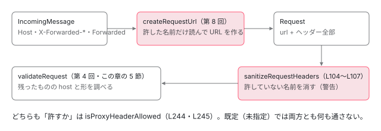

[目次](../README.md) › [SSR の守りと細部](README.md) › 第 5 回 / 全 10 回

# プロキシのヘッダー：trustProxyHeaders と Forwarded

> X-Forwarded-Host・X-Forwarded-Proto・X-Forwarded-Prefix などを、明示して許したときだけ使うようにした修正（5adc925414）と、その設定の正規化、環境変数（126b19b9c7）、すべての X-Forwarded-\* への対応（b75423d7a0）、標準の Forwarded ヘッダー（7ef9ed24d3）。X-Forwarded-Prefix による開いたリダイレクトの修正（f086eccc36・4d564f66f6）。

angular/angular-cli · 読了 約 13 分 · 発展 · [サイトで読む（デモが動きます）](https://angular-deep-dive-cyan.vercel.app/chapter/ssrx-proxy-headers)

---

ロードバランサーやリバースプロキシ（利用者とサーバーの間で中継するサーバー）の後ろでは、Node が受けるリクエストの `Host` はプロキシから見た内側の名前で、TLS もプロキシで終わっています。本当のホスト・プロトコル・パスの接頭辞は、プロキシが `X-Forwarded-Host`・`X-Forwarded-Proto`・`X-Forwarded-Prefix` や、標準の `Forwarded` ヘッダーに書いて渡します。ところが同じヘッダーは、利用者のブラウザからも自由に付けられます。この章では、`@angular/ssr` が**どのヘッダーを、どの設定のときだけ信じ、信じたものをどう分解し、どう形を調べるか**を、1 行ずつ追います。

読む対象は `packages/angular/ssr/src/utils/validation.ts` の後半（`isProxyHeaderAllowed`・`normalizeTrustProxyHeaders`・`parseForwardedHeader`・`validateHeaders` の後半）と、`src/app-engine.ts`・`node/src/app-engine.ts` の option の行です。ホストの検査そのものは[第 4 回](04-ssrx-host-validation.md)、Node の `IncomingMessage` から URL を組み立てる `createRequestUrl` は [ssr-app-engine の章](../platform/04-ssr-app-engine.md)の 1 節と[第 8 回](08-ssrx-node-streams.md)にあります。

1. [1. resolveUrl](01-ssrx-resolve-url.md)
2. [2. location と allowedHosts](02-ssrx-location-allowed-hosts.md)
3. [3. サーバーの HttpClient](03-ssrx-server-http.md)
4. [4. ホストとヘッダーの検査](04-ssrx-host-validation.md)
5. **5. プロキシのヘッダー**（この章）
6. [6. リダイレクトと URL の照合](06-ssrx-redirects.md)
7. [7. ロケールの選び方](07-ssrx-i18n-locale.md)
8. [8. Node のリクエストとレスポンス](08-ssrx-node-streams.md)
9. [9. アセットと重要 CSS](09-ssrx-assets-css.md)
10. [10. spec と issue](10-ssrx-tests-issues.md)

## 1. trustProxyHeaders：既定は「何も信じない」

📄 `angular-cli/packages/angular/ssr/src/app-engine.ts` L30–47 （▶ の行: 34, 38–39, 41–43, 45, 47）

```ts
30 │   /**
31 │    * Extends the scope of trusted proxy headers (`Forwarded` or `X-Forwarded-*`).
32 │    *
33 │    * @remarks
34 ▶    * **This is a security-sensitive option!**
35 │    *
36 │    * When `trustProxyHeaders` is enabled, request headers such as `Forwarded`, `X-Forwarded-Host`, and
37 │    * `X-Forwarded-Prefix` are trusted by the server and used for routing. These
38 ▶    * headers must be strictly validated and provided by a trusted client (e.g., at a reverse proxy, load
39 ▶    * balancer, or API gateway) and must *not* be provided by untrusted end users.
40 │    *
41 ▶    * If a `string[]` is provided, only those proxy headers are allowed.
42 ▶    * If `true`, all proxy headers are allowed.
43 ▶    * If `false` or not provided, proxy headers are ignored.
44 │    *
45 ▶    * @default false
46 │    */
47 ▶   trustProxyHeaders?: boolean | readonly string[];
```

47 行目の `trustProxyHeaders` は `boolean` か文字列の配列です。41〜43 行目のとおり、配列ならその名前だけ、`true` なら全部、`false` か省略なら**全部無視**（45 行目の既定）。34 行目は「セキュリティに関わる option」、38・39 行目は「これらのヘッダーは信頼できる中継（プロキシ・ロードバランサー・API ゲートウェイ）が付けたもので、利用者が付けたものであってはならない」と書いています。この既定は 5adc925414（2026-04-24）からで、それより前は、許すという設定そのものがありませんでした（6 節）。

> [!WARNING]
> **ハマりどころ**
>
> `trustProxyHeaders: true` は「プロキシを通らずにサーバーへ直接届くリクエストは無い」構成のときだけ安全です。Node のポートが外から直接叩けると、利用者が自分で書いた `X-Forwarded-Host` や `X-Forwarded-Prefix` も信じることになります。どの名前を許すかは、プロキシが**必ず上書きする**名前だけに絞ります。

## 2. 設定を Set にそろえる：normalizeTrustProxyHeaders

📄 `angular-cli/packages/angular/ssr/src/app-engine.ts` L118–121 （▶ の行: 120）

```ts
118 │   constructor(options?: AngularAppEngineOptions) {
119 │     this.allowedHosts = this.getAllowedHosts(options);
120 ▶     this.trustProxyHeaders = normalizeTrustProxyHeaders(options?.trustProxyHeaders);
121 │   }
```

120 行目、エンジンを作るときに 1 回だけ、設定を小文字の名前の Set にします。

📄 `angular-cli/packages/angular/ssr/src/utils/validation.ts` L9–12 （▶ の行: 12）

```ts
 9 │ /**
10 │  * Internal sentinel string representing a wildcard rule to trust all proxy headers.
11 │  */
12 ▶ const TRUST_ALL_PROXY_HEADERS = '*';
```

📄 `angular-cli/packages/angular/ssr/src/utils/validation.ts` L249–283 （▶ の行: 257–258, 261–262, 266–269, 273–275, 279）

```ts
249 │ /**
250 │  * Normalizes the `trustProxyHeaders` option to a consistent representation.
251 │  * @param trustProxyHeaders The input `trustProxyHeaders` value.
252 │  * @returns A `Set<string>` of normalized header names.
253 │  */
254 │ export function normalizeTrustProxyHeaders(
255 │   trustProxyHeaders: boolean | readonly string[] | undefined,
256 │ ): ReadonlySet<string> {
257 ▶   if (!trustProxyHeaders) {
258 ▶     return new Set();
259 │   }
260 │ 
261 ▶   if (trustProxyHeaders === true) {
262 ▶     return new Set([TRUST_ALL_PROXY_HEADERS]);
263 │   }
264 │ 
265 │   const normalizedTrustedProxyHeaders = new Set<string>();
266 ▶   for (const header of trustProxyHeaders) {
267 ▶     const lowerHeader = header.toLowerCase();
268 ▶     if (lowerHeader === TRUST_ALL_PROXY_HEADERS) {
269 ▶       throw new Error(
270 │         `"${TRUST_ALL_PROXY_HEADERS}" is not allowed as a value for the "trustProxyHeaders" option.`,
271 │       );
272 │     }
273 ▶     const isValid = lowerHeader === 'forwarded' || lowerHeader.startsWith('x-forwarded-');
274 ▶     if (!isValid) {
275 ▶       throw new Error(
276 │         `"${header}" is not a valid proxy header. Trusted proxy headers must be "forwarded" or start with "x-forwarded-".`,
277 │       );
278 │     }
279 ▶     normalizedTrustedProxyHeaders.add(lowerHeader);
280 │   }
281 │ 
282 │   return normalizedTrustedProxyHeaders;
283 │ }
```

1. **257・258 行目：`undefined`・`false` は空の Set**

   空の配列 `[]` も、266 行目の `for` が 1 回も回らないので空の Set になります。
2. **261・262 行目：`true` は `'*'` だけを入れた Set**

   12 行目の `TRUST_ALL_PROXY_HEADERS` は「全部信じる」を表す内部の印（sentinel）です。ヘッダーの名前としての `*` ではありません。
3. **267〜272 行目：配列に `'*'` を書くと投げる**

   「全部」は `true` でしか言えません。配列の `['*']` を許すと、印と利用者の書いた名前が区別できなくなるからです。
4. **273〜278 行目：`forwarded` か `x-forwarded-` で始まる名前だけ**

   `x-real-ip` や綴りを間違えた `x-forward-host` は、エンジンを作る時点で投げます。リクエストが来てから気づくのではなく、起動で気づけます。
5. **279 行目：小文字にして Set に入れる**

   同じ名前を大文字と小文字で 2 回書いても 1 つになります。

| trustProxyHeaders | normalizeTrustProxyHeaders の結果（記録） |
| --- | --- |
| undefined | \[\] |
| false | \[\] |
| true | \["\*"\] |
| \[\] | \[\] |
| \["X-Forwarded-Host","Forwarded"\] | \["x-forwarded-host","forwarded"\] |
| \["\*"\] | throw: "\*" is not allowed as a value for the "trustProxyHeaders" option. |
| \["x-real-ip"\] | throw: "x-real-ip" is not a valid proxy header. Trusted proxy headers must be "forwarded" or start with "x-forwarded-". |
| \["X-Forwarded-For","x-forwarded-for"\] | \["x-forwarded-for"\] |

## 3. 1 つの名前を許すか：isProxyHeaderAllowed

📄 `angular-cli/packages/angular/ssr/src/utils/validation.ts` L232–247 （▶ の行: 244–245）

```ts
232 │ /**
233 │  * Checks if a specific proxy header is allowed.
234 │  *
235 │  * @param headerName - The name of the proxy header to check.
236 │  * @param trustProxyHeaders - A set of allowed proxy headers.
237 │  * @returns `true` if the header is allowed, `false` otherwise.
238 │  */
239 │ export function isProxyHeaderAllowed(
240 │   headerName: string,
241 │   trustProxyHeaders: ReadonlySet<string>,
242 │ ): boolean {
243 │   return (
244 ▶     trustProxyHeaders.has(TRUST_ALL_PROXY_HEADERS) ||
245 ▶     trustProxyHeaders.has(headerName.toLowerCase())
246 │   );
247 │ }
```

244 行目で印の `'*'` があれば何でも許し、245 行目で小文字にした名前が Set にあれば許します。`true` のとき `x-forwarded-email` のような名前まで許されるのは 244 行目のおかげで、これは b75423d7a0（2026-05-13）が入れました。それまで `true` は決まった 5 つの名前の Set で、それ以外は捨てられて警告が出ていました（#33169「`trustProxyHeaders: true` なのに `x-forwarded-client-cert` の警告が出る」）。

📄 `git show b75423d7a0 -- validation.ts`

```ts
# b75423d7a0 2026-05-13 fix(@angular/ssr): support all X-Forwarded-* headers when trustProxyHeaders is true
--- a/packages/angular/ssr/src/utils/validation.ts
+++ b/packages/angular/ssr/src/utils/validation.ts
@@ -7,15 +7,9 @@
  */
 
 /**
- * Common X-Forwarded-* headers.
+ * Internal sentinel string representing a wildcard rule to trust all proxy headers.
  */
-const X_FORWARDED_HEADERS: ReadonlySet<string> = new Set([
-  'x-forwarded-for',
-  'x-forwarded-host',
-  'x-forwarded-port',
-  'x-forwarded-proto',
-  'x-forwarded-prefix',
-]);
+const TRUST_ALL_PROXY_HEADERS = '*';
 
 /**
  * The set of headers that should be validated for host header injection attacks.
@@ -235,7 +229,10 @@ export function isProxyHeaderAllowed(
   headerName: string,
   trustProxyHeaders: ReadonlySet<string>,
 ): boolean {
-  return trustProxyHeaders.has(headerName.toLowerCase());
+  return (
+    trustProxyHeaders.has(TRUST_ALL_PROXY_HEADERS) ||
+    trustProxyHeaders.has(headerName.toLowerCase())
+  );
 }
 
 /**
@@ -251,8 +248,15 @@ export function normalizeTrustProxyHeaders(
   }
 
   if (trustProxyHeaders === true) {
-    return X_FORWARDED_HEADERS;
+    return new Set([TRUST_ALL_PROXY_HEADERS]);
   }
 
-  return new Set(trustProxyHeaders.map((h) => h.toLowerCase()));
+  const normalizedTrustedProxyHeaders = new Set(trustProxyHeaders.map((h) => h.toLowerCase()));
+  if (normalizedTrustedProxyHeaders.has(TRUST_ALL_PROXY_HEADERS)) {
+    throw new Error(
+      `"${TRUST_ALL_PROXY_HEADERS}" is not allowed as a value for the "trustProxyHeaders" option.`,
+    );
+  }
+
+  return normalizedTrustedProxyHeaders;
 }
```
*決まった 5 つの Set をやめ、'\*' の印にした差分*

## 4. 同じ設定が 2 か所で効く

設定は、リクエストを作るときと、エンジンが受け取ったときの 2 回効きます。

📄 `angular-cli/packages/angular/ssr/node/src/app-engine.ts` L45–48 （▶ の行: 45–46）

```ts
45 ▶     this.angularAppEngine = new AngularAppEngine(appEngineOptions);
46 ▶     this.trustProxyHeaders = appEngineOptions.trustProxyHeaders;
47 │ 
48 │     attachNodeGlobalErrorHandlers();
```

📄 `angular-cli/packages/angular/ssr/node/src/app-engine.ts` L82–86 （▶ の行: 85）

```ts
82 │     const webRequest =
83 │       request instanceof Request
84 │         ? request
85 ▶         : createWebRequestFromNodeRequest(request, this.trustProxyHeaders);
86 │ 
```

1. **46 行目・85 行目：Node の変換にも同じ設定を渡す**

   `AngularNodeAppEngine` は設定を自分でも持ち（46 行目）、Node のリクエストを Web の `Request` に変える `createWebRequestFromNodeRequest` に渡します（85 行目）。その中の `createRequestUrl` は、`Forwarded` の `proto` → `X-Forwarded-Proto` → ソケットが TLS かどうか、の順でプロトコルを、`Forwarded` の `host` → `X-Forwarded-Host` → `Host` の順でホストを決めます。ただし各ヘッダーを読む前に 3 節の `isProxyHeaderAllowed` を通すので、**許していない名前は無いのと同じ**です（行は [ssr-app-engine](../platform/04-ssr-app-engine.md) の 1 節の引用）。
2. **エンジンの入口で、許していないヘッダーを消す**

   Node 以外から `Request` が直接来ても同じになるように、`AngularAppEngine.handle` の最初の行（[第 4 回](04-ssrx-host-validation.md)の 1 節）でもう一度掃除します。

📄 `angular-cli/packages/angular/ssr/src/utils/validation.ts` L101–107 （▶ の行: 104–107）

```ts
101 │   let headersDeleted = false;
102 │   const headers = new Headers();
103 │ 
104 ▶   for (const [key, value] of request.headers) {
105 ▶     const lowerKey = key.toLowerCase();
106 ▶     const isProxyHeader = lowerKey === 'forwarded' || lowerKey.startsWith('x-forwarded-');
107 ▶     if (isProxyHeader && !isProxyHeaderAllowed(lowerKey, trustProxyHeaders)) {
```

104 行目で全部のヘッダーを回し、106 行目で「`forwarded` か `x-forwarded-` で始まる」ものをプロキシのヘッダーとみなし、107 行目で許していなければ（警告を出して）新しい `Headers` に入れません。消したあとの `Request` の作り方（本文を貯めない 33169801c6）は[第 8 回](08-ssrx-node-streams.md)、警告の文と全体は [ssr-app-engine](../platform/04-ssr-app-engine.md) の 2 節にあります。消されたヘッダーは、そのあとの検査にも、アプリが `REQUEST` で読む値にも、リダイレクトの `Location` を作る行（[第 6 回](06-ssrx-redirects.md)）にも届きません。



*trustProxyHeaders が効く 2 か所。Node の変換では「読まない」、エンジンの入口では「消す」。どちらも isProxyHeaderAllowed の 1 行で決まる。*

## 5. 残ったヘッダーの形を調べる

📄 `angular-cli/packages/angular/ssr/src/utils/validation.ts` L204–210 （▶ の行: 204–206, 208–209）

```ts
204 ▶     const forwardedParams = parseForwardedHeader(forwarded);
205 ▶     if (forwardedParams.host && !disableHostCheck) {
206 ▶       verifyHostAllowed('Forwarded "host"', forwardedParams.host, allowedHosts);
207 │     }
208 ▶     if (forwardedParams.proto && !VALID_PROTO_REGEX.test(forwardedParams.proto)) {
209 ▶       throw new Error('Header "forwarded" proto parameter must be either "http" or "https".');
210 │     }
```

📄 `angular-cli/packages/angular/ssr/src/utils/validation.ts` L212–230 （▶ の行: 213–214, 218–219, 223–224）

```ts
212 │ 
213 ▶   const xForwardedPort = getFirstHeaderValue(headers.get('x-forwarded-port'));
214 ▶   if (xForwardedPort && !VALID_PORT_REGEX.test(xForwardedPort)) {
215 │     throw new Error('Header "x-forwarded-port" must be a numeric value.');
216 │   }
217 │ 
218 ▶   const xForwardedProto = getFirstHeaderValue(headers.get('x-forwarded-proto'));
219 ▶   if (xForwardedProto && !VALID_PROTO_REGEX.test(xForwardedProto)) {
220 │     throw new Error('Header "x-forwarded-proto" must be either "http" or "https".');
221 │   }
222 │ 
223 ▶   const xForwardedPrefix = getFirstHeaderValue(headers.get('x-forwarded-prefix'));
224 ▶   if (xForwardedPrefix && !VALID_PREFIX_REGEX.test(xForwardedPrefix)) {
225 │     throw new Error(
226 │       'Header "x-forwarded-prefix" is invalid. It must start with a "/" and contain ' +
227 │         'only alphanumeric characters, hyphens, and underscores, separated by single slashes.',
228 │     );
229 │   }
230 │ }
```

📄 `angular-cli/packages/angular/ssr/src/utils/validation.ts` L29–33 （▶ の行: 33）

```ts
29 │ /**
30 │  * Regular expression to validate that the prefix is valid. Validates that the prefix is a valid path prefix and nothing else.
31 │  * It validates that the prefix starts with a forward slash and contains only letters, numbers, hyphens, underscores and forward slashes.
32 │  */
33 ▶ const VALID_PREFIX_REGEX = /^\/([a-z0-9_-]+\/)*[a-z0-9_-]*$/i;
```

1. **204〜206 行目：`Forwarded` の `host` は、`Host` と同じ検査へ**

   204 行目で 7 節の `parseForwardedHeader` にかけ、`host` があれば第 4 回の `verifyHostAllowed` に、名前を `Forwarded "host"` として渡します。
2. **208・209 行目、218・219 行目：プロトコルは `http` か `https` だけ**

   正規表現は第 4 回の 3 節で見た定数 `VALID_PROTO_REGEX`（`/^https?$/i`、大文字も可）。`ftp` は 400 です。
3. **213・214 行目：ポートは数字だけ**

   定数 `VALID_PORT_REGEX`（`/^\d+$/`）です。
4. **223・224 行目と 33 行目：接頭辞は「`/` で始まり、英数字・`-`・`_` の区切りを 1 つの `/` でつないだもの」だけ**

   33 行目を読むと、`^\/` で `/` から始まり、`([a-z0-9_-]+\/)*` で「1 文字以上の区切り + `/`」を 0 回以上、最後に `[a-z0-9_-]*` で区切りを 0 か 1 つ、で終わりです。`/`・`/shop`・`/a/b_c-1` は通り、`//evil`（空の区切り）・`\evil`・`/./x`・`%2f%2f`・`shop`（`/` で始まらない）は通りません。`.` も許さないので、`/v1.2` のような接頭辞も 400 になります（記録の `/a.b`）。

この 3 つの検査は、第 4 回の旗 `ɵdisableAllowedHostsCheck` が立っていても止まりません（旗が見るのは 205 行目の `host` だけ）。また、どれも `getFirstHeaderValue` で取った**最初の値**を調べます。

## 6. 修正を順に読む：明示して許す（5adc925414）と環境変数（126b19b9c7）

📄 `git show 5adc925414 -- app-engine.ts / validation.ts（2 つの hunk）`

```
# 5adc925414 2026-04-24 fix(@angular/ssr): enforce explicit opt-in for proxy headers
--- a/packages/angular/ssr/src/app-engine.ts
+++ b/packages/angular/ssr/src/app-engine.ts
@@ -131,33 +160,17 @@ export class AngularAppEngine {
    */
   async handle(request: Request, requestContext?: unknown): Promise<Response | null> {
     const allowedHost = this.allowedHosts;
-    const disableAllowedHostsCheck = AngularAppEngine.ɵdisableAllowedHostsCheck;
+    const securedRequest = sanitizeRequestHeaders(request, this.trustProxyHeaders);
 
     try {
-      validateRequest(request, allowedHost, disableAllowedHostsCheck);
+      validateRequest(securedRequest, allowedHost, AngularAppEngine.ɵdisableAllowedHostsCheck);
     } catch (error) {
-      return this.handleValidationError(request.url, error as Error);
+      return this.handleValidationError(securedRequest.url, error as Error);
     }
 
-    // Clone request with patched headers to prevent unallowed host header access.
-    const { request: securedRequest, onError: onHeaderValidationError } = disableAllowedHostsCheck
-      ? { request, onError: null }
-      : cloneRequestAndPatchHeaders(request, allowedHost);
-
     const serverApp = await this.getAngularServerAppForRequest(securedRequest);
     if (serverApp) {
-      const promises: Promise<Response | null>[] = [];
-      if (onHeaderValidationError) {
-        promises.push(
-          onHeaderValidationError.then((error) =>
-            this.handleValidationError(securedRequest.url, error),
-          ),
-        );
-      }
-
-      promises.push(serverApp.handle(securedRequest, requestContext));
-
-      return Promise.race(promises);
+      return serverApp.handle(securedRequest, requestContext);
     }
 
     if (this.supportedLocales.length > 1) {

# 5adc925414 2026-04-24 fix(@angular/ssr): enforce explicit opt-in for proxy headers
--- a/packages/angular/ssr/src/utils/validation.ts
+++ b/packages/angular/ssr/src/utils/validation.ts
@@ -281,9 +216,43 @@ function validateHeaders(request: Request): void {
   }
 
   const xForwardedPrefix = getFirstHeaderValue(headers.get('x-forwarded-prefix'));
-  if (xForwardedPrefix && INVALID_PREFIX_REGEX.test(xForwardedPrefix)) {
+  if (xForwardedPrefix && !VALID_PREFIX_REGEX.test(xForwardedPrefix)) {
     throw new Error(
-      'Header "x-forwarded-prefix" must not start with "\\" or multiple "/" or contain ".", ".." path segments.',
+      'Header "x-forwarded-prefix" is invalid. It must start with a "/" and contain ' +
+        'only alphanumeric characters, hyphens, and underscores, separated by single slashes.',
     );
   }
 }
+
+/**
+ * Checks if a specific proxy header is allowed.
+ *
+ * @param headerName - The name of the proxy header to check.
+ * @param trustProxyHeaders - A set of allowed proxy headers.
+ * @returns `true` if the header is allowed, `false` otherwise.
+ */
+export function isProxyHeaderAllowed(
+  headerName: string,
+  trustProxyHeaders: ReadonlySet<string>,
+): boolean {
+  return trustProxyHeaders.has(headerName.toLowerCase());
+}
+
+/**
+ * Normalizes the `trustProxyHeaders` option to a consistent representation.
+ * @param trustProxyHeaders The input `trustProxyHeaders` value.
+ * @returns A `Set<string>` of normalized header names.
+ */
+export function normalizeTrustProxyHeaders(
+  trustProxyHeaders: boolean | readonly string[] | undefined,
+): ReadonlySet<string> {
+  if (!trustProxyHeaders) {
+    return new Set();
+  }
+
+  if (trustProxyHeaders === true) {
+    return X_FORWARDED_HEADERS;
+  }
+
+  return new Set(trustProxyHeaders.map((h) => h.toLowerCase()));
+}
```
*handle の最初で掃除してから調べる形と、許すかどうかの 2 つの関数を足した差分*

5adc925414 の前は、プロキシのヘッダーは**いつも**信じられていました。Node の変換は `X-Forwarded-Host` があればそれでホストを決め、エンジンはそれを（第 4 回 7 節の差し替えで）あとから調べていました。この修正で、`trustProxyHeaders` を書かない限り、どちらの経路でもプロキシのヘッダーは使われなくなりました。プロキシの後ろでヘッダーに頼っていたアプリは、設定を足す必要があります。

📄 `git show 126b19b9c7 -- node/src/app-engine.ts`

```ts
# 126b19b9c7 2026-04-27 fix(@angular/ssr): add support for configuring trusted proxy headers via environment variable
--- a/packages/angular/ssr/node/src/app-engine.ts
+++ b/packages/angular/ssr/node/src/app-engine.ts
@@ -36,11 +36,14 @@ export class AngularNodeAppEngine {
    * @param options Options for the Angular Node.js server application engine.
    */
   constructor(options?: AngularNodeAppEngineOptions) {
-    this.angularAppEngine = new AngularAppEngine({
+    const appEngineOptions: AngularAppEngineOptions = {
       ...options,
-      allowedHosts: [...getAllowedHostsFromEnv(), ...(options?.allowedHosts ?? [])],
-    });
-    this.trustProxyHeaders = options?.trustProxyHeaders;
+      allowedHosts: getAllowedHostsFromEnv() ?? options?.allowedHosts,
+      trustProxyHeaders: getTrustProxyHeadersFromEnv() ?? options?.trustProxyHeaders,
+    };
+
+    this.angularAppEngine = new AngularAppEngine(appEngineOptions);
+    this.trustProxyHeaders = appEngineOptions.trustProxyHeaders;
 
     attachNodeGlobalErrorHandlers();
   }
```
*NG\_TRUST\_PROXY\_HEADERS を足した差分（このときは環境変数が勝った）*

126b19b9c7 は、コードを書き換えずに設定できるよう `NG_TRUST_PROXY_HEADERS`（`,` 区切り）を足しました。読み方は `NG_ALLOWED_HOSTS` と同じ `getArrayFromEnv` で、どちらが勝つかの変遷（5875b6024f で options が勝つ形に戻った）は[第 4 回](04-ssrx-host-validation.md)の 8 節です。環境変数はいつも配列になるので、`true`（全部）は環境変数では言えません。`NG_TRUST_PROXY_HEADERS=*` は 2 節の 268 行目で投げます（9 節の記録）。

## 7. 標準の Forwarded を 1 文字ずつ読む（7ef9ed24d3）

RFC 7239 の `Forwarded` は、`for=203.0.113.7;proto=https;host=app.example.com` のように `;` で区切った `名前=値` を並べ、中継を重ねるたびに `,` で要素を足していくヘッダーです。値は `"…"` で囲めて、その中では `;` や `,` も文字です。だから `split(';')` では正しく分けられず、7ef9ed24d3（2026-06-23）は 1 文字ずつ読む関数を書きました。

📄 `angular-cli/packages/angular/ssr/src/utils/validation.ts` L285–307 （▶ の行: 287, 295–296, 300–306）

```ts
285 │ /**
286 │  * Parses the standard `Forwarded` header (RFC 7239).
287 ▶  * It extracts the parameters from the first (leftmost) element in the header.
288 │  *
289 │  * @param headerValue - The value of the `Forwarded` header.
290 │  * @returns A record of lowercase parameter names to their values.
291 │  */
292 │ export function parseForwardedHeader(
293 │   headerValue: string | null | undefined,
294 │ ): Record<string, string> {
295 ▶   if (!headerValue) {
296 ▶     return {};
297 │   }
298 │ 
299 │   const params: Record<string, string> = {};
300 ▶   let inQuotes = false;
301 ▶   let escaped = false;
302 ▶   let currentKey = '';
303 ▶   let currentValue = '';
304 ▶   let isParsingValue = false;
305 ▶   let isKeyEnded = false;
306 ▶   let isParsingValueEnded = false;
307 │ 
```

287 行目のとおり、読むのは**最初の（いちばん左の）要素だけ**です。300〜306 行目の 7 つの変数が「いまどこを読んでいるか」を持ちます。`inQuotes` は引用符の中か、`escaped` は直前が `\` か、`isParsingValue` は `=` の右か、残りの 2 つは空白で名前や値が終わったか、です。

📄 `angular-cli/packages/angular/ssr/src/utils/validation.ts` L308–342 （▶ の行: 309, 312, 319–321, 330–331, 335, 337）

```ts
308 │   for (const char of headerValue) {
309 ▶     if (escaped) {
310 │       escaped = false;
311 │       if (isParsingValue) {
312 ▶         currentValue += char;
313 │       } else {
314 │         currentKey += char;
315 │       }
316 │       continue;
317 │     }
318 │ 
319 ▶     if (char === '\\') {
320 ▶       if (inQuotes) {
321 ▶         escaped = true;
322 │       } else if (isParsingValue) {
323 │         currentValue += char;
324 │       } else {
325 │         currentKey += char;
326 │       }
327 │       continue;
328 │     }
329 │ 
330 ▶     if (char === '"') {
331 ▶       inQuotes = !inQuotes;
332 │       continue;
333 │     }
334 │ 
335 ▶     if (inQuotes) {
336 │       if (isParsingValue) {
337 ▶         currentValue += char;
338 │       } else {
339 │         currentKey += char;
340 │       }
341 │       continue;
342 │     }
```

1. **309〜317 行目：直前が `\` なら、この文字はそのまま足す**

   `"a\"b"` の `\"` は、引用符を閉じずに `"` という文字になります。
2. **319〜328 行目：`\` は、引用符の中でだけ「次をそのまま」の印**

   引用符の外の `\` は普通の文字として足します。
3. **330〜333 行目：`"` は中か外かを切り替えるだけで、文字としては足さない**

   だから `host="app.example.com:8443"` の値は引用符を外した `app.example.com:8443` です。
4. **335〜342 行目：引用符の中は、どんな文字もそのまま足す**

   このあとの `,`・`;`・`=`・空白の扱いに行かないので、`"a;b"` の `;` は区切りになりません。

📄 `angular-cli/packages/angular/ssr/src/utils/validation.ts` L344–366 （▶ の行: 344–346, 349–351, 360–361, 363）

```ts
344 ▶     if (char === ',') {
345 ▶       addParam(currentKey, currentValue, isParsingValue, params);
346 ▶       break;
347 │     }
348 │ 
349 ▶     if (char === ';') {
350 ▶       addParam(currentKey, currentValue, isParsingValue, params);
351 ▶       currentKey = '';
352 │       currentValue = '';
353 │       isParsingValue = false;
354 │       isKeyEnded = false;
355 │       isParsingValueEnded = false;
356 │       continue;
357 │     }
358 │ 
359 │     if (char === '=') {
360 ▶       if (!isParsingValue) {
361 ▶         isParsingValue = true;
362 │       } else {
363 ▶         currentValue += char;
364 │       }
365 │       continue;
366 │     }
```

1. **344〜347 行目：引用符の外の `,` で、いまの組を入れて読むのをやめる**

   `break` なので、2 つ目の要素（`, host=second.example`）は読みません。
2. **349〜356 行目：`;` で、いまの組を入れて、次の組のために状態を戻す**
3. **359〜366 行目：最初の `=` で名前から値に移り、2 つ目からは値の文字**

📄 `angular-cli/packages/angular/ssr/src/utils/validation.ts` L368–396 （▶ の行: 368, 370–371, 373–374, 380–381, 383–384, 391–392）

```ts
368 ▶     if (char === ' ' || char === '\t') {
369 │       if (isParsingValue) {
370 ▶         if (currentValue.length > 0) {
371 ▶           isParsingValueEnded = true;
372 │         }
373 ▶       } else if (currentKey.length > 0) {
374 ▶         isKeyEnded = true;
375 │       }
376 │       continue;
377 │     }
378 │ 
379 │     if (isParsingValue) {
380 ▶       if (!isParsingValueEnded) {
381 ▶         currentValue += char;
382 │       }
383 ▶     } else if (isKeyEnded) {
384 ▶       currentKey = char;
385 │       isKeyEnded = false;
386 │     } else {
387 │       currentKey += char;
388 │     }
389 │   }
390 │ 
391 ▶   if (currentKey || currentValue || isParsingValue) {
392 ▶     addParam(currentKey, currentValue, isParsingValue, params);
393 │   }
394 │ 
395 │   return params;
396 │ }
```

1. **368〜377 行目：空白とタブは足さず、「いまの名前か値が終わった」印だけ立てる**

   値の途中で空白が来ると 371 行目で `isParsingValueEnded` が立ち、380 行目でそれ以降の文字を捨てます。`host=app.example.com garbage` の `garbage` は消えます。
2. **383〜385 行目：名前の途中の空白のあとに文字が来たら、名前を最初から読み直す**

   `ho st=value` の名前は `st` になります（spec にも同じ入力の it があります）。
3. **391〜393 行目：最後の組を入れる**

   `,` や `;` で終わらなかった最後の組は、ここで入ります。

📄 `angular-cli/packages/angular/ssr/src/utils/validation.ts` L398–419 （▶ の行: 411–412, 415–417）

```ts
398 │ /**
399 │  * Helper function to add a parameter to the params object.
400 │  * @param key - The key to add.
401 │  * @param value - The value to add.
402 │  * @param hasValue - Whether the parameter has a value.
403 │  * @param params - The params object to add the parameter to.
404 │  */
405 │ function addParam(
406 │   key: string,
407 │   value: string,
408 │   hasValue: boolean,
409 │   params: Record<string, string>,
410 │ ): void {
411 ▶   if (!hasValue) {
412 ▶     return;
413 │   }
414 │ 
415 ▶   const trimmedKey = key.trim().toLowerCase();
416 ▶   if (trimmedKey) {
417 ▶     params[trimmedKey] = value;
418 │   }
419 │ }
```

411・412 行目、`=` が無かった組（`host` だけ）は入れません。415 行目で名前を小文字にするので `Host=` も `host` になります。値は小文字にしません。同じ名前が 2 回あれば、417 行目で後のものが上書きします。

| parseForwardedHeader に渡した値 | 返った値（記録） |
| --- | --- |
| for=203.0.113.7;proto=https;host=app.example.com | {"for":"203.0.113.7","proto":"https","host":"app.example.com"} |
| Host=App.Example.com;PROTO=http | {"host":"App.Example.com","proto":"http"} |
| host="app.example.com:8443" | {"host":"app.example.com:8443"} |
| host="a;b";proto=https | {"host":"a;b","proto":"https"} |
| host="a\\"b" | {"host":"a\\"b"} |
| host=app.example.com, host=second.example | {"host":"app.example.com"} |
| host="x,y";proto=https | {"host":"x,y","proto":"https"} |
| for = 1.2.3.4 ; host = app.example.com | {"for":"1.2.3.4","host":"app.example.com"} |
| host=app.example.com garbage;proto=https | {"host":"app.example.com","proto":"https"} |
| host | {} |
| host= | {"host":""} |

📄 `git show 7ef9ed24d3 -- validation.ts（前の 2 hunk）/ node/src/request.ts（URL を組む hunk）`

```
# 7ef9ed24d3 2026-06-23 feat(@angular/ssr): support the standard Forwarded header
--- a/packages/angular/ssr/src/utils/validation.ts
+++ b/packages/angular/ssr/src/utils/validation.ts
@@ -103,7 +103,8 @@ export function sanitizeRequestHeaders(
 
   for (const [key, value] of request.headers) {
     const lowerKey = key.toLowerCase();
-    if (lowerKey.startsWith('x-forwarded-') && !isProxyHeaderAllowed(lowerKey, trustProxyHeaders)) {
+    const isProxyHeader = lowerKey === 'forwarded' || lowerKey.startsWith('x-forwarded-');
+    if (isProxyHeader && !isProxyHeaderAllowed(lowerKey, trustProxyHeaders)) {
       // eslint-disable-next-line no-console
       console.warn(
         `Received "${key}" header but "trustProxyHeaders" was not set up to allow it.\n` +
@@ -199,6 +200,17 @@ function validateHeaders(
     }
   }
 
+  const forwarded = headers.get('forwarded');
+  if (forwarded) {
+    const forwardedParams = parseForwardedHeader(forwarded);
+    if (forwardedParams.host && !disableHostCheck) {
+      verifyHostAllowed('Forwarded "host"', forwardedParams.host, allowedHosts);
+    }
+    if (forwardedParams.proto && !VALID_PROTO_REGEX.test(forwardedParams.proto)) {
+      throw new Error('Header "forwarded" proto parameter must be either "http" or "https".');
+    }
+  }
+
   const xForwardedPort = getFirstHeaderValue(headers.get('x-forwarded-port'));
   if (xForwardedPort && !VALID_PORT_REGEX.test(xForwardedPort)) {
     throw new Error('Header "x-forwarded-port" must be a numeric value.');

# 7ef9ed24d3 2026-06-23 feat(@angular/ssr): support the standard Forwarded header
--- a/packages/angular/ssr/node/src/request.ts
+++ b/packages/angular/ssr/node/src/request.ts
@@ -114,11 +115,16 @@ export function createRequestUrl(
     originalUrl,
   } = nodeRequest as IncomingMessage & { originalUrl?: string };
 
+  const forwardedHeaderValue = getAllowedProxyHeaderValue(headers, 'forwarded', trustProxyHeaders);
+  const forwardedParams = parseForwardedHeader(forwardedHeaderValue);
+
   const protocol =
+    forwardedParams.proto ??
     getAllowedProxyHeaderValue(headers, 'x-forwarded-proto', trustProxyHeaders) ??
     ('encrypted' in socket && socket.encrypted ? 'https' : 'http');
 
   const hostname =
+    forwardedParams.host ??
     getAllowedProxyHeaderValue(headers, 'x-forwarded-host', trustProxyHeaders) ??
     headers.host ??
     headers[':authority'];
```
*Forwarded をプロキシのヘッダーとして扱い、host を検査し、URL の組み立てで最初に読むようにした差分*

差分のとおり、`Forwarded` は `sanitizeRequestHeaders` の 106 行目でプロキシのヘッダーに数えられ、5 節の 204〜209 行目で検査され、Node の変換では `X-Forwarded-*` より**先に**読まれます。2 つとも許していて値が違うと、`Forwarded` が勝ちます（9 節の記録の「Forwarded と X-Forwarded-Host」）。

## 8. X-Forwarded-Prefix の開いたリダイレクト（f086eccc36 → 4d564f66f6 → 5adc925414）

`X-Forwarded-Prefix` は「プロキシがこのアプリを `/shop` の下に置いている」のような接頭辞です。`@angular/ssr` は、リダイレクトの `Location` の先頭にこれを付けます（[第 6 回](06-ssrx-redirects.md)の `joinUrlParts`）。#32501（2026-02-18）は、ここから**開いたリダイレクト**（自分のサイトのリダイレクトが、外のサイトへ利用者を飛ばしてしまうこと）が起き、CDN のキャッシュを汚すことにもつながる、という報告でした。

📄 `git show f086eccc36`

````
# f086eccc36 2026-02-23 fix(@angular/ssr): prevent open redirect via X-Forwarded-Prefix header
--- a/packages/angular/ssr/src/utils/url.ts
+++ b/packages/angular/ssr/src/utils/url.ts
@@ -95,26 +95,32 @@ export function addTrailingSlash(url: string): string {
  * ```
  */
 export function joinUrlParts(...parts: string[]): string {
-  const normalizeParts: string[] = [];
+  const normalizedParts: string[] = [];
+
   for (const part of parts) {
     if (part === '') {
       // Skip any empty parts
       continue;
     }
 
-    let normalizedPart = part;
-    if (part[0] === '/') {
-      normalizedPart = normalizedPart.slice(1);
+    let start = 0;
+    let end = part.length;
+
+    // Use "Pointers" to avoid intermediate slices
+    while (start < end && part[start] === '/') {
+      start++;
     }
-    if (part.at(-1) === '/') {
-      normalizedPart = normalizedPart.slice(0, -1);
+
+    while (end > start && part[end - 1] === '/') {
+      end--;
     }
-    if (normalizedPart !== '') {
-      normalizeParts.push(normalizedPart);
+
+    if (start < end) {
+      normalizedParts.push(part.slice(start, end));
     }
   }
 
-  return addLeadingSlash(normalizeParts.join('/'));
+  return addLeadingSlash(normalizedParts.join('/'));
 }
 
 /**

# f086eccc36 2026-02-23 fix(@angular/ssr): prevent open redirect via X-Forwarded-Prefix header
--- a/packages/angular/ssr/src/utils/validation.ts
+++ b/packages/angular/ssr/src/utils/validation.ts
@@ -26,6 +26,11 @@ const VALID_PROTO_REGEX = /^https?$/i;
  */
 const VALID_HOST_REGEX = /^[a-z0-9.:-]+$/i;
 
+/**
+ * Regular expression to validate that the prefix is valid.
+ */
+const INVALID_PREFIX_REGEX = /^[/\\]{2}|(?:^|[/\\])\.\.?(?:[/\\]|$)/;
+
 /**
  * Extracts the first value from a multi-value header string.
  *
@@ -253,4 +258,11 @@ function validateHeaders(request: Request): void {
   if (xForwardedProto && !VALID_PROTO_REGEX.test(xForwardedProto)) {
     throw new Error('Header "x-forwarded-proto" must be either "http" or "https".');
   }
+
+  const xForwardedPrefix = getFirstHeaderValue(headers.get('x-forwarded-prefix'));
+  if (xForwardedPrefix && INVALID_PREFIX_REGEX.test(xForwardedPrefix)) {
+    throw new Error(
+      'Header "x-forwarded-prefix" must not start with multiple "/" or "\\" or contain ".", ".." path segments.',
+    );
+  }
 }
````
*joinUrlParts が先頭の / を全部削るようにし、接頭辞の検査を足した差分*

本文の説明はこうです。`joinUrlParts()` は各部分の先頭の `/` を**1 つだけ**削っていたので、`///evil.com` のような接頭辞から `//evil.com/home` ができ、ブラウザはそれをプロトコル相対の URL（`https://evil.com/home`）として外へ飛ぶ。直し方は 2 つで、`joinUrlParts` が先頭と末尾の `/` をすべて削るようにしたことと、`//` や `\\` で始まる接頭辞をリクエストの段階で拒むことです。修正の前後の `joinUrlParts` に同じ接頭辞を渡した記録です。

| X-Forwarded-Prefix | 今の validateRequest | 今の joinUrlParts(prefix, '/home') | f086eccc36 の前の joinUrlParts |
| --- | --- | --- | --- |
| /shop | 通る | /shop/home | /shop/home |
| /shop/ | 通る | /shop/home | /shop/home |
| / | 通る | /home | /home |
| /a/b\_c-1 | 通る | /a/b\_c-1/home | /a/b\_c-1/home |
| //evil.example | 400（接頭辞の形） | /evil.example/home | /evil.example/home |
| ///evil.example | 400（接頭辞の形） | /evil.example/home | //evil.example/home |
| \\evil.example | 400（接頭辞の形） | /\\evil.example/home | /\\evil.example/home |
| /\\evil.example | 400（接頭辞の形） | /\\evil.example/home | /\\evil.example/home |
| /./x | 400（接頭辞の形） | /./x/home | /./x/home |
| %2f%2fevil.example | 400（接頭辞の形） | /%2f%2fevil.example/home | /%2f%2fevil.example/home |
| shop | 400（接頭辞の形） | /shop/home | /shop/home |

今は二重に守られています。接頭辞の形が悪ければリクエストが 400 で止まり（223・224 行目）、仮に通っても `joinUrlParts` は `/` 1 つで始まる値しか作りません。検査の正規表現は、その後 2 回変わりました。

📄 `git show 4d564f66f6 -- validation.ts（1 つ目の hunk）`

```
# 4d564f66f6 2026-03-16 fix(@angular/ssr): disallow x-forwarded-prefix starting with a backslash
--- a/packages/angular/ssr/src/utils/validation.ts
+++ b/packages/angular/ssr/src/utils/validation.ts
@@ -29,7 +29,7 @@ const VALID_HOST_REGEX = /^[a-z0-9.:-]+$/i;
 /**
  * Regular expression to validate that the prefix is valid.
  */
-const INVALID_PREFIX_REGEX = /^[/\\]{2}|(?:^|[/\\])\.\.?(?:[/\\]|$)/;
+const INVALID_PREFIX_REGEX = /^(?:\\|\/[/\\])|(?:^|[/\\])\.\.?(?:[/\\]|$)/;
 
 /**
  * Extracts the first value from a multi-value header string.
```
*\\ 1 つで始まる接頭辞も拒むようにした差分*

📄 `git show 5adc925414 -- validation.ts（2 つ目の hunk）`

```
# 5adc925414 2026-04-24 fix(@angular/ssr): enforce explicit opt-in for proxy headers
--- a/packages/angular/ssr/src/utils/validation.ts
+++ b/packages/angular/ssr/src/utils/validation.ts
@@ -22,14 +33,10 @@ const VALID_PORT_REGEX = /^\d+$/;
 const VALID_PROTO_REGEX = /^https?$/i;
 
 /**
- * Regular expression to validate that the host is a valid hostname.
- */
-const VALID_HOST_REGEX = /^[a-z0-9_.-]+(:[0-9]+)?$/i;
-
-/**
- * Regular expression to validate that the prefix is valid.
+ * Regular expression to validate that the prefix is valid. Validates that the prefix is a valid path prefix and nothing else.
+ * It validates that the prefix starts with a forward slash and contains only letters, numbers, hyphens, underscores and forward slashes.
  */
-const INVALID_PREFIX_REGEX = /^(?:\\|\/[/\\])|(?:^|[/\\])\.\.?(?:[/\\]|$)/;
+const VALID_PREFIX_REGEX = /^\/([a-z0-9_-]+\/)*[a-z0-9_-]*$/i;
 
 /**
  * Extracts the first value from a multi-value header string.
```
*「悪い形を拒む」正規表現から「良い形だけ通す」正規表現に変えた差分*

f086eccc36 と 4d564f66f6 の正規表現は「当てはまったら拒む」（拒む形を並べる）、5adc925414 の 33 行目は「当てはまらなかったら拒む」（通す形だけを書く）です。spec にある入力で 3 つを比べた記録です。

| 接頭辞 | f086eccc36 | 4d564f66f6 | 5adc925414 以降（33 行目） |
| --- | --- | --- | --- |
| /shop | 通す | 通す | 通す |
| //evil | 拒む | 拒む | 拒む |
| \\evil | 通す | 拒む | 拒む |
| /\\evil | 拒む | 拒む | 拒む |
| /../ | 拒む | 拒む | 拒む |
| %2f%2f | 通す | 通す | 拒む |
| %5C | 通す | 通す | 拒む |
| https://attacker.com | 通す | 通す | 拒む |
| foo | 通す | 通す | 拒む |
| /my-app | 通す | 通す | 通す |
| /a.b | 通す | 通す | 拒む |

`\evil` は 4d564f66f6 で、`%2f%2f`・`%5C`・`https://attacker.com`・`foo` は 5adc925414 で初めて拒まれるようになりました。拒む形を並べる書き方は、思いつかなかった形を通してしまいます。第 4 回の 4 節で読んだ「URL のコンストラクタの暗黙の decode」の話と同じく、**通してよい形を狭く書く**方向に寄せた修正です。

## 9. DEMO と記録

> **🧪 DEMO — trustProxyHeaders とプロキシのヘッダー（記録の再生）**
>
> これは Node で動かした記録です。本物の `createWebRequestFromNodeRequest` に、本物の `IncomingMessage`（`url: '/products'`）と設定を渡して `Request` を作り、本物の `AngularAppEngine`（`allowedHosts: ['app.example.com', 'internal.local']`、同じ `trustProxyHeaders`）の `handle` に渡しました。「残ったヘッダー」は、同じ `Request` を `sanitizeRequestHeaders` にかけたあとに残ったプロキシのヘッダーです。入口の無いマニフェストなので、検査を通ると `null`（「通った」）です。
>
> ▶ [このデモはサイトで動かせます](https://angular-deep-dive-cyan.vercel.app/chapter/ssrx-proxy-headers)

押すと分かることです。

- 未指定（既定）では、どの組み合わせでも URL は `Host` の `internal.local:4000` のまま、プロトコルはソケットで決まり、プロキシのヘッダーは全部消えて警告が出ます。`X-Forwarded-Proto: ftp` も消えるので 400 になりません。
- `['x-forwarded-host']` だけでは、プロトコルは `http:` のまま、接頭辞は消えます。名前ごとに許すので、使うものを全部並べます。
- 許した `X-Forwarded-Host: evil.example` は、第 4 回の検査で 400 です。許すことと、ホストを検査することは別です。
- `true` では `X-Forwarded-Port` も使われ、`internal.local:8443` になります。

| NG\_TRUST\_PROXY\_HEADERS | new AngularNodeAppEngine({ trustProxyHeaders }) | エンジンの Set（記録） |
| --- | --- | --- |
| （無し） | （無し） | \[\] |
| x-forwarded-host, x-forwarded-proto | （無し） | \["x-forwarded-host","x-forwarded-proto"\] |
| x-forwarded-host | true | \["\*"\] |
| x-forwarded-host | false | \[\] |
| \* | （無し） | throw: "\*" is not allowed as a value for the "trustProxyHeaders" option. |

`false` を渡すと環境変数は使われません（`??` は `false` では右に行かない）。`NG_TRUST_PROXY_HEADERS=*` はエンジンを作るときに投げます。配布物 22.1.7 の `fesm2022/_validation-chunk.mjs` にも、ここで読んだ関数が同じ形で入っています（第 4 回 9 節で同じ入力の結果が一致することを確かめました）。

📄 `scratchpad/ssrx-demo/ssrx-proxy-headers/build.mjs`

```js
// 使い方: node build.mjs <記録のスクリプト.ts> <出力.mjs>  →  node <出力.mjs> > record.json
// ../angular-cli（44129f66a3、読むだけ）の packages/angular/ssr のソースを、記録のスクリプトと 1 つの ESM に束ねる。
// node/src/app-engine.ts が import する '@angular/ssr' は、同じソースの src/app-engine.ts に向ける
// （配布物 22.1.7 と混ぜないため）。ほかのパッケージは使わない。
import { build } from '~/angular-research/angular-deep-dive/node_modules/esbuild/lib/main.js';
const SSR = '~/angular-research/angular-cli/packages/angular/ssr';
const [entry, out] = process.argv.slice(2);
const plugin = {
  name: 'ssr-source',
  setup(b) {
    b.onResolve({ filter: /^@angular\/ssr$/ }, () => ({ path: `${SSR}/src/app-engine.ts` }));
  },
};
await build({ entryPoints: [entry], outfile: out, bundle: true, platform: 'node', format: 'esm', target: 'es2022',
  plugins: [plugin], logLevel: 'warning' });

```
*束ねるスクリプトの全文（記録）*

📄 `scratchpad/ssrx-demo/ssrx-proxy-headers/record.ts`

```ts
// 第 5 回 ssrx-proxy-headers の記録。../angular-cli（44129f66a3）の @angular/ssr のソースを束ねて Node で動かす。
// 使い方: node build.mjs record.ts out.mjs && node out.mjs > record.json
// old-url-before-f086eccc36.ts は `git show f086eccc36^:packages/angular/ssr/src/utils/url.ts` を書き出したもの（修正前の比較用）。
import { IncomingMessage } from 'node:http';
import { Socket } from 'node:net';
import { AngularAppEngine } from '~/angular-research/angular-cli/packages/angular/ssr/src/app-engine';
import { setAngularAppEngineManifest } from '~/angular-research/angular-cli/packages/angular/ssr/src/manifest';
import { createWebRequestFromNodeRequest } from '~/angular-research/angular-cli/packages/angular/ssr/node/src/request';
import { AngularNodeAppEngine } from '~/angular-research/angular-cli/packages/angular/ssr/node/src/app-engine';
import * as v from '~/angular-research/angular-cli/packages/angular/ssr/src/utils/validation';
import { joinUrlParts } from '~/angular-research/angular-cli/packages/angular/ssr/src/utils/url';
import { joinUrlParts as oldJoinUrlParts } from './old-url-before-f086eccc36';

const logs: string[] = [];
const keep = (kind: string) => (...a: unknown[]) => logs.push(`${kind}: ${String(a[0]).split('\n')[0]}`);
console.warn = keep('warn');
console.error = keep('error');
const takeLogs = () => logs.splice(0);

setAngularAppEngineManifest({ entryPoints: {}, basePath: '/', supportedLocales: { 'en-US': '' }, allowedHosts: [] } as any);
const ALLOWED = ['app.example.com', 'internal.local'];

const nodeReq = (headers: Record<string, string>, encrypted = false) => {
  const m = new IncomingMessage(new Socket());
  (m.socket as any).encrypted = encrypted; // TLS で受けたかどうか（request.ts 133 行目が読む）
  m.headers = headers;
  m.url = '/products';
  m.method = 'GET';
  return m;
};

const err = (f: () => unknown) => { try { return JSON.stringify(f()); } catch (e) { return `throw: ${(e as Error).message}`; } };

const out: any = { trust: [], normalize: [], parse: [], prefix: [], prefixRegex: [], env: [] };

// ---- A. trustProxyHeaders × ヘッダーの組み合わせ ----
const trusts: Array<[string, boolean | string[] | undefined]> = [
  ['未指定（既定）', undefined],
  ["['x-forwarded-host']", ['x-forwarded-host']],
  ["['x-forwarded-proto', 'x-forwarded-prefix']", ['x-forwarded-proto', 'x-forwarded-prefix']],
  ["['forwarded']", ['forwarded']],
  ['true', true],
];
const inputs: Array<[string, Record<string, string>, boolean?]> = [
  ['X-Forwarded-* 一式', { host: 'internal.local:4000', 'x-forwarded-host': 'app.example.com', 'x-forwarded-proto': 'https', 'x-forwarded-prefix': '/shop' }],
  ['Forwarded だけ', { host: 'internal.local:4000', forwarded: 'for=203.0.113.7;proto=https;host=app.example.com' }],
  ['Forwarded と X-Forwarded-Host', { host: 'internal.local:4000', forwarded: 'host=app.example.com', 'x-forwarded-host': 'internal.local' }],
  ['許していないホストの X-Forwarded-Host', { host: 'internal.local:4000', 'x-forwarded-host': 'evil.example' }],
  ['X-Forwarded-Port だけ', { host: 'internal.local', 'x-forwarded-port': '8443' }],
  ['X-Forwarded-Proto: ftp', { host: 'internal.local', 'x-forwarded-proto': 'ftp' }],
  ['TLS のソケットで受けた（ヘッダー無し）', { host: 'app.example.com' }, true],
];
for (const [tLabel, t] of trusts) {
  for (const [iLabel, headers, tls] of inputs) {
    const webReq = createWebRequestFromNodeRequest(nodeReq(headers, tls), t);
    const sanitized = v.sanitizeRequestHeaders(webReq, v.normalizeTrustProxyHeaders(t));
    takeLogs();
    const engine = new AngularAppEngine({ allowedHosts: ALLOWED, trustProxyHeaders: t });
    const res = await engine.handle(webReq);
    const u = new URL(webReq.url);
    const kept = [...sanitized.headers.keys()].filter((k) => k === 'forwarded' || k.startsWith('x-forwarded-'));
    out.trust.push({
      trust: tLabel, input: iLabel, headers,
      protocol: u.protocol, host: u.host,
      prefix: sanitized.headers.get('x-forwarded-prefix'),
      kept,
      result: res === null ? '通った' : `${res.status}: ${await res.text()}`,
      logs: takeLogs().filter((l) => l.startsWith('warn')).map((l) => l.replace(/^warn: /, '')),
    });
  }
}

// ---- B. normalizeTrustProxyHeaders ----
for (const x of [undefined, false, true, [], ['X-Forwarded-Host', 'Forwarded'], ['*'], ['x-real-ip'], ['X-Forwarded-For', 'x-forwarded-for']] as const) {
  out.normalize.push({ input: JSON.stringify(x) ?? 'undefined', output: err(() => [...v.normalizeTrustProxyHeaders(x as any)]) });
}

// ---- C. parseForwardedHeader ----
for (const s of [
  'for=203.0.113.7;proto=https;host=app.example.com',
  'Host=App.Example.com;PROTO=http',
  'host="app.example.com:8443"',
  'host="a;b";proto=https',
  'host="a\\"b"',
  'host=app.example.com, host=second.example',
  'host="x,y";proto=https',
  'for = 1.2.3.4 ; host = app.example.com',
  'host=app.example.com garbage;proto=https',
  'host',
  'host=',
]) out.parse.push({ input: s, output: JSON.stringify(v.parseForwardedHeader(s)) });

// ---- D. 接頭辞：検査と、リダイレクトの Location（app.ts 170 行目と同じ joinUrlParts）----
for (const p of ['/shop', '/shop/', '/', '/a/b_c-1', '//evil.example', '///evil.example', '\\evil.example', '/\\evil.example', '/./x', '%2f%2fevil.example', 'shop']) {
  const req = new Request('http://app.example.com/', { headers: { 'x-forwarded-prefix': p } });
  out.prefix.push({
    prefix: p,
    validate: err(() => { v.validateRequest(req, new Set(ALLOWED), false); return 'ok'; }).replace(/^"|"$/g, ''),
    newLocation: joinUrlParts(p, '/home'),
    oldLocation: oldJoinUrlParts(p, '/home'),
  });
}
// 修正の前後の検査の正規表現（f086eccc36 → 4d564f66f6 → 5adc925414）
const R1 = /^[/\\]{2}|(?:^|[/\\])\.\.?(?:[/\\]|$)/;            // f086eccc36（当てはまったら拒む）
const R2 = /^(?:\\|\/[/\\])|(?:^|[/\\])\.\.?(?:[/\\]|$)/;     // 4d564f66f6（当てはまったら拒む）
const R3 = /^\/([a-z0-9_-]+\/)*[a-z0-9_-]*$/i;                // 5adc925414 以降（当てはまらなかったら拒む）
for (const p of ['/shop', '//evil', '\\evil', '/\\evil', '/../', '%2f%2f', '%5C', 'https://attacker.com', 'foo', '/my-app', '/a.b']) {
  out.prefixRegex.push({ prefix: p, f086: R1.test(p) ? '拒む' : '通す', d4d5: R2.test(p) ? '拒む' : '通す', now: R3.test(p) ? '通す' : '拒む' });
}

// ---- E. NG_TRUST_PROXY_HEADERS と options の優先（node/src/app-engine.ts 42・46 行目）----
for (const [env, opt] of [[undefined, undefined], ['x-forwarded-host, x-forwarded-proto', undefined], ['x-forwarded-host', true], ['x-forwarded-host', false], ['*', undefined]] as const) {
  if (env === undefined) delete process.env['NG_TRUST_PROXY_HEADERS']; else process.env['NG_TRUST_PROXY_HEADERS'] = env;
  let r: string;
  try {
    const e = new AngularNodeAppEngine(opt === undefined ? undefined : { trustProxyHeaders: opt });
    r = JSON.stringify([...(e as any).angularAppEngine.trustProxyHeaders]);
  } catch (x) { r = `throw: ${(x as Error).message}`; }
  out.env.push({ env: env ?? '（無し）', option: opt === undefined ? '（無し）' : String(opt), trustProxyHeaders: r });
  takeLogs();
}
delete process.env['NG_TRUST_PROXY_HEADERS'];

process.stdout.write(JSON.stringify(out, null, 1));
process.exit(0);

```
*記録を取ったスクリプトの全文（2026-11-06、Node v24.22.1）*

## ここまでの呼び出し

- 👤 `new AngularNodeAppEngine({ trustProxyHeaders })` — あなたの server.ts — *options ?? NG\_TRUST\_PROXY\_HEADERS。46 で自分でも持つ*
  - `new AngularAppEngine(options)` → `normalizeTrustProxyHeaders` — src/app-engine.ts 120 → validation.ts 257〜282 — *小文字の Set。true は '\*' の印*
- 👤 `engine.handle(nodeReq)` — あなたの server.ts
  - `createWebRequestFromNodeRequest(nodeReq, trustProxyHeaders)` — node/src/app-engine.ts 85（第 8 回） — *許した名前だけで URL を作る*
    - `parseForwardedHeader` / `isProxyHeaderAllowed` — validation.ts 292〜396 / 244・245
  - `AngularAppEngine.handle` → `sanitizeRequestHeaders` — validation.ts 104〜107 — *許していない名前を消す*
  - `validateRequest` → `validateHeaders` — validation.ts 204〜209・213〜229 — *Forwarded の host、proto、port、prefix の形*

## テストと直し方

### spec と it

| describe / it | ファイルと行 | この章のどこ |
| --- | --- | --- |
| describe `parseForwardedHeader`（13 の it） | test/utils/validation\_spec.ts 42 | 7 節 |
| describe `normalizeTrustProxyHeaders`（7 つの it） | validation\_spec.ts 135 | 2 節 |
| `should pass for valid request with forwarded header`・`should throw if forwarded host …`・`… forwarded proto is invalid` | validation\_spec.ts 294・304・315・326 | 5 節の 204〜209 行目 |
| `should throw error if x-forwarded-prefix is invalid`・`should validate x-forwarded-prefix with valid usage` | validation\_spec.ts 337・381 | 5 節の 33 行目、8 節 |
| describe `sanitizeRequestHeaders`（9 つの it） | validation\_spec.ts 398 | 4 節の 104〜107 行目 |
| `should prioritize "forwarded" header over …`・`should ignore "forwarded" header when it is not trusted` など | node/test/request\_spec.ts 126〜201 | 4 節（URL を組む側。第 8 回） |
| `should normalize parts with multiple leading and trailing slashes` | test/utils/url\_spec.ts 104 | 8 節（f086eccc36 の joinUrlParts） |

📄 `angular-cli/packages/angular/ssr/test/utils/validation_spec.ts` L91–118 （▶ の行: 92–93, 100, 102–103, 108–109, 114–115）

```ts
 91 │     it('should handle commas inside quoted strings correctly without splitting the element', () => {
 92 ▶       expect(parseForwardedHeader('host="example.com,with,commas";proto=https')).toEqual({
 93 ▶         host: 'example.com,with,commas',
 94 │         proto: 'https',
 95 │       });
 96 │     });
 97 │ 
 98 │     it('should only parse the first (leftmost) element in a comma-separated list', () => {
 99 │       expect(
100 ▶         parseForwardedHeader('host=example.com;proto=https, for=192.0.2.60;proto=http'),
101 │       ).toEqual({
102 ▶         host: 'example.com',
103 ▶         proto: 'https',
104 │       });
105 │     });
106 │ 
107 │     it('should ignore parameters without values (no equals sign)', () => {
108 ▶       expect(parseForwardedHeader('host; proto=https')).toEqual({
109 ▶         proto: 'https',
110 │       });
111 │     });
112 │ 
113 │     it('should handle empty parameter values', () => {
114 ▶       expect(parseForwardedHeader('host=; proto=https')).toEqual({
115 ▶         host: '',
116 │         proto: 'https',
117 │       });
118 │     });
```

92・93 行目が 335〜342 行目（引用符の中の `,`）、100〜104 行目が 344〜347 行目（最初の要素だけ）、108・109 行目が 411 行目（`=` の無い組）、114・115 行目が「空の値も入る」を確かめます。

📄 `angular-cli/packages/angular/ssr/test/utils/validation_spec.ts` L337–364 （▶ の行: 339, 343, 358–360, 362）

```ts
337 │     it('should throw error if x-forwarded-prefix is invalid', () => {
338 │       const inputs = [
339 ▶         '//evil',
340 │         '\\\\evil',
341 │         '/\\evil',
342 │         '\\/evil',
343 ▶         '\\evil',
344 │         '/./',
345 │         '/../',
346 │         '/foo/./bar',
347 │         '/foo/../bar',
348 │         '/.',
349 │         '/..',
350 │         './',
351 │         '../',
352 │         '.\\',
353 │         '..\\',
354 │         '/foo/.\\bar',
355 │         '/foo/..\\bar',
356 │         '.',
357 │         '..',
358 ▶         'https://attacker.com',
359 ▶         '%2f%2f',
360 ▶         '%5C',
361 │         'http://localhost',
362 ▶         'foo',
363 │       ];
364 │ 
```

この配列は 3 本の修正の歴史そのものです。339 行目の `//evil` は f086eccc36、343 行目の `\evil` は 4d564f66f6、358〜362 行目の `https://attacker.com`・`%2f%2f`・`%5C`・`foo` は 5adc925414 の正規表現で初めて拒まれる入力です（8 節の表）。

📄 `angular-cli/packages/angular/ssr/test/utils/validation_spec.ts` L429–459 （▶ の行: 437, 440–441, 450, 453, 458）

```ts
429 │     it('should only retain allowed proxy headers when explicitly provided', () => {
430 │       const req = new Request('http://example.com', {
431 │         headers: {
432 │           'host': 'example.com',
433 │           'x-forwarded-host': 'proxy.com',
434 │           'x-forwarded-proto': 'https',
435 │         },
436 │       });
437 ▶       const secured = sanitizeRequestHeaders(req, normalizeTrustProxyHeaders(['x-forwarded-host']));
438 │ 
439 │       expect(secured.headers.get('host')).toBe('example.com');
440 ▶       expect(secured.headers.get('x-forwarded-host')).toBe('proxy.com');
441 ▶       expect(secured.headers.has('x-forwarded-proto')).toBeFalse();
442 │     });
443 │ 
444 │     it('should retain all proxy headers when trustProxyHeaders is true', () => {
445 │       const req = new Request('http://example.com', {
446 │         headers: {
447 │           'host': 'example.com',
448 │           'x-forwarded-host': 'proxy.com',
449 │           'x-forwarded-proto': 'https',
450 ▶           'x-forwarded-email': 'user@example.com',
451 │         },
452 │       });
453 ▶       const secured = sanitizeRequestHeaders(req, normalizeTrustProxyHeaders(true));
454 │ 
455 │       expect(secured.headers.get('host')).toBe('example.com');
456 │       expect(secured.headers.get('x-forwarded-host')).toBe('proxy.com');
457 │       expect(secured.headers.get('x-forwarded-proto')).toBe('https');
458 ▶       expect(secured.headers.get('x-forwarded-email')).toBe('user@example.com');
459 │     });
```

437〜441 行目は名前を 1 つだけ許した場合、450・458 行目の `x-forwarded-email` は b75423d7a0 が足した「`true` なら決まった 5 つ以外も残す」です。

### 手元で走らせた結果

練習用の複製で `//packages/angular/ssr/test:test` が「249 specs, 0 failures」、`//packages/angular/ssr/node/test:test` が「42 specs, 0 failures」（b-base.log）。`"--test_arg=--filter=^Validation Utils "` で「Ran 55 of 249 specs」でした（b-filter.log）。

**修正を戻すと落ちるか。**複製の `joinUrlParts` の `while (start < end && part[start] === '/')` を `if` に変えて（f086eccc36 の前と同じく先頭の `/` を 1 つだけ削る形）走らせると、「249 specs, 1 failure」で、落ちたのは `URL Utils joinUrlParts should normalize parts with multiple leading and trailing slashes` だけでした（b-revert-join.log）。接頭辞の検査（33 行目）が残っているので、`validateRequest` の it は落ちません。2 つの守りが別々の spec で見張られていることが分かります。戻したあと `git status --short` は空です。

### 直すとしたら

- `.` を含む接頭辞（`/v1.2`）が 400 になるのは、33 行目の文字の集合が狭いからです。広げるなら 33 行目と、spec の 381 行目の it に通る例、337 行目の it に引き続き拒む例（`/./`・`/../`）を両方足します。守りを緩める変更なので、拒む例のほうを先に増やします。
- `NG_TRUST_PROXY_HEADERS` では `true` を言えません。`environment-options.ts` の `getTrustProxyHeadersFromEnv` で `'true'` を特別扱いするかどうかは、設計の判断です（今は配列だけ）。
- 関係する issue：#32501（接頭辞の開いたリダイレクト、f086eccc36 で閉じた）、#33169（`true` の警告、b75423d7a0）、#33706（掃除で本文を貯める、33169801c6。[第 8 回](08-ssrx-node-streams.md)）。全体は[第 10 回](10-ssrx-tests-issues.md)にあります。

## 聞かれそうな質問

**Q. ロードバランサーの後ろで X-Forwarded-Host が効きません。**

既定では信じないからです（app-engine.ts 45 行目、validation.ts 257・258 行目）。`trustProxyHeaders: ['x-forwarded-host', 'x-forwarded-proto']` のように使うものを並べるか、`true` にします。許していない名前は、URL の組み立てでは読まれず、エンジンの入口では 107 行目で消されます。

**Q. trustProxyHeaders: \['\*'\] と true は同じですか？**

違います。`['*']` は 268〜271 行目で投げます。「全部」は `true` だけで、内部では 262 行目で `'*'` の印の Set になり、244 行目で使われます。

**Q. Forwarded と X-Forwarded-Host の両方が来たら、どちらが使われますか？**

両方を許していれば `Forwarded` の `host` が先に読まれます（7ef9ed24d3 の差分の `forwardedParams.host ??`）。`Forwarded` を許していなければ、それは無いのと同じで、`X-Forwarded-Host` が使われます（記録）。どちらも第 4 回の `verifyHostAllowed` にかかります（206 行目）。

**Q. Forwarded に要素が 2 つ（for=…, for=…）あると？**

最初の要素だけを読みます（287 行目、344〜347 行目の `break`）。引用符の中の `,` は区切りになりません（335〜342 行目）。いちばん左は、最初のプロキシが書いた要素です。

**Q. X-Forwarded-Prefix に何を書けますか？**

`/` で始まり、英数字・`-`・`_` の区切りを `/` 1 つでつないだものだけです（33 行目）。`//`・`\`・`.`・`%` を含むものは 400 です（224〜228 行目）。これに加えて、`joinUrlParts` が先頭の `/` をすべて削るので、`Location` が `//` で始まることはありません（f086eccc36）。

## 読み終えて

- `trustProxyHeaders` の既定は「何も信じない」。配列なら名前ごと、`true` なら `'*'` の印で全部。`['*']` や `x-forwarded-` で始まらない名前は、起動で投げる。
- 同じ設定が、Node で URL を作るとき（読まない）と、エンジンの入口（消す）の 2 か所で効く。どちらも `isProxyHeaderAllowed` の 2 行で決まる。
- 残ったヘッダーは形を調べる。host は第 4 回と同じ検査、proto は `http(s)`、port は数字、prefix は狭い正規表現。どれも最初の値。
- `Forwarded` は 1 文字ずつの状態機械で、最初の要素だけを読み、引用符の中の `;` と `,` を文字として扱う。
- 接頭辞の修正は「拒む形を並べる」から「通す形だけを書く」へ。`joinUrlParts` の側でも守り、2 つは別の spec で見張られている。

---

← 前: [ホストとヘッダーの検査：validateRequest と allowedHosts](04-ssrx-host-validation.md)  
次: [リダイレクトと URL の照合：redirect.ts と utils/url.ts](06-ssrx-redirects.md) →
