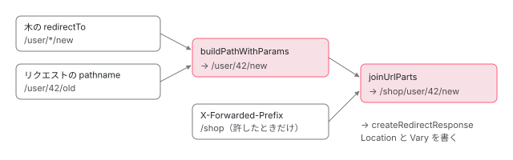

[目次](../README.md) › [SSR の守りと細部](README.md) › 第 6 回 / 全 10 回

# リダイレクトと URL の照合：redirect.ts と utils/url.ts

> createRedirectResponse が状態コードと Location と Vary を作る行、許す状態コード、ヘッダーを保つ修正（d9fb854c9a・998b8298e3・ff1160e301）、相対のリダイレクトですべての :param を置き換える修正（0bd22dae09）。utils/url.ts の joinUrlParts・buildPathWithParams・stripMatrixParams と、ルートの区切りを decode して照合する修正（53b9623b7b）、Router で URL を正規化して比べる修正（c34c569b07）。

angular/angular-cli · 読了 約 13 分 · 発展 · [サイトで読む（デモが動きます）](https://angular-deep-dive-cyan.vercel.app/chapter/ssrx-redirects)

---

SSR のサーバーは、ルートの設定の `redirectTo` や、描画中の `Router` のナビゲーションを、HTTP のリダイレクト（`Location` ヘッダーと 3xx の状態コード）にして返します。この章では、その応答を作る `createRedirectResponse` と、`Location` の文字列を組み立てる `utils/url.ts` の関数を全部、1 行ずつ読みます。続けて、リクエストの URL をルートの木と照らすときに **どこで decode するか**、描画の前後の URL を **どう正規化して比べるか**を読み、2026 年の 7 本の修正（ヘッダーを保つ・`Vary` を重ねない・すべての `:param`・区切りごとの decode・`Router` での正規化・`/g` の正規表現）を git show で確かめます。

読む対象は `packages/angular/ssr/src/utils/redirect.ts`・`src/utils/url.ts`（どちらもこのサイトでまだ引用していない）、`src/routes/route-tree.ts` の区切りを取り出す行、`src/routes/router.ts` の照合の行です。ルートの木の作り方と照合の順（完全一致 → `*` → `**`）、`redirectTo` を木に入れるときの `resolveRedirectTo` は [ssr-server-routes の章](../platform/05-ssr-server-routes.md)、`AngularServerApp.handle` の全体は [ssr-app-engine の章](../platform/04-ssr-app-engine.md)の 4 節にあります。

1. [1. resolveUrl](01-ssrx-resolve-url.md)
2. [2. location と allowedHosts](02-ssrx-location-allowed-hosts.md)
3. [3. サーバーの HttpClient](03-ssrx-server-http.md)
4. [4. ホストとヘッダーの検査](04-ssrx-host-validation.md)
5. [5. プロキシのヘッダー](05-ssrx-proxy-headers.md)
6. **6. リダイレクトと URL の照合**（この章）
7. [7. ロケールの選び方](07-ssrx-i18n-locale.md)
8. [8. Node のリクエストとレスポンス](08-ssrx-node-streams.md)
9. [9. アセットと重要 CSS](09-ssrx-assets-css.md)
10. [10. spec と issue](10-ssrx-tests-issues.md)

## 1. リダイレクトを作る 3 か所

📄 `angular-cli/packages/angular/ssr/src/app.ts` L166–172 （▶ の行: 166, 168–172）

```ts
166 ▶     const { redirectTo, status, renderMode, headers } = matchedRoute;
167 │ 
168 ▶     if (redirectTo !== undefined) {
169 ▶       return createRedirectResponse(
170 ▶         joinUrlParts(
171 ▶           request.headers.get('X-Forwarded-Prefix') ?? '',
172 ▶           buildPathWithParams(redirectTo, url.pathname),
```

1. **166・168 行目：ルートの木に `redirectTo` があれば、描画せずに返す**

   `matchedRoute` は 5 節の `ServerRouter.match` の結果です。166 行目で `status` と `headers`（サーバーのルートの設定に書いたもの）も取り出し、この呼び出しの続きの 2 つの引数として渡します。
2. **170〜172 行目：`Location` ＝ 接頭辞 ＋ `*` を埋めた `redirectTo`**

   171 行目の `X-Forwarded-Prefix` は、`trustProxyHeaders` で許したときだけ残っているヘッダーです（[第 5 回](05-ssrx-proxy-headers.md)）。172 行目の `buildPathWithParams` が、`/*/details` の `*` をリクエストのパスの同じ位置の区切りで埋めます（4 節）。

📄 `angular-cli/packages/angular/ssr/src/app.ts` L324–330 （▶ の行: 328–329）

```ts
324 │     if (result.hasNavigationError) {
325 │       return null;
326 │     }
327 │ 
328 ▶     if (result.redirectTo) {
329 ▶       return createRedirectResponse(result.redirectTo, responseInit.status, responseInit.headers);
330 │     }
```

2 か所目は、描画してみたら `Router` が別の URL にナビゲーションした場合です（ガードが `UrlTree` を返した、`navigate` を呼んだ、など）。`renderAngular` が 6 節の比べ方で「違う」と判断すると `result.redirectTo` が入り、329 行目で、コンポーネントやガードが `RESPONSE_INIT` に書いた `status` と `headers` を付けて返します。3 か所目は、ロケールが複数あるときに `/` を `Accept-Language` で選んだロケールへ送るもので、[第 7 回](07-ssrx-i18n-locale.md)で読みます。どれも同じ `createRedirectResponse` を呼びます。



*ルートの設定の redirectTo から Location ができるまで（app.ts 170〜172 行目）。\* を埋め、接頭辞とつなぎ、/ 1 つで始まる値にする。*

## 2. createRedirectResponse を 1 行ずつ

📄 `angular-cli/packages/angular/ssr/src/utils/redirect.ts` L9–24 （▶ の行: 12–13, 22–23）

```ts
 9 │ /**
10 │  * An set of HTTP status codes that are considered valid for redirect responses.
11 │  */
12 ▶ export const VALID_REDIRECT_RESPONSE_CODES: ReadonlySet<number> = new Set([
13 ▶   301, 302, 303, 307, 308,
14 │ ]);
15 │ 
16 │ /**
17 │  * Checks if the given HTTP status code is a valid redirect response code.
18 │  *
19 │  * @param code The HTTP status code to check.
20 │  * @returns `true` if the code is a valid redirect response code, `false` otherwise.
21 │  */
22 ▶ export function isValidRedirectResponseCode(code: number): boolean {
23 ▶   return VALID_REDIRECT_RESPONSE_CODES.has(code);
24 │ }
```

12・13 行目、許す状態コードは 301・302・303・307・308 の 5 つです。304（Not Modified）は 3xx ですがリダイレクトではないので入りません。この Set は、ルートの設定の `status` を取り出すときにも使われます（[ssr-server-routes](../platform/05-ssr-server-routes.md)）。

📄 `angular-cli/packages/angular/ssr/src/utils/redirect.ts` L26–53 （▶ の行: 37–38, 40–41, 47–48, 50–51）

```ts
26 │ /**
27 │  * Creates an HTTP redirect response with a specified location and status code.
28 │  *
29 │  * @param location - The URL to which the response should redirect.
30 │  * @param status - The HTTP status code for the redirection. Defaults to 302 (Found).
31 │  *                 See: https://developer.mozilla.org/en-US/docs/Web/API/Response/redirect_static#status
32 │  * @param headers - Additional headers to include in the response.
33 │  * @returns A `Response` object representing the HTTP redirect.
34 │  */
35 │ export function createRedirectResponse(
36 │   location: string,
37 ▶   status = 302,
38 ▶   headers?: Record<string, string> | Headers,
39 │ ): Response {
40 ▶   if (ngDevMode && !isValidRedirectResponseCode(status)) {
41 ▶     throw new Error(
42 │       `Invalid redirect status code: ${status}. ` +
43 │         `Please use one of the following redirect response codes: ${[...VALID_REDIRECT_RESPONSE_CODES.values()].join(', ')}.`,
44 │     );
45 │   }
46 │ 
47 ▶   const resHeaders = headers instanceof Headers ? headers : new Headers(headers);
48 ▶   if (ngDevMode && resHeaders.has('location')) {
49 │     // eslint-disable-next-line no-console
50 ▶     console.warn(
51 ▶       `Location header "${resHeaders.get('location')}" will be ignored and set to "${location}".`,
52 │     );
53 │   }
```

1. **37 行目：状態コードの既定は 302**

   呼ぶ側が `undefined` を渡すと既定の引数が効くので、`RESPONSE_INIT` に `status` を書いていなければ 302 です。
2. **40〜45 行目：開発モードのときだけ、状態コードを調べて投げる**

   `ngDevMode` は本番のビルドで `false` になる大域の印です。本番では調べないので、200 を渡すと「200 で `Location` 付き」の応答がそのまま作られます（記録）。
3. **47 行目：`Headers` を渡されたら、新しく作らずにそのまま使う**

   d9fb854c9a が足した形です（3 節）。渡した `Headers` に `Vary` と `Location` が書き込まれます（記録で確かめた）。
4. **48〜53 行目：渡したヘッダーに `Location` があれば、開発モードで警告**

   警告の文のとおり、その値は使われず、67 行目で上書きされます。

📄 `angular-cli/packages/angular/ssr/src/utils/redirect.ts` L55–73 （▶ の行: 56–57, 59, 61–62, 66–67, 69–71）

```ts
55 │   // Ensure unique values for Vary header
56 ▶   const varyArray = resHeaders.get('Vary')?.split(',') ?? [];
57 ▶   const varySet = new Set(['X-Forwarded-Prefix']);
58 │   for (const vary of varyArray) {
59 ▶     const value = vary.trim();
60 │ 
61 ▶     if (value) {
62 ▶       varySet.add(value);
63 │     }
64 │   }
65 │ 
66 ▶   resHeaders.set('Vary', [...varySet].join(', '));
67 ▶   resHeaders.set('Location', location);
68 │ 
69 ▶   return new Response(null, {
70 ▶     status,
71 ▶     headers: resHeaders,
72 │   });
73 │ }
```

1. **56 行目：渡された `Vary` を `,` で分ける**

   `Vary` は「この応答は、リクエストのどのヘッダーによって変わるか」をキャッシュ（CDN やブラウザ）に伝えるヘッダーです。
2. **57 行目：`X-Forwarded-Prefix` を最初に入れた Set**

   1 節の 171 行目のとおり、`Location` は `X-Forwarded-Prefix` で変わります。これを `Vary` に書かないと、CDN が「接頭辞 A のときのリダイレクト」を、接頭辞 B のリクエストにも返してしまいます。#32501（[第 5 回](05-ssrx-proxy-headers.md)の 8 節）が「キャッシュを汚す」と書いていたのは、この話です。
3. **58〜64 行目：前後の空白を落とし、空でなければ足す**

   Set なので同じ文字列は 1 つになります。ただし大文字と小文字は区別するので、`Vary: x-forwarded-prefix` を渡すと `X-Forwarded-Prefix, x-forwarded-prefix` になります（記録）。HTTP のヘッダー名は大文字と小文字を区別しないので、意味は同じものが 2 つ並びます。
4. **66・67 行目：`Vary` と `Location` を書く。69〜72 行目：本文なしの `Response`**

   `Location` は 67 行目で必ず上書きされるので、呼ぶ側のヘッダーからは変えられません。

## 3. ヘッダーを保つ 3 本の修正

📄 `git show 998b8298e3 -- redirect.ts / app.ts（2 つ目の hunk）`

```
# 998b8298e3 2026-03-16 fix(@angular/ssr): support custom headers in redirect responses
--- a/packages/angular/ssr/src/utils/redirect.ts
+++ b/packages/angular/ssr/src/utils/redirect.ts
@@ -27,9 +27,14 @@ export function isValidRedirectResponseCode(code: number): boolean {
  * @param location - The URL to which the response should redirect.
  * @param status - The HTTP status code for the redirection. Defaults to 302 (Found).
  *                 See: https://developer.mozilla.org/en-US/docs/Web/API/Response/redirect_static#status
+ * @param headers - Additional headers to include in the response.
  * @returns A `Response` object representing the HTTP redirect.
  */
-export function createRedirectResponse(location: string, status = 302): Response {
+export function createRedirectResponse(
+  location: string,
+  status = 302,
+  headers?: Record<string, string>,
+): Response {
   if (ngDevMode && !isValidRedirectResponseCode(status)) {
     throw new Error(
       `Invalid redirect status code: ${status}. ` +
@@ -37,10 +42,25 @@ export function createRedirectResponse(location: string, status = 302): Response
     );
   }
 
+  const resHeaders = new Headers(headers);
+  if (ngDevMode && resHeaders.has('location')) {
+    // eslint-disable-next-line no-console
+    console.warn(
+      `Location header "${resHeaders.get('location')}" will ignored and set to "${location}".`,
+    );
+  }
+
+  let vary = resHeaders.get('Vary') ?? '';
+  if (vary) {
+    vary += ', ';
+  }
+  vary += 'X-Forwarded-Prefix';
+
+  resHeaders.set('Vary', vary);
+  resHeaders.set('Location', location);
+
   return new Response(null, {
     status,
-    headers: {
-      'Location': location,
-    },
+    headers: resHeaders,
   });
 }

# 998b8298e3 2026-03-16 fix(@angular/ssr): support custom headers in redirect responses
--- a/packages/angular/ssr/src/app.ts
+++ b/packages/angular/ssr/src/app.ts
@@ -199,6 +199,7 @@ export class AngularServerApp {
           buildPathWithParams(redirectTo, url.pathname),
         ),
         status,
+        headers,
       );
     }
 
```
*2026-03-16：リダイレクトに追加のヘッダーを渡せるようにした*

998b8298e3 の前の `createRedirectResponse` は `Location` だけの応答を作っていました。ルートの設定の `headers`（`Cache-Control` など）を書いても、リダイレクトでは消えていました。この修正で 3 つ目の引数ができ、`Vary: X-Forwarded-Prefix` を付けるのもこのときからです。`Vary` は「足す」形で、spec は `'Host, X-Forwarded-Prefix'` を期待していました。

📄 `git show ff1160e301`

```
# ff1160e301 2026-03-17 fix(@angular/ssr): ensure unique values in redirect response Vary header
--- a/packages/angular/ssr/src/utils/redirect.ts
+++ b/packages/angular/ssr/src/utils/redirect.ts
@@ -50,13 +50,18 @@ export function createRedirectResponse(
     );
   }
 
-  let vary = resHeaders.get('Vary') ?? '';
-  if (vary) {
-    vary += ', ';
+  // Ensure unique values for Vary header
+  const varyArray = resHeaders.get('Vary')?.split(',') ?? [];
+  const varySet = new Set(['X-Forwarded-Prefix']);
+  for (const vary of varyArray) {
+    const value = vary.trim();
+
+    if (value) {
+      varySet.add(value);
+    }
   }
-  vary += 'X-Forwarded-Prefix';
 
-  resHeaders.set('Vary', vary);
+  resHeaders.set('Vary', [...varySet].join(', '));
   resHeaders.set('Location', location);
 
   return new Response(null, {
```
*2026-03-17：Vary を Set で作り、X-Forwarded-Prefix を 1 回だけにした*

翌日の ff1160e301 は、渡した `Vary` にすでに `X-Forwarded-Prefix` があると 2 回並ぶ問題を、Set で直しました。`X-Forwarded-Prefix` が先頭に来るようになったので、spec の期待も `'X-Forwarded-Prefix, Host'` に変わっています。

📄 `git show d9fb854c9a -- app.ts / redirect.ts（後ろの 2 hunk）`

```
# d9fb854c9a 2026-06-26 fix(@angular/ssr): preserve response headers during redirect
--- a/packages/angular/ssr/src/app.ts
+++ b/packages/angular/ssr/src/app.ts
@@ -353,7 +353,7 @@ export class AngularServerApp {
     }
 
     if (result.redirectTo) {
-      return createRedirectResponse(result.redirectTo, responseInit.status, headers);
+      return createRedirectResponse(result.redirectTo, responseInit.status, responseInit.headers);
     }
 
     if (renderMode === RenderMode.Prerender) {

# d9fb854c9a 2026-06-26 fix(@angular/ssr): preserve response headers during redirect
--- a/packages/angular/ssr/src/utils/redirect.ts
+++ b/packages/angular/ssr/src/utils/redirect.ts
@@ -33,7 +35,7 @@ export function isValidRedirectResponseCode(code: number): boolean {
 export function createRedirectResponse(
   location: string,
   status = 302,
-  headers?: Record<string, string>,
+  headers?: Record<string, string> | Headers,
 ): Response {
   if (ngDevMode && !isValidRedirectResponseCode(status)) {
     throw new Error(
@@ -42,7 +44,7 @@ export function createRedirectResponse(
     );
   }
 
-  const resHeaders = new Headers(headers);
+  const resHeaders = headers instanceof Headers ? headers : new Headers(headers);
   if (ngDevMode && resHeaders.has('location')) {
     // eslint-disable-next-line no-console
     console.warn(
```
*2026-06-26：描画中のリダイレクトで RESPONSE\_INIT のヘッダーを保つ*

d9fb854c9a は #33473（「`UrlTree` を返すガードのリダイレクトで、`RESPONSE_INIT` のヘッダーが無視される」）を直しました。1 節の 329 行目は、それまで 998b8298e3 が渡したルートの設定の `headers` を使っていて、ガードやコンポーネントが `RESPONSE_INIT` に書いた `Set-Cookie` などは落ちていました。`responseInit.headers` は `Headers` のこともあるので、47 行目の「`Headers` ならそのまま使う」が一緒に入りました。spec は `app_spec.ts` の既存の it に `X-Redirect-Header` の 1 行を足す形です。

## 4. utils/url.ts の関数を全部

### スラッシュの 4 つ

📄 `angular-cli/packages/angular/ssr/src/utils/url.ts` L23–45 （▶ の行: 25, 44）

````ts
23 │ export function stripTrailingSlash(url: string): string {
24 │   // Check if the last character of the URL is a slash
25 ▶   return url.length > 1 && url.at(-1) === '/' ? url.slice(0, -1) : url;
26 │ }
27 │ 
28 │ /**
29 │  * Removes the leading slash from a URL if it exists.
30 │  *
31 │  * @param url - The URL string from which to remove the leading slash.
32 │  * @returns The URL string without a leading slash.
33 │  *
34 │  * @example
35 │  * ```js
36 │  * stripLeadingSlash('/path'); // 'path'
37 │  * stripLeadingSlash('/path/');  // 'path/'
38 │  * stripLeadingSlash('/'); // '/'
39 │  * stripLeadingSlash(''); // ''
40 │  * ```
41 │  */
42 │ export function stripLeadingSlash(url: string): string {
43 │   // Check if the first character of the URL is a slash
44 ▶   return url.length > 1 && url[0] === '/' ? url.slice(1) : url;
45 │ }
````

📄 `angular-cli/packages/angular/ssr/src/utils/url.ts` L59–79 （▶ の行: 61, 78）

````ts
59 │ export function addLeadingSlash(url: string): string {
60 │   // Check if the URL already starts with a slash
61 ▶   return url[0] === '/' ? url : `/${url}`;
62 │ }
63 │ 
64 │ /**
65 │  * Adds a trailing slash to a URL if it does not already have one.
66 │  *
67 │  * @param url - The URL string to which the trailing slash will be added.
68 │  * @returns The URL string with a trailing slash.
69 │  *
70 │  * @example
71 │  * ```js
72 │  * addTrailingSlash('path'); // 'path/'
73 │  * addTrailingSlash('path/'); // 'path/'
74 │  * ```
75 │  */
76 │ export function addTrailingSlash(url: string): string {
77 │   // Check if the URL already end with a slash
78 ▶   return url.at(-1) === '/' ? url : `${url}/`;
79 │ }
````

25 行目の `stripTrailingSlash` と 44 行目の `stripLeadingSlash` は、長さが 2 以上のときだけ 1 文字削ります。`/` だけの文字列は残ります。61 行目の `addLeadingSlash` と 78 行目の `addTrailingSlash` は、無ければ 1 つ足します。どれも 1 つだけを扱い、`//` は気にしません。

### joinUrlParts：先頭と末尾の / を全部削ってつなぐ

📄 `angular-cli/packages/angular/ssr/src/utils/url.ts` L97–124 （▶ の行: 101, 110–111, 114–115, 118–119, 123）

```ts
 97 │ export function joinUrlParts(...parts: string[]): string {
 98 │   const normalizedParts: string[] = [];
 99 │ 
100 │   for (const part of parts) {
101 ▶     if (part === '') {
102 │       // Skip any empty parts
103 │       continue;
104 │     }
105 │ 
106 │     let start = 0;
107 │     let end = part.length;
108 │ 
109 │     // Use "Pointers" to avoid intermediate slices
110 ▶     while (start < end && part[start] === '/') {
111 ▶       start++;
112 │     }
113 │ 
114 ▶     while (end > start && part[end - 1] === '/') {
115 ▶       end--;
116 │     }
117 │ 
118 ▶     if (start < end) {
119 ▶       normalizedParts.push(part.slice(start, end));
120 │     }
121 │   }
122 │ 
123 ▶   return addLeadingSlash(normalizedParts.join('/'));
124 │ }
```

1. **101 行目：空の部分は飛ばす**

   1 節の 171 行目で `X-Forwarded-Prefix` が無いと `''` が来ますが、ここで消えます。
2. **110〜116 行目：先頭と末尾の `/` を、`while` で全部削る**

   文字列を切らずに、`start` と `end` の 2 つの位置だけを動かします（109 行目のコメント「Pointers」）。`///a//` は `a` になります。これが f086eccc36（[第 5 回](05-ssrx-proxy-headers.md)の 8 節）の修正で、前は `if` で 1 つだけでした。
3. **118・119 行目：残りがあれば足す。123 行目：`/` でつなぎ、先頭に `/` を 1 つ**

   結果は必ず `/` 1 つで始まり、`//` では始まりません。だから `Location` がプロトコル相対の URL（外のサイト）になりません。

この関数はパスだけを想定していて、最後の部分に `?` や `#` が付いていても、その後ろの末尾の `/` まで削ります。`joinUrlParts('/base/', '/login/?next=/a/')` は `/base/login/?next=/a` です（記録）。これは #34511（2026-10-23）として出され、44129f66a3 より新しい本家の 194b64137e で直りました（8 節）。

### stripIndexHtmlFromURL と stripMatrixParams

📄 `angular-cli/packages/angular/ssr/src/utils/url.ts` L143–153 （▶ の行: 144, 147）

```ts
143 │ export function stripIndexHtmlFromURL(url: URL): URL {
144 ▶   if (url.pathname.endsWith('/index.html')) {
145 │     const modifiedURL = new URL(url);
146 │     // Remove '/index.html' from the pathname
147 ▶     modifiedURL.pathname = modifiedURL.pathname.slice(0, /** '/index.html'.length */ -11);
148 │ 
149 │     return modifiedURL;
150 │   }
151 │ 
152 │   return url;
153 │ }
```

📄 `angular-cli/packages/angular/ssr/src/utils/url.ts` L206–228 （▶ の行: 206, 227）

````ts
206 ▶ const MATRIX_PARAMS_REGEX = /;[^/]+/g;
207 │ 
208 │ /**
209 │  * Removes Angular matrix parameters from a given URL path.
210 │  *
211 │  * This function takes a URL path string and removes any matrix parameters.
212 │  * Matrix parameters are parts of a URL segment that start with a semicolon `;`.
213 │  *
214 │  * @param pathname - The URL path to remove matrix parameters from.
215 │  * @returns The URL path with matrix parameters removed.
216 │  *
217 │  * @example
218 │  * ```ts
219 │  * stripMatrixParams('/path;param=value'); // returns '/path'
220 │  * stripMatrixParams('/path;param=value/to;p=1/resource'); // returns '/path/to/resource'
221 │  * stripMatrixParams('/path/to/resource'); // returns '/path/to/resource'
222 │  * ```
223 │  */
224 │ export function stripMatrixParams(pathname: string): string {
225 │   // Use a regular expression to remove matrix parameters.
226 │   // This regex finds all occurrences of a semicolon followed by any characters
227 ▶   return pathname.includes(';') ? pathname.replace(MATRIX_PARAMS_REGEX, '') : pathname;
228 │ }
````

144・147 行目、パスが `/index.html` で終われば、その 11 文字を削った新しい `URL` を返します（元の `URL` は変えない）。206 行目の `MATRIX_PARAMS_REGEX` は、`;` から次の `/` の手前までを消す正規表現で、`g`（全部に当てる）が付いています。227 行目は `;` を含むときだけ `replace` します。`g` の付いた正規表現を使い回すのは 7 節の落とし穴と同じ形ですが、`replace` は毎回 `lastIndex` を 0 から始めて最後に 0 に戻すので、ここでは問題になりません（記録の最後の表）。

### buildPathWithParams：\* を同じ位置の区切りで埋める

📄 `angular-cli/packages/angular/ssr/src/utils/url.ts` L184–204 （▶ の行: 185, 189, 193–194, 197–200, 203）

```ts
184 │ export function buildPathWithParams(toPath: string, fromPath: string): string {
185 ▶   if (toPath[0] !== '/') {
186 │     throw new Error(`Invalid toPath: The string must start with a '/'. Received: '${toPath}'`);
187 │   }
188 │ 
189 ▶   if (fromPath[0] !== '/') {
190 │     throw new Error(`Invalid fromPath: The string must start with a '/'. Received: '${fromPath}'`);
191 │   }
192 │ 
193 ▶   if (!toPath.includes('/*')) {
194 ▶     return toPath;
195 │   }
196 │ 
197 ▶   const fromPathParts = fromPath.split('/');
198 ▶   const toPathParts = toPath.split('/');
199 ▶   const resolvedParts = toPathParts.map((part, index) =>
200 ▶     toPathParts[index] === '*' ? fromPathParts[index] : part,
201 │   );
202 │ 
203 ▶   return joinUrlParts(...resolvedParts);
204 │ }
```

1. **185〜191 行目：どちらも `/` で始まらなければ投げる**
2. **193・194 行目：`/*` を含まなければ、そのまま返す**
3. **197〜201 行目：両方を `/` で分け、`toPath` の `*` の位置に、`fromPath` の同じ番号の区切りを入れる**

   `('/*/details', '/123/abc')` は `['', '*', 'details']` の 1 番目に `'123'` が入って `/123/details`。203 行目で `joinUrlParts` に通します。

埋めるのは `*` だけです。ルートの木には、ルートの `path` の `:id` が `*` として入るので（[ssr-server-routes](../platform/05-ssr-server-routes.md)）、相対の `redirectTo` はこれで埋まります。0bd22dae09（2026-07-06、#33504）は、その `*` への置き換えが、`:param1/:param2` のように 2 つ以上あるとき最初の 1 つだけだった問題を直しました。

📄 `git show 0bd22dae09 -- ng-routes.ts`

```ts
# 0bd22dae09 2026-07-06 fix(@angular/ssr): replace all route parameters when resolving relative redirects
--- a/packages/angular/ssr/src/routes/ng-routes.ts
+++ b/packages/angular/ssr/src/routes/ng-routes.ts
@@ -547,7 +547,7 @@ function resolveRedirectTo(routePath: string, redirectTo: string): string {
   }
 
   // Resolve relative redirectTo based on the current route path.
-  const segments = routePath.replace(URL_PARAMETER_REGEXP, '*').split('/');
+  const segments = routePath.replace(URL_PARAMETER_GLOBAL_REGEXP, '*').split('/');
   segments.pop(); // Remove the last segment to make it relative.
 
   return joinUrlParts(...segments, redirectTo);
```
*g の無い正規表現で replace していたので、最初の :param だけが \* になっていた*

一方、`redirectTo` の文字列そのものに書いた `:id`（`old/:id` → `new/:id`）は `*` にならず、`buildPathWithParams('/new/:id', '/old/5')` は `/new/:id` のままです（記録）。これは #34410（2026-10-20）で、新しい本家の 97ed36ec4f で直りました（8 節）。また、`toPath` の `*` の位置に `fromPath` の区切りが無いと、200 行目が `undefined` を入れ、203 行目の `joinUrlParts` の中で `TypeError` になります（記録の `('/a/*', '/x')`）。ルートの木で照らした結果を渡す限り、区切りの数は足りています。

### constructUrl：呼ばれていない関数

📄 `angular-cli/packages/angular/ssr/src/utils/url.ts` L230–243 （▶ の行: 241–242）

```ts
230 │ /**
231 │  * Constructs a decoded URL string from its components.
232 │  *
233 │  * This function joins the pathname (with trailing slash removed), search, and hash,
234 │  * and then decodes the result.
235 │  *
236 │  * @param pathname - The path of the URL.
237 │  * @param search - The query string of the URL (including '?').
238 │  * @param hash - The hash fragment of the URL (including '#').
239 │  * @returns The constructed and decoded URL string.
240 │  */
241 ▶ export function constructUrl(pathname: string, search: string, hash: string): string {
242 ▶   return decodeURIComponent([stripTrailingSlash(pathname), search, hash].join(''));
243 │ }
```

242 行目でパス・クエリ・ハッシュをつないで丸ごと `decodeURIComponent` します。44129f66a3 の `packages/angular/ssr` の中で、この関数を呼んでいる場所は 1 つもありません（`grep -rn constructUrl` で定義の行だけ）。新しい本家の 8b28a552b2（2026-11-01）が「61a027dba7 で呼び手なしに足され、それ以来どこからも参照されていない」として消しています。

## 5. 照合で decode する場所（53b9623b7b）

📄 `angular-cli/packages/angular/ssr/src/routes/router.ts` L76–91 （▶ の行: 88–89, 91）

```ts
76 │    * Matches a request URL against the route tree to retrieve route metadata.
77 │    *
78 │    * This method strips 'index.html' from the URL if it is present and then attempts
79 │    * to find a match in the route tree. If a match is found, it returns the associated
80 │    * route metadata; otherwise, it returns `undefined`.
81 │    *
82 │    * @param url - The URL to be matched against the route tree.
83 │    * @returns The metadata for the matched route or `undefined` if no match is found.
84 │    */
85 │   match(url: URL): RouteTreeNodeMetadata | undefined {
86 │     // Strip 'index.html' from URL if present.
87 │     // A request to `http://www.example.com/page/index.html` will render the Angular route corresponding to `http://www.example.com/page`.
88 ▶     let { pathname } = stripIndexHtmlFromURL(url);
89 ▶     pathname = stripMatrixParams(pathname);
90 │ 
91 ▶     return this.routeTree.match(pathname);
```

📄 `angular-cli/packages/angular/ssr/src/routes/route-tree.ts` L203–211 （▶ の行: 210）

```ts
203 │   /**
204 │    * Extracts the path segments from a given route string.
205 │    *
206 │    * @param route - The route string from which to extract segments.
207 │    * @returns An array of path segments.
208 │    */
209 │   private getPathSegments(route: string): string[] {
210 ▶     return route.split('/').filter(Boolean).map(decodeURIComponent);
211 │   }
```

1. **88・89 行目：`/index.html` とマトリクスのパラメータを外した `pathname`**

   `URL` の `pathname` はパーセントエンコードされたままです（`/user/Bob%20%2F%20Roberts`）。
2. **91 行目 → 210 行目：`/` で分けてから、区切りごとに decode する**

   `split('/')` で区切りに分け、空のものを捨て、**そのあとで** 1 つずつ `decodeURIComponent` します。`%2F`（エンコードされた `/`）は区切りの中の文字として残り、`Bob / Roberts` という 1 つの区切りになります。

📄 `git show 53b9623b7b`

```
# 53b9623b7b 2026-04-27 fix(@angular/ssr): decode route segments when building and matching route tree
--- a/packages/angular/ssr/src/routes/route-tree.ts
+++ b/packages/angular/ssr/src/routes/route-tree.ts
@@ -207,7 +207,7 @@ export class RouteTree<AdditionalMetadata extends Record<string, unknown> = {}>
    * @returns An array of path segments.
    */
   private getPathSegments(route: string): string[] {
-    return route.split('/').filter(Boolean);
+    return route.split('/').filter(Boolean).map(decodeURIComponent);
   }
 
   /**

# 53b9623b7b 2026-04-27 fix(@angular/ssr): decode route segments when building and matching route tree
--- a/packages/angular/ssr/src/routes/router.ts
+++ b/packages/angular/ssr/src/routes/router.ts
@@ -87,7 +87,6 @@ export class ServerRouter {
     // A request to `http://www.example.com/page/index.html` will render the Angular route corresponding to `http://www.example.com/page`.
     let { pathname } = stripIndexHtmlFromURL(url);
     pathname = stripMatrixParams(pathname);
-    pathname = decodeURIComponent(pathname);
 
     return this.routeTree.match(pathname);
   }
```
*decode を「全体に 1 回」から「分けたあと区切りごと」に移した差分*

前は router.ts で `pathname` 全体を先に decode していたので、`%2F` が本物の `/` になり、`/user/Bob / Roberts` が 3 つの区切りに分かれて `/user/*` に一致しませんでした（#33044「ルートのパラメータに `/` があると SSR が 404」）。210 行目はルートの木に**入れるとき**（`insert`）にも同じ関数を使うので、`'a b'` のようなルートと `/a%20b` のリクエストが同じ文字列で比べられます。

| リクエストのパス | 今の ServerRouter.match | 53b9623b7b の前 |
| --- | --- | --- |
| /user/42 | /user/\* | /user/\* |
| /user/Bob%20%2F%20Roberts | /user/\* | （無し） |
| /user/a%2Fb | /user/\* | （無し） |
| /a%20b | /a b | /a b |
| /home;x=1 | /home | /home |
| /home/index.html | /home | /home |
| /docs/x/y | /docs/\*\* | /docs/\*\* |
| /user/42/extra | （無し） | （無し） |

木は `/user/*`・`/docs/**`・`/a b`・`/home` の 4 つ。「前」の列は、`git show 53b9623b7b^` の route-tree.ts と、差分で消えた 3 行の `match` を同じ入力で動かしたものです。

## 6. Router で正規化して比べる（c34c569b07）

📄 `angular-cli/packages/angular/ssr/src/utils/ng.ts` L220–238 （▶ の行: 227–228, 230, 233, 235, 237）

```ts
220 │ function constructSerializedUrl(
221 │   router: Router,
222 │   url: { pathname: string; search: string; hash: string },
223 │   prefix?: string | null,
224 │ ): string {
225 │   const { pathname, hash, search } = url;
226 │   const urlParts: string[] = [];
227 ▶   if (prefix && !addTrailingSlash(pathname).startsWith(addTrailingSlash(prefix))) {
228 ▶     urlParts.push(joinUrlParts(prefix, pathname));
229 │   } else {
230 ▶     urlParts.push(stripTrailingSlash(pathname));
231 │   }
232 │ 
233 ▶   urlParts.push(search, hash);
234 │ 
235 ▶   const urlTree = router.parseUrl(urlParts.join(''));
236 │ 
237 ▶   return router.serializeUrl(urlTree);
238 │ }
```

1 節の 2 か所目で、`renderAngular` は「リクエストの URL」と「描画が終わったときの `PlatformLocation` の URL」をこの関数にかけて比べ、違えばリダイレクトにします（呼ぶ行は [ssr-app-engine](../platform/04-ssr-app-engine.md) の 7 節の引用）。227・228 行目で接頭辞（`APP_BASE_HREF` か `X-Forwarded-Prefix`）がまだ付いていなければ付け、230 行目で末尾の `/` を外し、233 行目でクエリとハッシュをつなぎます。**235・237 行目で、その文字列を `Router` の `parseUrl` で `UrlTree` にしてから `serializeUrl` で文字列に戻します。**

📄 `git show c34c569b07 -- ng.ts（呼ぶ側と最後の hunk）`

```
# c34c569b07 2026-04-27 fix(@angular/ssr): use router to normalize URLs for comparison
--- a/packages/angular/ssr/src/utils/ng.ts
+++ b/packages/angular/ssr/src/utils/ng.ts
@@ -126,8 +126,8 @@ export async function renderAngular(
         envInjector.get(REQUEST, null, { optional: true })?.headers.get('X-Forwarded-Prefix');
 
       const { pathname, search, hash } = envInjector.get(PlatformLocation);
-      const finalUrl = constructDecodedUrl({ pathname, search, hash }, requestPrefix);
-      const urlToRenderString = constructDecodedUrl(urlToRender, requestPrefix);
+      const finalUrl = constructSerializedUrl(router, { pathname, search, hash }, requestPrefix);
+      const urlToRenderString = constructSerializedUrl(router, urlToRender, requestPrefix);
 
       if (urlToRenderString !== finalUrl) {
         redirectTo = [pathname, search, hash].join('');
@@ -219,5 +224,7 @@ function constructDecodedUrl(
 
   urlParts.push(search, hash);
 
-  return decodeURIComponent(urlParts.join(''));
+  const urlTree = router.parseUrl(urlParts.join(''));
+
+  return router.serializeUrl(urlTree);
 }
```
*decodeURIComponent で比べるのをやめ、Router の読み方で比べるようにした差分*

前は 2 つを `decodeURIComponent` した文字列で比べていました。`Router` はクエリの `+`、値の無い `?empty`、同じ名前のパラメータ、`//home` を自分の規則で並べ直すので、描画後の URL とリクエストの URL が「意味は同じなのに文字列が違う」ことになり、不要な 302 が返っていました（#33053「SSR が正規化した URL へ 302 する」）。比べる両側を同じ `Router` の読み書きに通せば、並べ直し方も同じになります。差分の spec には `?scope=email+profile`・`?bbb=1&aaa=2&bbb=3`・`//home` などが 200 を返す it が足されました。

ここでの `Router` の `parseUrl` と `serializeUrl` の中身（`DefaultUrlSerializer`）は [router-url-tree の章](../router/02-router-url-tree.md)で読めます。

## 7. 状態を持つ正規表現（0fdcde5426）

📄 `git show 0fdcde5426`

```
# 0fdcde5426 2026-05-11 fix(@angular/ssr): remove stateful flag from URL_PARAMETER_REGEXP
--- a/packages/angular/ssr/src/routes/ng-routes.ts
+++ b/packages/angular/ssr/src/routes/ng-routes.ts
@@ -74,9 +74,14 @@ const MODULE_PRELOAD_MAX = 10;
 const CATCH_ALL_REGEXP = /\/(\*\*)$/;
 
 /**
- * Regular expression to match segments preceded by a colon in a string.
+ * Regular expression to match a segment preceded by a colon in a string.
  */
-const URL_PARAMETER_REGEXP = /(?<!\\):([^/]+)/g;
+const URL_PARAMETER_REGEXP = /(?<!\\):([^/]+)/;
+
+/**
+ * Regular expression to match all segments preceded by a colon in a string.
+ */
+const URL_PARAMETER_GLOBAL_REGEXP = new RegExp(URL_PARAMETER_REGEXP, 'g');
 
 /**
  * Additional metadata for a server configuration route tree.
@@ -464,7 +469,7 @@ async function* handleSSGRoute(
       for (const params of parameters) {
         const replacer = handlePrerenderParamsReplacement(params, currentRoutePath);
         const routeWithResolvedParams = currentRoutePath
-          .replace(URL_PARAMETER_REGEXP, replacer)
+          .replace(URL_PARAMETER_GLOBAL_REGEXP, replacer)
           .replace(CATCH_ALL_REGEXP, replacer);
 
         yield {
```
*test に使う正規表現から g を外し、replace 用に g 付きを別に作った差分*

`g` の付いた正規表現は、`test` や `exec` のたびに `lastIndex`（次にどこから探すか）を覚えます。同じ正規表現のオブジェクトで別の文字列を `test` すると、**前の文字列で止まった位置から**探し始めます。コミットの本文のとおり、ルートを取り出す処理が `URL_PARAMETER_REGEXP.test(path)` を何度も呼ぶので、2 つ目以降のパラメータ付きのルートで一致に失敗し、`getPrerenderParams` が黙って飛ばされていました（#33154）。Node で見るとこうです。

| 同じ /(?&lt;!\\\\):(\[^/\]+)/g で test した文字列（順に） | 前の lastIndex | test の結果 | 後の lastIndex | g なしの結果 |
| --- | --- | --- | --- | --- |
| /product/:id | 0 | true | 12 | true |
| /user/:name | 12 | false | 0 | true |
| /product/:id | 0 | true | 12 | true |
| /static | 12 | false | 0 | false |
| /product/:id | 0 | true | 12 | true |

1 回目の `/product/:id` で `lastIndex` が 12 になり、2 回目の `/user/:name`（11 文字）は 12 文字目から探すので `false`、そこで 0 に戻り、3 回目はまた当たる、を繰り返します。`:name` を持つのに `false` になる行が、#33154 の起きていたことです。同じ `g` 付きでも `replace` は、前の `lastIndex` が 12 でも全部を置き換え（`'/:a/:b'` → `/*/*`）、終わると 0 に戻しました。だから 4 節の 227 行目は安全で、0fdcde5426 も `replace` の側には `g` 付きを残しています。0bd22dae09 は逆に、`replace` に `g` の無い方を使っていた行でした。2 本の修正は、同じ正規表現の「`g` の有無」を両側から直したものです。

> [!TIP]
> **新卒エンジニアへ**
>
> 使い回す正規表現（モジュールの定数など）には、`test` に使うなら `g` を付けない、と覚えておくと安全です。`g` が要るのは `replace`・`matchAll` で「全部」を相手にするときで、その用途には別の定数を作ります（0fdcde5426 の `URL_PARAMETER_GLOBAL_REGEXP` がその形です）。

## 8. 新しい本家での変化（44129f66a3 より後）

この章は 44129f66a3（2026-09-10）の行で読みました。gh で読んだだけですが、それより後の本家では、この章の url.ts と照合の周りがまとまって変わっています。

| コミット | 日付 | 内容（コミットの題） | この章のどこ |
| --- | --- | --- | --- |
| b3bbada1ef | 2026-10-12 | 相対のリダイレクトを親のルートに対して解決する（#34300） | resolveRedirectTo（ssr-server-routes） |
| f2cd8c8cf7 | 2026-10-12 | 相対のリダイレクトでクエリを保つ（#34298）。route-tree.ts に `relativeRedirect` を足す | 1 節の 166〜172 行目 |
| 97ed36ec4f・8aa16b6f9f | 2026-10-12 | `redirectTo` の `:id` と `q=:term` を埋める（#34410・PR #34321） | 4 節の buildPathWithParams |
| 92033cea10 | 2026-10-23 | `buildPathWithParams` などを `buildUrlWithParams` にまとめ、`DefaultUrlSerializer` を使う | 4 節 |
| 194b64137e | 2026-10-26 | リダイレクトの URL のクエリとハッシュの末尾の `/` を保つ（#34511） | 4 節の joinUrlParts |
| 267064ca74 | 2026-10-26 | ルートのパスとリダイレクトの URL を、区切りとクエリの構造に分けて扱う | 4 節 |
| 8b28a552b2 | 2026-11-01 | 使われていない `constructUrl` を消す | 4 節の 241・242 行目 |

傾向ははっきりしています。**サーバーが `Router` を走らせずにリダイレクトを作るところ**（1 節の 1 か所目）で、`Router` と違う答えを出していた細部が、1 つずつ `Router` の振る舞いに揃えられています。6 節の c34c569b07 と同じ向きです。一方、同じ考えの #34090（「サーバーの照合と `@angular/router` が違うルートを選ぶ」）は 2026-09-14 に「予定なし」で閉じられ、#33555（照合の違いで、クライアント専用のデータが公開のキャッシュの設定で返り得る）は開いたままです。

## 9. DEMO と記録

> **🧪 DEMO — redirect.ts と url.ts に入力を渡した記録（再生）**
>
> これは Node で動かした記録です。../angular-cli（44129f66a3）の `utils/redirect.ts`・`utils/url.ts`・`routes/route-tree.ts`・`routes/router.ts` を esbuild で束ね、関数をそのまま呼びました（`router.ts` が連れてくる `@angular/*` はこのサイトの依存 22.1.x）。`ngDevMode` は行ごとに `true` か `false` を入れています。ページの上では何も走りません。
>
> `new Headers({ 'Set-Cookie': 'sid=1' })` を渡すと、その同じオブジェクトに `Location` が書かれ（true）、`Vary` は X-Forwarded-Prefix、応答の `Set-Cookie` は sid=1 でした。
>
> ▶ [このデモはサイトで動かせます](https://angular-deep-dive-cyan.vercel.app/chapter/ssrx-redirects)

`isValidRedirectResponseCode` の記録： `301`→許す、`302`→許す、`303`→許す、`304`→許さない、`307`→許す、`308`→許す、`200`→許さない

📄 `scratchpad/ssrx-demo/ssrx-redirects/build.mjs`

```js
// 使い方: node build.mjs <記録のスクリプト.ts> <出力.mjs>  →  node <出力.mjs> > record.json
// ../angular-cli（44129f66a3、読むだけ）の packages/angular/ssr のソースを、記録のスクリプトと 1 つの ESM に束ねる。
// routes/router.ts が読む @angular/core・@angular/router などは angular-deep-dive/node_modules（22.1.x）から読む。
import { build } from '~/angular-research/angular-deep-dive/node_modules/esbuild/lib/main.js';
const SITE = '~/angular-research/angular-deep-dive';
const [entry, out] = process.argv.slice(2);
const sitePackages = {
  name: 'site-packages',
  setup(b) {
    b.onResolve({ filter: /^[^./]/ }, async (args) => {
      if (args.pluginData === 'site' || args.path.startsWith('node:')) return undefined;
      const r = await b.resolve(args.path, { kind: args.kind, resolveDir: SITE, pluginData: 'site' });
      return r.errors.length ? undefined : r;
    });
  },
};
await build({ entryPoints: [entry], outfile: out, bundle: true, platform: 'node', format: 'esm', target: 'es2022',
  plugins: [sitePackages], logLevel: 'warning',
  tsconfigRaw: { compilerOptions: { experimentalDecorators: true, useDefineForClassFields: false } },
  banner: { js: "import { createRequire as __cr } from 'module'; const require = __cr(import.meta.url);" } });

```
*束ねるスクリプトの全文（記録）*

📄 `scratchpad/ssrx-demo/ssrx-redirects/record.ts`

```ts
// 第 6 回 ssrx-redirects の記録。../angular-cli（44129f66a3）の @angular/ssr のソースを束ねて Node で動かす。
// 使い方: node build.mjs record.ts out.mjs && node out.mjs > record.json
// old-route-tree-before-53b9623b7b.ts は `git show 53b9623b7b^:packages/angular/ssr/src/routes/route-tree.ts`（import の場所だけ書き換え）。
import '@angular/compiler'; // router.ts が連れてくる @angular/common の @Injectable を JIT で動かすため
import { createRedirectResponse, isValidRedirectResponseCode } from '~/angular-research/angular-cli/packages/angular/ssr/src/utils/redirect';
import * as u from '~/angular-research/angular-cli/packages/angular/ssr/src/utils/url';
import { RouteTree } from '~/angular-research/angular-cli/packages/angular/ssr/src/routes/route-tree';
import { ServerRouter } from '~/angular-research/angular-cli/packages/angular/ssr/src/routes/router';
import { RouteTree as OldRouteTree } from './old-route-tree-before-53b9623b7b';

const logs: string[] = [];
console.warn = (...a: unknown[]) => logs.push(String(a[0]));
const g = globalThis as any;
const err = (f: () => unknown) => { try { return f(); } catch (e) { return `throw ${(e as Error).name}: ${(e as Error).message}`; } };
const out: any = { redirect: [], join: [], params: [], matrix: [], match: [], regex: [] };

// ---- A. createRedirectResponse ----
const cases: Array<[string, () => Response, boolean]> = [
  ["('/home')", () => createRedirectResponse('/home'), true],
  ["('/home', 301)", () => createRedirectResponse('/home', 301), true],
  ["('/home', 302, { 'X-Custom': 'v', 'Cache-Control': 'no-store' })", () => createRedirectResponse('/home', 302, { 'X-Custom': 'v', 'Cache-Control': 'no-store' }), true],
  ["('/home', 302, { Vary: 'Accept-Language' })", () => createRedirectResponse('/home', 302, { Vary: 'Accept-Language' }), true],
  ["('/home', 302, { Vary: 'X-Forwarded-Prefix, Host' })", () => createRedirectResponse('/home', 302, { Vary: 'X-Forwarded-Prefix, Host' }), true],
  ["('/home', 302, { Vary: 'x-forwarded-prefix' })", () => createRedirectResponse('/home', 302, { Vary: 'x-forwarded-prefix' }), true],
  ["('/home', 302, { Location: '/evil' })", () => createRedirectResponse('/home', 302, { Location: '/evil' }), true],
  ["('/home', 200)（開発モード）", () => createRedirectResponse('/home', 200), true],
  ["('/home', 200)（本番：ngDevMode = false）", () => createRedirectResponse('/home', 200), false],
  ["('/home', 304)（本番）", () => createRedirectResponse('/home', 304), false],
];
for (const [label, f, dev] of cases) {
  g.ngDevMode = dev;
  logs.length = 0;
  const r = err(f) as Response | string;
  out.redirect.push(typeof r === 'string'
    ? { call: label, result: r, warn: logs[0] ?? '' }
    : { call: label, status: r.status, location: r.headers.get('location'), vary: r.headers.get('vary'), others: [...r.headers].filter(([k]) => k !== 'location' && k !== 'vary').map(([k, v]) => `${k}: ${v}`).join('; '), warn: logs[0] ?? '' });
}
// Headers を渡すと、同じオブジェクトに書き込む（d9fb854c9a の 47 行目）
{
  g.ngDevMode = true;
  const h = new Headers({ 'Set-Cookie': 'sid=1' });
  const r = createRedirectResponse('/login', 302, h);
  out.redirectSame = { sameObjectMutated: h.get('location') === '/login', varyOnPassedHeaders: h.get('vary'), setCookie: r.headers.get('set-cookie') };
}
out.validCodes = [301, 302, 303, 304, 307, 308, 200].map((c) => ({ code: c, valid: isValidRedirectResponseCode(c) }));

// ---- B. joinUrlParts ----
for (const parts of [['path/', '/to/resource'], ['', ''], ['/shop', '/home'], ['/shop/', '', '/home/'], ['///a//', '//b'], ['/a', 'b/c', '/d'], ['/base/', '/login/?next=/a/'], ['/x', '/y#frag/']]) {
  out.join.push({ parts: JSON.stringify(parts), result: u.joinUrlParts(...parts) });
}

// ---- C. buildPathWithParams（toPath は route-tree に入った redirectTo、fromPath はリクエストの pathname）----
for (const [to, from] of [['/*/details', '/123/abc'], ['/*/*/thing', '/a/b'], ['/static/path', '/base/unused'], ['/new/:id', '/old/5'], ['/a/*', '/x'], ['details', '/1'], ['/*', 'no-slash']]) {
  out.params.push({ toPath: to, fromPath: from, result: err(() => u.buildPathWithParams(to, from)) });
}

// ---- D. stripMatrixParams（g の付いた正規表現を replace で 2 回続けて使う）----
for (const p of ['/path;a=1', '/path;a=1;b=2/to;p=1/resource', '/path;a=1', '/no-matrix', '/;x=1']) {
  out.matrix.push({ input: p, output: u.stripMatrixParams(p) });
}

// ---- E. 照合：今の RouteTree / ServerRouter と、53b9623b7b の前 ----
const routes = [
  { route: '/user/*', renderMode: 2 },
  { route: '/docs/**', renderMode: 2 },
  { route: '/a b', renderMode: 2 },
  { route: '/home', renderMode: 2 },
];
const router = await ServerRouter.from({ routes } as any, new URL('http://localhost/'));
const oldTree = new OldRouteTree();
for (const { route, ...m } of routes) oldTree.insert(route, m as any);
const oldMatch = (url: URL) => { // 53b9623b7b の前の ServerRouter.match（git show で見た 3 行）
  let { pathname } = u.stripIndexHtmlFromURL(url);
  pathname = u.stripMatrixParams(pathname);
  pathname = decodeURIComponent(pathname);
  return oldTree.match(pathname);
};
for (const path of ['/user/42', '/user/Bob%20%2F%20Roberts', '/user/a%2Fb', '/a%20b', '/home;x=1', '/home/index.html', '/docs/x/y', '/user/42/extra']) {
  const url = new URL('http://localhost' + path);
  out.match.push({ path, pathname: url.pathname, now: router.match(url)?.route ?? '（無し）', before: (err(() => oldMatch(url)?.route) as string) ?? '（無し）' });
}

// ---- F. 0fdcde5426：状態を持つ正規表現 ----
{
  const G = /(?<!\\):([^/]+)/g; // 修正前の URL_PARAMETER_REGEXP
  const N = /(?<!\\):([^/]+)/;  // 修正後
  for (const s of ['/product/:id', '/user/:name', '/product/:id', '/static', '/product/:id']) {
    const before = G.lastIndex;
    const r = G.test(s);
    out.regex.push({ input: s, lastIndexBefore: before, gTest: r, lastIndexAfter: G.lastIndex, noFlag: N.test(s) });
  }
  const R = /(?<!\\):([^/]+)/g;
  R.test('/product/:id');
  out.regexReplace = { lastIndexBeforeReplace: R.lastIndex, replaced: '/:a/:b'.replace(R, '*'), lastIndexAfterReplace: R.lastIndex };
}

process.stdout.write(JSON.stringify(out, null, 1));
process.exit(0);

```
*記録を取ったスクリプトの全文（2026-11-06、Node v24.22.1）*

## ここまでの呼び出し

- 👤 `engine.handle(req)` — あなたの server.ts — *検査（第 4・5 回）のあと AngularServerApp へ*
  - `ServerRouter.match(url)` — routes/router.ts 88・89・91 — */index.html とマトリクスを外す*
    - `RouteTree.match` → `getPathSegments` — route-tree.ts 210 — *分けてから区切りごとに decode*
  - `createRedirectResponse(joinUrlParts(prefix, buildPathWithParams(redirectTo, pathname)), status, headers)` — app.ts 168〜172 — *ルートの設定の redirectTo*
  - `renderAngular` → `constructSerializedUrl` × 2 — utils/ng.ts 220〜238 — *Router の parseUrl / serializeUrl で比べる*
    - `createRedirectResponse(result.redirectTo, responseInit.status, responseInit.headers)` — app.ts 329 — *描画中のナビゲーション*
  - `createRedirectResponse` の中 — redirect.ts 40・47・56〜67 — *開発モードで状態コード、Vary に X-Forwarded-Prefix、Location を上書き*

## テストと直し方

### spec と it

| describe / it | ファイルと行 | この章のどこ |
| --- | --- | --- |
| describe `createRedirectResponse`（7 つの it） | test/utils/redirect\_spec.ts 12 | 2 節 |
| describe `joinUrlParts`（7 つの it） | test/utils/url\_spec.ts 87 | 4 節の 101〜123 行目 |
| describe `buildPathWithParams`（3 つの it） | url\_spec.ts 167 | 4 節の 185〜203 行目 |
| describe `stripMatrixParams`（6 つの it） | url\_spec.ts 198 | 4 節の 206・227 行目 |
| `should handle encoded URLs`・`should handle encoded params` | test/routes/router\_spec.ts 123・131 | 5 節 |
| `should work with complex and encoded URLs` など | test/app\_spec.ts | 6 節（c34c569b07） |
| `should extract nested redirects with multiple path parameters` | test/routes/ng-routes\_spec.ts | 4 節（0bd22dae09） |

📄 `angular-cli/packages/angular/ssr/test/utils/redirect_spec.ts` L11–47 （▶ の行: 17, 27–28, 35, 38–39, 44, 46）

```ts
11 │ describe('Redirect Utils', () => {
12 │   describe('createRedirectResponse', () => {
13 │     it('should create a redirect response with default status 302', () => {
14 │       const response = createRedirectResponse('/home');
15 │       expect(response.status).toBe(302);
16 │       expect(response.headers.get('Location')).toBe('/home');
17 ▶       expect(response.headers.get('Vary')).toBe('X-Forwarded-Prefix');
18 │     });
19 │ 
20 │     it('should create a redirect response with a custom status', () => {
21 │       const response = createRedirectResponse('/home', 301);
22 │       expect(response.status).toBe(301);
23 │       expect(response.headers.get('Location')).toBe('/home');
24 │     });
25 │ 
26 │     it('should allow providing additional headers', () => {
27 ▶       const response = createRedirectResponse('/home', 302, { 'X-Custom': 'value' });
28 ▶       expect(response.headers.get('X-Custom')).toBe('value');
29 │       expect(response.headers.get('Location')).toBe('/home');
30 │       expect(response.headers.get('Vary')).toBe('X-Forwarded-Prefix');
31 │     });
32 │ 
33 │     it('should append to Vary header instead of overriding it', () => {
34 │       const response = createRedirectResponse('/home', 302, {
35 ▶         'Location': '/evil',
36 │         'Vary': 'Host',
37 │       });
38 ▶       expect(response.headers.get('Location')).toBe('/home');
39 ▶       expect(response.headers.get('Vary')).toBe('X-Forwarded-Prefix, Host');
40 │     });
41 │ 
42 │     it('should NOT add duplicate X-Forwarded-Prefix if already present in Vary header', () => {
43 │       const response = createRedirectResponse('/home', 302, {
44 ▶         'Vary': 'X-Forwarded-Prefix, Host',
45 │       });
46 ▶       expect(response.headers.get('Vary')).toBe('X-Forwarded-Prefix, Host');
47 │     });
```

17 行目で「何も渡さなくても `Vary: X-Forwarded-Prefix`」、35・38 行目で「渡した `Location` は使われない」、39 行目で `X-Forwarded-Prefix` が先頭（ff1160e301 で期待が変わった行）、44・46 行目で重ならないことを確かめます。`Headers` を渡したとき（47 行目）と、大文字と小文字の違う `Vary` の it はありません。

📄 `angular-cli/packages/angular/ssr/test/utils/url_spec.ts` L104–114 （▶ の行: 105, 113）

```ts
104 │     it('should normalize parts with multiple leading and trailing slashes', () => {
105 ▶       expect(joinUrlParts('//path//', '///to///', '//resource//')).toBe('/path/to/resource');
106 │     });
107 │ 
108 │     it('should handle a single part', () => {
109 │       expect(joinUrlParts('path')).toBe('/path');
110 │     });
111 │ 
112 │     it('should handle parts containing only slashes', () => {
113 ▶       expect(joinUrlParts('//', '///')).toBe('/');
114 │     });
```

📄 `angular-cli/packages/angular/ssr/test/utils/url_spec.ts` L167–196 （▶ の行: 180, 184, 189, 194）

```ts
167 │   describe('buildPathWithParams', () => {
168 │     it('should return the same URL when there are no placeholders in the toPath', () => {
169 │       const fromPath = '/base/path';
170 │       const toPath = '/static/path';
171 │ 
172 │       const result = buildPathWithParams(toPath, fromPath);
173 │ 
174 │       // Since there are no placeholders, the URL remains the same.
175 │       expect(result.toString()).toBe('/static/path');
176 │     });
177 │ 
178 │     it('should replace placeholders with corresponding segments from the base URL path', () => {
179 │       const fromPath = '/base/path';
180 ▶       const toPath = '/*/*/details';
181 │ 
182 │       const result = buildPathWithParams(toPath, fromPath);
183 │ 
184 ▶       expect(result.toString()).toBe('/base/path/details');
185 │     });
186 │ 
187 │     it('should throw an error if the toPath does not start with "/"', () => {
188 │       const fromPath = '/base/path';
189 ▶       const toPath = 'details';
190 │ 
191 │       // This should throw an error because toPath doesn't start with "/"
192 │       expect(() => {
193 │         buildPathWithParams(toPath, fromPath);
194 ▶       }).toThrowError(`Invalid toPath: The string must start with a '/'. Received: 'details'`);
195 │     });
196 │   });
```

📄 `angular-cli/packages/angular/ssr/test/routes/router_spec.ts` L123–139 （▶ の行: 124, 126, 133, 136）

```ts
123 │     it('should handle encoded URLs', () => {
124 ▶       const encodedUserMetadata = router.match(new URL('http://localhost/encoding%20url'));
125 │       expect(encodedUserMetadata).toEqual({
126 ▶         route: '/encoding url',
127 │         renderMode: RenderMode.Server,
128 │       });
129 │     });
130 │ 
131 │     it('should handle encoded params', () => {
132 │       const encodedUserMetadata = router.match(
133 ▶         new URL('http://localhost/user/Bob%20%2F%20Roberts'),
134 │       );
135 │       expect(encodedUserMetadata).toEqual({
136 ▶         route: '/user/*',
137 │         renderMode: RenderMode.Server,
138 │       });
139 │     });
```

### 手元で走らせた結果

練習用の複製で `//packages/angular/ssr/test:test` が「249 specs, 0 failures」（b-base.log）。絞り込みでは `^Redirect Utils ` が「Ran 7 of 249 specs」、`^URL Utils ` が 38、`^RouteTree ` が 18、`^ServerRouter ` が 6 でした（b-filter.log）。

**修正を戻すと落ちるか。**210 行目から `.map(decodeURIComponent)` を外して走らせると「249 specs, 6 failures」でした（b-revert-decode.log）。落ちたのは `ServerRouter match should handle encoded URLs`（124 行目）と、`AngularServerApp` の非 ASCII のパスのプリレンダーの it が 4 つ、`AngularAppEngine` の非 ASCII のルートの it が 1 つです。**131 行目の `should handle encoded params` は落ちませんでした。**decode をどこでもしなければ `%2F` も `/` にならず、`Bob%20%2F%20Roberts` は 1 つの区切りのまま `*` に一致するからです。この it は「全体を先に decode する」形（53b9623b7b の前）に戻したときに落ちる it で、「区切りごとの decode を外す」変更は、`'encoding url'` のような decode された名前のルートの it が見張っています。戻したあと `git status --short` は空です。

### 直すとしたら

- `Vary` の重なり：57〜64 行目で、Set に入れる前に小文字で比べると、`x-forwarded-prefix` を渡しても 1 つになります。spec は 42 行目の it の隣に、小文字の `Vary` の it を足します。
- 本番での状態コード：40 行目の検査は開発モードだけです。`RESPONSE_INIT` の `status` に 200 を書いてリダイレクトすると、本番では 200 と `Location` の応答になります。開発モードでは投げるので、そこで気づける、という作りです。
- #34410・#34511 は新しい本家で直っているので、44129f66a3 の複製で直す練習をするなら、まず 8 節のコミットの spec を読み、同じ it を複製に足して落ちることを確かめてから、差分を読むのがよい順です。
- 関係する issue：#33044（5 節）、#33053（6 節）、#33154（7 節）、#33473（3 節）、#33504（4 節）、開いている #33555。全体は[第 10 回](10-ssrx-tests-issues.md)にあります。

## 聞かれそうな質問

**Q. SSR のリダイレクトは何の状態コードで返りますか？**

既定は 302（redirect.ts 37 行目）。ルートの設定の `status` か、描画中に `RESPONSE_INIT` に書いた `status` があればそれです（app.ts 166・329 行目）。許すのは 301・302・303・307・308（12・13 行目）で、外れると開発モードでは投げ、本番では調べません（40 行目）。

**Q. リダイレクトに Cache-Control や Set-Cookie を付けられますか？**

付けられます。ルートの設定の `headers` は 998b8298e3 から、描画中の `RESPONSE_INIT` の `headers` は d9fb854c9a から、`createRedirectResponse` の 3 つ目の引数で渡されます。`Location` だけは 67 行目で必ず上書きされます。

**Q. なぜリダイレクトにいつも Vary: X-Forwarded-Prefix が付くのですか？**

`Location` が `X-Forwarded-Prefix` で変わるからです（app.ts 171 行目）。`Vary` に書かないと、CDN が接頭辞の違うリクエストにも同じリダイレクトを返します。57 行目で必ず先頭に入れ、Set で重ならないようにしています（ff1160e301）。

**Q. /user/Bob%2FRoberts は /user/:id に一致しますか？**

一致します。route-tree.ts 210 行目で、`/` で分けてから区切りごとに decode するので、`%2F` は区切りの中の文字のままです（53b9623b7b、#33044）。前は全体を先に decode していて、3 つの区切りになって一致しませんでした（記録）。

**Q. SSR で、同じ URL なのに 302 が返ってくるのはなぜですか？**

描画の前後の URL を比べて違うと判断されたときです（ng.ts 220〜238 行目）。c34c569b07 からは両方を `Router` の `parseUrl`・`serializeUrl` に通して比べるので、クエリの並びや `+` の違いでは 302 になりません（#33053）。それでも返るなら、ガードやコンポーネントが実際に別の URL へナビゲーションしています。

**Q. 正規表現に g を付けると何が起きるのですか？**

`test` と `exec` が `lastIndex` を覚え、次の呼び出しがその位置から探します。同じオブジェクトを別の文字列に使い回すと、当たるはずのものが外れます（記録、0fdcde5426、#33154）。`replace` は毎回 0 から始めて 0 に戻すので影響を受けません。`test` には `g` の無いもの、`replace` で全部に当てたいときは `g` 付き、と分けます。

## 読み終えて

- リダイレクトは 3 か所（ルートの設定・描画中のナビゲーション・ロケール）で作られ、どれも `createRedirectResponse`。状態コードは開発モードでだけ調べ、`Vary: X-Forwarded-Prefix` を必ず先頭に付け、`Location` は必ず上書きする。
- `joinUrlParts` は先頭と末尾の `/` を全部削り、`/` 1 つで始まる値だけを作る。`buildPathWithParams` は `*` だけを同じ位置の区切りで埋める。
- 照合では、`/` で分けてから区切りごとに decode する（53b9623b7b）。描画の前後の比較は `Router` の読み書きに通して揃える（c34c569b07）。
- `g` の付いた正規表現の `test` は状態を持つ。0fdcde5426 と 0bd22dae09 は、同じ正規表現の `g` の有無を両側から直した。
- 新しい本家では、`Router` を走らせずに作るリダイレクトを、`Router` の振る舞いに揃える修正が続いている。

---

← 前: [プロキシのヘッダー：trustProxyHeaders と Forwarded](05-ssrx-proxy-headers.md)  
次: [ロケールの選び方：URL の先頭と Accept-Language](07-ssrx-i18n-locale.md) →
