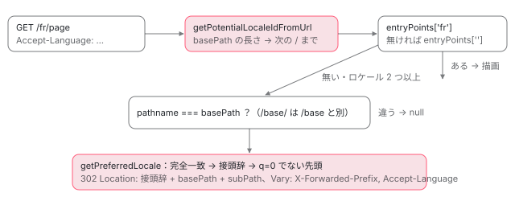

[目次](../README.md) › [SSR の守りと細部](README.md) › 第 7 回 / 全 10 回

# ロケールの選び方：URL の先頭と Accept-Language

> @angular/ssr の i18n.ts が、URL の先頭の区切りからロケールを取り出す行と、Accept-Language の q 値で好みのロケールを選ぶ行。ロケールの無い URL を、選んだロケールへリダイレクトするときに、転送の接頭辞と Vary を付ける修正（ca6f08c6e5）。AngularAppEngine の入口の選び方は ssr-app-engine へ。

angular/angular-cli · 読了 約 12 分 · 中核 · [サイトで読む（デモが動きます）](https://angular-deep-dive-cyan.vercel.app/chapter/ssrx-i18n-locale)

---

i18n でロケールごとにビルドしたアプリを `@angular/ssr` で配ると、サーバーは 1 つのリクエストごとに「どのロケールの入口を使うか」を決めます。手がかりは 2 つで、URL の先頭の区切り（`/fr/…` の `fr`）と、ブラウザが送る `Accept-Language` ヘッダーです。この章では、その 2 つを読む `i18n.ts` の 2 つの関数を 1 行ずつ読み、本物の `getPreferredLocale` にいろいろなヘッダーを渡した記録で、どの行がどの答えを作るかを確かめます。最後に、ロケールの無い URL を選んだロケールへ飛ばすリダイレクトに、転送の接頭辞と `Vary` を付けた修正 ca6f08c6e5 を読みます。

読む対象は `packages/angular/ssr/src/i18n.ts` と、表を作るビルドの側の `packages/angular/build/src/utils/server-rendering/manifest.ts` です。`AngularAppEngine.handle` から入口を選ぶまでの大きな流れ（`getEntryPointExportsForUrl` と入口のキャッシュ）は [AngularAppEngine の章](../platform/04-ssr-app-engine.md)の 3 節にあります。ここでは、その章が通り過ぎた 2 つの関数の中身と、リダイレクトの細部だけを書きます。

1. [1. resolveUrl](01-ssrx-resolve-url.md)
2. [2. location と allowedHosts](02-ssrx-location-allowed-hosts.md)
3. [3. サーバーの HttpClient](03-ssrx-server-http.md)
4. [4. ホストとヘッダーの検査](04-ssrx-host-validation.md)
5. [5. プロキシのヘッダー](05-ssrx-proxy-headers.md)
6. [6. リダイレクトと URL の照合](06-ssrx-redirects.md)
7. **7. ロケールの選び方**（この章）
8. [8. Node のリクエストとレスポンス](08-ssrx-node-streams.md)
9. [9. アセットと重要 CSS](09-ssrx-assets-css.md)
10. [10. spec と issue](10-ssrx-tests-issues.md)

## 1. ロケールの表はビルドが作る

サーバーがロケールを選ぶときに見る表は、実行時に作るのではなく、ビルドが `angular-app-engine-manifest.mjs` という 1 つのファイルに書き出します。書き出す関数がこれです。

📄 `angular-cli/packages/angular/build/src/utils/server-rendering/manifest.ts` L76–100 （▶ の行: 84–86, 88–89, 92–93, 97–99）

```ts
 76 │ export function generateAngularServerAppEngineManifest(
 77 │   i18nOptions: NormalizedApplicationBuildOptions['i18nOptions'],
 78 │   allowedHosts: string[],
 79 │   baseHref: string | undefined,
 80 │ ): string {
 81 │   const entryPoints: Record<string, string> = {};
 82 │   const supportedLocales: Record<string, string> = {};
 83 │ 
 84 ▶   if (i18nOptions.shouldInline && !i18nOptions.flatOutput) {
 85 ▶     for (const locale of i18nOptions.inlineLocales) {
 86 ▶       const { subPath } = i18nOptions.locales[locale];
 87 │       const importPath = `${subPath ? `${subPath}/` : ''}${MAIN_SERVER_OUTPUT_FILENAME}`;
 88 ▶       entryPoints[subPath] = `() => import('./${importPath}')`;
 89 ▶       supportedLocales[locale] = subPath;
 90 │     }
 91 │   } else {
 92 ▶     entryPoints[''] = `() => import('./${MAIN_SERVER_OUTPUT_FILENAME}')`;
 93 ▶     supportedLocales[i18nOptions.sourceLocale] = '';
 94 │   }
 95 │ 
 96 │   // Remove trailing slash but retain leading slash.
 97 ▶   let basePath = baseHref || '/';
 98 ▶   if (basePath.length > 1 && basePath.at(-1) === '/') {
 99 ▶     basePath = basePath.slice(0, -1);
100 │   }
```

1. **84〜90 行目：ロケールごとに 2 つの表へ書く**

   `angular.json` の i18n でロケールを埋め込む（inline）ビルドのとき、ロケールごとに `subPath`（URL の区切り。既定はロケールの名前と同じ）を取り、88 行目で `entryPoints[subPath]` に「そのロケールの `main.server.mjs` を import する関数」を、89 行目で `supportedLocales[locale] = subPath` を書きます。**`entryPoints` のキーは URL の区切り、`supportedLocales` のキーはロケールの名前**です。`subPath` を `francais` にすれば、`fr` の入口は `/francais/` で引かれます。
2. **91〜94 行目：i18n でなければ空文字の 1 つだけ**

   `entryPoints['']` と、元のロケール（`sourceLocale`）→ `''` の 1 組です。このサイトのような i18n を使わないアプリはこちらです。
3. **97〜100 行目：`basePath` は末尾のスラッシュを落とす**

   `baseHref` が `/base/` なら `basePath` は `/base`、何も無ければ `/` です。この形が 2 節と 5 節で効いてきます。

📄 `angular-cli/packages/angular/ssr/src/app-engine.ts` L97–112 （▶ の行: 100–102, 112）

```ts
 97 │   /**
 98 │    * A map of supported locales from the server application's manifest.
 99 │    */
100 ▶   private readonly supportedLocales: ReadonlyArray<string> = Object.keys(
101 ▶     this.manifest.supportedLocales,
102 ▶   );
103 │ 
104 │   /**
105 │    * The normalized allowed proxy headers.
106 │    */
107 │   private readonly trustProxyHeaders: ReadonlySet<string>;
108 │ 
109 │   /**
110 │    * A cache that holds entry points, keyed by their potential locale string.
111 │    */
112 ▶   private readonly entryPointsCache = new Map<string, Promise<EntryPointExports>>();
```

エンジンの側では、100〜102 行目で `supportedLocales` のキー（ロケールの名前）を `Object.keys` で配列にして持ちます。**この配列の順が、4 節で「どれにも当たらないときの先頭」になります**。112 行目の `entryPointsCache` は、URL の区切りをキーに入口の Promise を覚える Map です（使い方は[AngularAppEngine の章](../platform/04-ssr-app-engine.md)の 3 節）。マニフェストの型の定義もその章で見ています。

## 2. getPotentialLocaleIdFromUrl：URL の先頭の区切りを切り出す

📄 `angular-cli/packages/angular/ssr/src/i18n.ts` L28–45 （▶ の行: 29, 32–34, 38–40, 44）

```ts
28 │ export function getPotentialLocaleIdFromUrl(url: URL, basePath: string): string {
29 ▶   const { pathname } = url;
30 │ 
31 │   // Move forward of the base path section.
32 ▶   let start = basePath.length;
33 ▶   if (pathname[start] === '/') {
34 ▶     start++;
35 │   }
36 │ 
37 │   // Find the next forward slash.
38 ▶   let end = pathname.indexOf('/', start);
39 ▶   if (end === -1) {
40 ▶     end = pathname.length;
41 │   }
42 │ 
43 │   // Extract the potential locale id.
44 ▶   return pathname.slice(start, end);
45 │ }
```

1. **29 行目：`url.pathname` だけを見る**

   クエリやハッシュは見ません。`URL` の `pathname` は `%` のついたまま（decode しない）の文字列です。
2. **32〜35 行目：`basePath` の長さだけ進め、次が `/` ならもう 1 つ進める**

   `basePath` が `/` なら 1 文字目から、`/base` なら 6 文字目から読み始めます。**`pathname` が本当に `basePath` で始まるかは確かめません**。長さで進めるだけです。
3. **38〜41 行目：次の `/` まで。無ければ最後まで**

   `/fr/page` なら `fr`、`/fr` でも `fr` です。
4. **44 行目：切り出した文字列をそのまま返す**

   小文字にそろえることも、decode することもしません。呼ぶ側の `getEntryPointExportsForUrl`（[AngularAppEngine の章](../platform/04-ssr-app-engine.md)の 3 節）は、それを `entryPoints` のキーとして引き、無ければ `''` の入口を引きます。

次は、ソースを束ねて本物の関数に渡した記録です（7 節にスクリプトの全文）。

| URL | basePath | pathname | 返った値 |
| --- | --- | --- | --- |
| `https://example.com/fr/page` | `/` | `/fr/page` | `fr` |
| `https://example.com/fr` | `/` | `/fr` | `fr` |
| `https://example.com/` | `/` | `/` | `''` |
| `https://example.com/base/fr/page` | `/base` | `/base/fr/page` | `fr` |
| `https://example.com/base` | `/base` | `/base` | `''` |
| `https://example.com/other/fr` | `/base` | `/other/fr` | `r` |
| `https://example.com/FR/page` | `/` | `/FR/page` | `FR` |
| `https://example.com/%66r/page` | `/` | `/%66r/page` | `%66r` |

- `/other/fr` と `/base` の組は `r` になります。32 行目で 5 文字進め（`/othe` を飛ばす）、33 行目の判定は `r` なので進まず、38 行目で次の `/`（6 文字目）までを切り出すからです。`entryPoints['r']` は無いので、呼ぶ側は `''` の入口を引きます。
- `/FR/page` は `FR`、`/%66r/page` は `%66r` のままです。`entryPoints` のキーは 1 節の `subPath` そのものなので、大文字や `%` の形では当たりません。

## 3. parseLanguageHeader：Accept-Language を q 値の順の Map にする

`Accept-Language` は `fr-CH, fr;q=0.9, en;q=0.8` のように、言語の名前（言語タグ）を `,` で並べ、`;q=` で 0〜1 の重み（q 値。書かなければ 1）を付けるヘッダーです。

📄 `angular-cli/packages/angular/ssr/src/i18n.ts` L71–91 （▶ の行: 72–73, 77, 79, 81–83, 88, 90）

```ts
71 │ function parseLanguageHeader(header: string): ReadonlyMap<string, number> {
72 ▶   if (header === '*') {
73 ▶     return new Map([['*', 1]]);
74 │   }
75 │ 
76 │   const parsedValues = header
77 ▶     .split(',')
78 │     .map((item) => {
79 ▶       const [locale, qualityValue] = item.split(';', 2).map((v) => v.trim());
80 │ 
81 ▶       let quality = qualityValue?.startsWith('q=') ? parseFloat(qualityValue.slice(2)) : undefined;
82 ▶       if (typeof quality !== 'number' || isNaN(quality) || quality < 0 || quality > 1) {
83 ▶         quality = 1; // Invalid quality value defaults to 1
84 │       }
85 │ 
86 │       return [locale, quality] as const;
87 │     })
88 ▶     .sort(([_localeA, qualityA], [_localeB, qualityB]) => qualityB - qualityA);
89 │ 
90 ▶   return new Map(parsedValues);
91 │ }
```

1. **72・73 行目：`*` だけのときは `['*', 1]` の Map**

   「何でもよい」です。4 節の 135 行目で先頭のロケールになります。
2. **77・79 行目：`,` で分け、それぞれを最初の `;` で 2 つに分けて空白を落とす**

   `split(';', 2)` なので、`;` の 3 つめ以降は捨てます。
3. **81〜84 行目：`q=` で始まれば数にし、数でない・0 より小さい・1 より大きいなら 1**

   `q=abc` も `q=2` も 1 です。`q = 0.5` のように `=` の前に空白があると `q=` で始まらないので、これも 1 になります。
4. **88 行目：q の大きい順に並べる**

   `Array.prototype.sort` は安定な並べ替えなので、同じ q 値なら書いた順のままです。
5. **90 行目：Map にする**

   同じ言語タグが 2 回あると、位置は 1 回目、値はあとのほうになります（Map の `set` の決まり）。

## 4. getPreferredLocale：完全一致、接頭辞、q=0、先頭

📄 `angular-cli/packages/angular/ssr/src/i18n.ts` L121–145 （▶ の行: 125–126, 129, 135–136, 141–143）

```ts
121 │ export function getPreferredLocale(
122 │   header: string,
123 │   supportedLocales: ReadonlyArray<string>,
124 │ ): string | undefined {
125 ▶   if (supportedLocales.length < 2) {
126 ▶     return supportedLocales[0];
127 │   }
128 │ 
129 ▶   const parsedLocales = parseLanguageHeader(header);
130 │ 
131 │   // Handle edge cases:
132 │   // - No preferred locales provided.
133 │   // - Only one supported locale.
134 │   // - Wildcard preference.
135 ▶   if (parsedLocales.size === 0 || (parsedLocales.size === 1 && parsedLocales.has('*'))) {
136 ▶     return supportedLocales[0];
137 │   }
138 │ 
139 │   // Create a map for case-insensitive lookup of supported locales.
140 │   // Keys are normalized (lowercase) locale values, values are original casing.
141 ▶   const normalizedSupportedLocales = new Map<string, string>();
142 ▶   for (const locale of supportedLocales) {
143 ▶     normalizedSupportedLocales.set(normalizeLocale(locale), locale);
144 │   }
145 │ 
```

125・126 行目、対応ロケールが 1 つ以下ならヘッダーを読まずに返します。135・136 行目、ヘッダーが空の Map か `*` だけなら先頭です。141〜144 行目で「小文字にした名前 → 元の書き方」の Map を作り、大文字と小文字を区別せずに比べられるようにします。

📄 `angular-cli/packages/angular/ssr/src/i18n.ts` L146–185 （▶ の行: 149, 151–153, 157–158, 163–164, 167–170, 176–177, 181–183）

```ts
146 │   // Iterate through parsed locales in descending order of quality.
147 │   let bestMatch: string | undefined;
148 │   const qualityZeroNormalizedLocales = new Set<string>();
149 ▶   for (const [locale, quality] of parsedLocales) {
150 │     const normalizedLocale = normalizeLocale(locale);
151 ▶     if (quality === 0) {
152 ▶       qualityZeroNormalizedLocales.add(normalizedLocale);
153 ▶       continue; // Skip locales with quality value of 0.
154 │     }
155 │ 
156 │     // Exact match found.
157 ▶     if (normalizedSupportedLocales.has(normalizedLocale)) {
158 ▶       return normalizedSupportedLocales.get(normalizedLocale);
159 │     }
160 │ 
161 │     // If an exact match is not found, try prefix matching (e.g., "en" matches "en-US").
162 │     // Store the first prefix match encountered, as it has the highest quality value.
163 ▶     if (bestMatch !== undefined) {
164 ▶       continue;
165 │     }
166 │ 
167 ▶     const [languagePrefix] = normalizedLocale.split('-', 1);
168 ▶     for (const supportedLocale of normalizedSupportedLocales.keys()) {
169 ▶       if (supportedLocale.startsWith(languagePrefix)) {
170 ▶         bestMatch = normalizedSupportedLocales.get(supportedLocale);
171 │         break; // No need to continue searching for this locale.
172 │       }
173 │     }
174 │   }
175 │ 
176 ▶   if (bestMatch !== undefined) {
177 ▶     return bestMatch;
178 │   }
179 │ 
180 │   // Return the first locale that is not quality zero.
181 ▶   for (const [normalizedLocale, locale] of normalizedSupportedLocales) {
182 ▶     if (!qualityZeroNormalizedLocales.has(normalizedLocale)) {
183 ▶       return locale;
184 │     }
185 │   }
```

1. **149 行目：q 値の大きい順に 1 つずつ**

   3 節の 88 行目で並べた順です。
2. **151〜154 行目：q=0 は「要らない」として覚えて飛ばす**

   覚えるのは小文字にした言語タグそのもの（`de` なら `de`）です。181〜185 行目でしか使いません。
3. **157〜159 行目：完全一致なら、その場で返す**

   **ここで返るので、q 値がもっと高い言語で接頭辞の一致を先に見つけていても、完全一致が勝ちます**（下の「接頭辞と完全一致」）。
4. **163〜173 行目：まだ接頭辞の一致が無ければ、最初の `-` の前で比べる**

   167 行目で `en-GB` を `en` にし、168〜172 行目で対応ロケールを順に見て、`startsWith` で最初に当たったものを `bestMatch` にします。163 行目で、2 つめ以降の接頭辞の一致は探しません（最初のものが q 値の一番高いもの）。
5. **176〜178 行目：完全一致が 1 つも無ければ、接頭辞の一致**

   ループを最後まで回り切ったときだけ、ここに来ます。
6. **181〜185 行目：それも無ければ、q=0 でない先頭の対応ロケール**

   全部が q=0 なら何も返さず（`undefined`）、関数の終わりに落ちます。

> **🧪 DEMO — getPreferredLocale に渡した記録（16 件）**
>
> これは Node で動かした記録の再生です。ページの上では `@angular/ssr` を読みません。ボタンで入力を選ぶと、返った値と、それを作った行の注が出ます。
>
> ▶ [このデモはサイトで動かせます](https://angular-deep-dive-cyan.vercel.app/chapter/ssrx-i18n-locale)

記録から読めることを 3 つにまとめます。

- **完全一致は q 値に関係なく接頭辞の一致に勝ちます。**「接頭辞と完全一致」の `en;q=0.9,fr-FR;q=0.8` は `fr-FR` です。ところが関数の JSDoc の例（下の 114・115 行目）は `en-US`、117・118 行目の例は `undefined` と書いていて、どちらも実物と違います。
- **q=0 は、その言語タグの完全一致だけを外します。**`de;q=0, *` は `de-DE`、`en;q=0.5, en-US;q=0` は `en-US` を返しました。RFC 4647 の「`de` は `de-DE` も含む」という読み方とは違う振る舞いです。
- **接頭辞は最初の区切りまでを `startsWith` で比べます。**`zh-Hant-TW` は並びが先の `zh-Hans` に、1 文字の `e` は `en-US` に当たりました。

📄 `angular-cli/packages/angular/ssr/src/i18n.ts` L109–120 （▶ の行: 111–112, 114–115, 117–118）

````ts
109 │  * @example
110 │  * ```js
111 ▶  * getPreferredLocale('en-US;q=0.8,fr-FR;q=0.9', ['en-US', 'fr-FR', 'de-DE'])
112 ▶  * // returns 'fr-FR'
113 │  *
114 ▶  * getPreferredLocale('en;q=0.9,fr-FR;q=0.8', ['en-US', 'fr-FR', 'de-DE'])
115 ▶  * // returns 'en-US'
116 │  *
117 ▶  * getPreferredLocale('es-ES;q=0.7', ['en-US', 'fr-FR', 'de-DE'])
118 ▶  * // returns undefined
119 │  * ```
120 │  */
````
*JSDoc の例。114・115 行目と 117・118 行目は、記録の答え（fr-FR と en-US）と違う*

> [!NOTE]
> **ポイント**
>
> spec は今の振る舞いのほうを決めています。i18n\_spec.ts の 86〜92 行目は「`fr;q=0.9` の接頭辞の一致より、`en-GB;q=0.7` の完全一致」を期待し、94〜100 行目は一致が無いときに先頭を期待します（「テストと直し方」）。コメントが古いのであって、関数を spec に合わせて直したのではありません。

## 5. ロケールの無い URL を、選んだロケールへ飛ばす

`AngularAppEngine.handle` は、入口が見つからず、ロケールが 2 つ以上あるときに `redirectBasedOnAcceptLanguage` を呼びます（上の差分の 1 つめの塊）。その中で `pathname` が `basePath` と**同じ文字列**のときだけ、4 節の関数でロケールを選び、302 で飛ばします。その関数の全体と行の説明は[AngularAppEngine の章](../platform/04-ssr-app-engine.md)の 3 節にあります。ここでは、その行を今の形にした ca6f08c6e5（2026-03-24、PR #32815）を読みます。

📄 `git show ca6f08c6e5（packages/angular/ssr/src/app-engine.ts）`

```
@@ -146,7 +147,7 @@ export class AngularAppEngine {
     if (this.supportedLocales.length > 1) {
       // Redirect to the preferred language if i18n is enabled.
-      return this.redirectBasedOnAcceptLanguage(request);
+      return this.redirectBasedOnAcceptLanguage(securedRequest);
     }
@@ -179,13 +180,14 @@ export class AngularAppEngine {
     if (preferredLocale) {
       const subPath = supportedLocales[preferredLocale];
       if (subPath !== undefined) {
-        return new Response(null, {
-          status: 302, // Use a 302 redirect as language preference may change.
-          headers: {
-            'Location': joinUrlParts(pathname, subPath),
-            'Vary': 'Accept-Language',
-          },
-        });
+        const prefix = request.headers.get('X-Forwarded-Prefix') ?? '';
+
+        return createRedirectResponse(
+          joinUrlParts(prefix, pathname, subPath),
+          302,
+          // Use a 302 redirect as language preference may change.
+          { 'Vary': 'Accept-Language' },
+        );
       }
     }
```
*直す前は Response を自分で作っていた*

1. **何が足りなかったか**

   PR の本文は「Accept-Language のリダイレクトだけが共通のリダイレクトの関数を使わず、`Location` に転送の接頭辞（`X-Forwarded-Prefix`）が入らず、`Vary` にも `X-Forwarded-Prefix` が無かった」と書いています。プロキシの下の `/app/` に置いたアプリで `/app/` を開くと、`Location: /it` が返ってプロキシの外へ出てしまう、という形です。コミットの本文は題の 1 行だけで、説明は PR の本文にあります。
2. **どう変えたか**

   `request` の代わりに検査済みの `securedRequest` を渡し、`X-Forwarded-Prefix` を先頭につないで、`createRedirectResponse` に任せます。`createRedirectResponse` は `Vary` に必ず `X-Forwarded-Prefix` を足し、渡した `Vary` と重ならないようにまとめます（中身は[第 6 回](06-ssrx-redirects.md)）。
3. **そのあとの変更**

   1 か月後の 5adc925414 で、`trustProxyHeaders` で許していない転送のヘッダーは、`securedRequest` を作るとき（`sanitizeRequestHeaders`）に消されるようになりました（[第 5 回](05-ssrx-proxy-headers.md)）。そのため今は、**許したときだけ**接頭辞が `Location` に入ります。spec もそのとき「許していなければ無視する」の it を足しています（「テストと直し方」の 205〜218 行目）。

配布物の `@angular/ssr` 22.1.7 の `AngularAppEngine` に、ロケール `it` と `en` のマニフェストを入れて `handle` を呼んだ記録です。入口の関数は「呼ばれたら覚える」偽物で、どの行でも呼ばれませんでした（0 回）。

| basePath | trustProxyHeaders | URL | ヘッダー | 状態 | Location | Vary | 出た警告 |
| --- | --- | --- | --- | --- | --- | --- | --- |
| `/` | true | `https://example.com/` | `Accept-Language: en-GB,en;q=0.9`<br> | 302 | `/en` | `X-Forwarded-Prefix, Accept-Language` | — |
| `/` | true | `https://example.com/` | （なし） | 302 | `/it` | `X-Forwarded-Prefix, Accept-Language` | — |
| `/` | true | `https://example.com/` | `Accept-Language: de`<br> | 302 | `/it` | `X-Forwarded-Prefix, Accept-Language` | — |
| `/` | true | `https://example.com/` | `Accept-Language: it`<br>`X-Forwarded-Prefix: /app`<br> | 302 | `/app/it` | `X-Forwarded-Prefix, Accept-Language` | — |
| `/` | false | `https://example.com/` | `Accept-Language: it`<br>`X-Forwarded-Prefix: /app`<br> | 302 | `/it` | `X-Forwarded-Prefix, Accept-Language` | Received "x-forwarded-prefix" header but "trustProxyHeaders" was not set up to allow it. |
| `/` | true | `https://example.com/es/page` | `Accept-Language: it`<br> | null（handle が null） | `—` | `—` | — |
| `/base` | true | `https://example.com/base` | `Accept-Language: en`<br> | 302 | `/base/en` | `X-Forwarded-Prefix, Accept-Language` | — |
| `/base` | true | `https://example.com/base/` | `Accept-Language: en`<br> | null（handle が null） | `—` | `—` | — |

- ヘッダーが無いときは、AngularAppEngine が `'*'` を渡すので先頭の `it`、`de` は一致が無いので先頭の `it` です。
- `trustProxyHeaders: false` では接頭辞が消え、`Location` は `/it` でした。そのとき「許していない `x-forwarded-prefix` を受け取った」という警告が出ます。`Vary` はどちらでも `X-Forwarded-Prefix, Accept-Language` です。
- `/es/page` は、入口が無く、`pathname` が `basePath` でもないので `null` です（あとの Express などに任せる）。
- **`basePath` が `/base` のとき、`/base` は `/base/en` へ飛びますが、`/base/` は `null` でした。**1 節の 97〜100 行目で末尾のスラッシュを落とした `basePath` と、`pathname` を文字列のまま比べるからです。



*入口が見つかればそのロケールで描画、見つからずロケールが 2 つ以上で、pathname が basePath と同じときだけ Accept-Language で選んで 302。*

## 6. ここまでの呼び出し

- 👤 `GET /fr/products`（`Accept-Language: fr-CH, fr;q=0.9`） — ブラウザ
  - `AngularAppEngine.handle(request)` — app-engine.ts 161 — *ホストの検査のあと*
    - `getEntryPointExportsForUrl(url)` — app-engine.ts 292 — *ロケールが 1 つなら URL を見ない*
      - `getPotentialLocaleIdFromUrl(url, basePath)` — i18n.ts 28〜45 — *'fr' を切り出す*
      - `getEntryPointExports('fr') ?? getEntryPointExports('')` — app-engine.ts 301
    - `redirectBasedOnAcceptLanguage(securedRequest)` — app-engine.ts 192 — *入口が無く、pathname === basePath のときだけ*
      - `getPreferredLocale(header || '*', supportedLocales)` — i18n.ts 121〜186 — *完全一致 → 接頭辞 → q=0 でない先頭*
        - `parseLanguageHeader(header)` — i18n.ts 71〜91
      - `createRedirectResponse(joinUrlParts(prefix, pathname, subPath), 302, { Vary })` — utils/redirect.ts（第 6 回）

## 7. 記録の取り方

`getPreferredLocale` と `getPotentialLocaleIdFromUrl` は `@angular/ssr` の入口から export されていないので、../angular-cli（44129f66a3）の `i18n.ts` を esbuild で束ねました。5 節の `AngularAppEngine` と `ɵsetAngularAppEngineManifest` は、このサイトの依存の配布物 22.1.7 です（ca6f08c6e5 と 5adc925414 が入っていることを、配布物の `ssr.mjs` を grep して確かめました）。2026-11-06、Node v24.22.1 で動かしました。

📄 `scratchpad/ssrx-demo/_shared-c/build.mjs`

```js
// 使い方: RESEARCH=~/angular-research node build.mjs <記録のスクリプト.ts> <出力.mjs>  →  node <出力.mjs> > 記録.json
// 記録のスクリプトの中の 'ssr-src/…' は ../angular-cli/packages/angular/ssr/src/…（44129f66a3、読むだけ）、
// 'ssr-node-src/…' は ../angular-cli/packages/angular/ssr/node/src/… に読み替える。
// beasties だけは、44129f66a3 の package.json と同じ版（0.5.4）を練習用の複製（angular-cli-fix、pnpm install 済み）から読む。
// それ以外のパッケージ（@angular/ssr 22.1.7 など）は angular-deep-dive/node_modules から読む。
const ROOT = process.env.RESEARCH;
const SITE = ROOT + '/angular-deep-dive';
const SSR = ROOT + '/angular-cli/packages/angular/ssr';
const { build } = await import(SITE + '/node_modules/esbuild/lib/main.js');
const [entry, out] = process.argv.slice(2);
const aliases = {
  name: 'aliases',
  setup(b) {
    b.onResolve({ filter: /^ssr-(node-)?src\// }, (args) => {
      const rest = args.path.replace(/^ssr-(node-)?src\//, '');
      const dir = args.path.startsWith('ssr-node-src/') ? SSR + '/node/src/' : SSR + '/src/';
      return { path: dir + rest + (rest.endsWith('.ts') ? '' : '.ts') };
    });
    b.onResolve({ filter: /^beasties(\/|$)/ }, async (args) => {
      if (args.pluginData === 'site') return undefined;
      return b.resolve(args.path, { kind: args.kind, resolveDir: ROOT + '/angular-cli-fix/packages/angular/ssr', pluginData: 'site' });
    });
    b.onResolve({ filter: /^[^./]/ }, async (args) => {
      if (args.pluginData === 'site') return undefined;
      const r = await b.resolve(args.path, { kind: args.kind, resolveDir: SITE, pluginData: 'site' });
      return r.errors.length ? undefined : r;
    });
  },
};
await build({ entryPoints: [entry], outfile: out, bundle: true, platform: 'node', format: 'esm', target: 'es2022',
  plugins: [aliases], logLevel: 'warning',
  banner: { js: "import { createRequire as __cr } from 'module'; const require = __cr(import.meta.url);" } });

```
*束ねるスクリプトの全文（記録）*

📄 `scratchpad/ssrx-demo/ssrx-i18n-locale/record.ts`

```ts
// i18n の記録。getPreferredLocale・getPotentialLocaleIdFromUrl は ../angular-cli のソース（入口に export されていない）、
// AngularAppEngine と ɵsetAngularAppEngineManifest は配布物の @angular/ssr 22.1.7 を使う。
import { getPotentialLocaleIdFromUrl, getPreferredLocale } from 'ssr-src/i18n';
import { AngularAppEngine, ɵsetAngularAppEngineManifest as setManifest } from '@angular/ssr';

const LOCALE_SETS: Record<string, string[]> = {
  a: ['en-US', 'fr-FR', 'de-DE'],
  b: ['it', 'en'],
  c: ['zh-Hans', 'zh-Hant'],
  d: ['de-DE', 'en-US'],
  e: ['ja'],
};
const PREF_CASES: Array<[string, string, string]> = [
  // [id, Accept-Language, 対応ロケールの組]
  ['q', 'en-US;q=0.8,fr-FR;q=0.9', 'a'],
  ['prefix', 'en;q=0.9,fr-FR;q=0.8', 'a'],
  ['nomatch', 'es-ES;q=0.7', 'a'],
  ['spec', 'fr-CH, fr;q=0.9, it;q=0.8, en;q=0.7, *;q=0.5', 'b'],
  ['case', 'EN-us', 'a'],
  ['star', '*', 'a'],
  ['empty', '', 'a'],
  ['badq', 'de-DE;q=abc, fr-FR;q=0.9', 'a'],
  ['bigq', 'de-DE;q=2, fr-FR', 'a'],
  ['tie', 'de-DE, fr-FR', 'a'],
  ['zero-exact', 'de-DE;q=0, fr-FR;q=0.1', 'a'],
  ['zero-lang', 'de;q=0, *', 'd'],
  ['zero-prefix', 'en;q=0.5, en-US;q=0', 'd'],
  ['script', 'zh-Hant-TW', 'c'],
  ['one-letter', 'e', 'a'],
  ['single', 'fr-FR', 'e'],
];
const preferred = PREF_CASES.map(([id, header, set]) => ({
  id, header, locales: LOCALE_SETS[set], result: getPreferredLocale(header, LOCALE_SETS[set]) ?? null,
}));

const URL_CASES: Array<[string, string]> = [
  ['https://example.com/fr/page', '/'],
  ['https://example.com/fr', '/'],
  ['https://example.com/', '/'],
  ['https://example.com/base/fr/page', '/base'],
  ['https://example.com/base', '/base'],
  ['https://example.com/other/fr', '/base'],
  ['https://example.com/FR/page', '/'],
  ['https://example.com/%66r/page', '/'],
];
const fromUrl = URL_CASES.map(([url, basePath]) => ({
  url, basePath, pathname: new URL(url).pathname, result: getPotentialLocaleIdFromUrl(new URL(url), basePath),
}));

// AngularAppEngine（配布物）の Accept-Language のリダイレクト。入口は呼ばれたら記録するだけの偽物。
const loaded: string[] = [];
const warnings: string[] = [];
const origWarn = console.warn;
console.warn = (...a: unknown[]) => { warnings.push(String(a[0]).split('\n')[0]); };
const entry = (name: string) => () => {
  loaded.push(name);
  return Promise.reject(new Error('この記録では入口を読まない'));
};
async function redirect(basePath: string, trust: boolean, url: string, headers: Record<string, string>) {
  setManifest({
    allowedHosts: ['example.com'], basePath,
    entryPoints: { it: entry('it'), en: entry('en') },
    supportedLocales: { it: 'it', en: 'en' },
  });
  const engine = new AngularAppEngine({ trustProxyHeaders: trust });
  const before = warnings.length;
  const res = await engine.handle(new Request(url, { headers }));
  return {
    warned: warnings.slice(before),
    basePath, trust, url, headers,
    status: res ? res.status : null,
    location: res?.headers.get('Location') ?? null,
    vary: res?.headers.get('Vary') ?? null,
  };
}
const redirects = [
  await redirect('/', true, 'https://example.com/', { 'Accept-Language': 'en-GB,en;q=0.9' }),
  await redirect('/', true, 'https://example.com/', {}),
  await redirect('/', true, 'https://example.com/', { 'Accept-Language': 'de' }),
  await redirect('/', true, 'https://example.com/', { 'Accept-Language': 'it', 'X-Forwarded-Prefix': '/app' }),
  await redirect('/', false, 'https://example.com/', { 'Accept-Language': 'it', 'X-Forwarded-Prefix': '/app' }),
  await redirect('/', true, 'https://example.com/es/page', { 'Accept-Language': 'it' }),
  await redirect('/base', true, 'https://example.com/base', { 'Accept-Language': 'en' }),
  await redirect('/base', true, 'https://example.com/base/', { 'Accept-Language': 'en' }),
];

console.warn = origWarn;
console.log(JSON.stringify({ node: process.version, preferred, fromUrl, redirects, loaded }, null, 1));

```
*記録を取ったスクリプトの全文（記録）*

## テストと直し方

### spec と it

| describe / it | ファイルと行 | この章のどこ |
| --- | --- | --- |
| describe `getPotentialLocaleIdFromUrl`（8 件） | test/i18n\_spec.ts 11 | 2 節。`basePath` で始まらない URL の it はありません |
| describe `getPreferredLocale`（12 件） | test/i18n\_spec.ts 69 | 3・4 節 |
| `should match based on language prefix when no exact match is found` | i18n\_spec.ts 86 | 4 節の 157 行目（完全一致が勝つ） |
| `should ignore locales with quality 0 …`・`should select the highest quality supported locale as fallback …` | i18n\_spec.ts 136・144 | 4 節の 151〜153 行目。言語だけの `q=0` の it はありません |
| `should redirect to the highest priority locale when the URL is "/"` | test/app-engine\_spec.ts 181 | 5 節 |
| `should include forwarded prefix in locale redirect location when present` | app-engine\_spec.ts 191 | 5 節（ca6f08c6e5 が足した） |
| `should completely ignore proxy headers if not allowed` | app-engine\_spec.ts 205 | 5 節（5adc925414 が足した） |

📄 `angular-cli/packages/angular/ssr/test/i18n_spec.ts` L78–100 （▶ の行: 79–80, 82–83, 87–88, 90–91）

```ts
 78 │   it('should return the best match when no exact match is found, using language prefixes', () => {
 79 ▶     const header = 'en-GB;q=0.9,fr;q=0.8';
 80 ▶     const supportedLocales = ['fr-FR', 'de-DE', 'en-US'];
 81 │     const result = getPreferredLocale(header, supportedLocales);
 82 ▶     // 'en-US' is the exact match with the highest quality (0.9)
 83 ▶     expect(result).toBe('en-US');
 84 │   });
 85 │ 
 86 │   it('should match based on language prefix when no exact match is found', () => {
 87 ▶     const header = 'en-US;q=0.8,fr;q=0.9,en-GB;q=0.7';
 88 ▶     const supportedLocales = ['en-GB', 'fr-FR', 'de-DE'];
 89 │     const result = getPreferredLocale(header, supportedLocales);
 90 ▶     // Best match is 'en-GB' based on exact match (0.8 for 'en-US')
 91 ▶     expect(result).toBe('en-GB');
 92 │   });
 93 │ 
 94 │   it('should return the first available locale when no exact match or prefix is found', () => {
 95 │     const header = 'it-IT;q=0.8';
 96 │     const supportedLocales = ['en-GB', 'fr-FR', 'de-DE'];
 97 │     const result = getPreferredLocale(header, supportedLocales);
 98 │     // The first locale in the supportedLocales set
 99 │     expect(result).toBe('en-GB');
100 │   });
```

78〜84 行目の it は `en-GB` と `fr` のどちらも完全一致せず、`en-GB`（0.9）の接頭辞で `en-US` になります。82 行目のコメントは「exact match」と書いていますが、通るのは 168〜172 行目の接頭辞の道です。86〜92 行目の it は、4 節の「完全一致が勝つ」をそのまま決めています。

📄 `angular-cli/packages/angular/ssr/test/app-engine_spec.ts` L110–125 （▶ の行: 112, 116–118, 120–121, 124）

```ts
110 │   describe('Localized app', () => {
111 │     beforeAll(() => {
112 ▶       setAngularAppEngineManifest({
113 │         allowedHosts: ['example.com'],
114 │         // Note: Although we are testing only one locale, we need to configure two or more
115 │         // to ensure that we test a different code path.
116 ▶         entryPoints: {
117 ▶           it: createEntryPoint('it'),
118 ▶           en: createEntryPoint('en'),
119 │         },
120 ▶         supportedLocales: { 'it': 'it', 'en': 'en' },
121 ▶         basePath: '/',
122 │       });
123 │ 
124 ▶       appEngine = new AngularAppEngine({ trustProxyHeaders: true });
125 │     });
```

📄 `angular-cli/packages/angular/ssr/test/app-engine_spec.ts` L181–218 （▶ の行: 183, 187–188, 195, 201–202, 206, 210, 217）

```ts
181 │       it('should redirect to the highest priority locale when the URL is "/"', async () => {
182 │         const request = new Request('https://example.com', {
183 ▶           headers: { 'Accept-Language': 'fr-CH, fr;q=0.9, it;q=0.8, en;q=0.7, *;q=0.5' },
184 │         });
185 │         const response = await appEngine.handle(request);
186 │         expect(response?.status).toBe(302);
187 ▶         expect(response?.headers.get('Location')).toBe('/it');
188 ▶         expect(response?.headers.get('Vary')).toBe('X-Forwarded-Prefix, Accept-Language');
189 │       });
190 │ 
191 │       it('should include forwarded prefix in locale redirect location when present', async () => {
192 │         const request = new Request('https://example.com', {
193 │           headers: {
194 │             'Accept-Language': 'it',
195 ▶             'X-Forwarded-Prefix': '/app',
196 │           },
197 │         });
198 │ 
199 │         const response = await appEngine.handle(request);
200 │         expect(response?.status).toBe(302);
201 ▶         expect(response?.headers.get('Location')).toBe('/app/it');
202 ▶         expect(response?.headers.get('Vary')).toBe('X-Forwarded-Prefix, Accept-Language');
203 │       });
204 │ 
205 │       it('should completely ignore proxy headers if not allowed', async () => {
206 ▶         const strictEngine = new AngularAppEngine({ trustProxyHeaders: false });
207 │         const request = new Request('https://example.com', {
208 │           headers: {
209 │             'Accept-Language': 'it',
210 ▶             'X-Forwarded-Prefix': '/app',
211 │           },
212 │         });
213 │ 
214 │         // The strictEngine will ignore the prefix
215 │         const response = await strictEngine.handle(request);
216 │         expect(response?.status).toBe(302);
217 ▶         expect(response?.headers.get('Location')).toBe('/it');
218 │       });
```

この describe のマニフェストは 121 行目で `basePath: '/'` です（app-engine\_spec.ts の 5 つのマニフェストはどれも `'/'`）。5 節の「`/base/` が `null`」のような、`basePath` が `/` でないときの it はありません。

### 手元で走らせた結果

練習用の複製（angular-cli-fix、44129f66a3）で `pnpm bazel test //packages/angular/ssr/test:test //packages/angular/ssr/node/test:test --nocache_test_results --test_output=all` を走らせ、`//packages/angular/ssr/test:test` は「249 specs, 0 failures」でした（2026-11-06、scratchpad/ssrx-logs/c-cli-tests.log）。

複製で 5 節の行を ca6f08c6e5 の前の形に戻すと、181 行目の it が `Expected 'Accept-Language' to be 'X-Forwarded-Prefix, Accept-Language'.`、191 行目の it が `Expected '/it' to be '/app/it'.` で落ちました。205 行目の it は通ります（戻した形でも接頭辞を読まないので）。また、4 節の JSDoc の 2 つの例をそのまま it にして足すと、`Expected 'fr-FR' to be 'en-US'.` と `Expected 'en-US' to be undefined.` で落ちました（c-cli-reverted.log）。複製は `git checkout` で元に戻し、`git status --short` が空であることを確かめています。

### 直すとしたら

- JSDoc の例：i18n.ts の 109〜119 行目。実物と spec（86〜100 行目）に合わせて、`fr-FR` と `en-US`（先頭）に書き直すのが一番小さい直しです。
- 言語だけの `q=0`：`getPreferredLocale` の 151〜153 行目と 181〜185 行目。i18n\_spec.ts の describe `getPreferredLocale` に、`de;q=0, *` のような入力の it を足すことになります。振る舞いを変えるので、どう読むのが正しいかを決めるのが先です。
- `/base/` がリダイレクトされない：app-engine.ts の `redirectBasedOnAcceptLanguage` の `pathname !== basePath` の比べ方。app-engine\_spec.ts に `basePath: '/base'` のマニフェストの describe が要ります。
- 関係する issue：開いている #29111（ドメインでロケールを選びたい）、閉じた #31675（ロケール 1 つでサブパスのときの入口。30efc56333 で直り、ロケールが 1 つなら `supportedLocales` の `subPath` で入口を引くようになった）と #29019（ロケールを手で指定したい。NOT\_PLANNED）。`gh` で探した範囲では、4 節と 5 節の振る舞いを書いた issue はありませんでした。表は[第 10 回](10-ssrx-tests-issues.md)にあります。

## 聞かれそうな質問

**Q. /fr/ と /francais/ のどちらで引かれるかは、どこで決まりますか？**

ビルドが作る `entryPoints` のキーです。manifest.ts の 86・88 行目で、ロケールの `subPath` がキーになります。URL から切り出した文字列（i18n.ts 44 行目）はそのキーと文字列のまま比べられるので、`/FR/` や `/%66r/` では当たりません。

**Q. Accept-Language: en;q=0.9, fr-FR;q=0.8 で、en-US と fr-FR に対応していると、どちらになりますか？**

`fr-FR` です。149 行目で q 値の順に見ていき、`en` は 168〜172 行目で `en-US` を「接頭辞の一致」として覚えるだけで、次の `fr-FR` が 157 行目の完全一致でその場で返ります。JSDoc の 114・115 行目は `en-US` と書いていますが、記録と spec（86〜92 行目）は `fr-FR` 側です。

**Q. どの言語にも当たらないと、404 になりますか？**

なりません。181〜185 行目で、q=0 で外されていない先頭の対応ロケールを返します。先頭とは app-engine.ts の 100〜102 行目の `Object.keys` の順、つまりビルドがマニフェストに書いた順です。ヘッダーが無ければ AngularAppEngine は `'*'` を渡し、135 行目で先頭になります。

**Q. なぜ 301 ではなく 302 で、Vary が付くのですか？**

同じ URL でも、ヘッダーが違えば違うロケールへ飛ぶからです。恒久的な 301 にするとブラウザやキャッシュが覚えてしまいます。`Vary: X-Forwarded-Prefix, Accept-Language` は、キャッシュに「この 2 つのヘッダーごとに別の応答」と伝えます。`X-Forwarded-Prefix` のほうは ca6f08c6e5 から、`createRedirectResponse` が足します（5 節）。

**Q. プロキシの下の /app/ に置くと、Location に /app は付きますか？**

`trustProxyHeaders` で `X-Forwarded-Prefix` を許したときだけ付きます。許していなければ `sanitizeRequestHeaders` が消すので、`Location` は `/it` のままで、警告が 1 行出ます（5 節の記録）。

## 読み終えて

- ロケールの表はビルドが書く。`entryPoints` のキーは URL の区切り（`subPath`）、`supportedLocales` のキーはロケールの名前。
- `getPotentialLocaleIdFromUrl` は `basePath` の長さだけ進めて次の `/` まで切り出す。decode も小文字化も、`basePath` で始まるかの確認もしない。
- `getPreferredLocale` は q 値の順に、完全一致ならその場で返し、無ければ最初の接頭辞の一致、それも無ければ q=0 でない先頭。完全一致は q 値に関係なく接頭辞に勝ち、JSDoc の例はそれと違う。
- ロケールの無い URL のリダイレクトは、ca6f08c6e5 から `createRedirectResponse` を通り、許された `X-Forwarded-Prefix` を `Location` に、`X-Forwarded-Prefix` を `Vary` に入れる。
- `basePath` が `/` でないときの it は無く、`/base/` はリダイレクトされない。

---

← 前: [リダイレクトと URL の照合：redirect.ts と utils/url.ts](06-ssrx-redirects.md)  
次: [Node のリクエストとレスポンス：中断と切断](08-ssrx-node-streams.md) →
