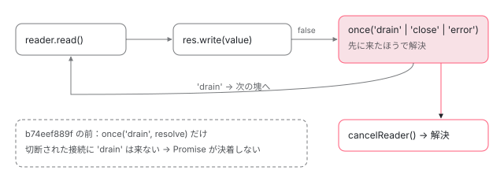

[目次](../README.md) › [SSR の守りと細部](README.md) › 第 8 回 / 全 10 回

# Node のリクエストとレスポンス：中断と切断

> node/src/request.ts が Node の IncomingMessage を Web の Request に変える行（本文、ヘッダー、URL）、Node のリクエストが中断されたら signal を中断する修正（f8576e3c8b）、本文を貯めずにヘッダーを整える修正（33169801c6）。response.ts がストリームを書き出す行、客が切断したときに終わらせる修正（b74eef889f）と、ストリームが取り消されたらプラットフォームを壊す修正（6a3446770a）。

angular/angular-cli · 読了 約 13 分 · 発展 · [サイトで読む（デモが動きます）](https://angular-deep-dive-cyan.vercel.app/chapter/ssrx-node-streams)

---

`@angular/ssr` の中身は Web 標準の `Request` と `Response` の上で書かれていて、Node の `http` の型に触るのは `@angular/ssr/node` の 2 つの関数だけです。この章では、その 2 つ（`createWebRequestFromNodeRequest` と `writeResponseToNodeResponse`）が、**客が途中で接続を切ったとき**に何をするかを、行と 2026 年の 5 本のコミットで読みます。127.0.0.1 の上に本物の Node の HTTP サーバーを立て、本物の 2 つの関数で切断を起こした記録で、`signal` と書き出しの Promise がどうなるかを確かめます。

読む対象は `packages/angular/ssr/node/src/request.ts`・`response.ts`・`handler.ts` です。Node の `req` から Web の `Request` を作り、`Response` を `res` に書き戻す大きな流れ（URL の組み立て、`Set-Cookie`、ヘッダーを先に送る行）は [AngularAppEngine の章](../platform/04-ssr-app-engine.md)の 1 節と 9 節にあります。URL のホストとプロトコルをどのヘッダーから取るかの規則は[第 5 回](05-ssrx-proxy-headers.md)です。ここでは呼ぶ側と、切断の扱いだけを書きます。

1. [1. resolveUrl](01-ssrx-resolve-url.md)
2. [2. location と allowedHosts](02-ssrx-location-allowed-hosts.md)
3. [3. サーバーの HttpClient](03-ssrx-server-http.md)
4. [4. ホストとヘッダーの検査](04-ssrx-host-validation.md)
5. [5. プロキシのヘッダー](05-ssrx-proxy-headers.md)
6. [6. リダイレクトと URL の照合](06-ssrx-redirects.md)
7. [7. ロケールの選び方](07-ssrx-i18n-locale.md)
8. **8. Node のリクエストとレスポンス**（この章）
9. [9. アセットと重要 CSS](09-ssrx-assets-css.md)
10. [10. spec と issue](10-ssrx-tests-issues.md)

## 1. 2 つの関数を、誰が呼ぶか

`AngularNodeAppEngine` を使えば、2 つの関数はその中で呼ばれます（[AngularAppEngine の章](../platform/04-ssr-app-engine.md)の 1 節）。Express 以外のサーバーで使うときは、利用者が自分で呼びます。その書き方の例が handler.ts の JSDoc にあります。

📄 `angular-cli/packages/angular/ssr/node/src/handler.ts` L40–72 （▶ の行: 46, 48, 50, 53, 68–69, 71）

````ts
40 │  * @example
41 │  * Usage in a Hono application:
42 │  * ```ts
43 │  * const app = new Hono();
44 │  * export default createNodeRequestHandler(async (req, res, next) => {
45 │  *   try {
46 ▶  *     const webRes = await app.fetch(createWebRequestFromNodeRequest(req));
47 │  *     if (webRes) {
48 ▶  *       await writeResponseToNodeResponse(webRes, res);
49 │  *     } else {
50 ▶  *       next();
51 │  *     }
52 │  *   } catch (error) {
53 ▶  *     next(error);
54 │  *   }
55 │  * });
56 │  * ```
57 │  *
58 │  * @example
59 │  * Usage in a Fastify application:
60 │  * ```ts
61 │  * const app = Fastify();
62 │  * export default createNodeRequestHandler(async (req, res) => {
63 │  *   await app.ready();
64 │  *   app.server.emit('request', req, res);
65 │  * });
66 │  * ```
67 │  */
68 ▶ export function createNodeRequestHandler<T extends NodeRequestHandlerFunction>(handler: T): T {
69 ▶   (handler as T & { __ng_node_request_handler__?: boolean })['__ng_node_request_handler__'] = true;
70 │ 
71 ▶   return handler;
72 │ }
````

46 行目で Node の `req` を `Request` に、48 行目で返った `Response` を `res` に書きます。**48 行目は `await` していて、書き出しの Promise が決着しないと、この関数も終わりません**。3 節の b74eef889f はこの Promise の話です。68〜72 行目の `createNodeRequestHandler` は、関数に `__ng_node_request_handler__` という印を付けて返すだけです（開発サーバーとビルドが、server.ts の default export を見分けるのに使う印）。

## 2. createWebRequestFromNodeRequest：ヘッダー、URL、中断

### ヘッダー：HTTP/2 の擬似ヘッダーを落とす

📄 `angular-cli/packages/angular/ssr/node/src/request.ts` L18–31 （▶ の行: 25–30）

```ts
18 │ /**
19 │  * A set containing all the pseudo-headers defined in the HTTP/2 specification.
20 │  *
21 │  * This set can be used to filter out pseudo-headers from a list of headers,
22 │  * as they are not allowed to be set directly using the `Node.js` Undici API or
23 │  * the web `Headers` API.
24 │  */
25 ▶ const HTTP2_PSEUDO_HEADERS: ReadonlySet<string> = new Set([
26 ▶   ':method',
27 ▶   ':scheme',
28 ▶   ':authority',
29 ▶   ':path',
30 ▶   ':status',
31 │ ]);
```

📄 `angular-cli/packages/angular/ssr/node/src/request.ts` L77–101 （▶ の行: 86–88, 91–95）

```ts
 77 │ /**
 78 │  * Creates a `Headers` object from Node.js `IncomingHttpHeaders`.
 79 │  *
 80 │  * @param nodeHeaders - The Node.js `IncomingHttpHeaders` object to convert.
 81 │  * @returns A `Headers` object containing the converted headers.
 82 │  */
 83 │ function createRequestHeaders(nodeHeaders: IncomingHttpHeaders): Headers {
 84 │   const headers = new Headers();
 85 │ 
 86 ▶   for (const [name, value] of Object.entries(nodeHeaders)) {
 87 ▶     if (HTTP2_PSEUDO_HEADERS.has(name)) {
 88 ▶       continue;
 89 │     }
 90 │ 
 91 ▶     if (typeof value === 'string') {
 92 ▶       headers.append(name, value);
 93 ▶     } else if (Array.isArray(value)) {
 94 ▶       for (const item of value) {
 95 ▶         headers.append(name, item);
 96 │       }
 97 │     }
 98 │   }
 99 │ 
100 │   return headers;
101 │ }
```

1. **86〜89 行目：`:method` などの擬似ヘッダーは飛ばす**

   HTTP/2 では、メソッドやパスも `:method`・`:path` のような「`:` で始まるヘッダー」として届き、Node の `Http2ServerRequest` の `headers` にも入っています。Web の `Headers` は `:` で始まる名前を受け付けないので、25〜31 行目の 5 つを落とします。
2. **91〜97 行目：文字列はそのまま、配列は 1 つずつ `append`**

   Node は同じ名前のヘッダーを配列にまとめることがあります。`append` するので、`Headers` の側でも 2 つのまま残ります。

HTTP/1.1 と HTTP/2 で違うのは、この擬似ヘッダーと、ホストを `Host` の代わりに `:authority` から取ること（[AngularAppEngine の章](../platform/04-ssr-app-engine.md)の 1 節の `createRequestUrl`）、それに 3 節の「下の stream が閉じたか」の確かめ方の 3 つです。

### URL：呼ぶ側から見た createRequestUrl

📄 `angular-cli/packages/angular/ssr/node/src/request.ts` L116–126 （▶ の行: 118, 122–124）

```ts
116 │ export function createRequestUrl(
117 │   nodeRequest: IncomingMessage | Http2ServerRequest,
118 ▶   trustProxyHeaders: ReadonlySet<string>,
119 │ ): URL {
120 │   const {
121 │     headers,
122 ▶     socket,
123 ▶     url = '',
124 ▶     originalUrl,
125 │   } = nodeRequest as IncomingMessage & { originalUrl?: string };
126 │ 
```

📄 `angular-cli/packages/angular/ssr/node/src/request.ts` L156–172 （▶ の行: 169–171）

```ts
156 │ /**
157 │  * Gets the first value of an allowed proxy header.
158 │  *
159 │  * @param headers - The Node.js incoming HTTP headers.
160 │  * @param headerName - The name of the proxy header to retrieve.
161 │  * @param trustProxyHeaders - A set of allowed proxy headers.
162 │  * @returns The value of the allowed proxy header, or `undefined` if not allowed or not present.
163 │  */
164 │ function getAllowedProxyHeaderValue(
165 │   headers: IncomingHttpHeaders,
166 │   headerName: string,
167 │   trustProxyHeaders: ReadonlySet<string>,
168 │ ): string | undefined {
169 ▶   return isProxyHeaderAllowed(headerName, trustProxyHeaders)
170 ▶     ? getFirstHeaderValue(headers[headerName])
171 ▶     : undefined;
172 │ }
```

118 行目、2 つめの引数は「信じてよいプロキシのヘッダーの名前」の `Set` で、`createWebRequestFromNodeRequest` の最初の行で `trustProxyHeaders`（`true`・`false`・名前の配列）を正規化したものです。169〜171 行目、その `Set` に入っていない名前のヘッダーは、値があっても `undefined` として扱います。どの名前が入るか、`Forwarded` をどう分けるかは[第 5 回](05-ssrx-proxy-headers.md)です。124 行目の `originalUrl` は Express が付ける値で、Express の `app.use('/sub', …)` の中で `req.url` が書き換えられていても、元のパスで URL を作るために使います。

### 中断：f8576e3c8b（2026-08-20）

この部分の今の行は[AngularAppEngine の章](../platform/04-ssr-app-engine.md)の 1 節で引用しています。ここでは、それを足したコミットの差分を読みます。

📄 `git show f8576e3c8b（packages/angular/ssr/node/src/request.ts）`

```
@@ -55,9 +55,18 @@ export function createWebRequestFromNodeRequest(
   const { headers, method = 'GET' } = nodeRequest;
   const withBody = method !== 'GET' && method !== 'HEAD';
   const referrer = headers.referer && URL.canParse(headers.referer) ? headers.referer : undefined;
+  const controller = new AbortController();
+  if (nodeRequest.aborted) {
+    controller.abort();
+  } else {
+    const onAbort = () => controller.abort();
+    nodeRequest.once('aborted', onAbort);
+    nodeRequest.once('close', () => nodeRequest.off('aborted', onAbort));
+  }
 
   return new Request(createRequestUrl(nodeRequest, trustProxyHeadersNormalized), {
     method,
+    signal: controller.signal,
     headers: createRequestHeaders(headers),
     body: withBody ? nodeRequest : undefined,
     duplex: withBody ? 'half' : undefined,
```
*AbortController を作り、Node の 'aborted' で中断する*

1. **何が足りなかったか**

   それまでの `Request` には `signal` が無く、客が接続を切っても、描画を待つ `promiseWithAbort`（[AngularAppEngine の章](../platform/04-ssr-app-engine.md)の 4 節）は何も知らされませんでした。コミットの本文は題の 1 行だけです。
2. **変えた行**

   変換した時点でもう中断されていれば（`nodeRequest.aborted`）その場で `abort()`、まだなら `'aborted'` を 1 回だけ聞き、`'close'` でその聞き手を外します。`signal: controller.signal` を `Request` に渡します。
3. **足した spec**

   request\_http1\_spec.ts と request\_http2\_spec.ts に、同じ形の describe `abort handling` を 1 つずつ（「テストと直し方」）。

### 本文を貯めない：33169801c6（2026-07-31）

`AngularAppEngine.handle` は、受け取った `Request` から許していない転送のヘッダーを消すとき（`sanitizeRequestHeaders`、[第 4 回](04-ssrx-host-validation.md)）、新しい `Request` を作ります。その作り方を変えたのが 33169801c6 です。

📄 `git show 33169801c6（packages/angular/ssr/src/utils/validation.ts）`

```
@@ -117,8 +117,7 @@ export function sanitizeRequestHeaders(
   }
 
   return headersDeleted
-    ? new Request(request.clone(), {
-        signal: request.signal,
+    ? new Request(request, {
         headers,
       })
     : request;
```
*request.clone() をやめて、元の Request をそのまま渡す*

`request.clone()` は本文のストリームを 2 つに分けます（tee）。片方しか読まれないと、もう片方のために読んだ分がメモリに貯まり続けます。コミットの本文は「本文のストリームを tee しない」と書いています。`new Request(request, { headers })` は本文を**移す**ので、元の `request` は使い終わった（`bodyUsed` が `true`）扱いになります。`signal` を書かなくなったのは、`Request` を `Request` から作ると `signal` も引き継がれるからです。足した 2 つの it は validation\_spec.ts の「本文を tee せずに移す」と「中断の signal を保つ」で、閉じた issue #33706 がこの修正の報告です。

## 3. writeResponseToNodeResponse：切断したら必ず終わる

ステータスとヘッダーを写して先に送る前半は[AngularAppEngine の章](../platform/04-ssr-app-engine.md)の 9 節にあります。その関数の最初の行と、本文が無いときに `end()` する前は、どちらも次の関数で「もう閉じていれば何もしない」を確かめます（b74eef889f で足された行）。

📄 `angular-cli/packages/angular/ssr/node/src/response.ts` L12–26 （▶ の行: 20–24）

```ts
12 │ /**
13 │  * Checks whether a Node.js `ServerResponse` or `Http2ServerResponse` is destroyed, closed, or ended.
14 │  *
15 │  * @param destination - The HTTP/1.1 or HTTP/2 server response to check.
16 │  * @returns `true` if the response or its underlying stream is destroyed, closed, or ended; otherwise `false`.
17 │  */
18 │ function isResponseDestroyedOrClosed(destination: ServerResponse | Http2ServerResponse): boolean {
19 │   return (
20 ▶     destination.destroyed ||
21 ▶     destination.closed ||
22 ▶     destination.writableEnded ||
23 ▶     ('stream' in destination &&
24 ▶       (!destination.stream || destination.stream.destroyed || destination.stream.closed))
25 │   );
26 │ }
```

20〜22 行目は HTTP/1.1 と HTTP/2 の両方にある印です（壊れた・閉じた・`end` を呼んだ）。23・24 行目は HTTP/2 だけ。`Http2ServerResponse` は下に `stream`（1 本の HTTP/2 の流れ）を持ち、客がセッションを壊すとそちらが先に閉じるので、それも見ます。この関数は b74eef889f で足され、36dff801ee（2026-08-10）で `Boolean(…)` の包みを外して今の形になりました。

📄 `git show 36dff801ee（packages/angular/ssr/node/src/response.ts）`

```
   return (
-    Boolean(destination.destroyed) ||
-    Boolean(destination.closed) ||
-    Boolean(destination.writableEnded) ||
+    destination.destroyed ||
+    destination.closed ||
+    destination.writableEnded ||
     ('stream' in destination &&
-      (!destination.stream ||
-        Boolean(destination.stream.destroyed) ||
-        Boolean(destination.stream.closed)))
+      (!destination.stream || destination.stream.destroyed || destination.stream.closed))
   );
```
*振る舞いを変えない refactor*

📄 `angular-cli/packages/angular/ssr/node/src/response.ts` L77–102 （▶ の行: 78–79, 81–82, 84, 87–91, 100–101）

```ts
 77 │ 
 78 ▶   let isClosed = isResponseDestroyedOrClosed(destination);
 79 ▶   const isDestroyedOrClosed = () => isClosed || isResponseDestroyedOrClosed(destination);
 80 │ 
 81 ▶   let readerCancelled = false;
 82 ▶   const reader = body.getReader();
 83 │   const cancelReader = (error?: unknown) => {
 84 ▶     if (readerCancelled) {
 85 │       return;
 86 │     }
 87 ▶     readerCancelled = true;
 88 ▶     isClosed = true;
 89 ▶     destination.off('close', cancelReader);
 90 ▶     destination.off('error', cancelReader);
 91 ▶     reader.cancel(error).catch((err) => {
 92 │       // eslint-disable-next-line no-console
 93 │       console.error(
 94 │         `An error occurred while writing the response body for: ${destination.req.url}.`,
 95 │         err,
 96 │       );
 97 │     });
 98 │   };
 99 │ 
100 ▶   destination.once('close', cancelReader);
101 ▶   destination.once('error', cancelReader);
102 │ 
```

1. **78・79 行目：閉じたかどうかを 1 つの関数にまとめる**

   `isClosed` は 88 行目で立てる自前の印、もう 1 つは 18 行目の関数です。どちらかが本当なら「閉じた」です。
2. **83〜98 行目：`cancelReader` は 1 回だけ動く**

   84〜87 行目の `readerCancelled` で 2 回目を止め、89・90 行目で自分の聞き手を外し、91 行目で本文のストリームを取り消します。取り消された側（`AngularServerApp` の `ReadableStream`）は、4 節の `cancel` でプラットフォームを壊します。
3. **100・101 行目：`'close'` でも `'error'` でも取り消す**

   `once` なので 1 回ずつです。

📄 `angular-cli/packages/angular/ssr/node/src/response.ts` L103–125 （▶ の行: 106–107, 111–113, 117–118, 122–123）

```ts
103 │   try {
104 │     // eslint-disable-next-line no-constant-condition
105 │     while (true) {
106 ▶       if (isDestroyedOrClosed()) {
107 ▶         cancelReader();
108 │         break;
109 │       }
110 │ 
111 ▶       const { done, value } = await reader.read();
112 ▶       if (isDestroyedOrClosed()) {
113 ▶         cancelReader();
114 │         break;
115 │       }
116 │ 
117 ▶       if (done) {
118 ▶         destination.end();
119 │         break;
120 │       }
121 │ 
122 ▶       const canContinue = (destination as ServerResponse).write(value);
123 ▶       if (canContinue === false) {
124 │         // Explicitly check for `false`, as AWS may return `undefined` even though this is not valid.
125 │         // See: https://github.com/CodeGenieApp/serverless-express/issues/683
```

106〜109 行目は読む**前**、112〜115 行目は読んだ**あと**に、閉じていないかを確かめます。`reader.read()` を待つあいだに客が切ることがあるからです。122 行目の `write` が `false` を返したら（Node の書き出しの溜まりが一杯）、123 行目から「`'drain'` を待つ」に入ります。

📄 `angular-cli/packages/angular/ssr/node/src/response.ts` L126–161 （▶ の行: 127–128, 133, 136, 139, 143–144, 147–149, 154–155, 157–159）

```ts
126 │         await new Promise<void>((resolve) => {
127 ▶           if (isDestroyedOrClosed()) {
128 ▶             resolve();
129 │ 
130 │             return;
131 │           }
132 │ 
133 ▶           const onDrain = () => {
134 │             destination.off('close', onClose);
135 │             destination.off('error', onClose);
136 ▶             resolve();
137 │           };
138 │ 
139 ▶           const onClose = () => {
140 │             destination.off('drain', onDrain);
141 │             destination.off('close', onClose);
142 │             destination.off('error', onClose);
143 ▶             cancelReader();
144 ▶             resolve();
145 │           };
146 │ 
147 ▶           destination.once('drain', onDrain);
148 ▶           destination.once('close', onClose);
149 ▶           destination.once('error', onClose);
150 │         });
151 │       }
152 │     }
153 │   } catch {
154 ▶     if (!isDestroyedOrClosed()) {
155 ▶       destination.end('Internal server error.');
156 │     }
157 ▶   } finally {
158 ▶     destination.off('close', cancelReader);
159 ▶     destination.off('error', cancelReader);
160 │   }
161 │ }
```

1. **127〜131 行目：待つ前に閉じていれば、すぐ解決**

   122 行目の `write` と 126 行目のあいだに閉じた場合です。聞き手は付けずに抜けます。
2. **133〜137 行目：`'drain'` が来たら、閉じたときの聞き手を外して解決**

   次の塊を読みにループへ戻ります。
3. **139〜145 行目：`'close'` か `'error'` が来たら、`'drain'` の聞き手を外し、本文を取り消して解決**

   ここが b74eef889f の中心です。切断された接続には `'drain'` が来ないので、前は 147 行目の 1 つしか聞いておらず、ずっと待ち続けました。
4. **153〜156 行目：読み書きで投げたら、まだ開いているときだけ `Internal server error.` で終える**

   閉じた接続に `end()` を呼ばないようにしたのも b74eef889f です。ステータスはもう送ってあるので、本文だけが変わります。
5. **157〜160 行目：最後に、100・101 行目の聞き手を必ず外す**

   キープアライブで同じ接続に次の応答が来ても、前の聞き手が残りません。



*write が false を返したあとの待ち。今は drain・close・error のどれかで必ず解決する。b74eef889f の前は drain だけを待ち、切断では来ないので止まった。*

📄 `git show b74eef889f（response.ts の要点。… は省いた行）`

```
-  try {
-    const reader = body.getReader();
-
-    destination.on('close', () => {
-      reader.cancel().catch((error) => { … });
-    });
-
     while (true) {
       const { done, value } = await reader.read();
       …
       const canContinue = (destination as ServerResponse).write(value);
       if (canContinue === false) {
-        await new Promise<void>((resolve) => destination.once('drain', resolve));
+        await new Promise<void>((resolve) => {
+          if (isDestroyedOrClosed()) { resolve(); return; }
+          const onDrain = () => { … resolve(); };
+          const onClose = () => { … cancelReader(); resolve(); };
+          destination.once('drain', onDrain);
+          destination.once('close', onClose);
+          destination.once('error', onClose);
+        });
       }
     }
   } catch {
-    destination.end('Internal server error.');
+    if (!isDestroyedOrClosed()) {
+      destination.end('Internal server error.');
+    }
+  } finally {
+    destination.off('close', cancelReader);
+    destination.off('error', cancelReader);
   }
```
*前は 'drain' だけを待っていた*

b74eef889f（2026-07-31、#33719 を閉じる）の本文は「客が切断すると、Node の応答は `drain` を出さずに閉じるか壊れる。そのため `writeResponseToNodeResponse()` は `drain` を待ったまま決着しなかった」と書き、「閉じたか壊れたかを見張り、聞き手を外し、reader を取り消し、Promise を解決する」と変えた中身を並べています。足した it は、HTTP/1.1 で 4 MB、HTTP/2 で 1 MB の塊を 2 つ流して、客が最初の `data` で切るものです（「テストと直し方」）。

## 4. 本文のストリームが取り消されたら、プラットフォームを壊す

3 節の 91 行目が `reader.cancel()` を呼ぶと、取り消しは本文を作った側の `ReadableStream` に届きます。`AngularServerApp` の側でそれを受けるようにしたのが 6a3446770a（2026-08-07）です。今の行は[AngularAppEngine の章](../platform/04-ssr-app-engine.md)の 8 節で引用しています。

📄 `git show 6a3446770a（packages/angular/ssr/src/app.ts）`

```
@@ -366,10 +366,18 @@ export class AngularServerApp {
     const stream = new ReadableStream({
       start: async (controller) => {
-        const renderedHtml = await result.content();
-        const finalHtml = await this.inlineCriticalCssWithCache(renderedHtml, url);
-        controller.enqueue(finalHtml);
-        controller.close();
+        try {
+          const renderedHtml = await result.content();
+          const finalHtml = await this.inlineCriticalCssWithCache(renderedHtml, url);
+          controller.enqueue(finalHtml);
+          controller.close();
+        } catch (error) {
+          result.destroy();
+          controller.error(error);
+        }
+      },
+      cancel: () => {
+        result.destroy();
       },
     });
```
*失敗したときと取り消されたときに result.destroy()*

コミットの本文は「応答のストリームが取り消されたり、描画中に失敗したりしたときに、メモリが漏れないよう `PlatformRef` を壊す」です。同じコミットで `renderAngular` が `destroy` を返すようにし、すでに壊れていれば何もしない早い `return` を `asyncDestroyPlatform` に足しています。そのあと 23e3d44a7f で `inlineCriticalCssWithCache` が消え、今の行になりました（[第 9 回](09-ssrx-assets-css.md)）。

> [!NOTE]
> **さらに深く**
>
> 新しい本家では、`request.signal` が中断されたときにも描画中のプラットフォームを壊すようになりました（47bc9c3969、2026-10-28、#34567 を閉じる。`gh` で読んだもので、../angular-cli の 44129f66a3 には入っていません）。それまでは、2 節の `signal` で `handle()` の Promise は中断されても、`renderAngular` は `whenStable()` まで走り続けていました。`renderAngular` に `signal` を渡し、中断で `destroy` を呼ぶ形です。

## 5. DEMO：本物のサーバーで切断する

> **🧪 DEMO — 切断したときの signal と書き出しの Promise（記録 9 件）**
>
> これは Node で動かした記録の再生です。127.0.0.1 の上だけで、外へは通信していません。ボタンで場面を選ぶと、サーバーの側で起きた出来事（ms は接続を受けてから）と結果が出ます。
>
> HTTP/1.1。GET を受けてすぐ Request に変え、200 ms の「描画」のあいだ（50 ms）に客が接続を壊す。描画が終わってから書き出す。
>
> ▶ [このデモはサイトで動かせます](https://angular-deep-dive-cyan.vercel.app/chapter/ssrx-node-streams)

記録から読めることです。

- **GET・描画中に切断**：切断と同じ ms に `req 'aborted'` と `request.signal の abort` が来ました。描画が終わってから呼んだ書き出しは、関数の最初の確かめ（18 行目の関数）で何も送らずに解決します（`headersSent` は `false`）。HTTP/2 も同じでした。
- **POST・本文の途中で切断**：`signal` が中断され、`request.text()` は `aborted` という `Error` で reject しました。
- **切断のあとで変換**：変換した時点で `nodeRequest.aborted` が `true` なので、`signal` は最初から中断済みでした（f8576e3c8b の `if` の側）。
- **詰まり中に切断**：今の関数は切断の 1 ms 後に解決し、`ReadableStream` の `cancel()` も呼ばれました。b74eef889f の前の写しでも `cancel()` は呼ばれますが、**Promise は 1.5 秒待っても決着しませんでした**。1 節の 48 行目の `await` がここで止まります。
- **GET・先に本文を読む**：変換の前に `req.resume()` で読み切ると、7 ms で `req 'close'` が来て、f8576e3c8b の `'close'` の聞き手が `'aborted'` の聞き手を外します。そのあとの切断では `'aborted'` は来ず、`signal` は最後まで中断されませんでした。

### 記録の取り方

2 つの関数は、このサイトの依存の配布物 `@angular/ssr/node` 22.1.7 です（f8576e3c8b・b74eef889f・36dff801ee の行が入っていることを、配布物の `node.mjs` を grep して確かめました）。「直す前」は `git show b74eef889f^:packages/angular/ssr/node/src/response.ts` で取り出した写しを、スクリプトの隣に置いて束ねました（../angular-cli は書き換えていません）。2026-11-06、Node v24.22.1。

📄 `scratchpad/ssrx-demo/_shared-c/build.mjs`

```js
// 使い方: RESEARCH=~/angular-research node build.mjs <記録のスクリプト.ts> <出力.mjs>  →  node <出力.mjs> > 記録.json
// 記録のスクリプトの中の 'ssr-src/…' は ../angular-cli/packages/angular/ssr/src/…（44129f66a3、読むだけ）、
// 'ssr-node-src/…' は ../angular-cli/packages/angular/ssr/node/src/… に読み替える。
// beasties だけは、44129f66a3 の package.json と同じ版（0.5.4）を練習用の複製（angular-cli-fix、pnpm install 済み）から読む。
// それ以外のパッケージ（@angular/ssr 22.1.7 など）は angular-deep-dive/node_modules から読む。
const ROOT = process.env.RESEARCH;
const SITE = ROOT + '/angular-deep-dive';
const SSR = ROOT + '/angular-cli/packages/angular/ssr';
const { build } = await import(SITE + '/node_modules/esbuild/lib/main.js');
const [entry, out] = process.argv.slice(2);
const aliases = {
  name: 'aliases',
  setup(b) {
    b.onResolve({ filter: /^ssr-(node-)?src\// }, (args) => {
      const rest = args.path.replace(/^ssr-(node-)?src\//, '');
      const dir = args.path.startsWith('ssr-node-src/') ? SSR + '/node/src/' : SSR + '/src/';
      return { path: dir + rest + (rest.endsWith('.ts') ? '' : '.ts') };
    });
    b.onResolve({ filter: /^beasties(\/|$)/ }, async (args) => {
      if (args.pluginData === 'site') return undefined;
      return b.resolve(args.path, { kind: args.kind, resolveDir: ROOT + '/angular-cli-fix/packages/angular/ssr', pluginData: 'site' });
    });
    b.onResolve({ filter: /^[^./]/ }, async (args) => {
      if (args.pluginData === 'site') return undefined;
      const r = await b.resolve(args.path, { kind: args.kind, resolveDir: SITE, pluginData: 'site' });
      return r.errors.length ? undefined : r;
    });
  },
};
await build({ entryPoints: [entry], outfile: out, bundle: true, platform: 'node', format: 'esm', target: 'es2022',
  plugins: [aliases], logLevel: 'warning',
  banner: { js: "import { createRequire as __cr } from 'module'; const require = __cr(import.meta.url);" } });

```
*束ねるスクリプトの全文（記録）*

📄 `scratchpad/ssrx-demo/ssrx-node-streams/record.ts`

```ts
// Node のリクエストとレスポンスの記録。127.0.0.1 の上だけで、外へは通信しない。
// createWebRequestFromNodeRequest・writeResponseToNodeResponse は配布物の @angular/ssr/node 22.1.7
// （f8576e3c8b・b74eef889f・36dff801ee が入っている）。「直す前」は b74eef889f^ の response.ts の写し。
import http from 'node:http';
import http2 from 'node:http2';
import type { AddressInfo } from 'node:net';
import { createWebRequestFromNodeRequest, writeResponseToNodeResponse } from '@angular/ssr/node';
import { writeResponseToNodeResponse as writeBefore } from './response-before-b74eef889f';

const sleep = (ms: number) => new Promise<void>((r) => setTimeout(r, ms));
type Ev = { t: number; e: string };

/** Promise が ms 以内に決着したか。決着しなければ 'pending'。 */
async function settle(p: Promise<unknown>, ms: number, t0: number) {
  let state = 'pending';
  p.then(() => (state = `resolved（${Date.now() - t0} ms）`), (e) => (state = `rejected（${Date.now() - t0} ms）`));
  await sleep(ms);
  return state;
}

/** HTTP/1.1。客は path を送り、disconnectAt ms で接続を壊す。サーバーの動きは onServer に書く。 */
async function h1(
  name: string,
  opts: { method?: string; partialBody?: boolean; readFirst?: boolean; convertLate?: boolean; disconnectOnData?: boolean; disconnectAt?: number },
  onServer: (req: http.IncomingMessage, res: http.ServerResponse, ev: (e: string) => void, t0: number) => Promise<Record<string, unknown>>,
) {
  const events: Ev[] = [];
  let result: Record<string, unknown> = {};
  const t0 = Date.now();
  const ev = (e: string) => events.push({ t: Date.now() - t0, e });
  const server = http.createServer();
  const done = new Promise<void>((resolve) => {
    server.once('request', async (req, res) => {
      req.once('aborted', () => ev("req 'aborted'"));
      req.once('close', () => ev("req 'close'"));
      res.once('close', () => ev("res 'close'"));
      if (opts.readFirst) req.resume();
      result = await onServer(req, res, ev, t0);
      resolve();
    });
  });
  await new Promise<void>((r) => server.listen(0, '127.0.0.1', r));
  const { port } = server.address() as AddressInfo;
  const client = http.request({ host: '127.0.0.1', port, path: '/' + name, method: opts.method ?? 'GET',
    headers: opts.partialBody ? { 'content-length': '100' } : undefined });
  client.on('error', () => {});
  client.on('response', (r) => r.once('data', () => { if (opts.disconnectOnData) { ev('客が切断'); client.destroy(); } }));
  if (opts.partialBody) client.write('{"a":'); else client.end();
  if (opts.disconnectAt !== undefined) setTimeout(() => { ev('客が切断'); client.destroy(); }, opts.disconnectAt);
  await done;
  server.closeAllConnections();
  await new Promise<void>((r) => server.close(() => r()));
  return { name, protocol: 'HTTP/1.1', events, ...result };
}

/** HTTP/2（平文の h2c）。 */
async function h2(
  name: string,
  opts: { disconnectOnData?: boolean; disconnectAt?: number },
  onServer: (req: http2.Http2ServerRequest, res: http2.Http2ServerResponse, ev: (e: string) => void, t0: number) => Promise<Record<string, unknown>>,
) {
  const events: Ev[] = [];
  let result: Record<string, unknown> = {};
  const t0 = Date.now();
  const ev = (e: string) => events.push({ t: Date.now() - t0, e });
  const server = http2.createServer();
  const done = new Promise<void>((resolve) => {
    server.once('request', async (req, res) => {
      req.once('aborted', () => ev("req 'aborted'"));
      req.once('close', () => ev("req 'close'"));
      res.once('close', () => ev("res 'close'"));
      result = await onServer(req, res, ev, t0);
      resolve();
    });
  });
  await new Promise<void>((r) => server.listen(0, '127.0.0.1', r));
  const { port } = server.address() as AddressInfo;
  const session = http2.connect(`http://127.0.0.1:${port}`);
  session.on('error', () => {});
  const stream = session.request({ ':path': '/' + name });
  stream.on('error', () => {});
  stream.once('data', () => { if (opts.disconnectOnData) { ev('客が切断'); session.destroy(); } });
  stream.end();
  if (opts.disconnectAt !== undefined) setTimeout(() => { ev('客が切断'); session.destroy(); }, opts.disconnectAt);
  await done;
  session.destroy();
  await new Promise<void>((r) => server.close(() => r()));
  return { name, protocol: 'HTTP/2', events, ...result };
}

/** 「描画」に 200 ms かかるふり。その間に客が切断する。 */
const renderThenWrite = (write: typeof writeResponseToNodeResponse) =>
  async (req: any, res: any, ev: (e: string) => void, t0: number) => {
    const request = createWebRequestFromNodeRequest(req);
    const atCreate = request.signal.aborted;
    request.signal.addEventListener('abort', () => ev('request.signal の abort'));
    await sleep(200);
    ev('描画が終わった（200 ms）');
    const p = write(new Response('<html>…</html>', { headers: { 'content-type': 'text/html' } }), res);
    return { signalAtCreate: atCreate, signalAfter: request.signal.aborted, write: await settle(p, 300, t0),
      wroteStatus: res.headersSent };
  };

/** 4 MB の塊を 2 つ流す（spec と同じ大きさ）。客は最初の data で切断する。 */
const backpressure = (write: typeof writeResponseToNodeResponse, chunk: number) =>
  async (_req: any, res: any, ev: (e: string) => void, t0: number) => {
    let cancelled = false;
    const big = new TextEncoder().encode('x'.repeat(chunk));
    const stream = new ReadableStream<Uint8Array>({
      start(c) { c.enqueue(big); c.enqueue(big); },
      cancel() { cancelled = true; ev('ReadableStream の cancel()（app.ts ではここでプラットフォームを壊す）'); },
    });
    const p = write(new Response(stream), res);
    return { write: await settle(p, 1500, t0), readerCancelled: cancelled };
  };

const records = [];
records.push(await h1('get-disconnect', { disconnectAt: 50 }, renderThenWrite(writeResponseToNodeResponse)));
records.push(await h1('get-body-read-first', { disconnectAt: 50, readFirst: true }, renderThenWrite(writeResponseToNodeResponse)));
records.push(await h1('post-partial-body', { method: 'POST', partialBody: true, disconnectAt: 50 }, async (req, _res, ev, t0) => {
  const request = createWebRequestFromNodeRequest(req);
  request.signal.addEventListener('abort', () => ev('request.signal の abort'));
  const atCreate = request.signal.aborted;
  const text = request.text();
  const state = await settle(text, 300, t0);
  const reason = await text.then(() => '', (e) => `${e?.name}: ${e?.message}`);
  return { signalAtCreate: atCreate, signalAfter: request.signal.aborted, text: state, textError: reason };
}));
records.push(await h1('convert-after-disconnect', { disconnectAt: 50 }, async (req, res, ev, t0) => {
  await sleep(150);
  const request = createWebRequestFromNodeRequest(req);
  ev('ここで変換した');
  const p = writeResponseToNodeResponse(new Response('late'), res);
  return { signalAtCreate: request.signal.aborted, write: await settle(p, 100, t0), wroteStatus: res.headersSent };
}));
records.push(await h1('backpressure-after', { disconnectOnData: true }, backpressure(writeResponseToNodeResponse, 4 * 1024 * 1024)));
records.push(await h1('backpressure-before', { disconnectOnData: true }, backpressure(writeBefore, 4 * 1024 * 1024)));
records.push(await h2('h2-get-disconnect', { disconnectAt: 50 }, renderThenWrite(writeResponseToNodeResponse)));
records.push(await h2('h2-backpressure-after', { disconnectOnData: true }, backpressure(writeResponseToNodeResponse, 1024 * 1024)));
records.push(await h2('h2-backpressure-before', { disconnectOnData: true }, backpressure(writeBefore, 1024 * 1024)));

console.log(JSON.stringify({ node: process.version, records }, null, 1));
process.exit(0);

```
*記録を取ったスクリプトの全文（記録）*

## ここまでの呼び出し

- 👤 `server.on('request', (req, res) => …)` — あなたの server.ts（Express なら AngularNodeAppEngine の中）
  - `createWebRequestFromNodeRequest(req, trustProxyHeaders)` — node/src/request.ts 50 — *AbortController と 'aborted'（f8576e3c8b）*
    - `createRequestUrl(req, trustProxyHeaders)` — request.ts 116 — *規則は第 5 回*
    - `createRequestHeaders(req.headers)` — request.ts 83〜101 — *擬似ヘッダーを落とす*
  - `AngularAppEngine.handle(request)` — src/app-engine.ts — *sanitizeRequestHeaders は本文を移す（33169801c6）*
    - `new ReadableStream({ start, cancel })` — src/app.ts — *cancel で result.destroy()（6a3446770a）*
  - `writeResponseToNodeResponse(response, res)` — node/src/response.ts 39
    - `isResponseDestroyedOrClosed(res)` — response.ts 18〜26 — *HTTP/2 は stream も見る*
    - `reader.read()` → `res.write(value)` → `'drain'` か `'close'` — response.ts 105〜152 — *切断なら cancelReader して解決（b74eef889f）*

## テストと直し方

### spec と it

| describe / it | ファイルと行 | この章のどこ |
| --- | --- | --- |
| describe `abort handling`（2 件） | node/test/request\_http1\_spec.ts 193・request\_http2\_spec.ts 192 | 2 節（f8576e3c8b） |
| `should resolve and cancel reader when client disconnects while response is backpressured` | node/test/response\_http1\_spec.ts 111・response\_http2\_spec.ts 120 | 3 節（b74eef889f） |
| `should set cookies on the ServerResponse` | response\_http1\_spec.ts 98 | AngularAppEngine の章の 9 節 |
| describe `createRequestUrl`（14 件） | node/test/request\_spec.ts 29 | 2 節の URL（規則は第 5 回） |
| `should transfer request body without teeing …`・`should preserve abort signal …` | test/utils/validation\_spec.ts | 2 節（33169801c6） |
| `should destroy the platform when the response stream is cancelled` | test/app\_spec.ts 464 | 4 節（6a3446770a） |

📄 `angular-cli/packages/angular/ssr/node/test/request_http1_spec.ts` L24–34 （▶ の行: 27, 31, 33）

```ts
24 │   async function getNodeRequest(): Promise<IncomingMessage> {
25 │     const { req, res } = await new Promise<{ req: IncomingMessage; res: ServerResponse }>(
26 │       (resolve) => {
27 ▶         server.once('request', (req, res) => resolve({ req, res }));
28 │       },
29 │     );
30 │ 
31 ▶     res.end();
32 │ 
33 ▶     return req;
34 │   }
```

📄 `angular-cli/packages/angular/ssr/node/test/request_http1_spec.ts` L193–229 （▶ の行: 204–205, 207, 209, 222, 225）

```ts
193 │   describe('abort handling', () => {
194 │     it('should abort the web request signal when the node request is aborted', async () => {
195 │       const nodeRequest = await extractNodeRequest(() => {
196 │         request({
197 │           hostname: 'localhost',
198 │           port,
199 │           path: '/abort',
200 │           method: 'GET',
201 │         }).end();
202 │       });
203 │ 
204 ▶       const webRequest = createWebRequestFromNodeRequest(nodeRequest);
205 ▶       expect(webRequest.signal.aborted).toBeFalse();
206 │ 
207 ▶       nodeRequest.emit('aborted');
208 │ 
209 ▶       expect(webRequest.signal.aborted).toBeTrue();
210 │     });
211 │ 
212 │     it('should create an aborted web request signal when the node request is already aborted', async () => {
213 │       const nodeRequest = await extractNodeRequest(() => {
214 │         request({
215 │           hostname: 'localhost',
216 │           port,
217 │           path: '/already-aborted',
218 │           method: 'GET',
219 │         }).end();
220 │       });
221 │ 
222 ▶       Object.defineProperty(nodeRequest, 'aborted', { get: () => true, configurable: true });
223 │ 
224 │       const webRequest = createWebRequestFromNodeRequest(nodeRequest);
225 ▶       expect(webRequest.signal.aborted).toBeTrue();
226 │ 
227 │       delete (nodeRequest as { aborted?: boolean }).aborted;
228 │     });
229 │   });
```

31 行目で、spec の補助は `req` を返す前に `res.end()` で応答を終えています。207 行目は本物の切断ではなく、`nodeRequest.emit('aborted')` でイベントを手で起こします。222 行目は `aborted` を `true` に見せかけます。どちらも「イベントが来たら / 印が立っていたら中断する」を確かめる it で、5 節の「先に本文を読むと `'aborted'` が来ない」のような、Node が実際にいつイベントを出すかは確かめていません。

📄 `angular-cli/packages/angular/ssr/node/test/response_http1_spec.ts` L111–153 （▶ の行: 114, 117–118, 121–122, 126–127, 137–138, 150–151）

```ts
111 │   it('should resolve and cancel reader when client disconnects while response is backpressured', async () => {
112 │     let writePromise!: Promise<void>;
113 │     let readerCancelled = false;
114 ▶     const largeChunk = 'x'.repeat(1024 * 1024 * 4); // 4MB to ensure backpressure
115 │     const stream = new ReadableStream({
116 │       start(controller) {
117 ▶         controller.enqueue(largeChunk);
118 ▶         controller.enqueue(largeChunk);
119 │       },
120 │       cancel() {
121 ▶         readerCancelled = true;
122 ▶       },
123 │     });
124 │ 
125 │     server.once('request', (_, nodeResponse) => {
126 ▶       writePromise = writeResponseToNodeResponse(new Response(stream), nodeResponse);
127 ▶     });
128 │ 
129 │     await new Promise<void>((resolve) => {
130 │       const { port } = server.address() as AddressInfo;
131 │       const clientRequest = requestCb(
132 │         {
133 │           host: 'localhost',
134 │           port,
135 │         },
136 │         (response) => {
137 ▶           response.once('data', () => {
138 ▶             clientRequest.destroy();
139 │             resolve();
140 │           });
141 │         },
142 │       );
143 │ 
144 │       clientRequest.on('error', () => {
145 │         // Expected when destroying the socket
146 │       });
147 │ 
148 │       clientRequest.end();
149 │     });
150 ▶ 
151 ▶     await writePromise;
152 │     expect(readerCancelled).toBeTrue();
153 │   });
```

📄 `angular-cli/packages/angular/ssr/test/app_spec.ts` L464–472 （▶ の行: 465–466, 468, 470–471）

```ts
464 │       it('should destroy the platform when the response stream is cancelled', async () => {
465 ▶         const destroySpy = spyOn(PlatformRef.prototype, 'destroy').and.callThrough();
466 ▶         const response = await app.handle(new Request('http://localhost/home'));
467 │         expect(response?.body).toBeInstanceOf(ReadableStream);
468 ▶         await response?.body?.cancel();
469 │         // Wait for the macrotask queue to clear since destroy is called asynchronously
470 ▶         await setTimeout(0);
471 ▶         expect(destroySpy).toHaveBeenCalled();
472 │       });
```

### 手元で走らせた結果

練習用の複製（angular-cli-fix、44129f66a3）で `pnpm bazel test //packages/angular/ssr/test:test //packages/angular/ssr/node/test:test --nocache_test_results --test_output=all` を走らせ、`//packages/angular/ssr/node/test:test` は「42 specs, 0 failures」（0.2 秒）でした（scratchpad/ssrx-logs/c-cli-tests.log）。

- 複製の response.ts を b74eef889f の前に戻すと、HTTP/1.1 と HTTP/2 の 111・120 行目の it が `Timeout - Async function did not complete within 5000ms` で落ちました（42 件中 2 件、10.1 秒。c-cli-reverted.log）。150 行目の `await writePromise` が終わらないからで、5 節の「前」の記録と同じです。
- 複製の request.ts から f8576e3c8b の行を消すと、`abort handling` の 4 件（HTTP/1.1 と HTTP/2 で 2 件ずつ）が落ち、validation.ts を 33169801c6 の前に戻すと「本文を tee せずに移す」の 1 件が落ちました。
- **app.ts の `cancel: () => { result.destroy(); }` を消しても、464 行目の it は通りました**（c-cli-reverted2.log）。`ReadableStream` の `start` は作った時点で `content()` を呼び、`content()` は描画のあとで必ずプラットフォームを壊す（[AngularAppEngine の章](../platform/04-ssr-app-engine.md)の 7 節）ので、470 行目の `setTimeout(0)` を待つあいだに、`cancel` が無くても `destroy` が呼ばれるからです。
- 試したあと、複製は `git checkout` で元に戻し、`git status --short` が空であることを確かめています。

### 直すとしたら

- `cancel` を確かめる it：app\_spec.ts の 464 行目の it は、`content()` の描画が終わる前に `cancel()` し、終わる前に `destroy` が呼ばれたことを見る形にしないと、6a3446770a を戻しても落ちません。たとえば描画が `PendingTasks` で止まる部品を使い、`cancel()` の直後に確かめる、などです。
- 本文を読んだあとの切断：request.ts の、f8576e3c8b が足した行（2 節の差分。今の行は [AngularAppEngine の章](../platform/04-ssr-app-engine.md)の 1 節）。`'aborted'` は「受け取りが終わる前に切れた」ときのイベントなので、読み終えたあとの切断も拾うなら、`res` の `'close'` を見る形が要ります。ただし変換の関数は `res` を受け取らないので、引数を増やすことになります。spec は request\_http1\_spec.ts の `abort handling` に、`emit` ではなく本物の `destroy()` で切る it を足すのが先です。
- 関係する issue：閉じた #33719（drain を待ち続ける。b74eef889f）、#33706（本文を貯める。33169801c6）、#34567（中断しても描画が続く。新しい本家の 47bc9c3969）。表は[第 10 回](10-ssrx-tests-issues.md)にあります。

## 聞かれそうな質問

**Q. 客がブラウザを閉じたら、SSR の描画は止まりますか？**

2 段に分かれます。f8576e3c8b から、Node の `'aborted'` で `request.signal` が中断され、`handle()` の Promise は `AbortError` で終わります（5 節の記録）。描画そのもの（プラットフォーム）を止めるのは、44129f66a3 では本文のストリームが取り消されたとき（4 節）だけで、`signal` で止めるのは新しい本家の 47bc9c3969 からです。

**Q. writeResponseToNodeResponse を await すると、いつまでも終わらないことはありますか？**

22.1.7 と 44129f66a3 では、切断で終わります。139〜145 行目で `'close'`・`'error'` も聞くからです。前は 147 行目の `'drain'` しか聞いておらず、詰まっているときに切られると決着しませんでした（5 節の「前」の記録、#33719）。

**Q. HTTP/2 で何が違いますか？**

3 つです。`:method` などの擬似ヘッダーを 87 行目で落とすこと、ホストに `Host` が無ければ `:authority` を使うこと、閉じたかどうかを 23・24 行目で下の `stream` でも見ること。`'aborted'` と切断の振る舞いは、記録では HTTP/1.1 と同じでした。

**Q. sanitizeRequestHeaders が Request を作り直すと、POST の本文はどうなりますか？**

33169801c6 から、元の `Request` の本文を新しいほうへ移します。`clone()` と違って 2 つに分けないので、読まれない片方の分がメモリに貯まりません。元の `request` は `bodyUsed` になるので、そのあとは新しいほうだけを読みます。

**Q. なぜ write の戻り値を === false で比べているのですか？**

124・125 行目のコメントのとおり、AWS の環境（serverless-express）では `write` が `undefined` を返すことがあるからです。`!canContinue` にすると、そこで `'drain'` を待ち始め、来ない `'drain'` を待つことになります。

## 読み終えて

- Node に触るのは 2 つの関数だけ。HTTP/1.1 と HTTP/2 の違いは、擬似ヘッダー、`:authority`、下の `stream` の 3 つ。
- f8576e3c8b で、Node の `'aborted'` が `request.signal` に届く。ただし本文を読み終えたあとの切断では `'aborted'` は来ない（記録）。
- b74eef889f で、書き出しは切断で必ず決着する。前は `'drain'` を待ったまま止まった。spec はその形（4 MB を 2 つ、最初の data で切る）で、戻すと落ちる。
- 6a3446770a で、本文のストリームが取り消されたらプラットフォームを壊す。ただしその it は、`cancel` を消しても通る。
- 33169801c6 は本文を tee しない修正で、守りの修正（転送のヘッダーを消す）が性能を落としていたのを直したもの。

---

← 前: [ロケールの選び方：URL の先頭と Accept-Language](07-ssrx-i18n-locale.md)  
次: [サーバーのアセットと重要 CSS：ServerAssets・hooks・CommonEngine](09-ssrx-assets-css.md) →
