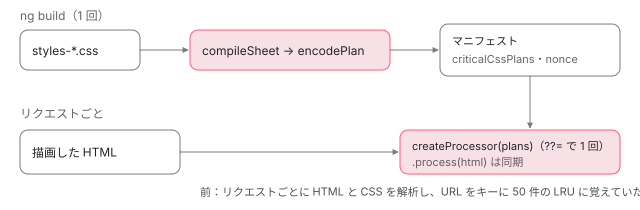

[目次](../README.md) › [SSR の守りと細部](README.md) › 第 9 回 / 全 10 回

# サーバーのアセットと重要 CSS：ServerAssets・hooks・CommonEngine

> ServerAssets がマニフェストから HTML を取り出す行と、リクエストからアセットのパスを作るときに decode する修正（4fa81d403c）。Hooks（html:transform:pre）と、それを登録する開発サーバー。重要 CSS の計画をビルド時に作るようにした変更（23e3d44a7f）。非推奨になった CommonEngine（50b16a65b1）が public の外のファイルを読まないようにした修正（bb72145f9a）。

angular/angular-cli · 読了 約 12 分 · 中核 · [サイトで読む（デモが動きます）](https://angular-deep-dive-cyan.vercel.app/chapter/ssrx-assets-css)

---

`@angular/ssr` のサーバーは、ディスクの HTML や CSS を読みません。ビルドがマニフェストに詰めた「アセット」と「重要 CSS の計画」だけを使います。この章では、アセットを引く `ServerAssets`、開発サーバーが HTML を加工するための `Hooks`、重要 CSS（画面の最初に見える部分に効くルールだけを `<style>` に入れる処理）を、行と本物を動かした記録で読みます。重要 CSS の計画をビルド時に作るようにした 23e3d44a7f と、古い入口 `CommonEngine` の 3 本（public の外を読まない bb72145f9a、アセットのパスを decode する 4fa81d403c、非推奨の 50b16a65b1）もあわせて読みます。

読む対象は `packages/angular/ssr/src/assets.ts`・`hooks.ts`・`manifest.ts`、ビルドの側の `packages/angular/build/src/utils/server-rendering/manifest.ts`、`packages/angular/ssr/node/src/common-engine/` です。`AngularServerApp.handle` が作り置きの HTML を返す流れと、描画の前後に HTML を加工する行は[AngularAppEngine の章](../platform/04-ssr-app-engine.md)の 5 節と 8 節、ビルドがアセットをマニフェストに書く行は[プリレンダーの章](../platform/06-ssr-prerender.md)にあります。

1. [1. resolveUrl](01-ssrx-resolve-url.md)
2. [2. location と allowedHosts](02-ssrx-location-allowed-hosts.md)
3. [3. サーバーの HttpClient](03-ssrx-server-http.md)
4. [4. ホストとヘッダーの検査](04-ssrx-host-validation.md)
5. [5. プロキシのヘッダー](05-ssrx-proxy-headers.md)
6. [6. リダイレクトと URL の照合](06-ssrx-redirects.md)
7. [7. ロケールの選び方](07-ssrx-i18n-locale.md)
8. [8. Node のリクエストとレスポンス](08-ssrx-node-streams.md)
9. **9. アセットと重要 CSS**（この章）
10. [10. spec と issue](10-ssrx-tests-issues.md)

## 1. ServerAsset と ServerAssets：マニフェストの中の表を引くだけ

📄 `angular-cli/packages/angular/ssr/src/manifest.ts` L13–33 （▶ の行: 16, 22, 27, 32）

```ts
13 │ /**
14 │  * Represents a server asset stored in the manifest.
15 │  */
16 ▶ export interface ServerAsset {
17 │   /**
18 │    * Retrieves the text content of the asset.
19 │    *
20 │    * @returns A promise that resolves to the asset's content as a string.
21 │    */
22 ▶   text: () => Promise<string>;
23 │ 
24 │   /**
25 │    * A hash string representing the asset's content.
26 │    */
27 ▶   hash: string;
28 │ 
29 │   /**
30 │    * The size of the asset's content in bytes.
31 │    */
32 ▶   size: number;
33 │ }
```

📄 `angular-cli/packages/angular/ssr/src/manifest.ts` L94–117 （▶ の行: 100, 107, 112, 117）

```ts
 94 │   /**
 95 │    * A readonly record of assets required by the server application.
 96 │    * Each entry consists of:
 97 │    * - `key`: The path of the asset.
 98 │    * - `value`: An object of type `ServerAsset`.
 99 │    */
100 ▶   readonly assets: Readonly<Record<string, ServerAsset | undefined>>;
101 │ 
102 │   /**
103 │    * The bootstrap mechanism for the server application.
104 │    * A function that returns a promise that resolves to an `NgModule` or a function
105 │    * returning a promise that resolves to an `ApplicationRef`.
106 │    */
107 ▶   readonly bootstrap: () => Promise<AngularBootstrap>;
108 │ 
109 │   /**
110 │    * Pre-compiled critical CSS plans generated at build time.
111 │    */
112 ▶   readonly criticalCssPlans?: readonly CompactPlan[];
113 │ 
114 │   /**
115 │    * Content Security Policy (CSP) nonce to be used for inlined critical CSS.
116 │    */
117 ▶   readonly nonce?: string;
```

1. **22 行目：`text` は関数**

   ビルドは HTML を 1 つずつ別の JS（`assets-chunks/…mjs`）に入れ、`text: () => import(…)` と書きます（[プリレンダーの章](../platform/06-ssr-prerender.md)）。呼ばれるまで読み込まれません。
2. **27・32 行目：`hash` と `size`**

   作り置きの HTML を返すときの `ETag` と `Content-Length` に使います（[AngularAppEngine の章](../platform/04-ssr-app-engine.md)の 5 節）。
3. **100 行目：`assets` は「パス → `ServerAsset`」のふつうのオブジェクト**

   キーは `index.server.html`・`index.csr.html`・`about/index.html` のような、先頭に `/` の無いパスです。
4. **112・117 行目：重要 CSS の計画と nonce**

   23e3d44a7f で足された 2 つです（3 節）。

📄 `angular-cli/packages/angular/ssr/src/assets.ts` L20–56 （▶ の行: 20, 30–32, 45, 55）

```ts
20 ▶   constructor(private readonly manifest: AngularAppManifest) {}
21 │ 
22 │   /**
23 │    * Retrieves the content of a server-side asset using its path.
24 │    *
25 │    * @param path - The path to the server asset within the manifest.
26 │    * @returns The server asset associated with the provided path, as a `ServerAsset` object.
27 │    * @throws Error - Throws an error if the asset does not exist.
28 │    */
29 │   getServerAsset(path: string): ServerAsset {
30 ▶     const asset = this.manifest.assets[path];
31 ▶     if (!asset) {
32 ▶       throw new Error(`Server asset '${path}' does not exist.`);
33 │     }
34 │ 
35 │     return asset;
36 │   }
37 │ 
38 │   /**
39 │    * Checks if a specific server-side asset exists.
40 │    *
41 │    * @param path - The path to the server asset.
42 │    * @returns A boolean indicating whether the asset exists.
43 │    */
44 │   hasServerAsset(path: string): boolean {
45 ▶     return !!this.manifest.assets[path];
46 │   }
47 │ 
48 │   /**
49 │    * Retrieves the asset for 'index.server.html'.
50 │    *
51 │    * @returns The `ServerAsset` object for 'index.server.html'.
52 │    * @throws Error - Throws an error if 'index.server.html' does not exist.
53 │    */
54 │   getIndexServerHtml(): ServerAsset {
55 ▶     return this.getServerAsset('index.server.html');
56 │   }
```

20 行目でマニフェストを受け取り、30 行目で `assets[path]` を引くだけです。31・32 行目、無ければ `Server asset '…' does not exist.` で投げます。45 行目の `hasServerAsset` は投げずに真偽を返し、55 行目の `getIndexServerHtml` は `index.server.html` の決め打ちです。ファイルを読む・パスをつなぐ処理はどこにもありません。だから**このクラスには「public の外を読む」という心配がそもそもありません**。4 節の `CommonEngine` と比べてください。

### リクエストからアセットのパスを作る：4fa81d403c（2026-08-31）

引くパスは `AngularServerApp` の `buildServerAssetPathFromRequest` が作ります（今の行は[AngularAppEngine の章](../platform/04-ssr-app-engine.md)の 5 節）。そこに decode を足したのが 4fa81d403c です。

📄 `git show 4fa81d403c（packages/angular/ssr/src/app.ts）`

```
   private buildServerAssetPathFromRequest(request: Request): string {
     let { pathname: assetPath } = new URL(request.url);
+    try {
+      assetPath = decodeURIComponent(assetPath);
+    } catch {
+      // In case of malformed URI component, keep assetPath as is.
+    }
+
     if (!assetPath.endsWith('/index.html')) {
```
*pathname を decode してからアセットを引く*

コミットの本文は「`new URL(request.url)` の `pathname` は `%` のついたままなのに、マニフェストには decode した名前で登録されていた。そのため ASCII でない文字や `%` の入ったプリレンダーのルートは引けず、SSR か 404 に落ちていた」と書き、#33966 を閉じます。decode できない文字列（`%E0%A4%A` など）は `catch` でそのまま使います。マニフェストの中の表を引くだけなので、decode で `/` が増えてもファイルの場所には関わりません。spec は app-engine\_spec.ts と app\_spec.ts に、ASCII でないルートの it を 6 件足しています（「テストと直し方」）。

## 2. Hooks：開発サーバーが HTML を差し替える口

📄 `angular-cli/packages/angular/ssr/src/hooks.ts` L16–39 （▶ の行: 16, 26–27, 39）

```ts
16 ▶ type HtmlTransformHandler = (ctx: { url: URL; html: string }) => string | Promise<string>;
17 │ 
18 │ /**
19 │  * Defines the names of available hooks for registering and triggering custom logic within the application.
20 │  */
21 │ type HookName = keyof HooksMapping;
22 │ 
23 │ /**
24 │  * Mapping of hook names to their corresponding handler types.
25 │  */
26 ▶ interface HooksMapping {
27 ▶   'html:transform:pre': HtmlTransformHandler;
28 │ }
29 │ 
30 │ /**
31 │  * Manages a collection of hooks and provides methods to register and execute them.
32 │  * Hooks are functions that can be invoked with specific arguments to allow modifications or enhancements.
33 │  */
34 │ export class Hooks {
35 │   /**
36 │    * A map of hook names to arrays of hook functions.
37 │    * Each hook name can have multiple associated functions, which are executed in sequence.
38 │    */
39 ▶   private readonly store = new Map<HookName, Function[]>();
```

16 行目、フックは「URL と HTML を受け取り、新しい HTML を返す関数」です。27 行目、名前は今 `html:transform:pre` の 1 つしかありません。39 行目、名前ごとに関数の配列を持ちます。

📄 `angular-cli/packages/angular/ssr/src/hooks.ts` L45–83 （▶ の行: 47, 62–63, 66, 69–70, 73–75, 78, 81）

````ts
45 │    * @template Hook - The type of the hook name. It should be one of the keys of `HooksMapping`.
46 │    * @param name - The name of the hook whose functions will be executed.
47 ▶    * @param context - The input value to be passed to each hook function. The value is mutated by each hook function.
48 │    * @returns A promise that resolves once all hook functions have been executed.
49 │    *
50 │    * @example
51 │    * ```typescript
52 │    * const hooks = new Hooks();
53 │    * hooks.on('html:transform:pre', async (ctx) => {
54 │    *   ctx.html = ctx.html.replace(/foo/g, 'bar');
55 │    *   return ctx.html;
56 │    * });
57 │    * const result = await hooks.run('html:transform:pre', { html: '<div>foo</div>' });
58 │    * console.log(result); // '<div>bar</div>'
59 │    * ```
60 │    * @internal
61 │    */
62 ▶   async run<Hook extends keyof HooksMapping>(
63 ▶     name: Hook,
64 │     context: Parameters<HooksMapping[Hook]>[0],
65 │   ): Promise<Awaited<ReturnType<HooksMapping[Hook]>>> {
66 ▶     const hooks = this.store.get(name);
67 │     switch (name) {
68 │       case 'html:transform:pre': {
69 ▶         if (!hooks) {
70 ▶           return context.html as Awaited<ReturnType<HooksMapping[Hook]>>;
71 │         }
72 │ 
73 ▶         const ctx = { ...context };
74 ▶         for (const hook of hooks) {
75 ▶           ctx.html = await hook(ctx);
76 │         }
77 │ 
78 ▶         return ctx.html as Awaited<ReturnType<HooksMapping[Hook]>>;
79 │       }
80 │       default:
81 ▶         throw new Error(`Running hook "${name}" is not supported.`);
82 │     }
83 │   }
````

1. **69・70 行目：登録が無ければ HTML をそのまま返す**

   本番のサーバーはいつもこの道です（下の開発サーバーの話）。
2. **73 行目：受け取った `context` を写してから使う**

   75 行目で書き換えるのは写しの `ctx.html` なので、呼んだ側のオブジェクトは変わりません。JSDoc の 47 行目は「The value is mutated by each hook function」と書いていますが、記録では呼んだ側の `html` は元のままでした。
3. **74・75 行目：登録した順に 1 つずつ `await`**

   前のフックが返した HTML が、次のフックの `ctx.html` になります。どれかが投げると、その `Promise` がそのまま reject します（記録）。
4. **80・81 行目：知らない名前は投げる**

   型（62・63 行目の `Hook extends keyof HooksMapping`）では書けない名前ですが、`as any` で渡されたときのための `default` です。

📄 `angular-cli/packages/angular/ssr/src/hooks.ts` L105–122 （▶ の行: 106, 108, 110, 121）

```ts
105 │   on<Hook extends HookName>(name: Hook, handler: HooksMapping[Hook]): void {
106 ▶     const hooks = this.store.get(name);
107 │     if (hooks) {
108 ▶       hooks.push(handler);
109 │     } else {
110 ▶       this.store.set(name, [handler]);
111 │     }
112 │   }
113 │ 
114 │   /**
115 │    * Checks if there are any hooks registered under the specified name.
116 │    *
117 │    * @param name - The name of the hook to check.
118 │    * @returns `true` if there are hooks registered under the specified name, otherwise `false`.
119 │    */
120 │   has(name: HookName): boolean {
121 ▶     return !!this.store.get(name)?.length;
122 │   }
```

108 行目で既存の配列に足すか、110 行目で新しく作ります。121 行目の `has` は「1 つ以上あるか」です。登録を外す関数はありません。

📄 `angular-cli/packages/angular/build/src/tools/vite/middlewares/ssr-middleware.ts` L131–141 （▶ の行: 131–135, 137, 140）

```ts
131 ▶       if (cachedAngularAppEngine !== AngularAppEngine) {
132 ▶         AngularAppEngine.ɵdisableAllowedHostsCheck = disableAllowedHostsCheck;
133 ▶         AngularAppEngine.ɵallowStaticRouteRender = true;
134 ▶         AngularAppEngine.ɵhooks.on('html:transform:pre', async ({ html, url }) => {
135 ▶           const processedHtml = await server.transformIndexHtml(url.pathname, html);
136 │ 
137 ▶           return indexHtmlTransformer?.(processedHtml) ?? processedHtml;
138 │         });
139 │ 
140 ▶         cachedAngularAppEngine = AngularAppEngine;
141 │       }
```

登録しているのは開発サーバー（`ng serve` の Vite のミドルウェア）だけです。131 行目、server.ts が読み直されて `AngularAppEngine` のクラスが変わったときだけ、134〜138 行目で Vite の `transformIndexHtml`（Vite のクライアントのスクリプトを足すなど）をフックに入れます。同じ 131 行目の条件で、132・133 行目のホストの検査を外す印とプリレンダーのルートをその場で描く印も立てます。本番のサーバーでは誰も登録しないので、`AngularServerApp` の側の `has` は `false` です。

## 3. 重要 CSS：計画はビルドで、当てはめはリクエストで

重要 CSS の処理は、外部のライブラリ beasties（「critters」から分かれたもの）が行います。23e3d44a7f（2026-09-03）の前は、**リクエストのたびに** HTML と CSS の両方を解析していました。コミットの本文は「リクエストごとに HTML とスタイルシートを解析するか、SHA-256 をキーにした LRU のキャッシュに入れていた。それが CPU と待ち時間を食い、ストリームで効率よく流すことも妨げていた」と書いています。消えた行の要点です。

📄 `git show 23e3d44a7f（packages/angular/ssr/src/app.ts の消えた行の要点。… は省いた行）`

```
-    if (this.manifest.inlineCriticalCss) {
-      this.inlineCriticalCssProcessor = new InlineCriticalCssProcessor((path: string) => {
-        const fileName = path.split('/').pop() ?? path;
-
-        return this.assets.getServerAsset(fileName).text();
-      });
-    }
 …
-  private readonly criticalCssLRUCache = new LRUCache<
-    string,
-    { shaOfContentPreInlinedCss: string; contentWithCriticialCSS: Uint8Array<ArrayBufferLike> }
-  >(MAX_INLINE_CSS_CACHE_ENTRIES);
 …
-    const cacheKey = url.toString();
-    const cached = criticalCssLRUCache.get(cacheKey);
-    const shaOfContentPreInlinedCss = await sha256(html);
-    if (cached?.shaOfContentPreInlinedCss === shaOfContentPreInlinedCss) {
-      return cached.contentWithCriticialCSS;
-    }
```
*実行時の解析と、URL をキーにした 50 件の LRU キャッシュ*

そのかわり、ビルドが CSS を「計画」に変えてマニフェストに入れます。

📄 `angular-cli/packages/angular/build/src/utils/server-rendering/manifest.ts` L160–168 （▶ の行: 162–163, 166–167）

```ts
160 │   const serverAssetsChunks: BuildOutputFile[] = [];
161 │   const serverAssets: Record<string, string> = {};
162 ▶   const criticalCssPlans: unknown[] = [];
163 ▶   let nonce: string | undefined;
164 │ 
165 │   // TODO(alanagius): This is done here as we do not use module resolution bundler/node16
166 ▶   const { compileSheet, encodePlan } = (await import(
167 ▶     'beasties/compiler' as string
168 │   )) as typeof import('beasties/compiler', { with: { 'resolution-mode': 'import' } });
```

📄 `angular-cli/packages/angular/build/src/utils/server-rendering/manifest.ts` L195–206 （▶ の行: 195–197, 199, 203–205）

```ts
195 ▶     } else if (inlineCriticalCss && extension === '.css') {
196 ▶       const sheet = compileSheet(file.text, {
197 ▶         href: joinUrlParts(publicPath ?? '', file.path),
198 │       });
199 ▶       criticalCssPlans.push(encodePlan(sheet));
200 │     }
201 │   }
202 │ 
203 ▶   const indexHtml = additionalHtmlOutputFiles.get(INDEX_HTML_SERVER)?.text;
204 ▶   if (indexHtml) {
205 ▶     nonce = (await findNonce(indexHtml)) ?? undefined;
206 │   }
```

1. **166・167 行目：`beasties/compiler` を読む**

   計画を作る側だけの入口です。サーバーで当てはめる側は `beasties/runtime` で、別の入口に分かれています。
2. **195〜199 行目：CSS の出力ごとに `compileSheet` → `encodePlan`**

   CSS を解析して「どのセレクタの規則か」の表にし、JSON にできる形（`CompactPlan`）に詰めて `criticalCssPlans` に足します。`href` は `publicPath` とファイル名をつないだもので、HTML の `<link>` と照らすのに使います。CSS は前と違い、アセットとしてはマニフェストに入らなくなりました。
3. **203〜206 行目：`index.server.html` から CSP の nonce を探す**

   見つかれば `nonce` としてマニフェストに書き、インライン化した `<style>` と `<script>` に付けます。

サーバーの側は、`AngularServerApp` の `inlineCriticalCss` が、計画が無ければ何もせず、あれば `createProcessor` で当てはめる関数を **1 回だけ**作って使い回します（`??=`）。その行と、失敗しても元の HTML を返す行は[AngularAppEngine の章](../platform/04-ssr-app-engine.md)の 8 節で引用しています。同期の関数になったので、[第 8 回](08-ssrx-node-streams.md)の 4 節の `ReadableStream` の中で `await` せずに呼べます。



*23e3d44a7f のあと。CSS の解析はビルドで 1 回だけ。サーバーは計画を当てはめるだけで、当てはめる関数も 1 つを使い回す。*

> [!WARNING]
> **ハマりどころ**
>
> このサイトの依存の `@angular/ssr` 22.1.7 には 23e3d44a7f が入っていません（配布物の `ssr.mjs` に `criticalCssPlans` が 1 つも無い）。23e3d44a7f は v22.2.0-next.7 から入っています。そのため 3 節の記録は、../angular-cli のソースの `AngularServerApp` を束ね、同じ版の beasties（0.5.4）で動かしました。

## 4. CommonEngine：ディスクから作り置きを読む古い入口

📄 `angular-cli/packages/angular/ssr/node/src/common-engine/common-engine.ts` L72–88 （▶ の行: 75–76, 79–81, 85, 87）

```ts
72 │ /**
73 │  * A common engine to use to server render an application.
74 │  *
75 ▶  * @deprecated Use `AngularNodeAppEngine` or `AngularAppEngine` instead.
76 ▶  * Deprecated since v22.
77 │  */
78 │ export class CommonEngine {
79 ▶   private readonly templateCache = new Map<string, string>();
80 ▶   private readonly inlineCriticalCssProcessor = new CommonEngineInlineCriticalCssProcessor();
81 ▶   private readonly pageIsSSG = new Map<string, boolean>();
82 │   private readonly allowedHosts: ReadonlySet<string>;
83 │ 
84 │   constructor(private options?: CommonEngineOptions) {
85 ▶     this.allowedHosts = new Set(getAllowedHostsFromEnv() ?? this.options?.allowedHosts ?? []);
86 │ 
87 ▶     attachNodeGlobalErrorHandlers();
88 │   }
```

75・76 行目、50b16a65b1（2026-05-05）で `CommonEngine` と 2 つの options の型に `@deprecated` が付きました。コミットの本文は「DEPRECATED: CommonEngine APIs are deprecated in favor of AngularNodeAppEngine or AngularAppEngine.」の 1 行で、`DEPRECATED:` で始めると変更履歴の「非推奨」の欄に載ります。振る舞いは変えていません。85 行目、許すホストは**環境変数 `NG_ALLOWED_HOSTS` が先**で、コンストラクタの `allowedHosts` はそれが無いときだけです。`AngularNodeAppEngine` は 5875b6024f（2026-06-11）で「options が先、環境変数はその次」に変わりましたが、`CommonEngine` の 85 行目は変わっていません（記録）。

📄 `angular-cli/packages/angular/ssr/node/src/common-engine/common-engine.ts` L94–131 （▶ の行: 97–98, 100, 108, 118, 120–121, 123, 126）

```ts
 94 │   async render(opts: CommonEngineRenderOptions): Promise<string> {
 95 │     const { url } = opts;
 96 │ 
 97 ▶     if (url && URL.canParse(url)) {
 98 ▶       const urlObj = new URL(url);
 99 │       try {
100 ▶         validateUrl(urlObj, this.allowedHosts);
101 │       } catch (error) {
102 │         // eslint-disable-next-line no-console
103 │         console.error(
104 │           `ERROR: ${(error as Error).message}` +
105 │             'Please provide a list of allowed hosts in the "allowedHosts" option in the "CommonEngine" constructor.',
106 │         );
107 │ 
108 ▶         throw error;
109 │       }
110 │     }
111 │ 
112 │     const enablePerformanceProfiler = this.options?.enablePerformanceProfiler;
113 │ 
114 │     const runMethod = enablePerformanceProfiler
115 │       ? runMethodAndMeasurePerf
116 │       : noopRunMethodAndMeasurePerf;
117 │ 
118 ▶     let html = await runMethod('Retrieve SSG Page', () => this.retrieveSSGPage(opts));
119 │ 
120 ▶     if (html === undefined) {
121 ▶       html = await runMethod('Render Page', () => this.renderApplication(opts));
122 │ 
123 ▶       if (opts.inlineCriticalCss !== false) {
124 │         const content = await runMethod('Inline Critical CSS', () =>
125 │           // eslint-disable-next-line @typescript-eslint/no-non-null-assertion
126 ▶           this.inlineCriticalCss(html!, opts),
127 │         );
128 │ 
129 │         html = content;
130 │       }
131 │     }
```

97〜110 行目、`url` が URL として読めるときだけ、ホストを検査します（`validateUrl` は[第 4 回](04-ssrx-host-validation.md)）。118 行目でまずディスクの作り置きを探し、無ければ 121 行目で描画、123〜130 行目で重要 CSS を当てはめます。`CommonEngine` の重要 CSS は今も 3 節の「前」と同じで、`CommonEngineInlineCriticalCssProcessor` がリクエストのたびに beasties で HTML を解析します。

📄 `angular-cli/packages/angular/ssr/node/src/common-engine/inline-css-processor.ts` L12–54 （▶ の行: 16, 25, 31–33, 43–44, 46–47, 53）

```ts
12 │ export class CommonEngineInlineCriticalCssProcessor {
13 │   private readonly resourceCache = new Map<string, string>();
14 │ 
15 │   async process(html: string, outputPath: string | undefined): Promise<string> {
16 ▶     const processor = new Beasties({
17 │       logger: {
18 │         // eslint-disable-next-line no-console
19 │         warn: (s: string) => console.warn(s),
20 │         // eslint-disable-next-line no-console
21 │         error: (s: string) => console.error(s),
22 │         info: () => {},
23 │       },
24 │       logLevel: 'warn',
25 ▶       path: outputPath,
26 │       publicPath: undefined,
27 │       compress: false,
28 │       pruneSource: false,
29 │       reduceInlineStyles: false,
30 │       mergeStylesheets: false,
31 ▶       preload: 'media-script',
32 ▶       nonce: (document) => {
33 ▶         const nonceElement = document.querySelector('[ngCspNonce], [ngcspnonce]');
34 │         const cspNonce =
35 │           nonceElement?.getAttribute('ngCspNonce') || nonceElement?.getAttribute('ngcspnonce');
36 │ 
37 │         return cspNonce;
38 │       },
39 │       noscriptFallback: true,
40 │       inlineFonts: true,
41 │     });
42 │ 
43 ▶     processor.readFile = async (path: string) => {
44 ▶       let resourceContent = this.resourceCache.get(path);
45 │       if (resourceContent === undefined) {
46 ▶         resourceContent = await readFile(path, 'utf-8');
47 ▶         this.resourceCache.set(path, resourceContent);
48 │       }
49 │ 
50 │       return resourceContent;
51 │     };
52 │ 
53 ▶     return processor.process(html);
54 │   }
```

16 行目、`process` のたびに `new Beasties` します。25 行目の `path` はディスクの出力先で、43〜51 行目でスタイルシートをディスクから読み、13 行目の Map に覚えます。32〜38 行目、nonce は計画ではなく、描画した HTML の `ngCspNonce` 属性から探します。

### 作り置きを探す行と bb72145f9a（2026-08-28）

📄 `angular-cli/packages/angular/ssr/node/src/common-engine/common-engine.ts` L147–185 （▶ の行: 149, 153, 156, 158–161, 165, 167, 170, 177, 179）

```ts
147 │   private async retrieveSSGPage(opts: CommonEngineRenderOptions): Promise<string | undefined> {
148 │     const { publicPath, documentFilePath, url } = opts;
149 ▶     if (!publicPath || !documentFilePath || url === undefined) {
150 │       return undefined;
151 │     }
152 │ 
153 ▶     const { pathname } = new URL(url, 'resolve://');
154 │     // Do not use `resolve` here as otherwise it can lead to path traversal vulnerability.
155 │     // See: https://portswigger.net/web-security/file-path-traversal
156 ▶     const pagePath = join(publicPath, pathname, 'index.html');
157 │ 
158 ▶     const relativePath = relative(publicPath, pagePath);
159 ▶     const isOutside =
160 ▶       relativePath === '..' || relativePath.startsWith('../') || relativePath.startsWith('..\\');
161 ▶     if (isOutside || isAbsolute(relativePath)) {
162 │       return undefined;
163 │     }
164 │ 
165 ▶     if (this.pageIsSSG.get(pagePath)) {
166 │       // Serve pre-rendered page.
167 ▶       return fs.promises.readFile(pagePath, 'utf-8');
168 │     }
169 │ 
170 ▶     if (pagePath === resolve(documentFilePath) || !(await exists(pagePath))) {
171 │       // View matches with prerender path or file does not exist.
172 │       return undefined;
173 │     }
174 │ 
175 │     // Static file exists.
176 │     const content = await fs.promises.readFile(pagePath, 'utf-8');
177 ▶     const isSSG = SSG_MARKER_REGEXP.test(content);
178 │     if (isSSG) {
179 ▶       this.pageIsSSG.set(pagePath, true);
180 │ 
181 │       return content;
182 │     }
183 │ 
184 │     return undefined;
185 │   }
```

1. **149 行目：`publicPath` と `documentFilePath` と `url` がそろわなければ探さない**

   そのときは描画へ進みます。
2. **153・156 行目：URL の `pathname` を `publicPath` の下につなぐ**

   154・155 行目のコメントのとおり、`resolve` ではなく `join` です。`resolve` は途中に絶対パスが来るとそこからやり直すので、`publicPath` を飛び越えてしまいます。
3. **158〜163 行目：`publicPath` から見た相対パスが `..` で始まるか、絶対パスなら探さない**

   ここが bb72145f9a です。`..\\` は Windows の区切り、`isAbsolute` は Windows で別のドライブになったとき（`relative` が絶対パスを返す）のためです。
4. **165〜167 行目：前に作り置きと分かったパスなら、すぐ読む**

   bb72145f9a は、158〜163 行目の確かめを、この **前**に動かしました。前は確かめがこのあとにあり、覚えたパスは確かめずに読んでいました。
5. **170〜184 行目：あれば読み、`ng-server-context="ssg"` の印があるときだけ作り置きとして返す**

   印は common-engine.ts の先頭の正規表現 `SSG_MARKER_REGEXP`（177 行目で使う）で探し、179 行目で覚えます。178〜182 行目の「印があるときだけ覚える」は 37f1a74913（2026-06-16）で、前は印の無いファイルのパスも `false` として Map に入れていました。

📄 `git show bb72145f9a（packages/angular/ssr/node/src/common-engine/common-engine.ts）`

```
-import { dirname, join, normalize, resolve } from 'node:path';
+import { dirname, isAbsolute, join, relative, resolve } from 'node:path';
@@ -155,16 +155,18 @@ export class CommonEngine {
     // See: https://portswigger.net/web-security/file-path-traversal
     const pagePath = join(publicPath, pathname, 'index.html');
 
+    const relativePath = relative(publicPath, pagePath);
+    const isOutside =
+      relativePath === '..' || relativePath.startsWith('../') || relativePath.startsWith('..\\');
+    if (isOutside || isAbsolute(relativePath)) {
+      return undefined;
+    }
+
     if (this.pageIsSSG.get(pagePath)) {
       // Serve pre-rendered page.
       return fs.promises.readFile(pagePath, 'utf-8');
     }
 
-    if (!pagePath.startsWith(normalize(publicPath))) {
-      // Potential path traversal detected.
-      return undefined;
-    }
-
```
*startsWith を relative に替え、確かめをキャッシュの前へ*

コミットの本文は「`retrieveSSGPage` で解決したパスが、設定した `publicPath` の中に必ず留まるよう、`relative()` で確かめる。前は文字列の `startsWith()` で、`publicPath` と同じ名前で始まる**隣のディレクトリ**にも一致した」と書いています。下の DEMO の「CommonEngine」で、その違いを本文の書いた形（隣のディレクトリ）で比べています。このコミットは spec を足していません（「テストと直し方」）。

## 5. DEMO：本物を動かした記録

> **🧪 DEMO — Hooks・ServerAssets・重要 CSS・CommonEngine**
>
> これは Node で動かした記録の再生です。ページの上では `@angular/ssr` を読みません。
>
> ../angular-cli の `Hooks`。最初の `ctx.html` は `<head></head><body>foo</body>`。1 つめのフックは `<head>` の直後にスクリプトを入れ、2 つめは `foo` を `bar` にします。
>
> ▶ [このデモはサイトで動かせます](https://angular-deep-dive-cyan.vercel.app/chapter/ssrx-assets-css)

記録から読めることです。

- Hooks は登録した順に通り、呼んだ側の `ctx.html` は変わりません（73 行目の写し）。3 つめが投げると `run` 全体が reject し、知らない名前は 81 行目の文で投げます。
- `/about`・`/about/`・`/about/index.html` は同じ `about/index.html`。`%D8%AF…` は decode されて `دليل/index.html` で引け、decode できない `%E0%A4%A` はそのままで見つかりません。
- 計画があると、`<style>` に効く規則だけが入り（`.footer .link` は HTML に無いので入らない）、元の `<link>` は `media="print"` にして読み込みを後ろへ回し、`<noscript>` と戻すスクリプトが付きます。nonce は `<style>` と `<script>` の両方に付きます。
- 計画を使う当てはめは、リクエストごとに解析する CommonEngine の処理より、この小さな入力で約 4.5 倍速く、出力は同じ形でした（CommonEngine の側は `<html data-beasties-container>` が付く違いだけ）。
- `CommonEngine` は、印のある `about` だけを作り置きとして返し、印の無い `plain`・`index.html` そのもの（170 行目）・無いファイルは描画へ進みました。`NG_ALLOWED_HOSTS` があると、`allowedHosts: ['localhost']` を渡しても `localhost` は拒まれます（85 行目）。
- 隣のディレクトリ `browser-old` は、前の `startsWith` では「中」、今の `relative` では「外」です。`..a` という名前のディレクトリは、`../` で始まらないので今も「中」です。

### 記録の取り方

`Hooks`・`ServerAssets`・`AngularServerApp`・`CommonEngineInlineCriticalCssProcessor` は ../angular-cli（44129f66a3）のソースを esbuild で束ね、beasties は同じ版の 0.5.4 を練習用の複製の `node_modules` から読みました。`@angular/*` はこのサイトの依存の 22.1.6、`CommonEngine` は配布物の `@angular/ssr/node` 22.1.7（bb72145f9a の行が入っていることを grep で確かめた）です。一時ディレクトリの場所は記録から外しています。2026-11-06、Node v24.22.1。

📄 `scratchpad/ssrx-demo/_shared-c/build.mjs`

```js
// 使い方: RESEARCH=~/angular-research node build.mjs <記録のスクリプト.ts> <出力.mjs>  →  node <出力.mjs> > 記録.json
// 記録のスクリプトの中の 'ssr-src/…' は ../angular-cli/packages/angular/ssr/src/…（44129f66a3、読むだけ）、
// 'ssr-node-src/…' は ../angular-cli/packages/angular/ssr/node/src/… に読み替える。
// beasties だけは、44129f66a3 の package.json と同じ版（0.5.4）を練習用の複製（angular-cli-fix、pnpm install 済み）から読む。
// それ以外のパッケージ（@angular/ssr 22.1.7 など）は angular-deep-dive/node_modules から読む。
const ROOT = process.env.RESEARCH;
const SITE = ROOT + '/angular-deep-dive';
const SSR = ROOT + '/angular-cli/packages/angular/ssr';
const { build } = await import(SITE + '/node_modules/esbuild/lib/main.js');
const [entry, out] = process.argv.slice(2);
const aliases = {
  name: 'aliases',
  setup(b) {
    b.onResolve({ filter: /^ssr-(node-)?src\// }, (args) => {
      const rest = args.path.replace(/^ssr-(node-)?src\//, '');
      const dir = args.path.startsWith('ssr-node-src/') ? SSR + '/node/src/' : SSR + '/src/';
      return { path: dir + rest + (rest.endsWith('.ts') ? '' : '.ts') };
    });
    b.onResolve({ filter: /^beasties(\/|$)/ }, async (args) => {
      if (args.pluginData === 'site') return undefined;
      return b.resolve(args.path, { kind: args.kind, resolveDir: ROOT + '/angular-cli-fix/packages/angular/ssr', pluginData: 'site' });
    });
    b.onResolve({ filter: /^[^./]/ }, async (args) => {
      if (args.pluginData === 'site') return undefined;
      const r = await b.resolve(args.path, { kind: args.kind, resolveDir: SITE, pluginData: 'site' });
      return r.errors.length ? undefined : r;
    });
  },
};
await build({ entryPoints: [entry], outfile: out, bundle: true, platform: 'node', format: 'esm', target: 'es2022',
  plugins: [aliases], logLevel: 'warning',
  banner: { js: "import { createRequire as __cr } from 'module'; const require = __cr(import.meta.url);" } });

```
*束ねるスクリプトの全文（記録）*

📄 `scratchpad/ssrx-demo/ssrx-assets-css/record.ts`

```ts
// アセットと重要 CSS の記録。Hooks・ServerAssets・AngularServerApp・CommonEngineInlineCriticalCssProcessor は
// ../angular-cli（44129f66a3）のソース、beasties は同じ版（0.5.4）、CommonEngine は配布物の @angular/ssr/node 22.1.7。
import '@angular/compiler';
import { mkdtempSync, mkdirSync, writeFileSync, rmSync } from 'node:fs';
import { tmpdir } from 'node:os';
import path from 'node:path';
import { compileSheet, encodePlan } from 'beasties/compiler';
import { Hooks } from 'ssr-src/hooks';
import { ServerAssets } from 'ssr-src/assets';
import { setAngularAppManifest, type AngularAppManifest } from 'ssr-src/manifest';
import { AngularServerApp } from 'ssr-src/app';
import { joinUrlParts } from 'ssr-src/utils/url';
import { CommonEngineInlineCriticalCssProcessor } from 'ssr-node-src/common-engine/inline-css-processor';
import { CommonEngine } from '@angular/ssr/node';

const out: Record<string, unknown> = { node: process.version };
const tryIt = async (f: () => unknown) => {
  try { return { ok: await f() }; } catch (e) { return { error: (e as Error).message }; }
};

/* ---- 1. Hooks ---- */
{
  const hooks = new Hooks();
  const ctx = { url: new URL('http://localhost/'), html: '<head></head><body>foo</body>' };
  const rows = [];
  rows.push({ step: "has('html:transform:pre')（登録前）", result: String(hooks.has('html:transform:pre')) });
  rows.push({ step: 'run（登録前）', result: await hooks.run('html:transform:pre', ctx) });
  hooks.on('html:transform:pre', ({ html }) => html.replace('<head>', '<head><script src="/@vite/client"></script>'));
  hooks.on('html:transform:pre', async ({ html }) => html.replace('foo', 'bar'));
  rows.push({ step: "has('html:transform:pre')（2 つ登録）", result: String(hooks.has('html:transform:pre')) });
  rows.push({ step: 'run（2 つ登録）', result: await hooks.run('html:transform:pre', ctx) });
  rows.push({ step: 'run のあとの ctx.html（呼んだ側の値）', result: ctx.html });
  hooks.on('html:transform:pre', () => { throw new Error('3 つめのフックが失敗'); });
  rows.push({ step: 'run（3 つめが投げる）', result: JSON.stringify(await tryIt(() => hooks.run('html:transform:pre', ctx))) });
  rows.push({ step: "run('html:transform:post')", result: JSON.stringify(await tryIt(() => hooks.run('html:transform:post' as 'html:transform:pre', ctx))) });
  out.hooks = rows;
}

/* ---- 2. ServerAssets と、リクエストから作るアセットのパス ---- */
const asset = (text: string) => ({ size: text.length, hash: 'h', text: async () => text });
const baseManifest = (baseHref: string, extra: Partial<AngularAppManifest> = {}): AngularAppManifest => ({
  baseHref,
  bootstrap: async () => { throw new Error('この記録では描画しない'); },
  assets: {
    'index.server.html': asset('<html><head><link rel="stylesheet" href="styles.css"></head><body><app-root></app-root></body></html>'),
    'index.csr.html': asset('<html><body><app-root></app-root></body></html>'),
    'about/index.html': asset('<html>about（作り置き）</html>'),
    'دليل/index.html': asset('<html>دليل（作り置き）</html>'),
  },
  ...extra,
});
{
  const assets = new ServerAssets(baseManifest('/'));
  out.assets = [
    { call: 'getIndexServerHtml().text()', result: JSON.stringify(await tryIt(() => assets.getIndexServerHtml().text())) },
    { call: "hasServerAsset('about/index.html')", result: String(assets.hasServerAsset('about/index.html')) },
    { call: "hasServerAsset('missing/index.html')", result: String(assets.hasServerAsset('missing/index.html')) },
    { call: "getServerAsset('missing/index.html')", result: JSON.stringify(await tryIt(() => assets.getServerAsset('missing/index.html'))) },
  ];
  const paths = [];
  for (const [baseHref, url] of [
    ['/', 'http://localhost/about'], ['/', 'http://localhost/about/'], ['/', 'http://localhost/about/index.html'],
    ['/', 'http://localhost/%D8%AF%D9%84%D9%8A%D9%84'], ['/', 'http://localhost/%E0%A4%A'],
    ['/app/', 'http://localhost/app/about'], ['/app/', 'http://localhost/about'],
  ]) {
    setAngularAppManifest(baseManifest(baseHref));
    const app = new AngularServerApp() as unknown as { buildServerAssetPathFromRequest(r: Request): string; assets: ServerAssets };
    const p = app.buildServerAssetPathFromRequest(new Request(url));
    paths.push({ baseHref, url, assetPath: p, found: app.assets.hasServerAsset(p) });
  }
  out.assetPaths = paths;
}

/* ---- 3. 重要 CSS：ビルドで計画を作り、リクエストでは計画だけを使う ---- */
const CSS = 'app-root{display:block;color:#222}.hero{font-size:2rem}.footer .link{color:blue}@media print{.hero{display:none}}';
const HTML = '<html><head><link rel="stylesheet" href="styles-ABC.css"></head><body><app-root><h1 class="hero">Hi</h1></app-root></body></html>';
{
  // packages/angular/build/src/utils/server-rendering/manifest.ts の 196〜199 行目と同じ呼び方
  const t0 = performance.now();
  const plan = encodePlan(compileSheet(CSS, { href: joinUrlParts('', 'styles-ABC.css') }));
  const compileMs = performance.now() - t0;
  const planJson = JSON.stringify(plan);

  const runApp = (extra: Partial<AngularAppManifest>, html = HTML) => {
    setAngularAppManifest(baseManifest('/', extra));
    const app = new AngularServerApp() as unknown as { inlineCriticalCss(html: string): string };
    return app.inlineCriticalCss(html);
  };
  const noPlan = runApp({});
  const withPlan = runApp({ criticalCssPlans: [plan] });
  const withNonce = runApp({ criticalCssPlans: [plan], nonce: '' });

  // 同じアプリで 500 回。createProcessor は 373 行目の ??= で 1 回だけ作られる
  setAngularAppManifest(baseManifest('/', { criticalCssPlans: [plan] }));
  const app = new AngularServerApp() as unknown as { inlineCriticalCss(html: string): string };
  app.inlineCriticalCss(HTML);
  let t = performance.now();
  for (let i = 0; i < 500; i++) app.inlineCriticalCss(HTML);
  const planPerCall = (performance.now() - t) / 500;

  // 比べる相手：CommonEngine の、リクエストごとに Beasties で HTML と CSS を解析する処理
  const dir = mkdtempSync(path.join(tmpdir(), 'ssrx-css-'));
  writeFileSync(path.join(dir, 'styles-ABC.css'), CSS);
  const dynamic = new CommonEngineInlineCriticalCssProcessor();
  const dynamicOut = await dynamic.process(HTML, dir);
  t = performance.now();
  for (let i = 0; i < 500; i++) await dynamic.process(HTML, dir);
  const dynamicPerCall = (performance.now() - t) / 500;
  rmSync(dir, { recursive: true });

  out.css = {
    css: CSS, html: HTML, planBytes: planJson.length, planHead: planJson.slice(0, 160), compileMs: +compileMs.toFixed(2),
    noPlanSame: noPlan === HTML, withPlan, withNonce, dynamicOut,
    planPerCallMs: +planPerCall.toFixed(3), dynamicPerCallMs: +dynamicPerCall.toFixed(3),
  };
}

/* ---- 4. CommonEngine の作り置きの読み出し（配布物 22.1.7） ---- */
{
  const root = mkdtempSync(path.join(tmpdir(), 'ssrx-ce-'));
  const pub = path.join(root, 'browser');
  mkdirSync(path.join(pub, 'about'), { recursive: true });
  mkdirSync(path.join(pub, 'plain'), { recursive: true });
  writeFileSync(path.join(pub, 'index.html'), '<html><body><app-root></app-root></body></html>');
  writeFileSync(path.join(pub, 'about/index.html'), '<html ng-server-context="ssg"><body>about（作り置き）</body></html>');
  writeFileSync(path.join(pub, 'plain/index.html'), '<html><body>plain（印なし）</body></html>');
  const engine = new CommonEngine({ allowedHosts: ['localhost'] });
  const rows = [];
  for (const url of ['http://localhost/about', 'http://localhost/about?x=1', 'http://localhost/plain', 'http://localhost/', 'http://localhost/missing', 'http://evil.example/about']) {
    const r = await tryIt(() => engine.render({ url, publicPath: pub, documentFilePath: path.join(pub, 'index.html'), inlineCriticalCss: false }));
    rows.push({ url, result: 'ok' in r ? `作り置きを返した：${String(r.ok)}` : `例外：${r.error}` });
  }
  // 85 行目：環境変数 NG_ALLOWED_HOSTS があると、コンストラクタの allowedHosts より先に使う
  process.env['NG_ALLOWED_HOSTS'] = 'app.example';
  const envEngine = new CommonEngine({ allowedHosts: ['localhost'] });
  const r = await tryIt(() => envEngine.render({ url: 'http://localhost/about', publicPath: pub, documentFilePath: path.join(pub, 'index.html'), inlineCriticalCss: false }));
  rows.push({ url: 'http://localhost/about（NG_ALLOWED_HOSTS=app.example、allowedHosts: [localhost]）', result: 'ok' in r ? `作り置きを返した：${String(r.ok)}` : `例外：${r.error}` });
  delete process.env['NG_ALLOWED_HOSTS'];
  rmSync(root, { recursive: true });
  out.commonEngine = rows;

  // 158〜161 行目（bb72145f9a のあと）と、bb72145f9a の前の startsWith の判定を、同じ組の publicPath / pagePath で比べる。
  // pagePath は join(publicPath, pathname, 'index.html') の結果として直接与える（URL からは作らない）。
  const judge = (p: typeof path.posix, publicPath: string, pagePath: string) => {
    const relativePath = p.relative(publicPath, pagePath);
    const isOutside = relativePath === '..' || relativePath.startsWith('../') || relativePath.startsWith('..\\');
    return {
      publicPath, pagePath, relativePath,
      before: pagePath.startsWith(p.normalize(publicPath)) ? '中（読む）' : '外（読まない）',
      after: isOutside || p.isAbsolute(relativePath) ? '外（読まない）' : '中（読む）',
    };
  };
  out.containment = [
    { os: 'POSIX', ...judge(path.posix, '/srv/app/browser', '/srv/app/browser/about/index.html') },
    { os: 'POSIX', ...judge(path.posix, '/srv/app/browser', '/srv/app/browser-old/index.html') },
    { os: 'POSIX', ...judge(path.posix, '/srv/app/browser', '/srv/app/server/index.html') },
    { os: 'POSIX', ...judge(path.posix, '/srv/app/browser/', '/srv/app/browser/..a/index.html') },
    { os: 'Windows', ...judge(path.win32 as typeof path.posix, 'C:\\srv\\browser', 'C:\\srv\\browser-old\\index.html') },
    { os: 'Windows', ...judge(path.win32 as typeof path.posix, 'C:\\srv\\browser', 'D:\\other\\index.html') },
  ];
}

console.log(JSON.stringify(out, null, 1));

```
*記録を取ったスクリプトの全文（記録）*

## ここまでの呼び出し

- 👤 `ng build` — あなたのコマンド
  - `generateAngularServerAppManifest(…)` — build/src/utils/server-rendering/manifest.ts 146
    - `compileSheet(css, { href })` → `encodePlan(sheet)` — manifest.ts 195〜199 — *criticalCssPlans*
    - `findNonce(indexHtml)` — manifest.ts 203〜206 — *nonce*
- 👤 `GET /about` — ブラウザ
  - `AngularServerApp.handle(request)` — ssr/src/app.ts
    - `buildServerAssetPathFromRequest(request)` — app.ts — *decode（4fa81d403c）*
    - `ServerAssets.hasServerAsset(path)` / `getServerAsset(path).text()` — assets.ts 29〜46
    - `Hooks.run('html:transform:pre', { html, url })` — hooks.ts 62〜83 — *開発サーバーのときだけ*
    - `inlineCriticalCss(html)` → `createProcessor(plans, …).process` — app.ts — *1 回だけ作って使い回す*

## テストと直し方

### spec と it

| describe / it | ファイルと行 | この章のどこ |
| --- | --- | --- |
| describe `ServerAsset`（3 件） | test/assets\_spec.ts 11 | 1 節。`hasServerAsset` の it はありません |
| describe `Hooks`（7 件） | test/hooks\_spec.ts 11 | 2 節。フックが投げたときの it はありません |
| `should correctly serve prerendered page with non-ASCII path` ほか 5 件 | test/app\_spec.ts 309〜354・app-engine\_spec.ts 166 | 1 節（4fa81d403c） |
| describe `Critical CSS inlining`（2 件） | test/app\_spec.ts 504 | 3 節（23e3d44a7f） |
| （無し） | — | 4 節の `CommonEngine`。packages/angular/ssr の spec に `CommonEngine` の名前は 1 つも出てきません |

📄 `angular-cli/packages/angular/ssr/test/hooks_spec.ts` L32–51 （▶ の行: 34–35, 37–38, 42–43, 48–49）

```ts
32 │   describe('run', () => {
33 │     it('should execute pre-transform hooks in sequence', async () => {
34 ▶       hooks.on('html:transform:pre', ({ html }) => html + '1');
35 ▶       hooks.on('html:transform:pre', ({ html }) => html + '2');
36 │ 
37 ▶       const result = await hooks.run('html:transform:pre', { html: 'start', url });
38 ▶       expect(result).toBe('start12');
39 │     });
40 │ 
41 │     it('should return the context html if no hooks are registered', async () => {
42 ▶       const result = await hooks.run('html:transform:pre', { html: 'start', url });
43 ▶       expect(result).toBe('start');
44 │     });
45 │ 
46 │     it('should throw an error for unknown hook names', async () => {
47 │       // eslint-disable-next-line @typescript-eslint/no-explicit-any
48 ▶       await expectAsync(hooks.run('unknown:hook' as any, { html: 'start' })).toBeRejectedWithError(
49 ▶         'Running hook "unknown:hook" is not supported.',
50 │       );
51 │     });
```

📄 `angular-cli/packages/angular/ssr/test/app_spec.ts` L509–535 （▶ の行: 517–519, 522, 524, 527, 529–531）

```ts
509 │         it('should inline critical CSS when inlineCriticalCss is provided', async () => {
510 │           setAngularAppTestingManifest(
511 │             [{ path: 'home', component: HomeComponent }],
512 │             [{ path: 'home', renderMode: RenderMode.Server }],
513 │             '/',
514 │             {
515 │               'index.server.html': {
516 │                 size: 100,
517 ▶                 hash: '123',
518 ▶                 text: async () =>
519 ▶                   `<html><head><link rel="stylesheet" href="styles.css"></head><body><app-root></app-root></body></html>`,
520 │               },
521 │             },
522 ▶             undefined,
523 │             undefined,
524 ▶             undefined,
525 │             { 'styles.css': 'app-home{color:blue}' },
526 │           );
527 ▶ 
528 │           const customApp = new AngularServerApp();
529 ▶           const response = await customApp.handle(new Request('http://localhost/home'));
530 ▶           const html = await response?.text();
531 ▶ 
532 │           expect(html).toContain('<style>app-home{color:blue}</style>');
533 │           expect(html).toContain('data-beasties-media="all"');
534 │           expect(html).toContain("document.querySelectorAll('link[data-beasties-media]')");
535 │         });
```

522 行目の `{ 'styles.css': 'app-home{color:blue}' }` は、testing-utils.ts の中でビルドと同じ `compileSheet` → `encodePlan` を通って `criticalCssPlans` になります（23e3d44a7f が testing-utils.ts に足した引数）。529〜531 行目で、`<style>`・`data-beasties-media`・戻すスクリプトの 3 つを確かめます。

### 手元で走らせた結果

練習用の複製（angular-cli-fix、44129f66a3）で `//packages/angular/ssr/test:test` は「249 specs, 0 failures」でした（c-cli-tests.log）。複製の app.ts から 4fa81d403c の `decodeURIComponent` の 5 行を消すと、ASCII でないルートの 6 件が `Expected undefined to contain …` で落ちました（c-cli-reverted.log）。common-engine.ts を bb72145f9a の前に戻しても、落ちる it はありませんでした（c-cli-reverted2.log）。どちらも試したあと複製を元に戻し、`git status --short` が空であることを確かめています。

### 直すとしたら

- `CommonEngine` の封じ込め：`retrieveSSGPage`（common-engine.ts 147〜185 行目）。spec が無いので、まず packages/angular/ssr/node/test に `CommonEngine` の spec を作ることからです。ただし `CommonEngine` は非推奨なので、足すなら小さく、一時ディレクトリで記録の「隣のディレクトリ」の形を確かめる it になります。
- `CommonEngine` の環境変数の順：85 行目。`AngularNodeAppEngine` の 5875b6024f と同じ向きにするかどうかは、非推奨の API の振る舞いを変えることになるので、判断が要ります。
- Hooks の JSDoc：hooks.ts の 47 行目（「mutated」）と、73 行目の写しが合っていません。spec は hooks\_spec.ts の describe `run` に「呼んだ側の値が変わらない」の it を足す形です。
- 関係する issue：閉じた #33966（ASCII でないルート。4fa81d403c）、#33203（beasties の logger。上流で対応）、NOT\_PLANNED の #34157 と #33342（どちらも「beasties の側の問題」として閉じた）。表は[第 10 回](10-ssrx-tests-issues.md)にあります。

## 聞かれそうな質問

**Q. SSR のサーバーは、作り置きの HTML をディスクから読みますか？**

`AngularAppEngine` と `AngularNodeAppEngine` は読みません。ビルドが HTML を JS のモジュールにしてマニフェストに入れ、`ServerAssets` は 30 行目でその表を引き、22 行目の `text()` で動的 import するだけです。ディスクを読むのは非推奨の `CommonEngine` で、167・176 行目で `fs.promises.readFile` します。

**Q. 重要 CSS の処理は、リクエストのたびに CSS を解析していますか？**

22.2 系（23e3d44a7f のあと）はしません。ビルドの 195〜199 行目で CSS を計画にし、サーバーは `createProcessor` で作った関数を使い回して HTML に当てはめるだけです。22.1.7 と `CommonEngine` は、リクエストのたびに beasties で解析します（`CommonEngine` の側は 16 行目の `new Beasties`）。

**Q. CSP の nonce は、インライン化した style に付きますか？**

付きます。ビルドの 203〜206 行目で `index.server.html` から nonce を探してマニフェストに書き、当てはめる関数に渡します。記録でも `<style nonce>` と `<script nonce>` の両方に付きました。spec は app\_spec.ts の「Critical CSS inlining」の 2 つめの it です。

**Q. Hooks は自分のアプリで使えますか？**

公開 API ではありません。`AngularAppEngine.ɵhooks` は `ɵ` 付きの印で、登録しているのは開発サーバーの 134 行目だけです。本番で HTML を加工したいなら、`handle` が返した `Response` を自分で読んで作り直すことになります。

**Q. CommonEngine の「public の外を読まない」は、何を確かめていますか？**

158〜161 行目で、`publicPath` から作り置きのパスへの相対パスが `..` で始まるか、絶対パスなら探さない、です。bb72145f9a の前の `startsWith` は、`browser-old` のように同じ名前で始まる隣のディレクトリも「中」と判定していました（記録）。確かめはキャッシュを引く 165 行目より前にあります。

## 読み終えて

- `ServerAssets` はマニフェストの表を引くだけで、ファイルもパスの連結も扱わない。パスは 4fa81d403c から decode してから引く。
- Hooks は `html:transform:pre` の 1 つだけで、登録するのは開発サーバー。写しの `ctx` に順に通す。
- 23e3d44a7f で、重要 CSS の解析はビルドへ移り、サーバーは計画を当てはめるだけになった。nonce もビルドが拾う。22.1.7 にはまだ無い。
- `CommonEngine` は非推奨。ディスクを読む唯一の入口で、bb72145f9a で `relative` の封じ込めになったが、spec は無い。許すホストは環境変数が先。

---

← 前: [Node のリクエストとレスポンス：中断と切断](08-ssrx-node-streams.md)  
次: [spec と issue を読む：platform-server と @angular/ssr の今](10-ssrx-tests-issues.md) →
