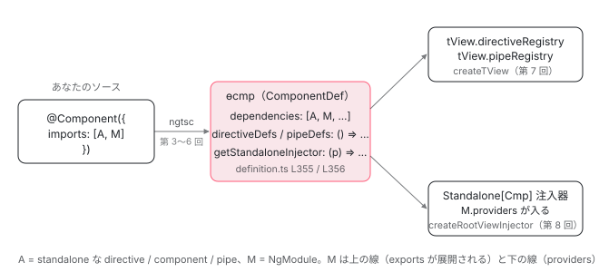

[目次](../README.md) › [standalone コンポーネントの内側](README.md) › 第 1 回 / 全 14 回

# standalone コンポーネントの概観：imports が ɵcmp の dependencies になり、依存解決と注入器を自分で持つ

> @Component({ standalone }) が既定で true になる行、ComponentDef の standalone / dependencies / getStandaloneInjector / schemas の 4 フィールド、コンパイル時（imports → dependencies）と実行時（directiveRegistry と StandaloneService）の 2 つの仕事。ng generate component の既定値と bootstrapApplication の入口。シリーズ全体の地図。

angular/angular · 読了 約 12 分 · 基礎 · [サイトで読む（デモが動きます）](https://angular-deep-dive-cyan.vercel.app/chapter/standalone)

---

「standalone コンポーネントとは、NgModule に書かなくていいコンポーネント」という説明は、何が無くなったかしか言っていません。この章では逆に、**standalone コンポーネントが自分で持つようになったもの**を、実行時のコンポーネント定義 `ɵcmp`（`ComponentDef`）の 4 つのフィールド `standalone` / `dependencies` / `getStandaloneInjector` / `schemas` で確認します。そのうえで、`imports` に書いたものがコンパイル時に `dependencies` になり、実行時に `directiveRegistry` と環境インジェクタになる、という 2 本の線を引きます。細部は第 2 回以降に委ね、この章はシリーズ全体の地図です。

読む対象は `packages/core/src/metadata/directives.ts`（デコレータの型）、`packages/core/src/render3/interfaces/definition.ts`（`ComponentDef` の型）、`packages/core/src/render3/definition.ts`（`ɵɵdefineComponent`）、それにコンパイラのテスト fixture と CLI の schematic です。

1. **1. 概観**（この章）
2. [2. @Component 実行の瞬間（JIT）](02-standalone-decorator.md)
3. [3. imports の検証（AOT）](03-standalone-imports-check.md)
4. [4. 使った依存だけが残る](04-standalone-used-only.md)
5. [5. forwardRef と自己参照](05-standalone-forward-ref.md)
6. [6. ローカルコンパイル](06-standalone-local-compilation.md)
7. [7. 実行時の依存解決](07-standalone-directive-registry.md)
8. [8. providers の 2 つの行き先](08-standalone-providers-two-injectors.md)
9. [9. 入口の検査](09-standalone-entry-checks.md)
10. [10. hostDirectives](10-standalone-host-directives.md)
11. [11. @defer と imports](11-standalone-defer-deps.md)
12. [12. TestBed の差し替え](12-standalone-testbed-override.md)
13. [13. selectorless（実験的）](13-standalone-selectorless.md)
14. [14. foreignImports（内部向け）](14-standalone-foreign-imports.md)

## 1. @Component に書けるもの：standalone と imports

あなたが書く `@Component({...})` の引数の型は `Component` インターフェースです。standalone に関係するフィールドは 3 つあります。

📄 `angular/packages/core/src/metadata/directives.ts` L630–643 （▶ の行: 631, 633, 636–638, 640–641, 643）

```ts
630 │   /**
631 ▶    * Set `standalone` to `false` if you want to import the directive into an NgModule.
632 │    */
633 ▶   standalone?: boolean;
634 │ 
635 │   /**
636 ▶    * The imports property specifies the standalone component's template dependencies — those
637 ▶    * directives, components, and pipes that can be used within its template. Standalone components
638 ▶    * can import other standalone components, directives, and pipes as well as existing NgModules.
639 │    *
640 ▶    * This property is only available for standalone components - specifying it for components
641 ▶    * declared in an NgModule generates a compilation error.
642 │    */
643 ▶   imports?: (Type<any> | ReadonlyArray<any>)[];
```

1. **633 行目：`standalone?: boolean`**

   631 行目の説明文は「NgModule に import したいなら `false` にせよ」です。`true` にする方法ではなく `false` にする方法しか書いていません。省略したときの既定値が `true` だからです（4 節で既定値が決まる行を見ます）。
2. **643 行目：`imports`**

   636〜638 行目、**テンプレートで使う** directive / component / pipe の一覧で、standalone なもの**と既存の NgModule** を入れられます。640〜641 行目、standalone でないコンポーネントに書くとコンパイルエラーです（[第 3 回](03-standalone-imports-check.md)の NG2010）。型が `(Type<any> | ReadonlyArray<any>)[]` なのは、配列の入れ子を許すためです。

📄 `angular/packages/core/src/metadata/directives.ts` L664–671 （▶ の行: 665–666, 668–669, 671）

```ts
664 │   /**
665 ▶    * The set of schemas that declare elements to be allowed in a standalone component. Elements and
666 ▶    * properties that are neither Angular components nor directives must be declared in a schema.
667 │    *
668 ▶    * This property is only available for standalone components - specifying it for components
669 ▶    * declared in an NgModule generates a compilation error.
670 │    */
671 ▶   schemas?: SchemaMetadata[];
```

671 行目の `schemas` も standalone 限定です（668〜669 行目）。NgModule 時代は `@NgModule({ schemas })` に書いていたものが、コンポーネントに移ってきました。`imports` と `schemas` の間には `foreignImports` と `deferredImports` がありますが、どちらも `@internal` なので [第 14 回](14-standalone-foreign-imports.md)と [第 11 回](11-standalone-defer-deps.md)で扱います。

## 2. ComponentDef の 4 フィールド

デコレータの引数はコンパイルされて `ɵɵdefineComponent({...})` の呼び出しになり、その戻り値 `ComponentDef` がクラスの静的プロパティ `ɵcmp` に入ります。実行時の Angular が読むのはデコレータの引数ではなく、こちらです。standalone に関係するフィールドを型定義で確認します。

📄 `angular/packages/core/src/render3/interfaces/definition.ts` L211–222 （▶ の行: 220–222）

```ts
211 │   /** The selectors that will be used to match nodes to this directive. */
212 │   readonly selectors: CssSelectorList;
213 │ 
214 │   /**
215 │    * Name under which the directive is exported (for use with local references in template)
216 │    */
217 │   readonly exportAs: string[] | null;
218 │ 
219 │   /**
220 ▶    * Whether this directive (or component) is standalone.
221 ▶    */
222 ▶   readonly standalone: boolean;
```

📄 `angular/packages/core/src/render3/interfaces/definition.ts` L386–394 （▶ の行: 387–389, 392–394）

```ts
386 │   /**
387 ▶    * Unfiltered list of all dependencies of a component, or `null` if none.
388 ▶    */
389 ▶   dependencies: TypeOrFactory<DependencyTypeList> | null;
390 │ 
391 │   /**
392 ▶    * The set of schemas that declare elements to be allowed in the component's template.
393 ▶    */
394 ▶   schemas: SchemaMetadata[] | null;
```
*directiveDefs / pipeDefs（370〜384 行目）は ivy-overview で既出。*

📄 `angular/packages/core/src/render3/interfaces/definition.ts` L402–406 （▶ の行: 403, 405–406）

```ts
402 │   /**
403 ▶    * A function used by the framework to create standalone injectors.
404 │    */
405 ▶   getStandaloneInjector:
406 ▶     ((parentInjector: EnvironmentInjector) => EnvironmentInjector | null) | null;
```

| フィールド | 型（行） | 誰が読むか | この シリーズの回 |
| --- | --- | --- | --- |
| `standalone` | `boolean`（222 行目） | `ɵɵdefineComponent` 自身（3 節）、`assertStandaloneComponentType`（7 節）、`walkProviderTree`、`isOrphanComponent` | 1・9 |
| `dependencies` | `TypeOrFactory<DependencyTypeList> \| null`（389 行目）。配列か、配列を返す関数か、`null` | `extractDefListOrFactory`（`directiveDefs` / `pipeDefs` の元）、`walkProviderTree`（providers 収集） | 2〜7 |
| `getStandaloneInjector` | `(parent) => EnvironmentInjector \| null` または `null`（405〜406 行目） | `createRootViewInjector`（component\_ref.ts）だけ | 8 |
| `schemas` | `SchemaMetadata[] \| null`（394 行目） | `createTView` → `validateElementIsKnown`（JIT のみ） | 2（JIT 側） |

387 行目のコメントは「**Unfiltered** list of all dependencies」です。NgModule のように「宣言したもの」と「export したもの」を区別せず、import したもの（と、その NgModule が export していたもの）が平らに入ります。389 行目の型 `TypeOrFactory` は `T | (() => T)`。配列になるか関数になるかは、AOT か JIT か、`forwardRef` があるかで決まります（[第 2 回](02-standalone-decorator.md)・[第 5 回](05-standalone-forward-ref.md)）。

## 3. ɵɵdefineComponent が standalone のときだけ値を入れる 2 行

📄 `angular/packages/core/src/render3/definition.ts` L353–360 （▶ の行: 355–356, 358, 360）

```ts
353 │       directiveDefs: null!, // assigned in noSideEffects
354 │       pipeDefs: null!, // assigned in noSideEffects
355 ▶       dependencies: (baseDef.standalone && componentDefinition.dependencies) || null,
356 ▶       getStandaloneInjector: baseDef.standalone
357 │         ? (parentInjector: EnvironmentInjector) => {
358 ▶             return parentInjector.get(StandaloneService).getOrCreateStandaloneInjector(def);
359 │           }
360 ▶         : null,
```
*ɵɵdefineComponent の中。関数全体（344〜385 行目）は ngmodule-standalone-imports で既出。*

355 行目、`dependencies` は `baseDef.standalone && componentDefinition.dependencies`。`standalone: false` なら、コンパイラが何を渡していても `null` になります。356〜360 行目、`getStandaloneInjector` は standalone なら 358 行目の 1 行だけの関数、そうでなければ `null`。**standalone かどうかは、この 2 つのフィールドが「ある」か「`null`」かの違いとして ɵcmp に残ります**。この 2 行の先（`StandaloneService`、`createEnvironmentInjector`）は [NgModule シリーズ第 13 回](../ngmodule/13-ngmodule-standalone-imports.md)で既に追ったので、この章では繰り返しません。

## 4. 既定が true である場所と、AOT の出力

既定値を決めている行は、実行時（JIT）とコンパイラ（AOT）の両方にあります。

📄 `angular/packages/core/src/render3/jit/directive.ts` L403–407 （▶ の行: 405）

```ts
403 │     providers: metadata.providers || null,
404 │     viewQueries: extractQueriesMetadata(type, propMetadata, isViewQuery),
405 ▶     isStandalone: metadata.standalone === undefined ? true : !!metadata.standalone,
406 │     isSignal: !!metadata.signals,
407 │     hostDirectives:
```
*JIT: directiveMetadata の中（400〜411 行目は ngmodule-to-standalone で既出）。*

📄 `angular/packages/compiler/src/render3/view/compiler.ts` L91–100 （▶ の行: 95–97）

```ts
 91 │   if (meta.exportAs !== null) {
 92 │     definitionMap.set('exportAs', o.literalArr(meta.exportAs.map((e) => o.literal(e))));
 93 │   }
 94 │ 
 95 ▶   if (meta.isStandalone === false) {
 96 ▶     definitionMap.set('standalone', o.literal(false));
 97 ▶   }
 98 │   if (meta.isSignal) {
 99 │     definitionMap.set('signals', o.literal(true));
100 │   }
```
*AOT: compileDirectiveFromMetadata の中。ɵcmp に standalone キーを書くのは false のときだけ。*

1. **405 行目（JIT）：`metadata.standalone === undefined ? true : !!metadata.standalone`**

   デコレータに書かなければ `true`。AOT 側の同じ判定（`implicitStandaloneValue`、core が 19.0.0 以上なら `true`）は [NgModule シリーズ第 18 回](../ngmodule/18-ngmodule-to-standalone.md)で読みました。
2. **95〜97 行目（AOT）：`isStandalone === false` のときだけ `standalone: false` を出力**

   `true` のときは何も書きません。実行時は `getNgDirectiveDef` が `directiveDefinition.standalone ?? true`（definition.ts 633 行目、[既出](../ngmodule/18-ngmodule-to-standalone.md)）で埋めるので、キーが無ければ `true` になります。だから生成コードを見ても `standalone: true` という文字は出てきません。

コンパイラのテスト fixture で、入力と出力を並べて見ます。

📄 `angular/packages/compiler-cli/test/compliance/test_cases/r3_compiler_compliance/components_and_directives/standalone/component.ts` L1–15 （▶ の行: 3–6, 11–12）

```ts
 1 │ import {Component} from '@angular/core';
 2 │ 
 3 ▶ @Component({
 4 ▶   selector: 'other-cmp',
 5 ▶   template: '',
 6 ▶ })
 7 │ export class OtherCmp {
 8 │ }
 9 │ 
10 │ @Component({
11 ▶   template: '<other-cmp></other-cmp>',
12 ▶   imports: [OtherCmp],
13 │ })
14 │ export class StandaloneCmp {
15 │ }
```
*入力。どちらのコンポーネントにも standalone は書いていない。*

📄 `angular/packages/compiler-cli/test/compliance/test_cases/r3_compiler_compliance/components_and_directives/standalone/component.js` L1–16 （▶ の行: 3, 10, 13）

```js
 1 │ export class StandaloneCmp {
 2 │   // ...
 3 ▶   static ɵcmp = /*@__PURE__*/ i0.ɵɵdefineComponent({
 4 │     type: StandaloneCmp,
 5 │     selectors: [["ng-component"]],
 6 │     decls: 1,
 7 │     vars: 0,
 8 │     template: function StandaloneCmp_Template(rf, ctx) {
 9 │       if (rf & 1) {
10 ▶         i0.ɵɵelement(0, "other-cmp");
11 │       }
12 │     },
13 ▶     dependencies: [OtherCmp],
14 │     encapsulation: 2
15 │   });
16 │ }
```
*期待出力（component.js）。2 行目の「// ...」は fixture が省略している印で、実際の出力にはもっと多くのキーがある。*

12 行目の `imports: [OtherCmp]` が、出力 13 行目で `dependencies: [OtherCmp]` になっています。`standalone` キーはありません（`true` なので省かれた）。10 行目の `ɵɵelement(0, "other-cmp")` が実行されたとき、この要素に `OtherCmp` を当てはめられるのは、`dependencies` から作られた `directiveRegistry` に `OtherCmp` の def があるからです。次の節でその線を引きます。

## 5. 2 本の線：テンプレートの依存と、providers

`imports` に書いた 1 つの配列は、実行時には 2 つの別の場所で使われます。1 本目はテンプレート、2 本目は注入器です。



*imports は 2 本の線に分かれる。上：テンプレートで使う directive / pipe の一覧。下：import した NgModule の providers。どちらも ɵcmp を経由する。*

1. **上の線：`dependencies` → `directiveDefs` / `pipeDefs` → `directiveRegistry` / `pipeRegistry`**

   3 節の 355 行目で入った `dependencies` から、`extractDefListOrFactory`（definition.ts 653〜674 行目、[既出](../ngmodule/13-ngmodule-standalone-imports.md)）が 「各型の `ɵcmp` / `ɵdir` / `ɵpipe` を集める関数」を作ります。その関数は `createTView`（[tView の章](../ivy/05-ivy-tview.md)）が最初のテンプレート作成時に呼び、結果が `tView.directiveRegistry` と `tView.pipeRegistry` になります。テンプレートの `<other-cmp>` とこの一覧を照合するのが [第 7 回](07-standalone-directive-registry.md)です。
2. **下の線：`getStandaloneInjector` → `StandaloneService` → 環境インジェクタ**

   3 節の 358 行目の関数を `createRootViewInjector` が呼び、`dependencies` の中の NgModule の `providers` を集めて `Standalone[Cmp]` という名前の環境インジェクタを作ります（[既出](../ngmodule/13-ngmodule-standalone-imports.md)）。これと `@Component({ providers })` の行き先が別であることを [第 8 回](08-standalone-providers-two-injectors.md)で見ます。

## 6. NgModule 時代と standalone で、誰が持つか

| 持ち物 | NgModule のコンポーネント | standalone コンポーネント |
| --- | --- | --- |
| テンプレートで使える directive / pipe | 宣言した NgModule の compilation スコープ（[第 4 回](../ngmodule/04-ngmodule-compilation-scope.md)）。ɵcmp の `dependencies` は `null`（355 行目）で、`directiveDefs` は `ɵɵsetComponentScope` から後で入る | 自分の `imports` → `dependencies`（355 行目） |
| import した NgModule の providers | NgModule の `ɵinj` → `R3Injector`（[第 7 回](../ngmodule/07-ngmodule-injector-def.md)） | `getStandaloneInjector`（356〜360 行目）→ `Standalone[Cmp]` 注入器 |
| schemas | `@NgModule({ schemas })` | `@Component({ schemas })`（671 行目）。AOT では ɵcmp に出ない（[第 16 回](../ngmodule/16-ngmodule-schemas.md)） |
| bootstrap の入口 | `platformBrowser().bootstrapModule(AppModule)`（[第 11 回](../ngmodule/11-ngmodule-bootstrap-module.md)） | `bootstrapApplication(App)`。standalone でなければ NG0907（7 節） |

## 7. 入口：ng generate と bootstrapApplication

📄 `angular-cli/packages/schematics/angular/component/schema.json` L54–59 （▶ の行: 57）

```json
54 │     "standalone": {
55 │       "description": "Generate a standalone component. Standalone components are self-contained and don't need to be declared in an NgModule. They can be used independently or imported directly into other standalone components.",
56 │       "type": "boolean",
57 ▶       "default": true,
58 │       "x-user-analytics": "ep.ng_standalone"
59 │     },
```

57 行目、`ng generate component` の `standalone` オプションは既定 `true`。生成されるファイルに `standalone: true` は書かれません（4 節のとおり、書かなくても `true`）。`--standalone=false` としたときだけ `standalone: false` が書かれ、NgModule の `declarations` に追加されます。

📄 `angular/packages/platform-browser/src/browser.ts` L63–78 （▶ の行: 64–65, 69, 72–75）

````ts
63 │ /**
64 ▶  * Bootstraps an instance of an Angular application and renders a standalone component as the
65 ▶  * application's root component. More information about standalone components can be found in [this
66 │  * guide](guide/components).
67 │  *
68 │  * @usageNotes
69 ▶  * The root component passed into this function **must** be a standalone one
70 │  *
71 │  * ```angular-ts
72 ▶  * @Component({
73 ▶  *   template: 'Hello world!'
74 ▶  * })
75 ▶  * class Root {}
76 │  *
77 │  * const appRef: ApplicationRef = await bootstrapApplication(Root);
78 │  * ```
````

64〜65 行目、`bootstrapApplication` は「standalone コンポーネントをルートとして描く」関数で、69 行目に「**must** be a standalone one」。72〜75 行目の例にも `standalone: true` は無く、`template` だけです。この「must」を実行時に検査しているのが次の 2 つです。

📄 `angular/packages/core/src/application/create_application.ts` L56–62 （▶ の行: 60–61）

```ts
56 │   try {
57 │     const platformInjector =
58 │       platformRef?.injector ?? createOrReusePlatformInjector(platformProviders as StaticProvider[]);
59 │ 
60 ▶     if ((typeof ngDevMode === 'undefined' || ngDevMode) && rootComponent !== undefined) {
61 ▶       assertStandaloneComponentType(rootComponent);
62 │     }
```

📄 `angular/packages/core/src/render3/errors.ts` L24–37 （▶ の行: 26–30）

```ts
24 │ /** Verifies that a given type is a Standalone Component. */
25 │ export function assertStandaloneComponentType(type: Type<unknown>) {
26 ▶   assertComponentDef(type);
27 ▶   const componentDef = getComponentDef(type)!;
28 ▶   if (!componentDef.standalone) {
29 ▶     throw new RuntimeError(
30 ▶       RuntimeErrorCode.TYPE_IS_NOT_STANDALONE,
31 │       `The ${stringifyForError(type)} component is not marked as standalone, ` +
32 │         `but Angular expects to have a standalone component here. ` +
33 │         `Please make sure the ${stringifyForError(type)} component does not have ` +
34 │         `the \`standalone: false\` flag in the decorator.`,
35 │     );
36 │   }
37 │ }
```

60〜61 行目、`internalCreateApplication`（[boot シリーズ](../boot/07-boot-bootstrap-application.md)）は開発モードのときだけ `assertStandaloneComponentType` を呼びます。26 行目で `ɵcmp` があることを確かめ、27〜28 行目で 2 節の `standalone` フィールドを読み、`false` なら 29〜30 行目で `TYPE_IS_NOT_STANDALONE`（NG0907）を投げます。本番ビルドではこの検査は走りません。その場合に何が起きるか、`createComponent` 側の検査も含めて [第 9 回](09-standalone-entry-checks.md)で追います。

## ここまでの呼び出し（実行時）

- 👤 `bootstrapApplication(App, appConfig)` — src/main.ts
  - `internalCreateApplication(config)` — core/src/application/create\_application.ts L60-61 — *ngDevMode なら assertStandaloneComponentType(rootComponent)*
    - `assertStandaloneComponentType(type)` — core/src/render3/errors.ts L25 — *getComponentDef(type).standalone が false なら NG0907*
  - `ApplicationRef.bootstrap(App)` — application\_ref.ts — *ComponentFactory.create へ（第 9 回）*
    - `createRootViewInjector(componentDef, …)` — component\_ref.ts — *componentDef.getStandaloneInjector !== null なら呼ぶ（definition.ts L356-360 → 第 8 回）*
    - `createTView(…, componentDef.directiveDefs, componentDef.pipeDefs, componentDef.schemas, …)` — view/construction.ts — *directiveDefs が関数なら呼んで directiveRegistry に（第 7 回）*

## DEMO：この章コンポーネント自身の ɵcmp を覗く

> **🧪 DEMO — (this.constructor as any).ɵcmp の 5 フィールド**
>
> この章のコンポーネント `StandaloneChapter` は `imports: [CodeBlock, ChapterShell, Figure, RouterLink]` を持つ standalone コンポーネントです。`ɵcmp` は private API なので、学習用に読むだけにしてください。このサイトは AOT ビルドなので `dependencies` は配列で、テンプレートで使った 4 つが入っています（使っていないものを import すると NG8113 の警告が出て配列から落ちます。[第 4 回](04-standalone-used-only.md)）。本番ビルドではクラス名が短く書き換えられて表示されることがあります。
>
> ▶ [このデモはサイトで動かせます](https://angular-deep-dive-cyan.vercel.app/chapter/standalone)

## 聞かれそうな質問

**Q. standalone: true と書く必要はありますか？**

ありません。JIT では `directiveMetadata`（jit/directive.ts 405 行目）が `metadata.standalone === undefined` のとき `true` にします。AOT では ngtsc の `implicitStandaloneValue`（core が 19.0.0 以上で `true`）が既定になり、出力には `false` のときだけ `standalone: false` が書かれます（view/compiler.ts 95〜97 行目）。実行時の `getNgDirectiveDef` は `?? true` で埋めるので、キーが無ければ `true` です （この 2 つの行は [NgModule シリーズ第 18 回](../ngmodule/18-ngmodule-to-standalone.md)で引用済み）。

**Q. imports に NgModule を入れてよいのですか？**

よいです。directives.ts 636〜638 行目の説明文に「as well as existing NgModules」とあります。その NgModule の `exports` がテンプレートで使えるようになり、`providers` が `Standalone[Cmp]` 注入器に入ります （[NgModule シリーズ第 13 回](../ngmodule/13-ngmodule-standalone-imports.md)）。ただし `RouterModule.forRoot(...)` のような `ModuleWithProviders` は入れられません。コンパイラが止める行は [第 3 回](03-standalone-imports-check.md)で読みます。

**Q. standalone と NgModule は 1 つのアプリで混ぜられますか？**

混ぜられます。方向は 2 つあります。standalone コンポーネントが NgModule を `imports` する方向（上の質問）と、NgModule が standalone コンポーネントを `imports` する方向（[第 4 回](../ngmodule/04-ngmodule-compilation-scope.md)の local.ts 358〜361 行目）です。できないのは「standalone でないコンポーネントに `imports` を書く」こと（directives.ts 640〜641 行目、NG2010）と、「standalone なコンポーネントを NgModule の `declarations` に書く」ことです。

**Q. standalone: false のコンポーネントでは、テンプレートの依存はどこから来るのですか？**

definition.ts 355 行目で `dependencies` は `null` になります。代わりに、宣言した NgModule の `ɵmod` から `ɵɵsetComponentScope`（AOT）または `patchComponentDefWithScope`（JIT）が `directiveDefs` / `pipeDefs` を後から書き込みます（[第 4 回](../ngmodule/04-ngmodule-compilation-scope.md)・[第 6 回](../ngmodule/06-ngmodule-jit-scope.md)）。

**Q. DEMO で schemas が null なのはなぜですか？schemas を書いていないからですか？**

書いていないからではなく、AOT だからです。コンパイラは `schemas` を型チェックにだけ使い、ɵcmp には出しません。JIT では `compileComponent` が standalone コンポーネントの `schemas` を `metadata.schemas` か `[]` に設定します（[第 2 回](02-standalone-decorator.md)の 210〜222 行目）。実行時の検査 `validateElementIsKnown` は `schemas === null` なら即 return するので、AOT では走りません（[第 16 回](../ngmodule/16-ngmodule-schemas.md)）。

**Q. bootstrapApplication に standalone: false のコンポーネントを渡すとどうなりますか？**

開発モードでは create\_application.ts 60〜61 行目で `assertStandaloneComponentType` が呼ばれ、errors.ts 28〜30 行目で `TYPE_IS_NOT_STANDALONE`（NG0907）が投げられます。メッセージは「The X component is not marked as standalone, but Angular expects to have a standalone component here」です。本番ビルドでは 60 行目の `ngDevMode` 判定で飛ばされます。その先は [第 9 回](09-standalone-entry-checks.md)。

## 読み終えて

- デコレータの `standalone` / `imports` / `schemas`（directives.ts 633・643・671 行目）は、ɵcmp の `standalone` / `dependencies` / `getStandaloneInjector` / `schemas` になる
- `ɵɵdefineComponent` は standalone のときだけ `dependencies`（355 行目）と `getStandaloneInjector`（356〜360 行目）を持たせる。standalone でなければ両方 `null`
- 既定は `true`（jit/directive.ts 405 行目、definition.ts 633 行目）。AOT は `false` のときだけ `standalone: false` を出す（view/compiler.ts 95〜97 行目）
- `imports` は 2 本の線に分かれる。`dependencies` → `directiveRegistry`（テンプレート）と、`getStandaloneInjector` → `Standalone[Cmp]`（providers）
- 入口は `ng generate component`（既定 standalone）と `bootstrapApplication`（開発モードで NG0907 の検査）

---

← 前: [standalone が既定になった後の NgModule：何が残り、何を移行するか](../ngmodule/18-ngmodule-to-standalone.md)  
次: [@Component が実行された瞬間（JIT）：compileComponent が ɵcmp を遅延定義し、imports を後から貼る](02-standalone-decorator.md) →
