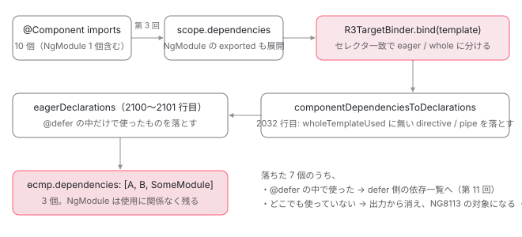

[目次](../README.md) › [standalone コンポーネントの内側](README.md) › 第 4 回 / 全 14 回

# 使った依存だけが dependencies に残る：eagerlyUsed と NG8113 unusedStandaloneImports

> imports に 10 個書いても、テンプレートで使った分しか ɵcmp の dependencies に出ない。resolveComponentDependencies が R3TargetBinder でテンプレートを束縛して使用集合を作る手順、componentDependenciesToDeclarations、NgModule だけは使用に関係なく残る行。未使用 import を警告する UnusedStandaloneImportsRule（NG8113）が何を見て、unusedStandaloneImports オプションでどう変わるか。このサイトのビルドで実際に出た警告の正体。

angular/angular · 読了 約 13 分 · 中核 · [サイトで読む（デモが動きます）](https://angular-deep-dive-cyan.vercel.app/chapter/standalone-used-only)

---

`imports` に 10 個書いても、テンプレートで使った分しか `ɵcmp` の `dependencies` には出ません。この章では、ngtsc が **テンプレートを一度「束縛」して使用集合を作り、それでフィルタしてから書き出す**手順を関数 1 つずつ追います。後半では、同じ使用集合を使って「使っていない import」を警告する `UnusedStandaloneImportsRule`（NG8113）が何を見ているか、`unusedStandaloneImports` オプションでどう変わるかを読み、最後にこのサイトのビルドで実際に出た警告の正体を確認します。

読む対象は `packages/compiler-cli/src/ngtsc/annotations/component/src/handler.ts`、`packages/compiler/src/render3/view/t2_binder.ts`、`packages/compiler-cli/src/ngtsc/validation/src/rules/unused_standalone_imports_rule.ts` です。

1. [1. 概観](01-standalone.md)
2. [2. @Component 実行の瞬間（JIT）](02-standalone-decorator.md)
3. [3. imports の検証（AOT）](03-standalone-imports-check.md)
4. **4. 使った依存だけが残る**（この章）
5. [5. forwardRef と自己参照](05-standalone-forward-ref.md)
6. [6. ローカルコンパイル](06-standalone-local-compilation.md)
7. [7. 実行時の依存解決](07-standalone-directive-registry.md)
8. [8. providers の 2 つの行き先](08-standalone-providers-two-injectors.md)
9. [9. 入口の検査](09-standalone-entry-checks.md)
10. [10. hostDirectives](10-standalone-host-directives.md)
11. [11. @defer と imports](11-standalone-defer-deps.md)
12. [12. TestBed の差し替え](12-standalone-testbed-override.md)
13. [13. selectorless（実験的）](13-standalone-selectorless.md)
14. [14. foreignImports（内部向け）](14-standalone-foreign-imports.md)

## 1. 入口：resolveComponentDependencies が返す 5 つ

[前回](03-standalone-imports-check.md)、`StandaloneComponentScopeReader` が `imports` を展開して 「このコンポーネントのテンプレートで使える directive / pipe / NgModule の全部」（`scope.dependencies`）を作るところまで読みました。その全部を受け取って「使った分」に絞るのが、`ComponentDecoratorHandler.resolve()` から呼ばれる `resolveComponentDependencies` です。まず戻り値の形を見ます。

📄 `angular/packages/compiler-cli/src/ngtsc/annotations/component/src/handler.ts` L1838–1851 （▶ の行: 1842, 1846–1850）

```ts
1838 │   private resolveComponentDependencies(
1839 │     node: ClassDeclaration,
1840 │     context: ts.SourceFile,
1841 │     analysis: Readonly<ComponentAnalysisData>,
1842 ▶     scope: ComponentScope,
1843 │     metadata: Readonly<R3ComponentMetadata<R3TemplateDependencyMetadata>>,
1844 │     diagnostics: ts.Diagnostic[],
1845 │   ): {
1846 ▶     allDependencies: (DirectiveMeta | PipeMeta | NgModuleMeta)[];
1847 ▶     eagerlyUsed: Set<ClassDeclaration>;
1848 ▶     wholeTemplateUsed: Set<ClassDeclaration>;
1849 ▶     deferBlocks: Map<TmplAstDeferredBlock, BoundTarget<DirectiveMeta>>;
1850 ▶     pipes: Map<string, PipeMeta>;
1851 │   } {
```

1. **1842 行目：入力は `scope: ComponentScope`**

   前回作ったスコープです。standalone なら `scope.dependencies`、NgModule 配下なら `scope.compilation.dependencies` が中身になります（1890 行目の分岐は [コンパイルスコープの章](../ngmodule/04-ngmodule-compilation-scope.md)で既出）。
2. **1846 行目：`allDependencies`**

   スコープにあった全部。**使ったかどうかはまだ見ていません**。
3. **1847 行目：`eagerlyUsed`**

   テンプレートの `@defer` の*外*で実際に使われた directive / pipe のクラス宣言の集合。`ɵcmp.dependencies` に残るのはこれです。
4. **1848 行目：`wholeTemplateUsed`**

   `@defer` の中まで含めて使われた集合。`eagerlyUsed` の上位集合です。
5. **1849〜1850 行目：`deferBlocks` と `pipes`**

   `@defer` ブロックごとの束縛結果（[第 11 回](11-standalone-defer-deps.md)）と、パイプ名 → メタデータの辞書です。

## 2. テンプレートを「束縛」して使用集合を作る

「使ったか」をどう判定するか。テンプレート関数を生成する `compile()` はまだ走っていないので、別の照合器 `R3TargetBinder` でテンプレート AST を一度歩きます。

📄 `angular/packages/compiler-cli/src/ngtsc/annotations/component/src/handler.ts` L1925–1931 （▶ の行: 1926–1927）

```ts
1925 │     // Set up the R3TargetBinder.
1926 ▶     const binder = new R3TargetBinder(
1927 ▶       createMatcherFromScope(scope, this.hostDirectivesResolver),
1928 │       createForeignComponentMatcher(analysis.foreignImports),
1929 │     );
1930 │     let allDependencies = dependencies;
1931 │     let deferBlockBinder = binder;
```

1926〜1927 行目、`createMatcherFromScope(scope, …)` で **スコープ内の全 directive のセレクタ**を登録した `SelectorMatcher`（selectorless なら名前で照合する `SelectorlessMatcher`。[第 13 回](13-standalone-selectorless.md)）を作り、それを `R3TargetBinder` に渡します。その直後の `binder.bind({template: metadata.template.nodes})` で束縛が実行され `BoundTarget` が返ります（既出。[コンパイルスコープの章](../ngmodule/04-ngmodule-compilation-scope.md) 7 節）。`BoundTarget` には「使った」を聞く 4 つのメソッドがあります。

📄 `angular/packages/compiler/src/render3/view/t2_api.ts` L280–302 （▶ の行: 284, 290, 296, 302）

```ts
280 │   /**
281 │    * Get a list of all the directives used by the target,
282 │    * including directives from `@defer` blocks.
283 │    */
284 ▶   getUsedDirectives(): DirectiveT[];
285 │ 
286 │   /**
287 │    * Get a list of eagerly used directives from the target.
288 │    * Note: this list *excludes* directives from `@defer` blocks.
289 │    */
290 ▶   getEagerlyUsedDirectives(): DirectiveT[];
291 │ 
292 │   /**
293 │    * Get a list of all the pipes used by the target,
294 │    * including pipes from `@defer` blocks.
295 │    */
296 ▶   getUsedPipes(): string[];
297 │ 
298 │   /**
299 │    * Get a list of eagerly used pipes from the target.
300 │    * Note: this list *excludes* pipes from `@defer` blocks.
301 │    */
302 ▶   getEagerlyUsedPipes(): string[];
```

284 行目 `getUsedDirectives()` は `@defer` の中も含めた全部、290 行目 `getEagerlyUsedDirectives()` は `@defer` の外だけ。pipe も同じ対になっています（296・302 行目）。「eager（即時）」と「whole（全体）」の違いはこの 2 系統から来ています。どこで振り分けているかを `t2_binder.ts` で確認します。

📄 `angular/packages/compiler/src/render3/view/t2_binder.ts` L767–775 （▶ の行: 770–772）

```ts
767 │   private trackMatchedDirectives(node: DirectiveOwner, matchedDirectives: DirectiveT[]) {
768 │     if (matchedDirectives.length > 0) {
769 │       const directives = this.dedupeAndMergeDirectives(node, matchedDirectives);
770 ▶       this.directives.set(node, directives);
771 ▶       if (!this.isInDeferBlock) {
772 ▶         this.eagerDirectives.push(...directives);
773 │       }
774 │     }
775 │   }
```

📄 `angular/packages/compiler/src/render3/view/t2_binder.ts` L1222–1228 （▶ の行: 1223–1225）

```ts
1222 │   override visitPipe(ast: BindingPipe, context: any): any {
1223 ▶     this.usedPipes.add(ast.name);
1224 ▶     if (!this.scope.isDeferred) {
1225 ▶       this.eagerPipes.add(ast.name);
1226 │     }
1227 │     this.pipes.set(ast, this.scope.getEnclosingDeferBlocks());
1228 │     return super.visitPipe(ast, context);
```

770 行目、セレクタが一致した directive は要素ごとの `directives` Map に必ず入ります。771〜772 行目、**いま `@defer` ブロックの中にいなければ**（`isInDeferBlock` が false）`eagerDirectives` にも足します。pipe も同じで、1223 行目で `usedPipes` に、1224〜1225 行目でスコープが deferred でないときだけ `eagerPipes` に入ります。「セレクタが一致する要素がテンプレートにあった」が「使った」の定義です。`imports` に書いたかどうかは、ここでは一切見ていません。

束縛が終わると、結果を `eagerlyUsed` に集めます。ここに分岐が 1 つあります。

📄 `angular/packages/compiler-cli/src/ngtsc/annotations/component/src/handler.ts` L1964–1980 （▶ の行: 1966, 1968, 1971–1973）

```ts
1964 │     // Register all Directives and Pipes used at the top level (outside
1965 │     // of any defer blocks), which would be eagerly referenced.
1966 ▶     const eagerlyUsed = new Set<ClassDeclaration>();
1967 │ 
1968 ▶     if (this.enableHmr) {
1969 │       // In HMR we need to preserve all the dependencies, because they have to remain consistent
1970 │       // with the initially-generated code no matter what the template looks like.
1971 ▶       for (const dep of dependencies) {
1972 ▶         if (dep.ref.node !== node) {
1973 ▶           eagerlyUsed.add(dep.ref.node);
1974 │         } else {
1975 │           const used = bound.getEagerlyUsedDirectives();
1976 │           if (used.some((current) => current.ref.node === node)) {
1977 │             eagerlyUsed.add(node);
1978 │           }
1979 │         }
1980 │       }
```

1966 行目が `eagerlyUsed` の入れ物です。1968 行目、HMR（`enableHmr`）が有効なときは 1971〜1973 行目で **スコープにある依存を使用に関係なく全部**入れます（1972 行目、自分自身だけは本当に使ったときだけ）。HMR 中にテンプレートを書き換えても、最初に生成したコードと依存が食い違わないようにするためです。HMR でないとき（1981 行目からの `else`、[既出](../ngmodule/04-ngmodule-compilation-scope.md)）は `getEagerlyUsedDirectives()` / `getEagerlyUsedPipes()` の結果だけが入ります。続けて `wholeTemplateUsed` を作ります。

📄 `angular/packages/compiler-cli/src/ngtsc/annotations/component/src/handler.ts` L1992–2007 （▶ の行: 1994–1997, 2000–2001, 2007）

```ts
1992 │     // Set of Directives and Pipes used across the entire template,
1993 │     // including all defer blocks.
1994 ▶     const wholeTemplateUsed = new Set<ClassDeclaration>(eagerlyUsed);
1995 ▶     for (const bound of deferBlocks.values()) {
1996 ▶       for (const dir of bound.getUsedDirectives()) {
1997 ▶         wholeTemplateUsed.add(dir.ref.node);
1998 │       }
1999 │       for (const name of bound.getUsedPipes()) {
2000 ▶         if (!pipes.has(name)) {
2001 ▶           continue;
2002 │         }
2003 │         wholeTemplateUsed.add(pipes.get(name)!.ref.node);
2004 │       }
2005 │     }
2006 │ 
2007 ▶     return {allDependencies, eagerlyUsed, wholeTemplateUsed, deferBlocks, pipes};
```

1994 行目、`eagerlyUsed` のコピーから始めて、1995〜1997 行目で各 `@defer` ブロックの束縛結果から `getUsedDirectives()` を足します。2007 行目で 5 つを返します。pipe については 2000〜2001 行目、スコープにない名前（`pipes.has(name)` が false）は黙って飛ばします。その名前のエラーは型検査側が別に出すので、ここでは依存の計算だけに専念しています。

> [!WARNING]
> **ハマりどころ**
>
> `ng serve` はこの HMR 経路を使います。CLI 側の条件は次の 9 行です。
>
> 📄 `angular-cli/packages/angular/build/src/builders/dev-server/vite/index.ts` L173–181 （▶ の行: 173–174, 181）
>
> ```ts
> 173 ▶   const componentsHmrCanBeUsed =
> 174 ▶     browserOptions.aot && serverOptions.liveReload && serverOptions.hmr;
> 175 │ 
> 176 │   // Enable to support link-based component style hot reloading (`NG_HMR_CSTYLES=1` can be used to enable)
> 177 │   browserOptions.externalRuntimeStyles = componentsHmrCanBeUsed && useComponentStyleHmr;
> 178 │ 
> 179 │   // Enable to support component template hot replacement (`NG_HMR_TEMPLATE=0` can be used to disable selectively)
> 180 │   // This will also replace file-based/inline styles as code if external runtime styles are not enabled.
> 181 ▶   browserOptions.templateUpdates = componentsHmrCanBeUsed && useComponentTemplateHmr;
> ```
>
> 173〜174 行目、AOT かつ `liveReload` かつ `hmr`（既定はどちらも有効）なら 181 行目で `templateUpdates` が立ち、それが ngtsc の `_enableHmr` になります。開発サーバで `ɵcmp.dependencies` を覗くと 1971〜1973 行目の経路で未使用の import も入って見える、ということです。この章のデモは `ng build` の出力（HMR なし）で動いているので、絞られた結果が見えます。手元で確かめるときは `ng serve --no-hmr` か `ng build` の出力で見てください。

## 3. 使用集合でフィルタして declarations にする

呼び出し側に戻ります。5 つの戻り値のうち `allDependencies` と `wholeTemplateUsed` が次の関数に渡ります。

📄 `angular/packages/compiler-cli/src/ngtsc/annotations/component/src/handler.ts` L1451–1460 （▶ の行: 1451–1452, 1454, 1457–1458）

```ts
1451 ▶       const {eagerlyUsed, deferBlocks, allDependencies, wholeTemplateUsed, pipes} =
1452 ▶         this.resolveComponentDependencies(node, context, analysis, scope, metadata, diagnostics);
1453 │ 
1454 ▶       const declarations = this.componentDependenciesToDeclarations(
1455 │         node,
1456 │         context,
1457 ▶         allDependencies,
1458 ▶         wholeTemplateUsed,
1459 │         pipes,
1460 │       );
```

📄 `angular/packages/compiler-cli/src/ngtsc/annotations/component/src/handler.ts` L2014–2053 （▶ の行: 2021, 2024, 2026, 2031–2033, 2035, 2042）

```ts
2014 │   private componentDependenciesToDeclarations(
2015 │     node: ClassDeclaration,
2016 │     context: ts.SourceFile,
2017 │     allDependencies: (DirectiveMeta | PipeMeta | NgModuleMeta)[],
2018 │     wholeTemplateUsed: Set<ClassDeclaration>,
2019 │     pipes: Map<string, PipeMeta>,
2020 │   ): ComponentDeclarations {
2021 ▶     const declarations: ComponentDeclarations = new Map();
2022 │ 
2023 │     // Transform the dependencies list, filtering out unused dependencies.
2024 ▶     for (const dep of allDependencies) {
2025 │       // Only emit references to each dependency once.
2026 ▶       if (declarations.has(dep.ref.node)) {
2027 │         continue;
2028 │       }
2029 │ 
2030 │       switch (dep.kind) {
2031 ▶         case MetaKind.Directive:
2032 ▶           if (!wholeTemplateUsed.has(dep.ref.node) || dep.matchSource !== MatchSource.Selector) {
2033 ▶             continue;
2034 │           }
2035 ▶           const dirType = this.refEmitter.emit(dep.ref, context);
2036 │           assertSuccessfulReferenceEmit(
2037 │             dirType,
2038 │             node.name,
2039 │             dep.isComponent ? 'component' : 'directive',
2040 │           );
2041 │ 
2042 ▶           declarations.set(dep.ref.node, {
2043 │             kind: R3TemplateDependencyKind.Directive,
2044 │             ref: dep.ref,
2045 │             type: dirType.expression,
2046 │             importedFile: dirType.importedFile,
2047 │             selector: dep.selector!,
2048 │             inputs: dep.inputs.propertyNames,
2049 │             outputs: dep.outputs.propertyNames,
2050 │             exportAs: dep.exportAs,
2051 │             isComponent: dep.isComponent,
2052 │           });
2053 │           break;
```

1. **2021 行目：結果は `Map<ClassDeclaration, …>`**

   キーがクラス宣言なので、2026 行目で同じクラスが 2 回来ても 1 回だけ入ります。`imports: [A, A]` や「NgModule 経由と直接の両方」で重複しても出力は 1 つです。
2. **2024 行目：`allDependencies` を 1 つずつ**

   入力は「スコープの全部」です。ここから落としていきます。
3. **2031〜2033 行目：directive は `wholeTemplateUsed` にあるものだけ**

   `!wholeTemplateUsed.has(dep.ref.node)` なら `continue`。**これが「使った依存だけが残る」の 1 行**です。もう 1 つの条件 `dep.matchSource !== MatchSource.Selector` は次の引用で見ます。
4. **2035 行目：参照を式に変換**

   `refEmitter.emit` で、生成コードから書ける式（同じファイルなら識別子、別ファイルなら import 付きの参照）にします。2042 行目で Map に入ります。

📄 `angular/packages/compiler/src/render3/view/t2_api.ts` L186–194 （▶ の行: 190, 193）

```ts
186 │  * Possible ways that a directive can be matched.
187 │  */
188 │ export enum MatchSource {
189 │   /** The directive was matched by its selector. */
190 ▶   Selector,
191 │ 
192 │   /** The directive was applied as a host directive. */
193 ▶   HostDirective,
194 │ }
```

190 行目 `Selector` がセレクタ一致、193 行目 `HostDirective` は他の directive の `hostDirectives` として付いてきたもの。hostDirective は使っていても `dependencies` には入れません。ホスト側の `ɵdir` が `ɵɵHostDirectivesFeature` で自分で持つからです （[第 10 回](10-standalone-host-directives.md)）。

📄 `angular/packages/compiler-cli/src/ngtsc/annotations/component/src/handler.ts` L2054–2086 （▶ の行: 2054–2055, 2058, 2067–2068, 2075, 2079）

```ts
2054 ▶         case MetaKind.NgModule:
2055 ▶           const ngModuleType = this.refEmitter.emit(dep.ref, context);
2056 │           assertSuccessfulReferenceEmit(ngModuleType, node.name, 'NgModule');
2057 │ 
2058 ▶           declarations.set(dep.ref.node, {
2059 │             kind: R3TemplateDependencyKind.NgModule,
2060 │             type: ngModuleType.expression,
2061 │             importedFile: ngModuleType.importedFile,
2062 │           });
2063 │           break;
2064 │       }
2065 │     }
2066 │ 
2067 ▶     for (const [localName, dep] of pipes) {
2068 ▶       if (!wholeTemplateUsed.has(dep.ref.node)) {
2069 │         continue;
2070 │       }
2071 │ 
2072 │       const pipeType = this.refEmitter.emit(dep.ref, context);
2073 │       assertSuccessfulReferenceEmit(pipeType, node.name, 'pipe');
2074 │ 
2075 ▶       declarations.set(dep.ref.node, {
2076 │         kind: R3TemplateDependencyKind.Pipe,
2077 │         type: pipeType.expression,
2078 │         // Use the local name for pipes to account for selectorless.
2079 ▶         name: localName,
2080 │         ref: dep.ref,
2081 │         importedFile: pipeType.importedFile,
2082 │       });
2083 │     }
2084 │ 
2085 │     return declarations;
2086 │   }
```

2054〜2058 行目が NgModule の分岐です。**`wholeTemplateUsed` を見ていません**。NgModule は「使った / 使わない」の対象ではなく、import した時点で無条件に `declarations` に入ります。理由は providers です。NgModule は `ɵinj` を持っていて、テンプレートで何も使わなくてもその providers は環境インジェクタに集められなければなりません （[NgModule シリーズ第 13 回](../ngmodule/13-ngmodule-standalone-imports.md)）。

2067〜2068 行目、pipe は directive と別のループです。`pipes` Map（名前 → メタデータ）を回し、`wholeTemplateUsed` にあるものだけ残します。2079 行目、出力には `localName`（selectorless で別名を付けたときの名前）を使います。

この `declarations` はまだ「`@defer` の中で使ったもの」を含んでいます。最後に 2100〜2101 行目の `eagerDeclarations` フィルタ（[既出](../ngmodule/13-ngmodule-standalone-imports.md)）で 「NgModule か、`eagerlyUsed` にあるもの」に絞られ、2156 行目で `data.declarations` に入り、`compiler.ts` の `compileDeclarationList`（[既出](../ngmodule/04-ngmodule-compilation-scope.md)）が `dependencies: [...]` として書き出します。



*imports に書いた 10 個が ɵcmp.dependencies の 3 個になるまで。落ちる場所は 2 か所（2032 行目と 2101 行目）。NgModule はどちらも通過する。*

## 4. 副産物：使った依存が無いと分かると何が変わるか

📄 `angular/packages/compiler-cli/src/ngtsc/annotations/component/src/handler.ts` L1486–1495 （▶ の行: 1486–1490, 1492–1493, 1495）

```ts
1486 ▶         data.hasDirectiveDependencies =
1487 ▶           !analysis.meta.isStandalone ||
1488 ▶           allDependencies.some(({kind, ref}) => {
1489 ▶             // Note that `allDependencies` includes ones that aren't
1490 ▶             // used in the template so we need to filter them out.
1491 │             return (
1492 ▶               (kind === MetaKind.Directive || kind === MetaKind.NgModule) &&
1493 ▶               wholeTemplateUsed.has(ref.node)
1494 │             );
1495 ▶           });
```

📄 `angular/packages/compiler/src/render3/view/compiler.ts` L201–204 （▶ の行: 202–203）

```ts
201 │   const compilationMode =
202 ▶     meta.isStandalone && !meta.hasDirectiveDependencies
203 ▶       ? TemplateCompilationMode.DomOnly
204 │       : TemplateCompilationMode.Full;
```

📄 `angular/packages/compiler/src/template/pipeline/src/compilation.ts` L22–29 （▶ の行: 25, 28）

```ts
22 │ /** Possible modes in which a component's template can be compiled. */
23 │ export enum TemplateCompilationMode {
24 │   /** Supports the full instruction set, including directives. */
25 ▶   Full,
26 │ 
27 │   /** Uses a narrower instruction set that doesn't support directives and allows optimizations. */
28 ▶   DomOnly,
29 │ }
```

1486〜1495 行目、standalone コンポーネントで「`wholeTemplateUsed` にある directive か NgModule」が 1 つも無ければ `hasDirectiveDependencies` は `false` です（1487 行目、standalone でなければ常に `true`）。`imports` に書いただけの依存は、この判定にも数えられません（1489〜1490 行目のコメント）。それを受けて `compiler.ts` 202〜203 行目は `TemplateCompilationMode.DomOnly` を選びます。28 行目のコメントどおり「ディレクティブを扱わない、より狭い命令セット」です。何が変わるかを 1 つだけ見ます。

📄 `angular/packages/compiler/src/template/pipeline/src/phases/reify.ts` L106–125 （▶ の行: 109–110, 117）

```ts
106 │       case ir.OpKind.ElementStart:
107 │         ir.OpList.replace(
108 │           op,
109 ▶           unit.job.mode === TemplateCompilationMode.DomOnly
110 ▶             ? ng.domElementStart(
111 │                 op.handle.slot!,
112 │                 op.tag!,
113 │                 op.attributes as number | null,
114 │                 op.localRefs as number | null,
115 │                 op.startSourceSpan,
116 │               )
117 ▶             : ng.elementStart(
118 │                 op.handle.slot!,
119 │                 op.tag!,
120 │                 op.attributes as number | null,
121 │                 op.localRefs as number | null,
122 │                 op.startSourceSpan,
123 │               ),
124 │         );
125 │         break;
```

109〜110 行目、`DomOnly` なら要素の開始命令は `ɵɵdomElementStart`、そうでなければ 117 行目の `ɵɵelementStart` です。`ɵɵelementStart` は要素ごとに `directiveRegistry` とセレクタを照合しますが（[第 7 回](07-standalone-directive-registry.md)）、`dom` 版はそれをしません。「使った依存が無い」とコンパイル時に分かるから、実行時の照合そのものを省けるのです。

もう 1 つ、NgModule 側の副産物です。standalone コンポーネントを NgModule の `imports` に入れると、`ɵinj` の `imports` には何も出ません。

📄 `angular/packages/compiler-cli/test/compliance/test_cases/r3_compiler_compliance/components_and_directives/standalone/module_optimization.ts` L1–18 （▶ の行: 15）

```ts
 1 │ import {Component, Directive, NgModule} from '@angular/core';
 2 │ 
 3 │ @Component({
 4 │   selector: 'standalone-cmp',
 5 │   template: '',
 6 │ })
 7 │ export class StandaloneCmp {
 8 │ }
 9 │ 
10 │ @Directive({})
11 │ export class StandaloneDir {
12 │ }
13 │ 
14 │ @NgModule({
15 ▶   imports: [StandaloneCmp, StandaloneDir],
16 │ })
17 │ export class Module {
18 │ }
```

📄 `angular/packages/compiler-cli/test/compliance/test_cases/r3_compiler_compliance/components_and_directives/standalone/module_optimization.js` L1–4 （▶ の行: 3）

```js
1 │ export class Module {
2 │   // ...
3 ▶   static ɵinj = /*@__PURE__*/ i0.ɵɵdefineInjector({});
4 │ }
```

15 行目で 2 つ import していますが、出力 3 行目は `ɵɵdefineInjector({})` と空です（出力中の `// ...` は fixture 側の省略記号です）。providers を持たない standalone コンポーネントと directive は注入器に関係ないので、`NgModuleDecoratorHandler` が `mayExportProviders` で落とします （[NgModule シリーズ第 3 回](../ngmodule/03-ngmodule-aot-output.md)で引用した 826〜852 行目）。「書いたものがそのまま出るのではなく、必要なものだけが出る」という方針は、コンポーネント側も NgModule 側も同じです。

> **🧪 DEMO — このページの ɵcmp.dependencies を実際に読む**
>
> 下の 2 つのコンポーネントは、この章の `standalone-used-only.ts` にあります。`UsedOnlyDemo` は `imports` に 2 つの directive を書き、テンプレートでは 1 つしか使っていません。右の列は実行時に `ɵcmp.dependencies` を読んでクラス名にしたものです。
>
> `UsedOnlyUnusedDir` が消えています。なお、この未使用 import は本来 NG8113 の警告になるところを、`export const USED_ONLY_DEMO_IMPORTS = [...]` という**export された共有配列**経由で渡しているため警告されていません。その判定（`isPotentialSharedReference`）は 5 節で読みます。
>
> ▶ [このデモはサイトで動かせます](https://angular-deep-dive-cyan.vercel.app/chapter/standalone-used-only)

## 5. NG8113：未使用 import を警告する UnusedStandaloneImportsRule

3 節で見た「使わなかったので落ちた」依存は、出力から消えるだけでなく警告になります。その警告はテンプレート型検査の一部ではなく、`NgCompiler.runAdditionalChecks` が各ソースファイルに対して走らせる `SourceFileValidator` の規則の 1 つです。

📄 `angular/packages/compiler-cli/src/ngtsc/core/src/compiler.ts` L1268–1280 （▶ の行: 1272, 1275–1276）

```ts
1268 │   private runAdditionalChecks(sf?: ts.SourceFile): ts.Diagnostic[] {
1269 │     const diagnostics: ts.Diagnostic[] = [];
1270 │     const compilation = this.ensureAnalyzed();
1271 │     const {extendedTemplateChecker, templateSemanticsChecker, sourceFileValidator} = compilation;
1272 ▶     const files = sf ? [sf] : this.inputProgram.getSourceFiles();
1273 │ 
1274 │     for (const sf of files) {
1275 ▶       if (sourceFileValidator !== null) {
1276 ▶         const sourceFileDiagnostics = sourceFileValidator.getDiagnosticsForFile(sf);
1277 │         if (sourceFileDiagnostics !== null) {
1278 │           diagnostics.push(...sourceFileDiagnostics);
1279 │         }
1280 │       }
```

📄 `angular/packages/compiler-cli/src/ngtsc/validation/src/source_file_validator.ts` L24–46 （▶ の行: 33, 36–38）

```ts
24 │ export class SourceFileValidator {
25 │   private rules: SourceFileValidatorRule[];
26 │ 
27 │   constructor(
28 │     reflector: ReflectionHost,
29 │     importedSymbolsTracker: ImportedSymbolsTracker,
30 │     templateTypeChecker: TemplateTypeChecker,
31 │     typeCheckingConfig: TypeCheckingConfig,
32 │   ) {
33 ▶     this.rules = [new InitializerApiUsageRule(reflector, importedSymbolsTracker)];
34 │ 
35 │     this.rules.push(
36 ▶       new UnusedStandaloneImportsRule(
37 ▶         templateTypeChecker,
38 ▶         typeCheckingConfig,
39 │         importedSymbolsTracker,
40 │       ),
41 │     );
42 │ 
43 │     this.rules.push(
44 │       new ForbiddenRequiredInitializersInvocationRule(reflector, importedSymbolsTracker),
45 │     );
46 │   }
```

📄 `angular/packages/compiler-cli/src/ngtsc/validation/src/source_file_validator.ts` L52–63 （▶ の行: 53, 59）

```ts
52 │   getDiagnosticsForFile(sourceFile: ts.SourceFile): ts.Diagnostic[] | null {
53 ▶     if (sourceFile.isDeclarationFile || sourceFile.fileName.endsWith('.ngtypecheck.ts')) {
54 │       return null;
55 │     }
56 │ 
57 │     let rulesToRun: SourceFileValidatorRule[] | null = null;
58 │     for (const rule of this.rules) {
59 ▶       if (rule.shouldCheck(sourceFile)) {
60 │         rulesToRun ??= [];
61 │         rulesToRun.push(rule);
62 │       }
63 │     }
```

1272 行目、対象は program の全ソースファイル。1275〜1276 行目で `getDiagnosticsForFile` を呼びます。`SourceFileValidator` は 33〜45 行目で 3 つの規則を持ち、36〜38 行目の `UnusedStandaloneImportsRule` が `TemplateTypeChecker`（使用集合を聞く相手）と `typeCheckingConfig`（error / warning / suppress の設定）を受け取ります。53 行目、`.d.ts` と型検査用の `.ngtypecheck.ts` は飛ばし、59 行目で各規則の `shouldCheck` に「このファイルを見るか」を聞きます。

📄 `angular/packages/compiler-cli/src/ngtsc/validation/src/rules/unused_standalone_imports_rule.ts` L22–35 （▶ の行: 31–33）

```ts
22 │ export class UnusedStandaloneImportsRule implements SourceFileValidatorRule {
23 │   constructor(
24 │     private templateTypeChecker: TemplateTypeChecker,
25 │     private typeCheckingConfig: TypeCheckingConfig,
26 │     private importedSymbolsTracker: ImportedSymbolsTracker,
27 │   ) {}
28 │ 
29 │   shouldCheck(sourceFile: ts.SourceFile): boolean {
30 │     return (
31 ▶       this.typeCheckingConfig.unusedStandaloneImports !== 'suppress' &&
32 ▶       (this.importedSymbolsTracker.hasNamedImport(sourceFile, 'Component', '@angular/core') ||
33 ▶         this.importedSymbolsTracker.hasNamespaceImport(sourceFile, '@angular/core'))
34 │     );
35 │   }
```

31 行目、設定が `'suppress'` なら何もしません。32〜33 行目、ファイルが `@angular/core` から `Component` を 名前付き import しているか、名前空間 import しているときだけ対象です。`@Component` が無いファイルはクラスを 1 つも見に行きません。

📄 `angular/packages/compiler-cli/src/ngtsc/validation/src/rules/unused_standalone_imports_rule.ts` L37–70 （▶ の行: 42, 46–49, 54–55, 62, 64–65）

```ts
37 │   checkNode(node: ts.Node): ts.Diagnostic | ts.Diagnostic[] | null {
38 │     if (!ts.isClassDeclaration(node)) {
39 │       return null;
40 │     }
41 │ 
42 ▶     const metadata = this.templateTypeChecker.getDirectiveMetadata(node);
43 │ 
44 │     if (
45 │       !metadata ||
46 ▶       !metadata.isStandalone ||
47 ▶       metadata.rawImports === null ||
48 ▶       metadata.imports === null ||
49 ▶       metadata.imports.length === 0
50 │     ) {
51 │       return null;
52 │     }
53 │ 
54 ▶     const usedDirectives = this.templateTypeChecker.getUsedDirectives(node);
55 ▶     const usedPipes = this.templateTypeChecker.getUsedPipes(node);
56 │ 
57 │     // These will be null if the component is invalid for some reason.
58 │     if (!usedDirectives || !usedPipes) {
59 │       return null;
60 │     }
61 │ 
62 ▶     const unused = this.getUnusedSymbols(
63 │       metadata,
64 ▶       new Set(usedDirectives.map((dir) => dir.ref.node as ts.ClassDeclaration)),
65 ▶       new Set(usedPipes),
66 │     );
67 │ 
68 │     if (unused === null) {
69 │       return null;
70 │     }
```

📄 `angular/packages/compiler-cli/src/ngtsc/typecheck/src/checker.ts` L480–486 （▶ の行: 481, 485）

```ts
480 │   getUsedDirectives(component: ts.ClassDeclaration): TypeCheckableDirectiveMeta[] | null {
481 ▶     return this.getLatestComponentState(component).data?.boundTarget.getUsedDirectives() ?? null;
482 │   }
483 │ 
484 │   getUsedPipes(component: ts.ClassDeclaration): string[] | null {
485 ▶     return this.getLatestComponentState(component).data?.boundTarget.getUsedPipes() ?? null;
486 │   }
```

1. **42 行目：クラスのメタデータを取る**

   46〜49 行目、standalone でない・`imports` を書いていない（`rawImports === null`）・解決後の `imports` が空、のどれかなら対象外です。`imports: []` と書いても警告は出ません。
2. **54〜55 行目：使用集合を型検査器に聞く**

   `checker.ts` 481・485 行目、中身は型検査用に束縛した `boundTarget.getUsedDirectives()` / `getUsedPipes()` です。2 節の `BoundTarget` と同じ API で、**`@defer` の中も含む「whole」側**を使います。`@defer` の中だけで使った import は `ɵcmp.dependencies` には出ませんが、未使用とは扱われません。
3. **62〜65 行目：imports から使用集合を引く**

   directive はクラス宣言の `Set`、pipe は名前の `Set` にして `getUnusedSymbols` へ。

📄 `angular/packages/compiler-cli/src/ngtsc/validation/src/rules/unused_standalone_imports_rule.ts` L117–147 （▶ の行: 117, 119, 123–125, 137, 139–140）

```ts
117 ▶     for (const current of imports) {
118 │       const currentNode = current.node as ts.ClassDeclaration;
119 ▶       const dirMeta = this.templateTypeChecker.getDirectiveMetadata(currentNode);
120 │ 
121 │       if (dirMeta !== null) {
122 │         if (
123 ▶           dirMeta.isStandalone &&
124 ▶           !usedDirectives.has(currentNode) &&
125 ▶           !this.isPotentialSharedReference(current, rawImports)
126 │         ) {
127 │           unused ??= [];
128 │           unused.push(current);
129 │         }
130 │         continue;
131 │       }
132 │ 
133 │       const pipeMeta = this.templateTypeChecker.getPipeMetadata(currentNode);
134 │ 
135 │       if (
136 │         pipeMeta !== null &&
137 ▶         pipeMeta.isStandalone &&
138 │         pipeMeta.name !== null &&
139 ▶         !usedPipes.has(pipeMeta.name) &&
140 ▶         !this.isPotentialSharedReference(current, rawImports)
141 │       ) {
142 │         unused ??= [];
143 │         unused.push(current);
144 │       }
145 │     }
146 │ 
147 │     return unused;
```

117 行目、`imports` の 1 つずつについて、119 行目で directive のメタデータを取ります。123〜125 行目、**その import 自体が standalone で**、使用集合に無く、共有配列由来でもないときだけ `unused` に入ります。pipe は 137〜140 行目で同じ 3 条件（名前で照合）。directive でも pipe でもないもの（NgModule）はどちらの `if` にも入らないので、**NgModule は未使用警告の対象外**です。3 節で見たとおり NgModule は使用に関係なく出力に残るので、警告する意味もありません。

📄 `angular/packages/compiler-cli/src/ngtsc/validation/src/rules/unused_standalone_imports_rule.ts` L155–181 （▶ の行: 157–158, 167, 170–171, 181）

```ts
155 │   private isPotentialSharedReference(reference: Reference, rawImports: ts.Expression): boolean {
156 │     // If the reference is defined directly in the `imports` array, it cannot be shared.
157 ▶     if (reference.getIdentityInExpression(rawImports) !== null) {
158 ▶       return false;
159 │     }
160 │ 
161 │     // The reference might be shared if it comes from an exported array. If the variable is local
162 │     /// to the file, then it likely isn't shared. Note that this has the potential for false
163 │     // positives if a non-exported array of imports is shared between components in the same
164 │     // file. This scenario is unlikely and even if we report the diagnostic for it, it would be
165 │     // okay since the user only has to refactor components within the same file, rather than the
166 │     // entire application.
167 ▶     let current: ts.Node | null = reference.getIdentityIn(rawImports.getSourceFile());
168 │ 
169 │     while (current !== null) {
170 ▶       if (ts.isVariableStatement(current)) {
171 ▶         return !!current.modifiers?.some((m) => m.kind === ts.SyntaxKind.ExportKeyword);
172 │       }
173 │ 
174 │       // `Node.parent` can be undefined, but the TS types don't reflect it.
175 │       // Coerce to null so the value is consitent with the type.
176 │       current = current.parent ?? null;
177 │     }
178 │ 
179 │     // Otherwise the reference likely comes from an imported
180 │     // symbol like an array of shared common components.
181 ▶     return true;
```

157〜158 行目、`imports: [A, B]` と配列リテラルに直接書いた参照は共有でないと即断します。そうでなければ 167 行目でファイル内の識別子から親をたどり、170〜171 行目、`const X = [...]` という変数宣言に行き着いたら **`export` が付いているかどうか**を答えにします。ファイル内に識別子が無い（別ファイルから import した配列）なら 181 行目で `true`。「複数のコンポーネントで共有する imports 配列には、どこかで使っていないものが混ざるのが普通」なので、そこは警告しない設計です。4 節のデモが警告されなかったのは 171 行目の判定です。

📄 `angular/packages/compiler-cli/src/ngtsc/validation/src/rules/unused_standalone_imports_rule.ts` L72–101 （▶ の行: 73–76, 78, 80, 82, 95, 97）

```ts
 72 │     const propertyAssignment = closestNode(metadata.rawImports, ts.isPropertyAssignment);
 73 ▶     const category =
 74 ▶       this.typeCheckingConfig.unusedStandaloneImports === 'error'
 75 ▶         ? ts.DiagnosticCategory.Error
 76 ▶         : ts.DiagnosticCategory.Warning;
 77 │ 
 78 ▶     if (unused.length === metadata.imports.length && propertyAssignment !== null) {
 79 │       return makeDiagnostic(
 80 ▶         ErrorCode.UNUSED_STANDALONE_IMPORTS,
 81 │         propertyAssignment.name,
 82 ▶         'All imports are unused',
 83 │         undefined,
 84 │         category,
 85 │       );
 86 │     }
 87 │ 
 88 │     return unused.map((ref) => {
 89 │       const diagnosticNode =
 90 │         ref.getIdentityInExpression(metadata.rawImports!) ||
 91 │         ref.getIdentityIn(node.getSourceFile()) ||
 92 │         metadata.rawImports!;
 93 │ 
 94 │       return makeDiagnostic(
 95 ▶         ErrorCode.UNUSED_STANDALONE_IMPORTS,
 96 │         diagnosticNode,
 97 ▶         `${ref.node.name.text} is not used within the template of ${metadata.name}`,
 98 │         undefined,
 99 │         category,
100 │       );
101 │     });
```

73〜76 行目、設定が `'error'` なら `Error`、それ以外（既定の `'warning'`）は `Warning` です。78〜82 行目、**全部**未使用なら `imports` プロパティ名の位置に「All imports are unused」を 1 つ。そうでなければ 95〜97 行目、未使用の識別子 1 つごとに「`X is not used within the template of Y`」です。どちらもコード 80 行目・95 行目の `ErrorCode.UNUSED_STANDALONE_IMPORTS`。

📄 `angular/packages/compiler-cli/src/ngtsc/diagnostics/src/error_code.ts` L627–632 （▶ の行: 632）

```ts
627 │   UNUSED_LET_DECLARATION = 8112,
628 │ 
629 │   /**
630 │    * A symbol referenced in `@Component.imports` isn't being used within the template.
631 │    */
632 ▶   UNUSED_STANDALONE_IMPORTS = 8113,
```

632 行目、番号は 8113。コンソールには `NG8113` と表示されます。

## 6. unusedStandaloneImports オプションの 3 値はどこで決まるか

📄 `angular/packages/compiler/src/typecheck/api.ts` L254–262 （▶ の行: 262）

```ts
254 │   /**
255 │    * Whether to check if control flow syntax will prevent a node from being projected.
256 │    */
257 │   controlFlowPreventingContentProjection: 'error' | 'warning' | 'suppress';
258 │ 
259 │   /**
260 │    * Whether to check if `@Component.imports` contains unused symbols.
261 │    */
262 ▶   unusedStandaloneImports: 'error' | 'warning' | 'suppress';
```

📄 `angular/packages/compiler-cli/src/ngtsc/core/src/compiler.ts` L1118–1126 （▶ の行: 1122–1123）

```ts
1118 │         enableTemplateTypeChecker: this.enableTemplateTypeChecker,
1119 │         useInlineTypeConstructors,
1120 │         controlFlowPreventingContentProjection:
1121 │           this.options.extendedDiagnostics?.defaultCategory || DiagnosticCategoryLabel.Warning,
1122 ▶         unusedStandaloneImports:
1123 ▶           this.options.extendedDiagnostics?.defaultCategory || DiagnosticCategoryLabel.Warning,
1124 │         allowSignalsInTwoWayBindings,
1125 │         allowDomEventAssertion,
1126 │       };
```

📄 `angular/packages/compiler-cli/src/ngtsc/core/src/compiler.ts` L1196–1207 （▶ の行: 1202–1204）

```ts
1196 │     if (
1197 │       this.options.extendedDiagnostics?.checks?.controlFlowPreventingContentProjection !== undefined
1198 │     ) {
1199 │       typeCheckingConfig.controlFlowPreventingContentProjection =
1200 │         this.options.extendedDiagnostics.checks.controlFlowPreventingContentProjection;
1201 │     }
1202 ▶     if (this.options.extendedDiagnostics?.checks?.unusedStandaloneImports !== undefined) {
1203 ▶       typeCheckingConfig.unusedStandaloneImports =
1204 ▶         this.options.extendedDiagnostics.checks.unusedStandaloneImports;
1205 │     }
1206 │ 
1207 │     return typeCheckingConfig;
```

262 行目、型は `'error' | 'warning' | 'suppress'` の 3 値です。1122〜1123 行目、既定値は `extendedDiagnostics.defaultCategory`、それも無ければ `Warning`。1202〜1204 行目、`extendedDiagnostics.checks.unusedStandaloneImports` が書かれていればそれで上書きします。tsconfig 側のキー名は `ExtendedTemplateDiagnosticName` の文字列です。

📄 `angular/packages/compiler-cli/src/ngtsc/diagnostics/src/extended_template_diagnostic_name.ts` L30–37 （▶ の行: 33）

```ts
30 │   CONTROL_FLOW_PREVENTING_CONTENT_PROJECTION = 'controlFlowPreventingContentProjection',
31 │   UNUSED_LET_DECLARATION = 'unusedLetDeclaration',
32 │   UNINVOKED_TRACK_FUNCTION = 'uninvokedTrackFunction',
33 ▶   UNUSED_STANDALONE_IMPORTS = 'unusedStandaloneImports',
34 │   UNPARENTHESIZED_NULLISH_COALESCING = 'unparenthesizedNullishCoalescing',
35 │   UNINVOKED_FUNCTION_IN_TEXT_INTERPOLATION = 'uninvokedFunctionInTextInterpolation',
36 │   DEFER_TRIGGER_MISCONFIGURATION = 'deferTriggerMisconfiguration',
37 │ }
```

📄 `angular/packages/compiler-cli/src/ngtsc/core/api/src/public_options.ts` L233–248 （▶ の行: 235, 240, 247）

```ts
233 │ export interface DiagnosticOptions {
234 │   /** Options which control how diagnostics are emitted from the compiler. */
235 ▶   extendedDiagnostics?: {
236 │     /**
237 │      * The category to use for configurable diagnostics which are not overridden by `checks`. Uses
238 │      * `warning` by default.
239 │      */
240 ▶     defaultCategory?: DiagnosticCategoryLabel;
241 │ 
242 │     /**
243 │      * A map of each extended template diagnostic's name to its category. This can be expanded in
244 │      * the future with more information for each check or for additional diagnostics not part of the
245 │      * extended template diagnostics system.
246 │      */
247 ▶     checks?: {[Name in ExtendedTemplateDiagnosticName]?: DiagnosticCategoryLabel};
248 │   };
```

33 行目の `'unusedStandaloneImports'` が 247 行目の `checks` のキーになります。つまり tsconfig の `angularCompilerOptions` に `"extendedDiagnostics": { "checks": { "unusedStandaloneImports": "error" } }` と書けばビルドが失敗するようになり、`"suppress"` なら 31 行目の `shouldCheck` が `false` を返して規則ごと止まります。240 行目の `defaultCategory` は、この規則を含む「拡張診断」全部の既定カテゴリを一度に変えるためのものです。

> [!WARNING]
> **ハマりどころ**
>
> 設定キーの正式な置き場所は `DiagnosticOptions.extendedDiagnostics`（233〜248 行目）で、`strictTemplates` のような直下のキーではありません。`"unusedStandaloneImports": "error"` を `angularCompilerOptions` の直下に書いても読まれません。

## 7. このサイトで実際に出た NG8113

このサイト自身は AOT でビルドされる standalone コンポーネントの集まりです。直前のコミット `0dbb954`（「build / projection 章の未使用 Figure import を削除（NG8113 警告の解消）」）では、`src/app/pages/chapters/build.ts` と `projection.ts` の `imports: [Callout, CodeBlock, ChapterShell, Figure]` に `Figure` が入っているのに、テンプレートに `<app-figure>` が 1 つも無い状態でした。ビルドは成功しますが、5 節の 95〜97 行目の形で 「`Figure is not used within the template of BuildChapter`」が warning として出ます。

3 節のとおり `Figure` は `ɵcmp.dependencies` に出ていなかったので、実行結果には何の影響もありませんでした。直し方は `imports` から `Figure` を消し、`import { Figure }` の行も消すだけです。「警告だけで動いているなら放置してよいか」と聞かれたら、「出力には既に含まれていないので動作は変わらない。ただしコードを読む人が 『このコンポーネントは図を持つ』と誤解する」と答えられます。

## ここまでの呼び出し

- `NgCompiler.resolveCompilation()` — compiler-cli/src/ngtsc/core/src/compiler.ts
  - `ComponentDecoratorHandler.resolve(node, analysis, symbol)` — annotations/component/src/handler.ts
    - `scopeReader.getScopeForComponent(node)` — handler.ts L1445 — *第 3 回。imports → scope.dependencies*
    - `resolveComponentDependencies(...)` — handler.ts L1838
      - `new R3TargetBinder(createMatcherFromScope(scope))` — handler.ts L1926
      - `binder.bind({template})` — handler.ts L1955 → compiler/src/render3/view/t2\_binder.ts — *trackMatchedDirectives L767 / visitPipe L1222 で eager と whole に分ける*
      - `bound.getEagerlyUsedDirectives() …` — handler.ts L1982-1989 — *eagerlyUsed*
      - `wholeTemplateUsed = new Set(eagerlyUsed) + defer blocks` — handler.ts L1994-2005
    - `componentDependenciesToDeclarations(allDependencies, wholeTemplateUsed, pipes)` — handler.ts L2014 — *2032 行目で未使用の directive を落とす。NgModule は無条件*
    - `handleDependencyCycles(...)` — handler.ts L2100-2101 — *eagerDeclarations: NgModule || eagerlyUsed.has*
  - `compileComponentFromMetadata(meta)` — compiler/src/render3/view/compiler.ts L246-256 — *dependencies: \[...\] を ɵcmp に書く*
- `NgCompiler.runAdditionalChecks()` — compiler.ts L1268 — *別経路。型検査のあと*
  - `SourceFileValidator.getDiagnosticsForFile(sf)` — validation/src/source\_file\_validator.ts L52
    - `UnusedStandaloneImportsRule.checkNode(classDecl)` — rules/unused\_standalone\_imports\_rule.ts L37 — *getUsedDirectives / getUsedPipes（whole 側）と imports を比べて NG8113*

## 聞かれそうな質問

**Q. 未使用の import を残しておくと、実行時に何か害はありますか？**

ありません。`componentDependenciesToDeclarations` の 2032 行目で `wholeTemplateUsed` に無い directive / pipe は `declarations` に入らないので、`ɵcmp.dependencies` にも `directiveRegistry` にも現れません。ただしクラス自体は `import` 文で参照されているため、バンドルからは消えません（tree-shaking はテンプレートの使用ではなく JS の参照で決まります）。害は「読む人の誤解」と NG8113 の warning です。

**Q. NgModule はなぜ使っていなくても dependencies に残るのですか？**

2054〜2058 行目の NgModule 分岐が `wholeTemplateUsed` を見ていないからです。NgModule は `ɵinj`（providers）を運ぶ単位で、テンプレートで何も使わなくても providers は環境インジェクタに入れる必要があります。その収集は実行時に `ɵcmp.dependencies` を `walkProviderTree` が歩いて行います （[NgModule シリーズ第 13 回](../ngmodule/13-ngmodule-standalone-imports.md)）。同じ理由で `UnusedStandaloneImportsRule.getUnusedSymbols`（117〜147 行目）は directive と pipe しか見ず、NgModule には警告を出しません。

**Q. @defer の中だけで使っているコンポーネントは「未使用」と警告されますか？**

されません。規則が聞くのは `getUsedDirectives()`（`t2_api.ts` 284 行目、`@defer` の中を含む）です。一方 `ɵcmp.dependencies` には入りません（2100〜2101 行目の `eagerlyUsed` フィルタ）。「警告の基準は whole、出力の基準は eager」と覚えてください。

**Q. NG8113 をビルドエラーにするには？**

tsconfig の `angularCompilerOptions.extendedDiagnostics.checks.unusedStandaloneImports` を `"error"` にします。`compiler.ts` 1202〜1204 行目で `typeCheckingConfig` に写され、規則の 73〜76 行目が `DiagnosticCategory.Error` を選びます。逆に `"suppress"` なら 31 行目の `shouldCheck` が `false` になり、ファイルを見に行くことすらしません。

**Q. 共有の imports 配列（export const SHARED = \[...\]）を使うと警告が出ないのはなぜ？**

`isPotentialSharedReference`（155〜181 行目）が、配列リテラルに直接書かれていない参照について、親の `VariableStatement` に `export` が付いていれば（171 行目）、あるいはファイル内に識別子が見つからなければ（181 行目）「共有の可能性あり」として警告対象から外すからです。`export` の無いローカル定数なら 171 行目が `false` を返すので警告されます。

**Q. imports に書いた順番と dependencies の順番は同じですか？**

同じではありません。`allDependencies` は `scope.dependencies`（`Set` への追加順。自分自身が先頭で、NgModule は exported の中身を展開した順）で、pipe は 2067 行目の別ループで directive の後ろに付きます。2026 行目の重複除去で 2 回目以降は消えます。実行時にこの順番がどう使われるかは [第 7 回](07-standalone-directive-registry.md)で読みます。

## 読み終えて

- 「使った」の定義はテンプレート AST の束縛（`R3TargetBinder.bind`）でセレクタが一致したこと。`imports` に書いたかどうかではない
- フィルタは 2 段。`componentDependenciesToDeclarations` 2032 行目（whole）と `eagerDeclarations` 2100〜2101 行目（eager）。NgModule はどちらも素通りする
- NG8113 は `SourceFileValidator` の規則 `UnusedStandaloneImportsRule` が、型検査器の `getUsedDirectives()`（whole 側）と `imports` を比べて出す。standalone な directive / pipe だけが対象で、export された共有配列は除外
- カテゴリは `extendedDiagnostics.checks.unusedStandaloneImports` で `error` / `warning`（既定）/ `suppress`
- このサイトの `0dbb954` は、`Figure` を import したまま `<app-figure>` を置いていない章がこの規則に引っかかった例

---

← 前: [imports の検証（AOT）：validateAndFlattenComponentImports・validateStandaloneImports・StandaloneComponentScopeReader](03-standalone-imports-check.md)  
次: [forwardRef と自己参照：dependencies が配列ではなく関数になる条件、再帰コンポーネント](05-standalone-forward-ref.md) →
