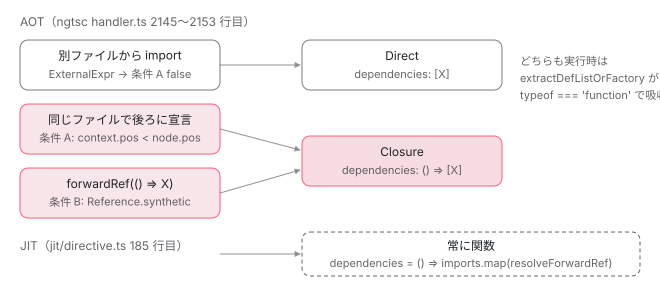

[目次](../README.md) › [standalone コンポーネントの内側](README.md) › 第 5 回 / 全 14 回

# forwardRef と自己参照：dependencies が配列ではなく関数になる条件、再帰コンポーネント

> ファイル内で後ろに宣言されたコンポーネントや forwardRef(() =&gt; X) を import すると、dependencies: () =&gt; \[X\] というクロージャになる。ngtsc が synthetic な Reference で forwardRef を推定する行、DeclarationListEmitMode の Direct / Closure / ClosureResolved、JIT の getStandaloneDefFunctions が resolveForwardRef を遅延して呼ぶ理由。imports を書かずに自分自身をテンプレートに置ける再帰コンポーネント。

angular/angular · 読了 約 12 分 · 中核 · [サイトで読む（デモが動きます）](https://angular-deep-dive-cyan.vercel.app/chapter/standalone-forward-ref)

---

`ɵcmp` の `dependencies` は普通は配列ですが、`dependencies: () => [X]` という**関数**になることがあります。この章では、ngtsc がその関数（Closure）を選ぶ 2 つの条件——「同じファイルで後ろに宣言されている」と「`forwardRef()` を通っている」——を 判定している行を読み、実行時がその関数をいつ呼ぶか、JIT ではなぜ常に関数なのかを確認します。最後に、`imports` を書かずに自分自身をテンプレートに置ける再帰コンポーネントの根拠を見ます。

読む対象は `packages/compiler-cli/src/ngtsc/annotations/component/src/handler.ts`、`packages/compiler-cli/src/ngtsc/partial_evaluator/src/interpreter.ts`、`packages/compiler/src/render3/view/api.ts`、`packages/core/src/di/forward_ref.ts` です。

1. [1. 概観](01-standalone.md)
2. [2. @Component 実行の瞬間（JIT）](02-standalone-decorator.md)
3. [3. imports の検証（AOT）](03-standalone-imports-check.md)
4. [4. 使った依存だけが残る](04-standalone-used-only.md)
5. **5. forwardRef と自己参照**（この章）
6. [6. ローカルコンパイル](06-standalone-local-compilation.md)
7. [7. 実行時の依存解決](07-standalone-directive-registry.md)
8. [8. providers の 2 つの行き先](08-standalone-providers-two-injectors.md)
9. [9. 入口の検査](09-standalone-entry-checks.md)
10. [10. hostDirectives](10-standalone-host-directives.md)
11. [11. @defer と imports](11-standalone-defer-deps.md)
12. [12. TestBed の差し替え](12-standalone-testbed-override.md)
13. [13. selectorless（実験的）](13-standalone-selectorless.md)
14. [14. foreignImports（内部向け）](14-standalone-foreign-imports.md)

## 1. 出力の形：配列ではなく関数

まず何が出るのかを、コンパイラのテスト fixture で見ます。

📄 `angular/packages/compiler-cli/test/compliance/test_cases/r3_compiler_compliance/components_and_directives/standalone/forward_ref.ts` L1–16 （▶ の行: 5–6, 15）

```ts
 1 │ import {Component, forwardRef} from '@angular/core';
 2 │ 
 3 │ @Component({
 4 │   selector: 'test',
 5 ▶   imports: [forwardRef(() => StandaloneComponent)],
 6 ▶   template: '<other-standalone></other-standalone>',
 7 │ })
 8 │ export class TestComponent {
 9 │ }
10 │ 
11 │ @Component({
12 │   selector: 'other-standalone',
13 │   template: '',
14 │ })
15 ▶ export class StandaloneComponent {
16 │ }
```

📄 `angular/packages/compiler-cli/test/compliance/test_cases/r3_compiler_compliance/components_and_directives/standalone/forward_ref.js` L1–18 （▶ の行: 15）

```js
 1 │ export class TestComponent {
 2 │   // ...
 3 │   static ɵcmp = /*@__PURE__*/ i0.ɵɵdefineComponent({
 4 │     type: TestComponent,
 5 │     selectors: [
 6 │       ["test"]
 7 │     ],
 8 │     decls: 1,
 9 │     vars: 0,
10 │     template: function TestComponent_Template(rf, ctx) {
11 │       if (rf & 1) {
12 │         i0.ɵɵelement(0, "other-standalone");
13 │       }
14 │     },
15 ▶     dependencies: () => [StandaloneComponent],
16 │     encapsulation: 2
17 │   });
18 │ }
```

入力 5 行目、`TestComponent` は 15 行目で**後ろに**宣言される `StandaloneComponent` を `forwardRef(() => …)` で import しています。出力 15 行目、`dependencies: () => [StandaloneComponent]`。配列を返すアロー関数です（出力中の `// ...` は fixture 側の省略記号です）。なぜ関数にする必要があるのか。`static ɵcmp = ɵɵdefineComponent({…})` はクラス定義と同時に評価されます。その時点で `StandaloneComponent` はまだ `class` 文に到達していないので、配列 `[StandaloneComponent]` を直接書くと 「初期化前にアクセスした」という `ReferenceError` になります。関数に包めば、評価は最初に呼ばれるときまで遅れます。

この「包むかどうか」はコンパイラの中では `DeclarationListEmitMode` という列挙で表されます。

📄 `angular/packages/compiler/src/render3/view/api.ts` L179–200 （▶ の行: 180–182, 194, 197, 199）

````ts
179 │   /**
180 ▶    * Similar to `Closure`, with the addition that the list of declarations can contain individual
181 ▶    * items that are themselves forward references. This is relevant for JIT compilations, as
182 ▶    * unwrapping the forwardRef cannot be done statically so must be deferred. This mode emits
183 │    * the declaration list using a mapping transform through `resolveForwardRef` to ensure that
184 │    * any forward references within the list are resolved when the outer closure is invoked.
185 │    *
186 │    * Consider the case where the runtime has captured two declarations in two distinct values:
187 │    * ```ts
188 │    * const dirA = MyDir;
189 │    * const dirB = forwardRef(function() { return ForwardRef; });
190 │    * ```
191 │    *
192 │    * This mode would emit the declarations captured in `dirA` and `dirB` as follows:
193 │    * ```ts
194 ▶    * directives: function () { return [dirA, dirB].map(ng.resolveForwardRef); },
195 │    * ```
196 │    */
197 ▶   ClosureResolved,
198 │ 
199 ▶   RuntimeResolved,
200 │ }
````

`Direct`（配列そのまま）と `Closure`（関数で包む）の 2 つは [コンパイルスコープの章](../ngmodule/04-ngmodule-compilation-scope.md)で読みました（159〜178 行目）。残り 2 つがこの引用です。197 行目 `ClosureResolved` は 180〜182 行目のコメントどおり **JIT 用**で、配列の要素そのものが `forwardRef` かもしれないときに 194 行目の形 `[dirA, dirB].map(ng.resolveForwardRef)` で出します（4 節）。199 行目 `RuntimeResolved` は[次回](06-standalone-local-compilation.md)のローカルコンパイル用です。この列挙を `dependencies: …` の式に変える `compileDeclarationList` も既出です（compiler.ts 353〜371 行目）。

## 2. AOT が Closure を選ぶ 2 つの条件

[前回](04-standalone-used-only.md)読んだ `handleDependencyCycles` の後半です。`eagerDeclarations`（最終的に書き出す依存）が決まったあと、ここで emit mode を決めます。

📄 `angular/packages/compiler-cli/src/ngtsc/annotations/component/src/handler.ts` L2126–2141 （▶ の行: 2127–2132, 2134）

```ts
2126 │     // Check whether any usages of standalone components in imports requires the dependencies
2127 ▶     // array to be wrapped in a closure. This check is technically a heuristic as there's no
2128 ▶     // direct way to check whether a `Reference` came from a `forwardRef`. Instead, we check if
2129 ▶     // the reference is `synthetic`, implying it came from _any_ foreign function resolver,
2130 ▶     // including the `forwardRef` resolver.
2131 ▶     const standaloneImportMayBeForwardDeclared =
2132 ▶       analysis.resolvedImports !== null && analysis.resolvedImports.some((ref) => ref.synthetic);
2133 │ 
2134 ▶     const cycleDetected = cyclesFromDirectives.size !== 0 || cyclesFromPipes.size !== 0;
2135 │     if (!cycleDetected) {
2136 │       // No cycle was detected. Record the imports that need to be created in the cycle detector
2137 │       // so that future cyclic import checks consider their production.
2138 │       for (const {type, importedFile} of eagerDeclarations) {
2139 │         this.maybeRecordSyntheticImport(importedFile, type, context);
2140 │       }
2141 │ 
```

📄 `angular/packages/compiler-cli/src/ngtsc/annotations/component/src/handler.ts` L2142–2156 （▶ の行: 2145–2146, 2149–2151, 2153）

```ts
2142 │       // Check whether the dependencies arrays in ɵcmp need to be wrapped in a closure.
2143 │       // This is required if any dependency reference is to a declaration in the same file
2144 │       // but declared after this component.
2145 ▶       const declarationIsForwardDeclared = eagerDeclarations.some((decl) =>
2146 ▶         isExpressionForwardReference(decl.type, node.name, context),
2147 │       );
2148 │ 
2149 ▶       if (
2150 ▶         this.compilationMode !== CompilationMode.LOCAL &&
2151 ▶         (declarationIsForwardDeclared || standaloneImportMayBeForwardDeclared)
2152 │       ) {
2153 ▶         data.declarationListEmitMode = DeclarationListEmitMode.Closure;
2154 │       }
2155 │ 
2156 │       data.declarations = eagerDeclarations;
```

1. **2131〜2132 行目：条件 B「`imports` のどれかが synthetic な Reference」**

   `analysis.resolvedImports` は第 3 回で評価した `imports` の中身です。その中に `synthetic` フラグが立った参照が 1 つでもあれば `standaloneImportMayBeForwardDeclared = true`。2127〜2130 行目のコメントが正直に書いているとおり、「`forwardRef` 由来かどうかを直接知る方法が無い」ので、「評価器が式を素直に評価して得た参照ではない」という印で代用する heuristic です。
2. **2145〜2146 行目：条件 A「書き出す依存のどれかが前方参照」**

   `eagerDeclarations` の各 `decl.type`（出力に書く式）について `isExpressionForwardReference` を聞きます。`forwardRef` を書いていなくても、**同じファイルで後ろに宣言されたクラス**ならここで `true` になります。
3. **2149〜2153 行目：どちらかが true なら `Closure`**

   2150 行目、ローカルコンパイル（`CompilationMode.LOCAL`）は除外です。そちらは 1405〜1411 行目で先に `RuntimeResolved` が選ばれています（次回）。2134 行目の `cycleDetected` は NgModule 配下だけで立ちうる値で、standalone では 2111 行目の `if (!metadata.isStandalone)`（既出）によりサイクル検査自体を飛ばすので常に `false` です。

### 条件 A：同じファイルで後ろにあるか

📄 `angular/packages/compiler-cli/src/ngtsc/annotations/common/src/util.ts` L286–297 （▶ の行: 291–293）

```ts
286 │ export function isExpressionForwardReference(
287 │   expr: Expression,
288 │   context: ts.Node,
289 │   contextSource: ts.SourceFile,
290 │ ): boolean {
291 ▶   if (isWrappedTsNodeExpr(expr)) {
292 ▶     const node = ts.getOriginalNode(expr.node);
293 ▶     return node.getSourceFile() === contextSource && context.pos < node.pos;
294 │   } else {
295 │     return false;
296 │   }
297 │ }
```

291 行目、`expr` が `WrappedNodeExpr`（TypeScript の AST ノードをそのまま包んだ式。同じファイル内のクラスへの参照はこの形）のときだけ判定します。別ファイルからの import は `ExternalExpr` になるのでここに来ず、`false` です。293 行目、**同じソースファイルで、かつ `context`（いまコンパイルしているクラスの名前）より後ろの位置**なら前方参照です。`pos` はファイル先頭からの文字位置なので、「後ろに書いてある」をそのまま数値で比べています。

この条件 A は standalone 専用ではありません。NgModule 配下のコンポーネントでも同じ判定が働くテストがあります。

📄 `angular/packages/compiler-cli/test/ngtsc/ngtsc_spec.ts` L6233–6264 （▶ の行: 6233, 6239, 6241–6242, 6246, 6251, 6263）

```ts
6233 ▶     it('should wrap "directives" in component metadata in a closure when forward references are present', () => {
6234 │       env.write(
6235 │         'test.ts',
6236 │         `
6237 │         import {Component, NgModule} from '@angular/core';
6238 │ 
6239 ▶         @Component({
6240 │           selector: 'cmp-a',
6241 ▶           template: '<cmp-b></cmp-b>',
6242 ▶           standalone: false,
6243 │         })
6244 │         class CmpA {}
6245 │ 
6246 ▶         @Component({
6247 │           selector: 'cmp-b',
6248 │           template: 'This is B',
6249 │           standalone: false,
6250 │         })
6251 ▶         class CmpB {}
6252 │ 
6253 │         @NgModule({
6254 │           declarations: [CmpA, CmpB],
6255 │         })
6256 │         class Module {}
6257 │     `,
6258 │       );
6259 │ 
6260 │       env.driveMain();
6261 │ 
6262 │       const jsContents = env.getContents('test.js');
6263 ▶       expect(jsContents).toContain('dependencies: () => [CmpB]');
6264 │     });
```

6239〜6251 行目、`CmpA`（`standalone: false`）がテンプレートで `<cmp-b>` を使い、`CmpB` は後ろで宣言されています。`imports` も `forwardRef` もありません。それでも 6263 行目、期待出力は `dependencies: () => [CmpB]` です。6233 行目のテスト名が言うとおり「forward reference があれば closure で包む」のが条件 A の役目で、standalone かどうかは関係ありません。

### 条件 B：forwardRef は評価器の中でどう見えるか

`imports: [forwardRef(() => X)]` を静的に評価するとき、評価器（`PartialEvaluator`）は `forwardRef` という関数の本体を知りません。`@angular/core` の中にある関数だからです。そこで「外部関数の解決器」（foreign function resolver）が割り込みます。第 3 回で見た 657〜660 行目、`imports` の評価には `createForwardRefResolver` が渡されていました。その中身です。

📄 `angular/packages/compiler-cli/src/ngtsc/annotations/common/src/util.ts` L253–268 （▶ の行: 254, 256–257, 261, 263）

```ts
253 │ export function createForwardRefResolver(isCore: boolean): ForeignFunctionResolver {
254 ▶   return (fn, callExpr, resolve, unresolvable) => {
255 │     if (
256 ▶       !isAngularCoreReferenceWithPotentialAliasing(fn, 'forwardRef', isCore) ||
257 ▶       callExpr.arguments.length !== 1
258 │     ) {
259 │       return unresolvable;
260 │     }
261 ▶     const expanded = expandForwardRef(callExpr.arguments[0]);
262 │     if (expanded !== null) {
263 ▶       return resolve(expanded);
264 │     } else {
265 │       return unresolvable;
266 │     }
267 │   };
268 │ }
```

256〜257 行目、呼ばれている関数が `@angular/core` の `forwardRef` で、引数が 1 つのときだけ扱います。261 行目 `expandForwardRef` が引数のアロー関数 `() => X` から本体の式 `X` を取り出し、263 行目でその式を `resolve` に渡します。この `resolve` が、評価器側の次の関数です。

📄 `angular/packages/compiler-cli/src/ngtsc/partial_evaluator/src/interpreter.ts` L498–526 （▶ の行: 503, 505, 517–519, 523）

```ts
498 │     const res: ResolvedValue = this.visitFunctionBody(node, fn, context);
499 │ 
500 │     // If the result of attempting to resolve the function body was a DynamicValue, attempt to use
501 │     // the foreignFunctionResolver if one is present. This could still potentially yield a usable
502 │     // value.
503 ▶     if (res instanceof DynamicValue && context.foreignFunctionResolver !== undefined) {
504 │       const unresolvable = DynamicValue.fromComplexFunctionCall(node, fn);
505 ▶       return context.foreignFunctionResolver(lhs, node, resolveFfrExpr, unresolvable);
506 │     }
507 │ 
508 │     return res;
509 │   }
510 │ 
511 │   /**
512 │    * Visit an expression which was extracted from a foreign-function resolver.
513 │    *
514 │    * This will process the result and ensure it's correct for FFR-resolved values, including marking
515 │    * `Reference`s as synthetic.
516 │    */
517 ▶   private visitFfrExpression(expr: ts.Expression, context: Context): ResolvedValue {
518 ▶     const res = this.visitExpression(expr, context);
519 ▶     if (res instanceof Reference) {
520 │       // This Reference was created synthetically, via a foreign function resolver. The real
521 │       // runtime value of the function expression may be different than the foreign function
522 │       // resolved value, so mark the Reference as synthetic to avoid it being misinterpreted.
523 ▶       res.synthetic = true;
524 │     }
525 │     return res;
526 │   }
```

📄 `angular/packages/compiler-cli/src/ngtsc/imports/src/references.ts` L46–56 （▶ の行: 49–50, 52, 54）

```ts
46 │   private identifiers: ts.Identifier[] = [];
47 │ 
48 │   /**
49 ▶    * Indicates that the Reference was created synthetically, not as a result of natural value
50 ▶    * resolution.
51 │    *
52 ▶    * This is used to avoid misinterpreting the Reference in certain contexts.
53 │    */
54 ▶   synthetic = false;
55 │ 
56 │   private _alias: Expression | null = null;
```

503〜505 行目、関数本体を評価できなかった（`DynamicValue`）とき、解決器が登録されていればそちらに任せます。解決器が 263 行目で呼ぶ `resolve` は 517 行目の `visitFfrExpression` です。518 行目で `X` を普通に評価してクラスへの `Reference` を得たあと、**523 行目で `synthetic = true` を立てます**。`references.ts` 49〜52 行目、この印の意味は「自然な値の解決ではなく合成で作られた参照。文脈によっては誤解しないように」。その文脈の 1 つが、2132 行目の「配列を関数で包むべきか」です。

> [!NOTE]
> **さらに深く**
>
> 2127〜2130 行目のコメントが「heuristic」と言う理由がこれです。`synthetic` は `forwardRef` 専用の印ではなく、どの外部関数解決器を通っても立ちます。`imports` の評価に渡される解決器は `createModuleWithProvidersResolver` と `createForwardRefResolver` の 2 つ（第 3 回で見た 657〜660 行目）なので、実際にはこの 2 経路のどちらかです。どちらにしても「実行時の値がコンパイル時の推定と違うかもしれない」ので、関数で包んで評価を遅らせるのが安全側の判断です。

standalone 側のテストで、条件 B の期待出力を確認しておきます。

📄 `angular/packages/compiler-cli/test/ngtsc/standalone_spec.ts` L604–628 （▶ の行: 612–613, 619, 626–627）

```ts
604 │       it('should handle a forwardRef used inside `imports`', () => {
605 │         env.write(
606 │           'test.ts',
607 │           `
608 │           import {Component, forwardRef} from '@angular/core';
609 │ 
610 │           @Component({
611 │             selector: 'test',
612 ▶             imports: [forwardRef(() => StandaloneComponent)],
613 ▶             template: "<other-standalone></other-standalone>"
614 │           })
615 │           class TestComponent {
616 │           }
617 │ 
618 │           @Component({selector: 'other-standalone', template: ""})
619 ▶           class StandaloneComponent {
620 │           }
621 │         `,
622 │         );
623 │         const diags = env.driveDiagnostics();
624 │         const jsCode = env.getContents('test.js');
625 │ 
626 ▶         expect(diags.length).toBe(0);
627 ▶         expect(jsCode).toContain('dependencies: () => [StandaloneComponent]');
628 │       });
```

612 行目で `forwardRef(() => StandaloneComponent)`、619 行目で後ろに宣言。626 行目、診断は 0（`forwardRef` があっても第 3 回の検証は通る。synthetic でも `Reference` はクラスを指しているので `isStandalone` を読めます）。627 行目、出力は `dependencies: () => [StandaloneComponent]`。1 節の fixture と同じです。

## 3. 実行時は関数をいつ呼ぶか

📄 `angular/packages/core/src/render3/interfaces/definition.ts` L561–565 （▶ の行: 561, 563, 565）

```ts
561 ▶ export type DependencyType = DirectiveType<any> | ComponentType<any> | PipeType<any> | Type<any>;
562 │ 
563 ▶ export type DependencyTypeList = Array<DependencyType>;
564 │ 
565 ▶ export type TypeOrFactory<T> = T | (() => T);
```

565 行目、`ComponentDef.dependencies` の型は `TypeOrFactory<DependencyTypeList>`、つまり「配列か、配列を返す関数か」です。実行時はこの違いを 1 か所で吸収します。[NgModule シリーズ第 13 回](../ngmodule/13-ngmodule-standalone-imports.md)で読んだ `extractDefListOrFactory`（definition.ts 653〜674 行目）が、`directiveDefs` / `pipeDefs` のゲッターの中で `typeof dependencies === 'function' ? dependencies() : dependencies` と書いています。つまり **Closure は、最初に `directiveDefs` が読まれる瞬間（最初のテンプレート描画で `directiveRegistry` を組むとき。[第 7 回](07-standalone-directive-registry.md)）に 1 回だけ呼ばれます**。その時点ではファイル全体の評価が終わっているので、後ろのクラスも定義済みです。

## 4. JIT では常に関数

JIT（`TestBed` や `ngJitMode`）では事情が違います。`@Component` デコレータが実行された瞬間に `imports` 配列が手元にあるだけで、その要素が `forwardRef` かどうかはまだ分かりません。`forwardRef` の実体を見ます。

📄 `angular/packages/core/src/di/forward_ref.ts` L69–78 （▶ の行: 69–70, 77）

```ts
69 ▶ export function forwardRef(forwardRefFn: ForwardRefFn): Type<any> {
70 ▶   (<any>forwardRefFn).__forward_ref__ = forwardRef;
71 │   if (ngDevMode) {
72 │     (<any>forwardRefFn).toString = function () {
73 │       return stringify(this());
74 │     };
75 │   }
76 │ 
77 ▶   return <Type<any>>(<any>forwardRefFn);
78 │ }
```

📄 `angular/packages/core/src/di/forward_ref.ts` L93–104 （▶ の行: 93–94, 98, 100–102）

```ts
 93 ▶ export function resolveForwardRef<T>(type: T): T {
 94 ▶   return isForwardRef(type) ? type() : type;
 95 │ }
 96 │ 
 97 │ /** Checks whether a function is wrapped by a `forwardRef`. */
 98 ▶ export function isForwardRef(fn: any): fn is () => any {
 99 │   return (
100 ▶     typeof fn === 'function' &&
101 ▶     Object.hasOwn(fn, __forward_ref__) &&
102 ▶     fn.__forward_ref__ === forwardRef
103 │   );
104 │ }
```

70 行目、`forwardRef(fn)` は渡された関数に `__forward_ref__` という印を付けて、77 行目でその**関数をそのまま返す**だけです。`imports: [forwardRef(() => X)]` の配列には、クラスではなく「印の付いた関数」が入っています。94 行目 `resolveForwardRef(type)` は、98〜103 行目の `isForwardRef`（関数で、自分自身の `__forward_ref__` プロパティが `forwardRef` を指す）なら `type()` を呼んで中身のクラスを返し、そうでなければそのまま返します。

JIT のコンパイラ本体はどのモードを使うかを見ます。

📄 `angular/packages/compiler/src/jit_compiler_facade.ts` L346–354 （▶ の行: 352–353）

```ts
346 │     // Compile the component metadata, including template, into an expression.
347 │     const meta: R3ComponentMetadata<R3TemplateDependency> = {
348 │       ...facade,
349 │       ...convertDirectiveFacadeToMetadata(facade),
350 │       selector: facade.selector || this.elementSchemaRegistry.getDefaultComponentElementName(),
351 │       template,
352 ▶       declarations: facade.declarations.map(convertDeclarationFacadeToMetadata),
353 ▶       declarationListEmitMode: DeclarationListEmitMode.Direct,
354 │       defer,
```

352〜353 行目、JIT の `compileComponent` は `declarations` を空で渡し、`Direct` で生成します （`facade.declarations` は JIT では常に空配列です。第 2 回で読んだ `jit/directive.ts` 150〜156 行目の `declarations: []`）。生成された `ɵcmp` には `dependencies` が無い状態で返り、その直後に `jit/directive.ts` 185 行目 `ngComponentDef.dependencies = () => imports.map(resolveForwardRef)`（[既出](../ngmodule/13-ngmodule-standalone-imports.md)）で**常に関数**が入ります。1 節で見た `ClosureResolved` の形 `[…].map(resolveForwardRef)` を、コンパイラの出力ではなく実行時コードで直接書いているわけです。

📄 `angular/packages/core/src/render3/jit/directive.ts` L234–239 （▶ の行: 236–238）

```ts
234 │ /**
235 │  * Build memoized `directiveDefs` and `pipeDefs` functions for the component definition of a
236 ▶  * standalone component, which process `imports` and filter out directives and pipes. The use of
237 ▶  * memoized functions here allows for the delayed resolution of any `forwardRef`s present in the
238 ▶  * component's `imports`.
239 │  */
```

236〜238 行目、`directiveDefs` / `pipeDefs` もメモ化された関数にする理由は「`imports` にある `forwardRef` の解決を遅らせるため」と明記されています。その関数 `getStandaloneDefFunctions` の中身は [第 2 回](02-standalone-decorator.md)で読みました。`DepsTracker.computeStandaloneComponentScope`（既出、deps\_tracker.ts 258 行目）が各要素に `resolveForwardRef` を掛けてから分類します。

では `ClosureResolved` はどこで使われるのか。`ɵɵngDeclareComponent`（partial コンパイルの出力をライブラリ利用時に JIT で仕上げる経路）です。

📄 `angular/packages/compiler/src/jit_compiler_facade.ts` L705–721 （▶ の行: 714, 721）

```ts
705 │   const hasDirectiveDependencies = declarations.some(
706 │     ({kind}) =>
707 │       kind === R3TemplateDependencyKind.Directive || kind === R3TemplateDependencyKind.NgModule,
708 │   );
709 │ 
710 │   return {
711 │     ...convertDeclareDirectiveFacadeToMetadata(decl, typeSourceSpan),
712 │     template,
713 │     styles: decl.styles ?? [],
714 ▶     declarations,
715 │     viewProviders:
716 │       decl.viewProviders !== undefined ? new WrappedNodeExpr(decl.viewProviders) : null,
717 │     animations: decl.animations !== undefined ? new WrappedNodeExpr(decl.animations) : null,
718 │     defer,
719 │     changeDetection: decl.changeDetection ?? ChangeDetectionStrategy.OnPush,
720 │     encapsulation: decl.encapsulation ?? ViewEncapsulation.Emulated,
721 ▶     declarationListEmitMode: DeclarationListEmitMode.ClosureResolved,
```

721 行目、partial 宣言から `ɵcmp` を作るときは `ClosureResolved` です。714 行目の `declarations` には `.d.ts` から読んだ依存のメタデータが入っていて、その `type` が `forwardRef` かもしれないので、`map(resolveForwardRef)` 付きの関数で出します。



*dependencies が配列になるか関数になるかの 3 経路。AOT は 2 条件のどちらかで Closure、JIT は無条件に関数。*

## 5. 再帰コンポーネント：imports 無しで自分を置ける

📄 `angular/packages/compiler-cli/test/compliance/test_cases/r3_compiler_compliance/components_and_directives/standalone/recursive.ts` L1–9 （▶ の行: 5–6）

```ts
1 │ import {Component} from '@angular/core';
2 │ 
3 │ @Component({
4 │   selector: 'recursive-cmp',
5 ▶   // Simple recursion. Note: no `imports`.
6 ▶   template: '<recursive-cmp></recursive-cmp>',
7 │ })
8 │ export class RecursiveComponent {
9 │ }
```

📄 `angular/packages/compiler-cli/test/compliance/test_cases/r3_compiler_compliance/components_and_directives/standalone/recursive.js` L1–1 （▶ の行: 1）

```js
1 ▶ dependencies: [RecursiveComponent],
```

入力 5〜6 行目、`imports` を書かずに自分のセレクタ `<recursive-cmp>` をテンプレートに置いています。出力 1 行目、`dependencies: [RecursiveComponent]`。自分自身が入っていて、しかも**配列**（Direct）です。根拠はスコープを作る側にあります。

📄 `angular/packages/compiler-cli/src/ngtsc/scope/src/standalone.ts` L44–50 （▶ の行: 45–47）

```ts
44 │ 
45 ▶       // A standalone component always has itself in scope, so add `clazzMeta` during
46 ▶       // initialization.
47 ▶       const dependencies = new Set<DirectiveMeta | PipeMeta | NgModuleMeta>([clazzMeta]);
48 │       const deferredDependencies = new Set<DirectiveMeta | PipeMeta>();
49 │       const seen = new Set<ClassDeclaration>([clazz]);
50 │       let isPoisoned = clazzMeta.isPoisoned;
```

45〜47 行目、`StandaloneComponentScopeReader` は `imports` を見る前に、**自分自身の `clazzMeta` を `dependencies` の初期値**にしています （この関数の全体は[第 3 回](03-standalone-imports-check.md)）。あとは前回の手順どおり、テンプレートで `<recursive-cmp>` が照合されて `wholeTemplateUsed` に入り、出力に残ります。配列になる理由は条件 A です。`isExpressionForwardReference` の 293 行目で比べる `node` は自分自身のクラス名なので、`context.pos < node.pos` は `false`。`forwardRef` も無いので条件 B も `false`。JIT 側も同じで、`computeStandaloneComponentScope`（既出）は `directives: new Set([type])` から始めます。

自己参照より一回り大きい「循環」も、実行時のテストで確認されています。

📄 `angular/packages/core/test/acceptance/standalone_spec.ts` L440–465 （▶ の行: 443–444, 451, 458, 462, 464）

```ts
440 │   it('should render a recursive cycle of standalone components', () => {
441 │     @Component({
442 │       selector: 'cmp-a',
443 ▶       template: '<ng-template [ngIf]="false"><cmp-c></cmp-c></ng-template>A',
444 ▶       imports: [forwardRef(() => StandaloneCmpC)],
445 │     })
446 │     class StandaloneCmpA {}
447 │ 
448 │     @Component({
449 │       selector: 'cmp-b',
450 │       template: '(<cmp-a></cmp-a>)B',
451 ▶       imports: [StandaloneCmpA],
452 │     })
453 │     class StandaloneCmpB {}
454 │ 
455 │     @Component({
456 │       selector: 'cmp-c',
457 │       template: '(<cmp-b></cmp-b>)C',
458 ▶       imports: [StandaloneCmpB],
459 │     })
460 │     class StandaloneCmpC {}
461 │ 
462 ▶     const fixture = TestBed.createComponent(StandaloneCmpC);
463 │     fixture.detectChanges();
464 ▶     expect(fixture.nativeElement.textContent).toBe('((A)B)C');
465 │   });
```

A → C（444 行目、`forwardRef`）、B → A（451 行目）、C → B（458 行目）という 3 つ巴です。後ろに宣言されている `StandaloneCmpC` を参照する A だけが `forwardRef` を使い、すでに宣言済みのクラスを参照する B と C はそのまま書いています。462〜464 行目、JIT（`TestBed`）で描画できます。443 行目、`<cmp-c>` は `<ng-template>` の中に置かれていて実体化されないので、無限には再帰しません。

> **🧪 DEMO — この章の 3 つのコンポーネントの ɵcmp.dependencies**
>
> 下は `standalone-forward-ref.ts` にあるコンポーネントです。`ForwardRefRecursiveDemo` は `imports` を書かずに自分を置き、`depth` が 3 で止めています。`ForwardRefParentDemo` は後ろに宣言された `ForwardRefChildDemo` を `forwardRef` で import しています。表は実行時に `ɵcmp.dependencies` の `typeof` を見て、関数なら呼び出した結果です。
>
> `ForwardRefChildDemo` が `null` なのは、テンプレートで何も使っていないため `declarations` が空になり、`compiler.ts` が `dependencies` を書かず、`ɵɵdefineComponent` が `null` を入れたからです（[第 1 回](01-standalone.md)の 355 行目）。
>
> ▶ [このデモはサイトで動かせます](https://angular-deep-dive-cyan.vercel.app/chapter/standalone-forward-ref)

## ここまでの呼び出し

- `ComponentDecoratorHandler.analyze(node)` — annotations/component/src/handler.ts
  - `evaluator.evaluate(rawImports, importResolvers)` — handler.ts L664（第 3 回） — *解決器に createForwardRefResolver を含む*
    - `StaticInterpreter.visitCallExpression → foreignFunctionResolver(...)` — partial\_evaluator/src/interpreter.ts L503-505 — *forwardRef の本体は評価できない*
      - `createForwardRefResolver → expandForwardRef → resolve(X)` — annotations/common/src/util.ts L261-263
      - `visitFfrExpression(X)` — interpreter.ts L517-523 — *Reference.synthetic = true*
- `ComponentDecoratorHandler.resolve(node)` — handler.ts
  - `handleDependencyCycles(...)` — handler.ts L2126-2153 — *条件 A: isExpressionForwardReference / 条件 B: resolvedImports.some(synthetic) → Closure*
- `compileComponentFromMetadata(meta)` — compiler/src/render3/view/compiler.ts L246-256
  - `compileDeclarationList(list, Closure)` — compiler.ts L353-371（既出） — *dependencies: () =&gt; \[X\]*
- 👤 `（ブラウザ）static ɵcmp = ɵɵdefineComponent({…, dependencies: () => [X]})` — 生成コード — *関数なので X が未定義でも評価できる*
  - `ɵcmp.directiveDefs（ゲッター）→ extractDefListOrFactory(dependencies)` — core/src/render3/definition.ts L653-674（既出） — *typeof === 'function' なら呼ぶ。最初の描画のとき*

## 聞かれそうな質問

**Q. 親子で互いを import すると循環 import エラーになりますか？**

ngtsc は standalone コンポーネントについて循環検査をしません。`handleDependencyCycles` の 2111 行目 `if (!metadata.isStandalone)`（[既出](../ngmodule/04-ngmodule-compilation-scope.md)）で、standalone なら `_checkForCyclicImport` のループを丸ごと飛ばします。利用者が自分で import 文を書いているので、コンパイラが新しい import を増やすことがなく、増やさないならサイクルも作れないからです。別ファイル同士の相互 import は TypeScript/ES モジュールとして合法で、`dependencies` は配列（Direct）のままです。問題になるのは**同じファイルで後ろのクラス**を参照するときだけで、それは 2 節の条件 A が Closure にして解決します。5 節の `runtimeCycle` テスト（440〜465 行目）が 3 つ巴で動く実例です。

**Q. AOT は後ろの宣言を自動で Closure にしてくれるなら、forwardRef はもう要らないのですか？**

`ɵcmp.dependencies` だけを見れば要りません（条件 A、`util.ts` 291〜293 行目）。ただし `imports: [Later]` という式そのものは、デコレータの引数として JIT では `@Component` 実行時に評価されます。AOT でも開発モードでは同じ式が評価されます。

📄 `angular/packages/compiler-cli/src/ngtsc/annotations/common/src/metadata.ts` L63–79 （▶ の行: 63–64, 66, 68–69, 77–78）

```ts
63 ▶   const ngClassDecorators = classDecorators
64 ▶     .filter((dec) => isAngularDecorator(dec, isCore))
65 │     .map((decorator) =>
66 ▶       decoratorToMetadata(angularDecoratorTransform(decorator), annotateForClosureCompiler),
67 │     )
68 ▶     // Since the `setClassMetadata` call is intended to be emitted after the class
69 ▶     // declaration, we have to strip references to the existing identifiers or
70 │     // TypeScript might generate invalid code when it emits to JS. In particular
71 │     // this can break when emitting a class to ES5 which has a custom decorator
72 │     // and is referenced inside of its own metadata (see #39509 for more information).
73 │     .map((decorator) => removeIdentifierReferences(decorator, id.text));
74 │   if (ngClassDecorators.length === 0) {
75 │     return null;
76 │   }
77 ▶   const metaDecorators = new WrappedNodeExpr(
78 ▶     ts.factory.createArrayLiteralExpression(ngClassDecorators),
79 │   );
```

📄 `angular/packages/compiler/src/render3/r3_class_metadata_compiler.ts` L44–48 （▶ の行: 45–47）

```ts
44 │ 
45 ▶ export function compileClassMetadata(metadata: R3ClassMetadata): o.InvokeFunctionExpr {
46 ▶   const fnCall = internalCompileClassMetadata(metadata);
47 ▶   return o.arrowFn([], [devOnlyGuardedExpression(fnCall).toStmt()]).callFn([]);
48 │ }
```

63〜66 行目、クラスに付いた Angular デコレータを `decoratorToMetadata` でそのまま配列にし、77〜78 行目で `WrappedNodeExpr`（書かれた式をそのまま出力）に包みます。68〜69 行目のコメントどおり、この `ɵsetClassMetadata` 呼び出しはクラス宣言の**直後**に出力されます。45〜47 行目、それを `ngDevMode` ガード付きのアロー関数で包んで**即時に呼ぶ**（`callFn([])`）ので、`imports: [Later]` はクラス宣言の直後、`class Later` に到達する前に評価されます。`Later` が後ろにあれば `ReferenceError`（初期化前アクセス）です。`forwardRef(() => Later)` は 77 行目（forward\_ref.ts）のとおり「印の付いた関数」を返すだけで `Later` に触らないので、この評価を安全に通せます。つまり「同じファイルで後ろのクラスを `imports` に書くときは `forwardRef`」という使い分けは今も必要で、「別ファイルなら不要」が正確な答えです。

**Q. 関数になると実行時のコストは増えますか？**

呼び出しは 1 回です。`extractDefListOrFactory`（既出）は `directiveDefs` ゲッターの中で `dependencies()` を呼び、結果は `tView.directiveRegistry` として最初の create pass で保存されます（[第 7 回](07-standalone-directive-registry.md)）。2 回目以降のインスタンス生成では `tView` が再利用されるので、関数は呼ばれません。

**Q. 再帰コンポーネントを imports: \[自分自身\] と明示したら何が変わりますか？**

何も変わりません。`StandaloneComponentScopeReader` の 45〜47 行目で自分は最初から `dependencies` に入っていて、52〜57 行目（第 3 回）の `seen` に自分のクラスが初期値として入っているので、`imports` に書いた自分は `continue` で飛ばされます。出力は同じ `dependencies: [Self]` です。ただし「書いても害が無い」だけで、書く理由も無いので fixture（`recursive.ts` 5 行目のコメント）は書いていません。

**Q. forwardRef(() =&gt; null) のように解決できない値を返したら？**

AOT では 2 節の条件 B の前に、第 3 回の `validateAndFlattenComponentImports` が「クラスでない値」として NG2012 系の診断を出します。JIT では `computeStandaloneComponentScope`（deps\_tracker.ts 258〜266 行目、既出）が `resolveForwardRef` の結果を `verifyStandaloneImport` に渡し、「Expected forwardRef function … to return a standalone entity or NgModule but got "null"」という例外になります（`core/test/acceptance/standalone_spec.ts` 573〜583 行目のテスト）。

## 読み終えて

- `dependencies: () => [X]`（Closure）になる条件は 2 つ。条件 A：書き出す依存が同じファイルで後ろに宣言されている（`isExpressionForwardReference`、`context.pos < node.pos`）。条件 B：`imports` の評価結果に `synthetic` な `Reference` がある（`forwardRef` を外部関数解決器が展開した印）
- 条件 B は heuristic。`synthetic` は「評価器が合成した参照」の意味で、`forwardRef` 専用の印ではない
- 実行時は `extractDefListOrFactory` が `typeof === 'function'` で吸収し、最初の `directiveDefs` 読み出しで 1 回だけ呼ぶ
- JIT は `jit/directive.ts` 185 行目で無条件に `() => imports.map(resolveForwardRef)`。`ClosureResolved` モードは `ɵɵngDeclareComponent` 経路（partial）のためのもの
- 再帰コンポーネントは `imports` 不要。`StandaloneComponentScopeReader` が自分自身をスコープの初期値に入れる（45〜47 行目）

---

← 前: [使った依存だけが dependencies に残る：eagerlyUsed と NG8113 unusedStandaloneImports](04-standalone-used-only.md)  
次: [ローカルコンパイル：ɵɵgetComponentDepsFactory が依存解決を実行時へ送る](06-standalone-local-compilation.md) →
