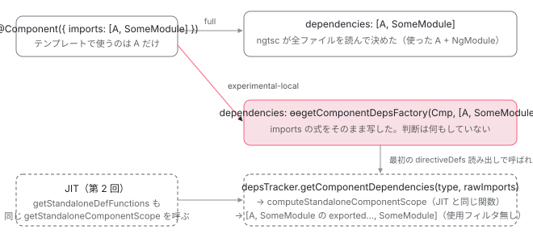

[目次](../README.md) › [standalone コンポーネントの内側](README.md) › 第 6 回 / 全 14 回

# ローカルコンパイル：ɵɵgetComponentDepsFactory が依存解決を実行時へ送る

> compilationMode: "experimental-local" ではファイル単位でコンパイルするため imports の中身を見られない。ngtsc が DeclarationListEmitMode.RuntimeResolved を選ぶ行、compiler が dependencies: ɵɵgetComponentDepsFactory(Cmp, \[raw imports\]) を出す行、実行時に DepsTracker.getComponentDependencies が rawImports から scope を計算する手順。local\_compilation\_spec の期待出力。CLI が partial を full に書き換える行。

angular/angular · 読了 約 12 分 · 発展 · [サイトで読む（デモが動きます）](https://angular-deep-dive-cyan.vercel.app/chapter/standalone-local-compilation)

---

[第 4 回](04-standalone-used-only.md)と[第 5 回](05-standalone-forward-ref.md)で読んだ「使った依存だけを配列に書き出す」処理は、コンパイラが **import 先のファイルを読める**ことを前提にしています。`compilationMode: "experimental-local"` はその前提を捨て、1 ファイルだけを見てコンパイルするモードです。この章では、ngtsc がこのモードで `DeclarationListEmitMode.RuntimeResolved` を選ぶ行、コンパイラが `dependencies: ɵɵgetComponentDepsFactory(Cmp, [raw imports])` を書き出す行、そして実行時に `DepsTracker.getComponentDependencies` が `imports` に書かれたものをそのまま受け取ってスコープを計算する手順を読みます。

読む対象は `packages/compiler-cli/src/ngtsc/core/src/compiler.ts`、`packages/compiler-cli/src/ngtsc/annotations/component/src/handler.ts`、`packages/core/src/render3/local_compilation.ts`、`packages/core/src/render3/deps_tracker/deps_tracker.ts` です。

1. [1. 概観](01-standalone.md)
2. [2. @Component 実行の瞬間（JIT）](02-standalone-decorator.md)
3. [3. imports の検証（AOT）](03-standalone-imports-check.md)
4. [4. 使った依存だけが残る](04-standalone-used-only.md)
5. [5. forwardRef と自己参照](05-standalone-forward-ref.md)
6. **6. ローカルコンパイル**（この章）
7. [7. 実行時の依存解決](07-standalone-directive-registry.md)
8. [8. providers の 2 つの行き先](08-standalone-providers-two-injectors.md)
9. [9. 入口の検査](09-standalone-entry-checks.md)
10. [10. hostDirectives](10-standalone-host-directives.md)
11. [11. @defer と imports](11-standalone-defer-deps.md)
12. [12. TestBed の差し替え](12-standalone-testbed-override.md)
13. [13. selectorless（実験的）](13-standalone-selectorless.md)
14. [14. foreignImports（内部向け）](14-standalone-foreign-imports.md)

## 1. 3 つのコンパイルモード

📄 `angular/packages/compiler-cli/src/ngtsc/core/api/src/public_options.ts` L426–438 （▶ の行: 429–433, 435, 437）

```ts
426 │ export interface TargetOptions {
427 │   /**
428 │    * Specifies the compilation mode to use. The following modes are available:
429 ▶    * - 'full': generates fully AOT compiled code using Ivy instructions.
430 ▶    * - 'partial': generates code in a stable, but intermediate form suitable for publication to NPM.
431 ▶    * - 'experimental-local': generates code based on each individual source file without using its
432 ▶    * dependencies. This mode is suitable only for fast edit/refresh during development. It will be
433 ▶    * eventually replaced by the value `local` once the feature is ready to be public.
434 │    *
435 ▶    * The default value is 'full'.
436 │    */
437 ▶   compilationMode?: 'full' | 'partial' | 'experimental-local';
438 │ }
```

437 行目、`angularCompilerOptions.compilationMode` の取りうる値は 3 つです。429 行目 `'full'` がアプリの通常ビルド（既定、435 行目）、430 行目 `'partial'` は npm に公開するライブラリ用の中間形式、431〜433 行目 `'experimental-local'` は「**各ソースファイルを、その依存を使わずに**コンパイルする。開発中の編集・更新を速くするためだけのもの」。名前の `experimental-` は、将来 `'local'` に変える予定という意味だと 433 行目に書いてあります。

📄 `angular/packages/compiler-cli/src/ngtsc/transform/src/api.ts` L25–41 （▶ の行: 29, 34, 40）

```ts
25 │ export enum CompilationMode {
26 │   /**
27 │    * Generates fully AOT compiled code using Ivy instructions.
28 │    */
29 ▶   FULL,
30 │ 
31 │   /**
32 │    * Generates code using a stable, but intermediate format suitable to be published to NPM.
33 │    */
34 ▶   PARTIAL,
35 │ 
36 │   /**
37 │    * Generates code based on each individual source file without using its
38 │    * dependencies (suitable for local dev edit/refresh workflow).
39 │    */
40 ▶   LOCAL,
41 │ }
```

📄 `angular/packages/compiler-cli/src/ngtsc/core/src/compiler.ts` L1305–1331 （▶ の行: 1308–1309, 1317–1318, 1322–1323, 1328, 1330）

```ts
1305 │     // Note: If this compilation builds `@angular/core`, we always build in full compilation
1306 │     // mode. Code inside the core package is always compatible with itself, so it does not
1307 │     // make sense to go through the indirection of partial compilation
1308 ▶     let compilationMode: CompilationMode = CompilationMode.FULL;
1309 ▶     if (!isCore) {
1310 │       switch (this.options.compilationMode) {
1311 │         case 'full':
1312 │           compilationMode = CompilationMode.FULL;
1313 │           break;
1314 │         case 'partial':
1315 │           compilationMode = CompilationMode.PARTIAL;
1316 │           break;
1317 ▶         case 'experimental-local':
1318 ▶           compilationMode = CompilationMode.LOCAL;
1319 │           break;
1320 │       }
1321 │     }
1322 ▶     if (this.emitDeclarationOnly) {
1323 ▶       compilationMode = CompilationMode.LOCAL;
1324 │     }
1325 │ 
1326 │     const checker = this.inputProgram.getTypeChecker();
1327 │ 
1328 ▶     const reflector = new TypeScriptReflectionHost(
1329 │       checker,
1330 ▶       compilationMode === CompilationMode.LOCAL,
1331 │     );
```

1. **1308〜1318 行目：文字列を列挙に写す**

   `NgCompiler` の構築時に 1 回。`'experimental-local'` は 1318 行目で内部の `CompilationMode.LOCAL`（40 行目）になります。1309 行目、`@angular/core` 自身をビルドするときはオプションを無視して常に `FULL` です。
2. **1322〜1323 行目：`emitDeclarationOnly` も LOCAL**

   `.d.ts` だけを出すビルドも、他ファイルを読まない点では同じなので `LOCAL` に合流します。
3. **1328〜1330 行目：reflection host に「ローカルか」を渡す**

   `TypeScriptReflectionHost` の第 2 引数 `isLocalCompilation` が `compilationMode === LOCAL`。この host は「クラスにどのデコレータが付いているか」「コンストラクタ引数の型は何か」を TypeScript の AST から答える部品で、このフラグはコンストラクタ引数の型を DI 用の値に変える `typeToValue` に渡されます。

📄 `angular/packages/compiler-cli/src/ngtsc/core/src/compiler.ts` L892–897 （▶ の行: 892–893, 895）

```ts
892 ▶     // In local compilation mode we don't make use of .d.ts files for Angular compilation, so their
893 ▶     // transformation can be ditched.
894 │     if (
895 ▶       (this.options.compilationMode !== 'experimental-local' || this.emitDeclarationOnly) &&
896 │       compilation.dtsTransforms !== null
897 │     ) {
```

892〜895 行目、ローカルモードでは `.d.ts` の変換も行いません。コメントが理由を 1 行で言っています。「**ローカルコンパイルでは Angular のコンパイルに `.d.ts` を使わない**」。[コンパイルスコープの章](../ngmodule/04-ngmodule-compilation-scope.md)で読んだ `DtsModuleScopeResolver` のように ライブラリの `.d.ts` から `ɵɵComponentDeclaration` を読む仕組みが、このモードでは最初から使われません。だから `imports: [MatButton]` と書いても、`MatButton` がコンポーネントなのか NgModule なのか、セレクタは何かを**コンパイラは知らない**のです。

## 2. analyze：imports を評価しない

[第 3 回](03-standalone-imports-check.md)で読んだ `analyze()` の 656 行目は `if (this.compilationMode !== CompilationMode.LOCAL && (rawImports || rawDeferredImports))` でした。ローカルモードではこの `if` に入らないので、`imports` の評価（`evaluator.evaluate`）も `validateAndFlattenComponentImports` も走らず、`resolvedImports` は `null` のままです。残るのは `rawImports`——`imports:` の右側に**書かれた式そのもの**（TypeScript の AST ノード）だけです。それが `R3ComponentMetadata` に渡ります。

📄 `angular/packages/compiler-cli/src/ngtsc/annotations/component/src/handler.ts` L1036–1046 （▶ の行: 1036–1037, 1042）

```ts
1036 ▶           // These will be replaced during the compilation step, after all `NgModule`s have been
1037 ▶           // analyzed and the full compilation scope for the component can be realized.
1038 │           animations,
1039 │           viewProviders: wrappedViewProviders,
1040 │           i18nUseExternalIds: this.i18nUseExternalIds,
1041 │           relativeContextFilePath,
1042 ▶           rawImports: rawImports !== null ? new o.WrappedNodeExpr(rawImports) : undefined,
1043 │           relativeTemplatePath,
1044 │           foreignImports: null,
1045 │           enableTemplateSourceLocations: this.enableTemplateSourceLocations,
1046 │         },
```

1042 行目、`rawImports` があれば `WrappedNodeExpr`（AST をそのまま出力式として包む）にして `meta.rawImports` に入れます。`imports: [A, B]` と書けば `[A, B]` という配列リテラルが、`imports: NG_IMPORTS` と書けば識別子 `NG_IMPORTS` が、そのまま出力に写ることになります。1036〜1037 行目のコメントは full モードの話で、「`declarations` などは NgModule の解析が終わったあと compile 段で置き換える」。ローカルモードではその置き換えが起きません。

## 3. resolve：RuntimeResolved を選ぶ

📄 `angular/packages/compiler-cli/src/ngtsc/annotations/component/src/handler.ts` L1337–1346 （▶ の行: 1339, 1346）

```ts
1337 │     let data: ComponentResolutionData;
1338 │ 
1339 ▶     if (this.compilationMode === CompilationMode.LOCAL) {
1340 │       const deferPerBlockDependencies = new Map<
1341 │         TmplAstDeferredBlock,
1342 │         DeferredComponentDependency[]
1343 │       >();
1344 │       let deferBlockDepsEmitMode = DeferBlockDepsEmitMode.PerComponent;
1345 │       const hasBlockSpecificImports = analysis.explicitlyDeferredTypesByBlock != null;
1346 ▶       const deferBlocks = this.locateDeferBlocksWithoutScope(analysis.template);
```

📄 `angular/packages/compiler-cli/src/ngtsc/annotations/component/src/handler.ts` L1405–1423 （▶ の行: 1406–1411, 1416, 1419–1420, 1422）

```ts
1405 │       // Initial value in local compilation mode.
1406 ▶       data = {
1407 ▶         declarations: EMPTY_ARRAY,
1408 ▶         declarationListEmitMode:
1409 ▶           !analysis.meta.isStandalone || analysis.rawImports !== null
1410 ▶             ? DeclarationListEmitMode.RuntimeResolved
1411 ▶             : DeclarationListEmitMode.Direct,
1412 │         deferPerBlockDependencies,
1413 │         deferBlockDepsEmitMode,
1414 │         deferrableDeclToImportDecl: new Map(),
1415 │         deferPerComponentDependencies: analysis.explicitlyDeferredTypes ?? [],
1416 ▶         hasDirectiveDependencies: true,
1417 │       };
1418 │ 
1419 ▶       if (this.localCompilationExtraImportsTracker === null) {
1420 ▶         // In local compilation mode the resolve phase is only needed for generating extra imports.
1421 │         // Otherwise we can skip it.
1422 ▶         return {data};
1423 │       }
```

1. **1339 行目：`resolve()` の先頭で LOCAL なら別経路**

   第 4 回の `resolveComponentDependencies` も `componentDependenciesToDeclarations` も通りません。スコープが無いので「使った依存」を計算できないからです。1346 行目、`@defer` ブロックだけはスコープ無しで位置を特定します（[第 11 回](11-standalone-defer-deps.md)）。
2. **1407 行目：`declarations` は空配列**

   書き出す依存は無い、と宣言します。配列を書く代わりに次の行でモードを変えます。
3. **1408〜1411 行目：`RuntimeResolved` か `Direct` か**

   **`!analysis.meta.isStandalone || analysis.rawImports !== null`**—— standalone でない（NgModule 配下。依存は NgModule が決める）か、standalone で `imports` を*書いている*なら `RuntimeResolved`。standalone で `imports` を書いていないときだけ `Direct`（空配列なので何も出ない）。`imports: []` と空配列を書いた場合は `rawImports !== null` なので `RuntimeResolved` です（6 節のテスト 4 つ目）。
4. **1416 行目：`hasDirectiveDependencies: true`**

   第 4 回で見た `DomOnly` 最適化は使えません。依存が無いと証明できないので、常に `Full` の命令セットでテンプレートを出します。
5. **1419〜1422 行目：原則ここで `resolve()` 終了**

   「ローカルモードの resolve 段は extra imports の生成にしか要らない」。`localCompilationExtraImportsTracker` が無ければ即 return です。

> [!NOTE]
> **さらに深く**
>
> 1419 行目の tracker は `generateExtraImportsInLocalMode` オプションで有効になるもので、[第 5 回](05-standalone-forward-ref.md)で読んだ `handleDependencyCycles` の末尾にも LOCAL 専用の分岐があります。
>
> 📄 `angular/packages/compiler-cli/src/ngtsc/annotations/component/src/handler.ts` L2158–2179 （▶ の行: 2160–2161, 2163, 2165–2166, 2171–2173）
>
> ```ts
> 2158 │       // Register extra local imports.
> 2159 │       if (
> 2160 ▶         this.compilationMode === CompilationMode.LOCAL &&
> 2161 ▶         this.localCompilationExtraImportsTracker !== null
> 2162 │       ) {
> 2163 ▶         // In global compilation mode `eagerDeclarations` contains "all" the component
> 2164 │         // dependencies, whose import statements will be added to the file. In local compilation
> 2165 ▶         // mode `eagerDeclarations` only includes the "local" dependencies, meaning those that are
> 2166 ▶         // declared inside this compilation unit.Here the import info of these local dependencies
> 2167 │         // are added to the tracker so that we can generate extra imports representing these local
> 2168 │         // dependencies. For non-local dependencies we use another technique of adding some
> 2169 │         // best-guess extra imports globally to all files using
> 2170 │         // `localCompilationExtraImportsTracker.addGlobalImportFromIdentifier`.
> 2171 ▶         for (const {type} of eagerDeclarations) {
> 2172 ▶           if (type instanceof ExternalExpr && type.value.moduleName) {
> 2173 ▶             this.localCompilationExtraImportsTracker.addImportForFile(
> 2174 │               context,
> 2175 │               type.value.moduleName,
> 2176 │             );
> 2177 │           }
> 2178 │         }
> 2179 │       }
> ```
>
> 2163〜2166 行目のコメントが full と local の違いを言い切っています。「full では `eagerDeclarations` に*全部*の依存が入り、その import 文がファイルに足される。local では*このコンパイル単位の中で宣言された*依存しか入らない」。2171〜2173 行目、その「ローカルな依存」の `moduleName` を tracker に登録し、ファイルに import 文を追加させます。コンパイル単位の外にある依存については「best-guess で全ファイルにグローバルな import を足す」という別手段（2168〜2170 行目）です。この tracker を有効にするオプションの説明が、誰のための仕組みかを言っています。
>
> 📄 `angular/packages/compiler-cli/src/ngtsc/core/api/src/public_options.ts` L321–326 （▶ の行: 322–324, 326）
>
> ```ts
> 321 │   /**
> 322 ▶    * Generates extra imports in local compilation mode which imply the extra imports generated in
> 323 ▶    * full mode compilation (e.g., imports for statically resolved component dependencies). These
> 324 ▶    * extra imports are needed for bundling purposes in g3.
> 325 │    */
> 326 ▶   generateExtraImportsInLocalMode?: boolean;
> ```
>
> 322〜324 行目、「full モードなら生成されていた import 文（静的に解決したコンポーネント依存の import）を、ローカルモードでも補う。**g3（Google 社内のモノレポ）でのバンドルのために必要**」。ローカルモードは、ファイル単位でコンパイルしたあとに別の仕組みでバンドルする環境を前提にしています。

## 4. compile：ɵɵgetComponentDepsFactory を書き出す

[既出](../ngmodule/04-ngmodule-compilation-scope.md)の `compileComponentFromMetadata` 246〜256 行目は 「`RuntimeResolved` でなく、かつ `declarations` があれば `dependencies: [...]`」でした。その `else if` がこの章の出力です。

📄 `angular/packages/compiler/src/render3/view/compiler.ts` L257–263 （▶ の行: 257–260, 262）

```ts
257 ▶   } else if (meta.declarationListEmitMode === DeclarationListEmitMode.RuntimeResolved) {
258 ▶     const args = [meta.type.value];
259 ▶     if (meta.rawImports) {
260 ▶       args.push(meta.rawImports);
261 │     }
262 ▶     definitionMap.set('dependencies', o.importExpr(R3.getComponentDepsFactory).callFn(args));
263 │   }
```

📄 `angular/packages/compiler/src/render3/r3_identifiers.ts` L328–331 （▶ の行: 329）

```ts
328 │   static getComponentDepsFactory: o.ExternalReference = {
329 ▶     name: 'ɵɵgetComponentDepsFactory',
330 │     moduleName: CORE,
331 │   };
```

257 行目、`RuntimeResolved` なら 258 行目で第 1 引数にコンポーネントのクラス（`meta.type.value`）、259〜260 行目で `meta.rawImports` があれば第 2 引数にそれを**そのまま**足し、262 行目で `dependencies: ɵɵgetComponentDepsFactory(Cmp, rawImports)` という呼び出し式を書きます。329 行目、関数名は `@angular/core` の `ɵɵgetComponentDepsFactory` です。第 4 回・第 5 回と違い、ここでは「使ったか」「前方参照か」の判断が一切ありません。判断材料が無いからです。

## 5. 実行時：DepsTracker が raw imports からスコープを計算する

📄 `angular/packages/core/src/render3/local_compilation.ts` L16–31 （▶ の行: 16–20, 22）

```ts
16 ▶ export function ɵɵgetComponentDepsFactory(
17 ▶   type: ComponentType<any>,
18 ▶   rawImports?: RawScopeInfoFromDecorator[],
19 ▶ ): () => DependencyTypeList {
20 ▶   return () => {
21 │     try {
22 ▶       return depsTracker.getComponentDependencies(type, rawImports).dependencies;
23 │     } catch (e) {
24 │       console.error(
25 │         `Computing dependencies in local compilation mode for the component "${type.name}" failed with the exception:`,
26 │         e,
27 │       );
28 │       throw e;
29 │     }
30 │   };
31 │ }
```

📄 `angular/packages/core/src/render3/interfaces/definition.ts` L615–625 （▶ の行: 620–623, 625）

```ts
615 │ /**
616 │  * The array element type passed to:
617 │  *  - NgModule's annotation imports/exports/declarations fields
618 │  *  - standalone component annotation imports field
619 │  */
620 ▶ export type RawScopeInfoFromDecorator =
621 ▶   | Type<any>
622 ▶   | ModuleWithProviders<any>
623 ▶   | (() => Type<any>)
624 │   | (() => ModuleWithProviders<any>)
625 ▶   | readonly any[];
```

16〜19 行目、`ɵɵgetComponentDepsFactory` は `type` と `rawImports` を受け取り、**配列を返す関数**（`() => DependencyTypeList`）を返します。つまり `ɵcmp.dependencies` には第 5 回の Closure と同じ「関数」が入り、`extractDefListOrFactory`（既出）が最初の `directiveDefs` 読み出しで呼びます。20〜22 行目、呼ばれたら `depsTracker.getComponentDependencies(type, rawImports).dependencies` を返すだけです。第 2 引数の型 `RawScopeInfoFromDecorator` は 620〜625 行目、「クラス、`ModuleWithProviders`、それらを返す関数（`forwardRef`）、配列（ネスト）」の和。`@Component` の `imports` に*書けるもの全部*をそのまま受けるための型です。

📄 `angular/packages/core/src/render3/deps_tracker/deps_tracker.ts` L67–93 （▶ の行: 71, 73, 80–81, 83–84, 88–91）

```ts
67 │   getComponentDependencies(
68 │     type: ComponentType<any>,
69 │     rawImports?: RawScopeInfoFromDecorator[],
70 │   ): ComponentDependencies {
71 ▶     this.resolveNgModulesDecls();
72 │ 
73 ▶     const def = getComponentDef(type);
74 │     if (def === null) {
75 │       throw new Error(
76 │         `Attempting to get component dependencies for a type that is not a component: ${type}`,
77 │       );
78 │     }
79 │ 
80 ▶     if (def.standalone) {
81 ▶       const scope = this.getStandaloneComponentScope(type, rawImports);
82 │ 
83 ▶       if (scope.compilation.isPoisoned) {
84 ▶         return {dependencies: []};
85 │       }
86 │ 
87 │       return {
88 ▶         dependencies: [
89 ▶           ...scope.compilation.directives,
90 ▶           ...scope.compilation.pipes,
91 ▶           ...scope.compilation.ngModules,
92 │         ],
93 │       };
```

1. **71 行目：未解決の NgModule を先に片づける**

   `resolveNgModulesDecls`。ローカルモードでは NgModule 側の `declarations` も実行時まで分からないので、ここで溜まっていたものを解決します（[JIT のスコープ計算の章](../ngmodule/06-ngmodule-jit-scope.md)）。
2. **73 行目：`ɵcmp` を取る**

   この関数は `ɵcmp` のゲッターから呼ばれるので、`ɵcmp` 自体は既に定義済みです。
3. **80〜81 行目：standalone なら `getStandaloneComponentScope(type, rawImports)`**

   [第 2 回](02-standalone-decorator.md)で読んだキャッシュ付きの入口で、中身は `computeStandaloneComponentScope`（[既出](../ngmodule/13-ngmodule-standalone-imports.md)、244〜292 行目）。`rawImports` を `flatten` し、各要素に `resolveForwardRef` を掛け、`verifyStandaloneImport` で検査し、NgModule なら exported スコープを展開、pipe / directive / component なら集合に足します。**JIT の `getStandaloneDefFunctions` とまったく同じ関数**です。ローカルモードは「AOT の出力から JIT の依存解決を呼ぶ」モードだと言えます。
4. **83〜84 行目：壊れていたら空**

   import に不正なものがあれば `isPoisoned` が立ち、依存は空配列。例外は `verifyStandaloneImport` の中で既に投げられています。
5. **88〜91 行目：directives + pipes + ngModules を 1 本に**

   これが `ɵcmp.dependencies` になります。`ngModules` も入れるのは、[第 8 回](08-standalone-providers-two-injectors.md)で読む環境インジェクタの材料にするためです（full モードでも NgModule は無条件に残っていました）。注意点は、**テンプレートで使ったかどうかのフィルタが無い**こと。`imports` に書いた 10 個は 10 個とも入ります。

📄 `angular/packages/core/src/render3/deps_tracker/deps_tracker.ts` L94–110 （▶ の行: 95, 98, 101, 108）

```ts
 94 │     } else {
 95 ▶       if (!this.ownerNgModule.has(type)) {
 96 │         // This component is orphan! No need to handle the error since the component rendering
 97 │         // pipeline (e.g., view_container_ref) will check for this error based on configs.
 98 ▶         return {dependencies: []};
 99 │       }
100 │ 
101 ▶       const scope = this.getNgModuleScope(this.ownerNgModule.get(type)!);
102 │ 
103 │       if (scope.compilation.isPoisoned) {
104 │         return {dependencies: []};
105 │       }
106 │ 
107 │       return {
108 ▶         dependencies: [...scope.compilation.directives, ...scope.compilation.pipes],
109 │       };
110 │     }
```

94〜110 行目は standalone でない側で、[JIT のスコープ計算の章](../ngmodule/06-ngmodule-jit-scope.md)で既出です。95〜98 行目、どの NgModule にも属していなければ依存は空（orphan。[第 9 回](09-standalone-entry-checks.md)）。101 行目、属している NgModule のスコープを取り、108 行目で directives + pipes を返します。ローカルモードでは NgModule 配下のコンポーネントも `ɵɵgetComponentDepsFactory(Cmp)`（第 2 引数なし）になるので、この経路を通ります。

## 6. 期待出力の 5 パターン

`local_compilation_spec.ts` に、3 節の条件 `!isStandalone || rawImports !== null` を 1 つずつ確かめるテストがあります。

📄 `angular/packages/compiler-cli/test/ngtsc/local_compilation_spec.ts` L749–775 （▶ の行: 758, 764, 774）

```ts
749 │       it('should generate ɵɵgetComponentDepsFactory for component def dependencies - for non-standalone component ', () => {
750 │         env.write(
751 │           'test.ts',
752 │           `
753 │           import {NgModule, Component} from '@angular/core';
754 │ 
755 │           @Component({
756 │             selector: 'test-main',
757 │             template: '<span>Hello world!</span>',
758 ▶             standalone: false,
759 │           })
760 │           export class MainComponent {
761 │           }
762 │ 
763 │           @NgModule({
764 ▶             declarations: [MainComponent],
765 │           })
766 │           export class MainModule {
767 │           }
768 │           `,
769 │         );
770 │ 
771 │         env.driveMain();
772 │         const jsContents = env.getContents('test.js');
773 │ 
774 ▶         expect(jsContents).toContain('dependencies: i0.ɵɵgetComponentDepsFactory(MainComponent)');
775 │       });
```

758 行目 `standalone: false`、764 行目で NgModule に属しています。774 行目、出力は `ɵɵgetComponentDepsFactory(MainComponent)`——第 2 引数なし。5 節の 95〜108 行目の経路で、実行時に `MainModule` の `declarations` から依存が決まります。

📄 `angular/packages/compiler-cli/test/ngtsc/local_compilation_spec.ts` L777–801 （▶ の行: 782–783, 786, 799）

```ts
777 │       it('should generate ɵɵgetComponentDepsFactory with raw imports as second param for component def dependencies - for standalone component with non-empty imports', () => {
778 │         env.write(
779 │           'test.ts',
780 │           `
781 │           import {Component, forwardRef} from '@angular/core';
782 ▶           import {SomeThing} from 'some-where';
783 ▶           import {SomeThing2} from 'some-where2';
784 │ 
785 │           @Component({
786 ▶             imports: [SomeThing, forwardRef(()=>SomeThing2)],
787 │             selector: 'test-main',
788 │             template: '<span>Hello world!</span>',
789 │           })
790 │           export class MainComponent {
791 │           }
792 │           `,
793 │         );
794 │ 
795 │         env.driveMain();
796 │         const jsContents = env.getContents('test.js');
797 │ 
798 │         expect(jsContents).toContain(
799 ▶           'dependencies: i0.ɵɵgetComponentDepsFactory(MainComponent, [SomeThing, forwardRef(() => SomeThing2)])',
800 │         );
801 │       });
```

782〜783 行目、`SomeThing` と `SomeThing2` は `'some-where'` という**存在しないモジュール**から import されています。full モードなら解決できずにエラーですが、ローカルモードは import 先を見ないのでコンパイルが通ります。786 行目の `imports: [SomeThing, forwardRef(()=>SomeThing2)]` が、799 行目で `forwardRef(() => SomeThing2)` も含めて**書いたまま**第 2 引数になっています。`forwardRef` を剥がすのは実行時の `computeStandaloneComponentScope`（`resolveForwardRef`、既出 258 行目）です。

📄 `angular/packages/compiler-cli/test/ngtsc/local_compilation_spec.ts` L803–829 （▶ の行: 811, 814, 827）

```ts
803 │       it('should generate ɵɵgetComponentDepsFactory with raw non-array imports as second param for component def dependencies - for standalone component with non-empty imports', () => {
804 │         env.write(
805 │           'test.ts',
806 │           `
807 │           import {Component, forwardRef} from '@angular/core';
808 │           import {SomeThing} from 'some-where';
809 │           import {SomeThing2} from 'some-where2';
810 │ 
811 ▶           const NG_IMPORTS = [SomeThing, forwardRef(()=>SomeThing2)];
812 │ 
813 │           @Component({
814 ▶             imports: NG_IMPORTS,
815 │             selector: 'test-main',
816 │             template: '<span>Hello world!</span>',
817 │           })
818 │           export class MainComponent {
819 │           }
820 │           `,
821 │         );
822 │ 
823 │         env.driveMain();
824 │         const jsContents = env.getContents('test.js');
825 │ 
826 │         expect(jsContents).toContain(
827 ▶           'dependencies: i0.ɵɵgetComponentDepsFactory(MainComponent, NG_IMPORTS)',
828 │         );
829 │       });
```

811 行目で定数 `NG_IMPORTS` に配列を入れ、814 行目で `imports: NG_IMPORTS`。827 行目、第 2 引数は識別子 `NG_IMPORTS` のままです。2 節の `WrappedNodeExpr` が AST をそのまま写すので、配列リテラルでなくても構いません。実行時に `flatten` が中身を開きます。

📄 `angular/packages/compiler-cli/test/ngtsc/local_compilation_spec.ts` L831–853 （▶ の行: 838, 851）

```ts
831 │       it('should generate ɵɵgetComponentDepsFactory with empty array as secon d arg for standalone component with empty imports', () => {
832 │         env.write(
833 │           'test.ts',
834 │           `
835 │       import {Component} from '@angular/core';
836 │ 
837 │       @Component({
838 ▶         imports: [],
839 │         selector: 'test-main',
840 │         template: '<span>Hello world!</span>',
841 │       })
842 │       export class MainComponent {
843 │       }
844 │       `,
845 │         );
846 │ 
847 │         env.driveMain();
848 │         const jsContents = env.getContents('test.js');
849 │ 
850 │         expect(jsContents).toContain(
851 ▶           'dependencies: i0.ɵɵgetComponentDepsFactory(MainComponent, [])',
852 │         );
853 │       });
```

📄 `angular/packages/compiler-cli/test/ngtsc/local_compilation_spec.ts` L855–874 （▶ の行: 861–862, 873）

```ts
855 │       it('should not generate ɵɵgetComponentDepsFactory for standalone component with no imports', () => {
856 │         env.write(
857 │           'test.ts',
858 │           `
859 │           import {Component} from '@angular/core';
860 │ 
861 ▶           @Component({
862 ▶             selector: 'test-main',
863 │             template: '<span>Hello world!</span>',
864 │           })
865 │           export class MainComponent {
866 │           }
867 │           `,
868 │         );
869 │ 
870 │         env.driveMain();
871 │         const jsContents = env.getContents('test.js');
872 │ 
873 ▶         expect(jsContents).not.toContain('i0.ɵɵgetComponentDepsFactory');
874 │       });
```

838 行目 `imports: []` は `rawImports !== null` なので 851 行目のとおり `ɵɵgetComponentDepsFactory(MainComponent, [])` が出ます。861〜862 行目、`imports` を書かなければ `rawImports === null` かつ standalone なので `Direct` と空配列。873 行目、`ɵɵgetComponentDepsFactory` は出ません（`dependencies` 自体が出ないので `ɵɵdefineComponent` が `null` にします）。

## 7. full / partial / experimental-local の出力を並べる

| compilationMode | ɵcmp の dependencies | 何がいつ決めるか |
| --- | --- | --- |
| `full`（既定） | `dependencies: [A, B, SomeModule]`<br>前方参照があれば `() => [A, B, SomeModule]` | ngtsc が全ファイルを読み、テンプレートで使った directive / pipe と、全 NgModule を書き出す（第 4・5 回） |
| `partial` | `ɵɵngDeclareComponent({ dependencies: [{ kind: "component", type: A, selector: "a", … }] })` | ngtsc が使った依存をメタデータ付きで書き出し、ライブラリ利用側のビルド（linker）か実行時 JIT が `ɵcmp` に変換する |
| `experimental-local` | `dependencies: ɵɵgetComponentDepsFactory(Cmp, [raw imports])` | ngtsc は `imports` の式を写すだけ。実行時に `DepsTracker` が全部を解決する（使用によるフィルタ無し） |

partial の行の根拠と、3 つのモードが互いに排他である根拠を 2 か所見ます。

📄 `angular/packages/compiler/src/render3/partial/component.ts` L204–216 （▶ の行: 207–209, 212–213, 216）

```ts
204 │ function compileUsedDependenciesMetadata(
205 │   meta: R3ComponentMetadata<R3TemplateDependencyMetadata>,
206 │ ): o.LiteralArrayExpr | null {
207 ▶   const wrapType =
208 ▶     meta.declarationListEmitMode !== DeclarationListEmitMode.Direct
209 ▶       ? generateForwardRef
210 │       : (expr: o.Expression) => expr;
211 │ 
212 ▶   if (meta.declarationListEmitMode === DeclarationListEmitMode.RuntimeResolved) {
213 ▶     throw new Error(`Unsupported emit mode`);
214 │   }
215 │ 
216 ▶   return toOptionalLiteralArray(meta.declarations, (decl) => {
```

partial 用の `compileUsedDependenciesMetadata` です。212〜213 行目、`RuntimeResolved` が来たら例外。partial と local は同時に成立しません。207〜209 行目、`Direct` でなければ各依存の `type` を `forwardRef` で包む—— 第 5 回の Closure の役目を、配列全体ではなく要素ごとに果たしています（4 節で見た `ClosureResolved` がこれを受けます）。216 行目、`meta.declarations`（使った依存だけ）を 1 つずつメタデータのオブジェクトにします。

📄 `angular-cli/packages/angular/build/src/tools/angular/compilation/compiler-options.ts` L59–66 （▶ の行: 59, 61, 63, 65）

```ts
59 ▶   if (compilerOptions.compilationMode === 'partial') {
60 │     warnings.push({
61 ▶       text: 'Angular partial compilation mode is not supported when building applications.',
62 │       location: null,
63 ▶       notes: [{ text: 'Full compilation mode will be used instead.' }],
64 │     });
65 ▶     compilerOptions.compilationMode = 'full';
66 │   }
```

Angular CLI のアプリケーションビルダーです。59 行目、tsconfig に `compilationMode: 'partial'` と書いてあると 61〜63 行目の警告「partial はアプリのビルドでは使えない。full を使う」を出し、65 行目で `'full'` に書き換えます。`'experimental-local'` についてはこのファイルに分岐が無く、`angular-cli` リポジトリの `packages/` 配下に `experimental-local` という文字列は出てきません。つまり **CLI には専用のオプションも書き換えも無く**、tsconfig の `angularCompilerOptions` に書けばそのまま ngtsc に渡ります。ただし 1 節の 431〜433 行目「開発中の高速な編集・更新のためだけに適する」、3 節の `generateExtraImportsInLocalMode` の説明「g3 でのバンドルのために必要」が示すとおり、このモードは**ファイル単位でコンパイルしたあとに別の仕組みでバンドルする環境**を前提にしたもので、CLI のアプリケーションビルドの選択肢として用意されたものではありません。



*同じ imports: \[A, SomeModule\] から、full では配列、local では factory 呼び出しが出る。local の実行時解決は JIT の getStandaloneDefFunctions と同じ DepsTracker に合流する。*

## ここまでの呼び出し

- 👤 `tsconfig.json: angularCompilerOptions.compilationMode = "experimental-local"` — 利用者の設定
- `new NgCompiler(...)` — compiler-cli/src/ngtsc/core/src/compiler.ts L1308-1324 — *'experimental-local' → CompilationMode.LOCAL*
  - `ComponentDecoratorHandler.analyze(node)` — annotations/component/src/handler.ts L656（第 3 回） — *LOCAL なので imports を評価しない。rawImports だけ保持*
    - `rawImports: new o.WrappedNodeExpr(rawImports)` — handler.ts L1042
  - `ComponentDecoratorHandler.resolve(node)` — handler.ts L1339 — *LOCAL 分岐*
    - `declarationListEmitMode = RuntimeResolved` — handler.ts L1408-1411 — *!isStandalone || rawImports !== null*
  - `compileComponentFromMetadata(meta)` — compiler/src/render3/view/compiler.ts L257-262 — *dependencies: ɵɵgetComponentDepsFactory(Cmp, rawImports)*
- 👤 `（ブラウザ）static ɵcmp = ɵɵdefineComponent({ dependencies: ɵɵgetComponentDepsFactory(Cmp, [A, SomeModule]) })` — 生成コード
  - `ɵɵgetComponentDepsFactory(type, rawImports)` — core/src/render3/local\_compilation.ts L16 — *関数を返すだけ。まだ何も解決しない*
  - `ɵcmp.directiveDefs（ゲッター）→ extractDefListOrFactory → dependencies()` — core/src/render3/definition.ts L653-674（既出） — *最初の描画のとき*
    - `depsTracker.getComponentDependencies(type, rawImports)` — deps\_tracker.ts L67
      - `getStandaloneComponentScope(type, rawImports)` — deps\_tracker.ts L230（第 2 回） — *キャッシュ*
        - `computeStandaloneComponentScope(type, rawImports)` — deps\_tracker.ts L244（既出） — *flatten → resolveForwardRef → verifyStandaloneImport → 分類*
      - `return [...directives, ...pipes, ...ngModules]` — deps\_tracker.ts L88-91

## 聞かれそうな質問

**Q. なぜコンパイル時ではなく実行時に依存を解決するのですか？**

ローカルモードは `.d.ts` を読まず（`compiler.ts` 892〜895 行目）、`imports` の評価もしない（第 3 回の 656 行目）ので、`imports: [X]` の `X` がコンポーネントか NgModule か、セレクタが何かを知る手段がありません。知らないものはフィルタできないので、`imports` の式を `WrappedNodeExpr`（1042 行目）で丸ごと写し、すべてのクラスが定義済みになっている実行時に `DepsTracker`（67〜93 行目）へ判断を送ります。

**Q. partial との違いは何ですか？**

partial は「全ファイルを読んで使った依存を決めたうえで、`ɵcmp` ではなく `ɵɵngDeclareComponent` という安定したメタデータ形式で出す」モードです（`partial/component.ts` 216 行目、`meta.declarations` を使う）。依存の*決定*はコンパイル時に済んでいて、`ɵcmp` への*変換*だけが後回しです。local は依存の決定そのものを実行時に送ります。212〜213 行目のとおり partial の出力器は `RuntimeResolved` を受け付けず、両立しません。用途も違い、partial は npm 公開ライブラリ用、local は分散ビルド中の開発用です。

**Q. ローカルモードでも、使っていない import は dependencies から落ちますか？**

落ちません。`resolve()` の 1407 行目で `declarations` は空、`resolveComponentDependencies` は呼ばれず、実行時の `getComponentDependencies` 88〜91 行目はスコープの directives / pipes / ngModules を**全部**返します。`computeStandaloneComponentScope` もテンプレートを見ません。第 4 回の「使った依存だけ」は、全ファイルを読める full モードの特権です。

**Q. forwardRef(() =&gt; X) を書いたらどうなりますか？**

そのまま出力に写ります（`local_compilation_spec.ts` 799 行目、`ɵɵgetComponentDepsFactory(MainComponent, [SomeThing, forwardRef(() => SomeThing2)])`）。第 5 回の Closure 判定（`handler.ts` 2150 行目）は `compilationMode !== LOCAL` の条件で除外されています。実行時に `computeStandaloneComponentScope` が各要素に `resolveForwardRef` を掛けて（既出 258 行目）剥がします。factory 自身が関数なので、X が後ろで宣言されていても評価は最初の描画まで遅れ、問題になりません。

**Q. Angular CLI の ng build / ng serve でローカルモードは使えますか？**

CLI 側に専用のオプションは無く、`compiler-options.ts` 59〜66 行目が書き換えるのは `'partial'` だけなので、tsconfig に `compilationMode: "experimental-local"` と書けば ngtsc にはそのまま渡ります。ただし `analyze()` が `imports` を評価しないため、第 3 回で読んだ `imports` の検証（NG2010〜2012）は走らず、第 4 回の「使った依存だけ」も、第 5 回の Closure 判定（2150 行目で LOCAL は除外）も効きません。`generateExtraImportsInLocalMode` の説明（322〜324 行目）が言うとおり g3 のバンドル環境を前提にした、名前どおり experimental なモードです。

**Q. NgModule 配下のコンポーネントもローカルモードでは変わりますか？**

変わります。1408〜1411 行目の条件は `!isStandalone` で始まるので、standalone でないコンポーネントは常に `RuntimeResolved` です。出力は `ɵɵgetComponentDepsFactory(MainComponent)`（第 2 引数なし、774 行目）で、実行時は 95〜108 行目の経路、つまり `ownerNgModule` から所属 NgModule を探してそのスコープの directives + pipes を返します。full モードなら NgModule 側が `ɵɵsetComponentScope` で書き込むか（[既出](../ngmodule/04-ngmodule-compilation-scope.md)）コンポーネント自身の配列に焼き込まれていたものが、ここでも実行時に送られます。

## 読み終えて

- `compilationMode: "experimental-local"` は `CompilationMode.LOCAL`（compiler.ts 1317〜1318 行目）。`.d.ts` を読まず、`imports` も評価しない
- `resolve()` は 1339 行目で別経路に入り、`!isStandalone || rawImports !== null` なら `DeclarationListEmitMode.RuntimeResolved`（1408〜1411 行目）
- compiler は `dependencies: ɵɵgetComponentDepsFactory(Cmp, rawImports)` を書く（compiler.ts 257〜262 行目）。`rawImports` は書かれた式そのまま
- 実行時は `DepsTracker.getComponentDependencies`（67〜93 行目）が JIT と同じ `computeStandaloneComponentScope` で全 import を解決する。使用によるフィルタは無い
- CLI は `'partial'` を `'full'` に書き換えるだけで（compiler-options.ts 59〜66 行目）、ローカルモードには関与しない。分散ビルド向けの実験機能

partial でビルドされたライブラリを、アプリのビルドで完全な定義に仕上げる仕組みは [リンカーの章](../cli/06-cli-linker.md)で読めます。

---

← 前: [forwardRef と自己参照：dependencies が配列ではなく関数になる条件、再帰コンポーネント](05-standalone-forward-ref.md)  
次: [実行時の依存解決：tView.directiveRegistry と findDirectiveDefMatches、pipeRegistry と getPipeDef](07-standalone-directive-registry.md) →
