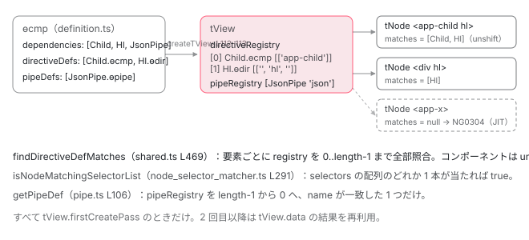

[目次](../README.md) › [standalone コンポーネントの内側](README.md) › 第 7 回 / 全 14 回

# 実行時の依存解決：tView.directiveRegistry と findDirectiveDefMatches、pipeRegistry と getPipeDef

> ɵcmp の dependencies から作られた directiveDefs / pipeDefs が createTView で directiveRegistry / pipeRegistry に入る。ɵɵelementStart の firstCreatePass で findDirectiveDefMatches が全 def の selectors を isNodeMatchingSelectorList で照合し、コンポーネントを先頭に並べる手順。ɵɵpipe が pipeRegistry を後ろから探す行。マッチしなかった &lt;app-x&gt; が NG0304「not a known element」になる場所と schemas。

angular/angular · 読了 約 14 分 · 中核 · [サイトで読む（デモが動きます）](https://angular-deep-dive-cyan.vercel.app/chapter/standalone-directive-registry)

---

前回までで、standalone コンポーネントの `imports` は `ɵcmp.dependencies` になり、そこから `directiveDefs` と `pipeDefs` が作られるところまで来ました。この章はその続きです。**実行時に、テンプレートの要素 1 つ 1 つがどの def と結び付くのか**を追います。`createTView` が `directiveDefs` を `tView.directiveRegistry` に置き、`ɵɵelementStart` の最初の 1 回で `findDirectiveDefMatches` がその配列を全部なめて `isNodeMatchingSelectorList` でセレクタを照合し、コンポーネントを先頭に並べる。パイプは `ɵɵpipe` が `pipeRegistry` を**後ろから**名前で探す。どれにも当たらなかった `<app-x>` が NG0304 になる場所も見ます。

読む対象は `packages/core/src/render3/view/construction.ts`、`instructions/element.ts`、`view/elements.ts`、`view/directives.ts`、`instructions/shared.ts`、`node_selector_matcher.ts`、`pipe.ts`、`instructions/element_validation.ts` です。ディレクティブの**生成**（インスタンスを new してフックを登録する側）は [ivy-directives](../ivy/14-ivy-directives.md) と [ivy-first-create-pass](../ivy/08-ivy-first-create-pass.md) が書いているので、ここでは**照合**だけに絞ります。

1. [1. 概観](01-standalone.md)
2. [2. @Component 実行の瞬間（JIT）](02-standalone-decorator.md)
3. [3. imports の検証（AOT）](03-standalone-imports-check.md)
4. [4. 使った依存だけが残る](04-standalone-used-only.md)
5. [5. forwardRef と自己参照](05-standalone-forward-ref.md)
6. [6. ローカルコンパイル](06-standalone-local-compilation.md)
7. **7. 実行時の依存解決**（この章）
8. [8. providers の 2 つの行き先](08-standalone-providers-two-injectors.md)
9. [9. 入口の検査](09-standalone-entry-checks.md)
10. [10. hostDirectives](10-standalone-host-directives.md)
11. [11. @defer と imports](11-standalone-defer-deps.md)
12. [12. TestBed の差し替え](12-standalone-testbed-override.md)
13. [13. selectorless（実験的）](13-standalone-selectorless.md)
14. [14. foreignImports（内部向け）](14-standalone-foreign-imports.md)

## 1. registry はどこから来るか

`ɵɵdefineComponent` が `dependencies` から `directiveDefs`（ディレクティブとコンポーネントの def の配列）と `pipeDefs`（パイプの def の配列）を作る行は [NgModule シリーズ第 13 回](../ngmodule/13-ngmodule-standalone-imports.md)で読みました。その 2 つが `TView` に渡る場所がここです。

📄 `angular/packages/core/src/render3/view/construction.ts` L158–166 （▶ の行: 161–162）

```ts
158 │       def.template,
159 │       def.decls,
160 │       def.vars,
161 ▶       def.directiveDefs,
162 ▶       def.pipeDefs,
163 │       def.viewQuery,
164 │       def.schemas,
165 │       def.consts,
166 │       def.id,
```

161〜162 行目、`getOrCreateComponentTView` は `def.directiveDefs` と `def.pipeDefs` を `createTView` にそのまま渡します（関数全体は [ivy-tview](../ivy/05-ivy-tview.md)）。受け取った側は 2 行です。

📄 `angular/packages/core/src/render3/view/construction.ts` L111–115 （▶ の行: 112–113）

```ts
111 │     components: null,
112 ▶     directiveRegistry: typeof directives === 'function' ? directives() : directives,
113 ▶     pipeRegistry: typeof pipes === 'function' ? pipes() : pipes,
114 │     firstChild: null,
115 │     schemas: schemas,
```

112 行目で `directiveRegistry`、113 行目で `pipeRegistry`。どちらも「関数なら呼んで配列にする」をしています。関数になるのは [第 5 回](05-standalone-forward-ref.md)で見た `forwardRef` の場合で、**TView を作るこの瞬間に初めて評価される**のがここです。結果として `tView.directiveRegistry` は「このコンポーネントの `imports` のうち、テンプレートで使われたディレクティブとコンポーネントの def」、`tView.pipeRegistry` は「同じくパイプの def」の配列です。これが照合の**探索範囲**になります。

> [!NOTE]
> **ポイント**
>
> standalone でないコンポーネントは `dependencies` が `null` で、`directiveDefs` は NgModule 側から `ɵɵsetComponentScope` で後から入ります（[NgModule シリーズ第 4 回](../ngmodule/04-ngmodule-compilation-scope.md)）。入り方は違いますが、112〜113 行目以降の照合の手順は standalone でもそうでなくても**完全に同じ**です。

## 2. ɵɵelementStart が照合関数を渡す

テンプレート関数の作成パスで `<app-child>` に対応するのが `ɵɵelementStart(0, 'app-child')` です。

📄 `angular/packages/core/src/render3/instructions/element.ts` L100–113 （▶ の行: 102–103, 108, 113）

```ts
100 │   const tView = lView[TVIEW];
101 │   const adjustedIndex = index + HEADER_OFFSET;
102 ▶   const tNode = tView.firstCreatePass
103 ▶     ? directiveHostFirstCreatePass(
104 │         adjustedIndex,
105 │         lView,
106 │         TNodeType.Element,
107 │         name,
108 ▶         findDirectiveDefMatches,
109 │         getBindingsEnabled(),
110 │         attrsIndex,
111 │         localRefsIndex,
112 │       )
113 ▶     : (tView.data[adjustedIndex] as TElementNode);
```

102 行目、`tView.firstCreatePass`（この TView で初めて作成パスを走らせている）のときだけ 103 行目の `directiveHostFirstCreatePass` を呼びます。108 行目、引数に `findDirectiveDefMatches` を**関数のまま**渡しています。2 回目以降は 113 行目、`tView.data` に保存済みの `TNode` を取り出すだけで、照合はしません。照合は **TView ごとに 1 回**です。

📄 `angular/packages/core/src/render3/view/elements.ts` L44–52 （▶ の行: 44–45, 50）

```ts
44 ▶   if (bindingsEnabled) {
45 ▶     resolveDirectives(
46 │       tView,
47 │       lView,
48 │       tNode,
49 │       getConstant<string[]>(tViewConsts, localRefsIndex),
50 ▶       directiveMatcher,
51 │     );
52 │   }
```

44 行目、`bindingsEnabled`（`ɵɵdisableBindings` で止められていない。通常は `true`）なら 45 行目で `resolveDirectives` を呼び、50 行目で受け取った照合関数をそのまま渡します。この関数の前後（`TNode` の作成や属性のマージ）は [ivy-first-create-pass](../ivy/08-ivy-first-create-pass.md) が読んでいます。

📄 `angular/packages/core/src/render3/view/directives.ts` L64–72 （▶ の行: 69, 71）

```ts
64 │ ): void {
65 │   // Please make sure to have explicit type for `exportsMap`. Inferred type triggers bug in tsickle.
66 │   ngDevMode && assertFirstCreatePass(tView);
67 │ 
68 │   const exportsMap: Record<string, number> | null = localRefs === null ? null : {'': -1};
69 ▶   const matchedDirectiveDefs = directiveMatcher(tView, tNode);
70 │ 
71 ▶   if (matchedDirectiveDefs !== null) {
72 │     let directiveDefs = matchedDirectiveDefs;
```

69 行目、`directiveMatcher(tView, tNode)`。これが `findDirectiveDefMatches` の呼び出しです。71 行目、結果が `null`（何も当たらなかった）でなければ、この先で `initializeDirectives` に渡されて インスタンス化の準備が始まります（[ivy-directives](../ivy/14-ivy-directives.md)）。途中の `resolveHostDirectives` は[第 10 回](10-standalone-host-directives.md)に任せます。

## 3. findDirectiveDefMatches：registry を全部なめる

📄 `angular/packages/core/src/render3/instructions/shared.ts` L466–491 （▶ の行: 466, 468–469, 471, 474–475, 483–484, 488, 490）

```ts
466 ▶   const registry = tView.directiveRegistry;
467 │   let matches: DirectiveDef<unknown>[] | null = null;
468 ▶   if (registry) {
469 ▶     for (let i = 0; i < registry.length; i++) {
470 │       const def = registry[i] as ComponentDef<any> | DirectiveDef<any>;
471 ▶       if (isNodeMatchingSelectorList(tNode, def.selectors!, /* isProjectionMode */ false)) {
472 │         matches ??= [];
473 │ 
474 ▶         if (isComponentDef(def)) {
475 ▶           if (ngDevMode) {
476 │             assertTNodeType(
477 │               tNode,
478 │               TNodeType.Element,
479 │               `"${tNode.value}" tags cannot be used as component hosts. ` +
480 │                 `Please use a different tag to activate the ${stringify(def.type)} component.`,
481 │             );
482 │ 
483 ▶             if (matches.length && isComponentDef(matches[0])) {
484 ▶               throwMultipleComponentError(tNode, matches.find(isComponentDef)!.type, def.type);
485 │             }
486 │           }
487 │ 
488 ▶           matches.unshift(def);
489 │         } else {
490 ▶           matches.push(def);
491 │         }
```

1. **466 行目：探索範囲は `tView.directiveRegistry`**

   1 節の 112 行目で入れた配列です。468 行目、`null` なら何もせず `matches` は `null` のまま返ります。
2. **469〜471 行目：全部の def について `isNodeMatchingSelectorList(tNode, def.selectors)`**

   `for` は途中で止まりません。**registry の長さぶん、毎要素で照合します**。`imports` に 50 個入っていてテンプレートで 50 個使っていれば、要素 1 つにつき 50 回セレクタ照合が走ります（TView ごとに 1 回ですが）。第 3 引数 `isProjectionMode = false` は「ディレクティブ照合モード」で、4 節で意味が出ます。
3. **474・488 行目：コンポーネントなら `unshift` で先頭へ、490 行目：ディレクティブは `push` で末尾へ**

   この並び順がそのまま `tNode.directiveStart` からの並びになり、「コンポーネントは `componentOffset = 0`」という [ivy-directives](../ivy/14-ivy-directives.md) の前提を作っています。
4. **475・483〜484 行目：コンポーネントが 2 つ目なら `throwMultipleComponentError`**

   475 行目の `ngDevMode` の中なので、**開発モードだけ**の検査です。483 行目、既に `matches[0]` がコンポーネントなら、484 行目で投げます。

📄 `angular/packages/core/src/render3/errors.ts` L50–62 （▶ の行: 57–58）

```ts
50 │ /** Called when there are multiple component selectors that match a given node */
51 │ export function throwMultipleComponentError(
52 │   tNode: TNode,
53 │   first: Type<unknown> | AbstractType<unknown>,
54 │   second: Type<unknown> | AbstractType<unknown>,
55 │ ): never {
56 │   throw new RuntimeError(
57 ▶     RuntimeErrorCode.MULTIPLE_COMPONENTS_MATCH,
58 ▶     `Multiple components match node with tagname ${tNode.value}: ` +
59 │       `${stringifyForError(first)} and ` +
60 │       `${stringifyForError(second)}`,
61 │   );
62 │ }
```

📄 `angular/packages/core/src/errors.ts` L50–55 （▶ の行: 51, 53, 55）

```ts
50 │   // Template Errors
51 ▶   MULTIPLE_COMPONENTS_MATCH = -300,
52 │   EXPORT_NOT_FOUND = -301,
53 ▶   PIPE_NOT_FOUND = -302,
54 │   UNKNOWN_BINDING = 303,
55 ▶   UNKNOWN_ELEMENT = 304,
```

57 行目のコードは 51 行目の `MULTIPLE_COMPONENTS_MATCH = -300`（負の値はメッセージが本番ビルドで削られる印）。58 行目、メッセージには要素名と 2 つのコンポーネント名が入ります。53 行目の `PIPE_NOT_FOUND` と 55 行目の `UNKNOWN_ELEMENT` は 5 節と 6 節で使います。

## 4. isNodeMatchingSelectorList：セレクタ 1 本の照合

`def.selectors` の形を先に見ます。コンパイラは `@Component({ selector: '...' })` の文字列を配列に分解して `ɵcmp` に書き出しています。

📄 `angular/packages/core/src/render3/interfaces/projection.ts` L40–49 （▶ の行: 46–47, 49）

```ts
40 │ /**
41 │  * A list of CssSelectors.
42 │  *
43 │  * A directive or component can have multiple selectors. This type is used for
44 │  * directive defs so any of the selectors in the list will match that directive.
45 │  *
46 ▶  * Original: 'form, [ngForm]'
47 ▶  * Parsed: [['form'], ['', 'ngForm', '']]
48 │  */
49 ▶ export type CssSelectorList = CssSelector[];
```

46〜47 行目の例が全部を言っています。`'form, [ngForm]'` は `[['form'], ['', 'ngForm', '']]`。外側の配列が「カンマ区切りのどれか」（`CssSelectorList`、49 行目）、内側の配列が「1 本のセレクタ」で、**先頭はタグ名**（`''` なら何でもよい）、続いて `属性名, 属性値` の組が並びます。`<app-child>` なら `[['app-child']]` です。

📄 `angular/packages/core/src/render3/node_selector_matcher.ts` L286–298 （▶ の行: 291–293）

```ts
286 │ export function isNodeMatchingSelectorList(
287 │   tNode: TNode,
288 │   selector: CssSelectorList,
289 │   isProjectionMode: boolean = false,
290 │ ): boolean {
291 ▶   for (let i = 0; i < selector.length; i++) {
292 ▶     if (isNodeMatchingSelector(tNode, selector[i], isProjectionMode)) {
293 ▶       return true;
294 │     }
295 │   }
296 │ 
297 │   return false;
298 │ }
```

291〜293 行目、外側の配列を順に `isNodeMatchingSelector` に渡し、**1 本でも当たれば `true`**。1 本の照合がこちらです。長いので要点の 3 か所に分けます。

📄 `angular/packages/core/src/render3/node_selector_matcher.ts` L129–154 （▶ の行: 129, 131, 140, 146–149, 151–152）

```ts
129 ▶   for (let i = 0; i < selector.length; i++) {
130 │     const current = selector[i];
131 ▶     if (typeof current === 'number') {
132 │       // If we finish processing a :not selector and it hasn't failed, return false
133 │       if (!skipToNextSelector && !isPositive(mode) && !isPositive(current)) {
134 │         return false;
135 │       }
136 │       // If we are skipping to the next :not() and this mode flag is positive,
137 │       // it's a part of the current :not() selector, and we should keep skipping
138 │       if (skipToNextSelector && isPositive(current)) continue;
139 │       skipToNextSelector = false;
140 ▶       mode = (current as number) | (mode & SelectorFlags.NOT);
141 │       continue;
142 │     }
143 │ 
144 │     if (skipToNextSelector) continue;
145 │ 
146 ▶     if (mode & SelectorFlags.ELEMENT) {
147 ▶       mode = SelectorFlags.ATTRIBUTE | (mode & SelectorFlags.NOT);
148 ▶       if (
149 ▶         (current !== '' && !hasTagAndTypeMatch(tNode, current, isProjectionMode)) ||
150 │         (current === '' && selector.length === 1)
151 ▶       ) {
152 ▶         if (isPositive(mode)) return false;
153 │         skipToNextSelector = true;
154 │       }
```

129 行目、セレクタ配列を前から 1 要素ずつ見ます。131 行目、要素が**数値**なら `SelectorFlags`（「ここからクラス」「ここから `:not`」の切り替え印）で、140 行目で `mode` を切り替えて次へ。146 行目、文字列で `mode` が `ELEMENT`（先頭のタグ名）なら、147 行目で次からは属性モードにして、149 行目で `hasTagAndTypeMatch` にタグ名を比べさせます。外れたら 152 行目で `false`（`:not` の中でなければ）。

📄 `angular/packages/core/src/render3/node_selector_matcher.ts` L94–102 （▶ の行: 99–101）

```ts
 94 │ function hasTagAndTypeMatch(
 95 │   tNode: TNode,
 96 │   currentSelector: string,
 97 │   isProjectionMode: boolean,
 98 │ ): boolean {
 99 ▶   const tagNameToCompare =
100 ▶     tNode.type === TNodeType.Container && !isProjectionMode ? NG_TEMPLATE_SELECTOR : tNode.value;
101 ▶   return currentSelector === tagNameToCompare;
102 │ }
```

99〜101 行目。比べる相手は `tNode.value`（要素のタグ名）ですが、`TNodeType.Container`（`*ngIf` などで生まれた `<ng-template>` 相当のノード）で 「ディレクティブ照合モード」のときは `NG_TEMPLATE_SELECTOR`（`'ng-template'`）と比べます。だから `<div *ngIf>` の `*ngIf` 側のノードには `div` セレクタのディレクティブは当たりません。3 節 471 行目の `isProjectionMode = false` はこのためにあります（`true` 側は [projection](../template/02-projection.md)）。

📄 `angular/packages/core/src/render3/node_selector_matcher.ts` L155–173 （▶ の行: 155–156, 161–162, 169–170）

```ts
155 ▶     } else if (mode & SelectorFlags.CLASS) {
156 ▶       if (nodeAttrs === null || !isCssClassMatching(tNode, nodeAttrs, current, isProjectionMode)) {
157 │         if (isPositive(mode)) return false;
158 │         skipToNextSelector = true;
159 │       }
160 │     } else {
161 ▶       const selectorAttrValue = selector[++i];
162 ▶       const attrIndexInNode = findAttrIndexInNode(
163 │         current,
164 │         nodeAttrs,
165 │         isInlineTemplate(tNode),
166 │         isProjectionMode,
167 │       );
168 │ 
169 ▶       if (attrIndexInNode === -1) {
170 ▶         if (isPositive(mode)) return false;
171 │         skipToNextSelector = true;
172 │         continue;
173 │       }
```

155〜156 行目、クラスモードなら `isCssClassMatching`。161 行目からが属性です。`[ngForm]` のような属性セレクタは配列で `'ngForm', ''` の 2 要素なので、161 行目で `++i` して値側を先に取り、162 行目で `findAttrIndexInNode` が `tNode.attrs` の中に同じ属性名があるかを探します。169〜170 行目、無ければ `false`。

📄 `angular/packages/core/src/render3/node_selector_matcher.ts` L175–200 （▶ の行: 175, 189, 192–193, 200）

```ts
175 ▶       if (selectorAttrValue !== '') {
176 │         let nodeAttrValue: string;
177 │         if (attrIndexInNode > nameOnlyMarkerIdx) {
178 │           nodeAttrValue = '';
179 │         } else {
180 │           ngDevMode &&
181 │             assertNotEqual(
182 │               nodeAttrs![attrIndexInNode],
183 │               AttributeMarker.NamespaceURI,
184 │               'We do not match directives on namespaced attributes',
185 │             );
186 │           // we lowercase the attribute value to be able to match
187 │           // selectors without case-sensitivity
188 │           // (selectors are already in lowercase when generated)
189 ▶           nodeAttrValue = (nodeAttrs![attrIndexInNode + 1] as string).toLowerCase();
190 │         }
191 │ 
192 ▶         if (mode & SelectorFlags.ATTRIBUTE && selectorAttrValue !== nodeAttrValue) {
193 ▶           if (isPositive(mode)) return false;
194 │           skipToNextSelector = true;
195 │         }
196 │       }
197 │     }
198 │   }
199 │ 
200 ▶   return isPositive(mode) || skipToNextSelector;
```

175 行目、セレクタ側に値が書かれていれば（`[type="text"]` など）、189 行目で要素側の値を小文字にして、192〜193 行目で一致しなければ `false`。値が `''`（`[ngForm]` のように存在だけ見る）なら比較を飛ばします。200 行目、ループを抜けたら `true`。

> [!TIP]
> **新卒エンジニアへ**
>
> `<form ngForm>` に `[['form'], ['', 'ngForm', '']]` を当てると：1 本目 `['form']` は 149 行目でタグ一致 → 200 行目で `true`。ここで 292〜293 行目が `true` を返すので 2 本目は見ません。`<div ngForm>` なら 1 本目は 152 行目で `false`、2 本目 `['', 'ngForm', '']` は先頭 `''` でタグ比較を飛ばし（148〜151 行目の条件はどちらも偽）、162 行目で属性 `ngForm` を見つけて 200 行目で `true`。

## 5. パイプは名前で、後ろから

パイプはセレクタではなく名前で引きます。`{{ value | json }}` に対応する作成パスの命令が `ɵɵpipe(1, 'json')` です。

📄 `angular/packages/core/src/render3/pipe.ts` L41–56 （▶ の行: 46, 49–50, 55）

```ts
41 │ export function ɵɵpipe(index: number, pipeName: string): any {
42 │   const tView = getTView();
43 │   let pipeDef: PipeDef<any>;
44 │   const adjustedIndex = index + HEADER_OFFSET;
45 │ 
46 ▶   if (tView.firstCreatePass) {
47 │     // The `getPipeDef` throws if a pipe with a given name is not found
48 │     // (so we use non-null assertion below).
49 ▶     pipeDef = getPipeDef(pipeName, tView.pipeRegistry)!;
50 ▶     tView.data[adjustedIndex] = pipeDef;
51 │     if (pipeDef.onDestroy) {
52 │       (tView.destroyHooks ??= []).push(adjustedIndex, pipeDef.onDestroy);
53 │     }
54 │   } else {
55 ▶     pipeDef = tView.data[adjustedIndex] as PipeDef<any>;
56 │   }
```

46 行目、ここも `firstCreatePass` だけ。49 行目で `getPipeDef(pipeName, tView.pipeRegistry)`（1 節 113 行目の配列）を引き、50 行目で `tView.data` に def を保存します。2 回目以降は 55 行目でそれを読むだけです。

📄 `angular/packages/core/src/render3/pipe.ts` L92–116 （▶ の行: 93, 95–98, 106, 108–109, 114）

```ts
 92 │ function getPipeDef(name: string, registry: PipeDefList | null): PipeDef<any> | undefined {
 93 ▶   if (registry) {
 94 │     if (ngDevMode) {
 95 ▶       const pipes = registry.filter((pipe) => pipe.name === name);
 96 ▶       // TODO: Throw an error in the next major
 97 ▶       if (pipes.length > 1) {
 98 ▶         console.warn(
 99 │           formatRuntimeError(
100 │             RuntimeErrorCode.MULTIPLE_MATCHING_PIPES,
101 │             getMultipleMatchingPipesMessage(name),
102 │           ),
103 │         );
104 │       }
105 │     }
106 ▶     for (let i = registry.length - 1; i >= 0; i--) {
107 │       const pipeDef = registry[i];
108 ▶       if (name === pipeDef.name) {
109 ▶         return pipeDef;
110 │       }
111 │     }
112 │   }
113 │   if (ngDevMode) {
114 ▶     throw new RuntimeError(RuntimeErrorCode.PIPE_NOT_FOUND, getPipeNotFoundErrorMessage(name));
115 │   }
116 │   return;
```

1. **93 行目：registry が `null` なら探さない**

   そのまま 114 行目へ落ちて、開発モードなら `PIPE_NOT_FOUND`（3 節 53 行目、-302）を投げます。
2. **95〜98 行目：開発モードだけ、同名が 2 つ以上なら `console.warn`**

   `RuntimeErrorCode.MULTIPLE_MATCHING_PIPES`（NG0313）です。**例外ではなく警告**で、96 行目のコメントどおり将来エラーにする予定です。
3. **106〜109 行目：`registry.length - 1` から `0` へ、名前が一致した最初の def を返す**

   **後ろから**です。`imports: [PipeA, PipeB]` で両方の `name` が `'fmt'` なら、配列で後ろにある `PipeB` が使われます。ディレクティブの 3 節 469 行目が前から全部拾うのと対照的で、パイプは**1 つしか選ばれません**。

## 6. どれにも当たらなかった要素

`findDirectiveDefMatches` が `null` を返した要素は、ただの DOM 要素として作られます。`<app-child>` を `imports` に入れ忘れたときもこれです。それを検出するのが `validateElementIsKnown` で、`ɵɵelementEnd` の最初の作成パスが `ngDevMode` のときに呼びます（呼び出し行と `schemas` の詳細は [NgModule シリーズ第 17 回](../ngmodule/16-ngmodule-schemas.md)）。ここでは standalone に関わる 2 か所だけ見ます。

📄 `angular/packages/core/src/render3/instructions/element_validation.ts` L80–85 （▶ の行: 80, 85）

```ts
80 ▶   if (tView.schemas === null) return;
81 │ 
82 │   const tagName = tNode.value;
83 │ 
84 │   // If the element matches any directive, it's considered as valid.
85 ▶   if (!isDirectiveHost(tNode) && tagName !== null) {
```

80 行目、`tView.schemas === null` なら即 `return`。AOT コンパイルされたコンポーネントは `ɵcmp` に `schemas` を書き出さないので `null` になり、**この実行時検査は AOT では一切走りません**。AOT で未知の要素を止めるのは ngtsc の型チェック（NG8001）です。85 行目、`isDirectiveHost(tNode)` が偽、つまり 3 節で 1 つも当たらなかった要素だけが対象です。

📄 `angular/packages/core/src/render3/instructions/element_validation.ts` L113–118 （▶ の行: 115–116, 118）

```ts
113 │         message += `2. To allow any element add 'NO_ERRORS_SCHEMA' to the ${schemas} of this component.`;
114 │       }
115 ▶       if (shouldThrowErrorOnUnknownElement) {
116 ▶         throw new RuntimeError(RuntimeErrorCode.UNKNOWN_ELEMENT, message);
117 │       } else {
118 ▶         console.error(formatRuntimeError(RuntimeErrorCode.UNKNOWN_ELEMENT, message));
```

116 行目が NG0304（3 節 55 行目の `UNKNOWN_ELEMENT = 304`）。115 行目の `shouldThrowErrorOnUnknownElement` は `TestBed` の `errorOnUnknownElements` で `true` になり、既定は 118 行目の `console.error` です。メッセージ本文はこの直前で組まれていて、ホストが standalone なら「`@Component.imports` に入っているか確認せよ」と出ます（第 17 回で引用済み）。



*imports → ɵcmp.dependencies → directiveDefs / pipeDefs → tView.directiveRegistry / pipeRegistry。要素ごとに findDirectiveDefMatches が registry を全走査し、当たった def を tNode に並べる（コンポーネントは先頭）。パイプは名前で後ろから 1 つ。*

## 7. DEMO：この章コンポーネントの registry

この章のコンポーネント自身の `ɵcmp` を読んで、`dependencies`（`imports` のうちテンプレートで使われたもの）と、1 節で `createTView` が受け取った `tView.directiveRegistry` / `pipeRegistry` を並べます。`ɵcmp` / `ɵdir` / `ɵpipe` は公開 API ではなく、ここでは学習のために読むだけです。この章は `JsonPipe` を `imports` に入れて下の表で使っているので、`pipeRegistry` に 1 つ入ります。

> **🧪 DEMO — ɵcmp.dependencies と tView の registry**
>
> ボタンを押した時点でこの章の TView は既に作られている（この文章が描かれている）ので、`ɵcmp.tView` は `null` ではありません。`directiveRegistry` の並びは `dependencies` からパイプを除いた並び、`pipeRegistry` はパイプだけです。
>
> ▶ [このデモはサイトで動かせます](https://angular-deep-dive-cyan.vercel.app/chapter/standalone-directive-registry)

## ここまでの呼び出し

- 👤 `template(rf = Create, ctx)` — コンパイラが生成したテンプレート関数
  - `ɵɵelementStart(0, 'app-child', ...)` — instructions/element.ts L90 — *firstCreatePass のときだけ次へ。findDirectiveDefMatches を関数で渡す（L108）*
    - `directiveHostFirstCreatePass(...)` — view/elements.ts L26 — *TNode を作る → bindingsEnabled なら resolveDirectives（L45）*
      - `resolveDirectives(tView, lView, tNode, localRefs, findDirectiveDefMatches)` — view/directives.ts L58
        - `findDirectiveDefMatches(tView, tNode)` — instructions/shared.ts L459 — *tView.directiveRegistry を 0 から全部*
          - `isNodeMatchingSelectorList(tNode, def.selectors, false)` × registry 件数 — node\_selector\_matcher.ts L286 — *セレクタ配列のどれか 1 本*
            - `isNodeMatchingSelector(tNode, selector, false)` — node\_selector\_matcher.ts L113 — *タグ → クラス → 属性の順に見て、外れたら false*
              - `hasTagAndTypeMatch(tNode, 'app-child', false)` — node\_selector\_matcher.ts L94
        - `initializeDirectives(tView, lView, tNode, directiveDefs, ...)` — view/directives.ts — *照合結果を tNode に並べる（ivy-directives）*
  - `ɵɵpipe(1, 'json')` — pipe.ts L41 — *firstCreatePass のときだけ次へ*
    - `getPipeDef('json', tView.pipeRegistry)` — pipe.ts L92 — *length-1 から 0 へ名前比較。無ければ NG0302*
  - `ɵɵelementEnd()` — instructions/element.ts — *ngDevMode かつ firstCreatePass なら validateElementIsKnown*
    - `validateElementIsKnown(lView, tNode)` — instructions/element\_validation.ts L73 — *schemas === null（AOT）なら即 return。当たらなかった要素だけ NG0304*

## 聞かれそうな質問

**Q. 同じ要素に 2 つのコンポーネントのセレクタが当たったらどうなりますか？**

開発モードでは `findDirectiveDefMatches` が 2 つ目を見つけた瞬間に投げます。shared.ts 483 行目で「既に `matches[0]` がコンポーネント」を確かめ、484 行目の `throwMultipleComponentError`（render3/errors.ts 57 行目、`MULTIPLE_COMPONENTS_MATCH = -300`）です。この検査は 475 行目の `ngDevMode` の中なので、本番ビルドでは投げずに 488 行目の `unshift` が 2 回走り、registry で**後ろ**にあった方が `matches[0]` になります。本番で黙って動かすのではなく、開発中に必ず直してください。

**Q. 同じ name のパイプを 2 つ imports に入れたら？**

pipe.ts 106〜109 行目のループが `registry.length - 1` から戻るので、**配列で後ろにある方**が選ばれます。開発モードでは 95〜98 行目で `console.warn`（NG0313）が出ますが、例外ではありません。ディレクティブは当たったものを全部 `push`（469〜490 行目）するのに対し、パイプは 1 つだけ、という違いも覚えておいてください。

**Q. AOT で imports に入れ忘れた &lt;app-x&gt; はどこで止まりますか？**

実行時ではなくコンパイル時です。element\_validation.ts 80 行目で `tView.schemas === null` なら即 `return` するので、AOT でコンパイルしたコンポーネントの実行時検査は走りません。止めるのは ngtsc のテンプレート型チェックで、`SCHEMA_INVALID_ELEMENT`（NG8001）の診断です （[第 17 回](../ngmodule/16-ngmodule-schemas.md)）。JIT（TestBed など）のときだけ 116 行目の NG0304 が出ます。

**Q. セレクタ照合は変更検知のたびに走るのですか？**

走りません。element.ts 102 行目の `tView.firstCreatePass` が真のとき、つまり **TView ごとに 1 回**だけです。2 回目以降は 113 行目で `tView.data[adjustedIndex]` の `TNode` を読むだけ。パイプも同じで、pipe.ts 46 行目の分岐で 55 行目の保存済み def を使います。同じコンポーネントを 100 個置いても、TView は 1 つなので照合は 1 回です。

**Q. \*ngIf を付けた &lt;div&gt; に、div セレクタのディレクティブは当たりますか？**

`*ngIf` 側のノード（`TNodeType.Container`）には当たりません。node\_selector\_matcher.ts 100 行目で、ディレクティブ照合モードのコンテナは タグ名を `'ng-template'` として比べるからです。`<div>` 本体は別の `TNode`（埋め込みビューの中）なので、そちらには当たります。同じディレクティブが 2 回当たらないための仕組みです。

## 読み終えて

- `tView.directiveRegistry` / `pipeRegistry` は `ɵcmp.directiveDefs` / `pipeDefs` をそのまま入れたもの（construction.ts 112〜113 行目）。standalone なら「`imports` のうち使ったもの」そのもの
- `findDirectiveDefMatches` は registry を**全件**照合し、コンポーネントは `unshift` で先頭、2 つ目のコンポーネントは開発モードで NG0300
- セレクタ 1 本は配列（先頭がタグ、続いて属性の名前と値）で、`isNodeMatchingSelector` がタグ → クラス → 属性の順に外れを探す
- パイプは `getPipeDef` が名前で**後ろから** 1 つだけ。同名は警告 NG0313
- 当たらなかった要素の NG0304 は JIT だけ。AOT は `schemas === null` で即 return し、ngtsc の NG8001 が代わりに止める

---

← 前: [ローカルコンパイル：ɵɵgetComponentDepsFactory が依存解決を実行時へ送る](06-standalone-local-compilation.md)  
次: [@Component の providers と imports の providers は別の注入器へ：ɵɵProvidersFeature と StandaloneService](08-standalone-providers-two-injectors.md) →
