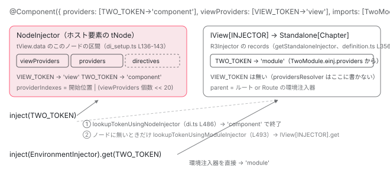

[目次](../README.md) › [standalone コンポーネントの内側](README.md) › 第 8 回 / 全 14 回

# @Component の providers と imports の providers は別の注入器へ：ɵɵProvidersFeature と StandaloneService

> providers / viewProviders は ɵɵProvidersFeature → providersResolver で TView の data と blueprint に積まれ、NodeInjector から見える。imports に入れた NgModule の providers はコンポーネントではなく getStandaloneInjector が作る環境インジェクタに入る。2 つの行き先を定義ファイルの行で分け、同じトークンを両方に置いたとき実際にどちらが取れるかをデモで確かめる。

angular/angular · 読了 約 13 分 · 中核 · [サイトで読む（デモが動きます）](https://angular-deep-dive-cyan.vercel.app/chapter/standalone-providers-two-injectors)

---

standalone コンポーネントには providers を書く場所が 2 つあります。`@Component({ providers, viewProviders })` と、`imports: [SomeModule]` に入れた NgModule の `providers` です。どちらも「このコンポーネントで使えるサービス」に見えますが、**入る注入器が違います**。前者は `ɵɵProvidersFeature` → `providersResolver` が `TView.data` と `blueprint` に積み、ホスト要素の `NodeInjector` から見えます。後者は `getStandaloneInjector` が作る環境注入器（`Standalone[...]`）に入ります。この章では 2 つの行き先を定義ファイルの行で分け、`inject()` がどの順で 2 つを見るかを追い、最後に**同じトークンを両方に置いて 2 つの答えが出る**のを実物で確かめます。

読む対象は `packages/compiler/src/render3/view/compiler.ts`（書き出す側）、`packages/core/src/render3/features/providers_feature.ts`、`di_setup.ts`、`view/directives.ts`、`instructions/di.ts`、`di.ts`、`definition.ts` です。環境注入器そのものの作られ方（`StandaloneService`、`createRootViewInjector`、`walkProviderTree`）は [NgModule シリーズ第 13 回](../ngmodule/13-ngmodule-standalone-imports.md)で読んだので、ここでは繰り返しません。

1. [1. 概観](01-standalone.md)
2. [2. @Component 実行の瞬間（JIT）](02-standalone-decorator.md)
3. [3. imports の検証（AOT）](03-standalone-imports-check.md)
4. [4. 使った依存だけが残る](04-standalone-used-only.md)
5. [5. forwardRef と自己参照](05-standalone-forward-ref.md)
6. [6. ローカルコンパイル](06-standalone-local-compilation.md)
7. [7. 実行時の依存解決](07-standalone-directive-registry.md)
8. **8. providers の 2 つの行き先**（この章）
9. [9. 入口の検査](09-standalone-entry-checks.md)
10. [10. hostDirectives](10-standalone-host-directives.md)
11. [11. @defer と imports](11-standalone-defer-deps.md)
12. [12. TestBed の差し替え](12-standalone-testbed-override.md)
13. [13. selectorless（実験的）](13-standalone-selectorless.md)
14. [14. foreignImports（内部向け）](14-standalone-foreign-imports.md)

## 1. コンパイラは providers を features に書き出す

`@Component({ providers: [A], viewProviders: [B] })` と書いたとき、`ɵcmp` には `providers` というフィールドはできません。コンパイラはこう書き出します。

📄 `angular/packages/compiler/src/render3/view/compiler.ts` L115–124 （▶ の行: 118–121, 123）

```ts
115 │   const providers = meta.providers;
116 │   const viewProviders = (meta as R3ComponentMetadata<R3TemplateDependency>).viewProviders;
117 │ 
118 ▶   if (providers || viewProviders) {
119 ▶     const args = [providers || new o.LiteralArrayExpr([])];
120 ▶     if (viewProviders) {
121 ▶       args.push(viewProviders);
122 │     }
123 ▶     features.push(o.importExpr(R3.ProvidersFeature).callFn(args));
124 │   }
```

118 行目、`providers` か `viewProviders` のどちらかがあれば、119 行目で第 1 引数を `providers`（無ければ空配列 `[]`）、120〜121 行目で `viewProviders` があるときだけ第 2 引数を足し、123 行目で `features: [ɵɵProvidersFeature(providers, viewProviders)]` を出力します。つまり `viewProviders` だけ書いても第 1 引数に `[]` が入り、**必ず `providers` が先、`viewProviders` が後**の 2 引数です。

📄 `angular/packages/core/src/render3/features/providers_feature.ts` L44–58 （▶ の行: 44, 46–47, 49–50, 54）

```ts
44 ▶ export function ɵɵProvidersFeature<T>(providers: Provider[], viewProviders?: Provider[]) {
45 │   return (definition: DirectiveDef<T>) => {
46 ▶     definition.providersResolver = (def, processProvidersFn) =>
47 ▶       providersResolver(def, processProvidersFn ? processProvidersFn(providers) : providers, false);
48 │ 
49 ▶     if (viewProviders) {
50 ▶       definition.viewProvidersResolver = (def, processProvidersFn) =>
51 │         providersResolver(
52 │           def,
53 │           processProvidersFn ? processProvidersFn(viewProviders) : viewProviders,
54 ▶           true,
55 │         );
56 │     }
57 │   };
58 │ }
```

44 行目、`ɵɵProvidersFeature` は「def を受け取る関数」を返します（`ɵɵdefineComponent` の `initFeatures` が def を渡して呼ぶ）。46〜47 行目、`def.providersResolver` に、`providersResolver(def, providers, false)` を呼ぶ関数を置きます。第 3 引数 `false` は「viewProviders ではない」。49〜54 行目、`viewProviders` があるときだけ `def.viewProvidersResolver` に `true` 版を置きます。ここでは**まだ何も注入器に入っていません**。関数を 2 つ def に取り付けただけです。

📄 `angular/packages/core/src/render3/interfaces/definition.ts` L205–209 （▶ の行: 206, 209）

```ts
205 │   /** Function that resolves `providers` and publishes them into the DI system. */
206 ▶   providersResolver: ProvidersResolver | null;
207 │ 
208 │   /** Function that resolves `viewProviders` and publishes them into the DI system. */
209 ▶   viewProvidersResolver: ProvidersResolver | null;
```

## 2. 呼ばれるのは最初の作成パス、順番は viewProviders → providers

取り付けた 2 つの関数を呼ぶのは `initializeDirectives` です。[第 7 回](07-standalone-directive-registry.md)で照合した def の配列を受け取ったあと、この部分が走ります。

📄 `angular/packages/core/src/render3/view/directives.ts` L163–180 （▶ の行: 165, 169, 172, 175, 177–178）

```ts
163 │   // When the same token is provided by several directives on the same node, some rules apply in
164 │   // the viewEngine:
165 ▶   // - viewProviders have priority over providers
166 │   // - the last directive in NgModule.declarations has priority over the previous one
167 │   // So to match these rules, the order in which providers are added in the arrays is very
168 │   // important.
169 ▶   if (componentDef?.viewProvidersResolver) {
170 │     // Only components can have `viewProviders`, `viewProviders` are registered first and there
171 │     // can only be one component so we check for it specifically.
172 ▶     componentDef.viewProvidersResolver(componentDef);
173 │   }
174 │ 
175 ▶   for (let i = 0; i < directivesLength; i++) {
176 │     const def = directives[i];
177 ▶     if (def.providersResolver) {
178 ▶       def.providersResolver(def);
179 │     }
180 │   }
```

165 行目のコメントがルールです。「viewProviders は providers より優先」。それを順番で実現しています。169〜172 行目、この要素にコンポーネントがいれば、**最初に**`componentDef.viewProvidersResolver`。175〜178 行目、次に照合された def を配列順に回して `providersResolver`。第 7 回で見たとおりコンポーネントは `unshift` で配列の先頭なので、順番は 「コンポーネントの viewProviders → コンポーネントの providers → 他のディレクティブの providers」になります。

📄 `angular/packages/core/src/render3/di_setup.ts` L38–55 （▶ の行: 44–50）

```ts
38 │ /**
39 │  * Resolves the providers which are defined in the DirectiveDef.
40 │  *
41 │  * When inserting the tokens and the factories in their respective arrays, we can assume that
42 │  * this method is called first for the component (if any), and then for other directives on the same
43 │  * node.
44 ▶  * As a consequence,the providers are always processed in that order:
45 ▶  * 1) The view providers of the component
46 ▶  * 2) The providers of the component
47 ▶  * 3) The providers of the other directives
48 ▶  * This matches the structure of the injectables arrays of a view (for each node).
49 ▶  * So the tokens and the factories can be pushed at the end of the arrays, except
50 ▶  * in one case for multi providers.
51 │  *
52 │  * @param def the directive definition
53 │  * @param providers: Array of `providers`.
54 │  * @param viewProviders: Array of `viewProviders`.
55 │  */
```

44〜48 行目、`di_setup.ts` のコメントが同じ順番を書いています。「この順で来ると仮定できるので、トークンと factory は配列の末尾に push するだけでよい」（49〜50 行目）が設計の要です。

📄 `angular/packages/core/src/render3/di_setup.ts` L56–65 （▶ の行: 61–63）

```ts
56 │ export function providersResolver<T>(
57 │   def: DirectiveDef<T>,
58 │   providers: Provider[],
59 │   isViewProviders: boolean,
60 │ ): void {
61 ▶   const tView = getTView();
62 ▶   if (tView.firstCreatePass) {
63 ▶     resolveProvider(providers, tView.data, tView.blueprint, isComponentDef(def), isViewProviders);
64 │   }
65 │ }
```

61〜62 行目、`tView.firstCreatePass` のときだけ。**providers の解決は TView ごとに 1 回**です。63 行目、積む先は `tView.data`（トークン）と `tView.blueprint`（factory の型紙）。`isComponentDef(def)` と `isViewProviders` も渡します。

## 3. tView.data と blueprint のどこに積むか

📄 `angular/packages/core/src/render3/di_setup.ts` L108–125 （▶ の行: 108–111, 114, 120, 123）

```ts
108 ▶     const beginIndex = tNode.providerIndexes & TNodeProviderIndexes.ProvidersStartIndexMask;
109 ▶     const endIndex = tNode.directiveStart;
110 ▶     const cptViewProvidersCount =
111 ▶       tNode.providerIndexes >> TNodeProviderIndexes.CptViewProvidersCountShift;
112 │ 
113 │     if (isTypeProvider(provider) || !provider.multi) {
114 ▶       const factory = new NodeInjectorFactory(
115 │         providerFactory,
116 │         isViewProvider,
117 │         ɵɵdirectiveInject,
118 │         ngDevMode ? providerName(provider) : null,
119 │       );
120 ▶       const existingFactoryIndex = indexOf(
121 │         token,
122 │         tInjectables,
123 ▶         isViewProvider ? beginIndex : beginIndex + cptViewProvidersCount,
124 │         endIndex,
125 │       );
```

108 行目、`beginIndex` はこのノードの providers 区間の先頭。`tNode.providerIndexes` の下位 20 ビットです。109 行目、`endIndex` は `tNode.directiveStart`、つまり**providers 区間はディレクティブ区間の直前**にあります。110〜111 行目、`cptViewProvidersCount` は viewProviders の個数で、同じ数値の上位ビットに入っています。

📄 `angular/packages/core/src/render3/interfaces/node.ts` L213–223 （▶ の行: 215, 221–222）

```ts
213 │ export const enum TNodeProviderIndexes {
214 │   /** The index of the first provider on this node is encoded on the least significant bits. */
215 ▶   ProvidersStartIndexMask = 0b00000000000011111111111111111111,
216 │ 
217 │   /**
218 │    * The count of view providers from the component on this node is
219 │    * encoded on the 20 most significant bits.
220 │    */
221 ▶   CptViewProvidersCountShift = 20,
222 ▶   CptViewProvidersCountShifter = 0b00000000000100000000000000000000,
223 │ }
```

215 行目のマスクが開始位置、221〜222 行目のシフトが viewProviders の個数。1 つの数値に 2 つの情報を詰めています。これで `tView.data` のノード 1 つぶんは `[viewProviders…][providers…][directives…]` の 3 区間に分かれます。戻って 114 行目、`NodeInjectorFactory` を作り（第 2 引数 `isViewProvider` を持たせる）、120〜123 行目で同じトークンが既にあるかを探します。探す範囲が `isViewProvider ? beginIndex : beginIndex + cptViewProvidersCount`、つまり **viewProviders は自分の区間だけ、providers は viewProviders 区間を飛ばして**探す。これが「同じトークンを両方に書ける」理由です。

📄 `angular/packages/core/src/render3/di_setup.ts` L126–147 （▶ の行: 126–127, 136–140, 142–143, 145–146）

```ts
126 ▶       if (existingFactoryIndex === -1) {
127 ▶         diPublicInInjector(
128 │           getOrCreateNodeInjectorForNode(
129 │             tNode as TElementNode | TContainerNode | TElementContainerNode,
130 │             lView,
131 │           ),
132 │           tView,
133 │           token,
134 │         );
135 │         registerDestroyHooksIfSupported(tView, provider, tInjectables.length);
136 ▶         tInjectables.push(token);
137 ▶         tNode.directiveStart++;
138 ▶         tNode.directiveEnd++;
139 ▶         if (isViewProvider) {
140 ▶           tNode.providerIndexes += TNodeProviderIndexes.CptViewProvidersCountShifter;
141 │         }
142 ▶         lInjectablesBlueprint.push(factory);
143 ▶         lView.push(factory);
144 │       } else {
145 ▶         lInjectablesBlueprint[existingFactoryIndex] = factory;
146 ▶         lView[existingFactoryIndex] = factory;
147 │       }
```

1. **126〜127 行目：新しいトークンなら `diPublicInInjector`**

   ホスト要素の `NodeInjector` のブルームフィルタにこのトークンのビットを立てます （ブルームフィルタは [di](../di/10-di.md)）。これで「このノードにそのトークンがあるかもしれない」と後で分かります。
2. **136 行目：`tInjectables.push(token)`、137〜138 行目：`directiveStart++` / `directiveEnd++`**

   `tView.data` の末尾にトークンを置き、ディレクティブ区間を 1 つ後ろへずらします。2 節の順番どおり呼ばれているので、末尾 push で区間の並びが保たれます。
3. **139〜140 行目：viewProviders なら個数を +1**

   `CptViewProvidersCountShifter` を足す、つまり上位ビットの個数を 1 増やします。
4. **142〜143 行目：`blueprint.push(factory)` と `lView.push(factory)`**

   型紙と、いま作っている最初の LView の両方に `NodeInjectorFactory` を置きます。2 回目以降の LView は型紙のコピーから始まるので、factory は最初から入っています。インスタンスはまだ作られません。誰かが `inject` したときに factory が置き換わります。
5. **145〜146 行目：同じトークンが既にあれば factory を上書き**

   同じ区間に同じトークンを 2 回書いたら後勝ちです。配列は伸びません。

## 4. inject() はまず NodeInjector、無ければ lView\[INJECTOR\]

コンポーネントのコンストラクタで `inject(TOKEN)` と書くと、ディレクティブのインスタンス化中は inject 実装が `ɵɵdirectiveInject` に差し替えられています。

📄 `angular/packages/core/src/render3/instructions/di.ts` L45–66 （▶ の行: 49, 57–58）

```ts
45 │ export function ɵɵdirectiveInject<T>(
46 │   token: ProviderToken<T>,
47 │   flags = InternalInjectFlags.Default,
48 │ ): T | null {
49 ▶   const lView = getLView();
50 │   // Fall back to inject() if view hasn't been created. This situation can happen in tests
51 │   // if inject utilities are used before bootstrapping.
52 │   if (lView === null) {
53 │     // Verify that we will not get into infinite loop.
54 │     ngDevMode && assertInjectImplementationNotEqual(ɵɵdirectiveInject);
55 │     return ɵɵinject(token, flags);
56 │   }
57 ▶   const tNode = getCurrentTNode();
58 ▶   const value = getOrCreateInjectable<T>(
59 │     tNode as TDirectiveHostNode,
60 │     lView,
61 │     resolveForwardRef(token),
62 │     flags,
63 │   );
64 │   ngDevMode && emitInjectEvent(token as Type<unknown>, value, flags);
65 │   return value;
66 │ }
```

49 行目で今の `LView`、57 行目で今の `TNode`（インスタンス化中のディレクティブのホスト）を取り、58 行目の `getOrCreateInjectable` に渡します。

📄 `angular/packages/core/src/render3/di.ts` L484–494 （▶ の行: 486–487, 493）

```ts
484 │ 
485 │     // Otherwise try the node injector.
486 ▶     const value = lookupTokenUsingNodeInjector(tNode, lView, token, flags, NOT_FOUND);
487 ▶     if (value !== NOT_FOUND) {
488 │       return value;
489 │     }
490 │   }
491 │ 
492 │   // Finally, fall back to the module injector.
493 ▶   return lookupTokenUsingModuleInjector<T>(lView, token, flags, notFoundValue);
494 │ }
```

486〜487 行目、まず `lookupTokenUsingNodeInjector`。ホスト要素の `NodeInjector` から親要素へ、ブルームフィルタを見ながら登っていき、見つかればそこで返します。493 行目、どのノードにも無ければ `lookupTokenUsingModuleInjector`。これが**2 つ目の注入器への出口**です。

📄 `angular/packages/core/src/render3/di.ts` L418–426 （▶ の行: 418–419, 426）

```ts
418 ▶   if ((flags & (InternalInjectFlags.Self | InternalInjectFlags.Host)) === 0) {
419 ▶     const moduleInjector = lView[INJECTOR];
420 │     // switch to `injectInjectorOnly` implementation for module injector, since module injector
421 │     // should not have access to Component/Directive DI scope (that may happen through
422 │     // `directiveInject` implementation)
423 │     const previousInjectImplementation = setInjectImplementation(undefined);
424 │     try {
425 │       if (moduleInjector) {
426 ▶         return (moduleInjector as BackwardsCompatibleInjector).get(
```

419 行目、`lView[INJECTOR]`。LView のスロットに入っている `Injector` で、426 行目でそれの `get` を呼びます。418 行目、`Self` か `Host` フラグが付いていればここへは来ません（`inject(T, {self: true})` はノードだけ）。この `lView[INJECTOR]` に何が入っているかが 5 節です。その前に、ノード側で「viewProviders が見えるか」をどう決めているかを見ます。

📄 `angular/packages/core/src/render3/di.ts` L635–655 （▶ の行: 639–640, 648, 655）

```ts
635 │   const currentTView = lView[TVIEW];
636 │   const tNode = currentTView.data[injectorIndex + NodeInjectorOffset.TNODE] as TNode;
637 │   // First, we need to determine if view providers can be accessed by the starting element.
638 │   // There are two possibilities
639 ▶   const canAccessViewProviders =
640 ▶     previousTView == null
641 │       ? // 1) This is the first invocation `previousTView == null` which means that we are at the
642 │         // `TNode` of where injector is starting to look. In such a case the only time we are allowed
643 │         // to look into the ViewProviders is if:
644 │         // - we are on a component
645 │         // - AND the injector set `includeViewProviders` to true (implying that the token can see
646 │         // ViewProviders because it is the Component or a Service which itself was declared in
647 │         // ViewProviders)
648 ▶         isComponentHost(tNode) && includeViewProviders
649 │       : // 2) `previousTView != null` which means that we are now walking across the parent nodes.
650 │         // In such a case we are only allowed to look into the ViewProviders if:
651 │         // - We just crossed from child View to Parent View `previousTView != currentTView`
652 │         // - AND the parent TNode is an Element.
653 │         // This means that we just came from the Component's View and therefore are allowed to see
654 │         // into the ViewProviders.
655 ▶         previousTView != currentTView && (tNode.type & TNodeType.AnyRNode) !== 0;
```

639〜640 行目、`canAccessViewProviders` は 2 通りで決まります。648 行目、探索の開始ノード（`previousTView == null`）なら「コンポーネントのホストであり、かつ `includeViewProviders`」。コンポーネント自身とその viewProviders から作られるサービスは `true` です。655 行目、親へ登ってきた途中なら「**子のビューから親のビューへ TView を跨いだ直後**（`previousTView != currentTView`）で、かつ要素ノード」。コンポーネントの**テンプレートの中**の子はこの条件を満たします。`<ng-content>` で投影された子は、同じ TView の中を登るだけなので満たしません。これが viewProviders が「ビューの中だけ」に見える仕組みです。

📄 `angular/packages/core/src/render3/di.ts` L692–713 （▶ の行: 700–702, 704–705, 708–709）

```ts
692 │   const nodeProviderIndexes = tNode.providerIndexes;
693 │   const tInjectables = tView.data;
694 │ 
695 │   const injectablesStart = nodeProviderIndexes & TNodeProviderIndexes.ProvidersStartIndexMask;
696 │   const directivesStart = tNode.directiveStart;
697 │   const directiveEnd = tNode.directiveEnd;
698 │   const cptViewProvidersCount =
699 │     nodeProviderIndexes >> TNodeProviderIndexes.CptViewProvidersCountShift;
700 ▶   const startingIndex = canAccessViewProviders
701 ▶     ? injectablesStart
702 ▶     : injectablesStart + cptViewProvidersCount;
703 │   // When the host special case applies, only the viewProviders and the component are visible
704 ▶   const endIndex = isHostSpecialCase ? injectablesStart + cptViewProvidersCount : directiveEnd;
705 ▶   for (let i = startingIndex; i < endIndex; i++) {
706 │     const providerTokenOrDef = tInjectables[i] as ProviderToken<any> | DirectiveDef<any> | string;
707 │     if (
708 ▶       (i < directivesStart && token === providerTokenOrDef) ||
709 ▶       (i >= directivesStart && (providerTokenOrDef as DirectiveDef<any>).type === token)
710 │     ) {
711 │       return i;
712 │     }
713 │   }
```

700〜702 行目、見えるなら `injectablesStart`（viewProviders 区間の先頭）から、見えないなら `cptViewProvidersCount` ぶん飛ばして providers 区間から。3 節で詰めた 2 つの数値をここで読んでいます。704 行目、終わりは通常 `directiveEnd`（ディレクティブ区間も含む。ディレクティブ自身もトークンだから）。705〜709 行目、providers 区間ではトークンそのもの、ディレクティブ区間では `def.type` と比べます。

## 5. imports の NgModule.providers は lView\[INJECTOR\] の側

ここまでに `imports` は一度も出てきません。`imports: [TwoModule]` の `providers` は `providersResolver` を通らず、`tView.data` にも入りません。入り口はこの 5 行です。

📄 `angular/packages/core/src/render3/definition.ts` L355–360 （▶ の行: 355–356, 358）

```ts
355 ▶       dependencies: (baseDef.standalone && componentDefinition.dependencies) || null,
356 ▶       getStandaloneInjector: baseDef.standalone
357 │         ? (parentInjector: EnvironmentInjector) => {
358 ▶             return parentInjector.get(StandaloneService).getOrCreateStandaloneInjector(def);
359 │           }
360 │         : null,
```

355 行目、`dependencies` は standalone のときだけ。356〜358 行目、同じく standalone のときだけ `getStandaloneInjector` が関数になり、呼ばれると親の環境注入器から `StandaloneService` を取って `getOrCreateStandaloneInjector(def)` を返します。その中で `walkProviderTree` が `def.dependencies` を再帰的に辿り、`TwoModule` の `ɵinj.providers` を集めて `createEnvironmentInjector` で `Standalone[コンポーネント名]` という名前の `R3Injector` を作ります （この部分の行は[第 13 回](../ngmodule/13-ngmodule-standalone-imports.md)で引用済み）。

`getStandaloneInjector` を呼ぶのは `ComponentFactory.create` の中の `createRootViewInjector` だけで、返った注入器は `ChainedInjector` に包まれて、ルート LView の `lView[INJECTOR]` になります（同じく第 13 回）。テンプレート内の子コンポーネントの LView は `createLView` で親の `lView[INJECTOR]` をそのまま受け継ぎます（[ivy-lview](../ivy/06-ivy-lview.md)）。だから 4 節 493 行目に落ちたとき、コンポーネントもその子も、同じ `Standalone[...]` を見ます。



*同じコンポーネントの 2 つの providers は別の場所へ。@Component.providers / viewProviders は tView.data の 3 区間（NodeInjector）、imports の NgModule.providers は Standalone\[...\] の records（環境注入器）。inject() はノード → 環境の順。*

## 6. 置き場所 × 誰から見えるか

| トークンを置いた場所 | 入る注入器 | コンポーネント自身 | テンプレート内の子 | &lt;ng-content&gt; で投影された子 | 親・兄弟 | 根拠 |
| --- | --- | --- | --- | --- | --- | --- |
| `viewProviders` | ホスト tNode の viewProviders 区間 | 見える | 見える | 見えない | 見えない | di.ts 648・655 行目、700〜702 行目 |
| `providers` | ホスト tNode の providers 区間 | 見える | 見える | 見える | 見えない | di.ts 702・704 行目（区間の先頭から directiveEnd まで） |
| `imports` の NgModule の `providers` | `Standalone[Cmp]`（環境注入器） | 見える（ノードに無いとき） | 見える（同じ lView\[INJECTOR\]） | 見える | 見えない（親の環境注入器の子なので） | di.ts 493 行目、419 行目。definition.ts 356〜358 行目 |

> [!WARNING]
> **ハマりどころ**
>
> 「親・兄弟から見えない」は 3 行とも同じですが理由が違います。前 2 つは NodeInjector の探索が**親方向にしか**登らないから。3 つ目は `Standalone[Cmp]` が**親の環境注入器の子**として作られるので、親側の `lView[INJECTOR]` からは辿れないからです。どちらも「子の providers を親が使う」ことはできません。

## 7. DEMO：同じトークンで 2 つの答え

この章のコンポーネントは `providers: [{provide: TWO_TOKEN, useValue: 'component'}]`、`viewProviders: [{provide: VIEW_TOKEN, useValue: 'view'}]` を持ち、`imports` に `providers: [{provide: TWO_TOKEN, useValue: 'module'}]` だけの `TwoModule` を入れています。**同じ `TWO_TOKEN` が 2 つの注入器に、別の値で入っている**状態です。

> **🧪 DEMO 1 — 章コンポーネント自身から**
>
> `inject(TWO_TOKEN)` は 4 節 486 行目でホストの NodeInjector に見つけて終わるので `component`。`inject(EnvironmentInjector).get(TWO_TOKEN)` は環境注入器を直接読むので `module`。環境注入器の名前は、この章を `/chapter/...` で開いていれば `Standalone[StandaloneProvidersTwoInjectorsChapter]` （バンドラがクラス名に `_` を付けることがあります）、シリーズを 1 ページで読む画面では `@defer` の中なので `DeferBlock Injector` です。どちらも `imports` の providers を集めているので値は同じ `module` になります。
>
> ▶ [このデモはサイトで動かせます](https://angular-deep-dive-cyan.vercel.app/chapter/standalone-providers-two-injectors)

> **🧪 DEMO 2 — テンプレートに置いた子 &lt;app-two-child&gt; から**
>
> 子は `imports` も `providers` も持ちません。`inject(TWO_TOKEN)` は子のノードに無いので親（章のホスト）へ登り、4 節 655 行目の条件（子ビューから親ビューへ跨いだ直後の要素ノード）を満たすので viewProviders の `VIEW_TOKEN` も見えます。環境側は親の `lView[INJECTOR]` を受け継いでいるので、章と同じ `module` / `null` です。
>
> ▶ [このデモはサイトで動かせます](https://angular-deep-dive-cyan.vercel.app/chapter/standalone-providers-two-injectors)

## ここまでの呼び出し

- 👤 `@Component({ providers, viewProviders, imports: [TwoModule] })` — あなたのコンポーネント
  - `addFeatures(definitionMap, meta)` — compiler/src/render3/view/compiler.ts L108 — *features: \[ɵɵProvidersFeature(providers, viewProviders)\] を書き出す（L123）*
  - `ɵɵdefineComponent(...)` — core/src/render3/definition.ts — *standalone なら getStandaloneInjector を関数に（L356）。initFeatures が ɵɵProvidersFeature を呼び def.providersResolver を取り付ける（providers\_feature.ts L46）*
  - `ComponentFactory.create(...)` — core/src/render3/component\_ref.ts — *ルートとして作るときだけ*
    - `createRootViewInjector(cmpDef, environmentInjector, injector)` — component\_ref.ts L126 — *getStandaloneInjector → StandaloneService → Standalone\[Cmp\]（imports の providers）。ChainedInjector が lView\[INJECTOR\] に*
  - `ɵɵelementStart(...)` → `resolveDirectives` → `initializeDirectives` — view/directives.ts — *第 7 回の照合のあと*
    - `componentDef.viewProvidersResolver(componentDef)` — view/directives.ts L172 — *最初に viewProviders*
    - `def.providersResolver(def)` × ディレクティブ数 — view/directives.ts L178 — *コンポーネントが先頭*
      - `providersResolver(def, providers, isViewProviders)` — di\_setup.ts L56 — *firstCreatePass だけ*
        - `resolveProvider(provider, tView.data, tView.blueprint, isComponent, isViewProvider)` — di\_setup.ts L70 — *diPublicInInjector → data.push(token) → directiveStart++ → blueprint.push(factory)*
  - `new Cmp()` → `inject(TWO_TOKEN)` — あなたのコンストラクタ
    - `ɵɵdirectiveInject(TWO_TOKEN)` — instructions/di.ts L45
      - `getOrCreateInjectable(tNode, lView, TWO_TOKEN)` — di.ts L457
        - `lookupTokenUsingNodeInjector(...)` — di.ts L506 — *ブルームフィルタ → searchTokensOnInjector → locateDirectiveOrProvider（L685）。見つかれば 'component'*
        - `lookupTokenUsingModuleInjector(lView, token, ...)` — di.ts L407 — *ノードに無いときだけ。lView\[INJECTOR\].get → Standalone\[Cmp\] → 'module'*

## 聞かれそうな質問

**Q. providedIn: 'root' のサービスは、この 2 つのどちらに入りますか？**

どちらにも入りません。`providersResolver` は `@Component.providers` に書かれたものしか積まず（di\_setup.ts 63 行目）、`Standalone[Cmp]` も `walkProviderTree` が `ɵinj.providers` から集めたものだけです。`inject(RootService)` は di.ts 486 行目のノード探索で外れ、493 行目で `lView[INJECTOR]` へ落ち、`Standalone[Cmp]` → その親 → … と `R3Injector` の親を登って、`providedIn: 'root'` を受け取れる根の注入器で作られます （[NgModule シリーズ第 10 回](../ngmodule/10-ngmodule-provided-in.md)）。

**Q. viewProviders と providers の違いは、どの行で決まりますか？**

書き込み側と読み出し側の 2 か所です。書き込みは providers\_feature.ts 47 行目の `false` と 54 行目の `true` が `isViewProviders` として di\_setup.ts 63 行目へ渡り、139〜140 行目で viewProviders だけ `providerIndexes` の個数を +1 します。読み出しは di.ts 639〜655 行目の `canAccessViewProviders` と、700〜702 行目の開始位置。見えないときは個数ぶん飛ばして providers 区間から探すので、viewProviders は**ビューの中（コンポーネント自身とテンプレートの子）**にだけ見えます。

**Q. imports した NgModule の providers を、子コンポーネントの providers で上書きできますか？**

子のサブツリーに対してはできます。di.ts 486〜487 行目で NodeInjector が先、493 行目で環境注入器が後なので、子のホストノードに同じトークンがあれば環境側には届きません。DEMO 1 の `inject(TWO_TOKEN)` が `component` になるのが同じ現象です。ただし環境注入器そのものの records は変わらないので、`inject(EnvironmentInjector).get(TOKEN)` や、環境側で作られるサービスのコンストラクタから見た値は `module` のままです。

**Q. providers を持つ standalone コンポーネントをテンプレートに置いた場合、その providers はどこへ行きますか？**

**その子のホスト要素の NodeInjector**です。子であっても `initializeDirectives`（view/directives.ts 177〜178 行目）が子の def の `providersResolver` を呼び、子のノードの区間に積みます（di\_setup.ts 136 行目）。環境注入器には入りません。一方、子の `imports` の NgModule の providers は子専用の環境注入器を作らず、ルートになったコンポーネントの `Standalone[Root]` に集まります（第 13 回）。「`providers` はノード、`imports` は環境」という対応は、ルートでも子でも変わりません。

**Q. viewProviders だけ書いて providers を書かなかったら、ɵcmp はどうなりますか？**

compiler.ts 119 行目で第 1 引数が `[]` になり、`ɵɵProvidersFeature([], viewProviders)` が出ます。providers\_feature.ts 46〜47 行目で `providersResolver` も取り付けられますが、空配列なので 2 節の `resolveProvider` は何も積みません。

## 読み終えて

- `@Component.providers / viewProviders` は `ɵɵProvidersFeature`（compiler.ts 123 行目）→ `def.providersResolver`（providers\_feature.ts 46 行目）→ 最初の作成パスで `tView.data` と `blueprint` に積まれる（di\_setup.ts 136・142 行目）
- 積む順は viewProviders → providers → 他ディレクティブ（view/directives.ts 172・178 行目）。ノード 1 つの区間は `[viewProviders][providers][directives]` で、個数は `providerIndexes` の上位ビット
- `imports` の NgModule の providers は `getStandaloneInjector`（definition.ts 356 行目）が作る `Standalone[Cmp]` に入り、`lView[INJECTOR]` として見える
- `inject()` は NodeInjector（di.ts 486 行目）→ `lView[INJECTOR]`（493 行目）の順。同じトークンが両方にあれば**ノード側が勝つ**
- viewProviders が見えるかは di.ts 648・655 行目。テンプレートの子は見え、投影された子と親は見えない

ここで使った `getOrCreateInjectable` の探索の全体と、self・skipSelf・host・optional の効き方は [NodeInjector の探索](../di/11-di-node-injector-lookup.md)と [4 つのフラグの章](../di/12-di-resolution-flags.md)で読めます。

---

← 前: [実行時の依存解決：tView.directiveRegistry と findDirectiveDefMatches、pipeRegistry と getPipeDef](07-standalone-directive-registry.md)  
次: [standalone でないコンポーネントを渡すと何が起きるか：assertStandaloneComponentType と orphan component](09-standalone-entry-checks.md) →
