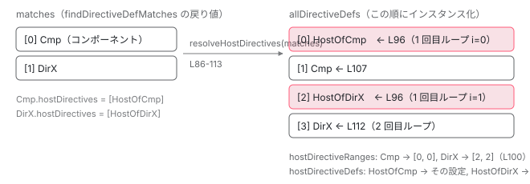

[目次](../README.md) › [standalone コンポーネントの内側](README.md) › 第 10 回 / 全 14 回

# hostDirectives が standalone 限定である理由：ɵɵHostDirectivesFeature と resolveHostDirectives

> hostDirectives は ɵɵHostDirectivesFeature で def に貼られ、セレクタ照合の後に resolveHostDirectives がマッチ結果へ割り込んで並び順（ホストのディレクティブ → ホスト本体）を決める。findHostDirectiveDefs の再帰、inputs / outputs の別名マップ、ngtsc の validateHostDirectives（NG2014）と実行時 validateHostDirective（NG0308）が standalone を要求する行。NgModule のスコープを経由しないから standalone でなければならない、を実物で示す。

angular/angular · 読了 約 14 分 · 発展 · [サイトで読む（デモが動きます）](https://angular-deep-dive-cyan.vercel.app/chapter/standalone-host-directives)

---

`hostDirectives` は「このディレクティブ（またはコンポーネント）が付いた要素に、別のディレクティブも一緒に付ける」ための設定です。ドキュメントには「standalone なディレクティブだけ指定できる」とあります。この章では、その設定がコンパイラでどう出力され、実行時にセレクタ照合の**あと**でどう割り込み、どの行が standalone を要求しているのかを 1 行ずつ確かめます。

読む対象は `packages/core/src/render3/features/host_directives_feature.ts`（実行時）、`packages/compiler/src/render3/view/compiler.ts`（出力）、`packages/compiler-cli/src/ngtsc/annotations/common/src/diagnostics.ts`（コンパイル時の検査）の 3 ファイルです。

1. [1. 概観](01-standalone.md)
2. [2. @Component 実行の瞬間（JIT）](02-standalone-decorator.md)
3. [3. imports の検証（AOT）](03-standalone-imports-check.md)
4. [4. 使った依存だけが残る](04-standalone-used-only.md)
5. [5. forwardRef と自己参照](05-standalone-forward-ref.md)
6. [6. ローカルコンパイル](06-standalone-local-compilation.md)
7. [7. 実行時の依存解決](07-standalone-directive-registry.md)
8. [8. providers の 2 つの行き先](08-standalone-providers-two-injectors.md)
9. [9. 入口の検査](09-standalone-entry-checks.md)
10. **10. hostDirectives**（この章）
11. [11. @defer と imports](11-standalone-defer-deps.md)
12. [12. TestBed の差し替え](12-standalone-testbed-override.md)
13. [13. selectorless（実験的）](13-standalone-selectorless.md)
14. [14. foreignImports（内部向け）](14-standalone-foreign-imports.md)

## 1. 書いたものと、出力されるもの

📄 `angular/packages/core/src/metadata/directives.ts` L347–364 （▶ の行: 348–350, 357, 360–362）

```ts
347 │   /**
348 ▶    * Standalone directives that should be applied to the host whenever the directive is matched.
349 ▶    * By default, none of the inputs or outputs of the host directives will be available on the host,
350 ▶    * unless they are specified in the `inputs` or `outputs` properties.
351 │    *
352 │    * You can additionally alias inputs and outputs by putting a colon and the alias after the
353 │    * original input or output name. For example, if a directive applied via `hostDirectives`
354 │    * defines an input named `menuDisabled`, you can alias this to `disabled` by adding
355 │    * `'menuDisabled: disabled'` as an entry to `inputs`.
356 │    */
357 ▶   hostDirectives?: (
358 │     | Type<unknown>
359 │     | {
360 ▶         directive: Type<unknown>;
361 ▶         inputs?: string[];
362 ▶         outputs?: string[];
363 │       }
364 │   )[];
```

348 行目、「**standalone な**ディレクティブを、このディレクティブが照合されたときホストに適用する」。349〜350 行目、ホストディレクティブの inputs / outputs は**既定では何も露出されず**、361〜362 行目の `inputs` / `outputs` に書いたものだけがホスト側の名前になります。形は 357〜363 行目のとおり、クラスそのものか `{ directive, inputs?, outputs? }` のどちらかです。

コンパイラのテスト用 fixture で、入力と出力を並べて見ます。

📄 `angular/packages/compiler-cli/test/compliance/test_cases/r3_view_compiler_directives/host_directives/host_directives_with_inputs_outputs.ts` L1–22 （▶ の行: 14–17）

```ts
 1 │ import {Component, Directive, EventEmitter, Input, Output} from '@angular/core';
 2 │ 
 3 │ @Directive({})
 4 │ export class HostDir {
 5 │   @Input() value = 0;
 6 │   @Input() color = '';
 7 │   @Output() opened = new EventEmitter();
 8 │   @Output() closed = new EventEmitter();
 9 │ }
10 │ 
11 │ @Component({
12 │     selector: 'my-component',
13 │     template: '',
14 ▶     hostDirectives: [{
15 ▶             directive: HostDir,
16 ▶             inputs: ['value', 'color: colorAlias'],
17 ▶             outputs: ['opened', 'closed: closedAlias'],
18 │         }],
19 │     standalone: false
20 │ })
21 │ export class MyComponent {
22 │ }
```

📄 `angular/packages/compiler-cli/test/compliance/test_cases/r3_view_compiler_directives/host_directives/host_directives_with_inputs_outputs_definition.js` L1–19 （▶ の行: 9–12）

```js
 1 │ export class MyComponent {
 2 │   // ...
 3 │   static ɵcmp = /*@__PURE__*/ $r3$.ɵɵdefineComponent({
 4 │     type: MyComponent,
 5 │     selectors: [
 6 │       ["my-component"]
 7 │     ],
 8 │     standalone: false,
 9 ▶     features: [$r3$.ɵɵHostDirectivesFeature([{
10 ▶       directive: HostDir,
11 ▶       inputs: ["value", "value", "color", "colorAlias"],
12 ▶       outputs: ["opened", "opened", "closed", "closedAlias"]
13 │     }])],
14 │     decls: 0,
15 │     vars: 0,
16 │     template: function MyComponent_Template(rf, ctx) {},
17 │     encapsulation: 2
18 │   });
19 │ }
```
*fixture の出力。2 行目の // ... は fixture 側の省略記号です。*

入力の 16 行目 `inputs: ['value', 'color: colorAlias']` が、出力の 11 行目では `inputs: ["value", "value", "color", "colorAlias"]` という**偶数長の平らな配列**になっています。別名が無い `value` も `"value", "value"` と 2 回書かれます。出力の 9 行目、`hostDirectives` は定義の直接のフィールドではなく、`features` に入った `ɵɵHostDirectivesFeature([...])` の呼び出しです。この「features の 1 つである」という点が、実行時の節で意味を持ちます。

### コンパイラがこの形を作る行

📄 `angular/packages/compiler/src/render3/view/compiler.ts` L118–136 （▶ の行: 125–127, 130–131, 134–135）

```ts
118 │   if (providers || viewProviders) {
119 │     const args = [providers || new o.LiteralArrayExpr([])];
120 │     if (viewProviders) {
121 │       args.push(viewProviders);
122 │     }
123 │     features.push(o.importExpr(R3.ProvidersFeature).callFn(args));
124 │   }
125 ▶   // Note: host directives feature needs to be inserted before the
126 ▶   // inheritance feature to ensure the correct execution order.
127 ▶   if (meta.hostDirectives?.length) {
128 │     features.push(
129 │       o
130 ▶         .importExpr(R3.HostDirectivesFeature)
131 ▶         .callFn([createHostDirectivesFeatureArg(meta.hostDirectives)]),
132 │     );
133 │   }
134 ▶   if (meta.usesInheritance) {
135 ▶     features.push(o.importExpr(R3.InheritDefinitionFeature));
136 │   }
```

127〜132 行目、`meta.hostDirectives` が 1 つでもあれば `R3.HostDirectivesFeature` の呼び出しを features に積みます。125〜126 行目のコメントどおり、**継承の feature（134〜135 行目）より前**に置かれます。features は定義時に配列順で実行されるので、親クラスから定義を継ぐ前に自分の hostDirectives が def に書かれる、という順番になります。

📄 `angular/packages/compiler/src/render3/view/compiler.ts` L687–720 （▶ の行: 689–690, 692, 695, 697, 708, 711–712, 718–720）

```ts
687 │   for (const current of hostDirectives) {
688 │     // Use a shorthand if there are no inputs or outputs.
689 ▶     if (!current.inputs && !current.outputs) {
690 ▶       expressions.push(current.directive.type);
691 │     } else {
692 ▶       const keys = [{key: 'directive', value: current.directive.type, quoted: false}];
693 │ 
694 │       if (current.inputs) {
695 ▶         const inputsLiteral = createHostDirectivesMappingArray(current.inputs);
696 │         if (inputsLiteral) {
697 ▶           keys.push({key: 'inputs', value: inputsLiteral, quoted: false});
698 │         }
699 │       }
700 │ 
701 │       if (current.outputs) {
702 │         const outputsLiteral = createHostDirectivesMappingArray(current.outputs);
703 │         if (outputsLiteral) {
704 │           keys.push({key: 'outputs', value: outputsLiteral, quoted: false});
705 │         }
706 │       }
707 │ 
708 ▶       expressions.push(o.literalMap(keys));
709 │     }
710 │ 
711 ▶     if (current.isForwardReference) {
712 ▶       hasForwardRef = true;
713 │     }
714 │   }
715 │ 
716 │   // If there's a forward reference, we generate a `function() { return [HostDir] }`,
717 │   // otherwise we can save some bytes by using a plain array, e.g. `[HostDir]`.
718 ▶   return hasForwardRef
719 ▶     ? new o.FunctionExpr([], [new o.ReturnStatement(o.literalArr(expressions))])
720 ▶     : o.literalArr(expressions);
```

689〜690 行目、inputs も outputs も無ければクラス参照そのもの（`DirectiveA`）を置きます。あれば 692〜708 行目でオブジェクトリテラルにします。711〜712 行目、どれか 1 つでも forwardRef（`isForwardReference`）なら `hasForwardRef` が立ち、718〜720 行目で**配列全体を `function () { return [...] }` で包みます**。そうでなければ素の配列です。

📄 `angular/packages/compiler-cli/test/compliance/test_cases/r3_view_compiler_directives/host_directives/forward_ref_host_directives_definition.js` L1–17 （▶ の行: 9–11）

```js
 1 │ export class MyComponent {
 2 │   …
 3 │   static ɵcmp = /*@__PURE__*/ $r3$.ɵɵdefineComponent({
 4 │     type: MyComponent,
 5 │     selectors: [
 6 │       ["my-component"]
 7 │     ],
 8 │       standalone: false,
 9 ▶       features: [$r3$.ɵɵHostDirectivesFeature(function () {
10 ▶       return [DirectiveB];
11 ▶     })],
12 │     decls: 0,
13 │     vars: 0,
14 │     template: function MyComponent_Template(rf, ctx) {},
15 │     encapsulation: 2
16 │   });
17 │ }
```
*forwardRef(() =&gt; DirectiveB) を書いた fixture の出力。… は fixture 側の省略記号です。*

9〜11 行目、`ɵɵHostDirectivesFeature(function () { return [DirectiveB]; })`。`DirectiveB` はこのファイルで後ろに宣言されているので、定義時に評価すると `undefined` になります。関数に包んで評価を遅らせるのは、[第 5 回](05-standalone-forward-ref.md)の `dependencies: () => [X]` と同じ理由です。

📄 `angular/packages/compiler/src/render3/view/compiler.ts` L723–744 （▶ の行: 729–730, 737–739）

```ts
723 │ /**
724 │  * Converts an input/output mapping object literal into an array where the even keys are the
725 │  * public name of the binding and the odd ones are the name it was aliased to. E.g.
726 │  * `{inputOne: 'aliasOne', inputTwo: 'aliasTwo'}` will become
727 │  * `['inputOne', 'aliasOne', 'inputTwo', 'aliasTwo']`.
728 │  *
729 ▶  * This conversion is necessary, because hosts bind to the public name of the host directive and
730 ▶  * keeping the mapping in an object literal will break for apps using property renaming.
731 │  */
732 │ export function createHostDirectivesMappingArray(
733 │   mapping: Record<string, string>,
734 │ ): o.LiteralArrayExpr | null {
735 │   const elements: o.LiteralExpr[] = [];
736 │ 
737 ▶   for (const publicName in mapping) {
738 ▶     if (Object.hasOwn(mapping, publicName)) {
739 ▶       elements.push(o.literal(publicName), o.literal(mapping[publicName]));
740 │     }
741 │   }
742 │ 
743 │   return elements.length > 0 ? o.literalArr(elements) : null;
744 │ }
```

737〜739 行目、`{ color: 'colorAlias' }` のようなオブジェクトを `["color", "colorAlias"]` に展開します。オブジェクトのままにしないのは、729〜730 行目のコメントにあるとおり、ホストは公開名で束縛するので、プロパティ名の短縮（minify）が入るアプリでオブジェクトのキーが壊れないようにするためです。

## 2. コンパイル時の検査：参照であること、standalone であること

ngtsc は `hostDirectives` の値を評価して、1 つずつ `HostDirectiveMeta` にします。

📄 `angular/packages/compiler-cli/src/ngtsc/annotations/directive/src/shared.ts` L2127–2147 （▶ の行: 2128, 2131–2133, 2140–2141）

```ts
2127 │   return resolved.map((value) => {
2128 ▶     const hostReference = value instanceof Map ? value.get('directive') : value;
2129 │ 
2130 │     // Diagnostics
2131 ▶     if (compilationMode !== CompilationMode.LOCAL) {
2132 ▶       if (!(hostReference instanceof Reference)) {
2133 ▶         throw createValueHasWrongTypeError(
2134 │           rawHostDirectives,
2135 │           hostReference,
2136 │           'Host directive must be a reference',
2137 │         );
2138 │       }
2139 │ 
2140 ▶       if (!isNamedClassDeclaration(hostReference.node)) {
2141 ▶         throw createValueHasWrongTypeError(
2142 │           rawHostDirectives,
2143 │           hostReference,
2144 │           'Host directive reference must be a class',
2145 │         );
2146 │       }
2147 │     }
```

📄 `angular/packages/compiler-cli/src/ngtsc/annotations/directive/src/shared.ts` L2171–2183 （▶ の行: 2171–2172, 2181–2183）

```ts
2171 ▶     } else if (hostReference instanceof Reference) {
2172 ▶       directive = hostReference as Reference<ClassDeclaration>;
2173 │       nameForErrors = (fieldName: string) =>
2174 │         `@Directive.hostDirectives.${
2175 │           (directive as Reference<ClassDeclaration>).node.name.text
2176 │         }.${fieldName}`;
2177 │     } else {
2178 │       throw new Error('Impossible state');
2179 │     }
2180 │ 
2181 ▶     const meta: HostDirectiveMeta = {
2182 ▶       directive,
2183 ▶       isForwardReference: hostReference instanceof Reference && hostReference.synthetic,
```

2128 行目、オブジェクト形なら `directive` キーの値を、クラス形ならそのまま `hostReference` とします。2131〜2138 行目、全体コンパイル（`LOCAL` 以外）では**それが `Reference`（クラス宣言への参照）でなければエラー**です。2140〜2146 行目、名前付きクラス宣言でなければエラー。2172 行目で `Reference` をそのまま `directive` に入れ、2183 行目で `synthetic`（forwardRef の中から取り出した参照）なら `isForwardReference` を立てます。1 節 711 行目の判定はここから来ています。

集めた `HostDirectiveMeta` は、resolve 段階で `validateHostDirectives` に渡されます。コンポーネント側の呼び出しはこれです（`@Directive` の handler にも同じ呼び出しがあります）。

📄 `angular/packages/compiler-cli/src/ngtsc/annotations/component/src/handler.ts` L2305–2316 （▶ の行: 2306–2307, 2310）

```ts
2305 │     const hostDirectivesDiagnostics =
2306 ▶       analysis.hostDirectives && analysis.rawHostDirectives
2307 ▶         ? validateHostDirectives(
2308 │             analysis.rawHostDirectives,
2309 │             analysis.hostDirectives,
2310 ▶             this.metaReader,
2311 │           )
2312 │         : null;
2313 │     if (hostDirectivesDiagnostics !== null) {
2314 │       diagnostics ??= [];
2315 │       diagnostics.push(...hostDirectivesDiagnostics);
2316 │     }
```

📄 `angular/packages/compiler-cli/src/ngtsc/annotations/common/src/diagnostics.ts` L211–247 （▶ の行: 216, 218, 221, 223, 229, 232, 234, 239, 242, 244）

```ts
211 │   for (const current of hostDirectives) {
212 │     if (!isHostDirectiveMetaForGlobalMode(current)) {
213 │       throw new Error('Impossible state: diagnostics code path for local compilation');
214 │     }
215 │ 
216 ▶     const hostMeta = flattenInheritedDirectiveMetadata(metaReader, current.directive);
217 │ 
218 ▶     if (hostMeta === null) {
219 │       diagnostics.push(
220 │         makeDiagnostic(
221 ▶           ErrorCode.HOST_DIRECTIVE_INVALID,
222 │           current.directive.getOriginForDiagnostics(origin),
223 ▶           `${current.directive.debugName} must be a standalone directive to be used as a host directive`,
224 │         ),
225 │       );
226 │       continue;
227 │     }
228 │ 
229 ▶     if (!hostMeta.isStandalone) {
230 │       diagnostics.push(
231 │         makeDiagnostic(
232 ▶           ErrorCode.HOST_DIRECTIVE_NOT_STANDALONE,
233 │           current.directive.getOriginForDiagnostics(origin),
234 ▶           `Host directive ${hostMeta.name} must be standalone`,
235 │         ),
236 │       );
237 │     }
238 │ 
239 ▶     if (hostMeta.isComponent) {
240 │       diagnostics.push(
241 │         makeDiagnostic(
242 ▶           ErrorCode.HOST_DIRECTIVE_COMPONENT,
243 │           current.directive.getOriginForDiagnostics(origin),
244 ▶           `Host directive ${hostMeta.name} cannot be a component`,
245 │         ),
246 │       );
247 │     }
```

216 行目、`flattenInheritedDirectiveMetadata(metaReader, current.directive)`。**`MetadataReader` に参照を渡してメタデータを直接取ります**。NgModule の宣言リストやコンパイルスコープ（[NgModule シリーズ](../ngmodule/04-ngmodule-compilation-scope.md)）はここに出てきません。

1. **218〜227 行目：メタデータが取れない → NG2013**

   `hostMeta === null`、つまり参照先が `@Directive` / `@Component` ではないとき。メッセージは 223 行目「must be a standalone directive to be used as a host directive」です。
2. **229〜237 行目：standalone でない → NG2014**

   `!hostMeta.isStandalone` なら 232 行目 `HOST_DIRECTIVE_NOT_STANDALONE`。メッセージは 234 行目「Host directive X must be standalone」。
3. **239〜247 行目：コンポーネントだった → NG2015**

   `hostMeta.isComponent` なら 242 行目 `HOST_DIRECTIVE_COMPONENT`。コンポーネントはテンプレートと DOM 上の位置を持つので、別のホストに「同居」できません。

📄 `angular/packages/compiler-cli/src/ngtsc/annotations/common/src/diagnostics.ts` L249–262 （▶ の行: 249–251, 253, 259）

```ts
249 ▶     const requiredInputNames = Array.from(hostMeta.inputs)
250 ▶       .filter((input) => input.required)
251 ▶       .map((input) => input.classPropertyName);
252 │ 
253 ▶     validateHostDirectiveMappings(
254 │       'input',
255 │       current,
256 │       hostMeta,
257 │       origin,
258 │       diagnostics,
259 ▶       requiredInputNames.length > 0 ? new Set(requiredInputNames) : null,
260 │     );
261 │     validateHostDirectiveMappings('output', current, hostMeta, origin, diagnostics, null);
262 │   }
```

249〜251 行目、ホストディレクティブの `required` な input の名前を集め、259 行目で `validateHostDirectiveMappings` に渡します。必須 input をホストが `inputs` で露出していなければ NG2019（`HOST_DIRECTIVE_MISSING_REQUIRED_BINDING`）です。露出しないと誰も値を渡せなくなるからです。

📄 `angular/packages/compiler-cli/src/ngtsc/diagnostics/src/error_code.ts` L114–128 （▶ の行: 117, 122, 127）

```ts
114 │   /**
115 │    * Raised when the compiler wasn't able to resolve the metadata of a host directive.
116 │    */
117 ▶   HOST_DIRECTIVE_INVALID = 2013,
118 │ 
119 │   /**
120 │    * Raised when a host directive isn't standalone.
121 │    */
122 ▶   HOST_DIRECTIVE_NOT_STANDALONE = 2014,
123 │ 
124 │   /**
125 │    * Raised when a host directive is a component.
126 │    */
127 ▶   HOST_DIRECTIVE_COMPONENT = 2015,
128 │ 
```

## 3. 実行時：feature が def に 2 つ貼る

📄 `angular/packages/core/src/render3/features/host_directives_feature.ts` L44–63 （▶ の行: 45, 48, 50–54, 56, 58, 61）

```ts
44 │ export function ɵɵHostDirectivesFeature(
45 ▶   rawHostDirectives: HostDirectiveConfig[] | (() => HostDirectiveConfig[]),
46 │ ) {
47 │   const feature: DirectiveDefFeature = (definition: DirectiveDef<unknown>) => {
48 ▶     const isEager = Array.isArray(rawHostDirectives);
49 │ 
50 ▶     if (definition.hostDirectives === null) {
51 ▶       definition.resolveHostDirectives = resolveHostDirectives;
52 ▶       definition.hostDirectives = isEager
53 ▶         ? rawHostDirectives.map(createHostDirectiveDef)
54 ▶         : [rawHostDirectives];
55 │     } else if (isEager) {
56 ▶       definition.hostDirectives.unshift(...rawHostDirectives.map(createHostDirectiveDef));
57 │     } else {
58 ▶       definition.hostDirectives.unshift(rawHostDirectives);
59 │     }
60 │   };
61 ▶   feature.ngInherit = true;
62 │   return feature;
63 │ }
```

45 行目、引数は配列か「配列を返す関数」。1 節 718〜720 行目の 2 通りの出力に対応します。48 行目で配列かどうかを `isEager` に取ります。

1. **51 行目：`definition.resolveHostDirectives = resolveHostDirectives`**

   def に**関数を 1 つ貼ります**。この関数は 4 節で、セレクタ照合の直後に呼ばれます。全 def で同じ関数です（この feature が貼るのは「印」と「データ」で、ロジックはモジュール内の関数にあります）。
2. **52〜54 行目：`definition.hostDirectives` にデータを貼る**

   配列なら今ここで `createHostDirectiveDef`（5 節）に通して正規化します。関数なら**呼ばずに**そのまま配列に 1 要素として入れます。forwardRef を今評価すると `undefined` だからです。
3. **56・58 行目：既に hostDirectives があれば先頭に足す**

   `unshift` です。61 行目 `ngInherit = true` により、この feature は `ɵɵInheritDefinitionFeature` が親 def から子へ引き継ぎます。1 節で「継承 feature より前に置く」と確認しました。この順で実行されると、まず自分の分が 52〜54 行目で入り、そのあと継承 feature が親の分をこの feature 経由で 56・58 行目の `unshift` で前に足します。

📄 `angular/packages/core/src/render3/interfaces/definition.ts` L246–263 （▶ の行: 251, 256–258, 263）

```ts
246 │   /**
247 │    * Function inteded to be called after template selector matching is done
248 │    * in order to resolve information about their host directives. Patched
249 │    * onto the definition by the `ɵɵHostDirectivesFeature`.
250 │    */
251 ▶   resolveHostDirectives: ((matches: DirectiveDef<unknown>[]) => HostDirectiveResolution) | null;
252 │ 
253 │   /**
254 │    * Additional directives to be applied whenever the directive has been matched.
255 │    *
256 ▶    * `HostDirectiveConfig` objects represent a host directive that can be resolved eagerly and were
257 ▶    * already pre-processed when the definition was created. A function needs to be resolved lazily
258 ▶    * during directive matching, because it's a forward reference.
259 │    *
260 │    * **Note:** we can't use `HostDirectiveConfig` in the array, because there's no way to
261 │    * distinguish if a function in the array is a `Type` or a `() => HostDirectiveConfig[]`.
262 │    */
263 ▶   hostDirectives: (HostDirectiveDef | (() => HostDirectiveConfig[]))[] | null;
```

251 行目と 263 行目が、貼られる 2 つのフィールドの型です。256〜258 行目のコメント、「オブジェクトは定義時に前処理済み。関数は forwardRef なので照合時に遅延解決する」。どちらも feature を使わなければ `null` です。

## 4. セレクタ照合の直後に割り込む

[第 7 回](07-standalone-directive-registry.md)で、`findDirectiveDefMatches` が `tView.directiveRegistry` からセレクタの合う def を集めるところを読みました。その戻り値 `matchedDirectiveDefs` を受け取る場所がここです。

📄 `angular/packages/core/src/render3/view/directives.ts` L69–82 （▶ の行: 69, 76–80）

```ts
69 ▶   const matchedDirectiveDefs = directiveMatcher(tView, tNode);
70 │ 
71 │   if (matchedDirectiveDefs !== null) {
72 │     let directiveDefs = matchedDirectiveDefs;
73 │     let hostDirectiveDefs: HostDirectiveDefs | null = null;
74 │     let hostDirectiveRanges: HostDirectiveRanges | null = null;
75 │ 
76 ▶     for (const def of matchedDirectiveDefs) {
77 ▶       if (def.resolveHostDirectives !== null) {
78 ▶         [directiveDefs, hostDirectiveDefs, hostDirectiveRanges] =
79 ▶           def.resolveHostDirectives(matchedDirectiveDefs);
80 ▶         break;
81 │       }
82 │     }
```

69 行目で照合結果を受け取り、76〜82 行目で**その中に `resolveHostDirectives !== null` の def が 1 つでもあれば**、その関数に照合結果**全体**を渡して、並び替えた配列・ホストディレクティブの Map・範囲の Map の 3 つに置き換えます（80 行目で `break`、1 回だけ）。1 つも無ければ照合結果がそのまま `directiveDefs` です。

📄 `angular/packages/core/src/render3/features/host_directives_feature.ts` L70–109 （▶ の行: 70, 76–77, 80–86, 89–90, 96, 100, 105–107）

```ts
 70 ▶ function resolveHostDirectives(matches: DirectiveDef<unknown>[]): HostDirectiveResolution {
 71 │   const allDirectiveDefs: DirectiveDef<unknown>[] = [];
 72 │   let hasComponent = false;
 73 │   let hostDirectiveDefs: HostDirectiveDefs | null = null;
 74 │   let hostDirectiveRanges: HostDirectiveRanges | null = null;
 75 │ 
 76 ▶   // Components are inserted at the front of the matches array so that their lifecycle
 77 ▶   // hooks run before any directive lifecycle hooks. This appears to be for ViewEngine
 78 │   // compatibility. This logic doesn't make sense with host directives, because it
 79 │   // would allow the host directives to undo any overrides the host may have made.
 80 ▶   // To handle this case, the host directives of components are inserted at the beginning
 81 ▶   // of the array, followed by the component. As such, the insertion order is as follows:
 82 ▶   // 1. Host directives belonging to the selector-matched component.
 83 ▶   // 2. Selector-matched component.
 84 ▶   // 3. Host directives belonging to selector-matched directives.
 85 ▶   // 4. Selector-matched dir
 86 ▶   for (let i = 0; i < matches.length; i++) {
 87 │     const def = matches[i];
 88 │ 
 89 ▶     if (def.hostDirectives !== null) {
 90 ▶       const start = allDirectiveDefs.length;
 91 │ 
 92 │       hostDirectiveDefs ??= new Map();
 93 │       hostDirectiveRanges ??= new Map();
 94 │ 
 95 │       // TODO(pk): probably could return matches instead of taking in an array to fill in?
 96 ▶       findHostDirectiveDefs(def, allDirectiveDefs, hostDirectiveDefs, matches);
 97 │ 
 98 │       // Note that these indexes are within the offset by `directiveStart`. We can't do the
 99 │       // offsetting here, because `directiveStart` hasn't been initialized on the TNode yet.
100 ▶       hostDirectiveRanges.set(def, [start, allDirectiveDefs.length - 1]);
101 │     }
102 │ 
103 │     // Component definition is always first and needs to be
104 │     // pushed early to maintain the correct ordering.
105 ▶     if (i === 0 && isComponentDef(def)) {
106 ▶       hasComponent = true;
107 ▶       allDirectiveDefs.push(def);
108 │     }
109 │   }
```

70 行目、引数は `matches` だけです。`tView` も `directiveRegistry` も渡されません。76〜85 行目のコメントが並び順の仕様です。

1. **76〜79 行目：なぜコンポーネントが先頭なのか**

   `findDirectiveDefMatches` はコンポーネントの def を配列の先頭に置きます（第 7 回）。これは「コンポーネントのフックがディレクティブのフックより先に走る」という ViewEngine 互換のためです。しかしホストディレクティブは「ホストが上書きできる土台」として先に走る必要があるので、この順ではホスト側の上書きをホストディレクティブが戻してしまいます。
2. **80〜85 行目：決めた順**

   1. セレクタで照合されたコンポーネントのホストディレクティブ → 2. そのコンポーネント → 3. 照合されたディレクティブ群のホストディレクティブ → 4. 照合されたディレクティブ群。
3. **86〜109 行目：1 回目のループ**

   89 行目、`def.hostDirectives !== null` の def だけ処理します。96 行目で `findHostDirectiveDefs`（5 節）がその def のホストディレクティブ def を `allDirectiveDefs` に push し、100 行目でその範囲（開始・終了インデックス）を `hostDirectiveRanges` に記録します。105〜108 行目、`i === 0` がコンポーネントなら、**自分のホストディレクティブの直後に**自分を push します。これで順の 1 と 2 ができます。ディレクティブ（`i >= 1`）はホストディレクティブだけ push され、本体はまだです。

📄 `angular/packages/core/src/render3/features/host_directives_feature.ts` L111–124 （▶ の行: 111–112, 117–119, 123）

```ts
111 ▶   for (let i = hasComponent ? 1 : 0; i < matches.length; i++) {
112 ▶     allDirectiveDefs.push(matches[i]);
113 │   }
114 │ 
115 │   // We need to patch the `declaredInputs` so that `ngOnChanges` can map the properties correctly.
116 │   // Note that we do this at the end so that all host directive inputs have been merged.
117 ▶   if (hostDirectiveDefs !== null) {
118 ▶     hostDirectiveDefs.forEach((def, hostDirectiveDef) => {
119 ▶       patchDeclaredInputs(hostDirectiveDef.declaredInputs, def.inputs);
120 │     });
121 │   }
122 │ 
123 ▶   return [allDirectiveDefs, hostDirectiveDefs, hostDirectiveRanges];
124 │ }
```

1. **111〜113 行目：2 回目のループ**

   コンポーネントがあれば 1 から、無ければ 0 から、照合されたディレクティブ本体を順に push します。順の 4 です。
2. **117〜120 行目：`declaredInputs` を補正**

   `ngOnChanges` の `SimpleChanges` のキーは「宣言名」です。別名で露出した input が書き込まれたとき宣言名に戻せるよう、`patchDeclaredInputs` で別名 → 宣言名の対応を `declaredInputs` に足します。
3. **123 行目：3 つ組を返す**

   `[allDirectiveDefs, hostDirectiveDefs, hostDirectiveRanges]`。4 節冒頭の 78〜79 行目で分解代入され、`initializeDirectives`（[ivy のディレクティブ生成](../ivy/14-ivy-directives.md)）に渡ります。インスタンスは**この配列の順に**作られ、フックもこの順に登録されます。



*findDirectiveDefMatches の結果（左）を resolveHostDirectives が並べ直す（右）。tView.directiveRegistry は右側の処理に関与しない。*

## 5. 参照から def を取る：findHostDirectiveDefs と trackHostDirectiveDef

📄 `angular/packages/core/src/render3/features/host_directives_feature.ts` L126–149 （▶ の行: 128, 130–135, 142）

```ts
126 │ function findHostDirectiveDefs(
127 │   currentDef: DirectiveDef<unknown>,
128 ▶   matchedDefs: DirectiveDef<unknown>[],
129 │   hostDirectiveDefs: HostDirectiveDefs,
130 ▶   templateMatches: readonly DirectiveDef<unknown>[],
131 ▶ ): void {
132 ▶   if (currentDef.hostDirectives !== null) {
133 ▶     for (const configOrFn of currentDef.hostDirectives) {
134 ▶       if (typeof configOrFn === 'function') {
135 ▶         const resolved = configOrFn();
136 │         for (const config of resolved) {
137 │           trackHostDirectiveDef(
138 │             createHostDirectiveDef(config),
139 │             matchedDefs,
140 │             hostDirectiveDefs,
141 │             templateMatches,
142 ▶           );
143 │         }
144 │       } else {
145 │         trackHostDirectiveDef(configOrFn, matchedDefs, hostDirectiveDefs, templateMatches);
146 │       }
147 │     }
148 │   }
149 │ }
```

128 行目、`currentDef.hostDirectives`（3 節で貼ったデータ）を 1 要素ずつ見ます。130〜131 行目、要素が関数（forwardRef を包んだもの）なら**今ここで**呼んで配列にし、133〜134 行目で各要素を `createHostDirectiveDef` で正規化してから `trackHostDirectiveDef` に渡します。142 行目、オブジェクトなら正規化済みなのでそのまま渡します。つまり forwardRef の評価は「最初にその要素が照合された瞬間」まで遅れます。

📄 `angular/packages/core/src/render3/features/host_directives_feature.ts` L152–175 （▶ の行: 158, 160–161, 164–169, 171–173）

```ts
152 │ function trackHostDirectiveDef(
153 │   def: HostDirectiveDef,
154 │   finalMatches: DirectiveDef<unknown>[],
155 │   hostDirectiveDefs: HostDirectiveDefs,
156 │   templateMatches: readonly DirectiveDef<unknown>[],
157 │ ) {
158 ▶   const hostDirectiveDef = getDirectiveDef(def.directive)!;
159 │ 
160 ▶   if (typeof ngDevMode === 'undefined' || ngDevMode) {
161 ▶     validateHostDirective(def, hostDirectiveDef);
162 │   }
163 │ 
164 ▶   // Host directives execute before the host so that its host bindings can be overwritten.
165 ▶   findHostDirectiveDefs(hostDirectiveDef, finalMatches, hostDirectiveDefs, templateMatches);
166 ▶ 
167 ▶   if (hostDirectiveDefs.has(hostDirectiveDef)) {
168 ▶     const existing = hostDirectiveDefs.get(hostDirectiveDef)!;
169 ▶     mergeBindingMaps(existing, def.inputs, 'input');
170 │     mergeBindingMaps(existing, def.outputs, 'output');
171 ▶   } else if (!templateMatches.includes(hostDirectiveDef)) {
172 ▶     hostDirectiveDefs.set(hostDirectiveDef, def);
173 ▶     finalMatches.push(hostDirectiveDef);
174 │   }
175 │ }
```

1. **158 行目：`getDirectiveDef(def.directive)`**

   設定に書かれた**クラスの参照**から `ɵdir` を読みます。`tView.directiveRegistry` も、コンポーネントの `dependencies` も見ていません。`def.directive` が指すクラスに `ɵdir` があるかどうか、それだけです。
2. **160〜162 行目：開発モードで検査**

   `validateHostDirective`（6 節）。production ビルドでは呼ばれません。
3. **164〜165 行目：先に再帰**

   ホストディレクティブ自身が `hostDirectives` を持っていれば、**自分を push する前に**その分を処理します。コメントどおり「ホストディレクティブはホストより先に実行される。ホストが host binding を上書きできるように」。鎖になっていても、末端から順に並びます。
4. **167〜170 行目：同じディレクティブが 2 回来たら Map を併合**

   既に `hostDirectiveDefs` にあれば push せず、inputs / outputs の別名 Map だけ `mergeBindingMaps` で併合します。同じ公開名に違う別名が付いていれば NG0312（`HOST_DIRECTIVE_CONFLICTING_ALIAS`）です。
5. **171〜174 行目：テンプレート側で照合済みなら push しない**

   `templateMatches.includes(hostDirectiveDef)`。同じディレクティブが要素の属性セレクタでも照合されていたら、インスタンスは 1 つで十分なので足しません。そうでなければ Map に登録して `finalMatches` に push します。

📄 `angular/packages/core/src/render3/features/host_directives_feature.ts` L200–209 （▶ の行: 202–203, 205–207）

```ts
200 │ /** Creates a `HostDirectiveDef` from a used-defined host directive configuration. */
201 │ function createHostDirectiveDef(config: HostDirectiveConfig): HostDirectiveDef {
202 ▶   return typeof config === 'function'
203 ▶     ? {directive: resolveForwardRef(config), inputs: {}, outputs: {}}
204 │     : {
205 ▶         directive: resolveForwardRef(config.directive),
206 ▶         inputs: bindingArrayToMap(config.inputs),
207 ▶         outputs: bindingArrayToMap(config.outputs),
208 │       };
209 │ }
```

202〜203 行目、クラス参照だけなら `{ directive, inputs: {}, outputs: {} }`。205〜207 行目、オブジェクトなら `resolveForwardRef` を通し、1 節の平らな配列 `["color", "colorAlias"]` を `bindingArrayToMap` で `{ color: "colorAlias" }` に戻します。デモで `ɵcmp.hostDirectives` を覗くと、この形で入っています。

## 6. 実行時の検査：307 / 310 / 308

📄 `angular/packages/core/src/render3/features/host_directives_feature.ts` L280–310 （▶ の行: 286–290, 294–297, 301–304, 308–309）

```ts
280 │ function validateHostDirective(
281 │   hostDirectiveConfig: HostDirectiveDef<unknown>,
282 │   directiveDef: DirectiveDef<any> | null,
283 │ ): asserts directiveDef is DirectiveDef<unknown> {
284 │   const type = hostDirectiveConfig.directive;
285 │ 
286 ▶   if (directiveDef === null) {
287 ▶     if (getComponentDef(type) !== null) {
288 ▶       throw new RuntimeError(
289 ▶         RuntimeErrorCode.HOST_DIRECTIVE_COMPONENT,
290 ▶         `Host directive ${type.name} cannot be a component.`,
291 │       );
292 │     }
293 │ 
294 ▶     throw new RuntimeError(
295 ▶       RuntimeErrorCode.HOST_DIRECTIVE_UNRESOLVABLE,
296 ▶       `Could not resolve metadata for host directive ${type.name}. ` +
297 ▶         `Make sure that the ${type.name} class is annotated with an @Directive decorator.`,
298 │     );
299 │   }
300 │ 
301 ▶   if (!directiveDef.standalone) {
302 ▶     throw new RuntimeError(
303 ▶       RuntimeErrorCode.HOST_DIRECTIVE_NOT_STANDALONE,
304 ▶       `Host directive ${directiveDef.type.name} must be standalone.`,
305 │     );
306 │   }
307 │ 
308 ▶   validateMappings('input', directiveDef, hostDirectiveConfig.inputs);
309 ▶   validateMappings('output', directiveDef, hostDirectiveConfig.outputs);
310 │ }
```

1. **286〜292 行目：`ɵdir` が無く `ɵcmp` がある → NG0310**

   `getDirectiveDef` はコンポーネントに対して `null` を返します（`ɵcmp` と `ɵdir` は別のプロパティ）。そこで `getComponentDef(type)` を試し、取れたら「Host directive X cannot be a component」です。
2. **294〜299 行目：どちらも無い → NG0307**

   デコレータが付いていないクラスなど。「Make sure that the X class is annotated with an @Directive decorator」。
3. **301〜306 行目：`!directiveDef.standalone` → NG0308**

   「Host directive X must be standalone」。`standalone` は `ɵɵdefineDirective` が def に書くフラグで、v22 では既定 `true`、`standalone: false` と書いたときだけ `false` です（[第 1 回](01-standalone.md)）。
4. **308〜309 行目：inputs / outputs の名前を検査**

   次の `validateMappings` です。

📄 `angular/packages/core/src/errors.ts` L50–64 （▶ の行: 58–59, 61–63）

```ts
50 │   // Template Errors
51 │   MULTIPLE_COMPONENTS_MATCH = -300,
52 │   EXPORT_NOT_FOUND = -301,
53 │   PIPE_NOT_FOUND = -302,
54 │   UNKNOWN_BINDING = 303,
55 │   UNKNOWN_ELEMENT = 304,
56 │   TEMPLATE_STRUCTURE_ERROR = 305,
57 │   INVALID_EVENT_BINDING = 306,
58 ▶   HOST_DIRECTIVE_UNRESOLVABLE = 307,
59 ▶   HOST_DIRECTIVE_NOT_STANDALONE = 308,
60 │   DUPLICATE_DIRECTIVE = 309,
61 ▶   HOST_DIRECTIVE_COMPONENT = 310,
62 ▶   HOST_DIRECTIVE_UNDEFINED_BINDING = 311,
63 ▶   HOST_DIRECTIVE_CONFLICTING_ALIAS = 312,
64 │   MULTIPLE_MATCHING_PIPES = 313,
```

📄 `angular/packages/core/src/render3/features/host_directives_feature.ts` L318–345 （▶ の行: 323, 326–328, 334, 336–338）

```ts
318 │ function validateMappings<T>(
319 │   bindingType: 'input' | 'output',
320 │   def: DirectiveDef<T>,
321 │   hostDirectiveBindings: HostDirectiveBindingMap,
322 │ ) {
323 ▶   const className = def.type.name;
324 │   const bindings = bindingType === 'input' ? def.inputs : def.outputs;
325 │ 
326 ▶   for (const publicName in hostDirectiveBindings) {
327 ▶     if (Object.hasOwn(hostDirectiveBindings, publicName)) {
328 ▶       if (!Object.hasOwn(bindings, publicName)) {
329 │         throw new RuntimeError(
330 │           RuntimeErrorCode.HOST_DIRECTIVE_UNDEFINED_BINDING,
331 │           `Directive ${className} does not have an ${bindingType} with a public name of ${publicName}.`,
332 │         );
333 │       }
334 ▶ 
335 │       const remappedPublicName = hostDirectiveBindings[publicName];
336 ▶ 
337 ▶       if (Object.hasOwn(bindings, remappedPublicName) && remappedPublicName !== publicName) {
338 ▶         throw new RuntimeError(
339 │           RuntimeErrorCode.HOST_DIRECTIVE_CONFLICTING_ALIAS,
340 │           `Cannot alias ${bindingType} ${publicName} of host directive ${className} to ${remappedPublicName}, because it already has a different ${bindingType} with the same public name.`,
341 │         );
342 │       }
343 │     }
344 │   }
345 │ }
```

323 行目、照合対象は**ホストディレクティブ自身の `def.inputs` / `def.outputs`**です。327〜328 行目、露出しようとした公開名がそこに無ければ NG0311（「does not have an input with a public name of X」）。336〜338 行目、別名が**別の既存 input の公開名**と衝突していれば NG0312 です。ここで見ている `def.inputs` のキーは公開名なので、`@Input('alias') foo` なら `'alias'` を書く必要があります。

## 7. 露出した inputs / outputs は誰が配線するか

📄 `angular/packages/core/src/render3/view/directives.ts` L252–273 （▶ の行: 259–260, 262–264, 267–269）

```ts
252 │ function initializeInputAndOutputAliases(
253 │   tView: TView,
254 │   tNode: TNode,
255 │   hostDirectiveDefs: HostDirectiveDefs | null,
256 │ ): void {
257 │   ngDevMode && assertFirstCreatePass(tView);
258 │ 
259 ▶   for (let index = tNode.directiveStart; index < tNode.directiveEnd; index++) {
260 ▶     const directiveDef = tView.data[index] as DirectiveDef<any>;
261 │ 
262 ▶     if (hostDirectiveDefs === null || !hostDirectiveDefs.has(directiveDef)) {
263 ▶       setupSelectorMatchedInputsOrOutputs(BindingType.Inputs, tNode, directiveDef, index);
264 ▶       setupSelectorMatchedInputsOrOutputs(BindingType.Outputs, tNode, directiveDef, index);
265 │       setupInitialInputs(tNode, index, false);
266 │     } else {
267 ▶       const hostDirectiveDef = hostDirectiveDefs.get(directiveDef)!;
268 ▶       setupHostDirectiveInputsOrOutputs(BindingType.Inputs, tNode, hostDirectiveDef, index);
269 ▶       setupHostDirectiveInputsOrOutputs(BindingType.Outputs, tNode, hostDirectiveDef, index);
270 │       setupInitialInputs(tNode, index, true);
271 │     }
272 │   }
273 │ }
```

259〜260 行目、ノードに付いた全 def を順に見ます。262〜264 行目、`hostDirectiveDefs` に**入っていない** def（セレクタで照合されたもの）は、自分の `def.inputs` 全部をノードの入力表に登録します。267〜269 行目、**入っている** def（ホストディレクティブ）は `hostDirectiveDef.inputs`、つまり 5 節で作った `{ color: "colorAlias" }` の**中にある名前だけ**を、別名のほうで登録します。1 節 349〜350 行目の「既定では何も露出されない」は、この分岐の結果です。

## 8. なぜ standalone 限定なのか：コードの事実を並べる

ここまでに読んだ行から、理由を「推測」ではなく「書かれていること」として並べます。

| 事実 | 場所 |
| --- | --- |
| `resolveHostDirectives` は `matches` だけを受け取り、`tView` も `directiveRegistry` も受け取らない | host\_directives\_feature.ts 70 行目 |
| ホストディレクティブの def は `getDirectiveDef(def.directive)`、つまり設定に書いた**クラス参照**から直接取る | host\_directives\_feature.ts 158 行目 |
| その def の `standalone` が `false` なら実行時に NG0308 を投げる | host\_directives\_feature.ts 301〜306 行目 |
| コンパイル時も `MetadataReader` に参照を渡して取り、`isStandalone` でなければ NG2014 | diagnostics.ts 216・229〜237 行目 |
| standalone でないディレクティブは NgModule の declarations を通してスコープに入り、コンポーネントの `dependencies` は `null`（NgModule 側が `directiveDefs` を貼る） | [NgModule シリーズ](../ngmodule/13-ngmodule-standalone-imports.md)・[第 1 回](01-standalone.md) |

まとめると、hostDirectives の解決経路は **NgModule のスコープ（`directiveRegistry`）を一切通らず、クラス参照だけで def を取ります**。その経路で許されるのは、スコープに依存せず自分だけで完結する def、つまり `standalone` な def です。コンパイル時（NG2014）と実行時（NG0308）の両方が、まさにそのフラグを見て弾いています。

> [!NOTE]
> **ポイント**
>
> 「ホスト**側**（`hostDirectives` を書く側）は standalone でなくてもよい」ことも fixture が示しています。1 節の fixture は `standalone: false` のコンポーネントに `hostDirectives` を書いていて、そのまま出力されています。standalone が要求されるのは**参照される側**だけです。

> **🧪 DEMO — ɵcmp.hostDirectives の中身と、フックの順番**
>
> この章の中に、`DataTagDirective`（ホスト要素に `data-tag` 属性を付けるだけの standalone ディレクティブ）を `hostDirectives: [{ directive: DataTagDirective, inputs: ['tag: label'] }]` として持つ `<app-hd-child>` を置いています。
>
> AOT の出力 `inputs: ["tag", "label"]` が、`createHostDirectiveDef`（205〜207 行目）で `{ "tag": "label" }` になっています。
>
> `<app-hd-child>` には `label` という input は無く、`DataTagDirective` の `tag` が 7 節 267〜269 行目の分岐で別名登録されています。`ngOnInit` はホストディレクティブが先、コンポーネントが後です（4 節の順 1 → 2）。子コンポーネントの中で `inject(DataTagDirective)` が通るのは、同じノードのインジェクタに両方のインスタンスが並ぶからです。
>
> ▶ [このデモはサイトで動かせます](https://angular-deep-dive-cyan.vercel.app/chapter/standalone-host-directives)

## ここまでの呼び出し

- 👤 `@Component({ hostDirectives: [{ directive: HostDir, inputs: ['a: b'] }] })` — あなたのコード
  - `extractHostDirectives()` — compiler-cli/.../directive/src/shared.ts L2110 — *Reference でなければエラー。synthetic なら isForwardReference*
  - `validateHostDirectives()` — compiler-cli/.../common/src/diagnostics.ts L204 — *NG2013 / NG2014 / NG2015、必須 input の露出*
  - `addFeatures() → createHostDirectivesFeatureArg()` — compiler/src/render3/view/compiler.ts L127 / L681 — *features に ɵɵHostDirectivesFeature(\[...\]) を出力。forwardRef なら function で包む*
- `ɵɵdefineComponent({ features: [ɵɵHostDirectivesFeature(...)] })` — 実行時、クラス定義の評価
  - `feature(definition)` — host\_directives\_feature.ts L47 — *def.resolveHostDirectives と def.hostDirectives を貼る*
- `ɵɵelementStart → resolveDirectives()` — core/src/render3/view/directives.ts L58 — *firstCreatePass のみ*
  - `directiveMatcher(tView, tNode)` — = findDirectiveDefMatches — *directiveRegistry からセレクタ照合（第 7 回）*
  - `def.resolveHostDirectives(matchedDirectiveDefs)` — host\_directives\_feature.ts L70 — *matches だけを受け取る*
    - `findHostDirectiveDefs(def, ...)` — L126 — *関数なら今呼ぶ（forwardRef）*
      - `trackHostDirectiveDef(def, ...)` — L152 — *getDirectiveDef(def.directive) で参照から def を取る*
        - `validateHostDirective()` — L280 — *ngDevMode: 310 / 307 / 308、validateMappings*
        - `findHostDirectiveDefs(hostDirectiveDef, ...)` — L164 — *鎖があれば先に再帰*
  - `initializeDirectives(..., directiveDefs, exportsMap, hostDirectiveDefs, hostDirectiveRanges)` — directives.ts L86 — *並べ直した順にインスタンス化（ivy-directives）*
    - `initializeInputAndOutputAliases()` — directives.ts L252 — *hostDirectiveDefs にある def は露出した名前だけ登録*

## 聞かれそうな質問

**Q. コンポーネントを hostDirectives に書けますか？**

書けません。コンパイル時は diagnostics.ts 239〜247 行目で `hostMeta.isComponent` なら NG2015、実行時は host\_directives\_feature.ts 286〜292 行目で `getDirectiveDef` が `null` かつ `getComponentDef` が取れれば NG0310 です。コンポーネントはテンプレートを持ち、1 要素に 1 つしか置けません（第 7 回の NG0300 と同じ制約です）。

**Q. ホストディレクティブの input は自動でホストから使えますか？**

使えません。directives.ts 262〜271 行目で、`hostDirectiveDefs` に入っている def は `hostDirectiveDef.inputs`（露出リスト）にある名前だけが登録されます。`inputs: ['tag']` と書けば同じ名前で、`'tag: label'` と書けば `label` として露出します。存在しない名前を書くと NG0311（`validateMappings` 327〜331 行目、コンパイル時は NG2017）、必須 input を露出し忘れると NG2019 です。

**Q. ライフサイクルフックはどの順で呼ばれますか？**

host\_directives\_feature.ts 80〜85 行目のコメントどおり、「コンポーネントのホストディレクティブ → コンポーネント → 各ディレクティブのホストディレクティブ → 各ディレクティブ」です。86〜113 行目の 2 つのループがその順に `allDirectiveDefs` を組み、`initializeDirectives` がその順にインスタンスとフックを登録します。鎖になっている場合は 164〜165 行目の再帰で、末端のホストディレクティブが最初です。デモで `ngOnInit` の順を確認できます。

**Q. なぜ standalone でないディレクティブを hostDirectives にできないのですか？**

8 節の表のとおりです。`resolveHostDirectives` は `matches` だけを受け取り（70 行目）、`getDirectiveDef(def.directive)`（158 行目）でクラス参照から直接 def を取ります。NgModule のスコープ（`directiveRegistry`）を通らない経路なので、スコープに依存しない standalone な def が要求され、コンパイル時（diagnostics.ts 229〜237 行目、NG2014）と実行時（301〜306 行目、NG0308）の両方で `standalone` フラグを検査しています。

**Q. 同じディレクティブをセレクタでも hostDirectives でも付けたら 2 つできますか？**

できません。host\_directives\_feature.ts 171 行目 `!templateMatches.includes(hostDirectiveDef)` が偽になるので push されず、インスタンスは照合側の 1 つだけです。また別の経路で同じホストディレクティブが 2 回来たときは 167〜170 行目で別名 Map だけ併合されます。

**Q. hostDirectives を書く側は standalone でなくてもよいのですか？**

よいです。1 節の fixture（`standalone: false` の `MyComponent`）がそのまま `ɵɵHostDirectivesFeature` 付きで出力されています。検査されるのは参照される側（`HostDir`）の `isStandalone` / `standalone` だけです。

## 読み終えて

- `hostDirectives` は定義の直接のフィールドではなく、features の `ɵɵHostDirectivesFeature([...])` として出力される。forwardRef があれば配列全体が関数に包まれる（compiler.ts 718〜720 行目）
- feature は def に `resolveHostDirectives`（関数）と `hostDirectives`（正規化済みデータ）の 2 つを貼る（host\_directives\_feature.ts 51〜54 行目）
- `resolveDirectives` はセレクタ照合の結果に `resolveHostDirectives !== null` の def があれば、その関数に全体を渡して並べ直す（directives.ts 76〜82 行目）。順は「コンポーネントのホストディレクティブ → コンポーネント → ディレクティブのホストディレクティブ → ディレクティブ」
- def は `getDirectiveDef(def.directive)` で参照から直接取る（158 行目）。`directiveRegistry` は使わない。だから standalone が要求され、NG2014（コンパイル時）と NG0308（実行時）がそれを検査する
- inputs / outputs は露出リストにある名前だけが、別名でノードに登録される（directives.ts 267〜269 行目）

---

← 前: [standalone でないコンポーネントを渡すと何が起きるか：assertStandaloneComponentType と orphan component](09-standalone-entry-checks.md)  
次: [@defer と imports：@defer の中でだけ使う依存が eager な dependencies から外れ import() になるまで](11-standalone-defer-deps.md) →
