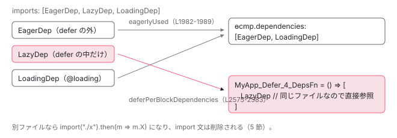

[目次](../README.md) › [standalone コンポーネントの内側](README.md) › 第 11 回 / 全 14 回

# @defer と imports：@defer の中でだけ使う依存が eager な dependencies から外れ import() になるまで

> imports に書いた CmpA を @defer の中だけで使うと、ɵcmp の dependencies から消え、Cmp\_Defer\_DepsFn の import("./cmp-a").then(m =&gt; m.CmpA) になる。resolveDeferBlocks が各ブロックの依存を集め、DeferredSymbolTracker が「その import 文を他で eager に使っていないか」を markAsDeferrableCandidate / canDefer で判定し、compile で import 文ごと削る手順。同じファイルの依存が import() にならない理由、HMR 有効時に全部 eager に戻る行、deferredImports が内部向けである注記。

angular/angular · 読了 約 14 分 · 発展 · [サイトで読む（デモが動きます）](https://angular-deep-dive-cyan.vercel.app/chapter/standalone-defer-deps)

---

`imports: [CmpA]` と書いたコンポーネントを、テンプレートの `@defer` ブロックの**中だけ**で使うと、出力された JS から `import { CmpA }` の行が消え、`ɵcmp` の `dependencies` からも消え、代わりに `import("./cmp-a").then(m => m.CmpA)` を返す関数が生まれます。この章では、ngtsc がその判断を**どの順で、何を見て**下しているかを 1 ステップずつ追います。トリガー（`on viewport` など）や読み込み後の描画は [template シリーズの defer の章](../template/03-defer.md)に任せ、ここでは「依存の分離」だけを扱います。

読む対象は `packages/compiler-cli/src/ngtsc/annotations/component/src/handler.ts` と `packages/compiler-cli/src/ngtsc/imports/src/deferred_symbol_tracker.ts`、出力側の `packages/compiler/src/render3/view/compiler.ts`、実行時の `packages/core/src/defer/triggering.ts` です。

1. [1. 概観](01-standalone.md)
2. [2. @Component 実行の瞬間（JIT）](02-standalone-decorator.md)
3. [3. imports の検証（AOT）](03-standalone-imports-check.md)
4. [4. 使った依存だけが残る](04-standalone-used-only.md)
5. [5. forwardRef と自己参照](05-standalone-forward-ref.md)
6. [6. ローカルコンパイル](06-standalone-local-compilation.md)
7. [7. 実行時の依存解決](07-standalone-directive-registry.md)
8. [8. providers の 2 つの行き先](08-standalone-providers-two-injectors.md)
9. [9. 入口の検査](09-standalone-entry-checks.md)
10. [10. hostDirectives](10-standalone-host-directives.md)
11. **11. @defer と imports**（この章）
12. [12. TestBed の差し替え](12-standalone-testbed-override.md)
13. [13. selectorless（実験的）](13-standalone-selectorless.md)
14. [14. foreignImports（内部向け）](14-standalone-foreign-imports.md)

## 1. 先に出力を見る

コンパイラのテスト用 fixture です。別ファイルの `CmpA` と、同じファイルの `LocalDep` を、どちらも `@defer` の中だけで使います。

📄 `angular/packages/compiler-cli/test/compliance/test_cases/r3_view_compiler_deferred/defer_deps.ts` L1–23 （▶ の行: 3, 14, 16–18）

```ts
 1 │ import {Component} from '@angular/core';
 2 │ 
 3 ▶ import {CmpA} from './defer_deps_ext';
 4 │ 
 5 │ @Component({
 6 │   selector: 'local-dep',
 7 │   template: 'Local dependency',
 8 │ })
 9 │ export class LocalDep {
10 │ }
11 │ 
12 │ @Component({
13 │   selector: 'test-cmp',
14 ▶   imports: [CmpA, LocalDep],
15 │   template: `
16 ▶ 	@defer {
17 ▶ 	<cmp-a />
18 ▶ 	<local-dep />
19 │ 	}
20 │ `,
21 │ })
22 │ export class TestCmp {
23 │ }
```

📄 `angular/packages/compiler-cli/test/compliance/test_cases/r3_view_compiler_deferred/defer_deps_ext.ts` L1–5 （▶ の行: 4）

```ts
1 │ import {Component} from '@angular/core';
2 │ 
3 │ @Component({selector: 'cmp-a', template: 'CmpA!'})
4 ▶ export class CmpA {
5 │ }
```

📄 `angular/packages/compiler-cli/test/compliance/test_cases/r3_view_compiler_deferred/defer_deps_template.js` L1–23 （▶ の行: 1, 3–4, 20–21）

```js
 1 ▶ const $TestCmp_Defer_1_DepsFn$ = () => [
 2 │   /* @ts-ignore */
 3 ▶   import("./defer_deps_ext").then(m => m.CmpA),
 4 ▶   LocalDep
 5 │ ];
 6 │ 
 7 │ function TestCmp_Defer_0_Template(rf, ctx) {
 8 │ 	if (rf & 1) {
 9 │ 		$r3$.ɵɵelement(0, "cmp-a")(1, "local-dep");
10 │ 	}
11 │ }
12 │ 
13 │ export class LocalDep {
14 │   …
15 │ }
16 │ 
17 │ …
18 │ 
19 │ function TestCmp_Template(rf, ctx) { if (rf & 1) {
20 ▶ 	$r3$.ɵɵdomTemplate(0, TestCmp_Defer_0_Template, 2, 0);
21 ▶ 	$r3$.ɵɵdefer(1, 0, $TestCmp_Defer_1_DepsFn$);
22 │ 	$r3$.ɵɵdeferOnIdle();
23 │ } }
```
*期待される出力。… は fixture 側の省略記号です。*

1〜5 行目、`$TestCmp_Defer_1_DepsFn$` という関数が生まれています。3 行目、`CmpA` は `import("./defer_deps_ext").then(m => m.CmpA)`、つまり**動的 import の Promise**。4 行目、`LocalDep` は**クラスへの直接の参照**のままです。21 行目、この関数が `ɵɵdefer(1, 0, $TestCmp_Defer_1_DepsFn$)` の第 3 引数として渡されます（6 節）。20 行目、ブロックの中身は `TestCmp_Defer_0_Template` という別のテンプレート関数（7〜11 行目）になっています。

📄 `angular/packages/compiler-cli/test/compliance/test_cases/r3_view_compiler_deferred/defer_deps_template.js` L27–41 （▶ の行: 28, 30–31, 36）

```js
27 │ (() => {
28 ▶   (typeof ngDevMode === "undefined" || ngDevMode) && $r3$.ɵsetClassMetadataAsync(TestCmp, () => [
29 │     /* @ts-ignore */
30 ▶     import("./defer_deps_ext").then(m => m.CmpA)
31 ▶   ], CmpA => {
32 │     $r3$.ɵsetClassMetadata(TestCmp, [{
33 │       type: Component,
34 │       args: [{
35 │         selector: 'test-cmp',
36 ▶         imports: [CmpA, LocalDep],
37 │         template: …
38 │       }]
39 │     }], null, null);
40 │   });
41 │ })();
```

28〜31 行目、開発モード用のクラスメタデータも `ɵsetClassMetadataAsync` になり、同じ `import()` を待ってから 36 行目の `imports: [CmpA, LocalDep]` を書き戻します。元の `import {CmpA} from './defer_deps_ext'`（入力 3 行目）はこの出力のどこにもありません。ngtsc のテストがそれを直接確かめています。

📄 `angular/packages/compiler-cli/test/ngtsc/defer_spec.ts` L73–82 （▶ の行: 77, 80–82）

```ts
73 │       const jsContents = env.getContents('test.js');
74 │ 
75 │       expect(jsContents).toContain('ɵɵdefer(1, 0, TestCmp_Defer_1_DepsFn)');
76 │       expect(cleanNewLines(jsContents)).toContain(
77 ▶         '() => [/* @ts-ignore */ import("./cmp-a").then(m => m.CmpA), LocalDep]',
78 │       );
79 │ 
80 ▶       // The `CmpA` symbol wasn't referenced elsewhere, so it can be defer-loaded
81 ▶       // via dynamic imports and an original import can be removed.
82 ▶       expect(jsContents).not.toContain('import { CmpA }');
```

### ɵcmp.dependencies からも消える

上の fixture は `ɵcmp` を省略しているので、同じディレクトリの別の fixture で `dependencies` を見ます。

📄 `angular/packages/compiler-cli/test/compliance/test_cases/r3_view_compiler_deferred/deferred_with_local_deps.ts` L1–29 （▶ の行: 18, 20, 22, 26）

```ts
 1 │ import {Component, Directive} from '@angular/core';
 2 │ 
 3 │ @Directive({selector: 'eager-dep'})
 4 │ export class EagerDep {
 5 │ }
 6 │ 
 7 │ @Directive({selector: 'lazy-dep'})
 8 │ export class LazyDep {
 9 │ }
10 │ 
11 │ @Directive({selector: 'loading-dep'})
12 │ export class LoadingDep {
13 │ }
14 │ 
15 │ @Component({
16 │   template: `
17 │     <div>
18 ▶       <eager-dep/>
19 │       @defer {
20 ▶         <lazy-dep/>
21 │       } @loading {
22 ▶         <loading-dep/>
23 │       }
24 │     </div>
25 │   `,
26 ▶   imports: [EagerDep, LazyDep, LoadingDep],
27 │ })
28 │ export class MyApp {
29 │ }
```

📄 `angular/packages/compiler-cli/test/compliance/test_cases/r3_view_compiler_deferred/deferred_with_local_deps_template.js` L1–23 （▶ の行: 1, 12, 17）

```js
 1 ▶ const $MyApp_Defer_4_DepsFn$ = () => [LazyDep];
 2 │ …
 3 │ export class MyApp {
 4 │   …
 5 │   static ɵcmp = /*@__PURE__*/ $r3$.ɵɵdefineComponent({
 6 │   …
 7 │   template: function MyApp_Template(rf, ctx) {
 8 │     if (rf & 1) {
 9 │       $r3$.ɵɵelementStart(0, "div");
10 │       $r3$.ɵɵelement(1, "eager-dep");
11 │       $r3$.ɵɵdomTemplate(2, MyApp_Defer_2_Template, 1, 0)(3, MyApp_DeferLoading_3_Template, 1, 0);
12 ▶       $r3$.ɵɵdefer(4, 2, $MyApp_Defer_4_DepsFn$, 3);
13 │       $r3$.ɵɵdeferOnIdle();
14 │       $r3$.ɵɵelementEnd();
15 │     }
16 │   },
17 ▶   dependencies: [EagerDep, LoadingDep],
18 │   …
19 │ });
20 │ 
21 │ …
22 │ $r3$.ɵsetClassMetadata(MyApp, …);
23 │ }
```
*… は fixture 側の省略記号です。*

入力 26 行目で 3 つを import していますが、出力 17 行目の `dependencies` は `[EagerDep, LoadingDep]` の 2 つです。`@defer` の本体（入力 20 行目）だけで使った `LazyDep` は `dependencies` から外れ、1 行目の `DepsFn` に入っています。`@loading` の中（22 行目）で使った `LoadingDep` は eager 側に残ります。読み込み中に表示するものは先に要るからです。同じファイルの `LazyDep` は `import()` になりません（理由は 4 節）。



*imports に書いた 3 つの行き先。テンプレートでの使われ方だけで決まる。*

## 2. 前提：この分離が有効になる条件

📄 `angular/packages/compiler-cli/src/ngtsc/annotations/component/src/handler.ts` L305–314 （▶ の行: 310–313）

```ts
305 │     this.undecoratedMetadataExtractor = getDirectiveUndecoratedMetadataExtractor(
306 │       reflector,
307 │       importTracker,
308 │     );
309 │ 
310 ▶     // Dependencies can't be deferred during HMR, because the HMR update module can't have
311 ▶     // dynamic imports and its dependencies need to be passed in directly. If dependencies
312 ▶     // are deferred, their imports will be deleted so we may lose the reference to them.
313 ▶     this.canDeferDeps = !enableHmr;
314 │   }
```

313 行目、`canDeferDeps = !enableHmr`。**HMR（Hot Module Replacement）が有効なときは一切分離しません**。310〜312 行目の理由：HMR の更新モジュールは動的 import を持てず、依存を直接渡す必要がある。分離すると import 文が消えて参照を失う。`enableHmr` は `NgCompiler` が `_enableHmr` オプションから取り、`ng serve` の HMR 有効時に CLI が渡します。つまり、開発サーバーで見ている出力と `ng build` の出力で、`@defer` の依存の扱いが違います。

> [!WARNING]
> **ハマりどころ**
>
> 「`@defer` にしたのに DevTools の Network に別チャンクが出ない」と言われたら、まず HMR が有効かを聞いてください。`ng build` の出力（`dist/` の `chunk-*.js`）で確かめるのが確実です。

📄 `angular/packages/core/src/metadata/directives.ts` L653–662 （▶ の行: 654–655, 659–660, 662）

```ts
653 │   /**
654 ▶    * The `deferredImports` property specifies a standalone component's template dependencies,
655 ▶    * which should be defer-loaded as a part of the `@defer` block. Angular *always* generates
656 │    * dynamic imports for such symbols and removes the regular/eager import. Make sure that imports
657 │    * which bring symbols used in the `deferredImports` don't contain other symbols.
658 │    *
659 ▶    * Note: this is an internal-only field, use regular `@Component.imports` field instead.
660 ▶    * @internal // 3p-only
661 │    */
662 ▶   deferredImports?: {[blockName: string]: (Type<any> | ReadonlyArray<any>)[]};
```

もう 1 つの経路、`@Component.deferredImports`（654〜662 行目）は `@internal // 3p-only` です（659〜660 行目）。公開 API ではないので、この章の本線は `imports` に書いたものが自動で分離される経路です。`deferredImports` に触れるのは、分岐の説明に必要な箇所と最後の質問だけにします。

## 3. 手順①②：defer ブロックごとにテンプレートを束縛し、使った依存を集める

[第 4 回](04-standalone-used-only.md)で読んだ `resolveComponentDependencies` の続きです。テンプレート全体を `R3TargetBinder` で束縛したあと、`@defer` ブロックを 1 つずつ別に束縛します。

📄 `angular/packages/compiler-cli/src/ngtsc/annotations/component/src/handler.ts` L1953–1990 （▶ の行: 1955, 1959–1961, 1966, 1968–1971, 1973, 1982–1983, 1985, 1987）

```ts
1953 │     // Next, the component template AST is bound using the R3TargetBinder. This produces a
1954 │     // BoundTarget, which is similar to a ts.TypeChecker.
1955 ▶     const bound = binder.bind({template: metadata.template.nodes});
1956 │ 
1957 │     // Find all defer blocks used in the template and for each block
1958 │     // bind its own scope.
1959 ▶     const deferBlocks = new Map<TmplAstDeferredBlock, BoundTarget<DirectiveMeta>>();
1960 ▶     for (const deferBlock of bound.getDeferBlocks()) {
1961 ▶       deferBlocks.set(deferBlock, deferBlockBinder.bind({template: deferBlock.children}));
1962 │     }
1963 │ 
1964 │     // Register all Directives and Pipes used at the top level (outside
1965 │     // of any defer blocks), which would be eagerly referenced.
1966 ▶     const eagerlyUsed = new Set<ClassDeclaration>();
1967 │ 
1968 ▶     if (this.enableHmr) {
1969 ▶       // In HMR we need to preserve all the dependencies, because they have to remain consistent
1970 ▶       // with the initially-generated code no matter what the template looks like.
1971 ▶       for (const dep of dependencies) {
1972 │         if (dep.ref.node !== node) {
1973 ▶           eagerlyUsed.add(dep.ref.node);
1974 │         } else {
1975 │           const used = bound.getEagerlyUsedDirectives();
1976 │           if (used.some((current) => current.ref.node === node)) {
1977 │             eagerlyUsed.add(node);
1978 │           }
1979 │         }
1980 │       }
1981 │     } else {
1982 ▶       for (const dir of bound.getEagerlyUsedDirectives()) {
1983 ▶         eagerlyUsed.add(dir.ref.node);
1984 │       }
1985 ▶       for (const name of bound.getEagerlyUsedPipes()) {
1986 │         if (pipes.has(name)) {
1987 ▶           eagerlyUsed.add(pipes.get(name)!.ref.node);
1988 │         }
1989 │       }
1990 │     }
```

1. **1955 行目：テンプレート全体を束縛**

   `bound` は「どの要素にどのディレクティブが付くか」を答えられるオブジェクトです。
2. **1959〜1962 行目：ブロックごとに束縛（手順①）**

   `bound.getDeferBlocks()` で全ブロックを取り、**各ブロックの `children` だけ**を `deferBlockBinder.bind` に通して `Map<TmplAstDeferredBlock, BoundTarget>` に入れます。以降「このブロックの中で使ったもの」はこの Map の値に聞きます。
3. **1982〜1989 行目：eager に使ったものを集める**

   `bound.getEagerlyUsedDirectives()` は**defer ブロックの外**で使ったディレクティブだけを返します。これが `eagerlyUsed`、つまり最終的に `ɵcmp.dependencies` に残る集合です（[既出の eagerDeclarations](../ngmodule/13-ngmodule-standalone-imports.md)）。1 節の `LazyDep` はここに入らないので `dependencies` から消えます。
4. **1968〜1980 行目：HMR のときは全部 eager**

   `enableHmr` なら、テンプレートの使われ方に関係なく `imports` の全依存を `eagerlyUsed` に入れます（1971〜1973 行目）。1969〜1970 行目のコメント、「初回生成コードと整合が取れるよう全依存を保つ」。2 節の `canDeferDeps` と対になる処置です。

📄 `angular/packages/compiler-cli/src/ngtsc/annotations/component/src/handler.ts` L1992–2007 （▶ の行: 1994–1997, 2007）

```ts
1992 │     // Set of Directives and Pipes used across the entire template,
1993 │     // including all defer blocks.
1994 ▶     const wholeTemplateUsed = new Set<ClassDeclaration>(eagerlyUsed);
1995 ▶     for (const bound of deferBlocks.values()) {
1996 ▶       for (const dir of bound.getUsedDirectives()) {
1997 ▶         wholeTemplateUsed.add(dir.ref.node);
1998 │       }
1999 │       for (const name of bound.getUsedPipes()) {
2000 │         if (!pipes.has(name)) {
2001 │           continue;
2002 │         }
2003 │         wholeTemplateUsed.add(pipes.get(name)!.ref.node);
2004 │       }
2005 │     }
2006 │ 
2007 ▶     return {allDependencies, eagerlyUsed, wholeTemplateUsed, deferBlocks, pipes};
```

1994〜2005 行目、`wholeTemplateUsed` は eager と全ブロックの合計です。これが `componentDependenciesToDeclarations`（[第 4 回](04-standalone-used-only.md)）に渡る「テンプレートのどこかで使った依存」の母集合なので、`@defer` の中だけで使った依存も `declarations` には入ります。2007 行目、`deferBlocks` の Map が呼び元に返ります。

📄 `angular/packages/compiler-cli/src/ngtsc/annotations/component/src/handler.ts` L1474–1500 （▶ の行: 1475–1476, 1479–1480, 1483, 1486–1488, 1492–1493, 1499）

```ts
1474 │       // Process information related to defer blocks
1475 ▶       if (this.compilationMode !== CompilationMode.LOCAL) {
1476 ▶         this.resolveDeferBlocks(
1477 │           node,
1478 │           scope,
1479 ▶           deferBlocks,
1480 ▶           declarations,
1481 │           data,
1482 │           analysis,
1483 ▶           eagerlyUsed,
1484 │           diagnostics,
1485 │         );
1486 ▶         data.hasDirectiveDependencies =
1487 ▶           !analysis.meta.isStandalone ||
1488 ▶           allDependencies.some(({kind, ref}) => {
1489 │             // Note that `allDependencies` includes ones that aren't
1490 │             // used in the template so we need to filter them out.
1491 │             return (
1492 ▶               (kind === MetaKind.Directive || kind === MetaKind.NgModule) &&
1493 ▶               wholeTemplateUsed.has(ref.node)
1494 │             );
1495 │           });
1496 │       } else {
1497 │         // We don't have the ability to inspect the component's dependencies in local
1498 │         // compilation mode. Assume that it always has directive dependencies in such cases.
1499 ▶         data.hasDirectiveDependencies = true;
1500 │       }
```

1475〜1485 行目、ローカルコンパイル（[第 6 回](06-standalone-local-compilation.md)）でなければ `resolveDeferBlocks` に `deferBlocks`（手順①の Map）、`declarations`（imports から来た全依存）、`eagerlyUsed` を渡します。1486〜1495 行目、`hasDirectiveDependencies` は「standalone でない、または `wholeTemplateUsed`（defer の中も含む）にディレクティブか NgModule が 1 つでもある」です。1499 行目、ローカルコンパイルでは依存を調べられないので常に `true` とみなします。

### resolveDeferBlocks：ブロックの中で使ったものを deps に積む（手順②）

📄 `angular/packages/compiler-cli/src/ngtsc/annotations/component/src/handler.ts` L2467–2493 （▶ の行: 2471, 2474, 2480–2481, 2483–2485, 2488–2489, 2491–2492）

```ts
2467 │   private resolveDeferBlocks(
2468 │     componentClassDecl: ClassDeclaration,
2469 │     scope: ComponentScope,
2470 │     deferBlocks: Map<TmplAstDeferredBlock, BoundTarget<DirectiveMeta>>,
2471 ▶     deferrableDecls: Map<ClassDeclaration, AnyUsedType>,
2472 │     resolutionData: ComponentResolutionData,
2473 │     analysisData: Readonly<ComponentAnalysisData>,
2474 ▶     eagerlyUsedDecls: Set<ClassDeclaration>,
2475 │     diagnostics: ts.Diagnostic[],
2476 │   ) {
2477 │     // Collect all deferred decls from all defer blocks from the entire template
2478 │     // to intersect with the information from the `imports` field of a particular
2479 │     // Component.
2480 ▶     const allDeferredDecls = new Set<ClassDeclaration>();
2481 ▶     const hasBlockSpecificImports = analysisData.resolvedDeferredImportsByBlock != null;
2482 │ 
2483 ▶     for (const [deferBlock, bound] of deferBlocks) {
2484 ▶       const usedDirectives = new Set(bound.getEagerlyUsedDirectives().map((d) => d.ref.node));
2485 ▶       const usedPipes = new Set(bound.getEagerlyUsedPipes());
2486 │       let deps: DeferredComponentDependency[];
2487 │ 
2488 ▶       if (resolutionData.deferPerBlockDependencies.has(deferBlock)) {
2489 ▶         deps = resolutionData.deferPerBlockDependencies.get(deferBlock)!;
2490 │       } else {
2491 ▶         deps = [];
2492 ▶         resolutionData.deferPerBlockDependencies.set(deferBlock, deps);
2493 │       }
```

2480 行目、`allDeferredDecls` は「どこかの defer ブロックで使った依存」の集合で、あとで手順③の判定に使います。2481 行目、`hasBlockSpecificImports` は `deferredImports` をブロック名付きのオブジェクトで書いたときだけ `true` です。本線は `false` 側です。2483〜2485 行目、ブロックごとに**そのブロックの束縛**から使用ディレクティブ・パイプを取ります。2488〜2493 行目、ブロック → deps 配列の Map（`deferPerBlockDependencies`）を用意します。

📄 `angular/packages/compiler-cli/src/ngtsc/annotations/component/src/handler.ts` L2549–2586 （▶ の行: 2549–2550, 2561–2563, 2565–2567, 2571, 2575–2579, 2581, 2583）

```ts
2549 ▶       } else {
2550 ▶         if (blockName !== null) {
2551 │           diagnostics.push(
2552 │             makeDiagnostic(
2553 │               ErrorCode.DEFER_BLOCK_INVALID_NAME_PARAMETER,
2554 │               analysisData.rawDeferredImports ?? componentClassDecl,
2555 │               `The 'name' parameter can only be used when '@Component.deferredImports' is defined.`,
2556 │             ),
2557 │           );
2558 │           continue;
2559 │         }
2560 │ 
2561 ▶         for (const decl of Array.from(deferrableDecls.values())) {
2562 ▶           if (decl.kind === R3TemplateDependencyKind.NgModule) {
2563 ▶             continue;
2564 │           }
2565 ▶           if (
2566 ▶             decl.kind === R3TemplateDependencyKind.Directive &&
2567 ▶             !usedDirectives.has(decl.ref.node)
2568 │           ) {
2569 │             continue;
2570 │           }
2571 ▶           if (decl.kind === R3TemplateDependencyKind.Pipe && !usedPipes.has(decl.name)) {
2572 │             continue;
2573 │           }
2574 │ 
2575 ▶           deps.push({
2576 ▶             typeReference: decl.type,
2577 ▶             symbolName: decl.ref.node.name.text,
2578 ▶             isDeferrable: false,
2579 ▶             importPath: null,
2580 │             isDefaultImport: false,
2581 ▶             declaration: decl.ref,
2582 │           });
2583 ▶           allDeferredDecls.add(decl.ref.node);
2584 │         }
2585 │       }
2586 │     }
```

1. **2549〜2559 行目：`deferredImports` が無いのに `@defer (name x)` を書いたらエラー**

   NG11102。`name` パラメータは `deferredImports` 専用です。
2. **2561〜2573 行目：`imports` 由来の全依存を 1 つずつ篩う**

   2562〜2563 行目、NgModule は飛ばします（NgModule は常に eager 側。既出）。2565〜2569 行目、ディレクティブなら**このブロックで使っていなければ**飛ばす。2571〜2573 行目、パイプも同じく名前で判定。
3. **2575〜2583 行目：残ったものを deps に積む**

   `isDeferrable: false`、`importPath: null` で積みます（2578〜2579 行目）。**この時点では「import() にするかどうか」はまだ決まっていません**。決めるのは手順④です。2581 行目の `declaration: decl.ref` が、あとで import 文を探す手がかりです。2583 行目で `allDeferredDecls` にも追加します。

## 4. 手順③：その依存を持ち込んだ import 文を候補として登録する

📄 `angular/packages/compiler-cli/src/ngtsc/annotations/component/src/handler.ts` L2588–2606 （▶ の行: 2588, 2592–2594, 2596–2597, 2600–2602）

```ts
2588 ▶     if (analysisData.meta.isStandalone) {
2589 │       // For standalone components with the `imports` and `deferredImports` fields -
2590 │       // inspect the list of referenced symbols and mark the ones used in defer blocks
2591 │       // as potential candidates for defer loading.
2592 ▶       if (
2593 ▶         analysisData.rawImports !== null &&
2594 ▶         ts.isArrayLiteralExpression(analysisData.rawImports)
2595 │       ) {
2596 ▶         for (const element of analysisData.rawImports.elements) {
2597 ▶           this.registerDeferrableCandidate(
2598 │             componentClassDecl,
2599 │             element,
2600 ▶             false /* isDeferredImport */,
2601 ▶             allDeferredDecls,
2602 ▶             eagerlyUsedDecls,
2603 │             resolutionData,
2604 │           );
2605 │         }
2606 │       }
```

2588 行目、**standalone のときだけ**。2592〜2594 行目、`imports` が配列リテラルとして書かれているときだけ。2596〜2605 行目、その配列の**要素（式）を 1 つずつ**`registerDeferrableCandidate` に渡します。依存のメタデータではなく、あなたが書いた `imports: [CmpA, LocalDep]` の `CmpA` という**識別子そのもの**を見に行くのがポイントです。

📄 `angular/packages/compiler-cli/src/ngtsc/annotations/component/src/handler.ts` L2678–2711 （▶ の行: 2678, 2680, 2685–2688, 2691, 2697, 2703–2704, 2707–2710）

```ts
2678 ▶     const node = tryUnwrapForwardRef(element, this.reflector) || element;
2679 │ 
2680 ▶     if (!ts.isIdentifier(node)) {
2681 │       // Can't defer-load non-literal references.
2682 │       return;
2683 │     }
2684 │ 
2685 ▶     const imp = this.reflector.getImportOfIdentifier(node);
2686 ▶     if (imp === null) {
2687 ▶       // Can't defer-load symbols which aren't imported.
2688 ▶       return;
2689 │     }
2690 │ 
2691 ▶     const decl = this.reflector.getDeclarationOfIdentifier(node);
2692 │     if (decl === null) {
2693 │       // Can't defer-load symbols which don't exist.
2694 │       return;
2695 │     }
2696 │ 
2697 ▶     if (!isNamedClassDeclaration(decl.node)) {
2698 │       // Can't defer-load symbols which aren't classes.
2699 │       return;
2700 │     }
2701 │ 
2702 │     // Are we even trying to defer-load this symbol?
2703 ▶     if (!allDeferredDecls.has(decl.node)) {
2704 ▶       return;
2705 │     }
2706 │ 
2707 ▶     if (eagerlyUsedDecls.has(decl.node)) {
2708 ▶       // Can't defer-load symbols that are eagerly referenced as a dependency
2709 ▶       // in a template outside of a defer block.
2710 ▶       return;
2711 │     }
```

1. **2678〜2683 行目：識別子でなければ対象外**

   `forwardRef(() => X)` は中身の `X` を取り出します。それ以外の式は候補になりません。
2. **2685〜2689 行目：import 文から来ていなければ対象外**

   `reflector.getImportOfIdentifier(node)` が `null`、つまり**このファイルで宣言されたクラス**ならここで `return`。1 節の `LocalDep` / `LazyDep` が `import()` にならない理由はこの 1 行です。動的 import は「ファイル」を分けるものなので、同じファイルのクラスには意味がありません。
3. **2691〜2700 行目：宣言がクラスでなければ対象外**
4. **2703〜2705 行目：どの defer ブロックでも使っていなければ対象外**

   手順②の `allDeferredDecls` に無いもの。`imports` に書いただけで defer の中で使っていないものはここで止まります。
5. **2707〜2711 行目：defer の外でも使っていれば対象外**

   `eagerlyUsedDecls`（手順①の `eagerlyUsed`）に入っているもの。外で使うなら最初から読み込まれているので分ける意味がありません。

📄 `angular/packages/compiler-cli/src/ngtsc/annotations/component/src/handler.ts` L2713–2741 （▶ の行: 2714–2716, 2720–2721, 2725–2726, 2733, 2735–2739）

```ts
2713 │     // Is it a standalone directive/component?
2714 ▶     const dirMeta = this.metaReader.getDirectiveMetadata(new Reference(decl.node));
2715 ▶     if (dirMeta !== null && !dirMeta.isStandalone) {
2716 ▶       return;
2717 │     }
2718 │ 
2719 │     // Is it a standalone pipe?
2720 ▶     const pipeMeta = this.metaReader.getPipeMetadata(new Reference(decl.node));
2721 ▶     if (pipeMeta !== null && !pipeMeta.isStandalone) {
2722 │       return;
2723 │     }
2724 │ 
2725 ▶     if (dirMeta === null && pipeMeta === null) {
2726 ▶       // This is not a directive or a pipe.
2727 │       return;
2728 │     }
2729 │ 
2730 │     // Keep track of how this class made it into the current source file.
2731 │     // Store the full `Import` info so that callers can correctly determine the
2732 │     // exported name (handling aliasing) and the module specifier.
2733 ▶     resolutionData.deferrableDeclToImportDecl.set(decl.node, imp);
2734 │ 
2735 ▶     this.deferredSymbolTracker.markAsDeferrableCandidate(
2736 ▶       node,
2737 ▶       imp.node,
2738 ▶       componentClassDecl,
2739 ▶       isDeferredImport,
2740 │     );
2741 │   }
```

1. **2714〜2728 行目：standalone なディレクティブかパイプであること**

   `isStandalone` でないディレクティブ（2715〜2716 行目）・パイプ（2721〜2722 行目）は対象外。どちらでもないもの（NgModule など）も対象外（2725〜2728 行目）。`import()` で後から持ってくる 1 つのクラスだけで完結する必要があるので、スコープを NgModule に頼る def は分けられません。
2. **2733 行目：クラス宣言 → import 情報の対応を記録**

   `deferrableDeclToImportDecl`。手順④で「この依存はどのパスから、どの名前で import されたか」を引くための Map です。
3. **2735〜2740 行目：tracker に登録**

   識別子（`CmpA`）、その import 文、コンポーネントのクラスを `DeferredSymbolTracker.markAsDeferrableCandidate` に渡します。

### DeferredSymbolTracker：import 文単位で「他に参照が残っているか」を数える

📄 `angular/packages/compiler-cli/src/ngtsc/imports/src/deferred_symbol_tracker.ts` L17–31 （▶ の行: 21, 24, 26–28, 31）

```ts
17 │ /**
18 │  * Maps imported symbol name to a set of locations where the symbols is used
19 │  * in a source file.
20 │  */
21 ▶ type SymbolMap = Map<string, Set<ts.Identifier> | AssumeEager>;
22 │ 
23 │ /**
24 ▶  * Allows to register a symbol as deferrable and keep track of its usage.
25 │  *
26 ▶  * This information is later used to determine whether it's safe to drop
27 ▶  * a regular import of this symbol (actually the entire import declaration)
28 ▶  * in favor of using a dynamic import for cases when defer blocks are used.
29 │  */
30 │ export class DeferredSymbolTracker {
31 ▶   private readonly imports = new Map<ts.ImportDeclaration, SymbolMap>();
```

21 行目、1 つの import 文について「シンボル名 → そのシンボルを参照している識別子の集合、または `AssumeEager`」を持ちます。31 行目、それを import 文ごとに Map で持ちます。26〜28 行目のコメント、「シンボルの通常 import（実際には**import 文全体**）を落として動的 import に置き換えて安全かを後で判定するための情報」。単位が**import 文**であることを覚えておいてください。`import { CmpA, Util } from './x'` なら、`Util` の参照が 1 つでも残れば文ごと残ります。

📄 `angular/packages/compiler-cli/src/ngtsc/imports/src/deferred_symbol_tracker.ts` L113–133 （▶ の行: 113, 119–123, 126）

```ts
113 ▶   markAsDeferrableCandidate(
114 │     identifier: ts.Identifier,
115 │     importDecl: ts.ImportDeclaration,
116 │     componentClassDecl: ClassDeclaration,
117 │     isExplicitlyDeferred: boolean,
118 │   ): void {
119 ▶     if (this.onlyExplicitDeferDependencyImports && !isExplicitlyDeferred) {
120 ▶       // Ignore deferrable candidates when only explicit deferred imports mode is enabled.
121 ▶       // In that mode only dependencies from the `@Component.deferredImports` field are
122 ▶       // defer-loadable.
123 ▶       return;
124 │     }
125 │ 
126 ▶     if (isExplicitlyDeferred) {
127 │       if (this.explicitlyDeferredImports.has(componentClassDecl)) {
128 │         this.explicitlyDeferredImports.get(componentClassDecl)!.push(importDecl);
129 │       } else {
130 │         this.explicitlyDeferredImports.set(componentClassDecl, [importDecl]);
131 │       }
132 │     }
133 │ 
```

119〜124 行目、`onlyExplicitDeferDependencyImports` オプションが `true` のときは、`deferredImports` から来た候補以外を無視します（内部向けの厳格モード）。通常は `false` なので素通りします。126〜132 行目は `deferredImports` 用の記録で、本線では通りません。

📄 `angular/packages/compiler-cli/src/ngtsc/imports/src/deferred_symbol_tracker.ts` L134–162 （▶ の行: 134, 137–139, 149–153, 157, 159–161）

```ts
134 ▶     let symbolMap = this.imports.get(importDecl);
135 │ 
136 │     // Do we come across this import for the first time?
137 ▶     if (!symbolMap) {
138 ▶       symbolMap = this.extractImportedSymbols(importDecl);
139 ▶       this.imports.set(importDecl, symbolMap);
140 │     }
141 │ 
142 │     if (!symbolMap.has(identifier.text)) {
143 │       throw new Error(
144 │         `The '${identifier.text}' identifier doesn't belong ` +
145 │           `to the provided import declaration.`,
146 │       );
147 │     }
148 │ 
149 ▶     if (symbolMap.get(identifier.text) === AssumeEager) {
150 ▶       // We process this symbol for the first time, populate references.
151 ▶       symbolMap.set(
152 ▶         identifier.text,
153 ▶         this.lookupIdentifiersInSourceFile(identifier.text, importDecl),
154 │       );
155 │     }
156 │ 
157 ▶     const identifiers = symbolMap.get(identifier.text) as Set<ts.Identifier>;
158 │ 
159 ▶     // Drop the current identifier, since we are trying to make it deferrable
160 ▶     // (it's used as a dependency in one of the defer blocks).
161 ▶     identifiers.delete(identifier);
162 │   }
```

1. **137〜140 行目：この import 文を初めて見たら、全シンボルを `AssumeEager` で登録**

   `extractImportedSymbols` が `import {a, b as B}` / `import X` / `import * as x` の 3 形を読み、各名前に「とりあえず eager とみなす」印を付けます。
2. **149〜155 行目：そのシンボルを初めて処理するなら、ファイル全体から参照を集める**

   `lookupIdentifiersInSourceFile`（次の引用）で、**同じ名前の識別子をファイル中から探し**、`TypeChecker` で「本当にこの import 文のシンボルを指しているか」を確かめた集合に置き換えます。
3. **157〜161 行目：いま渡された識別子を集合から削除**

   `imports: [CmpA]` の中の `CmpA` は「defer の依存として使う」参照なので、eager な参照から除きます。残った集合が空になれば、この import 文は他のどこからも eager に参照されていない、と分かります。

📄 `angular/packages/compiler-cli/src/ngtsc/imports/src/deferred_symbol_tracker.ts` L202–238 （▶ の行: 210–211, 214, 216, 226–228, 232, 237）

```ts
202 │     const results = new Set<ts.Identifier>();
203 │     const visit = (node: ts.Node): void => {
204 │       // Don't record references from the declaration itself or inside
205 │       // type nodes which will be stripped from the JS output.
206 │       // Note that `ts.isTypeNode` returns `true` for `ExpressionWithTypeArguments`,
207 │       // which is used for both `extends` and `implements` heritage clauses. An `extends`
208 │       // clause on a class is a value expression that survives in the emitted JavaScript,
209 │       // so references within it must be recorded.
210 ▶       if (node === importDecl || (ts.isTypeNode(node) && !isClassExtendsClause(node))) {
211 ▶         return;
212 │       }
213 │ 
214 ▶       if (ts.isIdentifier(node) && node.text === name) {
215 │         // Is `node` actually a reference to this symbol?
216 ▶         const sym = this.typeChecker.getSymbolAtLocation(node);
217 │         if (sym === undefined) {
218 │           return;
219 │         }
220 │ 
221 │         if (sym.declarations === undefined || sym.declarations.length === 0) {
222 │           return;
223 │         }
224 │         const importClause = sym.declarations[0];
225 │         // Is declaration from this import statement?
226 ▶         const decl = getContainingImportDeclaration(importClause);
227 ▶         if (decl !== importDecl) {
228 ▶           return;
229 │         }
230 │ 
231 │         // `node` *is* a reference to the same import.
232 ▶         results.add(node);
233 │       }
234 │       ts.forEachChild(node, visit);
235 │     };
236 │ 
237 ▶     visit(importDecl.getSourceFile());
238 │     return results;
```

237 行目、ソースファイル全体を走査します。210〜212 行目、import 文自身と型注釈の中は数えません（型は JS 出力に残らないため。ただし `extends` 節は値として残るので数えます）。214〜216 行目、同名の識別子に `TypeChecker.getSymbolAtLocation` を当て、226〜229 行目でその宣言が**この import 文**に属するときだけ 232 行目で集合に足します。1 節の `CmpA` の場合、ファイル中の `CmpA` は `import {CmpA}`（除外）と `imports: [CmpA]`（自分、削除）の 2 つだけなので、集合は空になります。

## 5. 手順④⑤：全コンポーネントの解決が終わってから判定し、出力する

なぜ「登録」と「判定」を分けるのか。同じファイルに複数のコンポーネントがあり、別のコンポーネントが同じ `CmpA` を eager に使うかもしれないからです。判定は **compile 段階**（全クラスの resolve が終わった後）で行います。

📄 `angular/packages/compiler-cli/src/ngtsc/annotations/component/src/handler.ts` L1596–1611 （▶ の行: 1596–1599, 1609–1610）

```ts
1596 ▶     const perComponentDeferredDeps = this.canDeferDeps
1597 ▶       ? this.resolveAllDeferredDependencies(resolution)
1598 ▶       : null;
1599 ▶     const defer = this.compileDeferBlocks(resolution);
1600 │     const foreignImports = this.resolveForeignComponentImports(analysis);
1601 │     const meta: R3ComponentMetadata<R3TemplateDependency> = {
1602 │       ...analysis.meta,
1603 │       ...resolution,
1604 │       defer,
1605 │       foreignImports,
1606 │     };
1607 │     const fac = compileNgFactoryDefField(toFactoryMetadata(meta, FactoryTarget.Component));
1608 │ 
1609 ▶     if (perComponentDeferredDeps !== null) {
1610 ▶       removeDeferrableTypesFromComponentDecorator(analysis, perComponentDeferredDeps);
1611 │     }
```

📄 `angular/packages/compiler-cli/src/ngtsc/annotations/component/src/handler.ts` L2344–2375 （▶ の行: 2352–2360, 2366–2368）

```ts
2344 │   private resolveAllDeferredDependencies(
2345 │     resolution: Readonly<ComponentResolutionData>,
2346 │   ): R3DeferPerComponentDependency[] {
2347 │     const seenDeps = new Set<ClassDeclaration>();
2348 │     const deferrableTypes: R3DeferPerComponentDependency[] = [];
2349 │     // Go over all dependencies of all defer blocks and update the value of
2350 │     // the `isDeferrable` flag and the `importPath` to reflect the current
2351 │     // state after visiting all components during the `resolve` phase.
2352 ▶     for (const [_, deps] of resolution.deferPerBlockDependencies) {
2353 ▶       for (const deferBlockDep of deps) {
2354 ▶         const node = deferBlockDep.declaration.node;
2355 ▶         const importInfo = resolution.deferrableDeclToImportDecl.get(node) ?? null;
2356 ▶         if (importInfo !== null && this.deferredSymbolTracker.canDefer(importInfo.node)) {
2357 ▶           deferBlockDep.isDeferrable = true;
2358 ▶           deferBlockDep.symbolName = importInfo.name;
2359 ▶           deferBlockDep.importPath = importInfo.from;
2360 ▶           deferBlockDep.isDefaultImport = isDefaultImport(importInfo.node);
2361 │ 
2362 │           // The same dependency may be used across multiple deferred blocks. De-duplicate it
2363 │           // because it can throw off other logic further down the compilation pipeline.
2364 │           // Note that the logic above needs to run even if the dependency is seen before,
2365 │           // because the object literals are different between each block.
2366 ▶           if (!seenDeps.has(node)) {
2367 ▶             seenDeps.add(node);
2368 ▶             deferrableTypes.push(deferBlockDep as R3DeferPerComponentDependency);
2369 │           }
2370 │         }
2371 │       }
2372 │     }
2373 │ 
2374 │     return deferrableTypes;
2375 │   }
```

1. **1596〜1598 行目：`canDeferDeps` なら `resolveAllDeferredDependencies`**

   HMR 中は `null`。2 節のとおりです。
2. **2352〜2356 行目：各ブロックの各依存について `canDefer(import 文)` を聞く（手順④）**

   手順②で `isDeferrable: false` のまま積んだ依存を、手順③の Map（2355 行目 `deferrableDeclToImportDecl`）で import 文に引き直し、tracker に判定を聞きます。
3. **2357〜2360 行目：`true` なら `isDeferrable = true` にしてパスと名前を書き込む**

   `importPath`（`"./defer_deps_ext"`）、`symbolName`（`CmpA`）、default import かどうか。1 節の出力 3 行目の材料です。
4. **2366〜2369 行目：コンポーネント単位の一覧にも重複なしで積む**

   これが `perComponentDeferredDeps`。1609〜1610 行目で `removeDeferrableTypesFromComponentDecorator` に渡り、`ɵsetClassMetadataAsync` の材料になります。

📄 `angular/packages/compiler-cli/src/ngtsc/imports/src/deferred_symbol_tracker.ts` L164–196 （▶ の行: 168–170, 173–177, 181, 188, 190–192）

```ts
164 │   /**
165 │    * Whether all symbols from a given import declaration have no references
166 │    * in a source file, thus it's safe to use dynamic imports.
167 │    */
168 ▶   canDefer(importDecl: ts.ImportDeclaration): boolean {
169 ▶     if (!this.imports.has(importDecl)) {
170 ▶       return false;
171 │     }
172 │ 
173 ▶     const symbolsMap = this.imports.get(importDecl)!;
174 ▶     for (const refs of symbolsMap.values()) {
175 ▶       if (refs === AssumeEager || refs.size > 0) {
176 ▶         // There may be still eager references to this symbol.
177 ▶         return false;
178 │       }
179 │     }
180 │ 
181 ▶     return true;
182 │   }
183 │ 
184 │   /**
185 │    * Returns a set of import declarations that is safe to remove
186 │    * from the current source file and generate dynamic imports instead.
187 │    */
188 ▶   getDeferrableImportDecls(): Set<ts.ImportDeclaration> {
189 │     const deferrableDecls = new Set<ts.ImportDeclaration>();
190 ▶     for (const [importDecl] of this.imports) {
191 ▶       if (this.canDefer(importDecl)) {
192 ▶         deferrableDecls.add(importDecl);
193 │       }
194 │     }
195 │     return deferrableDecls;
196 │   }
```

169〜171 行目、登録されていない import 文は `false`（同じファイルのクラスはそもそも登録されないので、ここにも来ません）。174〜178 行目、**その import 文の全シンボル**について、`AssumeEager` のまま（候補にされなかった名前がある）か、参照集合が空でなければ `false`。全部空なら 181 行目で `true`。188〜196 行目の `getDeferrableImportDecls` は、`canDefer` が `true` の import 文の集合を返します。これが「削除してよい import 文」です。

### 出力：DepsFn の中身と、import 文の削除（手順⑤）

📄 `angular/packages/compiler-cli/src/ngtsc/annotations/component/src/handler.ts` L2752–2767 （▶ の行: 2752, 2760–2761, 2763）

```ts
2752 ▶     if (mode === DeferBlockDepsEmitMode.PerBlock) {
2753 │       if (!perBlockDeps) {
2754 │         throw new Error(
2755 │           'Internal error: deferPerBlockDependencies must be present when compiling in PerBlock mode',
2756 │         );
2757 │       }
2758 │ 
2759 │       const blocks = new Map<TmplAstDeferredBlock, o.Expression | null>();
2760 ▶       for (const [block, dependencies] of perBlockDeps) {
2761 ▶         blocks.set(
2762 │           block,
2763 ▶           dependencies.length === 0 ? null : compileDeferResolverFunction({mode, dependencies}),
2764 │         );
2765 │       }
2766 │ 
2767 │       return {mode, blocks};
```

📄 `angular/packages/compiler/src/render3/view/compiler.ts` L754–779 （▶ の行: 754–756, 758, 761, 765–767, 774–777）

```ts
754 ▶   if (meta.mode === DeferBlockDepsEmitMode.PerBlock) {
755 ▶     for (const dep of meta.dependencies) {
756 ▶       if (dep.isDeferrable) {
757 │         // Callback function, e.g. `m () => m.MyCmp;`.
758 ▶         const innerFn = o.arrowFn(
759 │           // Default imports are always accessed through the `default` property.
760 │           [new o.FnParam('m', o.DYNAMIC_TYPE)],
761 ▶           o.variable('m').prop(dep.isDefaultImport ? 'default' : dep.symbolName),
762 │         );
763 │ 
764 │         // Dynamic import, e.g. `import('./a').then(...)`.
765 ▶         const importExpr = new o.DynamicImportExpr(dep.importPath!)
766 ▶           .prop('then')
767 ▶           .callFn([innerFn], undefined, undefined, [
768 │             // Necessary, because we might not generate extensions for the path
769 │             // and TS may try to enforce it based on the compiler options.
770 │             tsIgnoreComment(),
771 │           ]);
772 │         depExpressions.push(importExpr);
773 │       } else {
774 ▶         // Non-deferrable symbol, just use a reference to the type. Note that it's important to
775 ▶         // go through `typeReference`, rather than `symbolName` in order to preserve the
776 ▶         // original reference within the source file.
777 ▶         depExpressions.push(dep.typeReference);
778 │       }
779 │     }
```

2760〜2764 行目、ブロックごとに deps が 1 つ以上あれば `compileDeferResolverFunction` で関数式を作ります（deps が無ければ `null`）。756〜772 行目、`isDeferrable` なら `import(importPath).then(m => m.symbolName)`（default import なら `m.default`）。774〜777 行目、そうでなければ `dep.typeReference`、つまり**元の識別子をそのまま**置きます。1 節の出力 4 行目 `LocalDep` がこれです。

📄 `angular/packages/compiler/src/render3/view/api.ts` L131–154 （▶ の行: 137, 144, 149–150, 153）

```ts
131 │ /**
132 │  * Defines how dynamic imports for deferred dependencies should be emitted in the
133 │  * generated output:
134 │  *  - either in a function on per-component basis (in case of local compilation)
135 │  *  - or in a function on per-block basis (in full compilation mode)
136 │  */
137 ▶ export const enum DeferBlockDepsEmitMode {
138 │   /**
139 │    * Dynamic imports are grouped on per-block basis.
140 │    *
141 │    * This is used in full compilation mode, when compiler has more information
142 │    * about particular dependencies that belong to this block.
143 │    */
144 ▶   PerBlock,
145 │ 
146 │   /**
147 │    * Dynamic imports are grouped on per-component basis.
148 │    *
149 ▶    * In local compilation, compiler doesn't have enough information to determine
150 ▶    * which deferred dependencies belong to which block. In this case we group all
151 │    * dynamic imports into a single file on per-component basis.
152 │    */
153 ▶   PerComponent,
154 │ }
```

この章で読んだのは 144 行目 `PerBlock`（全体コンパイル）です。149〜153 行目、ローカルコンパイルでは「どの依存がどのブロックのものか」が分からないので、コンポーネントに 1 つの関数をまとめて出す `PerComponent` になります。

📄 `angular/packages/compiler-cli/src/ngtsc/annotations/component/src/handler.ts` L1638–1650 （▶ の行: 1638–1640, 1647）

```ts
1638 ▶     const deferrableImports = this.canDeferDeps
1639 ▶       ? this.deferredSymbolTracker.getDeferrableImportDecls()
1640 ▶       : null;
1641 │     return compileResults(
1642 │       fac,
1643 │       def,
1644 │       classMetadata,
1645 │       'ɵcmp',
1646 │       inputTransformFields,
1647 ▶       deferrableImports,
1648 │       debugInfo,
1649 │       hmrInitializer,
1650 │     );
```

📄 `angular/packages/compiler-cli/src/ngtsc/transform/src/transform.ts` L247–256 （▶ の行: 249–253）

```ts
247 │ 
248 │   override visitOtherNode<T extends ts.Node>(node: T): T {
249 ▶     if (ts.isImportDeclaration(node) && this.deferrableImports.has(node)) {
250 ▶       // Return `null` as an indication that this node should not be present
251 ▶       // in the final AST. Symbols from this import would be imported via
252 ▶       // dynamic imports.
253 ▶       return null!;
254 │     }
255 │     return node;
256 │   }
```

1638〜1640 行目、`getDeferrableImportDecls()` の結果を 1647 行目で `compileResults` に渡します。それは TypeScript の transform まで運ばれ、249〜253 行目、**その import 文のノードを AST から落とします**（`null` を返す）。1 節のテスト 82 行目 `not.toContain('import { CmpA }')` はこの結果です。

📄 `angular/packages/compiler-cli/src/ngtsc/annotations/component/src/handler.ts` L2829–2841 （▶ の行: 2833–2837, 2839）

```ts
2829 │ function removeDeferrableTypesFromComponentDecorator(
2830 │   analysis: Readonly<ComponentAnalysisData>,
2831 │   deferrableTypes: R3DeferPerComponentDependency[],
2832 │ ) {
2833 ▶   if (analysis.classMetadata) {
2834 ▶     const deferrableSymbols = new Set(deferrableTypes.map((t) => t.symbolName));
2835 ▶     const rewrittenDecoratorsNode = removeIdentifierReferences(
2836 ▶       (analysis.classMetadata.decorators as o.WrappedNodeExpr<ts.Node>).node,
2837 ▶       deferrableSymbols,
2838 │     );
2839 ▶     analysis.classMetadata.decorators = new o.WrappedNodeExpr(rewrittenDecoratorsNode);
2840 │   }
2841 │ }
```

2833〜2839 行目、開発モード用のクラスメタデータ（`@Component({...})` の引数をそのまま写したもの）からも、deferrable なシンボルへの参照を取り除きます。取り除かないと、そこからの参照が残って import 文を消せません。代わりに `compileComponentClassMetadata(..., perComponentDeferredDeps)` が 1 節の `ɵsetClassMetadataAsync`（`import()` を待って書き戻す形）を出します。

## 6. 手順⑥：実行時、ɵɵdefer が DepsFn を受け取り、トリガーで呼ぶ

📄 `angular/packages/core/src/defer/instructions.ts` L125–136 （▶ の行: 125, 128）

```ts
125 ▶ export function ɵɵdefer(
126 │   index: number,
127 │   primaryTmplIndex: number,
128 ▶   dependencyResolverFn?: DependencyResolverFn | null,
129 │   loadingTmplIndex?: number | null,
130 │   placeholderTmplIndex?: number | null,
131 │   errorTmplIndex?: number | null,
132 │   loadingConfigIndex?: number | null,
133 │   placeholderConfigIndex?: number | null,
134 │   enableTimerScheduling?: typeof ɵɵdeferEnableTimerScheduling | null,
135 │   flags?: TDeferDetailsFlags | null,
136 │ ) {
```

📄 `angular/packages/core/src/defer/instructions.ts` L156–172 （▶ の行: 156, 163–164, 172）

```ts
156 ▶     const tDetails: TDeferBlockDetails = {
157 │       primaryTmplIndex,
158 │       loadingTmplIndex: loadingTmplIndex ?? null,
159 │       placeholderTmplIndex: placeholderTmplIndex ?? null,
160 │       errorTmplIndex: errorTmplIndex ?? null,
161 │       placeholderBlockConfig: null,
162 │       loadingBlockConfig: null,
163 ▶       dependencyResolverFn: dependencyResolverFn ?? null,
164 ▶       loadingState: DeferDependenciesLoadingState.NOT_STARTED,
165 │       loadingPromise: null,
166 │       providers: null,
167 │       hydrateTriggers: null,
168 │       debug: null,
169 │       flags: flags ?? TDeferDetailsFlags.Default,
170 │     };
171 │     enableTimerScheduling?.(tView, tDetails, placeholderConfigIndex, loadingConfigIndex);
172 ▶     setTDeferBlockDetails(tView, adjustedIndex, tDetails);
```

128 行目、第 3 引数 `dependencyResolverFn`。1 節の出力 21 行目で渡した `$TestCmp_Defer_1_DepsFn$` です。163 行目、`TDeferBlockDetails` に**呼ばずに**保存し、172 行目で `tView` に置きます。`tView` 単位なので、同じコンポーネントを 100 個描いても関数は 1 つです。

📄 `angular/packages/core/src/defer/triggering.ts` L193–222 （▶ の行: 193, 209–213, 222）

```ts
193 ▶   let dependenciesFn = tDetails.dependencyResolverFn;
194 │ 
195 │   if (ngDevMode) {
196 │     // Check if dependency function interceptor is configured.
197 │     const deferDependencyInterceptor = injector.get(DEFER_BLOCK_DEPENDENCY_INTERCEPTOR, null, {
198 │       optional: true,
199 │     });
200 │ 
201 │     if (deferDependencyInterceptor) {
202 │       dependenciesFn = deferDependencyInterceptor.intercept(dependenciesFn);
203 │     }
204 │   }
205 │ 
206 │   // Indicate that an application is not stable and has a pending task.
207 │   const removeTask = injector.get(PendingTasks).add();
208 │ 
209 ▶   // The `dependenciesFn` might be `null` when all dependencies within
210 ▶   // a given defer block were eagerly referenced elsewhere in a file,
211 ▶   // thus no dynamic `import()`s were produced.
212 ▶   if (!dependenciesFn) {
213 ▶     tDetails.loadingPromise = Promise.resolve().then(() => {
214 │       tDetails.loadingPromise = null;
215 │       tDetails.loadingState = DeferDependenciesLoadingState.COMPLETE;
216 │       removeTask();
217 │     });
218 │     return tDetails.loadingPromise;
219 │   }
220 │ 
221 │   // Start downloading of defer block dependencies.
222 ▶   tDetails.loadingPromise = Promise.allSettled(dependenciesFn()).then((results) => {
```

193 行目、トリガーが発火して `triggerResourceLoading` が走ると、保存した関数を取り出します。209〜219 行目、`null` のとき（`compileDeferBlocks` 2763 行目で deps が無かったブロック）は読み込み無しで即 `COMPLETE`。222 行目、**ここで初めて `dependenciesFn()` を呼び**、返ってきた配列を `Promise.allSettled` で待ちます。配列の要素が `import().then(...)` なら Promise、`LocalDep` のような直接参照ならそのまま値として解決されます。結果から `directiveDefs` / `pipeDefs` を集めてブロックのテンプレートに渡す部分は、[既出](../ngmodule/13-ngmodule-standalone-imports.md)と [defer の章](../template/03-defer.md)に任せます。

## ここまでの呼び出し

- 👤 `@Component({ imports: [CmpA, LocalDep], template: '@defer { <cmp-a /><local-dep /> }' })` — あなたのコード
- `ComponentDecoratorHandler.resolve()` — handler.ts — *全体コンパイルのみ（LOCAL は PerComponent）*
  - `resolveComponentDependencies()` — handler.ts L1955-2007 — *① 全体と各 @defer ブロックを別々に bind。eagerlyUsed = 外で使ったもの*
  - `resolveDeferBlocks()` — handler.ts L2467 — *② ブロックで使った imports 由来の依存を isDeferrable:false で deps に積む*
    - `registerDeferrableCandidate(element)` × imports の要素数 — handler.ts L2670 — *③ 識別子・import 文あり・defer で使用・外で未使用・standalone*
      - `DeferredSymbolTracker.markAsDeferrableCandidate()` — deferred\_symbol\_tracker.ts L113 — *AssumeEager → ファイル中の参照集合 → 自分を delete*
- `ComponentDecoratorHandler.compileFull()` — handler.ts L1596 — *全クラスの resolve 後*
  - `resolveAllDeferredDependencies()` — handler.ts L2344 — *④ canDefer(import 文) が true なら isDeferrable=true、importPath / symbolName*
    - `DeferredSymbolTracker.canDefer()` — L168 — *import 文の全シンボルの参照が空か*
  - `compileDeferBlocks() → compileDeferResolverFunction()` — handler.ts L2752 / compiler.ts L749 — *⑤ import("./x").then(m =&gt; m.X) か直接参照の配列を返す関数*
  - `getDeferrableImportDecls() → compileResults()` — L188 / handler.ts L1638-1647 — *削除してよい import 文の集合*
    - `IvyTransformationVisitor.visitOtherNode()` — transform/src/transform.ts L249 — *import 文を AST から落とす*
- `ɵɵdefer(1, 0, TestCmp_Defer_1_DepsFn)` — core/src/defer/instructions.ts L125 — *⑥ tView の TDeferBlockDetails.dependencyResolverFn に保存*
  - `triggerResourceLoading()` — core/src/defer/triggering.ts L169 — *トリガー発火時。dependenciesFn() を呼び Promise.allSettled*

## 聞かれそうな質問

**Q. @defer の中で使うだけで、自動的にバンドルが分割されますか？**

`imports` に書いていれば自動です。ただし条件は `registerDeferrableCandidate`（handler.ts 2678〜2728 行目）にあるとおり、(1) **別ファイルから import した**クラスであること（2685〜2689 行目）、(2) どの `@defer` ブロックの外でも使っていないこと（2707〜2711 行目）、(3) standalone なディレクティブかパイプであること（2714〜2728 行目）。さらに `canDefer`（deferred\_symbol\_tracker.ts 174〜178 行目）で、**同じ import 文の他のシンボルも含めて**ファイル中に eager な参照が残っていないことが必要です。分割されたか確かめるには、出力に `import("...")` があり元の `import { X }` が消えていることを見ます。

**Q. 同じ依存を @defer の外でも使っていたらどうなりますか？**

`eagerlyUsed` に入る（handler.ts 1982〜1984 行目）ので `ɵcmp.dependencies` に残り、`registerDeferrableCandidate` 2707〜2711 行目で候補から外れます。テンプレート以外、たとえばコンストラクタで `console.log(CmpA)` と書いただけでも、`lookupIdentifiersInSourceFile`（232 行目）が参照として数えるので `canDefer` は `false` になります。その場合 DepsFn は `() => [CmpA]` と直接参照になり、`ɵsetClassMetadataAsync` も生成されません。ngtsc のテストがその形を確かめています。

📄 `angular/packages/compiler-cli/test/ngtsc/defer_spec.ts` L2012–2048 （▶ の行: 2029–2030, 2041, 2045）

```ts
2012 │           env.write(
2013 │             '/test.ts',
2014 │             `
2015 │             import {Component} from '@angular/core';
2016 │             import {CmpA} from './cmp-a';
2017 │ 
2018 │             @Component({
2019 │               selector: 'test-cmp',
2020 │               imports: [CmpA],
2021 │               template: \`
2022 │                 @defer {
2023 │                   <cmp-a />
2024 │                 }
2025 │               \`,
2026 │             })
2027 │             export class TestCmp {
2028 │               constructor() {
2029 ▶                 // This eager reference retains 'CmpA' symbol as eager.
2030 ▶                 console.log(CmpA);
2031 │               }
2032 │             }
2033 │           `,
2034 │           );
2035 │ 
2036 │           env.driveMain();
2037 │ 
2038 │           const jsContents = env.getContents('test.js');
2039 │ 
2040 │           // Dependency function eagerly references `CmpA`.
2041 ▶           expect(jsContents).toContain('() => [CmpA]');
2042 │ 
2043 │           // The `setClassMetadataAsync` wasn't generated, since there are no deferrable
2044 │           // symbols.
2045 ▶           expect(jsContents).not.toContain('setClassMetadataAsync');
2046 │ 
2047 │           // But the regular `setClassMetadata` is present.
2048 │           expect(jsContents).toContain('setClassMetadata');
```

**Q. 同じファイルに書いた LocalDep が import() にならないのはなぜですか？**

handler.ts 2685〜2689 行目、`getImportOfIdentifier` が `null` なので tracker に登録されず、`deferrableDeclToImportDecl` にも入りません。`resolveAllDeferredDependencies` 2355〜2356 行目で `importInfo === null` となり `isDeferrable` は `false` のまま、`compileDeferResolverFunction` 774〜777 行目で元の識別子がそのまま置かれます。同じファイルにある以上、別チャンクに分けられないので、これで正しい動きです。それでも `ɵcmp.dependencies` には入りません（`eagerlyUsed` に無いため）。1 節 2 つ目の fixture の `LazyDep` がその例です。

**Q. ng serve（HMR）で見ているときは分割されないのですか？**

されません。`canDeferDeps = !enableHmr`（handler.ts 313 行目）で `resolveAllDeferredDependencies` も `getDeferrableImportDecls` も呼ばれず（1596〜1598、1638〜1640 行目）、`resolveComponentDependencies` 1968〜1980 行目で全依存が `eagerlyUsed` に入ります。310〜312 行目の理由どおり、HMR の更新モジュールは動的 import を持てないからです。`ng build` の出力で確かめてください。

**Q. deferredImports を使えば確実に分割できますか？**

`deferredImports` は `@internal // 3p-only`（directives.ts 659〜660 行目）で、公開 API ではありません。使った場合は `imports` との重複が NG8014、`@defer` の外での使用が NG8012 / NG8013 になります。また同じ import 文に他のシンボルが同居していると、「import 文を消せない」として NG8014 が出ます（handler.ts 1316〜1331 行目）。通常のアプリでは `imports` に書いて `@defer` の中だけで使う、が正解です。

📄 `angular/packages/compiler-cli/src/ngtsc/diagnostics/src/error_code.ts` L383–399 （▶ の行: 387, 393, 399）

```ts
383 │   /**
384 │    * A pipe imported via `@Component.deferredImports` is
385 │    * used outside of a `@defer` block in a template.
386 │    */
387 ▶   DEFERRED_PIPE_USED_EAGERLY = 8012,
388 │ 
389 │   /**
390 │    * A directive/component imported via `@Component.deferredImports` is
391 │    * used outside of a `@defer` block in a template.
392 │    */
393 ▶   DEFERRED_DIRECTIVE_USED_EAGERLY = 8013,
394 │ 
395 │   /**
396 │    * A directive/component/pipe imported via `@Component.deferredImports` is
397 │    * also included into the `@Component.imports` list.
398 │    */
399 ▶   DEFERRED_DEPENDENCY_IMPORTED_EAGERLY = 8014,
```

📄 `angular/packages/compiler-cli/src/ngtsc/annotations/component/src/handler.ts` L1312–1335 （▶ の行: 1316, 1320, 1323, 1325–1327）

```ts
1312 │     // Check if there are some import declarations that contain symbols used within
1313 │     // the `@Component.deferredImports` field, but those imports contain other symbols
1314 │     // and thus the declaration can not be removed. This diagnostics is shared between local and
1315 │     // global compilation modes.
1316 ▶     const nonRemovableImports = this.deferredSymbolTracker.getNonRemovableDeferredImports(
1317 │       context,
1318 │       node,
1319 │     );
1320 ▶     if (nonRemovableImports.length > 0) {
1321 │       for (const importDecl of nonRemovableImports) {
1322 │         const diagnostic = makeDiagnostic(
1323 ▶           ErrorCode.DEFERRED_DEPENDENCY_IMPORTED_EAGERLY,
1324 │           importDecl,
1325 ▶           `This import contains symbols that are used both inside and outside of the ` +
1326 ▶             `\`@Component.deferredImports\` fields in the file. This renders all these ` +
1327 ▶             `defer imports useless as this import remains and its module is eagerly loaded. ` +
1328 │             `To fix this, make sure that all symbols from the import are *only* used within ` +
1329 │             `\`@Component.deferredImports\` arrays and there are no other references to those ` +
1330 │             `symbols present in this file.`,
1331 │         );
1332 │         diagnostics.push(diagnostic);
1333 │       }
1334 │       return {diagnostics};
1335 │     }
```

📄 `angular/packages/compiler-cli/src/ngtsc/core/api/src/public_options.ts` L310–319 （▶ の行: 311–313, 319）

```ts
310 │   /**
311 ▶    * Specifies whether Angular compiler should rely on explicit imports
312 ▶    * via `@Component.deferredImports` field for `@defer` blocks and generate
313 ▶    * dynamic imports only for types from that list.
314 │    *
315 │    * This flag is needed to enable stricter behavior internally to make sure
316 │    * that local compilation with specific internal configuration can support
317 │    * `@defer` blocks.
318 │    */
319 ▶   onlyExplicitDeferDependencyImports?: boolean;
```

`onlyExplicitDeferDependencyImports`（public\_options.ts 319 行目）を `true` にすると、`markAsDeferrableCandidate` 119〜124 行目で `imports` 由来の候補が全部無視され、`deferredImports` 由来だけが分割されます。これも 315〜317 行目のとおり内部向けの設定です。

**Q. どの @defer ブロックにも入らなかったが、@defer の中で使っている依存はどうなりますか？**

`resolveDeferBlocks` の最後、handler.ts 2658〜2662 行目で `allDeferredDecls` に無い依存を `eagerlyUsedDecls` に足し戻します。ブロック名の不一致などで `continue` した場合の安全側の処置で、実行時に def が見つからない事態を防ぎます。

📄 `angular/packages/compiler-cli/src/ngtsc/annotations/component/src/handler.ts` L2654–2663 （▶ の行: 2656–2660）

```ts
2654 │     }
2655 │ 
2656 ▶     // Any directive or pipe used inside a defer block that wasn't deferred
2657 ▶     // must be added to eager dependencies to ensure it's available at runtime.
2658 ▶     for (const decl of Array.from(deferrableDecls.values())) {
2659 ▶       if (decl.kind !== R3TemplateDependencyKind.NgModule && !allDeferredDecls.has(decl.ref.node)) {
2660 ▶         eagerlyUsedDecls.add(decl.ref.node);
2661 │       }
2662 │     }
2663 │   }
```

## 読み終えて

- `@defer` の中だけで使った依存は `eagerlyUsed`（handler.ts 1982〜1989 行目）に入らないので、`ɵcmp.dependencies` から外れる。これは「import() になるか」とは別の判断
- import() になるのは、`registerDeferrableCandidate`（2678〜2741 行目）の条件をすべて通り、`DeferredSymbolTracker.canDefer`（174〜181 行目）が「その import 文の全シンボルに eager な参照が無い」と答えたものだけ
- 判定は `compileFull`（1596〜1598 行目）で全クラスの resolve 後に行い、import 文は transform で AST から落とす（transform.ts 249〜253 行目）
- 同じファイルのクラスは import 文が無いので候補にならず、DepsFn に直接参照で残る（compiler.ts 774〜777 行目）
- HMR 中は `canDeferDeps = false`（313 行目）で分離しない。`deferredImports` は内部向け（directives.ts 659〜660 行目）

---

← 前: [hostDirectives が standalone 限定である理由：ɵɵHostDirectivesFeature と resolveHostDirectives](10-standalone-host-directives.md)  
次: [TestBed.overrideComponent で standalone の imports を差し替えると何が再コンパイルされるか](12-standalone-testbed-override.md) →
