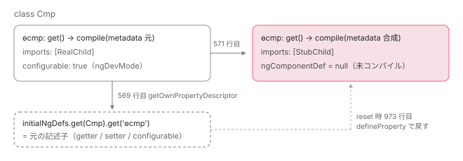

[目次](../README.md) › [standalone コンポーネントの内側](README.md) › 第 12 回 / 全 14 回

# TestBed.overrideComponent で standalone の imports を差し替えると何が再コンパイルされるか

> overrideComponent が OverrideResolver に差分を積み pendingComponents に入れる行、standalone フラグ自体は上書きできないと投げる行、compileTypesSync が resolve した metadata を MetadataOverrider で合成し maybeStoreNgDef で元の ɵcmp を退避してから ɵcompileComponent を呼び直す手順、AOT 済みコンポーネント（デコレータ無し）の特別経路、overrideTemplateUsingTestingModule、@defer を持つコンポーネントの非同期メタデータ、resetTestingModule で ɵcmp が戻る行。

angular/angular · 読了 約 13 分 · 中核 · [サイトで読む（デモが動きます）](https://angular-deep-dive-cyan.vercel.app/chapter/standalone-testbed-override)

---

テストで `TestBed.overrideComponent(Cmp, {set: {imports: [Stub]}})` と書くと、`Cmp` のテンプレートの中で本物の子コンポーネントの代わりに `Stub` が使われます。この章では、その 1 行が **どこに差分を積み**、**いつ・何を再コンパイルし**、**テストが終わったらどう元に戻すのか**を行番号で追います。結論を先に言うと、TestBed はデコレータの metadata を `MetadataOverrider` で合成し直し、元の `ɵcmp` の getter を退避してから JIT の `compileComponent` をもう一度呼ぶだけです。AOT 済み（デコレータが残っていない）コンポーネントには別の経路があり、そこでは `imports` の差し替えは効きません。

読む対象は `packages/core/testing/src/test_bed.ts`、`test_bed_compiler.ts`、`resolvers.ts`、`metadata_overrider.ts` と、JIT 側の `packages/core/src/render3/jit/directive.ts` です。`configureTestingModule` と `DynamicTestModule`、`overrideProvider` の中身は [NgModule シリーズの TestBed の章](../ngmodule/17-ngmodule-testbed.md)で既に読んでいるので、ここでは繰り返しません。

1. [1. 概観](01-standalone.md)
2. [2. @Component 実行の瞬間（JIT）](02-standalone-decorator.md)
3. [3. imports の検証（AOT）](03-standalone-imports-check.md)
4. [4. 使った依存だけが残る](04-standalone-used-only.md)
5. [5. forwardRef と自己参照](05-standalone-forward-ref.md)
6. [6. ローカルコンパイル](06-standalone-local-compilation.md)
7. [7. 実行時の依存解決](07-standalone-directive-registry.md)
8. [8. providers の 2 つの行き先](08-standalone-providers-two-injectors.md)
9. [9. 入口の検査](09-standalone-entry-checks.md)
10. [10. hostDirectives](10-standalone-host-directives.md)
11. [11. @defer と imports](11-standalone-defer-deps.md)
12. **12. TestBed の差し替え**（この章）
13. [13. selectorless（実験的）](13-standalone-selectorless.md)
14. [14. foreignImports（内部向け）](14-standalone-foreign-imports.md)

## 1. 公開 API は TestBedCompiler に委譲するだけ

`TestBed.overrideComponent` は static メソッドで、`TestBedImpl.INSTANCE` の同名メソッドを呼びます。その中身はこれだけです。

📄 `angular/packages/core/testing/src/test_bed.ts` L661–665 （▶ の行: 662–663）

```ts
661 │   overrideComponent(component: Type<any>, override: MetadataOverride<Component>): this {
662 ▶     this.assertNotInstantiated('overrideComponent', 'override component metadata');
663 ▶     this.compiler.overrideComponent(component, override);
664 │     return this;
665 │   }
```

662 行目で「テスト用モジュールがまだ実体化されていないこと」を確認し、663 行目で `TestBedCompiler` に渡します。`createComponent` や `inject` を一度呼んだあとに `overrideComponent` を呼ぶと、662 行目の `assertNotInstantiated` が例外を投げます。override は**最初の実体化より前**にしか積めません。

よく使う `TestBed.overrideTemplate` も、実体は `overrideComponent` の `set` です。

📄 `angular/packages/core/testing/src/test_bed.ts` L700–702 （▶ の行: 701）

```ts
700 │   overrideTemplate(component: Type<any>, template: string): TestBed {
701 ▶     return this.overrideComponent(component, {set: {template, templateUrl: null!}});
702 │   }
```

701 行目。`template` を置き換え、同時に `templateUrl` を `null` にしています。両方が残ると、JIT 側で「テンプレートが未解決」と判定されるためです（6 節）。

### TestBedCompiler.overrideComponent が積む 3 つ

📄 `angular/packages/core/testing/src/test_bed_compiler.ts` L263–283 （▶ の行: 264–266, 270）

```ts
263 │   overrideComponent(component: Type<any>, override: MetadataOverride<Component>): void {
264 ▶     this.verifyNoStandaloneFlagOverrides(component, override);
265 ▶     this.resolvers.component.addOverride(component, override);
266 ▶     this.pendingComponents.add(component);
267 │ 
268 │     // If this is a component with async metadata (i.e. a component with a `@defer` block
269 │     // in a template) - store it for future processing.
270 ▶     this.maybeRegisterComponentWithAsyncMetadata(component);
271 │   }
272 │ 
273 │   overrideDirective(directive: Type<any>, override: MetadataOverride<Directive>): void {
274 │     this.verifyNoStandaloneFlagOverrides(directive, override);
275 │     this.resolvers.directive.addOverride(directive, override);
276 │     this.pendingDirectives.add(directive);
277 │   }
278 │ 
279 │   overridePipe(pipe: Type<any>, override: MetadataOverride<Pipe>): void {
280 │     this.verifyNoStandaloneFlagOverrides(pipe, override);
281 │     this.resolvers.pipe.addOverride(pipe, override);
282 │     this.pendingPipes.add(pipe);
283 │   }
```

1. **264 行目：`standalone` フラグの上書きを拒否**

   次の節で読みます。ここで例外になれば以降は何も積まれません。
2. **265 行目：`OverrideResolver` に差分を積む**

   `this.resolvers.component` は `ComponentResolver` のインスタンスです（`TestBedCompiler` の フィールドとして `initResolvers()` で作られます）。まだ metadata は合成しません。差分を積むだけです。
3. **266 行目：`pendingComponents` に入れる**

   「再コンパイルが必要なコンポーネント」の `Set` です。6 節の `compileTypesSync` がこの Set を順に処理します。`configureTestingModule({imports: [Cmp]})` を呼ばなくても、ここに入っていれば再コンパイルされます（10 節の spec で確認します）。
4. **270 行目：`@defer` を持つコンポーネントなら別の Set にも入れる**

   5 節で読みます。

## 2. standalone フラグだけは上書きできない

📄 `angular/packages/core/testing/src/test_bed_compiler.ts` L289–303 （▶ の行: 294–296, 298）

```ts
289 │   private verifyNoStandaloneFlagOverrides(
290 │     type: Type<any>,
291 │     override: MetadataOverride<Component | Directive | Pipe>,
292 │   ) {
293 │     if (
294 ▶       (override.add && Object.hasOwn(override.add, 'standalone')) ||
295 ▶       (override.set && Object.hasOwn(override.set, 'standalone')) ||
296 ▶       (override.remove && Object.hasOwn(override.remove, 'standalone'))
297 │     ) {
298 ▶       throw new Error(
299 │         `An override for the ${type.name} class has the \`standalone\` flag. ` +
300 │           `Changing the \`standalone\` flag via TestBed overrides is not supported.`,
301 │       );
302 │     }
303 │   }
```

294〜296 行目、`add` / `set` / `remove` のどれかに `standalone` キーがあれば、298 行目で例外です。値が `true` か `false` かは見ていません。**キーがあるだけで拒否**されます。

理由はこのシリーズでずっと見てきたとおりです。standalone かどうかで `ɵcmp.dependencies` が 残るか `null` になるかが変わり（[第 1 回](01-standalone.md)）、依存の供給元が自分の `imports` か NgModule かも変わります。テスト中にこれを反転させると、`configureTestingModule` の `declarations` 検査や `DynamicTestModule` の組み立てと矛盾するため、最初から禁止されています。

## 3. OverrideResolver：差分を積み、合成結果のキャッシュを捨てる

📄 `angular/packages/core/testing/src/resolvers.ts` L37–48 （▶ の行: 38–39, 45, 47）

```ts
37 │ abstract class OverrideResolver<T> implements Resolver<T> {
38 ▶   private overrides = new Map<Type<any>, MetadataOverride<T>[]>();
39 ▶   private resolved = new Map<Type<any>, T | null>();
40 │ 
41 │   abstract get type(): any;
42 │ 
43 │   addOverride(type: Type<any>, override: MetadataOverride<T>) {
44 │     const overrides = this.overrides.get(type) || [];
45 ▶     overrides.push(override);
46 │     this.overrides.set(type, overrides);
47 ▶     this.resolved.delete(type);
48 │   }
```

38 行目の `overrides` は「型 → 差分の配列」、39 行目の `resolved` は「型 → 合成済み metadata」です。45 行目で差分を配列の末尾に push し、**47 行目で合成済みキャッシュを捨てます**。同じコンポーネントに `overrideComponent` を 2 回呼ぶと、差分は 2 つ並び、次に `resolve` されたときに両方が順に適用されます。

📄 `angular/packages/core/testing/src/resolvers.ts` L85–103 （▶ の行: 89, 91, 93–95, 99）

```ts
 85 │   resolve(type: Type<any>): T | null {
 86 │     let resolved: T | null = this.resolved.get(type) || null;
 87 │ 
 88 │     if (!resolved) {
 89 ▶       resolved = this.getAnnotation(type);
 90 │       if (resolved) {
 91 ▶         const overrides = this.overrides.get(type);
 92 │         if (overrides) {
 93 ▶           const overrider = new MetadataOverrider();
 94 ▶           overrides.forEach((override) => {
 95 ▶             resolved = overrider.overrideMetadata(this.type, resolved!, override);
 96 │           });
 97 │         }
 98 │       }
 99 ▶       this.resolved.set(type, resolved);
100 │     }
101 │ 
102 │     return resolved;
103 │   }
```

1. **89 行目：デコレータの metadata を読む**

   `getAnnotation` は `ReflectionCapabilities.annotations(type)` で、クラスに付いた `@Component({...})` の引数オブジェクトそのものを取り出します。AOT でコンパイル済みのクラスにはデコレータが残っていないので `null` になります。この違いが 7 節の分岐になります。
2. **91〜96 行目：差分を順に合成する**

   93 行目で `MetadataOverrider` を作り、94〜96 行目で差分を 1 つずつ `overrideMetadata` に通します。前の結果が次の入力になるので、`set` のあとに `add` を別の呼び出しで積めば、両方が反映されます。
3. **99 行目：結果をキャッシュ**

   次に `addOverride` が呼ばれるまで（3 節の 47 行目）この結果が使われます。

## 4. MetadataOverrider：set → remove → add の順で、新しい Component を作る

📄 `angular/packages/core/testing/src/metadata_overrider.ts` L25–48 （▶ の行: 32, 35–36, 39, 42, 45, 47）

```ts
25 │   overrideMetadata<C extends T, T>(
26 │     metadataClass: {new (options: T): C},
27 │     oldMetadata: C,
28 │     override: MetadataOverride<T>,
29 │   ): C {
30 │     const props: StringMap = {};
31 │     if (oldMetadata) {
32 ▶       _valueProps(oldMetadata).forEach((prop) => (props[prop] = (<any>oldMetadata)[prop]));
33 │     }
34 │ 
35 ▶     if (override.set) {
36 ▶       if (override.remove || override.add) {
37 │         throw new Error(`Cannot set and add/remove ${stringify(metadataClass)} at the same time!`);
38 │       }
39 ▶       setMetadata(props, override.set);
40 │     }
41 │     if (override.remove) {
42 ▶       removeMetadata(props, override.remove, this._references);
43 │     }
44 │     if (override.add) {
45 ▶       addMetadata(props, override.add);
46 │     }
47 ▶     return new metadataClass(<any>props);
48 │   }
```

32 行目で元の metadata の公開プロパティを `props` に写します。35〜40 行目が `set`、41〜43 行目が `remove`、44〜46 行目が `add` です。36 行目のとおり `set` と `add` / `remove` は同時に指定できません。47 行目で `new Component(props)` と、**新しい metadata オブジェクト**を作って返します。元のデコレータ引数は書き換えません。

📄 `angular/packages/core/testing/src/metadata_overrider.ts` L78–94 （▶ の行: 82–83, 85, 92）

```ts
78 │ function addMetadata(metadata: StringMap, add: any) {
79 │   for (const prop in add) {
80 │     const addValue = add[prop];
81 │     const propValue = metadata[prop];
82 ▶     if (propValue != null && Array.isArray(propValue)) {
83 ▶       metadata[prop] = propValue.concat(addValue);
84 │     } else {
85 ▶       metadata[prop] = addValue;
86 │     }
87 │   }
88 │ }
89 │ 
90 │ function setMetadata(metadata: StringMap, set: any) {
91 │   for (const prop in set) {
92 ▶     metadata[prop] = set[prop];
93 │   }
94 │ }
```

92 行目、`set` は `metadata[prop] = set[prop]` の代入です。`set: {imports: [Stub]}` なら、**元の `imports` 配列は丸ごと消えて `[Stub]` だけ**になります。元の依存も残したいときは 82〜83 行目の `add` を使います。元の値が配列なら `concat` で後ろに足されます（85 行目は配列でないときの上書き）。

> [!WARNING]
> **ハマりどころ**
>
> `set: {imports: [StubChild]}` と書いて「子だけ差し替えたつもり」が、元の `imports` にあった `RouterLink` や `FormsModule` まで消える、はこの 92 行目が原因です。再コンパイル後の `dependencies` は `[StubChild]` だけになり、テンプレートに残っている他のディレクティブは照合されません。

## 5. compileComponents が先に待つもの：@defer の非同期メタデータ

1 節の 270 行目で呼ばれた `maybeRegisterComponentWithAsyncMetadata` はこれです。

📄 `angular/packages/core/testing/src/test_bed_compiler.ts` L752–757 （▶ の行: 753, 755）

```ts
752 │   private maybeRegisterComponentWithAsyncMetadata(type: Type<unknown>) {
753 ▶     const asyncMetadataFn = getAsyncClassMetadataFn(type);
754 │     if (asyncMetadataFn) {
755 ▶       this.componentsWithAsyncMetadata.add(type);
756 │     }
757 │   }
```

753 行目の `getAsyncClassMetadataFn` は、`@defer` ブロックを持つコンポーネントにコンパイラが付ける 「依存を `import()` で読み込む関数」を返します（[第 11 回](11-standalone-defer-deps.md)）。それがあるコンポーネントだけ 755 行目で `componentsWithAsyncMetadata` に入ります。

📄 `angular/packages/core/testing/src/test_bed_compiler.ts` L393–412 （▶ の行: 394, 399, 405, 412）

```ts
393 │   async compileComponents(): Promise<void> {
394 ▶     this.clearComponentResolutionQueue();
395 │ 
396 │     // Wait for all async metadata for components that were
397 │     // overridden, we need resolved metadata to perform an override
398 │     // and re-compile a component.
399 ▶     await this.resolvePendingComponentsWithAsyncMetadata();
400 │ 
401 │     // Verify that there were no standalone components present in the `declarations` field
402 │     // during the `TestBed.configureTestingModule` call. We perform this check here in addition
403 │     // to the logic in the `configureTestingModule` function, since at this point we have
404 │     // all async metadata resolved.
405 ▶     assertNoStandaloneComponents(
406 │       this.declarations,
407 │       this.resolvers.component,
408 │       '"TestBed.configureTestingModule" call',
409 │     );
410 │ 
411 │     // Run compilers for all queued types.
412 ▶     let needsAsyncResources = this.compileTypesSync();
```

`await TestBed.compileComponents()` の中身です。394 行目でリソース解決キューを退避し、**399 行目で非同期メタデータを待ち**、405 行目で `declarations` に standalone が無いことを再確認し、412 行目で同期コンパイルに入ります。399 行目の中身はこうです。

📄 `angular/packages/core/testing/src/test_bed_compiler.ts` L370–391 （▶ の行: 375, 377, 382, 384, 389）

```ts
370 │   private async resolvePendingComponentsWithAsyncMetadata() {
371 │     if (this.componentsWithAsyncMetadata.size === 0) return;
372 │ 
373 │     const promises = [];
374 │     for (const component of this.componentsWithAsyncMetadata) {
375 ▶       const asyncMetadataFn = getAsyncClassMetadataFn(component);
376 │       if (asyncMetadataFn) {
377 ▶         promises.push(asyncMetadataFn());
378 │       }
379 │     }
380 │     this.componentsWithAsyncMetadata.clear();
381 │ 
382 ▶     const resolvedDeps = await Promise.all(promises);
383 │     const flatResolvedDeps = resolvedDeps.flat(2);
384 ▶     this.queueTypesFromModulesArray(flatResolvedDeps);
385 │ 
386 │     // Loaded standalone components might contain imports of NgModules
387 │     // with providers, make sure we override providers there too.
388 │     for (const component of flatResolvedDeps) {
389 ▶       this.applyProviderOverridesInScope(component);
390 │     }
391 │   }
```

375〜377 行目で各コンポーネントの非同期関数を呼び、382 行目で全部を `await` します。解決された依存（遅延側のコンポーネント配列）は 384 行目で通常の型キューに入れられ、389 行目で `applyProviderOverridesInScope`（[TestBed の章](../ngmodule/17-ngmodule-testbed.md)で既出）が 遅延側の providers にも `overrideProvider` を効かせます。

> [!TIP]
> **新卒エンジニアへ**
>
> `@defer` を持つコンポーネントを override したのに `compileComponents()` を待たずに `createComponent` すると、次の節の 506〜510 行目で 「`has unresolved metadata. Please call await TestBed.compileComponents()`」と投げられます。

## 6. compileTypesSync：デコレータが残っているコンポーネントの経路

`compileTypesSync` は `compileComponents()` の 412 行目からと、`createComponent` → `testModuleRef` → `finalize()` からの 2 経路で呼ばれます （`finalize` は [TestBed の章](../ngmodule/17-ngmodule-testbed.md)で引用済み）。どちらから来ても `pendingComponents` を先頭から処理します。

📄 `angular/packages/core/testing/src/test_bed_compiler.ts` L502–518 （▶ の行: 505–506, 513, 518）

```ts
502 │   private compileTypesSync(): boolean {
503 │     // Compile all queued components, directives, pipes.
504 │     let needsAsyncResources = false;
505 ▶     this.pendingComponents.forEach((declaration) => {
506 ▶       if (getAsyncClassMetadataFn(declaration)) {
507 │         throw new Error(
508 │           `Component '${declaration.name}' has unresolved metadata. ` +
509 │             `Please call \`await TestBed.compileComponents()\` before running this test.`,
510 │         );
511 │       }
512 │ 
513 ▶       needsAsyncResources = needsAsyncResources || ɵisComponentDefPendingResolution(declaration);
514 │ 
515 │       // Note: we can't use `this.resolvers.component.resolve(declaration)` here, because
516 │       // that function requires the component to have a decorator, which is not the case
517 │       // for AOT components.
518 ▶       let metadata = this.resolvers.component.resolve(declaration);
```

505 行目で 1 節の Set を回し、506 行目で非同期メタデータが残っていれば例外（前節）。513 行目は `templateUrl` などの外部リソースが未解決かどうか。518 行目で 3 節の `resolve` を呼び、**合成済みの metadata**を受け取ります。デコレータが残っているクラスなら `null` ではないので、7 節の AOT 分岐を飛ばして 569 行目へ進みます。

📄 `angular/packages/core/testing/src/test_bed_compiler.ts` L538–573 （▶ の行: 569–571, 573）

```ts
538 │ 
539 │             if (metadata!.providers) {
540 │               const providers = metadata!.providers;
541 │               const providersResolver = (
542 │                 ndef: DirectiveDef<any>,
543 │                 processProvidersFn?: (providers: Provider[]) => Provider[],
544 │               ) => {
545 │                 return processProvidersFn ? processProvidersFn(providers) : providers;
546 │               };
547 │               componentDef.providersResolver = providersResolver;
548 │             }
549 │ 
550 │             if ((metadata as Component).viewProviders) {
551 │               const viewProviders = (metadata as Component).viewProviders!;
552 │               const viewProvidersResolver = (
553 │                 ndef: DirectiveDef<any>,
554 │                 processProvidersFn?: (providers: Provider[]) => Provider[],
555 │               ) => {
556 │                 return processProvidersFn ? processProvidersFn(viewProviders) : viewProviders;
557 │               };
558 │               componentDef.viewProvidersResolver = viewProvidersResolver;
559 │             }
560 │ 
561 │             // We manually patched ɵcmp.
562 │             // We must skip compileComponent to avoid overwriting our work (and to avoid failure).
563 │             return;
564 │           }
565 │         }
566 │         throw invalidTypeError(declaration.name, 'Component');
567 │       }
568 │ 
569 ▶       this.maybeStoreNgDef(NG_COMP_DEF, declaration);
570 ▶       depsTracker.clearScopeCacheFor(declaration);
571 ▶       compileComponent(declaration, metadata);
572 │     });
573 ▶     this.pendingComponents.clear();
```

1. **569 行目：元の `ɵcmp` を退避する**

   📄 `angular/packages/core/testing/src/test_bed_compiler.ts` L910–919 （▶ の行: 911, 915–917）

   ```ts
   910 │   private maybeStoreNgDef(prop: string, type: Type<any>) {
   911 ▶     if (!this.initialNgDefs.has(type)) {
   912 │       this.initialNgDefs.set(type, new Map());
   913 │     }
   914 │     const currentDefs = this.initialNgDefs.get(type)!;
   915 ▶     if (!currentDefs.has(prop)) {
   916 ▶       const currentDef = Object.getOwnPropertyDescriptor(type, prop);
   917 ▶       currentDefs.set(prop, currentDef);
   918 │     }
   919 │   }
   ```

   916 行目、退避するのは値ではなく `Object.getOwnPropertyDescriptor(type, 'ɵcmp')`、つまり**プロパティ記述子**です。JIT の `ɵcmp` は getter（次のステップ）なので、getter 関数ごと保存します。915 行目の `if` により、同じテスト内で 2 回 override しても**最初の 1 回だけ**保存され、元の状態が上書きされません。
2. **570 行目：DepsTracker のスコープキャッシュを消す**

   📄 `angular/packages/core/src/render3/deps_tracker/deps_tracker.ts` L128–131 （▶ の行: 130）

   ```ts
   128 │   clearScopeCacheFor(type: Type<any>): void {
   129 │     this.ngModulesScopeCache.delete(type as NgModuleType);
   130 ▶     this.standaloneComponentsScopeCache.delete(type as ComponentType<any>);
   131 │   }
   ```

   130 行目、`standaloneComponentsScopeCache` からそのコンポーネントを消します。JIT の standalone コンポーネントの `directiveDefs` / `pipeDefs` は `DepsTracker.getStandaloneComponentScope` がキャッシュした結果から作られるため （[第 7 回](07-standalone-directive-registry.md)）、ここを消さないと古い `imports` の依存が返り続けます。
3. **571 行目：JIT の `compileComponent` を合成済み metadata で呼び直す**

   `compileComponent` は `ɵcompileComponent`（`jit/directive.ts`）のエイリアスです。[第 2 回](02-standalone-decorator.md)で読んだ、`@Component` デコレータが実行時に呼ぶ関数と同じものです。つまり**「もう一度デコレータが実行された」のと同じ状態**になります。
4. **573 行目：キューを空にする**

   次に `overrideComponent` が呼ばれるまで、再コンパイルは起きません。

### なぜ ɵcmp を定義し直せるのか

📄 `angular/packages/core/src/render3/jit/directive.ts` L85–92 （▶ の行: 85–87）

```ts
85 ▶   Object.defineProperty(type, NG_COMP_DEF, {
86 ▶     get: () => {
87 ▶       if (ngComponentDef === null) {
88 │         const compiler = getCompilerFacade({
89 │           usage: JitCompilerUsage.Decorator,
90 │           kind: 'component',
91 │           type: type,
92 │         });
```

📄 `angular/packages/core/src/render3/jit/directive.ts` L224–231 （▶ の行: 226, 230）

```ts
224 │       return ngComponentDef;
225 │     },
226 ▶     set: (def: ComponentDef<unknown> | null) => {
227 │       ngComponentDef = def;
228 │     },
229 │     // Make the property configurable in dev mode to allow overriding in tests
230 ▶     configurable: !!ngDevMode,
231 │   });
```

85 行目、`ɵcmp` は `Object.defineProperty` で定義される getter です。87 行目のとおり `ngComponentDef === null` の間はコンパイルせず、最初にアクセスされたときに初めてコンパイルします（遅延）。**230 行目、`configurable: !!ngDevMode`**。開発モードのときだけ「再定義できる」プロパティにしています。コメントのとおり、テストでの上書きのためです。571 行目の `compileComponent` はこの 85 行目をもう一度実行するので、`ɵcmp` は**新しい getter に置き換わり**、新しい getter の中の `ngComponentDef` は `null` から始まります。次に `createComponent` が `Cmp.ɵcmp` を読んだ瞬間に、合成済み metadata（`imports: [Stub]`）で JIT コンパイルが走ります。



*override 前後の Cmp.ɵcmp。getter ごと置き換えるので、元の getter（と元の def）は initialNgDefs の記述子として丸ごと退避される。*

## 7. AOT 済み（デコレータが無い）コンポーネントの特別経路

ライブラリから来た AOT 済みコンポーネントや、AOT でビルドしてテストしている場合、クラスにデコレータは残っておらず `ɵcmp` が静的フィールドとして最初から存在します。3 節の `getAnnotation` が `null` を返すので、518 行目の `metadata` も `null` です。

📄 `angular/packages/core/testing/src/test_bed_compiler.ts` L519–537 （▶ の行: 519–521, 526–529, 534–535）

```ts
519 ▶       if (metadata === null) {
520 ▶         if (this.resolvers.component.hasOverrides(declaration)) {
521 ▶           const componentDef = getComponentDef(declaration);
522 │           if (componentDef) {
523 │             // We have a component without metadata, but with a definition (AOT) and overrides.
524 │             // We can manually apply the overrides to the definition.
525 │             const overrider = new MetadataOverrider();
526 ▶             metadata = new Component({
527 ▶               selector: componentDef.selectors[0][0] as string,
528 ▶               template: componentDef.template as any,
529 ▶               standalone: componentDef.standalone,
530 │             });
531 │ 
532 │             const overrides = this.resolvers.component.getOverrides(declaration);
533 │             if (overrides) {
534 ▶               overrides.forEach((override) => {
535 ▶                 metadata = overrider.overrideMetadata(Component, metadata!, override);
536 │               });
537 │             }
```

1. **519〜521 行目：metadata は無いが `ɵcmp` と override はある**

   `getComponentDef(declaration)` で AOT が生成した `ɵcmp` を取り出します。
2. **526〜530 行目：`ɵcmp` から最低限の metadata を組み立てる**

   `selector`（`selectors[0][0]`）、`template`、`standalone` の 3 つだけです。`imports` はここに**含まれていません**。AOT の `ɵcmp` には `dependencies` はあっても 元の `imports` 配列は残っていないからです（[第 4 回](04-standalone-used-only.md)）。
3. **534〜536 行目：差分を合成する**

   4 節と同じ `MetadataOverrider` です。`set: {imports: [Stub]}` なら `metadata.imports` は `[Stub]` になります。

📄 `angular/packages/core/testing/src/test_bed_compiler.ts` L538–573 （▶ の行: 539, 547, 550, 558, 563）

```ts
538 │ 
539 ▶             if (metadata!.providers) {
540 │               const providers = metadata!.providers;
541 │               const providersResolver = (
542 │                 ndef: DirectiveDef<any>,
543 │                 processProvidersFn?: (providers: Provider[]) => Provider[],
544 │               ) => {
545 │                 return processProvidersFn ? processProvidersFn(providers) : providers;
546 │               };
547 ▶               componentDef.providersResolver = providersResolver;
548 │             }
549 │ 
550 ▶             if ((metadata as Component).viewProviders) {
551 │               const viewProviders = (metadata as Component).viewProviders!;
552 │               const viewProvidersResolver = (
553 │                 ndef: DirectiveDef<any>,
554 │                 processProvidersFn?: (providers: Provider[]) => Provider[],
555 │               ) => {
556 │                 return processProvidersFn ? processProvidersFn(viewProviders) : viewProviders;
557 │               };
558 ▶               componentDef.viewProvidersResolver = viewProvidersResolver;
559 │             }
560 │ 
561 │             // We manually patched ɵcmp.
562 │             // We must skip compileComponent to avoid overwriting our work (and to avoid failure).
563 ▶             return;
564 │           }
565 │         }
566 │         throw invalidTypeError(declaration.name, 'Component');
567 │       }
568 │ 
569 │       this.maybeStoreNgDef(NG_COMP_DEF, declaration);
570 │       depsTracker.clearScopeCacheFor(declaration);
571 │       compileComponent(declaration, metadata);
572 │     });
573 │     this.pendingComponents.clear();
```

合成した metadata から **読み取るのは 539 行目の `providers` と 550 行目の `viewProviders` だけ**です。547 行目と 558 行目で、AOT の `ɵcmp` の `providersResolver` / `viewProvidersResolver` を 「override 後の配列を返す関数」に差し替えます。そして 563 行目で `return` し、`compileComponent` は呼びません。コメントのとおり「手で `ɵcmp` にパッチしたので、再コンパイルで上書きされないように」です。

> [!WARNING]
> **ハマりどころ**
>
> つまり AOT 済みコンポーネントに `set: {imports: [Stub]}` や `set: {template: '...'}` を積んでも、**例外にはならないが `ɵcmp` には反映されません**。この経路で効くのは `providers` と `viewProviders` だけです。`imports` や `template` を差し替えたいテストは、JIT（デコレータが残る）でコンパイルされている必要があります。

## 8. overrideTemplateUsingTestingModule も overrideComponent に帰着する

📄 `angular/packages/core/testing/src/test_bed_compiler.ts` L342–368 （▶ の行: 343, 348, 357–358, 360, 363, 367）

```ts
342 │   overrideTemplateUsingTestingModule(type: Type<any>, template: string): void {
343 ▶     const def = (type as any)[NG_COMP_DEF];
344 │     const hasStyleUrls = (): boolean => {
345 │       const metadata = this.resolvers.component.resolve(type)! as Component;
346 │       return !!metadata.styleUrl || !!metadata.styleUrls?.length;
347 │     };
348 ▶     const overrideStyleUrls = !!def && !ɵisComponentDefPendingResolution(type) && hasStyleUrls();
349 │ 
350 │     // In Ivy, compiling a component does not require knowing the module providing the
351 │     // component's scope, so overrideTemplateUsingTestingModule can be implemented purely via
352 │     // overrideComponent. Important: overriding template requires full Component re-compilation,
353 │     // which may fail in case styleUrls are also present (thus Component is considered as required
354 │     // resolution). In order to avoid this, we preemptively set styleUrls to an empty array,
355 │     // preserve current styles available on Component def and restore styles back once compilation
356 │     // is complete.
357 ▶     const override = overrideStyleUrls
358 ▶       ? {template, styles: [], styleUrls: [], styleUrl: undefined}
359 │       : {template};
360 ▶     this.overrideComponent(type, {set: override});
361 │ 
362 │     if (overrideStyleUrls && def.styles && def.styles.length > 0) {
363 ▶       this.existingComponentStyles.set(type, def.styles);
364 │     }
365 │ 
366 │     // Set the component's scope to be the testing module.
367 ▶     this.componentToModuleScope.set(type, TestingModuleOverride.OVERRIDE_TEMPLATE);
368 │   }
```

360 行目、結局は `this.overrideComponent(type, {set: override})` です。違いは 2 つ。348 行目で「既に `ɵcmp` があり、リソース未解決でもなく、`styleUrl(s)` を持つ」ときは 357〜358 行目で `styles: []` と `styleUrls: []` も一緒に `set` します （再コンパイル時に外部 CSS を読みに行って失敗しないため）。消したスタイルは 363 行目で保存し、コンパイル後に `ɵcmp.styles` へ戻します。367 行目で、そのコンポーネントのスコープを `TestingModuleOverride.OVERRIDE_TEMPLATE` に印付けします。この印は standalone でないコンポーネント向けで、`DynamicTestModule` をスコープにするためのものです（[TestBed の章](../ngmodule/17-ngmodule-testbed.md)）。

## 9. resetTestingModule で ɵcmp が戻る

📄 `angular/packages/core/testing/src/test_bed.ts` L545–551 （▶ の行: 549, 551）

```ts
545 │   resetTestingModule(): this {
546 │     this.checkGlobalCompilationFinished();
547 │     resetCompiledComponents();
548 │     if (this._compiler !== null) {
549 ▶       this.compiler.restoreOriginalState();
550 │     }
551 ▶     this._compiler = new TestBedCompiler(this.platform, this.ngModule);
```

549 行目で `restoreOriginalState()`、551 行目で `TestBedCompiler` を**作り直し**ます。3 節の `OverrideResolver` は `TestBedCompiler` のフィールドなので、積んだ差分は 551 行目で全部消えます。`ɵcmp` を戻すのは 549 行目です。

📄 `angular/packages/core/testing/src/test_bed_compiler.ts` L953–978 （▶ の行: 956–957, 962, 971, 973, 978）

```ts
953 │   restoreOriginalState(): void {
954 │     // Process cleanup ops in reverse order so the field's original value is restored correctly (in
955 │     // case there were multiple overrides for the same field).
956 ▶     forEachRight(this.defCleanupOps, (op: CleanupOperation) => {
957 ▶       op.object[op.fieldName] = op.originalValue;
958 │     });
959 │     // Restore initial component/directive/pipe defs
960 │     this.initialNgDefs.forEach(
961 │       (defs: Map<string, PropertyDescriptor | undefined>, type: Type<any>) => {
962 ▶         depsTracker.clearScopeCacheFor(type);
963 │         defs.forEach((descriptor, prop) => {
964 │           if (!descriptor) {
965 │             // Delete operations are generally undesirable since they have performance
966 │             // implications on objects they were applied to. In this particular case, situations
967 │             // where this code is invoked should be quite rare to cause any noticeable impact,
968 │             // since it's applied only to some test cases (for example when class with no
969 │             // annotations extends some @Component) when we need to clear 'ɵcmp' field on a given
970 │             // class to restore its original state (before applying overrides and running tests).
971 ▶             delete (type as any)[prop];
972 │           } else {
973 ▶             Object.defineProperty(type, prop, descriptor);
974 │           }
975 │         });
976 │       },
977 │     );
978 ▶     this.initialNgDefs.clear();
```

1. **956〜958 行目：フィールド単位のパッチを逆順に戻す**

   7 節の `providersResolver` 差し替えなど、`storeFieldOfDefOnType` で記録したものです。
2. **962 行目：DepsTracker のキャッシュを再度消す**

   6 節で消したあと、テスト中に override 版のスコープがキャッシュされているので、元の def に戻す前にもう一度消します。
3. **971 / 973 行目：記述子を戻す**

   6 節の 916 行目で退避した記述子が `undefined`（元々 `ɵcmp` が無かった）なら 971 行目で `delete`、あれば **973 行目で `Object.defineProperty` により元の getter を戻します**。元の getter はクロージャに `ngComponentDef` を持っている（jit/directive.ts 87 行目）ので、テスト前に一度でもコンパイル済みならその def がそのまま返ります。
4. **978 行目：退避テーブルを空にする**

   次のテストで override すれば、915 行目の `if` が再び「初回」として記述子を保存します。

## 10. 何が変わるのか：4 つの API の比較

| API | 積まれる場所 | 再コンパイルされるもの | standalone の imports に効くか |
| --- | --- | --- | --- |
| `configureTestingModule({imports: [Cmp]})` | `DynamicTestModule` の imports | なし。`ɵcmp` を既に持つクラスは `pendingComponents` に入らない（[queueType](../ngmodule/17-ngmodule-testbed.md)） | 効かない。`Cmp` 自身の `ɵcmp.dependencies` がそのまま |
| `overrideComponent(Cmp, {set/add/remove})` | `ComponentResolver.overrides` + `pendingComponents`（265〜266 行目） | `Cmp` の `ɵcmp` 全体（571 行目で `compileComponent`） | 効く（JIT のみ）。AOT 済みなら providers / viewProviders だけ |
| `overrideTemplateUsingTestingModule(Cmp, tpl)` | 同上 + `componentToModuleScope = OVERRIDE_TEMPLATE`（367 行目） | `Cmp` の `ɵcmp` 全体（template のみ差し替え） | imports はそのまま。standalone なら元の imports で再コンパイル |
| `overrideProvider(token, {useValue})` | `providerOverrides`（[TestBed の章](../ngmodule/17-ngmodule-testbed.md)） | なし。`ɵinj.providers` / `providersResolver` にパッチ | imports は変えない。imports した NgModule の providers には効く |

## 11. 実在する spec で確認する

📄 `angular/packages/core/test/test_bed_spec.ts` L262–291 （▶ の行: 265, 279, 283–284, 290）

```ts
262 │ 
263 │     @Component({
264 │       selector: 'app-root',
265 ▶       imports: [MainDep],
266 │       template: '<dep />',
267 │     })
268 │     class AppComponent {}
269 │ 
270 │     TestBed.configureTestingModule({imports: [AppComponent]});
271 │ 
272 │     let fixture = TestBed.createComponent(AppComponent);
273 │     fixture.detectChanges();
274 │ 
275 │     // No overrides defined, expecting main dependency to be used.
276 │     expect(fixture.nativeElement.innerHTML).toBe('<dep>main dep</dep>');
277 │ 
278 │     // Emulate an end of a test.
279 ▶     TestBed.resetTestingModule();
280 │ 
281 │     // Emulate the start of a next test, make sure previous overrides
282 │     // are not persisted across tests.
283 ▶     TestBed.configureTestingModule({imports: [AppComponent]});
284 ▶     TestBed.overrideComponent(AppComponent, {set: {imports: [MockDep]}});
285 │ 
286 │     fixture = TestBed.createComponent(AppComponent);
287 │     fixture.detectChanges();
288 │ 
289 │     // Main dependency was overridden, expect to see a mock.
290 ▶     expect(fixture.nativeElement.innerHTML).toBe('<dep>mock dep</dep>');
291 │   });
```

265 行目で本物の `MainDep` を import した `AppComponent` を、279 行目の `resetTestingModule` のあと、284 行目で `set: {imports: [MockDep]}` に差し替えます。290 行目、描画結果は `mock dep` です。同じセレクタ `dep` を持つ 2 つのコンポーネントのうち、`imports` にあるほうだけが `directiveRegistry` に入るので、照合で競合は起きません（[第 7 回](07-standalone-directive-registry.md)）。

📄 `angular/packages/core/test/test_bed_spec.ts` L462–482 （▶ の行: 464, 470–473, 480–481）

```ts
462 │     @Component({
463 │       template: '<div dir>{{ name | pipe }}</div>',
464 ▶       imports: [MyStandalonePipeA, MyStandaloneDirectiveA],
465 │     })
466 │     class MyStandaloneComp {
467 │       name = 'MyStandaloneComp';
468 │     }
469 │ 
470 ▶     // NOTE: the `TestBed.configureTestingModule` call is *not* required here, since TestBed
471 ▶     // already knows that the `MyStandaloneComp` should be overridden/recompiled.
472 ▶     TestBed.overrideComponent(MyStandaloneComp, {
473 ▶       set: {imports: [MyStandalonePipeB, MyStandaloneDirectiveB]},
474 │     });
475 │ 
476 │     const fixture = TestBed.createComponent(MyStandaloneComp);
477 │     fixture.detectChanges();
478 │ 
479 │     const rootElement = fixture.nativeElement.firstChild;
480 ▶     expect(rootElement.id).toBe('B');
481 ▶     expect(rootElement.innerHTML).toBe('transformed MyStandaloneComp (B)');
482 │   });
```

470〜471 行目のコメントが 1 節の 266 行目を裏付けています。`configureTestingModule` を呼ばずに `overrideComponent` だけで `pendingComponents` に入り、`createComponent` 時の `finalize` → `compileTypesSync` で再コンパイルされます。464 行目の A 系が 473 行目の B 系に置き換わり、480〜481 行目で B の結果になります。

## ここまでの呼び出し

- 👤 `TestBed.overrideComponent(Cmp, {set: {imports: [Stub]}})` — your.spec.ts
  - `TestBedImpl.overrideComponent()` — core/testing/src/test\_bed.ts L661 — *assertNotInstantiated*
    - `TestBedCompiler.overrideComponent()` — test\_bed\_compiler.ts L263
      - `verifyNoStandaloneFlagOverrides()` — test\_bed\_compiler.ts L289 — *standalone キーがあれば throw*
      - `ComponentResolver.addOverride()` — resolvers.ts L43 — *overrides に push、resolved を delete*
      - `pendingComponents.add(Cmp)` — test\_bed\_compiler.ts L266
- 👤 `TestBed.createComponent(Cmp)` / `await TestBed.compileComponents()` — your.spec.ts
  - `TestBedCompiler.compileTypesSync()` — test\_bed\_compiler.ts L502 — *finalize() か compileComponents() L412 から*
    - `ComponentResolver.resolve(Cmp)` — resolvers.ts L85 — *getAnnotation → MetadataOverrider.overrideMetadata を差分の数だけ*
    - `maybeStoreNgDef('ɵcmp', Cmp)` — test\_bed\_compiler.ts L910 — *元の記述子を initialNgDefs に（初回のみ）*
    - `depsTracker.clearScopeCacheFor(Cmp)` — deps\_tracker.ts L128
    - `ɵcompileComponent(Cmp, 合成 metadata)` — render3/jit/directive.ts L70 — *defineProperty で ɵcmp の getter を置き換え（configurable: !!ngDevMode）*
  - `Cmp.ɵcmp` への最初のアクセス — jit/directive.ts L86 — *合成 metadata で JIT コンパイル → dependencies = () =&gt; \[Stub\]*
- 👤 `TestBed.resetTestingModule()` — （テストランナーが afterEach で）
  - `TestBedCompiler.restoreOriginalState()` — test\_bed\_compiler.ts L953 — *Object.defineProperty(Cmp, 'ɵcmp', 元の記述子)*
  - `new TestBedCompiler(...)` — test\_bed.ts L551 — *OverrideResolver ごと作り直し*

## 聞かれそうな質問

**Q. AOT でビルドしたコンポーネントも overrideComponent できますか？**

例外にはなりませんが、効くのは `providers` と `viewProviders` だけです。`compileTypesSync` の 519〜521 行目で「metadata は無いが `ɵcmp` と override はある」と判定し、526〜530 行目で `ɵcmp` から selector / template / standalone だけの metadata を作って差分を合成します。合成結果から読むのは 539 行目の `providers` と 550 行目の `viewProviders` で、563 行目で `return` して `compileComponent` は呼びません。`imports` や `template` の差し替えは反映されません。

**Q. standalone を false にする override はできますか？**

できません。`verifyNoStandaloneFlagOverrides`（289〜303 行目）が `add` / `set` / `remove` のどれかに `standalone` キーがあるだけで 298 行目の例外を投げます。値は見ていないので `set: {standalone: true}` でも同じです。

**Q. set で imports を置き換えると、元の imports はどうなりますか？**

消えます。`MetadataOverrider` の `setMetadata`（90〜94 行目）は `metadata[prop] = set[prop]` の代入なので、元の配列は丸ごと新しい配列に置き換わります。残したいなら `add: {imports: [Stub]}`（82〜83 行目で `concat`）か、`remove` と `add` を組み合わせます（36 行目のとおり `set` と `add` は同時に書けません）。

**Q. configureTestingModule を呼ばずに overrideComponent だけでも再コンパイルされますか？**

されます。`overrideComponent` の 266 行目で `pendingComponents` に入り、`createComponent` 時の `finalize` から呼ばれる `compileTypesSync`（505 行目）がそれを処理します。`test_bed_spec.ts` 470〜474 行目の spec がまさにその形です。

**Q. 再コンパイルは overrideComponent を呼んだ瞬間に起きますか？**

起きません。2 段階遅延です。`compileTypesSync` の 571 行目で `ɵcompileComponent` が呼ばれるのは `compileComponents()` か最初の `createComponent` / `inject` のとき。そこでも `ɵcmp` の getter（jit/directive.ts 85〜87 行目）を置き換えるだけで、実際の JIT コンパイルは `Cmp.ɵcmp` が最初に読まれた瞬間です。

**Q. テストが終わったら、本物の ɵcmp はどう戻るのですか？**

`resetTestingModule`（test\_bed.ts 549 行目）→ `restoreOriginalState`（test\_bed\_compiler.ts 953 行目）です。override 前に 916 行目で退避したプロパティ記述子を、973 行目の `Object.defineProperty` で戻します。元の getter はクロージャに `ngComponentDef` を持っている（jit/directive.ts 87 行目）ので、コンパイル済みならそれがそのまま返ります。差分そのものは 551 行目で `TestBedCompiler` を作り直すことで消えます。

## 読み終えて

- `overrideComponent` は `ComponentResolver` に差分を積み `pendingComponents` に入れるだけ（263〜271 行目）。`standalone` キーがあれば即例外（298 行目）
- `resolve` がデコレータの metadata を読み、`MetadataOverrider` が set → remove → add の順で**新しい** metadata を作る。`set` は配列の丸ごと置き換え（92 行目）
- `compileTypesSync` は元の `ɵcmp` の記述子を退避（916 行目）→ DepsTracker キャッシュを消す（570 行目）→ `ɵcompileComponent` で getter を置き換える（571 行目、`configurable: !!ngDevMode`）
- AOT 済みコンポーネントはデコレータが無いので別経路。効くのは providers / viewProviders だけで `compileComponent` は呼ばれない（519〜563 行目）
- `@defer` を持つコンポーネントは `compileComponents()` が先に非同期メタデータを待つ（399 行目）。reset は記述子を `defineProperty` で戻す（973 行目）

---

← 前: [@defer と imports：@defer の中でだけ使う依存が eager な dependencies から外れ import() になるまで](11-standalone-defer-deps.md)  
次: [selectorless（実験的）：imports を書かずに &lt;MyCmp /&gt; と書けるようにする仕組み](13-standalone-selectorless.md) →
