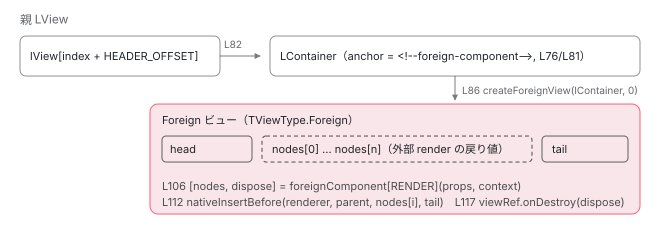

[目次](../README.md) › [standalone コンポーネントの内側](README.md) › 第 14 回 / 全 14 回

# foreignImports（内部向け）：他フレームワークのコンポーネントを standalone の依存に並べる

> @Component.foreignImports は @internal（3p-only）だが v22 のソースに実在する。ForeignComponent インターフェースの 4 つのシンボル（render / onDestroy / contentAdapter / getContext）、ngtsc が extractForeignImportsFromAst で読み analyzeForeignComponentFeatures がテンプレートの使い方を検証する手順、実行時に ɵɵforeignComponent 系の命令が描く位置、JIT では例外になる行。imports との違いを表で整理する。

angular/angular · 読了 約 12 分 · 発展 · [サイトで読む（デモが動きます）](https://angular-deep-dive-cyan.vercel.app/chapter/standalone-foreign-imports)

---

> [!WARNING]
> **ハマりどころ**
>
> この章で読む `@Component.foreignImports` は**公開 API ではありません**。フィールドの JSDoc は `@internal // 3p-only`（directives.ts 649 行目、1 節で引用）で、公開の型定義には現れません。JIT では例外になります（2 節）。v22 のソースに実在する形をそのまま読む回です。

`foreignImports` は、**他のフレームワークが DOM を作って返す**「外部コンポーネント」を standalone コンポーネントの テンプレートに置くための仕組みです。`imports` と似た位置に書きますが、受け取るのは Angular の `Type` ではなく `ForeignComponent` インターフェースを満たすオブジェクトで、`ɵcmp.dependencies` ではなく `consts` に入り、実行時は `ɵɵforeignComponent` という専用の命令で描かれます。この章では、4 つの `Symbol` からなる契約、ngtsc が `foreignImports` の配列を読む行、テンプレートの使い方を検証する行、コンパイラが `ɵɵforeignComponent` を出す行、実行時にその命令が外部の `render` を呼んで DOM を差し込む行を順に読みます。

読む対象は `packages/core/src/metadata/directives.ts`、`packages/core/src/interface/foreign_component.ts`、`packages/core/src/render3/foreign_import.ts`、`packages/core/src/render3/instructions/foreign_component.ts`、ngtsc 側は `packages/compiler-cli/src/ngtsc/annotations/component/src/handler.ts`、`util.ts`、`foreign_component.ts`、コンパイラ側は `packages/compiler/src/template/pipeline/src/ingest.ts` と compliance テストの出力例です。

1. [1. 概観](01-standalone.md)
2. [2. @Component 実行の瞬間（JIT）](02-standalone-decorator.md)
3. [3. imports の検証（AOT）](03-standalone-imports-check.md)
4. [4. 使った依存だけが残る](04-standalone-used-only.md)
5. [5. forwardRef と自己参照](05-standalone-forward-ref.md)
6. [6. ローカルコンパイル](06-standalone-local-compilation.md)
7. [7. 実行時の依存解決](07-standalone-directive-registry.md)
8. [8. providers の 2 つの行き先](08-standalone-providers-two-injectors.md)
9. [9. 入口の検査](09-standalone-entry-checks.md)
10. [10. hostDirectives](10-standalone-host-directives.md)
11. [11. @defer と imports](11-standalone-defer-deps.md)
12. [12. TestBed の差し替え](12-standalone-testbed-override.md)
13. [13. selectorless（実験的）](13-standalone-selectorless.md)
14. **14. foreignImports（内部向け）**（この章）

## 1. フィールドの定義：imports の隣にあるが @internal

📄 `angular/packages/core/src/metadata/directives.ts` L645–662 （▶ の行: 646, 649, 651, 660, 662）

```ts
645 │   /**
646 ▶    * The foreignImports property specifies components from other frameworks that can be used
647 │    * within this component's template.
648 │    *
649 ▶    * @internal // 3p-only
650 │    */
651 ▶   foreignImports?: ForeignComponent<any, any>[];
652 │ 
653 │   /**
654 │    * The `deferredImports` property specifies a standalone component's template dependencies,
655 │    * which should be defer-loaded as a part of the `@defer` block. Angular *always* generates
656 │    * dynamic imports for such symbols and removes the regular/eager import. Make sure that imports
657 │    * which bring symbols used in the `deferredImports` don't contain other symbols.
658 │    *
659 │    * Note: this is an internal-only field, use regular `@Component.imports` field instead.
660 ▶    * @internal // 3p-only
661 │    */
662 ▶   deferredImports?: {[blockName: string]: (Type<any> | ReadonlyArray<any>)[]};
```

646〜647 行目、「他のフレームワークのコンポーネントをこのコンポーネントのテンプレート内で使えるようにする」。**649 行目、`@internal // 3p-only`**。651 行目の型は `ForeignComponent<any, any>[]` です。同じ印が 660 行目の `deferredImports`（[第 11 回](11-standalone-defer-deps.md)）にもあります。`@internal` なので公開の型定義には含まれず、5 節で引用する compliance テストの入力も 「`@angular/core does not expose the foreignImports property`」と `@ts-ignore` を付けて書いています（fixture 15 行目）。

### ForeignComponent の契約：4 つの Symbol

📄 `angular/packages/core/src/interface/foreign_component.ts` L9–34 （▶ の行: 10, 13, 16, 19, 31–34）

```ts
 9 │ /** Symbol used to store and retrieve the render function for a foreign component. */
10 ▶ export const RENDER: unique symbol = Symbol('RENDER');
11 │ 
12 │ /** Symbol used to store and retrieve the disposal registration function for a foreign component. */
13 ▶ export const ON_DESTROY: unique symbol = Symbol('ON_DESTROY');
14 │ 
15 │ /** Symbol used to store and retrieve the content adapter function for a foreign component. */
16 ▶ export const CONTENT_ADAPTER: unique symbol = Symbol('CONTENT_ADAPTER');
17 │ 
18 │ /** Symbol used to store and retrieve the context retrieval function for a foreign component. */
19 ▶ export const GET_CONTEXT: unique symbol = Symbol('GET_CONTEXT');
20 │ 
21 │ /**
22 │  * A function used to render a foreign component in an Angular template.
23 │  *
24 │  * The function accepts the component's properties and optional context. It should return an array
25 │  * of nodes rendered and owned by the foreign component. It may also return a callback to perform
26 │  * any necessary cleanup when the component is destroyed.
27 │  *
28 │  * @template TProps The properties of the foreign component.
29 │  * @template TContext The context passed to the foreign component.
30 │  */
31 ▶ export type ForeignRenderFn<TProps, TContext> = (
32 ▶   props: TProps,
33 ▶   context?: TContext,
34 ▶ ) => [Node[], VoidFunction?];
```

10 / 13 / 16 / 19 行目、キーは文字列ではなく `Symbol` です。外部フレームワーク側のオブジェクトと名前が衝突しないためです。31〜34 行目の `ForeignRenderFn` が中心の契約です。**`props`（と任意の `context`）を受け取り、`[Node[], VoidFunction?]` を返す**。つまり外部側が DOM ノードの配列を作って返し、必要なら後始末の関数を添えます。Angular はそのノードを自分の位置に差し込むだけです（6 節）。

📄 `angular/packages/core/src/interface/foreign_component.ts` L43–70 （▶ の行: 51, 57, 65–69）

```ts
43 │ /**
44 │  * A function that allows a foreign component to register a destroy callback.
45 │  *
46 │  * Angular will invoke this function during the creation phase of projected content
47 │  * to provide a cleanup callback. The foreign component is responsible for calling
48 │  * this callback when the container slot is removed or when the foreign component itself
49 │  * is destroyed. This triggers the destruction and lifecycle cleanup of the nested Angular views.
50 │  */
51 ▶ export type ForeignOnDestroyFn = (destroy: VoidFunction) => void;
52 │ 
53 │ /**
54 │  * A function that adapts an Angular content producer callback into a compatible representation for
55 │  * the foreign component.
56 │  */
57 ▶ export type ForeignContentAdapterFn = (producer: () => Node[]) => any;
58 │ 
59 │ /**
60 │  * Represents a component from another framework that Angular can import and render.
61 │  *
62 │  * @template TProps The properties of the foreign component.
63 │  * @template TContext The context passed to the foreign component.
64 │  */
65 ▶ export interface ForeignComponent<TProps = {}, TContext = unknown> {
66 ▶   readonly [RENDER]: ForeignRenderFn<TProps, TContext>;
67 ▶   readonly [ON_DESTROY]: ForeignOnDestroyFn;
68 ▶   readonly [CONTENT_ADAPTER]: ForeignContentAdapterFn;
69 ▶   readonly [GET_CONTEXT]?: ForeignGetContextFn<TContext>;
70 │ }
```

1. **66 行目 `[RENDER]`：描く**

   上の 31〜34 行目の関数です。
2. **67 行目 `[ON_DESTROY]`：外部側に「片付け関数」を登録する**

   51 行目の型は `(destroy: VoidFunction) => void`。Angular が渡す `destroy` を外部側が保持し、外部側の都合でスロットが消えたときに呼び返します。コメント（46〜49 行目）のとおり、これで中の Angular ビューの破棄が走ります（7 節）。
3. **68 行目 `[CONTENT_ADAPTER]`：Angular の子コンテンツを外部側の表現に変える**

   57 行目、`(producer: () => Node[]) => any`。「呼ぶと Node 配列を返す関数」を受け取り、外部フレームワークが扱える何か（`any`）に変換します。コンテンツ投影の代替です（7 節）。
4. **69 行目 `[GET_CONTEXT]`（任意）：外部側の実行時コンテキストを取る**

   外部フレームワーク側の「今のコンテキスト」を捕まえ、投影された Angular ビューに `FOREIGN_CONTEXT` として渡すのに使います（7 節）。

この 4 つを 1 つのオブジェクトにまとめるヘルパが `foreignImport` です。

📄 `angular/packages/core/src/render3/foreign_import.ts` L32–44 （▶ の行: 32, 38–42）

```ts
32 ▶ export function foreignImport<TProps, TContext = unknown>(
33 │   render: ForeignRenderFn<TProps, TContext>,
34 │   onDestroy: ForeignOnDestroyFn,
35 │   contentAdapter: ForeignContentAdapterFn,
36 │   getContext?: ForeignGetContextFn<TContext>,
37 │ ): ForeignComponent<TProps, TContext> {
38 ▶   return {
39 ▶     [RENDER]: render,
40 ▶     [ON_DESTROY]: onDestroy,
41 ▶     [CONTENT_ADAPTER]: contentAdapter,
42 ▶     [GET_CONTEXT]: getContext,
43 │   };
44 │ }
```

38〜43 行目、引数 4 つを Symbol キーに詰めて返すだけです。外部フレームワーク向けの橋渡しライブラリは、この関数（かこの形のオブジェクト）を返す `myImport(MyComponent)` のような関数を用意し、利用者は `foreignImports: [myImport(MyComponent)]` と書きます。

## 2. JIT では例外

📄 `angular/packages/core/src/render3/jit/directive.ts` L94–99 （▶ の行: 94–96）

```ts
94 ▶         if (metadata.foreignImports !== undefined) {
95 ▶           throw new Error(
96 ▶             `Foreign components are not supported in JIT mode. ` +
97 │               `Component '${type.name}' cannot specify 'foreignImports'.`,
98 │           );
99 │         }
```

[第 2 回](02-standalone-decorator.md)で読んだ `compileComponent` の `ɵcmp` getter の中です。94 行目、`metadata.foreignImports !== undefined` なら 95〜98 行目で 「`Foreign components are not supported in JIT mode`」。空配列でも `undefined` ではないので例外です。つまり **`foreignImports` は AOT 専用**で、TestBed（JIT）でそのコンポーネントを直接コンパイルすることもできません。

## 3. ngtsc が foreignImports を読む：配列の形だけを見る

📄 `angular/packages/compiler-cli/src/ngtsc/annotations/component/src/handler.ts` L611–628 （▶ の行: 612, 618, 620, 624, 626–628）

```ts
611 │     let resolvedImports: Reference<ClassDeclaration>[] | null = null;
612 ▶     let foreignImports: ForeignComponentMeta[] | null = null;
613 │     let resolvedDeferredImports: Reference<ClassDeclaration>[] | null = null;
614 │     let resolvedDeferredImportsByBlock: Map<string, Reference<ClassDeclaration>[]> | null = null;
615 │ 
616 │     let rawImports: ts.Expression | null = component.get('imports') ?? null;
617 │     let rawDeferredImports: ts.Expression | null = component.get('deferredImports') ?? null;
618 ▶     let rawForeignImports: ts.Expression | null = component.get('foreignImports') ?? null;
619 │ 
620 ▶     if ((rawImports || rawDeferredImports || rawForeignImports) && !metadata.isStandalone) {
621 │       if (diagnostics === undefined) {
622 │         diagnostics = [];
623 │       }
624 ▶       const importsField = rawImports
625 │         ? 'imports'
626 ▶         : rawDeferredImports
627 ▶           ? 'deferredImports'
628 ▶           : 'foreignImports';
```

`ComponentDecoratorHandler.analyze` です。618 行目で `foreignImports` の式を取り出し、620 行目、3 つのフィールドのどれかがあって standalone でなければ `NG2010`（`COMPONENT_NOT_STANDALONE`）。624〜628 行目でメッセージに使うフィールド名を選びます。`imports` と同じ検査に相乗りしています （[第 3 回](03-standalone-imports-check.md)）。

📄 `angular/packages/compiler-cli/src/ngtsc/annotations/component/src/handler.ts` L645–654 （▶ の行: 649–651, 653）

```ts
645 │     } else if (rawImports || rawDeferredImports || rawForeignImports) {
646 │       const importDiagnostics: ts.Diagnostic[] = [];
647 │ 
648 │       // There's no need to extract foreign imports if we're only emitting declarations.
649 ▶       if (rawForeignImports && !this.emitDeclarationOnly) {
650 ▶         const {foreignImports: imports, diagnostics} =
651 ▶           extractForeignImportsFromAst(rawForeignImports);
652 │         importDiagnostics.push(...diagnostics);
653 ▶         foreignImports = imports;
654 │       }
```

649 行目、`emitDeclarationOnly`（`.d.ts` だけ出すモード）でなければ、651 行目で `extractForeignImportsFromAst` を呼びます。`imports` のように `PartialEvaluator` で値を評価するのではなく、**AST の形だけ**を見る関数です。

📄 `angular/packages/compiler-cli/src/ngtsc/annotations/component/src/util.ts` L213–230 （▶ の行: 220–221, 224, 226）

```ts
213 │ export function extractForeignImportsFromAst(expr: ts.Expression): {
214 │   foreignImports: ForeignComponentMeta[];
215 │   diagnostics: ts.Diagnostic[];
216 │ } {
217 │   const foreignImports: ForeignComponentMeta[] = [];
218 │   const diagnostics: ts.Diagnostic[] = [];
219 │ 
220 ▶   const unwrappedExpr = unwrapExpression(expr);
221 ▶   if (!ts.isArrayLiteralExpression(unwrappedExpr)) {
222 │     diagnostics.push(
223 │       makeDiagnostic(
224 ▶         ErrorCode.VALUE_HAS_WRONG_TYPE,
225 │         expr,
226 ▶         `'foreignImports' must be an array of foreign imports, e.g. 'foreignImports: [myImport(MyComponent)]'.`,
227 │       ),
228 │     );
229 │     return {foreignImports, diagnostics};
230 │   }
```

📄 `angular/packages/compiler-cli/src/ngtsc/annotations/component/src/util.ts` L268–287 （▶ の行: 268–269, 280–282）

```ts
268 ▶     const arg = unwrapExpression(unwrappedEl.arguments[0]);
269 ▶     if (!ts.isIdentifier(arg)) {
270 │       diagnostics.push(
271 │         makeDiagnostic(
272 │           ErrorCode.VALUE_HAS_WRONG_TYPE,
273 │           unwrappedEl.arguments[0],
274 │           `The component reference passed to the foreign import must be a simple identifier, e.g. 'myImport(MyComponent)'.`,
275 │         ),
276 │       );
277 │       continue;
278 │     }
279 │ 
280 ▶     foreignImports.push({
281 ▶       name: arg.text,
282 ▶       rawExpression: element,
283 │     });
284 │   }
285 │ 
286 │   return {foreignImports, diagnostics};
287 │ }
```

1. **221 行目：配列リテラルでなければ NG1010（`VALUE_HAS_WRONG_TYPE`）**

   226 行目のメッセージが期待する形を示しています：`foreignImports: [myImport(MyComponent)]`。変数に入れた配列を渡すことはできません。
2. **要素ごとの検査（引用の間の行）**

   各要素は「識別子を callee とし、引数がちょうど 1 つの呼び出し式」でなければなりません。`myImport(MyComponent)` の `myImport` が単純な識別子、引数が 1 つ、という形の検査です。
3. **268〜269 行目：引数は識別子**

   `myImport(someObj.Component)` のようなプロパティアクセスは拒否されます。
4. **280〜283 行目：名前と式をそのまま記録**

   **281 行目、`name: arg.text`**。引数の識別子名（`MyComponent`）が、テンプレートで照合に使う名前になります。282 行目の `rawExpression` は呼び出し式そのもので、後で `consts` にそのまま書き出されます（5 節）。`MyComponent` が何かを ngtsc は評価しません。Angular のクラスである必要も、import されている必要も、ここでは確かめません。

## 4. テンプレートの使い方を検証する：できないことの一覧

📄 `angular/packages/compiler-cli/src/ngtsc/annotations/component/src/handler.ts` L860–866 （▶ の行: 860–861, 863, 865）

```ts
860 ▶     const foreignMatcher = createForeignComponentMatcher(foreignImports);
861 ▶     const foreignComponentDiagnostics = analyzeForeignComponentFeatures(template, foreignMatcher);
862 │     if (foreignComponentDiagnostics.length > 0) {
863 ▶       isPoisoned = true;
864 │       diagnostics ??= [];
865 ▶       diagnostics.push(...foreignComponentDiagnostics);
866 │     }
```

860 行目、3 節の名前から `SelectorlessMatcher` を作ります（[第 13 回](13-standalone-selectorless.md)で読んだ、名前の `Map` だけのマッチャです）。861 行目でテンプレート全体を検証し、エラーがあれば 863 行目で `isPoisoned`。

📄 `angular/packages/compiler-cli/src/ngtsc/annotations/component/src/foreign_component.ts` L51–58 （▶ の行: 55–56）

```ts
51 │ export function analyzeForeignComponentFeatures(
52 │   template: ParsedTemplateWithSource,
53 │   foreignMatcher: SelectorlessMatcher<ForeignComponentMeta> | null,
54 │ ): ts.Diagnostic[] {
55 ▶   const analyzer = new ForeignComponentFeatureAnalyzer(foreignMatcher, template.sourceMapping);
56 ▶   tmplAstVisitAll(analyzer, template.nodes);
57 │   return analyzer.diagnostics;
58 │ }
```

📄 `angular/packages/compiler-cli/src/ngtsc/annotations/component/src/foreign_component.ts` L98–134 （▶ の行: 99, 106–107, 111, 119, 123, 131）

```ts
 98 │   private validateForeignComponent(element: TmplAstElement): void {
 99 ▶     if (element.outputs.length > 0) {
100 │       this.diagnostics.push(
101 │         makeTemplateDiagnostic(
102 │           '' as TypeCheckId,
103 │           this.sourceMapping,
104 │           element.sourceSpan,
105 │           ts.DiagnosticCategory.Error,
106 ▶           ngErrorCode(ErrorCode.FOREIGN_COMPONENT_UNSUPPORTED_BINDING),
107 ▶           'Foreign components do not support event bindings.',
108 │         ),
109 │       );
110 │     }
111 ▶     if (element.references.length > 0) {
112 │       this.diagnostics.push(
113 │         makeTemplateDiagnostic(
114 │           '' as TypeCheckId,
115 │           this.sourceMapping,
116 │           element.sourceSpan,
117 │           ts.DiagnosticCategory.Error,
118 │           ngErrorCode(ErrorCode.FOREIGN_COMPONENT_UNSUPPORTED_BINDING),
119 ▶           'Foreign components do not support references.',
120 │         ),
121 │       );
122 │     }
123 ▶     if (element.inputs.some((input) => input.type !== BindingType.Property)) {
124 │       this.diagnostics.push(
125 │         makeTemplateDiagnostic(
126 │           '' as TypeCheckId,
127 │           this.sourceMapping,
128 │           element.sourceSpan,
129 │           ts.DiagnosticCategory.Error,
130 │           ngErrorCode(ErrorCode.FOREIGN_COMPONENT_UNSUPPORTED_BINDING),
131 ▶           'Foreign components only support static attributes and property bindings.',
132 │         ),
133 │       );
134 │     }
```

要素名が `foreignImports` の名前と一致した要素（`<FancyButton>`）に対する検査です。

1. **99〜110 行目：`(click)` などのイベント束縛は不可**

   107 行目「`Foreign components do not support event bindings.`」
2. **111〜122 行目：`#ref` は不可**

   119 行目。外部コンポーネントのインスタンスを Angular 側から参照する手段はありません。
3. **123〜134 行目：プロパティ束縛以外は不可**

   131 行目「`only support static attributes and property bindings`」。`[prop]="x"` と `attr="v"` だけ。`[attr.x]`、`[class.x]`、`[style.x]`、`[(x)]` は `BindingType.Property` ではないので拒否されます。

📄 `angular/packages/compiler-cli/src/ngtsc/diagnostics/src/error_code.ts` L462–486 （▶ の行: 465, 470, 476, 481, 486）

```ts
462 │   /**
463 │    * Raised when a foreign component node has an unsupported Angular binding.
464 │    */
465 ▶   FOREIGN_COMPONENT_UNSUPPORTED_BINDING = 8025,
466 │ 
467 │   /**
468 │    * Raised when a `@content` block is not used as a direct child of a foreign component.
469 │    */
470 ▶   INVALID_CONTENT_PLACEMENT = 8026,
471 │ 
472 │   /**
473 │    * Raised when a `@content` block is named 'children', which is unnecessary because children should be passed
474 │    * implicitly.
475 │    */
476 ▶   FOREIGN_COMPONENT_CONTENT_UNNECESSARY_FOR_CHILDREN = 8027,
477 │ 
478 │   /**
479 │    * Raised when multiple `@content` blocks with the same name are defined for a foreign component.
480 │    */
481 ▶   CONFLICTING_CONTENT_DECLARATION = 8028,
482 │ 
483 │   /**
484 │    * Raised when a `@content` block name conflicts with an input binding on the parent foreign component.
485 │    */
486 ▶   CONFLICTING_CONTENT_AND_PROPERTY = 8029,
```

エラーコードは 8025〜8029 の 5 つです。106 / 118 / 130 行目が 465 行目の `8025`。残りの 4 つは `@content` ブロック（次の項）に関するものです。

### @content ブロック：外部コンポーネントの直下にだけ書ける

📄 `angular/packages/compiler-cli/src/ngtsc/annotations/component/src/foreign_component.ts` L259–279 （▶ の行: 260–261, 269–270）

```ts
259 │   override visitContentBlock(block: TmplAstContentBlock): void {
260 ▶     if (this.parentNodeIsForeignComponent()) {
261 ▶       this.validateContentBlock(block);
262 │     } else {
263 │       this.diagnostics.push(
264 │         makeTemplateDiagnostic(
265 │           '' as TypeCheckId,
266 │           this.sourceMapping,
267 │           block.sourceSpan,
268 │           ts.DiagnosticCategory.Error,
269 ▶           ngErrorCode(ErrorCode.INVALID_CONTENT_PLACEMENT),
270 ▶           '@content blocks are only valid as direct children of foreign components.',
271 │         ),
272 │       );
273 │     }
274 │ 
275 │     const prevParent = this.currentParent;
276 │     this.currentParent = block;
277 │     super.visitContentBlock(block);
278 │     this.currentParent = prevParent;
279 │   }
```

`@content (icon) { ... }` は、この機能のために追加されたテンプレート構文です（`TmplAstContentBlock`）。260〜261 行目、親が外部コンポーネントの要素なら中身の検証へ。そうでなければ 269〜270 行目の `8026` 「`@content blocks are only valid as direct children of foreign components.`」です。中身の検証（引用外の `validateContentBlock`）は、同名ブロックの重複（8028）、親のプロパティ名との衝突（8029）、引数無しの `@content (children)`（8027、子ノードは暗黙に `children` になるので不要）を報告します。

## 5. コンパイラの出力：dependencies ではなく consts、ɵɵforeignComponent 命令

`resolve` 段階で、3 節の記録がコード生成用の形に変わります。

📄 `angular/packages/compiler-cli/src/ngtsc/annotations/component/src/handler.ts` L2444–2461 （▶ の行: 2447, 2451, 2454, 2457–2458）

```ts
2444 │   private resolveForeignComponentImports(
2445 │     analysis: Readonly<ComponentAnalysisData>,
2446 │   ): R3ForeignComponentMetadata[] | null {
2447 ▶     if (analysis.foreignImports === null || analysis.foreignImports.length === 0) {
2448 │       return null;
2449 │     }
2450 │     return analysis.foreignImports.map((foreignMeta) => {
2451 ▶       const {name, rawExpression} = foreignMeta;
2452 │ 
2453 │       // Avoid copying comments from the source file into the compiled output.
2454 ▶       ts.setEmitFlags(rawExpression, ts.EmitFlags.NoComments | ts.EmitFlags.NoNestedComments);
2455 │ 
2456 │       return {
2457 ▶         name,
2458 ▶         component: new o.WrappedNodeExpr(rawExpression),
2459 │       } satisfies R3ForeignComponentMetadata;
2460 │     });
2461 │   }
```

📄 `angular/packages/compiler/src/render3/view/api.ts` L421–431 （▶ の行: 425, 430）

```ts
421 │ export interface R3ForeignComponentMetadata {
422 │   /**
423 │    * The foreign component's name.
424 │    */
425 ▶   name: string;
426 │ 
427 │   /**
428 │    * The expression used to refer to this foreign component.
429 │    */
430 ▶   component: o.Expression;
431 │ }
```

2451 行目で名前と生の式を取り出し、2454 行目でコメントを出力に写さない印を付け、2457〜2458 行目で `{name, component: WrappedNodeExpr(rawExpression)}` にします。`WrappedNodeExpr` は「TypeScript の AST ノードをそのまま出力に埋める式」です。つまり `myImport(MyComponent)` という呼び出し式が**評価されずに、書いたまま**出力へ行きます（430 行目の `component`）。

### テンプレートの要素が外部コンポーネントかどうか

📄 `angular/packages/compiler/src/template/pipeline/src/compilation.ts` L99–116 （▶ の行: 99–102, 104, 110, 114–115）

```ts
 99 ▶     if (foreignImports && foreignImports.length > 0) {
100 ▶       const registry = new Map<string, R3ForeignComponentMetadata[]>();
101 ▶       for (const meta of foreignImports) {
102 ▶         registry.set(meta.name, [meta]);
103 │       }
104 ▶       this.foreignMatcher = new SelectorlessMatcher(registry);
105 │     } else {
106 │       this.foreignMatcher = null;
107 │     }
108 │   }
109 │ 
110 ▶   getForeignComponent(element: t.Element): R3ForeignComponentMetadata | null {
111 │     if (this.foreignMatcher === null) {
112 │       return null;
113 │     }
114 ▶     const matches = this.foreignMatcher.match(element.name);
115 ▶     return matches.length > 0 ? matches[0] : null;
116 │   }
```

テンプレートのコンパイル単位 `ComponentCompilationJob` のコンストラクタです。100〜102 行目で `名前 → [meta]` の `Map` を作り、104 行目で `SelectorlessMatcher` に。110〜116 行目の `getForeignComponent` は、要素名（`element.name`、114 行目）で その `Map` を引くだけです。**CSS セレクタの照合は行われず、要素名がクラス名と一致するかどうか**だけで決まります。

📄 `angular/packages/compiler/src/template/pipeline/src/ingest.ts` L389–406 （▶ の行: 389–391, 393–394, 397–398, 401–402, 404）

```ts
389 ▶   const props = new Map<string, o.Expression>();
390 ▶   for (const attr of element.attributes) {
391 ▶     props.set(attr.name, o.literal(attr.value));
392 │   }
393 ▶   for (const input of element.inputs) {
394 ▶     props.set(input.name, convertAst(input.value, unit.job, input.sourceSpan));
395 │   }
396 │ 
397 ▶   const contentBlocks: t.ContentBlock[] = [];
398 ▶   const childNodes: t.Node[] = [];
399 │ 
400 │   for (const child of element.children) {
401 ▶     if (child instanceof t.ContentBlock) {
402 ▶       contentBlocks.push(child);
403 │     } else {
404 ▶       childNodes.push(child);
405 │     }
406 │   }
```

📄 `angular/packages/compiler/src/template/pipeline/src/ingest.ts` L425–445 （▶ の行: 425–427, 430, 433, 443–444）

```ts
425 ▶   if (childNodes.length > 0) {
426 ▶     const childView = unit.job.allocateView(unit.xref);
427 ▶     ingestNodes(childView, childNodes);
428 │ 
429 │     unit.create.push(
430 ▶       ir.createContentOp(
431 │         id,
432 │         childView.xref,
433 ▶         'children',
434 │         element.startSourceSpan,
435 │         element.sourceSpan,
436 │       ),
437 │     );
438 │   }
439 │ 
440 │   // Foreign components are created in the creation block. Updates are triggered reactively
441 │   // through directly passed signal properties, alleviating the need for any explicit update
442 │   // operations.
443 ▶   const constIndex = unit.job.addConst(foreignComp.component);
444 ▶   unit.create.push(ir.createForeignComponentOp(id, constIndex, props, element.startSourceSpan));
445 │ }
```

1. **389〜395 行目：属性と束縛を 1 つの `props` Map に**

   390〜391 行目、静的属性は文字列リテラル。393〜394 行目、`[label]="title"` のような束縛は式に変換して同じ Map に入れます。通常の要素のように「属性は `consts`、束縛は update ブロックの `ɵɵproperty`」と分けません。
2. **397〜406 行目：子を `@content` ブロックとそれ以外に分ける**

   401〜402 行目が名前付きブロック、404 行目がそれ以外の子ノードです。
3. **425〜437 行目：残りの子ノードは `children` という名前の埋め込みビューに**

   426〜427 行目で子ビューを割り当て、430〜433 行目で名前 `'children'` の content op を積みます。4 節で「引数無しの `@content (children)` は不要」とされる理由です。
4. **443〜444 行目：外部コンポーネントの式を `consts` に入れ、`ForeignComponent` op を積む**

   **443 行目、`unit.job.addConst(foreignComp.component)`**。`myImport(MyComponent)` の式が `ɵcmp.consts` の要素になり、その添字（`constIndex`）が 444 行目の op に渡ります。コメント（440〜442 行目）のとおり、更新ブロックの命令は生成しません。更新は外部側に渡した signal などに任せる設計です。

📄 `angular/packages/compiler/src/render3/r3_identifiers.ts` L28–30 （▶ の行: 28–30）

```ts
28 ▶   static foreignComponent: o.ExternalReference = {name: 'ɵɵforeignComponent', moduleName: CORE};
29 ▶   static foreignContent: o.ExternalReference = {name: 'ɵɵforeignContent', moduleName: CORE};
30 ▶   static foreignContentFn: o.ExternalReference = {name: 'ɵɵforeignContentFn', moduleName: CORE};
```

op が最終的に呼び出す命令の名前です。`ɵɵforeignComponent`、`ɵɵforeignContent`、`ɵɵforeignContentFn` の 3 つ。compliance テストの入力と期待出力で形を確認します。

📄 `angular/packages/compiler-cli/test/compliance/test_cases/r3_compiler_compliance/components_and_directives/standalone/foreign_component.ts` L10–23 （▶ の行: 13, 15–16, 18）

```ts
10 │ @Component({
11 │   selector: 'main',
12 │   template: `
13 ▶     <FancyButton class="btn-cls" unsafe-attr="value" [label]="title" [unsafe-input]="title" />
14 │   `,
15 ▶   // @ts-ignore: @angular/core does not expose the `foreignImports` property.
16 ▶   foreignImports: [
17 │     // @ts-ignore: @angular/core does not expose the `ForeignComponent` type this expects.
18 ▶     frameworkImport(FancyButton),
19 │   ],
20 │ })
21 │ export class TestCmp {
22 │   title = 'Submit';
23 │ }
```

📄 `angular/packages/compiler-cli/test/compliance/test_cases/r3_compiler_compliance/components_and_directives/standalone/foreign_component.js` L58–73 （▶ の行: 62, 65, 68）

```js
58 │ export class TestCmp {
59 │   // ...
60 │   static ɵcmp = /*@__PURE__*/ i0.ɵɵdefineComponent({
61 │     type: TestCmp,
62 ▶     selectors: [["main"]],
63 │     decls: 1,
64 │     vars: 0,
65 ▶     consts: [frameworkImport(FancyButton)],
66 │     template: function TestCmp_Template(rf, ctx) {
67 │       if (rf & 1) {
68 ▶         i0.ɵɵforeignComponent(0, 0, () => ({ class: "btn-cls", "unsafe-attr": "value", label: ctx.title, "unsafe-input": ctx.title }));
69 │       }
70 │     },
71 │     encapsulation: 2
72 │   });
73 │ }
```

13 行目、`<FancyButton class="btn-cls" unsafe-attr="value" [label]="title" [unsafe-input]="title" />`。18 行目の `frameworkImport(FancyButton)` が **65 行目でそのまま `consts: [frameworkImport(FancyButton)]`** に出ています。68 行目、テンプレート関数は `ɵɵforeignComponent(0, 0, () => ({class: "btn-cls", "unsafe-attr": "value", label: ctx.title, "unsafe-input": ctx.title}))` の 1 命令。第 1 引数がスロット番号、第 2 引数が `consts` の添字、第 3 引数が `props` を返す関数です。`ɵcmp` に `dependencies` フィールドは**ありません**（62 行目の `selectors` の次は `decls`）。`imports` 経由の依存とは置き場所が違います。fixture の `…` は fixture 自身の省略記号です。

📄 `angular/packages/compiler-cli/test/compliance/test_cases/r3_compiler_compliance/components_and_directives/standalone/foreign_component.ts` L25–46 （▶ の行: 28–29, 32, 35）

```ts
25 │ @Component({
26 │   selector: 'main-children',
27 │   template: `
28 ▶     <FancyButton [label]="title">
29 ▶       @content (icon) {
30 │         <span>Icon!</span>
31 │       }
32 ▶       @content (description) {
33 │         <span>Description text</span>
34 │       }
35 ▶       <span>Other children</span>
36 │     </FancyButton>
37 │   `,
38 │   // @ts-ignore: @angular/core does not expose the `foreignImports` property.
39 │   foreignImports: [
40 │     // @ts-ignore: @angular/core does not expose the `ForeignComponent` type this expects.
41 │     frameworkImport(FancyButton),
42 │   ],
43 │ })
44 │ export class TestCmpChildren {
45 │   title = 'Submit';
46 │ }
```

📄 `angular/packages/compiler-cli/test/compliance/test_cases/r3_compiler_compliance/components_and_directives/standalone/foreign_component.js` L77–96 （▶ の行: 87–91）

```js
77 │ export class TestCmpChildren {
78 │   // ...
79 │   static ɵcmp = /*@__PURE__*/ i0.ɵɵdefineComponent({
80 │     type: TestCmpChildren,
81 │     selectors: [["main-children"]],
82 │     decls: 4,
83 │     vars: 0,
84 │     consts: [frameworkImport(FancyButton)],
85 │     template: function TestCmpChildren_Template(rf, ctx) {
86 │       if (rf & 1) {
87 ▶         i0.ɵɵdomTemplate(0, TestCmpChildren_Icon_0_Template, 2, 0)(1, TestCmpChildren_Description_1_Template, 2, 0)(2, TestCmpChildren_Children_2_Template, 2, 0);
88 ▶         const icon_r1 = i0.ɵɵforeignContent(0, 0);
89 ▶         const description_r2 = i0.ɵɵforeignContent(1, 0);
90 ▶         const children_r3 = i0.ɵɵforeignContent(2, 0);
91 ▶         i0.ɵɵforeignComponent(3, 0, () => ({ label: ctx.title, icon: icon_r1, description: description_r2, children: children_r3 }));
92 │       }
93 │     },
94 │     encapsulation: 2
95 │   });
96 │ }
```

子を持つ例です。29 行目と 32 行目の名前付き `@content`、35 行目の名無しの子。出力の 87 行目で 3 つの埋め込みテンプレートを `ɵɵdomTemplate` で宣言し、88〜90 行目で `ɵɵforeignContent(スロット, 0)` がそれぞれの「コンテンツの表現」を返し、91 行目の `props` に `icon` / `description` / `children` として渡ります。外部コンポーネントは `props.children` を受け取る、という形に Angular の子コンテンツが変換されています。

## 6. 実行時：ɵɵforeignComponent は外部の render を 1 回だけ呼び、返ってきた Node を差し込む

📄 `angular/packages/core/src/render3/instructions/foreign_component.ts` L50–72 （▶ の行: 50, 53, 58–60, 65–66）

```ts
50 ▶ export function ɵɵforeignComponent(
51 │   index: number,
52 │   foreignComponentIndex: number,
53 ▶   props?: (() => any) | null,
54 │ ): void {
55 │   const lView = getLView();
56 │   const tView = getTView();
57 │   const adjustedIndex = index + HEADER_OFFSET;
58 ▶   const foreignComponent = getConstant<ForeignComponent<any, any>>(
59 ▶     tView.consts,
60 ▶     foreignComponentIndex,
61 │   )!;
62 │ 
63 │   // 1. Get or create TNode for this container slot
64 │   let tNode: TContainerNode;
65 ▶   if (tView.firstCreatePass) {
66 ▶     tNode = getOrCreateTNode(tView, adjustedIndex, TNodeType.Container, null, null);
67 │     // `getOrCreateTNode` unconditionally sets the current node as a parent node, which it is not.
68 │     setCurrentTNodeAsNotParent();
69 │   } else {
70 │     tNode = tView.data[adjustedIndex] as TContainerNode;
71 │     setCurrentTNode(tNode, false);
72 │   }
```

50〜54 行目、引数は 5 節の 68 行目と対応します。58〜61 行目、`tView.consts[foreignComponentIndex]` から `ForeignComponent` オブジェクトを取り出します。AOT の出力に書かれた `frameworkImport(FancyButton)` の呼び出し結果（1 節の 4 つの Symbol を持つオブジェクト）です。65〜66 行目、TNode は `TNodeType.Container`。要素ノードではなく**コンテナ**として扱います。

📄 `angular/packages/core/src/render3/instructions/foreign_component.ts` L74–87 （▶ の行: 76–77, 81–82, 86）

```ts
74 │   // 2. Create the anchor node in the DOM
75 │   const renderer = lView[RENDERER] as Renderer;
76 ▶   const comment = renderer.createComment(ngDevMode ? 'foreign-component' : '');
77 ▶   appendChild(tView, lView, comment, tNode);
78 │   attachPatchData(comment, lView);
79 │ 
80 │   // 3. Create the hosting LContainer
81 ▶   const lContainer = createLContainer(comment, lView, comment, tNode);
82 ▶   lView[adjustedIndex] = lContainer;
83 │   addToEndOfViewTree(lView, lContainer);
84 │ 
85 │   // 4. Create the Foreign View and insert it at index 0 of the container
86 ▶   const viewRef = createForeignView(lContainer, 0);
87 │ 
```

76〜77 行目、DOM にはコメントノード（開発モードでは `<!--foreign-component-->`）を 1 つ置きます。これが位置の目印です。81〜82 行目で `LContainer` を作って `lView` のスロットに入れ、86 行目で `createForeignView` が `TViewType.Foreign` の特別なビュー（head と tail の 2 つのコメントノードで区切られた空のビュー）をコンテナの 0 番に挿します。`LContainer` の仕組みは [Ivy シリーズの LContainer の章](../ivy/11-ivy-lcontainer.md)です。

📄 `angular/packages/core/src/render3/instructions/foreign_component.ts` L88–123 （▶ の行: 89, 91, 97, 99–100, 103, 106, 108–109, 111–112, 116–117）

```ts
 88 │   // 5. Create a run-once view effect to render the foreign component during runEffectsInView
 89 ▶   const node = createViewEffect(lView, lView[ENVIRONMENT].changeDetectionScheduler!, () => {
 90 │     // Destroy this effect the first time it's called to ensure it doesn't run more than once.
 91 ▶     node.destroy();
 92 │ 
 93 │     if (isDestroyed(lView)) {
 94 │       return;
 95 │     }
 96 │ 
 97 ▶     const prevConsumer = setActiveConsumer(null);
 98 │     try {
 99 ▶       const resolvedProps = props ? props() : undefined;
100 ▶       const context = getOrCreateInjectable(
101 │         tNode,
102 │         lView,
103 ▶         FOREIGN_CONTEXT,
104 │         InternalInjectFlags.Optional,
105 │       );
106 ▶       const [nodes, dispose] = foreignComponent[RENDER](resolvedProps, context ?? undefined);
107 │ 
108 ▶       const tail = viewRef.tail as RNode;
109 ▶       const parent = tail.parentNode;
110 │       if (parent) {
111 ▶         for (let i = 0; i < nodes.length; i++) {
112 ▶           nativeInsertBefore(renderer, parent, nodes[i], tail, false);
113 │         }
114 │       }
115 │ 
116 ▶       if (dispose) {
117 ▶         viewRef.onDestroy(dispose);
118 │       }
119 │     } finally {
120 │       setActiveConsumer(prevConsumer);
121 │     }
122 │   });
123 │ }
```

1. **89 行目：ビューエフェクトとして予約し、91 行目で自分を destroy する（1 回限り）**

   `createViewEffect` はこのビューに結びついたエフェクトです（[effect の章](../cd/09-cd-effects.md)）。作成フェーズの命令の中で即描くのではなく、エフェクトの実行タイミングまで遅らせ、最初の 1 回で `node.destroy()` して二度と走らせません。
2. **97 行目：`setActiveConsumer(null)`**

   外部の `render` の中で signal を読んでも、このエフェクトの依存として記録されないようにします。再描画は外部側の責任です。
3. **99〜105 行目：props を評価し、`FOREIGN_CONTEXT` を任意で注入する**

   📄 `angular/packages/core/src/render3/foreign_context.ts` L15–28 （▶ の行: 15, 23, 25）

   ```ts
   15 ▶ export const FOREIGN_CONTEXT = new InjectionToken<unknown>('FOREIGN_CONTEXT');
   16 │ 
   17 │ /**
   18 │  * Configures an opaque root context for a foreign framework within Angular's dependency injection
   19 │  * hierarchy.
   20 │  *
   21 │  * @param contextFactory The factory function that creates the root context object.
   22 │  */
   23 ▶ export function provideForeignRootContext(contextFactory: () => unknown): Provider {
   24 │   return {
   25 ▶     provide: FOREIGN_CONTEXT,
   26 │     useFactory: contextFactory,
   27 │   };
   28 │ }
   ```

   99 行目で 5 節の `() => ({label: ctx.title, ...})` を呼びます。100〜105 行目、`getOrCreateInjectable` で `FOREIGN_CONTEXT`（15 行目のトークン）を `Optional` で探します。23〜28 行目の `provideForeignRootContext` で アプリの providers に入れておけば、外部フレームワークの「ルートのコンテキスト」が `render` の第 2 引数に渡ります。[DI の章](../di/10-di.md)のノード注入器の探索です。
4. **106 行目：外部の `render` を呼ぶ**

   `foreignComponent[RENDER](resolvedProps, context)`。1 節の契約どおり `[nodes, dispose]` が返ります。
5. **108〜114 行目：返ってきた Node を tail の前に挿す**

   `viewRef.tail` は 86 行目の Foreign ビューの末尾コメントノードです。109 行目でその親を取り、111〜112 行目で `nodes` を順に `tail` の直前へ。Angular は外部が作った DOM の中身を一切見ません。位置だけを決めます。
6. **116〜118 行目：後始末を登録**

   外部が返した `dispose` を `viewRef.onDestroy` に。この Angular ビューが壊れるとき外部側も片付けられます。



*ɵɵforeignComponent が作る構造。LContainer の 0 番に Foreign ビュー（head / tail のコメント）があり、外部 render が返した Node を tail の前に並べる。*

## 7. 子コンテンツ：ɵɵforeignContent は「呼ばれたら Angular ビューを作って Node を返す関数」を外部側に渡す

📄 `angular/packages/core/src/render3/instructions/foreign_component.ts` L172–210 （▶ の行: 177–179, 181, 183, 188–189, 193, 196, 200, 206, 209）

```ts
172 │ export function ɵɵforeignContent(index: number, foreignComponentConstIndex: number): any {
173 │   const [lView, lContainer, tNode, foreignComponent] = resolveForeignContentContainer(
174 │     index,
175 │     foreignComponentConstIndex,
176 │   );
177 ▶   const adapter = foreignComponent[CONTENT_ADAPTER];
178 ▶   const onDestroy = foreignComponent[ON_DESTROY];
179 ▶   const getContext = foreignComponent[GET_CONTEXT];
180 │ 
181 ▶   const producer = () => {
182 │     const options = getContext
183 ▶       ? {embeddedViewInjector: new ForeignContextInjector(getContext())}
184 │       : undefined;
185 │ 
186 │     // Instantiate and render the embedded view inside the container, but do not add its elements to
187 │     // the DOM at the container anchor since the nodes will be projected into a foreign view.
188 ▶     const embeddedLView = createAndRenderEmbeddedLView(lView, tNode, null, options);
189 ▶     addLViewToLContainer(
190 │       lContainer,
191 │       embeddedLView,
192 │       lContainer.length - CONTAINER_HEADER_OFFSET,
193 ▶       /* addToDOM */ false,
194 │     );
195 │ 
196 ▶     onDestroy(() => {
197 │       if (!isDestroyed(embeddedLView)) {
198 │         const embeddedLViewIndex = lContainer.indexOf(embeddedLView, CONTAINER_HEADER_OFFSET);
199 │         ngDevMode && assertNotSame(embeddedLViewIndex, -1, 'Embedded view not found in container');
200 ▶         removeLViewFromLContainer(lContainer, embeddedLViewIndex - CONTAINER_HEADER_OFFSET);
201 │       }
202 │     });
203 │ 
204 │     const embeddedTView = embeddedLView[TVIEW];
205 │     // Extract and return the root nodes of the created view
206 ▶     return collectNativeNodes(embeddedTView, embeddedLView, embeddedTView.firstChild, []);
207 │   };
208 │ 
209 ▶   return adapter(producer);
210 │ }
```

1. **177〜179 行目：契約の残り 3 つを取り出す**

   `CONTENT_ADAPTER`、`ON_DESTROY`、`GET_CONTEXT`。1 節の 67〜69 行目です。
2. **181〜207 行目：`producer` を定義する（まだ呼ばない）**

   183 行目、`GET_CONTEXT` があれば、その戻り値を `FOREIGN_CONTEXT` として返す小さなインジェクタ `ForeignContextInjector` を `embeddedViewInjector` に指定します。188 行目で埋め込みビュー（5 節の 87 行目の `ɵɵdomTemplate` で宣言したテンプレート）を作って描き、189〜194 行目で `LContainer` に追加しますが、**193 行目 `addToDOM: false`**。DOM には置きません。196〜202 行目、外部側に「このビューをコンテナから外す関数」を `onDestroy` で預けます。206 行目、`collectNativeNodes` でそのビューのルート DOM ノードを配列にして返します。
3. **209 行目：`adapter(producer)` の戻り値を返す**

   `ɵɵforeignContent` 自身の戻り値は、外部側の `CONTENT_ADAPTER` が `producer` から作った「何か」です。5 節の 88〜91 行目で、それが `props.icon` / `props.children` として `render` に渡ります。外部フレームワークが `children` を描く場所で `producer` を呼べば、そのときに初めて Angular の埋め込みビューが作られ、DOM ノードが手渡されます。

`ɵɵforeignContentFn`（同じファイルにある、引数を持つ版）は `@content (items; let item, index)` のように引数を持つ版で、「引数を受け取って毎回新しい埋め込みビューを作る関数」を返します。構造は同じです。

## 8. imports / deferredImports / foreignImports の比較

|   | `imports` | `deferredImports` | `foreignImports` |
| --- | --- | --- | --- |
| 公開か | 公開（directives.ts 643 行目） | `@internal // 3p-only`（660 行目） | `@internal // 3p-only`（649 行目） |
| 受け取るもの | standalone なコンポーネント / ディレクティブ / パイプ、NgModule（`Type`） | ブロック名 → `Type` の配列（662 行目） | `ForeignComponent` オブジェクト（4 つの Symbol）。`myImport(X)` の形の呼び出し式のみ（util.ts 221〜283 行目） |
| ngtsc での扱い | `PartialEvaluator` で評価し、クラスの metadata を解決（[第 3 回](03-standalone-imports-check.md)） | 同上 + `import()` 化（[第 11 回](11-standalone-defer-deps.md)） | AST の形だけ検査、引数の識別子名を記録。評価しない（util.ts 281〜282 行目） |
| JIT | 対応（`dependencies: () => imports`） | 第 11 回を参照 | 例外（jit/directive.ts 94〜98 行目） |
| ɵcmp のどこに出るか | `dependencies` | `ɵɵdefer` の依存関数（`import()`） | `consts`（fixture 65 行目）。`dependencies` には出ない |
| テンプレートでの照合 | CSS セレクタ（[第 7 回](07-standalone-directive-registry.md)） | 同上 | 要素名 = 引数の識別子名（compilation.ts 114 行目） |
| 描画する命令 | `ɵɵelementStart` など + ディレクティブ生成 | 同上（`@defer` 内） | `ɵɵforeignComponent` / `ɵɵforeignContent` / `ɵɵforeignContentFn` |

## ここまでの呼び出し

- 👤 `@Component({foreignImports: [myImport(FancyButton)], template: '<FancyButton [label]="title"/>'})` — your.component.ts（AOT）
  - `ComponentDecoratorHandler.analyze()` — compiler-cli/.../component/src/handler.ts L618 — *rawForeignImports を取り出す。standalone でなければ NG2010*
    - `extractForeignImportsFromAst(expr)` — component/src/util.ts L213 — *配列 → 呼び出し式 → 識別子引数。{name: 'FancyButton', rawExpression}*
    - `analyzeForeignComponentFeatures(template, matcher)` — component/src/foreign\_component.ts L51 — *イベント / #ref / Property 以外の束縛、@content の位置を検査（8025〜8029）*
  - `ComponentDecoratorHandler.compile*()` → `resolveForeignComponentImports()` — handler.ts L2444 — *{name, component: WrappedNodeExpr(式)}*
    - `compileComponentFromMetadata()` → `ingestComponent(..., meta.foreignImports)` — compiler/src/render3/view/compiler.ts L207
      - `new ComponentCompilationJob(...)` — template/pipeline/src/compilation.ts L99 — *名前 → meta の SelectorlessMatcher*
      - `ingestElement()` → `getForeignComponent(element)` — template/pipeline/src/ingest.ts L332 — *要素名で Map を引く*
      - `ingestForeignComponent()` — ingest.ts L383 — *props Map、@content / children の埋め込みビュー、addConst(式)、ForeignComponent op*
  - 出力: `consts: [myImport(FancyButton)]`、`ɵɵforeignComponent(0, 0, () => ({label: ctx.title}))` — fixture foreign\_component.js L65 / L68
- 👤 ブラウザでテンプレート関数が `rf & 1` で実行される
  - `ɵɵforeignComponent(0, 0, props)` — core/src/render3/instructions/foreign\_component.ts L50 — *consts から ForeignComponent、コメント anchor、LContainer、Foreign ビュー*
    - `createViewEffect(lView, scheduler, fn)` — foreign\_component.ts L89 — *1 回限りのエフェクトを予約*
      - `foreignComponent[RENDER](props(), FOREIGN_CONTEXT?)` — foreign\_component.ts L106 — *外部フレームワークが \[Node\[\], dispose?\] を返す*
      - `nativeInsertBefore(renderer, parent, nodes[i], tail)` × n — foreign\_component.ts L112
      - `viewRef.onDestroy(dispose)` — foreign\_component.ts L117

## 聞かれそうな質問

**Q. React のコンポーネントを Angular のテンプレートに置けるということですか？**

ソースに特定のフレームワーク名は出てきません。ソースにある契約は `ForeignRenderFn`（interface/foreign\_component.ts 31〜34 行目）、つまり「`props` を受け取り `[Node[], VoidFunction?]` を返す関数」です。この契約を満たす `myImport(X)` を用意できるフレームワークなら、その `render` が作った DOM を `ɵɵforeignComponent` が tail の前に差し込みます（instructions/foreign\_component.ts 106〜114 行目）。Angular 側は DOM の中身に関与せず、位置と破棄のタイミングだけを管理します。

**Q. content projection（ng-content）はどうなりますか？**

`<ng-content>` ではなく `CONTENT_ADAPTER` と `@content` ブロックです。コンパイラは子ノードを埋め込みテンプレートにし（ingest.ts 425〜437 行目、名前は `children`）、`ɵɵforeignContent`（foreign\_component.ts 172〜210 行目）が「呼ばれたら埋め込みビューを作って Node 配列を返す」`producer` を 外部側の `CONTENT_ADAPTER` に渡し、その戻り値が `props.children` になります（fixture 88〜91 行目）。埋め込みビューは `addToDOM: false`（193 行目）で作られ、外部側が受け取った Node を自分で置きます。

**Q. テストで使えますか？**

TestBed（JIT）でそのコンポーネントをコンパイルすると、jit/directive.ts 94〜98 行目で 「`Foreign components are not supported in JIT mode`」の例外です。`foreignImports` は AOT 専用です。

**Q. (click) を付けたらどうなりますか？**

コンパイルエラー NG8025 です。compiler-cli の foreign\_component.ts 99〜110 行目で `element.outputs.length > 0` なら 「`Foreign components do not support event bindings.`」。`#ref`（111〜122 行目）と、`[attr.x]` / `[class.x]` / `[style.x]` / `[(x)]`（123〜134 行目、Property 以外の束縛）も同じコードで拒否されます。イベントは外部側に関数を `props` として渡す形になります。

**Q. imports と何が違うのですか？ɵcmp.dependencies に入りますか？**

入りません。`extractForeignImportsFromAst` は呼び出し式を評価せず名前と式を記録し（util.ts 281〜282 行目）、`ingestForeignComponent` が式を `addConst` で `consts` に入れます（ingest.ts 443 行目）。fixture の出力でも `consts: [frameworkImport(FancyButton)]`（65 行目）があり `dependencies` はありません。照合も CSS セレクタではなく要素名と識別子名の一致です（compilation.ts 114 行目）。

**Q. 外部コンポーネントは Angular の変更検知で再描画されますか？**

されません。ingest.ts 440〜442 行目のコメントどおり更新ブロックの命令は生成されず、実行時も `createViewEffect` の中で 91 行目に `node.destroy()` があるので `render` は 1 回だけです。97 行目の `setActiveConsumer(null)` により `render` 内で読んだ signal も依存として記録されません。更新は `props` に signal などを渡し、外部側が購読する形です。

## 読み終えて

- `foreignImports` は `@internal // 3p-only`（directives.ts 649 行目）。JIT では例外（jit/directive.ts 95 行目）
- 契約は 4 つの Symbol：`RENDER`（props → `[Node[], dispose?]`）、`ON_DESTROY`、`CONTENT_ADAPTER`、`GET_CONTEXT`（任意）。`foreignImport()` がまとめる
- ngtsc は `myImport(X)` の形だけを検査して名前 `X` と式を記録し（util.ts 281〜282 行目）、テンプレートでイベント / 参照 / Property 以外の束縛と `@content` の位置を 8025〜8029 で検査する
- 出力は `consts` に式、テンプレート関数に `ɵɵforeignComponent(slot, constIndex, () => props)`。`dependencies` には出ず、照合は要素名の完全一致
- 実行時は LContainer + Foreign ビューを作り、1 回限りのビューエフェクトで外部 `render` を呼び、返った Node を tail の前へ。子コンテンツは `ɵɵforeignContent` が `producer` を `CONTENT_ADAPTER` に渡す

---

← 前: [selectorless（実験的）：imports を書かずに &lt;MyCmp /&gt; と書けるようにする仕組み](13-standalone-selectorless.md)  
次: [DI の概観：NodeInjector と環境インジェクタ、2 つの木と 1 本の探索順](../di/01-di-overview.md) →
