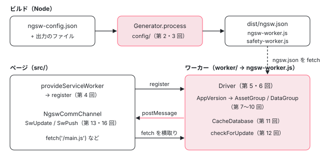

[目次](../README.md) › [Service Worker の内側](README.md) › 第 1 回 / 全 20 回

# Service Worker の全体像：ngsw.json・ngsw-worker.js・SwUpdate

> packages/service-worker の分担（config/ は ngsw.json を作る Generator、cli/ は ngsw-config のコマンド、worker/ はブラウザの中で動く Driver、src/ はアプリの側の provideServiceWorker・SwUpdate・SwPush、testing/ と worker/testing/ はテストの偽物）。ビルドで ngsw.json ができ、ページがワーカーを登録し、ワーカーがファイルを取り込んで fetch を横取りし、新しい版を知らせるまでの流れ。

angular/angular · 読了 約 12 分 · 基礎 · [サイトで読む（デモが動きます）](https://angular-deep-dive-cyan.vercel.app/chapter/sw-overview)

---

Angular の Service Worker は、1 つのパッケージ `@angular/service-worker` の中で 3 つの場所に分かれて動きます。ビルドのときに Node で動く部品（`ngsw.json` を作る）、ページの中で動く部品（ワーカーを登録し、知らせを受け取る）、ブラウザのワーカーの中で動く部品（`ngsw-worker.js`）です。この章では、ソースのどのフォルダがどれに当たり、npm に何が入るのか、そして 1 回の更新がどの順で流れるのかを、実物の行とページの上の本物のワーカーで確かめます。

読む対象は `packages/service-worker/` の `PACKAGE.md`・`package.json`・`BUILD.bazel`・`src/index.ts`・`config/public_api.ts` です（../angular、22.2.0-next.7、8576f161ae4）。

1. **1. 全体像**（この章）
2. [2. Generator](02-sw-config-generator.md)
3. [3. ビルド](03-sw-cli-build.md)
4. [4. 登録](04-sw-register.md)
5. [5. Driver の起動](05-sw-driver-lifecycle.md)
6. [6. fetch の横取り](06-sw-driver-fetch.md)
7. [7. 版とタブ](07-sw-versions.md)
8. [8. アセット](08-sw-asset-groups.md)
9. [9. ハッシュ](09-sw-hash-integrity.md)
10. [10. データ](10-sw-data-groups.md)
11. [11. 小さな DB](11-sw-database.md)
12. [12. 更新の確認](12-sw-update-check.md)
13. [13. SwUpdate](13-sw-swupdate.md)
14. [14. アイドルと掃除](14-sw-idle-cleanup.md)
15. [15. 壊れたとき](15-sw-safe-mode.md)
16. [16. プッシュ](16-sw-push.md)
17. [17. デバッグ](17-sw-debug.md)
18. [18. ワーカーのテスト](18-sw-testing-harness.md)
19. [19. アプリ側のテスト](19-sw-testing-app.md)
20. [20. issue と PR を読む](20-sw-issues.md)

## 1. パッケージの最初の 1 行

Service Worker（サービスワーカー）は、ページとは別のスレッドで動き、そのページが出すリクエストを途中で受け取って、自分で答えを返せるスクリプトです。パッケージの説明書 `PACKAGE.md` は、その説明より先に、方針を書いています。

📄 `angular/packages/service-worker/PACKAGE.md` L1–9 （▶ の行: 1, 7）

```md
1 ▶ IMPORTANT: The Angular Service Worker is a basic caching utility for simple offline support with a limited featureset. We will not be accepting any new features other than security fixes. For more advanced caching and offline capabilities, we recommend exploring native browser APIs directly.
2 │ 
3 │ Implements a service worker for Angular apps.
4 │ Adding a service worker to an Angular app is one of the steps for turning it into a Progressive Web App (also known as a PWA).
5 │ 
6 │ At its simplest, a service worker is a script that runs in the web browser and manages caching for an application.
7 ▶ Service workers function as a network proxy. They intercept all outgoing HTTP requests made by the application and can choose how to respond to them.
8 │ 
9 │ To set up the Angular service worker in your project, use the CLI `add` command.
```

1 行目のとおり、このパッケージは「簡単なオフライン対応のための、機能の限られたキャッシュの道具」で、**セキュリティの修正のほかは新しい機能を受け付けません**。7 行目はワーカーの役目（すべての HTTP リクエストを受け取り、どう答えるかを選ぶネットワークのプロキシ）、12 行目は入れ方（`ng add @angular/pwa`、[第 3 回](03-sw-cli-build.md)）です。

> [!NOTE]
> **ポイント**
>
> 1 行目の方針は、PR の扱いにも表れています。2026-09 に出た「`registerWhenStable` にタイムアウトを書かないと安定を待たない」を直す PR #71018 は「service worker はセキュリティの修正だけ」として閉じられ、代わりに説明を直す PR #71041 が入りました（[第 4 回](04-sw-register.md)で行を読みます）。2026-04 の PR #67918（CSP の違反の報告を横取りしない、という fix）も同じ理由でマージされずに閉じられています。新しい機能の PR は受け付けられず、不具合の直しも慎重に扱われます。
>
> さらに、ここで読んでいる 8576f161ae4 より後に、main の PACKAGE.md の 1 行目は commit 3ace772da9c（docs(service-worker): clarify maintenance mode note）で「新しい機能**も不具合の直しも**、セキュリティの修正のほかは受け付けない」に書き直されました（`gh api 'repos/angular/angular/contents/packages/service-worker/PACKAGE.md?ref=main'` で読めます）。つまり今は、セキュリティ以外の PR はどれもマージされないと考えてよい、ということです。このシリーズで見つかる不具合らしきものは、「手元で確かめる」「issue を読むときの手がかりにする」ためのものとして読みます（[第 20 回](20-sw-issues.md)の 0 節）。

## 2. フォルダの分担

2026-11-03 に `find packages/service-worker -type f` で数えた表です（BUILD.bazel は数えていません）。

| フォルダ | 中身 | どこで動くか | このシリーズ |
| --- | --- | --- | --- |
| `config/` | `src/` の 5 個（`generator.ts` 210 行・`glob.ts`・`duration.ts`・`in.ts`・`filesystem.ts`）、`schema.json`、`test/generator_spec.ts`、`testing/mock.ts` | ビルドのとき（Node）。`ngsw-config.json` を読んで `ngsw.json` を作る `Generator` | [第 2 回](02-sw-config-generator.md) |
| `cli/` | `main.ts`・`filesystem.ts`・`sha1.ts` | Node。単独で走らせる `ngsw-config` のコマンド | [第 3 回](03-sw-cli-build.md) |
| `src/` | `provider.ts`・`module.ts`・`low_level.ts`・`update.ts`・`push.ts`・`errors.ts`・`index.ts` の 7 個 | ページの中（アプリの側）。`provideServiceWorker`・`SwUpdate`・`SwPush` | [第 4 回](04-sw-register.md)・[第 13 回](13-sw-swupdate.md)・[第 16 回](16-sw-push.md) |
| `worker/` | 入口 `main.ts`（16 行）と `src/` の 16 個（`driver.ts` 1395 行・`assets.ts` 722 行・`data.ts` 655 行・`app-version.ts`・`idle.ts`・`db-cache.ts` など）、`test/` の spec 5 本、`testing/` の偽物 7 個 | ブラウザのワーカーの中。1 本の `ngsw-worker.js` にまとめられる | [第 5〜12・14〜18 回](05-sw-driver-lifecycle.md) |
| `test/`・`testing/` | `comm_spec.ts`・`provider_spec.ts`・`integration_spec.ts`、偽物の `navigator.serviceWorker`（`testing/mock.ts`） | テスト（Node とブラウザ） | [第 19 回](19-sw-testing-app.md) |
| 直下 | `safety-worker.js`（30 行）、`package.json`、`index.ts`・`public_api.ts`、`PACKAGE.md` | `safety-worker.js` はワーカーを止めるための別のワーカー | [第 15 回](15-sw-safe-mode.md) |

ページの側から使える名前は `src/index.ts` の 12 行だけです。

📄 `angular/packages/service-worker/src/index.ts` L9–20 （▶ の行: 10, 15, 17–20）

```ts
 9 │ export {
10 ▶   NoNewVersionDetectedEvent,
11 │   UnrecoverableStateEvent,
12 │   VersionDetectedEvent,
13 │   VersionEvent,
14 │   VersionInstallationFailedEvent,
15 ▶   VersionReadyEvent,
16 │ } from './low_level';
17 ▶ export {ServiceWorkerModule} from './module';
18 ▶ export {provideServiceWorker, SwRegistrationOptions} from './provider';
19 ▶ export {SwPush} from './push';
20 ▶ export {SwUpdate} from './update';
```

10〜15 行目の 6 つの型は、`SwUpdate.versionUpdates` などに流れてくる知らせの形です（[第 13 回](13-sw-swupdate.md)）。17〜18 行目が登録の入口（[第 4 回](04-sw-register.md)）、19〜20 行目がアプリから使うサービスです。**ワーカーの中身（`Driver` など）はここに 1 つも出てきません。**ワーカーは npm パッケージの API ではなく、1 本の JS ファイルとして配られるからです（次の節）。ビルドの道具のほうは、別の入口 `config/public_api.ts` から出ています。

📄 `angular/packages/service-worker/config/public_api.ts` L9–11 （▶ の行: 9–11）

```ts
 9 ▶ export {Filesystem} from './src/filesystem';
10 ▶ export {Generator} from './src/generator';
11 ▶ export {AssetGroup, Config, DataGroup, Duration, Glob} from './src/in';
```

9 行目の `Filesystem` は「ファイルの一覧と中身とハッシュを返すもの」の型、10 行目の `Generator` が `ngsw.json` を作るクラス、11 行目は `ngsw-config.json` の型です。angular-cli はこの入口を `import('@angular/service-worker/config')` で読み込みます（[第 3 回](03-sw-cli-build.md)）。

## 3. npm のパッケージに入るもの

📄 `angular/packages/service-worker/BUILD.bazel` L44–66 （▶ の行: 46–50, 63–64）

```python
44 │ ng_package(
45 │     srcs = [
46 ▶         "package.json",
47 ▶         "safety-worker.js",
48 ▶         ":ngsw_config_binary",
49 ▶         ":ngsw_worker_renamed",
50 ▶         "//packages/service-worker/config:schema.json",
51 │     ],
52 │     package = "@angular/service-worker",
53 │     tags = [
54 │         "release-with-framework",
55 │     ],
56 │     # Do not add more to this list.
57 │     # Dependencies on the full npm_package cause long re-builds.
58 │     visibility = [
59 │         "//integration:__subpackages__",
60 │         "//modules/ssr-benchmarks:__subpackages__",
61 │     ],
62 │     deps = [
63 ▶         ":service-worker",
64 ▶         "//packages/service-worker/config",
65 │     ],
66 │ )
```

`ng_package` は npm に出すパッケージを組む Bazel のルールです。46〜50 行目の 5 つは「そのままの形で」パッケージに入るファイルで、63〜64 行目の 2 つはコンパイルして入口（`.` と `./config`）になるものです。

1. **48 行目 `:ngsw_config_binary`**

   `cli/main.ts` を esbuild で 1 本にまとめ、先頭に `#!/usr/bin/env node` を足したもの。`ngsw-config.js` になります（[第 3 回](03-sw-cli-build.md)で genrule の行を読みます）。
2. **49 行目 `:ngsw_worker_renamed`**

   `worker/main.ts` から始まる全部を esbuild で 1 本（IIFE。即時に呼ぶ関数の形）にまとめ、ソースマップの行を消したもの。これが `ngsw-worker.js` です。`main.ts` の中身（`Adapter` と `CacheDatabase` を作って `Driver` を new する 2 行）は [第 5 回](05-sw-driver-lifecycle.md)で読みます。
3. **47・50 行目**

   `safety-worker.js` は手で書いた JS がそのまま入ります。`config/schema.json` は `ngsw-config.json` の `$schema` から参照される JSON Schema です（[第 2 回](02-sw-config-generator.md)）。

入れたファイルが外から見える名前は、`package.json` に書いてあります。

📄 `angular/packages/service-worker/package.json` L10–39 （▶ の行: 11, 14, 17, 25–26, 33–34）

```json
10 │   "exports": {
11 ▶     "./ngsw-worker.js": {
12 │       "default": "./ngsw-worker.js"
13 │     },
14 ▶     "./safety-worker.js": {
15 │       "default": "./safety-worker.js"
16 │     },
17 ▶     "./config/schema.json": {
18 │       "default": "./config/schema.json"
19 │     }
20 │   },
21 │   "dependencies": {
22 │     "tslib": "^2.3.0"
23 │   },
24 │   "peerDependencies": {
25 ▶     "@angular/core": "0.0.0-PLACEHOLDER",
26 ▶     "rxjs": "^6.5.3 || ^7.4.0"
27 │   },
28 │   "repository": {
29 │     "type": "git",
30 │     "url": "https://github.com/angular/angular.git",
31 │     "directory": "packages/service-worker"
32 │   },
33 ▶   "bin": {
34 ▶     "ngsw-config": "./ngsw-config.js"
35 │   },
36 │   "ng-update": {
37 │     "packageGroup": "NG_UPDATE_PACKAGE_GROUP"
38 │   },
39 │   "sideEffects": false
```

11・14・17 行目の `exports` が、`require.resolve('@angular/service-worker/ngsw-worker.js')` のように中のファイルを指せるようにしています（angular-cli はこの名前でワーカーを探してコピーします）。33〜34 行目の `bin` で、`npx ngsw-config` のコマンドになります。25〜26 行目のとおり、ページの側のコードは `@angular/core` と `rxjs` を必要とします。**ワーカーの 1 本は何にも依存しません**（esbuild がすべてを 1 本に入れるので）。

このサイトの `node_modules/@angular/service-worker`（22.1.6）の `package.json` では、`exports` に `"."`（`fesm2022/service-worker.mjs`）と `"./config"`（`fesm2022/config.mjs`）が足されています。ng\_package が 63〜64 行目から足したものです。`ngsw-worker.js` を開くと、`// packages/service-worker/worker/src/named-cache-storage.js` から `// packages/service-worker/worker/main.ts` までの 16 個のファイルが順に並び、IIFE の最後の 2 行が `new Adapter(…)` と `new Driver(…)` です（2,285 行・84,643 バイト）。

## 4. 1 回の更新の流れ

ここから先の章は、次の流れを 1 段ずつ広げたものです。どの段も、**ページとワーカーは `postMessage` と `fetch` でしか話さない**ことに気をつけて読みます。

1. **ビルド：`ngsw.json` を作り、ワーカーを置く**

   `ng build` の後処理（[ng build の段取り](../cli/02-build.md)の 5 節）で、angular-cli が出力のファイルを `Generator` に渡し、`ngsw.json`（ファイルの一覧と SHA-1 のハッシュ、キャッシュの決まり）を作ります。`ngsw-worker.js` と `safety-worker.js` も出力にコピーします。[第 2 回](02-sw-config-generator.md)・[第 3 回](03-sw-cli-build.md)
2. **登録：ページが `navigator.serviceWorker.register` を呼ぶ**

   `provideServiceWorker('ngsw-worker.js')` が足したアプリの初期化の関数が、アプリが安定するか 30 秒たつのを待ってから登録します。[第 4 回](04-sw-register.md)
3. **install・activate：`Driver` が目を覚ます**

   ブラウザがワーカーのスクリプトを読み、`install` と `activate` のイベントを送ります。`Driver` は最初の仕事で `ngsw.json` を取り、1 つの版（`AppVersion`）を作ります。[第 5 回](05-sw-driver-lifecycle.md)・[第 11 回](11-sw-database.md)
4. **先読み：`prefetch` のファイルを取り込む**

   アイドル（イベントが来ない時間）になったら、`installMode: 'prefetch'` のファイルを全部取り、ハッシュを確かめてキャッシュに入れます。[第 8 回](08-sw-asset-groups.md)・[第 9 回](09-sw-hash-integrity.md)・[第 14 回](14-sw-idle-cleanup.md)
5. **fetch の横取り：キャッシュから答える**

   ページのリクエストは全部 `Driver.onFetch` に届きます。タブごとに使う版を決め、その版のアセット・データのグループに順に聞いて、キャッシュから答えるかネットワークへ行くかを決めます。[第 6 回](06-sw-driver-fetch.md)・[第 7 回](07-sw-versions.md)・[第 10 回](10-sw-data-groups.md)
6. **更新の確認：`ngsw.json` を取り直す**

   ナビゲーションのあとや `SwUpdate.checkForUpdate()` のときに、`ngsw.json` を cache-bust（`?ngsw-cache-bust=乱数`）付きで取り、ハッシュが違えば新しい版を作って全部取り込みます。[第 12 回](12-sw-update-check.md)
7. **知らせ：`VERSION_DETECTED`・`VERSION_READY`**

   ワーカーは開いているタブに `postMessage` で知らせます。ページの側では `NgswCommChannel` が受け取り、`SwUpdate.versionUpdates` に流します。[第 13 回](13-sw-swupdate.md)
8. **切り替え：`activateUpdate()` か、次のナビゲーション**

   **開いているタブは、知らせを受けても古い版のまま**です。`SwUpdate.activateUpdate()`（`ACTIVATE_UPDATE`）を送るか、再読み込みや新しいタブで、新しい版に切り替わります。[第 7 回](07-sw-versions.md)・[第 13 回](13-sw-swupdate.md)



*3 つの場所と、そのあいだを流れるもの。上がビルド（Node）、左下がページ、右下がワーカー。ページとワーカーは postMessage と fetch でしか話さない*

## 5. デモ：本物のワーカーで 1 回の更新を追う

> **🧪 DEMO — 本物の ngsw-worker.js（@angular/service-worker 22.1.6）を偽物のブラウザで動かす**
>
> ボタンを押すたびに 1 段ずつ進めます。ワーカーは npm の配布物そのものを、`sw-sandbox.ts` の偽物の `self`（メモリの上のキャッシュとサーバー、偽物のタブ、仮想の時計）の上で動かしています。このページに本物の Service Worker は登録しません。`ngsw.json` は本物の `Generator` で作ります（ファイルは `/index.html`・`/main.js`・`/styles.css` の 3 つ、v1 と v2 で `styles.css` だけ同じ）。
>
> ▶ [このデモはサイトで動かせます](https://angular-deep-dive-cyan.vercel.app/chapter/sw-overview)

5 段まで進めると、次のことが読み取れます（2026-11-03 にこのページの開発ビルドで確かめた結果）。

1. **1 段目：ワーカーは自分から `ngsw.json` を取りに行く**

   サーバーに届く最初のパスは `/ngsw.json?ngsw-cache-bust=0.…` で、続いて `/index.html`・`/main.js`・`/styles.css` の 3 つです。キャッシュの名前は `ngsw:/:db:control`（状態の DB）と、`ngsw:/:<版のハッシュ>:assets:app:cache`（アセットグループ `app` の中身）です。名前の付け方は[第 11 回](11-sw-database.md)。
2. **2 段目：ナビゲーションも `/main.js` もサーバーに行かない**

   「サーバーに届いた」が空のまま、`<h1>v1</h1>` と `v1()` が返ります。先読みしたキャッシュから答えています。
3. **3 段目：サーバーが変わっても、ワーカーはまだ知らない**

   サーバーを v2 にしても `/main.js` は `v1()` のままです。ワーカーが `ngsw.json` を取り直すまで、新しい版は存在しません。
4. **4 段目：`VERSION_DETECTED` → `VERSION_READY` → `OPERATION_COMPLETED`**

   サーバーには `ngsw.json` と、中身の変わった `/index.html`・`/main.js` の 2 つだけが届きます。`/styles.css` は前の版のキャッシュから写されます（[第 8 回](08-sw-asset-groups.md)）。tab1 に 3 つの知らせが届いたあとでも、**tab1 の `/main.js` は `v1()`** です。
5. **5 段目：`ACTIVATE_UPDATE` のあとで `v2()`**

   tab1 に `OPERATION_COMPLETED`（`nonce: 2`）が届き、同じタブの `/main.js` が `v2()` に変わります。キャッシュには 2 つの版が並んだままです。古い版を消す時期は[第 14 回](14-sw-idle-cleanup.md)で読みます。

> [!WARNING]
> **ハマりどころ**
>
> 偽物のブラウザは、イベントを順に呼ぶだけです。本物のブラウザはワーカーを止めたり起こしたりし、`install` のあとの「待機」（前のワーカーがいるあいだ新しいワーカーは動かない）もあります。ここで見えるのは**ワーカーのコードの動き**で、ブラウザのワーカーの寿命の動きではありません。

## ここまでの呼び出し

- 👤 `ng build`（angular.json の `serviceWorker`） — angular-cli
  - `augmentAppWithServiceWorkerEsbuild` → `new Generator(fs, baseHref).process(config)` — angular-cli utils/service-worker.ts → config/src/generator.ts — *第 2・3 回*
- 👤 `provideServiceWorker('ngsw-worker.js', { enabled, registrationStrategy })` — あなたの app.config.ts
  - `ngswAppInitializer` → `navigator.serviceWorker.register(script, …)` — src/provider.ts — *第 4 回*
- `new Driver(scope, adapter, new CacheDatabase(adapter))` — worker/main.ts — *第 5 回*
  - `onFetch` → `handleFetch` → `AppVersion.handleFetch` — worker/src/driver.ts → app-version.ts — *第 6・7 回*
  - `checkForUpdate` → `VERSION_DETECTED`・`VERSION_READY` — worker/src/driver.ts — *第 12 回*
- `NgswCommChannel` → `SwUpdate.versionUpdates`・`activateUpdate()` — src/low\_level.ts・update.ts — *第 13 回*

## テストと直し方

### パッケージのテストのターゲット

2026-11-03 に `pnpm bazel test //packages/service-worker/... --nocache_test_results` を走らせると、18 のターゲット（`_deps` を含む）がすべて PASSED でした。主なものの表です。

| ターゲット | 中身 | 時間 | 詳しく |
| --- | --- | --- | --- |
| `//packages/service-worker/config/test:test` | `generator_spec.ts`（10 specs） | 3.1〜6.5 秒 | [第 2 回](02-sw-config-generator.md) |
| `//packages/service-worker/worker/test:test` | `happy_spec.ts` などワーカーの spec 5 本（Node） | 2.0 秒 | [第 18 回](18-sw-testing-harness.md) |
| `//packages/service-worker/test:test` | アプリ側の spec 3 本を Node で | 3.2 秒 | [第 19 回](19-sw-testing-app.md) |
| `//packages/service-worker/test:test_web_chromium`・`_firefox` | 同じ spec をブラウザで（`navigator.serviceWorker` があるのはこちら） | 1.4 秒・5.3 秒 | [第 4 回](04-sw-register.md) |
| `//packages/service-worker:service-worker_api` | npm のパッケージの公開 API を `goldens/public-api/service-worker/index.api.md`（146 行）と比べる | 1.0 秒 | この回 |
| `//packages/service-worker:service-worker_errors` | `src/errors.ts` のエラー番号を `errors.api.md` と比べる | 1.0 秒 | この回 |

📄 `ターミナル`

```
cd ~/angular-research/angular
git status --short          # 走らせる前と後で同じか（ソースは変えない）
# 公開 API の形（goldens/public-api/service-worker/*.api.md）と比べる
pnpm bazel test //packages/service-worker:service-worker_api \
  //packages/service-worker:service-worker_errors --nocache_test_results
# パッケージの全部のテスト（18 ターゲット）
pnpm bazel test //packages/service-worker/... --nocache_test_results
```

2026-11-03 にこのマシンで最初の 1 本を走らせた結果は、`service-worker_api` と `service-worker_errors` が **PASSED in 1.0s** ずつ（Elapsed 2.7 秒、ビルドのキャッシュあり、ログは `scratchpad/sw-logs/a-api.log`）。走らせる前と後で `git status --short` は同じでした。

### 直すとしたら、どこから

- **`ngsw.json` の中身がおかしい**（ファイルが入らない、正規表現が違う）：`config/src/generator.ts` と `glob.ts`。spec は `config/test/generator_spec.ts`（[第 2 回](02-sw-config-generator.md)）。
- **ビルドの出力に `ngsw.json` が無い・ワーカーが無い**：angular/angular ではなく angular-cli の `utils/service-worker.ts`（[第 3 回](03-sw-cli-build.md)）。
- **ワーカーが登録されない**：`src/provider.ts`、spec は `test/provider_spec.ts`（ブラウザのターゲットでだけ中身が走る。[第 4 回](04-sw-register.md)）。
- **キャッシュ・更新・知らせの不具合**：`worker/src/`。spec は `worker/test/happy_spec.ts` に足すことが多い（[第 18 回](18-sw-testing-harness.md)）。
- **公開 API を変えた**：`service-worker_api` が落ちます。ゴールデン（`goldens/public-api/service-worker/`）を更新する手順は [公開 API の変え方](../contrib/08-contrib-public-api.md)。ただし 1 節の方針のとおり、新しい機能は受け付けられません。
- issue のラベルは `area: service-worker`（開いているもの 6 件、2026-11-03）。並べて読むのは [第 20 回](20-sw-issues.md)です。

## 聞かれそうな質問

**Q. Angular の Service Worker に、新しい機能を足す PR を出せますか？**

PACKAGE.md 1 行目のとおり、セキュリティの修正のほかは新しい機能を受け付けない方針です。実際に 2026-09 の PR #71018（タイムアウトの無い `registerWhenStable` を直す）も、この方針で閉じられ、説明を直す PR #71041 が入りました。

**Q. `ngsw-worker.js` はどこから来るのですか？自分のアプリのコードからできるのですか？**

いいえ。`@angular/service-worker` の npm パッケージに入っている 1 本の JS です（BUILD.bazel 49 行目、`package.json` 11 行目）。アプリのビルドはそれをコピーするだけで、アプリごとに違うのは `ngsw.json` の中身です（[第 3 回](03-sw-cli-build.md)）。

**Q. `SwUpdate` の `versionUpdates` に `VERSION_READY` が来たのに、画面が古いままです。**

それが正しい動きです。デモの 4 段目のとおり、知らせのあとも開いているタブの `/main.js` は古い版から返ります。`activateUpdate()`（5 段目）でそのタブの版を切り替えても、すでに読み込んだ JS は変わらないので、ふつうは続けて `document.location.reload()` します（[第 13 回](13-sw-swupdate.md)）。

**Q. ビルドの道具（`Generator`）とワーカーは、同じコードを使っていますか？**

使っていません。`Generator` は `config/public_api.ts` 10 行目から出る Node の道具で、ワーカーは `worker/` の別のコードです。2 つをつなぐのは `ngsw.json` という JSON の形だけです （ワーカーの側の型は `worker/src/manifest.ts`、[第 7 回](07-sw-versions.md)）。

## 読み終えて

- `@angular/service-worker` は、ビルドの道具（`config/`・`cli/`）、ページの側（`src/`）、ワーカー（`worker/` → 1 本の `ngsw-worker.js`）の 3 つに分かれる。
- ページの側の公開 API は `src/index.ts` の 12 行。ワーカーの中身は API ではなく、esbuild でまとめた 1 本のファイルとして配られる。
- ビルドが `ngsw.json` を作り、ページが登録し、ワーカーが `ngsw.json` を取って先読みし、fetch を横取りし、取り直して知らせる。
- 知らせを受けても開いているタブは古い版のまま。切り替えは `ACTIVATE_UPDATE` か次のナビゲーション。
- このパッケージはセキュリティの修正のほかは新しい機能を受け付けない（PACKAGE.md 1 行目）。main ではさらに不具合の直しも受け付けないと書き直された。

---

← 前: [issue と PR を読む：i18n の今](../loc/20-loc-issues.md)  
次: [ngsw-config.json から ngsw.json へ：Generator](02-sw-config-generator.md) →
