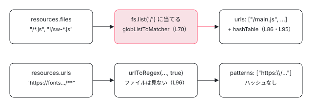

[目次](../README.md) › [Service Worker の内側](README.md) › 第 2 回 / 全 20 回

# ngsw-config.json から ngsw.json へ：Generator

> Generator.process が assetGroups の glob をファイルの一覧に当てて urls と patterns に分け、hashTable にファイルごとの SHA-1 を入れ、dataGroups の maxAge や timeout を ms に直し（duration.ts）、navigationUrls の既定（ファイル名に . や \_\_ を含むものを除く）を正規表現にする流れ。glob.ts の globToRegex と、configVersion・timestamp・appData。ページの上で本物の Generator を動かすデモ。

angular/angular · 読了 約 12 分 · 中核 · [サイトで読む（デモが動きます）](https://angular-deep-dive-cyan.vercel.app/chapter/sw-config-generator)

---

あなたが書く `ngsw-config.json` は「どのファイルを、どう取り込むか」の glob（`/*.js` のようなワイルドカードの書き方）の集まりです。ワーカーは glob を読みません。読むのは、ビルドのときに `Generator.process` が作る `ngsw.json` で、そこには**ファイルの実際の一覧・ファイルごとの SHA-1・正規表現・ミリ秒**が入っています。この章では、その変換を `process` の 1 行ずつ追い、glob が正規表現になる手順と、`"1d12h"` がミリ秒になる手順を確かめます。

読む対象は `packages/service-worker/config/src/` の `generator.ts`（210 行）・`glob.ts`・`duration.ts`・`in.ts`・`filesystem.ts` と、`config/schema.json`・`config/test/generator_spec.ts` です（../angular、22.2.0-next.7、8576f161ae4）。

1. [1. 全体像](01-sw-overview.md)
2. **2. Generator**（この章）
3. [3. ビルド](03-sw-cli-build.md)
4. [4. 登録](04-sw-register.md)
5. [5. Driver の起動](05-sw-driver-lifecycle.md)
6. [6. fetch の横取り](06-sw-driver-fetch.md)
7. [7. 版とタブ](07-sw-versions.md)
8. [8. アセット](08-sw-asset-groups.md)
9. [9. ハッシュ](09-sw-hash-integrity.md)
10. [10. データ](10-sw-data-groups.md)
11. [11. 小さな DB](11-sw-database.md)
12. [12. 更新の確認](12-sw-update-check.md)
13. [13. SwUpdate](13-sw-swupdate.md)
14. [14. アイドルと掃除](14-sw-idle-cleanup.md)
15. [15. 壊れたとき](15-sw-safe-mode.md)
16. [16. プッシュ](16-sw-push.md)
17. [17. デバッグ](17-sw-debug.md)
18. [18. ワーカーのテスト](18-sw-testing-harness.md)
19. [19. アプリ側のテスト](19-sw-testing-app.md)
20. [20. issue と PR を読む](20-sw-issues.md)

## 1. 入力の型と、ファイルを見る窓

まず `process` が受け取るものです。`ngsw-config.json` の型は `in.ts` にあります。

📄 `angular/packages/service-worker/config/src/in.ts` L19–45 （▶ の行: 25–31, 41–43）

```ts
19 │ /**
20 │  * A top-level Angular Service Worker configuration object.
21 │  *
22 │  * @publicApi
23 │  */
24 │ export interface Config {
25 ▶   appData?: {};
26 ▶   index: string;
27 ▶   assetGroups?: AssetGroup[];
28 ▶   dataGroups?: DataGroup[];
29 ▶   navigationUrls?: string[];
30 ▶   navigationRequestStrategy?: 'freshness' | 'performance';
31 ▶   applicationMaxAge?: Duration;
32 │ }
33 │ 
34 │ /**
35 │  * Configuration for a particular group of assets.
36 │  *
37 │  * @publicApi
38 │  */
39 │ export interface AssetGroup {
40 │   name: string;
41 ▶   installMode?: 'prefetch' | 'lazy';
42 ▶   updateMode?: 'prefetch' | 'lazy';
43 ▶   resources: {files?: Glob[]; urls?: Glob[]};
44 │   cacheQueryOptions?: Pick<CacheQueryOptions, 'ignoreSearch'>;
45 │ }
```

26 行目の `index` だけが必須で、ほかは省けます。アセットグループ（39〜45 行目）の `resources` は 43 行目のとおり `files` と `urls` の 2 種類の glob を持ちます。`files` は「ビルドの出力の中のファイル」、`urls` は「実行時に URL で当てるもの」で、扱いがまったく違います（3 節）。データグループの型は 5 節で見ます。

`Generator` は、ファイルを自分で読みません。ファイルを見る窓を外から受け取ります。

📄 `angular/packages/service-worker/config/src/filesystem.ts` L9–20 （▶ の行: 16, 18）

```ts
 9 │ /**
10 │  * An abstraction over a virtual file system used to enable testing and operation
11 │  * of the config generator in different environments.
12 │  *
13 │  * @publicApi
14 │  */
15 │ export interface Filesystem {
16 ▶   list(dir: string): Promise<string[]>;
17 │   read(file: string): Promise<string>;
18 ▶   hash(file: string): Promise<string>;
19 │   write(file: string, contents: string): Promise<void>;
20 │ }
```

16 行目の `list` は「そのフォルダの下の全部のファイルのパス」を、18 行目の `hash` は「そのファイルの SHA-1 の 16 進」を返します。この窓を、angular-cli はビルドの結果のメモリの上のファイルで、`ngsw-config` のコマンドはディスクで、テストはただの表で実装します（[第 3 回](03-sw-cli-build.md)、テストは 8 節）。

## 2. process：ngsw.json の 10 個の欄

📄 `angular/packages/service-worker/config/src/generator.ts` L14–50 （▶ の行: 14–18, 33–34, 37–40, 43–46）

```ts
14 ▶ const DEFAULT_NAVIGATION_URLS = [
15 ▶   '/**', // Include all URLs.
16 ▶   '!/**/*.*', // Exclude URLs to files (containing a file extension in the last segment).
17 ▶   '!/**/*__*', // Exclude URLs containing `__` in the last segment.
18 ▶   '!/**/*__*/**', // Exclude URLs containing `__` in any other segment.
19 │ ];
20 │ 
21 │ /**
22 │  * Consumes service worker configuration files and processes them into control files.
23 │  *
24 │  * @publicApi
25 │  */
26 │ export class Generator {
27 │   constructor(
28 │     readonly fs: Filesystem,
29 │     private baseHref: string,
30 │   ) {}
31 │ 
32 │   async process(config: Config): Promise<Object> {
33 ▶     const unorderedHashTable = {};
34 ▶     const assetGroups = await this.processAssetGroups(config, unorderedHashTable);
35 │ 
36 │     return {
37 ▶       configVersion: 1,
38 ▶       timestamp: Date.now(),
39 ▶       appData: config.appData,
40 ▶       index: joinUrls(this.baseHref, config.index),
41 │       assetGroups,
42 │       dataGroups: this.processDataGroups(config),
43 ▶       hashTable: withOrderedKeys(unorderedHashTable),
44 ▶       navigationUrls: processNavigationUrls(this.baseHref, config.navigationUrls),
45 ▶       navigationRequestStrategy: config.navigationRequestStrategy ?? 'performance',
46 ▶       applicationMaxAge: config.applicationMaxAge
47 │         ? parseDurationToMs(config.applicationMaxAge)
48 │         : undefined,
49 │     };
50 │   }
```

1. **33〜34 行目：アセットグループを先に処理する**

   空のオブジェクト `unorderedHashTable` を渡し、`processAssetGroups` がその中に「URL → SHA-1」を書き込みます（3 節）。返り値はグループの配列です。
2. **37〜39 行目：形の番号・時刻・appData**

   `configVersion: 1` は `ngsw.json` の形の番号で、ワーカーは自分の知らない番号を受け付けません（[第 12 回](12-sw-update-check.md)）。38 行目の `timestamp` はビルドした時刻で、**中身が同じでもビルドのたびに変わります**。39 行目の `appData` は何も変えずにそのまま入り、`VERSION_READY` などの知らせに載ってページに届きます。
3. **40 行目：`index` に baseHref を付ける**

   `joinUrls`（4 節）で `baseHref` と `index` をつなぎます。`baseHref` が `/app/` なら `/app/index.html` です。
4. **43 行目：ハッシュの表を並べ替える**

   `withOrderedKeys` がキーを辞書順に並べ直します。ファイルを読んだ順に左右されず、同じ入力なら同じ並びの JSON になります。
5. **44 行目：ナビゲーションの URL**

   `navigationUrls` を省くと、14〜19 行目の既定の 4 つが使われます（`processNavigationUrls` の引数の既定値。4 節）。「全部の URL（15 行目）から、最後の区切りに `.` を含むもの（16 行目）と `__` を含むもの（17・18 行目）を除く」です。`/chapter/sw-overview` はナビゲーション、`/main.js` は違う、という区別です。
6. **45〜48 行目：既定値と単位の変換**

   `navigationRequestStrategy` の既定は `'performance'`。`applicationMaxAge` は書いたときだけ `parseDurationToMs`（6 節）でミリ秒にし、書かなければ `undefined` です。

> [!NOTE]
> **ポイント**
>
> `undefined` の欄（`appData` を書かないとき、`applicationMaxAge` など）は、最後に `JSON.stringify` されるときに消えます。[第 3 回](03-sw-cli-build.md)で本物の `ngsw-config` のコマンドが書いた `ngsw.json` にも、この 2 つの欄はありません。

## 3. processAssetGroups：glob をファイルの一覧に当てる

📄 `angular/packages/service-worker/config/src/generator.ts` L52–78 （▶ の行: 57–58, 62–63, 70–74, 76–77）

```ts
52 │   private async processAssetGroups(
53 │     config: Config,
54 │     hashTable: {[file: string]: string | undefined},
55 │   ): Promise<Object[]> {
56 │     // Retrieve all files of the build.
57 ▶     const allFiles = await this.fs.list('/');
58 ▶     const seenMap = new Set<string>();
59 │     const filesPerGroup = new Map<AssetGroup, string[]>();
60 │ 
61 │     // Computed which files belong to each asset-group.
62 ▶     for (const group of config.assetGroups || []) {
63 ▶       if ((group.resources as any).versionedFiles) {
64 │         throw new Error(
65 │           `Asset-group '${group.name}' in 'ngsw-config.json' uses the 'versionedFiles' option, ` +
66 │             "which is no longer supported. Use 'files' instead.",
67 │         );
68 │       }
69 │ 
70 ▶       const fileMatcher = globListToMatcher(group.resources.files || []);
71 ▶       const matchedFiles = allFiles
72 ▶         .filter(fileMatcher)
73 ▶         .filter((file) => !seenMap.has(file))
74 ▶         .sort();
75 │ 
76 ▶       matchedFiles.forEach((file) => seenMap.add(file));
77 ▶       filesPerGroup.set(group, matchedFiles);
78 │     }
```

1. **57 行目：全部のファイルを 1 回だけ取る**

   `fs.list('/')` でビルドの出力の全部のパスを取ります。glob ごとにディスクを見に行くのではなく、一覧に正規表現を当てます。
2. **63〜68 行目：古い `versionedFiles` は例外**

   型（in.ts 43 行目）には無い欄ですが、古い設定ファイルを読んだときのために `any` で覗いて止めます。
3. **70〜74 行目：当てて、先に取られたものを除いて、並べる**

   70 行目で `files` の glob の配列を 1 つの判定関数にし（4 節）、71〜72 行目で一覧に当て、**73 行目で `seenMap` に入っているもの（前のグループが取ったもの）を除きます**。76 行目でこのグループが取ったものを `seenMap` に足します。だから **1 つのファイルは、配列で先に書いたグループにだけ入ります**。

📄 `angular/packages/service-worker/config/src/generator.ts` L80–98 （▶ の行: 81–83, 86, 92–96）

```ts
80 │     // Compute hashes for all matched files and add them to the hash-table.
81 ▶     const allMatchedFiles = ([] as string[]).concat(...Array.from(filesPerGroup.values())).sort();
82 ▶     const allMatchedHashes = await processInBatches(allMatchedFiles, 500, (file) =>
83 ▶       this.fs.hash(file),
84 │     );
85 │     allMatchedFiles.forEach((file, idx) => {
86 ▶       hashTable[joinUrls(this.baseHref, file)] = allMatchedHashes[idx];
87 │     });
88 │ 
89 │     // Generate and return the processed asset-groups.
90 │     return Array.from(filesPerGroup.entries()).map(([group, matchedFiles]) => ({
91 │       name: group.name,
92 ▶       installMode: group.installMode || 'prefetch',
93 ▶       updateMode: group.updateMode || group.installMode || 'prefetch',
94 ▶       cacheQueryOptions: buildCacheQueryOptions(group.cacheQueryOptions),
95 ▶       urls: matchedFiles.map((url) => joinUrls(this.baseHref, url)),
96 ▶       patterns: (group.resources.urls || []).map((url) => urlToRegex(url, this.baseHref, true)),
97 │     }));
98 │   }
```

1. **81〜87 行目：当たったファイルだけハッシュを取る**

   どのグループにも当たらなかったファイルは、ハッシュの表に入りません。82 行目の `processInBatches` は 500 個ずつ `Promise.all` で `fs.hash` を呼び、終わってから次の 500 個に進みます（4 節の引用の 130〜146 行目）。86 行目で表のキーに `baseHref` を付けます。
2. **92〜93 行目：`installMode` と `updateMode` の既定**

   `installMode` を省くと `'prefetch'`、`updateMode` を省くと **`installMode` と同じ**です。ワーカーがこの 2 つをどう使うかは[第 8 回](08-sw-asset-groups.md)。
3. **95 行目：`urls` はファイルの一覧そのもの**

   `files` の glob は `ngsw.json` に残りません。残るのは、当たったファイルのパス（`baseHref` 付き）の配列です。
4. **96 行目：`resources.urls` は正規表現の文字列になる**

   こちらはファイルの一覧に当てず、glob を正規表現の文字列にして `patterns` に入れます。3 つめの引数 `true` は「`?` を文字どおりに扱う」です（5 節）。ハッシュが無いので、ワーカーは中身を確かめられません（[第 8 回](08-sw-asset-groups.md)）。



*resources の 2 種類の glob の行き先。files はビルドの出力に当てて「パス + ハッシュ」に、urls は正規表現の文字列のまま patterns に入る*

## 4. glob の配列を判定にする：globListToMatcher と urlToRegex

📄 `angular/packages/service-worker/config/src/generator.ts` L148–173 （▶ の行: 150, 153, 158, 166–168, 170, 172）

```ts
148 │ function globListToMatcher(globs: string[]): (file: string) => boolean {
149 │   const patterns = globs.map((pattern) => {
150 ▶     if (pattern.startsWith('!')) {
151 │       return {
152 │         positive: false,
153 ▶         regex: new RegExp('^' + globToRegex(pattern.slice(1)) + '$'),
154 │       };
155 │     } else {
156 │       return {
157 │         positive: true,
158 ▶         regex: new RegExp('^' + globToRegex(pattern) + '$'),
159 │       };
160 │     }
161 │   });
162 │   return (file: string) => matches(file, patterns);
163 │ }
164 │ 
165 │ function matches(file: string, patterns: {positive: boolean; regex: RegExp}[]): boolean {
166 ▶   return patterns.reduce((isMatch, pattern) => {
167 ▶     if (pattern.positive) {
168 ▶       return isMatch || pattern.regex.test(file);
169 │     } else {
170 ▶       return isMatch && !pattern.regex.test(file);
171 │     }
172 ▶   }, false);
173 │ }
```

150 行目で `!` で始まる glob を「除く」側にし、153・158 行目で `^…$` で挟んだ `RegExp` を作ります。判定の 166〜172 行目は、**配列を左から順に**なめる `reduce` です。初めは `false`（172 行目）、「含む」の glob は `isMatch || 当たる`（168 行目）、「除く」の glob は `isMatch && !当たる`（170 行目）。だから `["/*.js", "!/sw-*.js"]` と `["!/sw-*.js", "/*.js"]` は結果が違います。後者では、除いたあとに `/*.js` がもう一度 `true` にします。

📄 `angular/packages/service-worker/config/src/generator.ts` L175–210 （▶ の行: 176, 180, 183, 187, 189, 198, 207）

```ts
175 │ function urlToRegex(url: string, baseHref: string, literalQuestionMark?: boolean): string {
176 ▶   if (!url.startsWith('/') && url.indexOf('://') === -1) {
177 │     // Prefix relative URLs with `baseHref`.
178 │     // Strip a leading `.` from a relative `baseHref` (e.g. `./foo/`), since it would result in an
179 │     // incorrect regex (matching a literal `.`).
180 ▶     url = joinUrls(baseHref.replace(/^\.(?=\/)/, ''), url);
181 │   }
182 │ 
183 ▶   return globToRegex(url, literalQuestionMark);
184 │ }
185 │ 
186 │ function joinUrls(a: string, b: string): string {
187 ▶   if (a.endsWith('/') && b.startsWith('/')) {
188 │     return a + b.slice(1);
189 ▶   } else if (!a.endsWith('/') && !b.startsWith('/')) {
190 │     return a + '/' + b;
191 │   }
192 │   return a + b;
193 │ }
194 │ 
195 │ function withOrderedKeys<T extends {[key: string]: any}>(unorderedObj: T): T {
196 │   const orderedObj = {} as {[key: string]: any};
197 │   Object.keys(unorderedObj)
198 ▶     .sort()
199 │     .forEach((key) => (orderedObj[key] = unorderedObj[key]));
200 │   return orderedObj as T;
201 │ }
202 │ 
203 │ function buildCacheQueryOptions(
204 │   inOptions?: Pick<CacheQueryOptions, 'ignoreSearch'>,
205 │ ): CacheQueryOptions {
206 │   return {
207 ▶     ignoreVary: true,
208 │     ...inOptions,
209 │   };
210 │ }
```

1. **176〜181 行目：相対の URL にだけ baseHref を付ける**

   `/` で始まらず `://` も含まない glob（`news/*` など）だけ、前に `baseHref` を付けます。180 行目の `replace(/^\.(?=\/)/, '')` は、`./foo/` のような相対の `baseHref` の先頭の `.` を消します（残すと正規表現の「どの 1 文字でも」になってしまうため）。
2. **183 行目：glob を正規表現の文字列に**

   `urls` と `dataGroups` から来たときは `literalQuestionMark` が `true`、`navigationUrls` から来たとき（下の 126 行目）は省かれて `false` です。
3. **186〜193 行目：`joinUrls`**

   両方に `/` があれば 1 つにし、どちらにも無ければ足します。`files` の glob（154 行目）には baseHref を付けません。一覧のパスは `/` から始まるので、当ててから 86・95 行目で付けます。
4. **198・207 行目：並べ替えと `ignoreVary`**

   198 行目がハッシュの表のキーを並べます。207 行目、`cacheQueryOptions` には必ず `ignoreVary: true` が入り、書いた `ignoreSearch` がその上に重なります。

📄 `angular/packages/service-worker/config/src/generator.ts` L119–146 （▶ の行: 121, 124–126, 137, 141, 143）

```ts
119 │ export function processNavigationUrls(
120 │   baseHref: string,
121 ▶   urls = DEFAULT_NAVIGATION_URLS,
122 │ ): {positive: boolean; regex: string}[] {
123 │   return urls.map((url) => {
124 ▶     const positive = !url.startsWith('!');
125 ▶     url = positive ? url : url.slice(1);
126 ▶     return {positive, regex: `^${urlToRegex(url, baseHref)}$`};
127 │   });
128 │ }
129 │ 
130 │ async function processInBatches<I, O>(
131 │   items: I[],
132 │   batchSize: number,
133 │   processFn: (item: I) => O | Promise<O>,
134 │ ): Promise<O[]> {
135 │   const batches = [];
136 │ 
137 ▶   for (let i = 0; i < items.length; i += batchSize) {
138 │     batches.push(items.slice(i, i + batchSize));
139 │   }
140 │ 
141 ▶   return batches.reduce(
142 │     async (prev, batch) =>
143 ▶       (await prev).concat(await Promise.all(batch.map((item) => processFn(item)))),
144 │     Promise.resolve<O[]>([]),
145 │   );
146 │ }
```

121 行目が既定の 4 つ、124〜125 行目で `!` を外して `positive` にし、126 行目で `^…$` で挟みます（ファイルの判定と違い、ここでは `RegExp` ではなく**文字列のまま**`ngsw.json` に入ります）。ワーカーがこの `positive` と `regex` をどう使ってナビゲーションを見分けるかは[第 7 回](07-sw-versions.md)です。137〜145 行目は 3 節で使った `processInBatches` で、143 行目の `await prev` のとおり、1 つの束が終わってから次の束を始めます。

## 5. glob.ts：1 区切りずつ正規表現にする

📄 `angular/packages/service-worker/config/src/glob.ts` L9–45 （▶ の行: 9–11, 14–16, 18–19, 23, 27–29, 31, 34, 39–40）

```ts
 9 ▶ const QUESTION_MARK = '[^/]';
10 ▶ const WILD_SINGLE = '[^/]*';
11 ▶ const WILD_OPEN = '(?:.+\\/)?';
12 │ 
13 │ const TO_ESCAPE_BASE = [
14 ▶   {replace: /\./g, with: '\\.'},
15 ▶   {replace: /\+/g, with: '\\+'},
16 ▶   {replace: /\*/g, with: WILD_SINGLE},
17 │ ];
18 ▶ const TO_ESCAPE_WILDCARD_QM = [...TO_ESCAPE_BASE, {replace: /\?/g, with: QUESTION_MARK}];
19 ▶ const TO_ESCAPE_LITERAL_QM = [...TO_ESCAPE_BASE, {replace: /\?/g, with: '\\?'}];
20 │ 
21 │ export function globToRegex(glob: string, literalQuestionMark = false): string {
22 │   const toEscape = literalQuestionMark ? TO_ESCAPE_LITERAL_QM : TO_ESCAPE_WILDCARD_QM;
23 ▶   const segments = glob.split('/').reverse();
24 │   let regex: string = '';
25 │   while (segments.length > 0) {
26 │     const segment = segments.pop()!;
27 ▶     if (segment === '**') {
28 ▶       if (segments.length > 0) {
29 ▶         regex += WILD_OPEN;
30 │       } else {
31 ▶         regex += '.*';
32 │       }
33 │     } else {
34 ▶       const processed = toEscape.reduce(
35 │         (segment, escape) => segment.replace(escape.replace, escape.with),
36 │         segment,
37 │       );
38 │       regex += processed;
39 ▶       if (segments.length > 0) {
40 ▶         regex += '\\/';
41 │       }
42 │     }
43 │   }
44 │   return regex;
45 │ }
```

1. **23 行目：`/` で切る**

   `/**/*.png` は `["", "**", "*.png"]` になります。`reverse` してから `pop` するので、左から順に取り出すのと同じです。
2. **27〜32 行目：`**` の区切り**

   後ろにまだ区切りがあれば 11 行目の `(?:.+\/)?`（「何階層でも、0 階層でもよい」）、最後の区切りなら `.*`（何でも）。だから `/**/*.png` は `/logo.png` にも `/media/icons/a.png` にも当たります。
3. **34〜37 行目：ふつうの区切りの文字を置き換える**

   置き換えるのは 14〜16 行目の 3 つ（`.` → `\.`、`+` → `\+`、`*` → `[^/]*`）と、18・19 行目の `?` だけです。`?` は、ファイルとナビゲーションでは「`/` 以外の 1 文字」（9 行目）、`urls` と `dataGroups` では文字どおりの `\?` です。
4. **39〜41 行目：区切りの `/` を戻す**

   最後の区切りでなければ `\/` を足します。

> [!WARNING]
> **ハマりどころ**
>
> **`( ) | [ ] { } ^ $` はエスケープされません。**正規表現の記号として、そのまま効きます。`ng add` が作る `ngsw-config.json` の `/**/*.(svg|cur|jpg|…)`（[第 3 回](03-sw-cli-build.md)）は、この性質に頼って「どれかの拡張子」を書いています。逆に、ファイル名に `(` や `[` を含むものを glob で書くと、思った通りに当たりません。

`urls` の `?` の扱いは、`schema.json` の説明にも書いてあります。

📄 `angular/packages/service-worker/config/schema.json` L41–62 （▶ の行: 47, 55）

```json
41 │           "resources": {
42 │             "type": "object",
43 │             "description": "This section describes the resources to cache.",
44 │             "properties": {
45 │               "files": {
46 │                 "type": "array",
47 ▶                 "description": "Lists patterns that match files in the distribution directory. These can be single files or glob-like patterns that match a number of files.",
48 │                 "items": {
49 │                   "type": "string"
50 │                 },
51 │                 "uniqueItems": true
52 │               },
53 │               "urls": {
54 │                 "type": "array",
55 ▶                 "description": "Includes both URLs and URL patterns that will be matched at runtime. These resources are not fetched directly and do not have content hashes, but they will be cached according to their HTTP headers. This is most useful for CDNs such as the Google Fonts service. (Negative glob patterns are not supported and '?' will be matched literally; i.e. it will not match any character other than '?'.)",
56 │                 "items": {
57 │                   "type": "string"
58 │                 },
59 │                 "uniqueItems": true
60 │               }
61 │             },
62 │             "additionalProperties": false
```

55 行目の括弧の中のとおり、`urls` では「`!` の除外は使えず、`?` は文字どおり」です。除外が使えないのは、96 行目が glob を 1 つずつ正規表現にして並べるだけで、`!` を見ないからです。この `schema.json` は `ngsw-config.json` の 1 行目の `$schema` から参照され、エディターの補完に使われます。`Generator` 自身は schema で検査しません。

## 6. データグループと duration.ts

📄 `angular/packages/service-worker/config/src/in.ts` L47–65 （▶ の行: 54–55, 57–60）

```ts
47 │ /**
48 │  * Configuration for a particular group of dynamic URLs.
49 │  *
50 │  * @publicApi
51 │  */
52 │ export interface DataGroup {
53 │   name: string;
54 ▶   urls: Glob[];
55 ▶   version?: number;
56 │   cacheConfig: {
57 ▶     maxSize: number;
58 ▶     maxAge: Duration;
59 ▶     timeout?: Duration;
60 ▶     refreshAhead?: Duration;
61 │     strategy?: 'freshness' | 'performance';
62 │     cacheOpaqueResponses?: boolean;
63 │   };
64 │   cacheQueryOptions?: Pick<CacheQueryOptions, 'ignoreSearch'>;
65 │ }
```

📄 `angular/packages/service-worker/config/src/generator.ts` L100–116 （▶ の行: 104–105, 107–108, 110, 113）

```ts
100 │   private processDataGroups(config: Config): Object[] {
101 │     return (config.dataGroups || []).map((group) => {
102 │       return {
103 │         name: group.name,
104 ▶         patterns: group.urls.map((url) => urlToRegex(url, this.baseHref, true)),
105 ▶         strategy: group.cacheConfig.strategy || 'performance',
106 │         maxSize: group.cacheConfig.maxSize,
107 ▶         maxAge: parseDurationToMs(group.cacheConfig.maxAge),
108 ▶         timeoutMs: group.cacheConfig.timeout && parseDurationToMs(group.cacheConfig.timeout),
109 │         refreshAheadMs:
110 ▶           group.cacheConfig.refreshAhead && parseDurationToMs(group.cacheConfig.refreshAhead),
111 │         cacheOpaqueResponses: group.cacheConfig.cacheOpaqueResponses,
112 │         cacheQueryOptions: buildCacheQueryOptions(group.cacheQueryOptions),
113 ▶         version: group.version !== undefined ? group.version : 1,
114 │       };
115 │     });
116 │   }
```

データグループ（API の応答など、版と一緒に変わらないもの）では、ファイルの一覧を見ません。104 行目で `urls` を正規表現の文字列にするだけです。107 行目の `maxAge` は必須（in.ts 58 行目）なので必ず変換し、108・110 行目の `timeout`・`refreshAhead` は `&&` で「書いたときだけ」変換します。113 行目、`version` の既定は 1 です。ワーカーがこれらをどう使うかは[第 10 回](10-sw-data-groups.md)です。

📄 `angular/packages/service-worker/config/src/duration.ts` L9–48 （▶ の行: 9–10, 16–17, 21, 23, 26, 39–40, 43, 45, 47）

```ts
 9 ▶ const PARSE_TO_PAIRS = /([0-9]+[^0-9]+)/g;
10 ▶ const PAIR_SPLIT = /^([0-9]+)([dhmsu]+)$/;
11 │ 
12 │ export function parseDurationToMs(duration: string): number {
13 │   const matches: string[] = [];
14 │ 
15 │   let array: RegExpExecArray | null;
16 ▶   while ((array = PARSE_TO_PAIRS.exec(duration)) !== null) {
17 ▶     matches.push(array[0]);
18 │   }
19 │   return matches
20 │     .map((match) => {
21 ▶       const res = PAIR_SPLIT.exec(match);
22 │       if (res === null) {
23 ▶         throw new Error(`Not a valid duration: ${match}`);
24 │       }
25 │       let factor: number = 0;
26 ▶       switch (res[2]) {
27 │         case 'd':
28 │           factor = 86400000;
29 │           break;
30 │         case 'h':
31 │           factor = 3600000;
32 │           break;
33 │         case 'm':
34 │           factor = 60000;
35 │           break;
36 │         case 's':
37 │           factor = 1000;
38 │           break;
39 ▶         case 'u':
40 ▶           factor = 1;
41 │           break;
42 │         default:
43 ▶           throw new Error(`Not a valid duration unit: ${res[2]}`);
44 │       }
45 ▶       return parseInt(res[1]) * factor;
46 │     })
47 ▶     .reduce((total, value) => total + value, 0);
48 │ }
```

1. **9・16〜18 行目：「数字 + 数字でないもの」の組に切る**

   `"1d12h"` は `["1d", "12h"]` になります。**最後に単位の無い数字（`"1h30"` の `30`）は組にならず、黙って捨てられます**。
2. **10・21〜24 行目：組の形を確かめる**

   `"1w"` のように単位が `d h m s u` のどれでもない組は、23 行目で `Not a valid duration: 1w` になります。
3. **26〜44 行目：単位をミリ秒の倍率に**

   `u` がミリ秒です（39〜40 行目）。`"5ms"` と書くと、10 行目の `[dhmsu]+` は `ms` に当たるのに switch に `ms` が無いので、43 行目で `Not a valid duration unit: ms` になります。
4. **45・47 行目：足し合わせる**

   `"1d12h"` は 86,400,000 + 43,200,000 = **129,600,000**。数字が 1 つも無い `"abc"` は組が 0 個なので、47 行目の `reduce` の初期値 **0** が返ります（エラーになりません）。

上の 4 つの例（`"1h30"` → 3,600,000、`"1w"` と `"5ms"` → 例外、`"abc"` → 0）は、2026-11-03 に本物の `Generator`（22.1.6）の `maxAge` に入れて確かめました。

## 7. デモ：本物の Generator で ngsw.json を作る

> **🧪 DEMO — @angular/service-worker/config 22.1.6 の Generator.process を、このページで動かす**
>
> 「ngsw.json を作る」を押すと、`sw-sandbox.ts` の `buildManifest` が本物の `new Generator(fs, baseHref).process(config)` を呼びます。`fs` は下のファイルの一覧（1 行に 1 つ。`パス = 中身`、`=` を省くと中身は「中身：パス」）で、ハッシュは Web Crypto の SHA-1 です。「files の glob の正規表現」の表だけは、glob.ts の `globToRegex` を移植した関数で作っています（本物の Generator はこの正規表現を ngsw.json に書かないため）。
>
> ▶ [このデモはサイトで動かせます](https://angular-deep-dive-cyan.vercel.app/chapter/sw-config-generator)

初期値のまま押すと、次のことが読み取れます。

1. **`/sw-helper.js` と `/3rdpartylicenses.txt` はどこにも入らない**

   `/sw-helper.js` は `/*.js` で一度 `true` になり、そのあとの `!/sw-*.js` で `false` に戻ります（4 節の 170 行目）。`/3rdpartylicenses.txt` はどの glob にも当たりません。どちらも `hashTable` にありません。
2. **`/**/*.(svg|png|woff2)` の括弧はそのまま**

   正規表現は `^\/(?:.+\/)?[^/]*\.(svg|png|woff2)$` で、`/media/logo.png` と `/media/icons/close.svg` が `assets` に入ります。
3. **`urls` の `?` は文字どおり、相対の `news/*` には baseHref**

   `/cdn/lib.js?v=2` は `\/cdn\/lib\.js\?v=2`、`news/*` は `\/news\/[^/]*` です。baseHref を `/app/` にすると、`news/*` と `urls`・`index`・`hashTable` のキーには `/app/` が付き、`/api/**` と既定の `navigationUrls`（`/` で始まる）には付きません。
4. **`"1d12h"` は 129600000、`"5s30u"` は 5030**

   6 節の計算のとおりです。`maxAge` を `"5ms"` にすると、エラーの欄に `Not a valid duration unit: ms` が出ます。

## ここまでの呼び出し

- 👤 `ngsw-config.json` — あなたの設定
  - `new Generator(fs, baseHref).process(config)` — config/src/generator.ts L32 — *fs は angular-cli・ngsw-config・テストがそれぞれ作る（第 3 回）*
    - `processAssetGroups` → `fs.list('/')` → `globListToMatcher(files)` → `globToRegex` — generator.ts L52・L148 → glob.ts L21
    - `processInBatches(allMatchedFiles, 500, fs.hash)` — generator.ts L82・L130
    - `urlToRegex(url, baseHref, true)` — generator.ts L175 — *resources.urls と dataGroups.urls*
    - `processDataGroups` → `parseDurationToMs` — generator.ts L100 → duration.ts L12
    - `processNavigationUrls(baseHref, urls = DEFAULT_NAVIGATION_URLS)` — generator.ts L119
- `ngsw.json` — JSON.stringify されて出力へ — *ワーカーが読む（第 5・7 回）*

## テストと直し方

### この回の部品を確かめている spec

Generator の spec は `config/test/generator_spec.ts` の 1 本で、`Generator`（13 行目）の中に 7 つの `it` と、`processNavigationUrls()`（539 行目）の 3 つの `it` があります。

| it（行） | 何を確かめるか |
| --- | --- |
| `'generates a correct config'`（16 行目） | 全部の欄。baseHref `/test`、`?` と `+` のエスケープ、除外、相対の URL |
| `'assigns files to the first matching asset-group …'`（130 行目） | 3 節の `seenMap`（先に書いたグループが取る） |
| ``'uses default `navigationUrls` if not provided'``（217 行目） | 既定の 4 つ |
| ``'throws if the obsolete `versionedFiles` is used'``（245 行目） | 63〜68 行目の例外 |
| ``'… with `cacheOpaqueResponses`'``（276 行目）・``'… with `cacheQueryOptions`'``（437 行目） | データグループの欄と `ignoreVary` |
| `"doesn't exceed concurrency limit"`（514 行目） | 600 個のファイルで同時に走る `hash` が 500 以下 |
| `processNavigationUrls()` の 3 つ（549・558・569 行目） | 既定、相対だけに baseHref、`./` の `.` を消す（`../` は消さない） |

最初の `it` の入力と、期待する `urls` と `patterns` です。

📄 `angular/packages/service-worker/config/test/generator_spec.ts` L13–40 （▶ の行: 14, 17, 26, 36–37）

```ts
13 │ describe('Generator', () => {
14 ▶   beforeEach(() => spyOn(Date, 'now').and.returnValue(1234567890123));
15 │ 
16 │   it('generates a correct config', async () => {
17 ▶     const fs = new MockFilesystem({
18 │       '/index.html': 'This is a test',
19 │       '/main.css': 'This is a CSS file',
20 │       '/main.js': 'This is a JS file',
21 │       '/main.ts': 'This is a TS file',
22 │       '/test.txt': 'Another test',
23 │       '/foo/test.html': 'Another test',
24 │       '/ignored/x.html': 'should be ignored',
25 │     });
26 ▶     const gen = new Generator(fs, '/test');
27 │     const config = await gen.process({
28 │       appData: {
29 │         test: true,
30 │       },
31 │       index: '/index.html',
32 │       assetGroups: [
33 │         {
34 │           name: 'test',
35 │           resources: {
36 ▶             files: ['/**/*.html', '/**/*.?s', '!/ignored/**', '/**/*.txt'],
37 ▶             urls: ['/absolute/**', '/some/url?with+escaped+chars', 'relative/*.txt'],
38 │           },
39 │         },
40 │       ],
```

📄 `angular/packages/service-worker/config/test/generator_spec.ts` L64–89 （▶ の行: 70, 76–81, 84–86）

```ts
64 │     expect(config).toEqual({
65 │       configVersion: 1,
66 │       timestamp: 1234567890123,
67 │       appData: {
68 │         test: true,
69 │       },
70 ▶       index: '/test/index.html',
71 │       assetGroups: [
72 │         {
73 │           name: 'test',
74 │           installMode: 'prefetch',
75 │           updateMode: 'prefetch',
76 ▶           urls: [
77 ▶             '/test/foo/test.html',
78 ▶             '/test/index.html',
79 ▶             '/test/main.js',
80 ▶             '/test/main.ts',
81 ▶             '/test/test.txt',
82 │           ],
83 │           patterns: [
84 ▶             '\\/absolute\\/.*',
85 ▶             '\\/some\\/url\\?with\\+escaped\\+chars',
86 ▶             '\\/test\\/relative\\/[^/]*\\.txt',
87 │           ],
88 │           cacheQueryOptions: {ignoreVary: true},
89 │         },
```

14 行目で `Date.now` を固定しているので、`timestamp` まで `toEqual` で比べられます。36 行目の `/**/*.?s` は `?` が 1 文字なので、`/main.js` と `/main.ts` には当たり、`/main.css`（`?` のところが 2 文字）には当たりません。期待値の 76〜82 行目に `main.css` が無いのはそのためです。85 行目は 37 行目の `?` と `+` が文字どおりにエスケープされたもの、86 行目は相対の `relative/*.txt` に `/test` が付いたものです。

テストのファイルの窓は、`config/testing/mock.ts` の表です。

📄 `angular/packages/service-worker/config/testing/mock.ts` L9–34 （▶ の行: 9, 20, 28）

```ts
 9 ▶ import {sha1} from '../../cli/sha1';
10 │ import {Filesystem} from '../src/filesystem';
11 │ 
12 │ export class MockFilesystem implements Filesystem {
13 │   private files = new Map<string, string>();
14 │ 
15 │   constructor(files: {[name: string]: string | undefined}) {
16 │     Object.keys(files).forEach((path) => this.files.set(path, files[path]!));
17 │   }
18 │ 
19 │   async list(dir: string): Promise<string[]> {
20 ▶     return Array.from(this.files.keys()).filter((path) => path.startsWith(dir));
21 │   }
22 │ 
23 │   async read(path: string): Promise<string> {
24 │     return this.files.get(path)!;
25 │   }
26 │ 
27 │   async hash(path: string): Promise<string> {
28 ▶     return sha1(this.files.get(path)!);
29 │   }
30 │ 
31 │   async write(path: string, contents: string): Promise<void> {
32 │     this.files.set(path, contents);
33 │   }
34 │ }
```

20 行目の `list` は `startsWith` で絞るだけ、28 行目の `hash` は 9 行目のとおり `cli/sha1.ts` の `sha1` を文字列に使います（[第 3 回](03-sw-cli-build.md)）。このページのデモの `buildManifest` も、同じ形の表を Web Crypto で作っています。

📄 `ターミナル`

```
cd ~/angular-research/angular
git status --short          # 走らせる前と後で同じか（ソースは変えない）
pnpm bazel test //packages/service-worker/config/test:test \
  --nocache_test_results --test_output=all
# 1 つの it だけ（jasmine の --filter は「describe 名 + 空白 + it 名」に当たる正規表現）
pnpm bazel test //packages/service-worker/config/test:test \
  --nocache_test_results --test_output=all \
  '--test_arg=--filter=processNavigationUrls'
```

2026-11-03 にこのマシンで走らせた結果です（ログは `scratchpad/sw-logs/a-config.log` と `a-config-filter.log`）。フィルタ無しで **10 specs, 0 failures、PASSED in 3.1s**（Elapsed 4.2 秒）。`--filter=processNavigationUrls` で **Ran 3 of 10 specs、PASSED in 0.6s**。`--filter` は 0 件に当たっても PASSED になるので、必ず「Ran N of M」を見ます。走らせる前と後で `git status --short` は同じでした。

### 直すとしたら、どこから

- **ファイルが ngsw.json に入らない・別のグループに入る**：まずデモに同じ設定とファイルの名前を入れ、glob の正規表現の表を見ます。glob の書き方なら `glob.ts` の `globToRegex`、順番なら `generator.ts` の `matches`（166〜172 行目）と `seenMap`（73 行目）。
- **時間の書き方**：`duration.ts` の `parseDurationToMs`。`"1h30"` が黙って 1 時間になる、`"abc"` が 0 になるのは今の実装の動きです。直すなら `generator_spec.ts` の `Generator` の中に、`maxAge` だけを変えた `it` を足すのが近道です（duration だけの spec は今はありません）。
- **baseHref の付き方**：`urlToRegex`（176〜181 行目）と `joinUrls`。spec は `processNavigationUrls()` の describe（539 行目）に足します。
- ワーカーの側で `ngsw.json` がどう読まれるか（`patterns` の当て方、`navigationUrls` の判定）は Generator ではなく `worker/src/` です（[第 7 回](07-sw-versions.md)・[第 8 回](08-sw-asset-groups.md)）。

このパッケージでは、PACKAGE.md 1 行目の方針（[第 1 回](01-sw-overview.md)）のとおり新しい機能の PR は受け付けられず、不具合の直しも慎重に扱われます（例：PR #67918・#71018 はこの理由で閉じられた）。上の入口は「手元で確かめる」「issue を読むときの手がかりにする」ために使います。

## 聞かれそうな質問

**Q. 1 つのファイルが 2 つのアセットグループの glob に当たったら、どうなりますか？**

`assetGroups` の配列で先に書いたグループにだけ入ります。generator.ts 73 行目で `seenMap` にあるファイルを除き、76 行目で取ったものを足すからです。spec の `'assigns files to the first matching asset-group …'`（130 行目）が確かめています。

**Q. `"!/sw-*.js"` を `"/*.js"` の前に書いたら？**

除けません。`matches`（166〜172 行目）は左から順に、除く glob は `isMatch && !当たる`、含む glob は `isMatch || 当たる` で畳むので、後ろの `/*.js` がもう一度 `true` にします。除く glob は最後に書きます。

**Q. `ngsw.json` の `urls` と `patterns` は何が違いますか？**

`urls`（95 行目）は `files` の glob をビルドの出力に当てた結果のパスの一覧で、`hashTable` にハッシュがあります。`patterns`（96 行目）は `resources.urls` の glob をそのまま正規表現の文字列にしたもので、ファイルの一覧にもハッシュの表にも関係しません。CDN のフォントのような、ビルドの外のものに使います。

**Q. 中身を変えずにもう一度ビルドしたら、`ngsw.json` は同じになりますか？**

`timestamp`（38 行目、`Date.now()`）だけ変わります。ほかの欄は、43 行目と 198 行目でハッシュの表のキーが並べられ、74 行目でグループの `urls` も並べられるので、同じ並びになります。ワーカーは `ngsw.json` 全体を `JSON.stringify` した文字列の SHA-1（`worker/src/manifest.ts` の `hashManifest`）で版を見分けるので、`timestamp` が違えば別の版として扱われます（[第 12 回](12-sw-update-check.md)）。

**Q. `maxAge` に `"500ms"` と書けますか？**

書けません。duration.ts 10 行目の `[dhmsu]+` が `ms` を単位として切り出し、switch（26〜44 行目）に `ms` が無いので 43 行目の例外になります。ミリ秒は `"500u"` と書きます。

## 読み終えて

- `Generator.process` は、`files` の glob をビルドの出力の一覧に当てて「パスの一覧 + SHA-1」にし、`urls`・`dataGroups`・`navigationUrls` の glob は正規表現の文字列にする。ワーカーは glob を読まない。
- 1 つのファイルは先に書いたグループにだけ入る。除く glob は配列の後ろに書かないと効かない。
- `globToRegex` が置き換えるのは `. + * ? **` だけで、括弧や `|` は正規表現としてそのまま効く。`?` は `urls`・`dataGroups` でだけ文字どおり。
- 時間は `d h m s u`（`u` がミリ秒）。単位の無い数字は捨てられ、`ms` は例外になる。
- spec は `generator_spec.ts` の 10 本。`//packages/service-worker/config/test:test` で 3 秒ほどで走る。

---

← 前: [Service Worker の全体像：ngsw.json・ngsw-worker.js・SwUpdate](01-sw-overview.md)  
次: [ビルドで ngsw.json を作る：CLI と ngsw-config](03-sw-cli-build.md) →
