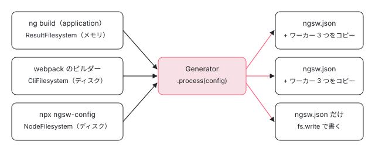

[目次](../README.md) › [Service Worker の内側](README.md) › 第 3 回 / 全 20 回

# ビルドで ngsw.json を作る：CLI と ngsw-config

> ng build の serviceWorker の設定で、angular-cli の augmentAppWithServiceWorker が出力のファイルを Generator に渡し、ngsw.json を書き、ngsw-worker.js と safety-worker.js を出力にコピーする行（angular-cli の utils/service-worker.ts）。単独で走らせる ngsw-config のコマンド（cli/main.ts・filesystem.ts）、ng add @angular/pwa と service-worker の schematic が足すもの。

angular/angular · 読了 約 12 分 · 中核 · [サイトで読む（デモが動きます）](https://angular-deep-dive-cyan.vercel.app/chapter/sw-cli-build)

---

[第 2 回](02-sw-config-generator.md)の `Generator` は「ファイルを見る窓」を外から受け取るだけで、自分ではディスクを読みません。この章では、その窓を誰がどう作るのかを 3 つの呼び出し元で比べます。`ng build`（angular-cli がビルドの結果をメモリのまま渡す）、古い webpack のビルダー（ディスクから読む）、単独の `ngsw-config` のコマンド（ディスクから読む）です。最後に、`ng add @angular/pwa` がプロジェクトに足すものを schematic の行で確かめます。

読む対象は angular-cli の `packages/angular/build/src/utils/service-worker.ts`（251 行）・`packages/schematics/angular/service-worker/`・`packages/angular/pwa/pwa/index.ts`（angular-cli、44129f66a3）と、angular の `packages/service-worker/cli/`・`BUILD.bazel` です。

1. [1. 全体像](01-sw-overview.md)
2. [2. Generator](02-sw-config-generator.md)
3. **3. ビルド**（この章）
4. [4. 登録](04-sw-register.md)
5. [5. Driver の起動](05-sw-driver-lifecycle.md)
6. [6. fetch の横取り](06-sw-driver-fetch.md)
7. [7. 版とタブ](07-sw-versions.md)
8. [8. アセット](08-sw-asset-groups.md)
9. [9. ハッシュ](09-sw-hash-integrity.md)
10. [10. データ](10-sw-data-groups.md)
11. [11. 小さな DB](11-sw-database.md)
12. [12. 更新の確認](12-sw-update-check.md)
13. [13. SwUpdate](13-sw-swupdate.md)
14. [14. アイドルと掃除](14-sw-idle-cleanup.md)
15. [15. 壊れたとき](15-sw-safe-mode.md)
16. [16. プッシュ](16-sw-push.md)
17. [17. デバッグ](17-sw-debug.md)
18. [18. ワーカーのテスト](18-sw-testing-harness.md)
19. [19. アプリ側のテスト](19-sw-testing-app.md)
20. [20. issue と PR を読む](20-sw-issues.md)

## 1. ng build の入口：augmentAppWithServiceWorkerEsbuild

application builder の後処理 `executePostBundleSteps` は、`serviceWorker` の設定があるときだけ、出来上がったファイルを全部この関数に渡します（呼び出しの行は [ng build の段取り](../cli/02-build.md)の 5 節、execute-post-bundle.ts 241〜259 行目）。渡す `serviceWorker` は、`options.ts` の正規化で `workspaceRoot` からの絶対パスになっています（`true` なら `src/ngsw-config.json`、options.ts 510〜514 行目）。

📄 `angular-cli/packages/angular/build/src/utils/service-worker.ts` L177–214 （▶ の行: 177, 182–184, 189–190, 192–193, 199, 209, 211）

```ts
177 ▶ // This is currently used by the esbuild-based builder
178 │ export async function augmentAppWithServiceWorkerEsbuild(
179 │   workspaceRoot: string,
180 │   configPath: string,
181 │   baseHref: string,
182 ▶   indexHtml: string | undefined,
183 ▶   outputFiles: BuildOutputFile[],
184 ▶   assetFiles: BuildOutputAsset[],
185 │ ): Promise<{ manifest: string; assetFiles: BuildOutputAsset[] }> {
186 │   // Read the configuration file
187 │   let config: Config | undefined;
188 │   try {
189 ▶     const configurationData = await fsPromises.readFile(configPath, 'utf-8');
190 ▶     config = JSON.parse(configurationData) as Config;
191 │ 
192 ▶     if (indexHtml) {
193 ▶       config.index = indexHtml;
194 │     }
195 │   } catch (error) {
196 │     assertIsError(error);
197 │     if (error.code === 'ENOENT') {
198 │       // TODO: Generate an error object that can be consumed by the esbuild-based builder
199 ▶       const message = `Service worker configuration file "${path.relative(
200 │         workspaceRoot,
201 │         configPath,
202 │       )}" could not be found.`;
203 │       throw new Error(message, { cause: error });
204 │     } else {
205 │       throw error;
206 │     }
207 │   }
208 │ 
209 ▶   return augmentAppWithServiceWorkerCore(
210 │     config,
211 ▶     new ResultFilesystem(outputFiles, assetFiles),
212 │     baseHref,
213 │   );
214 │ }
```

1. **189〜190 行目：`ngsw-config.json` を読む**

   ふつうの `JSON.parse` です。schema での検査はしません。ファイルが無ければ 197〜203 行目で「`… could not be found.`」のエラーにし、後処理のエラーの一覧に入ります。
2. **192〜194 行目：`index` を書き換える**

   4 つめの引数 `indexHtml` は、ビルドが書き出す index のファイル名（`options.indexHtmlOptions?.output`）です。**`ngsw-config.json` の `index` に何を書いても、ここで上書きされます**。SSR やプリレンダーを使うと、この名前は `index.csr.html` になります（プリレンダーした `index.html` ではなく、クライアントで描く素の HTML をナビゲーションに返すため。options.ts の 373〜385 行目のコメント）。
3. **209〜213 行目：メモリの窓で `Core` を呼ぶ**

   183・184 行目の `outputFiles`（esbuild の出力）と `assetFiles`（`assets` の設定でコピーするもの）から `ResultFilesystem` を作ります。**ディスクには何も書かれていない段階**なので、ディスクを読む窓は使えません。

## 2. ResultFilesystem：ビルドの結果をそのまま窓にする

📄 `angular-cli/packages/angular/build/src/utils/service-worker.ts` L71–96 （▶ の行: 79–80, 83–85, 91–92, 95）

```ts
71 │ class ResultFilesystem implements Filesystem {
72 │   private readonly fileReaders = new Map<string, () => Promise<Uint8Array>>();
73 │ 
74 │   constructor(
75 │     outputFiles: BuildOutputFile[],
76 │     assetFiles: { source: string; destination: string }[],
77 │   ) {
78 │     for (const file of outputFiles) {
79 ▶       if (file.type === BuildOutputFileType.Media || file.type === BuildOutputFileType.Browser) {
80 ▶         this.fileReaders.set('/' + toPosixPath(file.path), async () => file.contents);
81 │       }
82 │     }
83 ▶     for (const file of assetFiles) {
84 ▶       this.fileReaders.set('/' + toPosixPath(file.destination), () =>
85 ▶         fsPromises.readFile(file.source),
86 │       );
87 │     }
88 │   }
89 │ 
90 │   async list(dir: string): Promise<string[]> {
91 ▶     if (dir !== '/') {
92 ▶       throw new Error('Serviceworker manifest generator should only list files from root.');
93 │     }
94 │ 
95 ▶     return [...this.fileReaders.keys()];
96 │   }
```

1. **79〜80 行目：ブラウザに出すファイルだけ**

   `BuildOutputFileType` が `Media` か `Browser` のものだけを表に入れます。SSR のサーバー用のファイル（`Server`）は入りません。キーは `'/' + toPosixPath(file.path)` で、Windows でも `/` 区切りの URL の形になります。
2. **83〜87 行目：アセットは「読み方」だけ登録する**

   アセットはまだ元の場所（`file.source`）にあるので、読むときに `fsPromises.readFile` する関数を入れておきます。
3. **91〜95 行目：`list` は `/` しか受け付けない**

   `Generator` が `list` を呼ぶのは `processAssetGroups` の `fs.list('/')` の 1 回だけ（第 2 回の 57 行目）なので、それ以外は例外にしています。

📄 `angular-cli/packages/angular/build/src/utils/service-worker.ts` L98–123 （▶ の行: 105, 114–117, 120–121）

```ts
 98 │   async read(file: string): Promise<string> {
 99 │     const reader = this.fileReaders.get(file);
100 │     if (reader === undefined) {
101 │       throw new Error('File does not exist.');
102 │     }
103 │     const contents = await reader();
104 │ 
105 ▶     return Buffer.from(contents.buffer, contents.byteOffset, contents.byteLength).toString('utf-8');
106 │   }
107 │ 
108 │   async hash(file: string): Promise<string> {
109 │     const reader = this.fileReaders.get(file);
110 │     if (reader === undefined) {
111 │       throw new Error('File does not exist.');
112 │     }
113 │ 
114 ▶     return crypto
115 ▶       .createHash('sha1')
116 ▶       .update(await reader())
117 ▶       .digest('hex');
118 │   }
119 │ 
120 ▶   write(): never {
121 ▶     throw new Error('Serviceworker manifest generator should not attempted to write.');
122 │   }
123 │ }
```

114〜117 行目、ハッシュは Node の `crypto.createHash('sha1')` で、ファイルの**バイト列**から取ります。ワーカーは取ってきた応答のバイト列から同じ SHA-1 を計算して比べます（[第 9 回](09-sw-hash-integrity.md)）。120〜121 行目、`write` は例外です。`Generator` は `write` を呼ばず、`ngsw.json` を書くのは呼び出し元の仕事だからです。

## 3. Core：Generator を呼び、コピーするワーカーを決める

📄 `angular-cli/packages/angular/build/src/utils/service-worker.ts` L216–251 （▶ の行: 222, 228–229, 232, 235, 240, 244–247）

```ts
216 │ export async function augmentAppWithServiceWorkerCore(
217 │   config: Config,
218 │   serviceWorkerFilesystem: Filesystem,
219 │   baseHref: string,
220 │ ): Promise<{ manifest: string; assetFiles: { source: string; destination: string }[] }> {
221 │   // eslint-disable-next-line @typescript-eslint/no-explicit-any
222 ▶   const { Generator } = (await import('@angular/service-worker/config' as any)) as typeof import(
223 │     '@angular/service-worker/config',
224 │     { with: { 'resolution-mode': 'import' } }
225 │   );
226 │ 
227 │   // Generate the manifest
228 ▶   const generator = new Generator(serviceWorkerFilesystem, baseHref);
229 ▶   const output = await generator.process(config);
230 │ 
231 │   // Write the manifest
232 ▶   const manifest = JSON.stringify(output, null, 2);
233 │ 
234 │   // Find the service worker package
235 ▶   const workerPath = require.resolve('@angular/service-worker/ngsw-worker.js');
236 │ 
237 │   const result = {
238 │     manifest,
239 │     // Main worker code
240 ▶     assetFiles: [{ source: workerPath, destination: 'ngsw-worker.js' }],
241 │   };
242 │ 
243 │   // If present, write the safety worker code
244 ▶   const safetyPath = path.join(path.dirname(workerPath), 'safety-worker.js');
245 ▶   if (existsSync(safetyPath)) {
246 ▶     result.assetFiles.push({ source: safetyPath, destination: 'worker-basic.min.js' });
247 ▶     result.assetFiles.push({ source: safetyPath, destination: 'safety-worker.js' });
248 │   }
249 │ 
250 │   return result;
251 │ }
```

1. **222 行目：`@angular/service-worker/config` を動的 import**

   `@angular/build` は `@angular/service-worker` に依存していません。`serviceWorker` を使うときだけ、プロジェクトの `node_modules` から読みます（`ng add` が依存に足す。5 節）。
2. **228〜232 行目：Generator → 2 つの空白で整形した JSON**

   第 2 回の `process` そのものです。`JSON.stringify(output, null, 2)` で、`undefined` の欄（`appData` を書かないときなど）は消えます。
3. **235・240 行目：`ngsw-worker.js` をそのまま**

   `require.resolve('@angular/service-worker/ngsw-worker.js')` は、package.json の `exports` の `"./ngsw-worker.js"`（[第 1 回](01-sw-overview.md)の 11 行目）で解けます。中身には手を加えず、出力の `ngsw-worker.js` にコピーするだけです。
4. **244〜248 行目：`safety-worker.js` を 2 つの名前で**

   同じフォルダに `safety-worker.js` があれば、`worker-basic.min.js` と `safety-worker.js` の 2 つの名前で置きます。この行を入れた angular-cli のコミット 935389997e（2018-01-29）の説明によると、`worker-basic.min.js` は前の世代の Service Worker で作ったアプリが使っていたパスで、「一度ウェブに出したワーカーのパスは、全部の利用者が移るまで置き続ける必要がある」ためです。昔のワーカーを登録したままのブラウザがそのパスを取り直すと、ワーカーを外す `safety-worker.js` が返ります（中身は[第 15 回](15-sw-safe-mode.md)）。

戻り値の `manifest` は execute-post-bundle.ts 254 行目で `ngsw.json` という `Browser` の出力ファイルになり、`assetFiles` は 256 行目でアセットに足されて、ほかのファイルと一緒に書き出されます。このとき `ngsw-worker.js` 自身は、窓の `list` に入っていません（1 節の 249 行目で渡した時点では、まだ足されていない）。だから**ワーカーのファイルは `ngsw.json` の `hashTable` に入りません**。



*3 つの呼び出し元と、それぞれが Generator に渡す窓。どれも最後は同じ Generator.process を呼ぶ*

## 4. ディスクから読む 2 つの道

### webpack のビルダー：augmentAppWithServiceWorker

`@angular-devkit/build-angular` の古いビルダー（`browser`・`app-shell`・`prerender` と webpack のプラグイン）は、`@angular/build/private` からこちらを呼びます。ファイルがディスクに書かれたあとで呼ぶので、窓はディスクを読みます。

📄 `angular-cli/packages/angular/build/src/utils/service-worker.ts` L125–157 （▶ の行: 130, 135–137, 142–143, 146）

```ts
125 │ export async function augmentAppWithServiceWorker(
126 │   appRoot: string,
127 │   workspaceRoot: string,
128 │   outputPath: string,
129 │   baseHref: string,
130 ▶   ngswConfigPath?: string,
131 │   inputFileSystem = fsPromises,
132 │   outputFileSystem = fsPromises,
133 │ ): Promise<void> {
134 │   // Determine the configuration file path
135 ▶   const configPath = ngswConfigPath
136 ▶     ? path.join(workspaceRoot, ngswConfigPath)
137 ▶     : path.join(appRoot, 'ngsw-config.json');
138 │ 
139 │   // Read the configuration file
140 │   let config: Config | undefined;
141 │   try {
142 ▶     const configurationData = await inputFileSystem.readFile(configPath, 'utf-8');
143 ▶     config = JSON.parse(configurationData) as Config;
144 │   } catch (error) {
145 │     assertIsError(error);
146 ▶     if (error.code === 'ENOENT') {
147 │       throw new Error(
148 │         'Error: Expected to find an ngsw-config.json configuration file' +
149 │           ` in the ${appRoot} folder. Either provide one or` +
150 │           ' disable Service Worker in the angular.json configuration file.',
151 │         { cause: error },
152 │       );
153 │     } else {
154 │       throw error;
155 │     }
156 │   }
157 │ 
```

📄 `angular-cli/packages/angular/build/src/utils/service-worker.ts` L158–175 （▶ の行: 158, 160, 165, 167, 170, 172–173）

```ts
158 ▶   const result = await augmentAppWithServiceWorkerCore(
159 │     config,
160 ▶     new CliFilesystem(outputFileSystem, outputPath),
161 │     baseHref,
162 │   );
163 │ 
164 │   const copy = async (src: string, dest: string): Promise<void> => {
165 ▶     const resolvedDest = path.join(outputPath, dest);
166 │ 
167 ▶     return outputFileSystem.writeFile(resolvedDest, await inputFileSystem.readFile(src));
168 │   };
169 │ 
170 ▶   await outputFileSystem.writeFile(path.join(outputPath, 'ngsw.json'), result.manifest);
171 │ 
172 ▶   for (const { source, destination } of result.assetFiles) {
173 ▶     await copy(source, destination);
174 │   }
175 │ }
```

135〜137 行目、`ngswConfigPath`（angular.json の同名の設定）が無ければ `appRoot/ngsw-config.json` を読みます。160 行目の `CliFilesystem` は出力のフォルダ（`outputPath`）を見る窓で、170 行目で `ngsw.json` を、172〜173 行目で 3 節と同じワーカーのファイルを、ディスクに書きます。こちらは `index` を書き換えません（1 節の 192〜194 行目に当たる行がありません）。

📄 `angular-cli/packages/angular/build/src/utils/service-worker.ts` L20–47 （▶ の行: 27, 35–37, 41–42）

```ts
20 │ class CliFilesystem implements Filesystem {
21 │   constructor(
22 │     private fs: typeof fsPromises,
23 │     private base: string,
24 │   ) {}
25 │ 
26 │   list(dir: string): Promise<string[]> {
27 ▶     return this._recursiveList(this._resolve(dir), []);
28 │   }
29 │ 
30 │   read(file: string): Promise<string> {
31 │     return this.fs.readFile(this._resolve(file), 'utf-8');
32 │   }
33 │ 
34 │   async hash(file: string): Promise<string> {
35 ▶     return crypto
36 ▶       .createHash('sha1')
37 ▶       .update(await this.fs.readFile(this._resolve(file)))
38 │       .digest('hex');
39 │   }
40 │ 
41 ▶   write(_file: string, _content: string): never {
42 ▶     throw new Error('This should never happen.');
43 │   }
44 │ 
45 │   private _resolve(file: string): string {
46 │     return path.join(this.base, file);
47 │   }
```

27 行目の `list` はフォルダを下までたどり（同じクラスの `_recursiveList`）、35〜38 行目は 2 節と同じ `crypto` の SHA-1 です。41〜42 行目、こちらも `write` は使いません。

### 単独のコマンド：ngsw-config

`@angular/service-worker` の `bin`（第 1 回の package.json 33〜34 行目）の中身は、`cli/main.ts` の 21 行です。

📄 `angular/packages/service-worker/cli/main.ts` L9–29 （▶ の行: 9, 17–19, 21, 23–24, 27–28）

```ts
 9 ▶ import {Config, Generator} from '../config';
10 │ import * as fs from 'fs';
11 │ import * as path from 'path';
12 │ 
13 │ import {NodeFilesystem} from './filesystem';
14 │ 
15 │ const cwd = process.cwd();
16 │ 
17 ▶ const distDir = path.join(cwd, process.argv[2]);
18 ▶ const config = path.join(cwd, process.argv[3]);
19 ▶ const baseHref = process.argv[4] || '/';
20 │ 
21 ▶ const configParsed = JSON.parse(fs.readFileSync(config).toString()) as Config;
22 │ 
23 ▶ const filesystem = new NodeFilesystem(distDir);
24 ▶ const gen = new Generator(filesystem, baseHref);
25 │ 
26 │ (async () => {
27 ▶   const control = await gen.process(configParsed);
28 ▶   await filesystem.write('/ngsw.json', JSON.stringify(control, null, 2));
29 │ })();
```

1. **17〜19 行目：3 つの引数**

   出力のフォルダ・設定ファイル・baseHref（省くと `/`）。**どちらのパスも `path.join(cwd, …)` でつなぐので、絶対パスを渡すと「cwd の後ろに絶対パス」になって見つかりません**（次の pre で確かめます）。
2. **21〜24 行目：読んで、窓と Generator を作る**

   9 行目のとおり、Generator は `../config` から直接 import します。esbuild がまとめるときに中へ入るので、`ngsw-config.js` 1 本で動きます。
3. **27〜28 行目：`ngsw.json` だけを書く**

   窓の `write` で `/ngsw.json` を書きます。**ワーカーのファイルはコピーしません**。自分で `node_modules/@angular/service-worker/ngsw-worker.js` を置く必要があります。

📄 `angular/packages/service-worker/cli/filesystem.ts` L15–56 （▶ の行: 20–21, 25, 30–32, 44–45, 54）

```ts
15 │ export class NodeFilesystem implements Filesystem {
16 │   constructor(private base: string) {}
17 │ 
18 │   async list(_path: string): Promise<string[]> {
19 │     const dir = this.canonical(_path);
20 ▶     const entries = fs
21 ▶       .readdirSync(dir)
22 │       .map((entry: string) => ({entry, stats: fs.statSync(path.join(dir, entry))}));
23 │     const files = entries
24 │       .filter((entry: any) => !entry.stats.isDirectory())
25 ▶       .map((entry: any) => path.posix.join(_path, entry.entry));
26 │ 
27 │     return entries
28 │       .filter((entry: any) => entry.stats.isDirectory())
29 │       .map((entry: any) => path.posix.join(_path, entry.entry))
30 ▶       .reduce(
31 ▶         async (list: Promise<string[]>, subdir: string) =>
32 ▶           (await list).concat(await this.list(subdir)),
33 │         Promise.resolve(files),
34 │       );
35 │   }
36 │ 
37 │   async read(_path: string): Promise<string> {
38 │     const file = this.canonical(_path);
39 │     return fs.readFileSync(file).toString();
40 │   }
41 │ 
42 │   async hash(_path: string): Promise<string> {
43 │     const file = this.canonical(_path);
44 ▶     const contents: Buffer = fs.readFileSync(file);
45 ▶     return sha1Binary(contents as any as ArrayBuffer);
46 │   }
47 │ 
48 │   async write(_path: string, contents: string): Promise<void> {
49 │     const file = this.canonical(_path);
50 │     fs.writeFileSync(file, contents);
51 │   }
52 │ 
53 │   private canonical(_path: string): string {
54 ▶     return path.posix.join(this.base, _path);
55 │   }
56 │ }
```

18〜35 行目の `list` は、そのフォルダのファイルを先に並べ、サブフォルダを `reduce` で 1 つずつ再帰して後ろにつなげます。44〜45 行目のハッシュは `crypto` ではなく、同じフォルダの `sha1.ts` の `sha1Binary` です。54 行目の `path.posix.join(this.base, _path)` が、17 行目の基準のフォルダの下にパスをつなぎます。

📄 `angular/packages/service-worker/cli/sha1.ts` L9–29 （▶ の行: 14–15, 17, 21, 23, 26–28）

```ts
 9 │ /**
10 │  * Compute the SHA1 of the given string
11 │  *
12 │  * see https://csrc.nist.gov/publications/fips/fips180-4/fips-180-4.pdf
13 │  *
14 ▶  * WARNING: this function has not been designed not tested with security in mind.
15 ▶  *          DO NOT USE IT IN A SECURITY SENSITIVE CONTEXT.
16 │  *
17 ▶  * Borrowed from @angular/compiler/src/i18n/digest.ts
18 │  */
19 │ 
20 │ export function sha1(str: string): string {
21 ▶   const utf8 = str;
22 │   const words32 = stringToWords32(utf8, Endian.Big);
23 ▶   return _sha1(words32, utf8.length * 8);
24 │ }
25 │ 
26 ▶ export function sha1Binary(buffer: ArrayBuffer): string {
27 ▶   const words32 = arrayBufferToWords32(buffer, Endian.Big);
28 ▶   return _sha1(words32, buffer.byteLength * 8);
29 │ }
```

17 行目のとおり、この SHA-1 はコンパイラの i18n の ID の計算（[メッセージ ID](../loc/04-loc-message-id.md)）から借りたもので、14〜15 行目は「セキュリティの用途に使うな」の注意です。26〜28 行目の `sha1Binary` はバイト列から計算するので、`crypto` と同じ値になります（次の pre で `shasum` と比べます）。21〜23 行目の文字列版 `sha1` は、変数の名前は `utf8` ですが UTF-8 に直さず、23 行目で文字列の長さをそのままバイト数として扱います。使っているのはテストの `MockFilesystem`（第 2 回）で、ASCII のテストデータだけです。

### 手元で走らせた結果

このサイトの `node_modules` にある本物の `ngsw-config.js`（22.1.6）を、小さなフォルダに対して走らせました（2026-11-03 14:32、Node 24.22.1）。設定は 5 節の雛形と同じ中身です。

📄 `ターミナル（scratchpad/build-sw-a/ngsw-demo）`

```
$ cd scratchpad/build-sw-a/ngsw-demo
$ find dist -type f | sort
dist/assets/logo.png
dist/index.html
dist/main.js
dist/manifest.webmanifest
dist/styles.css

# ngsw-config.json は ng add が作る雛形（5 節）と同じ中身
$ node angular-deep-dive/node_modules/@angular/service-worker/ngsw-config.js dist ngsw-config.json
$ echo $?
0
$ ls dist
assets  index.html  main.js  manifest.webmanifest  ngsw.json  styles.css
#      ↑ 増えたのは ngsw.json だけ。ngsw-worker.js はコピーしない

$ node -e 'console.log(Object.keys(require("./dist/ngsw.json")).join(", "))'
configVersion, timestamp, index, assetGroups, dataGroups, hashTable, navigationUrls, navigationRequestStrategy
#      ↑ appData と applicationMaxAge は undefined なので JSON.stringify で消えている

# assetGroups（name, installMode, updateMode, urls）
app     prefetch prefetch ["/index.html","/main.js","/manifest.webmanifest","/styles.css"]
assets  lazy     prefetch ["/assets/logo.png"]

# hashTable
"/assets/logo.png":     "70fe60b7dfe0837f2c69677bfef128c134937b16"
"/index.html":          "4f5ebb068ed28917e3b11ece0ddd601f42ce703d"
"/main.js":             "86a3d07d24b0786b8e59531cd890cbccd1573a16"
"/manifest.webmanifest":"bf21a9e8fbc5a3846fb05b4fa0859e0917b2202f"
"/styles.css":          "21ef14208c03845349614a37d516463738e52e04"

$ shasum dist/index.html dist/main.js        # 同じ値になる
4f5ebb068ed28917e3b11ece0ddd601f42ce703d  dist/index.html
86a3d07d24b0786b8e59531cd890cbccd1573a16  dist/main.js

# 3 つめの引数は baseHref
$ node …/ngsw-config.js dist ngsw-config.json /app/
#   index は /app/index.html、urls と hashTable のキーも /app/… になる

# 絶対パスを渡すと、cwd の後ろにつながって見つからない（main.ts 17 行目）
$ node …/ngsw-config.js "$PWD/dist" ngsw-config.json
Error: ENOENT: no such file or directory, scandir '…/ngsw-demo/private/tmp/…/ngsw-demo/dist/'
$ echo $?
1
```

5 つのファイルのうち `/*.css`・`/*.js`・`/index.html`・`/manifest.webmanifest` に当たる 4 つが `app` に、`.png` が `assets` に入りました。雛形にある `/favicon.ico` と `/index.csr.html` は、フォルダに無いので何も起きません（glob は「あれば入れる」だけ）。`hashTable` の値は `shasum` と一致しました。

### ngsw-config.js と ngsw-worker.js は、どう作られるか

📄 `angular/packages/service-worker/BUILD.bazel` L28–42 （▶ の行: 30–32, 36–37, 41）

```python
28 │ genrule(
29 │     name = "ngsw_config_binary",
30 ▶     srcs = ["//packages/service-worker/cli:ngsw_config.js"],
31 ▶     outs = ["ngsw-config.js"],
32 ▶     cmd = "echo '#!/usr/bin/env node' > $@ && cat $< >> $@",
33 │ )
34 │ 
35 │ genrule(
36 ▶     name = "ngsw_worker_renamed",
37 ▶     srcs = ["//packages/service-worker/worker:ngsw_worker.js"],
38 │     outs = ["ngsw-worker.js"],
39 │     # Remove sourcemap since this file will be served in production site
40 │     # See https://github.com/angular/angular/issues/23596
41 ▶     cmd = "grep -v '//# sourceMappingURL' < $< > $@",
42 │ )
```

32 行目、`ngsw-config.js` は esbuild の出力の先頭に `#!/usr/bin/env node` を足しただけです。41 行目、`ngsw-worker.js` は esbuild の出力から `//# sourceMappingURL` の行を消したものです（本番のサイトに置かれるため、とコメントにあります）。2026-11-03 に `pnpm bazel build //packages/service-worker:ngsw_config_binary //packages/service-worker:ngsw_worker_renamed` で作った `ngsw-config.js`（12,740 バイト）は、npm の 22.1.6 のものと `diff` で一致しました。`ngsw-worker.js` は 1 行だけ違い、それは版の文字列（`SW_VERSION = "0.0.0-PLACEHOLDER"` と `"22.1.6"`）でした。

## 5. ng add @angular/pwa と service-worker の schematic

`@angular/pwa` の `ng-add` は、`@schematics/angular` の `service-worker` の schematic を呼び、そのうえで PWA の部品を足します。Tree と Rule の仕組みは [Rule の組み立て](../cli/14-schematics-rules.md)で読みました。

📄 `angular-cli/packages/angular/pwa/pwa/index.ts` L142–178 （▶ の行: 143, 148, 157, 165, 167–168, 172, 174, 176）

```ts
142 │     // Setup service worker schematic options
143 ▶     const { title, ...swOptions } = options;
144 │ 
145 │     await writeWorkspace(host, workspace);
146 │     let assetsDir = posix.join(sourcePath, 'assets');
147 │     let iconsPath: string;
148 ▶     if (host.exists(assetsDir)) {
149 │       // Add manifest to asset configuration
150 │       const assetEntry = posix.join(
151 │         project.sourceRoot ?? posix.join(project.root, 'src'),
152 │         'manifest.webmanifest',
153 │       );
154 │       for (const target of [...buildTargets, ...testTargets]) {
155 │         if (target.options) {
156 │           if (Array.isArray(target.options.assets)) {
157 ▶             target.options.assets.push(assetEntry);
158 │           } else {
159 │             target.options.assets = [assetEntry];
160 │           }
161 │         } else {
162 │           target.options = { assets: [assetEntry] };
163 │         }
164 │       }
165 ▶       iconsPath = 'assets';
166 │     } else {
167 ▶       assetsDir = posix.join(project.root, 'public');
168 ▶       iconsPath = 'icons';
169 │     }
170 │ 
171 │     return chain([
172 ▶       externalSchematic('@schematics/angular', 'service-worker', swOptions),
173 │       mergeWith(
174 ▶         apply(url('./files/assets'), [template({ ...options, iconsPath }), move(assetsDir)]),
175 │       ),
176 ▶       ...[...indexFiles].map((path) => updateIndexFile(path)),
177 │     ]);
178 │   };
```

1. **172 行目：service-worker の schematic を先に**

   143 行目で `title` を除いた残りの options（`project`・`target`）をそのまま渡します。
2. **146〜169 行目：アイコンと manifest の置き場所**

   `src/assets` があれば（古い形のプロジェクト）そこへ置き、ビルドとテストの `assets` に `manifest.webmanifest` を足します（157 行目）。無ければ 167〜168 行目、`public/` の下の `icons/` に置きます。新しいプロジェクトの angular.json は `public/` の中身を出力の直下にコピーする設定（`input: 'public'`）を最初から持つので、`assets` を書き換えません。
3. **174・176 行目：テンプレートと index.html**

   `files/assets/` の `manifest.webmanifest`（`name` に `title`）と 8 つの大きさのアイコンを置き、ビルドの対象の index.html を書き換えます。

📄 `angular-cli/packages/angular/pwa/pwa/index.ts` L27–63 （▶ の行: 36–37, 44–46, 48）

```ts
27 │ function updateIndexFile(path: string): Rule {
28 │   return async (host: Tree) => {
29 │     const originalContent = host.readText(path);
30 │ 
31 │     const { RewritingStream } = await import('parse5-html-rewriting-stream');
32 │ 
33 │     const rewriter = new RewritingStream();
34 │     let needsNoScript = true;
35 │     rewriter.on('startTag', (startTag) => {
36 ▶       if (startTag.tagName === 'noscript') {
37 ▶         needsNoScript = false;
38 │       }
39 │ 
40 │       rewriter.emitStartTag(startTag);
41 │     });
42 │ 
43 │     rewriter.on('endTag', (endTag) => {
44 ▶       if (endTag.tagName === 'head') {
45 ▶         rewriter.emitRaw('  <link rel="manifest" href="manifest.webmanifest">\n');
46 ▶       } else if (endTag.tagName === 'body' && needsNoScript) {
47 │         rewriter.emitRaw(
48 ▶           '  <noscript>Please enable JavaScript to continue using this application.</noscript>\n',
49 │         );
50 │       }
51 │ 
52 │       rewriter.emitEndTag(endTag);
53 │     });
54 │ 
55 │     return pipeline(Readable.from(originalContent), rewriter, async function (source) {
56 │       const chunks = [];
57 │       for await (const chunk of source) {
58 │         chunks.push(Buffer.from(chunk));
59 │       }
60 │       host.overwrite(path, Buffer.concat(chunks));
61 │     });
62 │   };
63 │ }
```

44〜45 行目で `</head>` の直前に `<link rel="manifest" href="manifest.webmanifest">` を、46〜48 行目で `</body>` の直前に `<noscript>` を足します。36〜37 行目、すでに `<noscript>` があれば足しません。HTML の書き換えは parse5 の `RewritingStream` で、タグの単位で流しながら書きます。

### service-worker の schematic

📄 `angular-cli/packages/schematics/angular/service-worker/index.ts` L108–140 （▶ の行: 110, 120, 123–124, 126, 128, 130, 136–137）

```ts
108 │ const serviceWorkerSchematic: RuleFactory<ServiceWorkerOptions> = createProjectSchematic(
109 │   async (options, { project, workspace, tree, context: { logger } }) => {
110 ▶     if (project.extensions.projectType !== 'application') {
111 │       throw new SchematicsException(`Service worker requires a project type of "application".`);
112 │     }
113 │     const buildTarget = project.targets.get('build');
114 │     if (!buildTarget) {
115 │       throw targetBuildNotFoundError();
116 │     }
117 │ 
118 │     const buildOptions = buildTarget.options as Record<string, string | boolean>;
119 │     const browserEntryPoint = await getMainFilePath(tree, options.project);
120 ▶     const ngswConfigPath = join(project.root, 'ngsw-config.json');
121 │ 
122 │     if (
123 ▶       buildTarget.builder === Builders.Application ||
124 ▶       buildTarget.builder === Builders.BuildApplication
125 │     ) {
126 ▶       const productionConf = buildTarget.configurations?.production;
127 │       if (productionConf) {
128 ▶         productionConf.serviceWorker = ngswConfigPath;
129 │       } else {
130 ▶         logger.warn(
131 │           'No "production" configuration found for build target. ' +
132 │             `The "serviceWorker" option with a value of "${ngswConfigPath}" will need to be set manually.`,
133 │         );
134 │       }
135 │     } else {
136 ▶       buildOptions.serviceWorker = true;
137 ▶       buildOptions.ngswConfigPath = ngswConfigPath;
138 │     }
139 │ 
140 │     await writeWorkspace(tree, workspace);
```

1. **120 行目：`ngsw-config.json` はプロジェクトの直下**

   `project.root`（ふつうは空文字なのでワークスペースの直下）に置きます。`src/` の中ではありません。
2. **123〜134 行目：application builder なら `production` にだけ**

   `@angular/build:application` では、`configurations.production.serviceWorker` に `ngsw-config.json` のパスを書きます。だから **`ng build`（既定は production）では `ngsw.json` ができ、`ng serve`（development）ではできません**。`production` の設定が無ければ 130〜133 行目で警告だけ出します。
3. **135〜138 行目：古い browser のビルダー**

   こちらは `options` に `serviceWorker: true` と `ngswConfigPath` を書きます。4 節の `augmentAppWithServiceWorker` の引数に当たります。

📄 `angular-cli/packages/schematics/angular/service-worker/index.ts` L141–158 （▶ の行: 143, 145, 148, 150, 153–155）

```ts
141 │ 
142 │     return chain([
143 ▶       addDependencies(),
144 │       mergeWith(
145 ▶         apply(url('./files'), [
146 │           applyTemplates({
147 │             ...options,
148 ▶             relativePathToWorkspaceRoot: relativePathToWorkspaceRoot(project.root),
149 │           }),
150 ▶           move(project.root),
151 │         ]),
152 │       ),
153 ▶       isStandaloneApp(tree, browserEntryPoint)
154 ▶         ? addProvideServiceWorker(options.project, browserEntryPoint)
155 ▶         : updateAppModule(browserEntryPoint),
156 │     ]);
157 │   },
158 │ );
```

143 行目で `@angular/service-worker` を `@angular/core` と同じ版で依存に足し、145〜150 行目で `files/` のテンプレートをプロジェクトの直下へ置きます。153〜155 行目、`bootstrapApplication` の standalone のアプリなら `provideServiceWorker` を、NgModule のアプリなら `ServiceWorkerModule.register` を足します。

📄 `angular-cli/packages/schematics/angular/service-worker/index.ts` L84–99 （▶ の行: 87–88, 90, 93–95）

```ts
84 │ function addProvideServiceWorker(projectName: string, mainPath: string): Rule {
85 │   return (host: Tree) => {
86 │     const bootstrapCall = findBootstrapApplicationCall(host, mainPath);
87 ▶     const appConfig = findAppConfig(bootstrapCall, host, mainPath)?.filePath || mainPath;
88 ▶     addImport(host, appConfig, 'isDevMode', '@angular/core');
89 │ 
90 ▶     return addRootProvider(
91 │       projectName,
92 │       ({ code, external }) =>
93 ▶         code`${external('provideServiceWorker', '@angular/service-worker')}('ngsw-worker.js', {
94 ▶             enabled: !isDevMode(),
95 ▶             registrationStrategy: 'registerWhenStable:30000'
96 │           })`,
97 │     );
98 │   };
99 │ }
```

87 行目で `app.config.ts` を探し（無ければ `main.ts`）、90 行目の `addRootProvider` が `providers` の配列に 93〜96 行目のコードを足します。94 行目の `enabled: !isDevMode()` が、開発中（`ng serve`）にワーカーを登録しない理由です。95 行目の `'registerWhenStable:30000'` は既定と同じ値をわざわざ書いています。この 2 つの値がページの中で何を起こすかは[第 4 回](04-sw-register.md)です。

📄 `angular-cli/packages/schematics/angular/service-worker/files/ngsw-config.json.template` L1–30 （▶ の行: 2–3, 7, 11–12, 21–22, 25）

```
 1 │ {
 2 ▶   "$schema": "<%= relativePathToWorkspaceRoot %>/node_modules/@angular/service-worker/config/schema.json",
 3 ▶   "index": "/index.html",
 4 │   "assetGroups": [
 5 │     {
 6 │       "name": "app",
 7 ▶       "installMode": "prefetch",
 8 │       "resources": {
 9 │         "files": [
10 │           "/favicon.ico",
11 ▶           "/index.csr.html",
12 ▶           "/index.html",
13 │           "/manifest.webmanifest",
14 │           "/*.css",
15 │           "/*.js"
16 │         ]
17 │       }
18 │     },
19 │     {
20 │       "name": "assets",
21 ▶       "installMode": "lazy",
22 ▶       "updateMode": "prefetch",
23 │       "resources": {
24 │         "files": [
25 ▶           "/**/*.(svg|cur|jpg|jpeg|png|apng|webp|avif|gif|otf|ttf|woff|woff2)"
26 │         ]
27 │       }
28 │     }
29 │   ]
30 │ }
```

2 行目の `$schema` は [第 2 回](02-sw-config-generator.md)の `schema.json` を指します。11〜12 行目に `index.csr.html` と `index.html` の両方があるのは、1 節の 192〜194 行目で SSR のときに `index` が `index.csr.html` に変わるからです（無いほうは当たらないだけ）。21〜22 行目の `assets` は「最初は要るときに取り（`lazy`）、更新のときはキャッシュにあるものを先に取り直す（`prefetch`）」で、ワーカーの側の意味は[第 8 回](08-sw-asset-groups.md)。25 行目の括弧と `|` は、glob.ts がエスケープしない記号として正規表現のまま効きます（第 2 回の 5 節）。

## ここまでの呼び出し

- 👤 `ng add @angular/pwa` — angular-cli packages/angular/pwa/pwa/index.ts
  - `externalSchematic('@schematics/angular', 'service-worker', swOptions)` — pwa/index.ts L172 — *production.serviceWorker・ngsw-config.json・provideServiceWorker*
- 👤 `ng build` — @angular/build:application
  - `executePostBundleSteps` — execute-post-bundle.ts L241 — *ng build の段取り（build の章）*
    - `augmentAppWithServiceWorkerEsbuild(workspaceRoot, configPath, baseHref, indexHtml, outputFiles, assetFiles)` — utils/service-worker.ts L178
      - `augmentAppWithServiceWorkerCore(config, new ResultFilesystem(…), baseHref)` — utils/service-worker.ts L216
        - `new Generator(fs, baseHref).process(config)` — @angular/service-worker/config — *第 2 回*
        - `require.resolve('@angular/service-worker/ngsw-worker.js')` + `safety-worker.js` ×2 — utils/service-worker.ts L235・L244
  - `ngsw.json`・`ngsw-worker.js`・`safety-worker.js`・`worker-basic.min.js` を出力へ — execute-post-bundle.ts L254・L256

## テストと直し方

### この回の部品を確かめている spec

| spec | describe / it（行） | 何を確かめるか |
| --- | --- | --- |
| angular-cli `packages/angular/build/src/builders/application/tests/options/service-worker_spec.ts` | `'Option: "serviceWorker"'`（13 行目）の 7 つ。`'should generate SW config referencing index output'`（75 行目）、`'should not generate initial modulepreload hints by default when service worker is enabled'`（92 行目）など | 1 節の `index` の上書き、ワーカーがあるときは index.html の modulepreload を既定で出さないこと（options.ts 387 行目の `preloadInitialDefault = !options.serviceWorker`） |
| angular-cli `packages/schematics/angular/service-worker/index_spec.ts` | `'Service Worker Schematic'`（15 行目）。``'should add `serviceWorker` option to build target'``（47 行目）、`` `should add the 'provideServiceWorker' to providers` ``（126 行目）、`'Legacy browser builder'`（194 行目） | 5 節の 123〜138 行目と 84〜99 行目 |
| angular-cli `packages/angular/pwa/pwa/index_spec.ts` | `'PWA Schematic'`（13 行目）。`'should update the index file'`（110 行目）、`'should not add noscript element to the index file if already present'`（120 行目） | 5 節の `updateIndexFile` |
| angular `packages/service-worker/config/test/generator_spec.ts` | `processNavigationUrls()`（539 行目）の 3 つ | baseHref の付き方（第 2 回） |

`cli/` の 3 つのファイルには spec がありません。手元で確かめるには、上の pre のように本物のコマンドを走らせるか、ソースから作って npm のものと比べます。angular-cli の spec は、../angular-cli に `node_modules` が無いこのマシンでは走らせていません（`pnpm install` をしていないため）。

📄 `ターミナル`

```
cd ~/angular-research/angular
git status --short          # 走らせる前と後で同じか（ソースは変えない）
# ソースから ngsw-config.js と ngsw-worker.js を作る（BUILD.bazel の 2 つの genrule）
pnpm bazel build //packages/service-worker:ngsw_config_binary \
  //packages/service-worker:ngsw_worker_renamed
# 出力は dist/bin/packages/service-worker/ にできる。npm の 22.1.6 と比べる
diff dist/bin/packages/service-worker/ngsw-config.js \
  ../angular-deep-dive/node_modules/@angular/service-worker/ngsw-config.js && echo IDENTICAL
# Generator の spec（第 2 回）。baseHref の扱いの 3 本だけ
pnpm bazel test //packages/service-worker/config/test:test \
  --nocache_test_results --test_output=all '--test_arg=--filter=processNavigationUrls'
```

2026-11-03 にこのマシンで走らせた結果です。`bazel build` の 2 つは **Build completed successfully**（Elapsed 1.4 秒、キャッシュあり、ログは `scratchpad/sw-logs/a-cli.log`）、`diff` は **IDENTICAL**。`--filter=processNavigationUrls` は **Ran 3 of 10 specs、PASSED in 0.6s**。走らせる前と後で `git status --short` は同じでした。

### 直すとしたら、どこから

- **`ng build` の出力に `ngsw.json` が無い**：angular.json の `serviceWorker` がそのビルドの設定（`production` だけ）に入っているかを見ます。ある場合は angular-cli の `execute-post-bundle.ts` 241 行目と `utils/service-worker.ts`。直すなら angular-cli の `service-worker_spec.ts` に足します（angular/angular ではありません）。
- **`ngsw.json` の `index` が思ったものと違う**：1 節の 192〜194 行目で上書きされています。
- **`ngsw-config` のコマンドで絶対パスが使えない**：`cli/main.ts` 17〜18 行目の `path.join(cwd, …)` です。spec が無いので、直すなら `cli/` に spec を足すところからになります。1 節の方針（セキュリティの修正のほかは受け付けない）を思い出してください。
- **ハッシュが合わない**：ビルドの側（`crypto` の SHA-1）と、ワーカーが取った応答のバイト列が違う、が多い原因です（サーバーがファイルを書き換えている、など）。ワーカーの側は[第 9 回](09-sw-hash-integrity.md)。

このパッケージでは、PACKAGE.md 1 行目の方針（[第 1 回](01-sw-overview.md)）のとおり新しい機能の PR は受け付けられず、不具合の直しも慎重に扱われます（例：PR #67918・#71018 はこの理由で閉じられた）。上の入口は「手元で確かめる」「issue を読むときの手がかりにする」ために使います。

## 聞かれそうな質問

**Q. `ng serve` で Service Worker が動かないのはなぜですか？**

2 つの理由が重なっています。service-worker の schematic は `serviceWorker` を `production` の設定にだけ書くので（index.ts 126〜128 行目）、development のビルドでは `ngsw.json` もワーカーもできません。さらに `provideServiceWorker` の `enabled: !isDevMode()`（94 行目）で、開発のビルドでは登録もしません（[第 4 回](04-sw-register.md)）。

**Q. `ngsw-worker.js` は自分のアプリに合わせてビルドされますか？**

されません。utils/service-worker.ts 235・240 行目のとおり、`node_modules/@angular/service-worker/ngsw-worker.js` をそのままコピーします。アプリごとに違うのは `ngsw.json` だけです。

**Q. `worker-basic.min.js` という知らないファイルが出力にあります。**

utils/service-worker.ts 246 行目で、`safety-worker.js` と同じ中身をその名前でも置いています。前の世代の Service Worker のパスで登録したままのブラウザを止めるためのものです（angular-cli のコミット 935389997e の説明。[第 15 回](15-sw-safe-mode.md)）。

**Q. `ngsw-config` のコマンドと `ng build` で、できる `ngsw.json` は同じですか？**

どちらも同じ `Generator.process` を呼ぶので、同じファイルの一覧と設定なら `timestamp` 以外は同じです。違いは 3 つ。`ng build` は `index` を上書きし（192〜194 行目）、窓に入るのはブラウザ用の出力とアセットだけ（79 行目）で、ワーカーのファイルもコピーします。`ngsw-config` はフォルダの全部のファイルを見て、`ngsw.json` だけを書きます（main.ts 28 行目）。

## 読み終えて

- `Generator` は窓（`Filesystem`）を受け取るだけ。`ng build` はメモリの `ResultFilesystem`、webpack のビルダーと `ngsw-config` はディスクを読む窓を渡す。
- `ng build` は `ngsw-config.json` の `index` を、ビルドが書く index のファイル名（SSR なら `index.csr.html`）で上書きする。
- ワーカーは npm の `ngsw-worker.js` をそのままコピーし、`safety-worker.js` を 2 つの名前で置く。`ngsw-config` のコマンドはコピーしない。
- `ng add @angular/pwa` は service-worker の schematic（`production` の `serviceWorker`・`ngsw-config.json`・`provideServiceWorker`）に、manifest とアイコンと index.html の 2 つのタグを足す。

---

← 前: [ngsw-config.json から ngsw.json へ：Generator](02-sw-config-generator.md)  
次: [ワーカーの登録：provideServiceWorker と登録の戦略](04-sw-register.md) →
