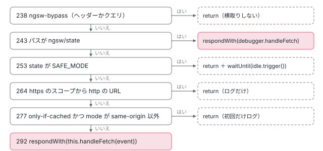

[目次](../README.md) › [Service Worker の内側](README.md) › 第 6 回 / 全 20 回

# fetch を横取りする：Driver.onFetch と handleFetch

> onFetch が横取りしないもの（ngsw-bypass の印、SAFE\_MODE、https から http の混在コンテンツ、only-if-cached と same-origin 以外の mode）と、その前に無条件に答える /ngsw/state、横取りするときに respondWith で handleFetch を渡す行。onFetch はスコープ（オリジン）も method も見ないこと。初期化を待つ、タブに版を割り当てる、版に聞いて無ければネットワークへ、ネットワークも駄目なら safeFetch が 504 を作る戻り方。

angular/angular · 読了 約 13 分 · 発展 · [サイトで読む（デモが動きます）](https://angular-deep-dive-cyan.vercel.app/chapter/sw-driver-fetch)

---

ワーカーが動き始めると、管理下のページが出すリクエストはすべて `fetch` のイベントとしてワーカーに届きます。この章では `Driver.onFetch` が「横取りしない」と決める条件を 1 つずつ確かめ、横取りすると決めたあとの `handleFetch` が 初期化を待ち、タブに版を割り当て、版に聞き、無ければネットワークに行き、ネットワークも駄目なら 504 を作るまでを、行番号で追います。

読む対象は `packages/service-worker/worker/src/driver.ts` の `onFetch`・`handleFetch`・`safeFetch` です。

1. [1. 全体像](01-sw-overview.md)
2. [2. Generator](02-sw-config-generator.md)
3. [3. ビルド](03-sw-cli-build.md)
4. [4. 登録](04-sw-register.md)
5. [5. Driver の起動](05-sw-driver-lifecycle.md)
6. **6. fetch の横取り**（この章）
7. [7. 版とタブ](07-sw-versions.md)
8. [8. アセット](08-sw-asset-groups.md)
9. [9. ハッシュ](09-sw-hash-integrity.md)
10. [10. データ](10-sw-data-groups.md)
11. [11. 小さな DB](11-sw-database.md)
12. [12. 更新の確認](12-sw-update-check.md)
13. [13. SwUpdate](13-sw-swupdate.md)
14. [14. アイドルと掃除](14-sw-idle-cleanup.md)
15. [15. 壊れたとき](15-sw-safe-mode.md)
16. [16. プッシュ](16-sw-push.md)
17. [17. デバッグ](17-sw-debug.md)
18. [18. ワーカーのテスト](18-sw-testing-harness.md)
19. [19. アプリ側のテスト](19-sw-testing-app.md)
20. [20. issue と PR を読む](20-sw-issues.md)

> [!TIP]
> **新卒エンジニアへ**
>
> fetch のイベントには `respondWith(promise)` があります。ワーカーがこれを呼ぶと「この応答は私が作る」という約束になり、ブラウザは その Promise が返す Response をページに渡します。**呼ばずにハンドラーから戻ると、ブラウザはワーカーがいないときと同じようにネットワークへ行きます**。「横取りしない」とは、この「呼ばずに戻る」のことです。なお、ページの側の `HttpClient` がどう fetch を呼ぶかは [http-backend-fetch](../http/06-http-backend-fetch.md) の話で、この章はその fetch を受け取る側です。

## 1. onFetch：横取りしないもの

📄 `angular/packages/service-worker/worker/src/driver.ts` L227–247 （▶ の行: 233, 236, 238–239, 243, 245–246）

```ts
227 │   /**
228 │    * The handler for fetch events.
229 │    *
230 │    * This is the transition point between the synchronous event handler and the
231 │    * asynchronous execution that eventually resolves for respondWith() and waitUntil().
232 │    */
233 ▶   private onFetch(event: FetchEvent): void {
234 │     const req = event.request;
235 │     const scopeUrl = this.scope.registration.scope;
236 ▶     const requestUrlObj = this.adapter.parseUrl(req.url, scopeUrl);
237 │ 
238 ▶     if (req.headers.has('ngsw-bypass') || /[?&]ngsw-bypass(?:[=&]|$)/i.test(requestUrlObj.search)) {
239 ▶       return;
240 │     }
241 │ 
242 │     // The only thing that is served unconditionally is the debug page.
243 ▶     if (requestUrlObj.path === this.ngswStatePath) {
244 │       // Allow the debugger to handle the request, but don't affect SW state in any other way.
245 ▶       event.respondWith(this.debugger.handleFetch(req));
246 ▶       return;
247 │     }
```

233 行目、`onFetch` は `async` ではありません。`respondWith` はイベントのハンドラーの中で**同期で**呼ばないと効かないので、横取りするかどうかは、`await` を 1 つも挟まずにここで決めます。236 行目で URL をスコープ基準で解析します（`parseUrl` は [第 11 回](11-sw-database.md)の `Adapter`）。

1. **238〜239 行目：`ngsw-bypass` の印**

   リクエストのヘッダーに `ngsw-bypass` がある（値は何でもよい）か、クエリに `ngsw-bypass` という名前のパラメーターがあれば、何もせず戻ります。正規表現 `/[?&]ngsw-bypass(?:[=&]|$)/i` は大文字小文字を区別せず、`?ngsw-bypass`・`&ngsw-bypass=1` は当たり、`?ngsw-bypasss` は外れます。対象は `requestUrlObj.search`（? から後ろ）なので、パスの中の `ngsw-bypass` は印になりません。
2. **243〜246 行目：`/ngsw/state` は無条件に答える**

   パスがコンストラクタで決めた `ngswStatePath`（スコープ + `ngsw/state`、[第 5 回](05-sw-driver-lifecycle.md)）と同じなら、`DebugHandler` の答えを `respondWith` に渡して戻ります。初期化も版の割り当てもしないので、`SAFE_MODE` のワーカーでもこのページは開けます（中身は [第 17 回](17-sw-debug.md)）。

📄 `angular/packages/service-worker/worker/src/driver.ts` L249–268 （▶ の行: 253, 256–257, 264, 266–267）

```ts
249 │     // If the SW is in a broken state where it's not safe to handle requests at all,
250 │     // returning causes the request to fall back on the network. This is preferred over
251 │     // `respondWith(fetch(req))` because the latter still shows in DevTools that the
252 │     // request was handled by the SW.
253 ▶     if (this.state === DriverReadyState.SAFE_MODE) {
254 │       // Even though the worker is in safe mode, idle tasks still need to happen so
255 │       // things like update checks, etc. can take place.
256 ▶       event.waitUntil(this.idle.trigger());
257 ▶       return;
258 │     }
259 │ 
260 │     // Although "passive mixed content" (like images) only produces a warning without a
261 │     // ServiceWorker, fetching it via a ServiceWorker results in an error. Let such requests be
262 │     // handled by the browser, since handling with the ServiceWorker would fail anyway.
263 │     // See https://github.com/angular/angular/issues/23012#issuecomment-376430187 for more details.
264 ▶     if (requestUrlObj.origin.startsWith('http:') && scopeUrl.startsWith('https:')) {
265 │       // Still, log the incident for debugging purposes.
266 ▶       this.debugger.log(`Ignoring passive mixed content request: Driver.fetch(${req.url})`);
267 ▶       return;
268 │     }
```

1. **253〜258 行目：`SAFE_MODE` なら横取りしない。アイドルの時計だけ動かす**

   `respondWith(fetch(req))` にしない理由が 249〜252 行目のコメントにあります。それだと DevTools に「ワーカーが答えた」と出てしまうからです。256 行目で `idle.trigger()` を `waitUntil` に渡すので、更新の確認などのアイドルの仕事は `SAFE_MODE` でも走ります。`SAFE_MODE` に入る行は [第 5 回](05-sw-driver-lifecycle.md)と [第 15 回](15-sw-safe-mode.md)です。
2. **264〜267 行目：https のスコープから http の URL（混在コンテンツ）**

   画像などの「受け身の混在コンテンツ」は、ワーカーがいなければ警告で済みますが、ワーカーを通すとエラーになります（260〜263 行目のコメント）。そこでログにだけ残して戻ります。

📄 `angular/packages/service-worker/worker/src/driver.ts` L270–293 （▶ の行: 277, 280, 286, 292）

```ts
270 │     // When opening DevTools in Chrome, a request is made for the current URL (and possibly related
271 │     // resources, e.g. scripts) with `cache: 'only-if-cached'` and `mode: 'no-cors'`. These request
272 │     // will eventually fail, because `only-if-cached` is only allowed to be used with
273 │     // `mode: 'same-origin'`.
274 │     // This is likely a bug in Chrome DevTools. Avoid handling such requests.
275 │     // (See also https://github.com/angular/angular/issues/22362.)
276 │     // TODO(gkalpak): Remove once no longer necessary (i.e. fixed in Chrome DevTools).
277 ▶     if (req.cache === 'only-if-cached' && req.mode !== 'same-origin') {
278 │       // Log the incident only the first time it happens, to avoid spamming the logs.
279 │       if (!this.loggedInvalidOnlyIfCachedRequest) {
280 ▶         this.loggedInvalidOnlyIfCachedRequest = true;
281 │         this.debugger.log(
282 │           `Ignoring invalid request: 'only-if-cached' can be set only with 'same-origin' mode`,
283 │           `Driver.fetch(${req.url}, cache: ${req.cache}, mode: ${req.mode})`,
284 │         );
285 │       }
286 ▶       return;
287 │     }
288 │ 
289 │     // Past this point, the SW commits to handling the request itself. This could still
290 │     // fail (and result in `state` being set to `SAFE_MODE`), but even in that case the
291 │     // SW will still deliver a response.
292 ▶     event.respondWith(this.handleFetch(event));
293 │   }
```

1. **277〜287 行目：`cache: 'only-if-cached'` と `mode` が `same-origin` 以外**

   Chrome の DevTools を開くと、この組み合わせのリクエストが出ます（270〜276 行目のコメント。#22362）。仕様では `only-if-cached` は `same-origin` とだけ使えるので、ワーカーが取り直すと必ず失敗します。280 行目のフラグで最初の 1 回だけログに書き、戻ります。
2. **292 行目：ここまで来たら横取りする**

   `respondWith(this.handleFetch(event))`。289〜291 行目のコメントのとおり、ここから先は失敗しても何かしらの応答を返す約束です。



*onFetch は上から順に 5 つを確かめ、どれにも当たらなければ 292 行目で横取りする。return は respondWith を呼ばないこと（ブラウザがワーカー無しのときと同じくネットワークへ行く）。*

> [!WARNING]
> **ハマりどころ**
>
> **onFetch はスコープも method も見ていません。** 別のオリジン（`https://cdn.example/…`）へのリクエストも、POST も、上の 4 つに当たらなければ 292 行目で横取りされます。ブラウザは「ワーカーが管理しているページが出したリクエスト」をオリジンにかかわらずワーカーへ送るからです。そのあと、どの版のどのグループにも当たらなければ 2 節の 631 行目でネットワークに流されます。method で分かれるのはその先で、ナビゲーションの判定は GET だけ（[第 7 回](07-sw-versions.md)の `isNavigationRequest`）、データグループは method ごとに扱いを変えます（[第 10 回](10-sw-data-groups.md)）。

## 2. handleFetch：初期化を待つ、版を決める、版に聞く

📄 `angular/packages/service-worker/worker/src/driver.ts` L579–600 （▶ の行: 582, 586, 590–592, 594, 600）

```ts
579 │   private async handleFetch(event: FetchEvent): Promise<Response> {
580 │     try {
581 │       // Ensure the SW instance has been initialized.
582 ▶       await this.ensureInitialized(event);
583 │     } catch {
584 │       // Since the SW is already committed to responding to the currently active request,
585 │       // respond with a network fetch.
586 ▶       return this.safeFetch(event.request);
587 │     }
588 │ 
589 │     // On navigation requests, check for new updates.
590 ▶     if (event.request.mode === 'navigate' && !this.scheduledNavUpdateCheck) {
591 ▶       this.scheduledNavUpdateCheck = true;
592 ▶       this.idle.schedule('check-updates-on-navigation', async () => {
593 │         this.scheduledNavUpdateCheck = false;
594 ▶         await this.checkForUpdate();
595 │       });
596 │     }
597 │ 
598 │     // Decide which version of the app to use to serve this request. This is asynchronous as in
599 │     // some cases, a record will need to be written to disk about the assignment that is made.
600 ▶     const appVersion = await this.assignVersion(event);
```

1. **582 行目：初期化を待つ**

   `ensureInitialized` は初期化を 1 回だけ走らせる関数です（[第 5 回](05-sw-driver-lifecycle.md)）。ワーカーが起動し直した直後の最初の fetch では、ここで DB を読むか `ngsw.json` を取ってくるのを待ちます。
2. **583〜587 行目：初期化に失敗したら、そのままネットワークへ**

   292 行目でもう `respondWith` を呼んでいるので、断ることはできません。586 行目で `safeFetch`（3 節）に回します。
3. **590〜596 行目：ナビゲーションなら更新の確認をアイドルに積む**

   `mode === 'navigate'`（ページを開く・再読み込み）のたびに、`scheduledNavUpdateCheck` で重複を防ぎながら `checkForUpdate` を積みます。中身は [第 12 回](12-sw-update-check.md)です。
4. **600 行目：このリクエストに使う版を決める**

   `assignVersion` はタブの ID（`clientId` か `resultingClientId`）から版を決めます。開いているタブは今の版のまま、新しいタブは最新の版。`null` が返るのは状態が `NORMAL` でなく新しいタブを受け付けないときです（[第 7 回](07-sw-versions.md)）。

📄 `angular/packages/service-worker/worker/src/driver.ts` L601–625 （▶ の行: 602–604, 608, 612, 614, 617, 620–621, 623）

```ts
601 │     // If there's a configured max age, check whether this version is within that age.
602 ▶     const isVersionWithinMaxAge =
603 ▶       appVersion?.manifest.applicationMaxAge === undefined ||
604 ▶       this.adapter.time - appVersion.manifest.timestamp < appVersion.manifest.applicationMaxAge;
605 │     let res: Response | null = null;
606 │ 
607 │     try {
608 ▶       if (appVersion !== null && isVersionWithinMaxAge) {
609 │         try {
610 │           // Handle the request. First try the AppVersion. If that doesn't work, fall back on the
611 │           // network.
612 ▶           res = await appVersion.handleFetch(event.request, event);
613 │         } catch (err: any) {
614 ▶           if (err.isUnrecoverableState) {
615 │             await this.notifyClientsAboutUnrecoverableState(appVersion, err.message);
616 │           }
617 ▶           if (err.isCritical) {
618 │             // Something went wrong with handling the request from this version.
619 │             this.debugger.log(err, `Driver.handleFetch(version: ${appVersion.manifestHash})`);
620 ▶             await this.versionFailed(appVersion, err);
621 ▶             return this.safeFetch(event.request);
622 │           }
623 ▶           throw err;
624 │         }
625 │       }
```

1. **602〜604 行目：`applicationMaxAge` を過ぎていないか**

   `ngsw.json` に `applicationMaxAge` があれば、版の `timestamp` からの経過で判定し、過ぎていれば 608 行目の if に入らず版に聞きません。数え方の issue（#71720）は [第 14 回](14-sw-idle-cleanup.md)で扱います。
2. **612 行目：版に聞く**

   `AppVersion.handleFetch` はアセットグループ → データグループ → ナビゲーションの順に聞き、どこも答えなければ `null` を返します（[第 7 回](07-sw-versions.md)）。
3. **614〜623 行目：版が投げたとき**

   614 行目、「キャッシュにもサーバーにももう無い」`isUnrecoverableState` のエラーならタブに知らせます（[第 9 回](09-sw-hash-integrity.md)）。617 行目、`isCritical` のエラー（ハッシュが合わない、キャッシュに書けない など）なら 620 行目で `versionFailed`（[第 15 回](15-sw-safe-mode.md)）を呼び、621 行目でネットワークに回します。それ以外は 623 行目で投げ直し、`respondWith` の Promise が reject するので、ページからはネットワークエラーに見えます。

📄 `angular/packages/service-worker/worker/src/driver.ts` L626–643 （▶ の行: 630–631, 635, 641）

```ts
626 │ 
627 │       // The response will be `null` only if no `AppVersion` can be assigned to the request or if
628 │       // the assigned `AppVersion`'s manifest doesn't specify what to do about the request.
629 │       // In that case, just fall back on the network.
630 ▶       if (res === null) {
631 ▶         return this.safeFetch(event.request);
632 │       }
633 │ 
634 │       // The `AppVersion` returned a usable response, so return it.
635 ▶       return res;
636 │     } finally {
637 │       // Trigger the idle scheduling system. The Promise returned by `trigger()` will resolve after
638 │       // a specific amount of time has passed. If `trigger()` hasn't been called again by then (e.g.
639 │       // on a subsequent request), the idle task queue will be drained and the `Promise` won't
640 │       // be resolved until that operation is complete as well.
641 ▶       event.waitUntil(this.idle.trigger());
642 │     }
643 │   }
```

630〜631 行目、版が無い（`assignVersion` が `null`）か、版が `null` を返したら `safeFetch`。635 行目、版が答えたらそれを返します。641 行目の `finally` で、どの道を通っても `idle.trigger()` を `waitUntil` に渡します。fetch のたびにアイドルの 5 秒の時計がやり直しになるので、ページが忙しい間はアイドルの仕事（先読みや更新の確認）が後ろに延びます（[第 14 回](14-sw-idle-cleanup.md)）。

## 3. safeFetch：投げずに 504 を返す

📄 `angular/packages/service-worker/worker/src/driver.ts` L1375–1385 （▶ の行: 1377–1379, 1381–1382）

```ts
1375 │   async safeFetch(req: Request): Promise<Response> {
1376 │     try {
1377 ▶       return await this.scope.fetch(req);
1378 ▶     } catch (err) {
1379 ▶       this.debugger.log(err as Error, `Driver.fetch(${req.url})`);
1380 │       return this.adapter.newResponse(null, {
1381 ▶         status: 504,
1382 ▶         statusText: 'Gateway Timeout',
1383 │       });
1384 │     }
1385 │   }
```

1377 行目で本物の `fetch` を呼び、1378 行目、ネットワークが無いなどで投げたら、1379 行目でログに残して 1380〜1383 行目で `504 Gateway Timeout` の Response を作って返します。サーバーが返した 404 や 500 は投げないので、そのまま通ります。ページから見ると、オフラインで「ワーカーが横取りしたがどの版も答えなかった」リクエストは、`TypeError` ではなく `status 504` になります。

## 4. 本物の ngsw-worker.js で、横取りするかどうかを見る

> **🧪 DEMO — onFetch の条件と、サーバーに届いたもの**
>
> 本物の `ngsw-worker.js`（@angular/service-worker 22.1.6 の配布物）を、偽物のブラウザの上で動かします（偽物にしたものは `sw-sandbox.ts` の先頭のコメント）。アプリはグループ app（`/index.html`・`/main.js`、prefetch）とグループ assets（`/assets/data.json`、lazy）です。最初に押したときに install・activate・`settle(0)`・`settle(6000)` まで進め、app を先読みした状態から、tab-1 のリクエストを送ります。「サーバーに届いた」は、同じオリジンの GET はパスだけ、GET 以外は `POST /api/save`、別のオリジンは `https://cdn.example/lib.js` の形で出ます。偽物のサーバーは別のオリジンのファイルを持たないので、そちらは 404 です。
>
> ▶ [このデモはサイトで動かせます](https://angular-deep-dive-cyan.vercel.app/chapter/sw-driver-fetch)

代表の 14 件を送ると、次のことが読み取れます。

1. **handled が false なのは 3 件だけ**

   ヘッダーの `ngsw-bypass`、クエリの `ngsw-bypass`（238 行目）、http の画像（264 行目）。このときサーバーの記録も「なし」ですが、それは偽物のブラウザが respondWith の無いリクエストを本物のネットワークへ送らないからで、本物のブラウザならそのままサーバーに届きます。
2. **別のオリジンも handled が true**

   `https://cdn.example/lib.js` は 292 行目で横取りされ、どのグループにも無いので 631 行目の `safeFetch` で、そのオリジンのサーバーへ行きました（404 は偽物のサーバーがそのファイルを持たないため）。
3. **POST も handled が true。グループの外ならそのまま POST で届く**

   `POST /api/save` は 292 行目で横取りされ、どのグループにも当たらないので 631 行目の `safeFetch(event.request)` で元のリクエストのまま（method も body も）届きました。
4. **アセットグループの URL への POST は、GET になって届く**

   `POST /assets/data.json` のとき、サーバーの記録は `POST /assets/data.json` ではなく `/assets/data.json`（GET）です。`AssetGroup.handleFetch` は method を見ずに URL だけで当て、キャッシュに無ければ `newRequestWithMetadata` で作り直したリクエストで取りに行きます（[第 8 回](08-sw-asset-groups.md)の 2 節）。作り直すときに引き継ぐのは headers・referrer・referrerPolicy・redirect・credentials・cache だけで、method と body は引き継ぎません（[第 8 回](08-sw-asset-groups.md)の「直すとしたら」）。その GET の応答がキャッシュに入るので、次の行の GET はネットワークに行かずに答えます。ふつうのアプリはアセットに POST しないので、これを不具合と呼んでよいかは決めません。この動きに当たる issue は見つけていません。なお、偽物の Cache は method を区別しないので、このデモではキャッシュに**まだ無い** lazy のファイルを使っています（本物の Cache Storage は GET 以外の `match` に何も返さないので、本物のブラウザでは、キャッシュにあっても同じく GET で取りに行きます）。
5. **同じ `/products/42` でも、ナビゲーションならサーバーに行かない**

   ナビゲーションは版が `index.html` のキャッシュで答え、そうでなければネットワークへ行って 404 です。この分かれ目は [第 7 回](07-sw-versions.md)で読みます。
6. **オフラインの `/main.js` は 200、`/api/user` は 504**

   前者はキャッシュにあるのでネットワークに行かず、後者は 1378 行目の catch で 504 を作りました（サーバーの記録に `/api/user` が出るのは、偽物のサーバーが「届いたが落ちた」も記録するため）。

### ここまでの呼び出し

- `fetch のイベント → onFetch(event)` — driver.ts:233 — *同期で決める*
  - `ngsw-bypass / mixed content / only-if-cached → return` — driver.ts:238・264・277 — *ブラウザがネットワークへ*
  - `event.respondWith(this.handleFetch(event))` — driver.ts:292
    - `await this.ensureInitialized(event)` — driver.ts:582
    - `await this.assignVersion(event)` — driver.ts:600 — *第 7 回*
    - `await appVersion.handleFetch(event.request, event)` — driver.ts:612 — *第 7・8 回*
    - `this.safeFetch(event.request)` — driver.ts:631 — *どこも答えなかった*
      - `scope.fetch(req) / 504 Gateway Timeout` — driver.ts:1377・1380
    - `event.waitUntil(this.idle.trigger())` — driver.ts:641

## テストと直し方

### spec と describe

| spec | describe / it | bazel のターゲット |
| --- | --- | --- |
| worker/test/happy\_spec.ts | describe `Driver` の it ``bypasses the ServiceWorker on `ngsw-bypass` parameter``（1317）・`handles actual errors from the browser`（366）、describe `serving ngsw/state`（1431、it 4 つ）、describe `bugs` の it ``ignores invalid `only-if-cached` requests ``（2462）・`ignores passive mixed content requests `（2471） | `//packages/service-worker/worker/test:test` |

📄 `angular/packages/service-worker/worker/test/happy_spec.ts` L1317–1345 （▶ の行: 1319–1320, 1322, 1331, 1334–1335, 1339, 1342）

```ts
1317 │     it('bypasses the ServiceWorker on `ngsw-bypass` parameter', async () => {
1318 │       // NOTE:
1319 ▶       // Requests that bypass the SW are not handled at all in the mock implementation of `scope`,
1320 ▶       // therefore no requests reach the server.
1321 │ 
1322 ▶       await makeRequest(scope, '/some/url', undefined, {headers: {'ngsw-bypass': 'true'}});
1323 │       server.assertNoRequestFor('/some/url');
1324 │ 
1325 │       await makeRequest(scope, '/some/url', undefined, {headers: {'ngsw-bypass': 'anything'}});
1326 │       server.assertNoRequestFor('/some/url');
1327 │ 
1328 │       await makeRequest(scope, '/some/url', undefined, {headers: {'ngsw-bypass': null!}});
1329 │       server.assertNoRequestFor('/some/url');
1330 │ 
1331 ▶       await makeRequest(scope, '/some/url', undefined, {headers: {'NGSW-bypass': 'upperCASE'}});
1332 │       server.assertNoRequestFor('/some/url');
1333 │ 
1334 ▶       await makeRequest(scope, '/some/url', undefined, {headers: {'ngsw-bypasss': 'anything'}});
1335 ▶       server.assertSawRequestFor('/some/url');
1336 │ 
1337 │       server.clearRequests();
1338 │ 
1339 ▶       await makeRequest(scope, '/some/url?ngsw-bypass=true');
1340 │       server.assertNoRequestFor('/some/url');
1341 │ 
1342 ▶       await makeRequest(scope, '/some/url?ngsw-bypasss=true');
1343 │       server.assertSawRequestFor('/some/url');
1344 │ 
1345 │       server.clearRequests();
```

1319〜1320 行目のコメントのとおり、テストのハーネスも respondWith の無いリクエストをネットワークに送りません。だから「横取りしなかった」は 1323 行目の `assertNoRequestFor`（届いていない）で、「横取りした」は 1335 行目の `assertSawRequestFor`（`safeFetch` で届いた）で確かめます。1331 行目は大文字のヘッダー名（ヘッダー名は大文字小文字を区別しない）、1334・1342 行目は 1 文字多い名前が印にならないことの確認です。

📄 `angular/packages/service-worker/worker/test/happy_spec.ts` L366–376 （▶ の行: 371, 374–375）

```ts
366 │     it('handles actual errors from the browser', async () => {
367 │       expect(await makeRequest(scope, '/foo.txt')).toEqual('this is foo');
368 │       await driver.initialized;
369 │       server.clearRequests();
370 │ 
371 ▶       const [resPromise, done] = scope.handleFetch(new MockRequest('/error.txt'), 'default');
372 │       await done;
373 │       const res = (await resPromise)!;
374 ▶       expect(res.status).toEqual(504);
375 ▶       expect(res.statusText).toEqual('Gateway Timeout');
376 │     });
```

`/error.txt` はハーネスのサーバーが投げるように作ってあり（`withError`）、374〜375 行目で 1380〜1383 行目の 504 を確かめています。

📄 `angular/packages/service-worker/worker/test/happy_spec.ts` L2462–2502 （▶ の行: 2466–2468, 2482, 2488–2489, 2494, 2500–2501）

```ts
2462 │       it('ignores invalid `only-if-cached` requests ', async () => {
2463 │         const requestFoo = (cache: RequestCache | 'only-if-cached', mode: RequestMode) =>
2464 │           makeRequest(scope, '/foo.txt', undefined, {cache, mode});
2465 │ 
2466 ▶         expect(await requestFoo('default', 'no-cors')).toBe('this is foo');
2467 ▶         expect(await requestFoo('only-if-cached', 'same-origin')).toBe('this is foo');
2468 ▶         expect(await requestFoo('only-if-cached', 'no-cors')).toBeNull();
2469 │       });
2470 │ 
2471 │       it('ignores passive mixed content requests ', async () => {
2472 │         const scopeFetchSpy = spyOn(scope, 'fetch').and.callThrough();
2473 │         const getRequestUrls = () =>
2474 │           (scopeFetchSpy.calls.allArgs() as [Request][]).map((args) => args[0].url);
2475 │ 
2476 │         const httpScopeUrl = 'http://mock.origin.dev';
2477 │         const httpsScopeUrl = 'https://mock.origin.dev';
2478 │         const httpRequestUrl = 'http://other.origin.sh/unknown.png';
2479 │         const httpsRequestUrl = 'https://other.origin.sh/unknown.pnp';
2480 │ 
2481 │         // Registration scope: `http:`
2482 ▶         (scope.registration.scope as string) = httpScopeUrl;
2483 │ 
2484 │         await makeRequest(scope, httpRequestUrl);
2485 │         await makeRequest(scope, httpsRequestUrl);
2486 │         const requestUrls1 = getRequestUrls();
2487 │ 
2488 ▶         expect(requestUrls1).toContain(httpRequestUrl);
2489 ▶         expect(requestUrls1).toContain(httpsRequestUrl);
2490 │ 
2491 │         scopeFetchSpy.calls.reset();
2492 │ 
2493 │         // Registration scope: `https:`
2494 ▶         (scope.registration.scope as string) = httpsScopeUrl;
2495 │ 
2496 │         await makeRequest(scope, httpRequestUrl);
2497 │         await makeRequest(scope, httpsRequestUrl);
2498 │         const requestUrls2 = getRequestUrls();
2499 │ 
2500 ▶         expect(requestUrls2).not.toContain(httpRequestUrl);
2501 ▶         expect(requestUrls2).toContain(httpsRequestUrl);
2502 │       });
```

2468 行目、`only-if-cached` と `no-cors` の組だけが `null`（横取りされず、ハーネスでは応答が無い）。混在コンテンツは、2482 行目でスコープを http にしたときは 2488 行目で http の URL も届き、2494 行目で https にしたときは 2500 行目で届かない、の 2 通りを比べています。

### 手元で走らせた結果

📄 `ターミナル（../angular で）`

```
cd ~/angular-research/angular
pnpm bazel test //packages/service-worker/worker/test:test \
  --nocache_test_results --test_output=all \
  '--test_arg=--filter=^Driver (bypasses the ServiceWorker|handles actual errors|serving ngsw/state|bugs ignores)'
```

📄 `出力（2026-11-03 に実行。抜粋。ログは scratchpad/sw-logs/b-fetch.log）`

```
Ran 8 of 153 specs
8 specs, 0 failures
//packages/service-worker/worker/test:test                               PASSED in 0.7s
```

- 8 件 = bypass 1・handles actual errors 1・serving ngsw/state 4・bugs の ignores 2。

### 直すとしたら

- 「横取りしない条件」を足すなら `onFetch`（233〜293 行目）で、292 行目より前に `return` を置きます。it は 1317 行目の形（届いた・届いていないで確かめる）で足します。
- 実例があります。CSP の違反レポート（ブラウザが自分で送る POST）まで横取りしてしまう issue #31477 に対し、PR #67918（2026-03）は `onFetch` の ngsw-bypass の判定の直後に Content-Type を見る判定を足し、happy\_spec に 5 つの it を足していました。この PR はマージされずに 2026-04-10 に閉じました（issue も 2026-07-06 に閉じています）。PR へのメンテナーの返信で示されたのは、セキュリティの修正以外の新しい機能は受け付けない、というこのパッケージの方針です（`PACKAGE.md`。[第 1 回](01-sw-overview.md)）。
- つまりこのパッケージで本家に出せるのは、ほぼセキュリティの修正だけです。2026 年のこのディレクトリのコミット（`git log -- packages/service-worker/worker/src`）も、作り直したリクエストに referrer・credentials・cache・redirect・ヘッダーをどう引き継ぐか、という修正が中心です（[第 8 回](08-sw-asset-groups.md)の「直すとしたら」）。本家に PR を出すことは勧めません。ここで読んだ行は、issue を読むときに「どの return で抜けたか」を言い当てる手がかりにします（[第 20 回](20-sw-issues.md)）。

## 聞かれそうな質問

**Q. あるリクエストだけ Service Worker を通さないようにするには？**

リクエストに `ngsw-bypass` というヘッダーを付けるか、URL のクエリに `ngsw-bypass` を足します。238 行目がどちらかを見つけると、239 行目で `respondWith` を呼ばずに戻るので、ブラウザがワーカー無しのときと同じようにネットワークへ行きます。

**Q. CDN など別のオリジンへのリクエストはワーカーを通る？**

通ります。`onFetch` はオリジンを見ていないので（混在コンテンツの 264 行目だけは例外）、292 行目で横取りします。どのグループの URL にも当たらなければ 631 行目の `safeFetch` でそのままネットワークに行くので、結果はワーカーが無いときとほぼ同じです。ただしオフラインのときは `TypeError` ではなく 504 になります（1380 行目）。

**Q. POST はワーカーに横取りされる？**

横取りされます。`onFetch` に method の判定はありません。POST が分かれるのは版に聞いたあとで、ナビゲーションとしては扱われず（[第 7 回](07-sw-versions.md)）、データグループに当たれば method ごとの扱いを受け（[第 10 回](10-sw-data-groups.md)）、どこにも当たらなければ 631 行目で元のリクエストのままネットワークへ行きます。アセットグループの URL に当たったときだけは、作り直した GET で取りに行きます（デモの `POST /assets/data.json`）。

**Q. ワーカーが壊れて SAFE\_MODE になったら、ページは真っ白？**

なりません。253〜258 行目で `respondWith` を呼ばずに戻るので、すべてのリクエストはふつうにネットワークへ行きます。オンラインならワーカーが無いのと同じ動きです。`/ngsw/state` だけは 243 行目でその前に答えるので、壊れた理由を読めます。

**Q. オフラインでキャッシュに無いものを取ると、ページには何が返る？**

どの版も答えなければ 631 行目の `safeFetch` が呼ばれ、1377 行目の `fetch` が投げるので、1380〜1383 行目の `504 Gateway Timeout` が返ります。デモのオフラインの `/api/user` がこれです。

## 読み終えて

- `onFetch` は同期で、横取りしないのは ngsw-bypass・SAFE\_MODE・混在コンテンツ・only-if-cached の 4 つだけ。`/ngsw/state` はその前に必ず答える。
- スコープ（オリジン）も method も `onFetch` では見ない。分かれるのは版に聞いたあと。
- `handleFetch` は初期化を待ち → 版を割り当て → 版に聞き → 無ければ `safeFetch`。最後に必ず `idle.trigger()`。
- `safeFetch` は投げない。ネットワークが無ければ 504 を作る。
- このパッケージはセキュリティの修正以外の新しい機能を受け付けない方針（[第 1 回](01-sw-overview.md)）。PR #67918 がその例。

---

← 前: [Driver の起動：install・activate・初期化](05-sw-driver-lifecycle.md)  
次: [版とタブ：AppVersion とクライアントの割り当て](07-sw-versions.md) →
