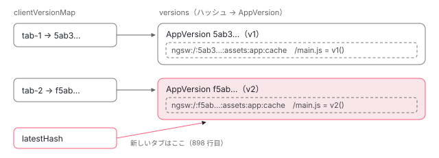

[目次](../README.md) › [Service Worker の内側](README.md) › 第 7 回 / 全 20 回

# 版とタブ：AppVersion とクライアントの割り当て

> ngsw.json 1 つが 1 つの AppVersion（ハッシュで呼ぶ）になり、Driver の clientVersionMap がタブごとに使う版を覚える仕組み。ナビゲーション（新しいタブや再読み込み）は最新の版、開いているタブは今の版のまま。AppVersion.handleFetch がグループを順に聞き、ナビゲーションを index.html に向ける行（isNavigationRequest・navigationUrls・navigationRequestStrategy）。

angular/angular · 読了 約 13 分 · 発展 · [サイトで読む（デモが動きます）](https://angular-deep-dive-cyan.vercel.app/chapter/sw-versions)

---

新しい版を出したあと、開いているタブは古い版のまま動き、新しく開いたタブは新しい版になります。この章では、その仕組みを 2 つに分けて行で追います。1 つは **`AppVersion`**（`ngsw.json` 1 つ分の版。リクエストをどのグループに聞くか、ナビゲーションをどう `index.html` に向けるか）、もう 1 つは **`Driver` の `clientVersionMap` と `assignVersion`**（どのタブにどの版を使わせるか）です。

読む対象は `packages/service-worker/worker/src/app-version.ts`・`manifest.ts` と、`driver.ts` の `assignVersion`・`updateClient` です。

1. [1. 全体像](01-sw-overview.md)
2. [2. Generator](02-sw-config-generator.md)
3. [3. ビルド](03-sw-cli-build.md)
4. [4. 登録](04-sw-register.md)
5. [5. Driver の起動](05-sw-driver-lifecycle.md)
6. [6. fetch の横取り](06-sw-driver-fetch.md)
7. **7. 版とタブ**（この章）
8. [8. アセット](08-sw-asset-groups.md)
9. [9. ハッシュ](09-sw-hash-integrity.md)
10. [10. データ](10-sw-data-groups.md)
11. [11. 小さな DB](11-sw-database.md)
12. [12. 更新の確認](12-sw-update-check.md)
13. [13. SwUpdate](13-sw-swupdate.md)
14. [14. アイドルと掃除](14-sw-idle-cleanup.md)
15. [15. 壊れたとき](15-sw-safe-mode.md)
16. [16. プッシュ](16-sw-push.md)
17. [17. デバッグ](17-sw-debug.md)
18. [18. ワーカーのテスト](18-sw-testing-harness.md)
19. [19. アプリ側のテスト](19-sw-testing-app.md)
20. [20. issue と PR を読む](20-sw-issues.md)

> [!TIP]
> **新卒エンジニアへ**
>
> ワーカーから見た「タブ」は `Client` と呼ばれ、ブラウザが付けた ID（`clientId`）を持ちます。fetch のイベントには 2 つの ID が付いてきます。`clientId` は「このリクエストを出したページ」、`resultingClientId` は 「このナビゲーションの結果できるページ」です。ページを開く・再読み込みするナビゲーションでは、前者は空で後者に新しいページの ID が入ります。

## 1. 版はハッシュで呼ぶ

📄 `angular/packages/service-worker/worker/src/manifest.ts` L11–24 （▶ の行: 15, 17–21, 23）

```ts
11 │ export type ManifestHash = string;
12 │ 
13 │ export interface Manifest {
14 │   configVersion: number;
15 ▶   timestamp: number;
16 │   appData?: {[key: string]: string};
17 ▶   index: string;
18 ▶   assetGroups?: AssetGroupConfig[];
19 ▶   dataGroups?: DataGroupConfig[];
20 ▶   navigationUrls: {positive: boolean; regex: string}[];
21 ▶   navigationRequestStrategy: 'freshness' | 'performance';
22 │   applicationMaxAge?: number;
23 ▶   hashTable: {[url: string]: string};
24 │ }
```

📄 `angular/packages/service-worker/worker/src/manifest.ts` L48–50 （▶ の行: 49）

```ts
48 │ export function hashManifest(manifest: Manifest): ManifestHash {
49 ▶   return sha1(JSON.stringify(manifest));
50 │ }
```

ワーカーの中の `Manifest` は、[第 2 回](02-sw-config-generator.md)の Generator が書いた `ngsw.json` そのものです。49 行目、版の名前は `JSON.stringify(manifest)` の SHA-1 です。23 行目の `hashTable` にはファイルごとのハッシュが入っているので、ファイルが 1 つ変われば版のハッシュも変わります。15 行目の `timestamp` はビルドの時刻なので、ファイルが同じでもビルドし直せば別の版になります （happy\_spec の it ``detects new version even if only `manifest.timestamp` is different``）。

## 2. AppVersion：1 つの版が持つもの

📄 `angular/packages/service-worker/worker/src/app-version.ts` L18–51 （▶ の行: 25, 29, 34, 39, 45, 51）

```ts
18 │ /**
19 │  * A specific version of the application, identified by a unique manifest
20 │  * as determined by its hash.
21 │  *
22 │  * Each `AppVersion` can be thought of as a published version of the app
23 │  * that can be installed as an update to any previously installed versions.
24 │  */
25 ▶ export class AppVersion implements UpdateSource {
26 │   /**
27 │    * A Map of absolute URL paths (`/foo.txt`) to the known hash of their contents (if available).
28 │    */
29 ▶   private hashTable = new Map<NormalizedUrl, string>();
30 │ 
31 │   /**
32 │    * All of the asset groups active in this version of the app.
33 │    */
34 ▶   private assetGroups: AssetGroup[];
35 │ 
36 │   /**
37 │    * All of the data groups active in this version of the app.
38 │    */
39 ▶   private dataGroups: DataGroup[];
40 │ 
41 │   /**
42 │    * Requests to URLs that match any of the `include` RegExps and none of the `exclude` RegExps
43 │    * are considered navigation requests and handled accordingly.
44 │    */
45 ▶   private navigationUrls: {include: RegExp[]; exclude: RegExp[]};
46 │ 
47 │   /**
48 │    * The normalized URL to the file that serves as the index page to satisfy navigation requests.
49 │    * Usually this is `/index.html`.
50 │    */
51 ▶   private indexUrl: NormalizedUrl;
```

25 行目の `AppVersion` は、29 行目のファイル → ハッシュの表、34 行目のアセットグループ、39 行目のデータグループ、45 行目のナビゲーションの URL の規則、51 行目の `index.html` の URL を持ちます。どれもコンストラクタで `manifest` から作ります。

📄 `angular/packages/service-worker/worker/src/app-version.ts` L62–104 （▶ の行: 68–69, 71, 73–74, 79, 82, 84, 94）

```ts
 62 │   constructor(
 63 │     private scope: ServiceWorkerGlobalScope,
 64 │     private adapter: Adapter,
 65 │     private database: Database,
 66 │     idle: IdleScheduler,
 67 │     private debugHandler: DebugHandler,
 68 ▶     readonly manifest: Manifest,
 69 ▶     readonly manifestHash: string,
 70 │   ) {
 71 ▶     this.indexUrl = this.adapter.normalizeUrl(this.manifest.index);
 72 │     // The hashTable within the manifest is an Object - convert it to a Map for easier lookups.
 73 ▶     Object.keys(manifest.hashTable).forEach((url) => {
 74 ▶       this.hashTable.set(adapter.normalizeUrl(url), manifest.hashTable[url]);
 75 │     });
 76 │ 
 77 │     // Process each `AssetGroup` declared in the manifest. Each declared group gets an `AssetGroup`
 78 │     // instance created for it, of a type that depends on the configuration mode.
 79 ▶     const assetCacheNamePrefix = `${manifestHash}:assets`;
 80 │     this.assetGroups = (manifest.assetGroups || []).map((config) => {
 81 │       // Check the caching mode, which determines when resources will be fetched/updated.
 82 ▶       switch (config.installMode) {
 83 │         case 'prefetch':
 84 ▶           return new PrefetchAssetGroup(
 85 │             scope,
 86 │             adapter,
 87 │             idle,
 88 │             config,
 89 │             this.hashTable,
 90 │             database,
 91 │             assetCacheNamePrefix,
 92 │           );
 93 │         case 'lazy':
 94 ▶           return new LazyAssetGroup(
 95 │             scope,
 96 │             adapter,
 97 │             idle,
 98 │             config,
 99 │             this.hashTable,
100 │             database,
101 │             assetCacheNamePrefix,
102 │           );
103 │       }
104 │     });
```

1. **71〜75 行目：`index` と `hashTable` を正規化した URL で持つ**

   `normalizeUrl` は、スコープと同じオリジンならパスだけにする関数です（[第 11 回](11-sw-database.md)の `Adapter`）。74 行目でオブジェクトを Map に入れ替えます。
2. **79 行目：キャッシュの名前の頭に版のハッシュ**

   `${manifestHash}:assets`。アセットのキャッシュは版ごとに別の箱になります。[第 5 回](05-sw-driver-lifecycle.md)のデモで `…<ハッシュ>:assets:app:cache` という名前が見えたのはこの行です。
3. **82〜103 行目：`installMode` でクラスを選ぶ**

   `prefetch` なら 84 行目の `PrefetchAssetGroup`、`lazy` なら 94 行目の `LazyAssetGroup`。違いは [第 8 回](08-sw-asset-groups.md)です。

📄 `angular/packages/service-worker/worker/src/app-version.ts` L106–119 （▶ の行: 109, 113–114, 116–117）

```ts
106 │     // Process each `DataGroup` declared in the manifest.
107 │     this.dataGroups = (manifest.dataGroups || []).map(
108 │       (config) =>
109 ▶         new DataGroup(scope, adapter, config, database, debugHandler, `${config.version}:data`),
110 │     );
111 │ 
112 │     // Create `include`/`exclude` RegExps for the `navigationUrls` declared in the manifest.
113 ▶     const includeUrls = manifest.navigationUrls.filter((spec) => spec.positive);
114 ▶     const excludeUrls = manifest.navigationUrls.filter((spec) => !spec.positive);
115 │     this.navigationUrls = {
116 ▶       include: includeUrls.map((spec) => new RegExp(spec.regex)),
117 ▶       exclude: excludeUrls.map((spec) => new RegExp(spec.regex)),
118 │     };
119 │   }
```

109 行目、データグループのキャッシュの名前は `${config.version}:data` で、**版のハッシュを含みません**。アプリの版が変わっても、データグループの `version` を上げない限り同じキャッシュを使い続けます（[第 10 回](10-sw-data-groups.md)）。113〜118 行目は `navigationUrls` を `positive` で 2 つに分け、正規表現にします。既定の規則（拡張子のあるものや `__` を含むものを外す）は Generator が作ります（[第 2 回](02-sw-config-generator.md)）。

## 3. AppVersion.handleFetch：アセット → データ → ナビゲーション

📄 `angular/packages/service-worker/worker/src/app-version.ts` L146–187 （▶ の行: 154, 157–158, 163, 169, 175, 181, 185）

```ts
146 │   async handleFetch(req: Request, event: ExtendableEvent): Promise<Response | null> {
147 │     // Check the request against each `AssetGroup` in sequence. If an `AssetGroup` can't handle the
148 │     // request,
149 │     // it will return `null`. Thus, the first non-null response is the SW's answer to the request.
150 │     // So reduce
151 │     // the group list, keeping track of a possible response. If there is one, it gets passed
152 │     // through, and if
153 │     // not the next group is consulted to produce a candidate response.
154 ▶     const asset = await this.assetGroups.reduce(async (potentialResponse, group) => {
155 │       // Wait on the previous potential response. If it's not null, it should just be passed
156 │       // through.
157 ▶       const resp = await potentialResponse;
158 ▶       if (resp !== null) {
159 │         return resp;
160 │       }
161 │ 
162 │       // No response has been found yet. Maybe this group will have one.
163 ▶       return group.handleFetch(req, event);
164 │     }, Promise.resolve<Response | null>(null));
165 │ 
166 │     // The result of the above is the asset response, if there is any, or null otherwise. Return the
167 │     // asset
168 │     // response if there was one. If not, check with the data caching groups.
169 ▶     if (asset !== null) {
170 │       return asset;
171 │     }
172 │ 
173 │     // Perform the same reduction operation as above, but this time processing
174 │     // the data caching groups.
175 ▶     const data = await this.dataGroups.reduce(async (potentialResponse, group) => {
176 │       const resp = await potentialResponse;
177 │       if (resp !== null) {
178 │         return resp;
179 │       }
180 │ 
181 ▶       return group.handleFetch(req, event);
182 │     }, Promise.resolve<Response | null>(null));
183 │ 
184 │     // If the data caching group returned a response, go with it.
185 ▶     if (data !== null) {
186 │       return data;
187 │     }
```

1. **154〜164 行目：アセットグループに順に聞く**

   `reduce` で 1 つずつ `group.handleFetch` を呼び、158 行目で最初に `null` でなかった答えをそのまま後ろへ流します。グループは自分の URL か pattern に当たらなければ `null` を返します（[第 8 回](08-sw-asset-groups.md)）。`ngsw-config.json` に書いた順が、聞く順です。
2. **175〜182 行目：アセットが答えなければデータグループに順に聞く**

   同じ形の `reduce` です（[第 10 回](10-sw-data-groups.md)）。

📄 `angular/packages/service-worker/worker/src/app-version.ts` L189–210 （▶ の行: 191–192, 196, 206, 209）

```ts
189 │     // Next, check if this is a navigation request for a route. Detect circular
190 │     // navigations by checking if the request URL is the same as the index URL.
191 ▶     if (this.adapter.normalizeUrl(req.url) !== this.indexUrl && this.isNavigationRequest(req)) {
192 ▶       if (this.manifest.navigationRequestStrategy === 'freshness') {
193 │         // For navigation requests the freshness was configured. The request will always go trough
194 │         // the network and fallback to default `handleFetch` behavior in case of failure.
195 │         try {
196 ▶           return await this.scope.fetch(req);
197 │         } catch {
198 │           // Navigation request failed - application is likely offline.
199 │           // Proceed forward to the default `handleFetch` behavior, where
200 │           // `indexUrl` will be requested and it should be available in the cache.
201 │         }
202 │       }
203 │ 
204 │       // This was a navigation request. Re-enter `handleFetch` with a request for
205 │       // the index URL.
206 ▶       return this.handleFetch(this.adapter.newRequest(this.indexUrl), event);
207 │     }
208 │ 
209 ▶     return null;
210 │   }
```

1. **191 行目：どこも答えず、ナビゲーションで、しかも index そのものではない**

   `/products/42` のような「ルートの URL」がここに来ます。index そのものを除くのは、206 行目で自分を呼び直したときに無限に回らないためです（189〜190 行目のコメント）。
2. **192〜202 行目：`navigationRequestStrategy: 'freshness'` なら、まずネットワーク**

   196 行目で元のリクエストをそのまま `fetch` し、返ってきたらそれを答えます（404 でも 500 でも）。投げたとき（オフライン）だけ catch に落ちて、下の index に進みます。既定の `'performance'` ではこの if に入りません。
3. **206 行目：`index.html` のリクエストに作り直して、自分をもう一度呼ぶ**

   今度は index の URL なので、アセットグループ（ふつうは prefetch の app）がキャッシュから答えます。SPA のどの URL を開いても同じ `index.html` が返るのはこの 1 行のおかげです。
4. **209 行目：それ以外は `null`**

   Driver の側で `safeFetch` に回ります（[第 6 回](06-sw-driver-fetch.md)）。

### ナビゲーションかどうか

📄 `angular/packages/service-worker/worker/src/app-version.ts` L212–233 （▶ の行: 217, 221, 225–227, 230–231）

```ts
212 │   /**
213 │    * Determine whether the request is a navigation request.
214 │    * Takes into account: Request method and mode, `Accept` header, `navigationUrls` patterns.
215 │    */
216 │   isNavigationRequest(req: Request): boolean {
217 ▶     if (req.method !== 'GET' || req.mode !== 'navigate') {
218 │       return false;
219 │     }
220 │ 
221 ▶     if (!this.acceptsTextHtml(req)) {
222 │       return false;
223 │     }
224 │ 
225 ▶     const urlPrefix = this.scope.registration.scope.replace(/\/$/, '');
226 ▶     const url = req.url.startsWith(urlPrefix) ? req.url.slice(urlPrefix.length) : req.url;
227 ▶     const urlWithoutQueryOrHash = url.replace(/[?#].*$/, '');
228 │ 
229 │     return (
230 ▶       this.navigationUrls.include.some((regex) => regex.test(urlWithoutQueryOrHash)) &&
231 ▶       !this.navigationUrls.exclude.some((regex) => regex.test(urlWithoutQueryOrHash))
232 │     );
233 │   }
```

📄 `angular/packages/service-worker/worker/src/app-version.ts` L315–326 （▶ の行: 319–320, 323–324）

```ts
315 │   /**
316 │    * Check whether a request accepts `text/html` (based on the `Accept` header).
317 │    */
318 │   private acceptsTextHtml(req: Request): boolean {
319 ▶     const accept = req.headers.get('Accept');
320 ▶     if (accept === null) {
321 │       return false;
322 │     }
323 ▶     const values = accept.split(',');
324 ▶     return values.some((value) => value.trim().toLowerCase() === 'text/html');
325 │   }
326 │ }
```

4 つの条件が全部そろったときだけ、ナビゲーションです。

1. **217 行目：GET で、`mode === 'navigate'`**

   POST のフォーム送信は、ブラウザから見ればナビゲーションでも、ここで外れます（#47263 の修正）。
2. **221 行目と 319〜324 行目：`Accept` に `text/html` がある**

   カンマで割り、前後の空白を取って、小文字にして `text/html` と完全に一致するものを探します。`Accept` が無ければ外れます。
3. **225〜227 行目：スコープの頭と、`?`・`#` から後ろを取る**

   スコープが `/app/` なら `/app/products/42?x=1` は `/products/42` として規則に当てます。
4. **229〜232 行目：`include` のどれかに当たり、`exclude` のどれにも当たらない**

   2 節の 113〜118 行目で作った正規表現です。

## 4. Driver が覚えるもの：clientVersionMap

📄 `angular/packages/service-worker/worker/src/driver.ts` L115–133 （▶ の行: 121, 126, 133）

```ts
115 │   /**
116 │    * Maps client IDs to the manifest hash of the application version being used to serve
117 │    * them. If a client ID is not present here, it has not yet been assigned a version.
118 │    *
119 │    * If a ManifestHash appears here, it is also present in the `versions` map below.
120 │    */
121 ▶   private clientVersionMap = new Map<ClientId, ManifestHash>();
122 │ 
123 │   /**
124 │    * Maps manifest hashes to instances of `AppVersion` for those manifests.
125 │    */
126 ▶   private versions = new Map<ManifestHash, AppVersion>();
127 │ 
128 │   /**
129 │    * The latest version fetched from the server.
130 │    *
131 │    * Valid after initialization has completed.
132 │    */
133 ▶   private latestHash: ManifestHash | null = null;
```

121 行目の `clientVersionMap` がタブの ID → 版のハッシュ、126 行目の `versions` が版のハッシュ → `AppVersion`、133 行目の `latestHash` が新しいタブに渡す版です。`clientVersionMap` は DB の `assignments` に保存され、ワーカーが起動し直すと `initialize` の中のこの行で戻ります。



*Driver の 3 つの状態。タブの ID は clientVersionMap で版のハッシュに、版のハッシュは versions で AppVersion に結びつく。latestHash は新しいタブに渡す版。どちらの版も自分のハッシュで始まる名前のキャッシュを持つ。*

📄 `angular/packages/service-worker/worker/src/driver.ts` L736–751 （▶ の行: 739, 741–742, 744）

```ts
736 │     // Map each client ID to its associated hash. Along the way, verify that the hash
737 │     // is still valid for that client ID. It should not be possible for a client to
738 │     // still be associated with a hash that was since removed from the state.
739 ▶     Object.keys(assignments).forEach((clientId: ClientId) => {
740 │       const hash = assignments[clientId];
741 ▶       if (this.versions.has(hash)) {
742 ▶         this.clientVersionMap.set(clientId, hash);
743 │       } else {
744 ▶         this.clientVersionMap.set(clientId, latest.latest);
745 │         this.debugger.log(
746 │           `Unknown version ${hash} mapped for client ${clientId}, using latest instead`,
747 │           `initialize: map assignments`,
748 │         );
749 │       }
750 │     });
751 │ 
```

741 行目、保存されていた版がまだ `versions` にあればそのまま、無ければ 744 行目で最新の版に付け替えてログに残します。DB を読んで `versions` を作る前半は [第 5 回](05-sw-driver-lifecycle.md)です。

## 5. assignVersion：このリクエストにどの版を使うか

📄 `angular/packages/service-worker/worker/src/driver.ts` L795–818 （▶ の行: 807–809, 811–812, 814, 816–817）

```ts
795 │   /**
796 │    * Decide which version of the manifest to use for the event.
797 │    */
798 │   private async assignVersion(event: FetchEvent): Promise<AppVersion | null> {
799 │     // First, check whether the event has a (non empty) client ID. If it does, the version may
800 │     // already be associated.
801 │     //
802 │     // NOTE: For navigation requests, we care about the `resultingClientId`. If it is undefined or
803 │     //       the empty string (which is the case for sub-resource requests), we look at `clientId`.
804 │     //
805 │     // NOTE: If a request is a worker script, we should use the `clientId`, as worker is a part
806 │     //       of requesting client.
807 ▶     const isWorkerScriptRequest =
808 ▶       event.request.destination === 'worker' && event.resultingClientId && event.clientId;
809 ▶     const clientId = isWorkerScriptRequest
810 │       ? event.clientId
811 ▶       : event.resultingClientId || event.clientId;
812 ▶     if (clientId) {
813 │       // Check if there is an assigned client id.
814 ▶       if (this.clientVersionMap.has(clientId)) {
815 │         // There is an assignment for this client already.
816 ▶         const hash = this.clientVersionMap.get(clientId)!;
817 ▶         let appVersion = this.lookupVersionByHash(hash, 'assignVersion');
818 │ 
```

1. **807〜811 行目：どの ID で引くか**

   ふつうは `resultingClientId || clientId`。ナビゲーションなら新しいページの ID、ページの中からのリクエストならそのページの ID になります。例外は Web Worker のスクリプト（`destination === 'worker'` で両方の ID がある）で、そのときは呼び出し元のページの `clientId` で引きます（805〜806 行目のコメント）。
2. **814〜817 行目：もう割り当てがあれば、その版**

   ここが「開いているタブは今の版のまま」の正体です。

📄 `angular/packages/service-worker/worker/src/driver.ts` L819–853 （▶ の行: 823–825, 832, 834, 837, 841, 843, 853）

```ts
819 │         // Ordinarily, this client would be served from its assigned version. But, if this
820 │         // request is a navigation request, this client can be updated to the latest
821 │         // version immediately.
822 │         if (
823 ▶           this.state === DriverReadyState.NORMAL &&
824 ▶           hash !== this.latestHash &&
825 ▶           appVersion.isNavigationRequest(event.request)
826 │         ) {
827 │           // Update this client to the latest version immediately.
828 │           if (this.latestHash === null) {
829 │             throw new Error(`Invariant violated (assignVersion): latestHash was null`);
830 │           }
831 │ 
832 ▶           const client = await this.scope.clients.get(clientId);
833 │           if (client) {
834 ▶             await this.updateClient(client);
835 │           }
836 │ 
837 ▶           appVersion = this.lookupVersionByHash(this.latestHash, 'assignVersion');
838 │         }
839 │ 
840 │         if (isWorkerScriptRequest) {
841 ▶           if (!this.clientVersionMap.has(event.resultingClientId)) {
842 │             // New worker hasn't been seen before; set this client to requesting client version
843 ▶             this.clientVersionMap.set(event.resultingClientId, hash);
844 │             await this.sync();
845 │           } else if (this.clientVersionMap.get(event.resultingClientId)! !== hash) {
846 │             throw new Error(
847 │               `Version mismatch between worker client ${event.resultingClientId} and requesting client ${clientId}`,
848 │             );
849 │           }
850 │         }
851 │ 
852 │         // TODO: make sure the version is valid.
853 ▶         return appVersion;
```

1. **822〜826 行目：割り当てがあっても、ナビゲーションなら最新に乗り換える**

   状態が `NORMAL` で、今の版が最新でなく、3 節の `isNavigationRequest` が true のとき。834 行目で `updateClient`（6 節）を呼んで割り当てを最新に書き換え、837 行目で最新の `AppVersion` に差し替えます。同じ ID のままナビゲーションが来るのは、テストのハーネスやこのページのデモのように ID を使い回した場合です。
2. **840〜850 行目：Web Worker のスクリプトなら、Worker にも同じ版を割り当てる**

   843 行目で Worker の ID（`resultingClientId`）を呼び出し元と同じ版にします。すでに違う版になっていたら 846 行目で投げます。

📄 `angular/packages/service-worker/worker/src/driver.ts` L854–884 （▶ の行: 858, 865, 875–876）

```ts
854 │       } else {
855 │         // This is the first time this client ID has been seen. Whether the SW is in a
856 │         // state to handle new clients depends on the current readiness state, so check
857 │         // that first.
858 ▶         if (this.state !== DriverReadyState.NORMAL) {
859 │           // It's not safe to serve new clients in the current state. It's possible that
860 │           // this is an existing client which has not been mapped yet (see below) but
861 │           // even if that is the case, it's invalid to make an assignment to a known
862 │           // invalid version, even if that assignment was previously implicit. Return
863 │           // undefined here to let the caller know that no assignment is possible at
864 │           // this time.
865 ▶           return null;
866 │         }
867 │ 
868 │         // It's safe to handle this request. Two cases apply. Either:
869 │         // 1) the browser assigned a client ID at the time of the navigation request, and
870 │         //    this is truly the first time seeing this client, or
871 │         // 2) a navigation request came previously from the same client, but with no client
872 │         //    ID attached. Browsers do this to avoid creating a client under the origin in
873 │         //    the event the navigation request is just redirected.
874 │         //
875 ▶         // In case 1, the latest version can safely be used.
876 ▶         // In case 2, the latest version can be used, with the assumption that the previous
877 │         // navigation request was answered under the same version. This assumption relies
878 │         // on the fact that it's unlikely an update will come in between the navigation
879 │         // request and requests for subsequent resources on that page.
880 │ 
881 │         // First validate the current state.
882 │         if (this.latestHash === null) {
883 │           throw new Error(`Invariant violated (assignVersion): latestHash was null`);
884 │         }
```

📄 `angular/packages/service-worker/worker/src/driver.ts` L885–903 （▶ の行: 898–899, 902）

```ts
885 │ 
886 │         if (isWorkerScriptRequest) {
887 │           if (!this.clientVersionMap.has(event.resultingClientId)) {
888 │             // New worker hasn't been seen before; set this client to latest hash as well
889 │             this.clientVersionMap.set(event.resultingClientId, this.latestHash);
890 │           } else if (this.clientVersionMap.get(event.resultingClientId)! !== this.latestHash) {
891 │             throw new Error(
892 │               `Version mismatch between worker client ${event.resultingClientId} and requesting client ${clientId}`,
893 │             );
894 │           }
895 │         }
896 │ 
897 │         // Pin this client ID to the current latest version, indefinitely.
898 ▶         this.clientVersionMap.set(clientId, this.latestHash);
899 ▶         await this.sync();
900 │ 
901 │         // Return the latest `AppVersion`.
902 ▶         return this.lookupVersionByHash(this.latestHash, 'assignVersion');
903 │       }
```

1. **858〜866 行目：初めて見る ID。`NORMAL` でなければ割り当てない**

   `EXISTING_CLIENTS_ONLY` のときに新しいタブを壊れた最新の版に付けないためです。`null` を返すと Driver は `safeFetch` でネットワークに行きます。
2. **898〜899 行目：最新の版に「ずっと」ピン留めし、DB に書く**

   897 行目のコメントの「indefinitely」のとおり、以後このタブは 814 行目でこの版を引き続けます。`sync()` は `manifests`・`assignments`・`latest` の 3 つを DB に書き直す関数です。868〜879 行目のコメントは、ナビゲーションのリクエストに ID が付いていなかった場合（後の 3 つ目の道）も、そのページの最初のサブリソースのときに最新の版を付ければ同じ版になる、という前提を述べています。

📄 `angular/packages/service-worker/worker/src/driver.ts` L904–922 （▶ の行: 907–908, 920）

```ts
904 │     } else {
905 │       // No client ID was associated with the request. This must be a navigation request
906 │       // for a new client. First check that the SW is accepting new clients.
907 ▶       if (this.state !== DriverReadyState.NORMAL) {
908 ▶         return null;
909 │       }
910 │ 
911 │       // Serve it with the latest version, and assume that the client will actually get
912 │       // associated with that version on the next request.
913 │ 
914 │       // First validate the current state.
915 │       if (this.latestHash === null) {
916 │         throw new Error(`Invariant violated (assignVersion): latestHash was null`);
917 │       }
918 │ 
919 │       // Return the latest `AppVersion`.
920 ▶       return this.lookupVersionByHash(this.latestHash, 'assignVersion');
921 │     }
922 │   }
```

どちらの ID も空なら、新しいタブのナビゲーションとみなします。907〜908 行目で `NORMAL` を確かめ、920 行目で最新の版を返すだけで、`clientVersionMap` には書きません （911〜912 行目のコメントのとおり、次のリクエストで付きます）。

## 6. updateClient：タブを最新に付け替える

5 節の 834 行目が呼ぶ `updateClient(client)` は、そのタブの割り当てがもう最新なら `false`、そうでなければ `clientVersionMap` を `latestHash` に書き換えて `sync()` で DB に書き、`true` を返す関数です。同じ関数を、ページの `SwUpdate.activateUpdate()` から届く `ACTIVATE_UPDATE` のメッセージも呼びます。行は [第 13 回](13-sw-swupdate.md)で引用しています。

> [!NOTE]
> **さらに深く**
>
> `updateClient` の終わりには「このタブに知らせる」というコメントのあとで作るだけで使わない変数 `current`（と `previous`）が残っています。`git log -L 570,577:packages/service-worker/worker/src/driver.ts` で見ると、2023 年の a645ceca94d（非推奨だった `SwUpdate.activated` を消したコミット）で、この 2 つを使っていた通知が消えて変数だけが残ったことが分かります。動きには影響しません。

## 7. 本物の ngsw-worker.js で、2 つのタブを比べる

> **🧪 DEMO — 開いているタブは v1 のまま、新しいタブは v2**
>
> 本物の `ngsw-worker.js`（@angular/service-worker 22.1.6 の配布物）を、偽物のブラウザの上で動かします（偽物にしたものは `sw-sandbox.ts` の先頭のコメント）。アプリは `/index.html` と `/main.js` の 2 つ（prefetch）。各段のあとに `/ngsw/state` の「=== Version ===」と「Clients:」を読み、最新の版を赤で示します。偽物のブラウザでは、ナビゲーションの `resultingClientId` を自分で決めて渡します。
>
> ▶ [このデモはサイトで動かせます](https://angular-deep-dive-cyan.vercel.app/chapter/sw-versions)

1. **1 段目：版は 1 つで `tab-1` が乗る**

   ナビゲーションは `resultingClientId: 'tab-1'` で来るので、初めて見る ID として 898 行目でピン留めされます。`/` は 206 行目で `index.html` に向き `<h1>v1</h1>`。
2. **2 段目：版が 2 つになり、最新が v2 に移る。`tab-1` は v1 のまま**

   タブに `VERSION_DETECTED`・`VERSION_READY`・`OPERATION_COMPLETED` が届きます（確認の中身は [第 12 回](12-sw-update-check.md)）。`tab-1` の `/main.js` は `v1()`。814〜817 行目で割り当てを引いたからです。
3. **3 段目：`tab-2` は v2**

   初めて見る ID なので 898 行目で `latestHash`（v2）に付き、`<h1>v2</h1>`。
4. **4 段目：同じ `/main.js` でも、タブによって `v1()` と `v2()`**

   ワーカーのキャッシュには版ごとの箱（2 節の 79 行目）があり、どちらの箱から答えるかを `clientVersionMap` が決めます。
5. **5 段目：`tab-1` を同じ ID でナビゲーションすると v2 に乗り換え、古い版の Clients が空になる**

   822〜838 行目の道です。誰も使わなくなった v1 のキャッシュは、アイドルの掃除で消えます（[第 14 回](14-sw-idle-cleanup.md)）。

### ここまでの呼び出し

- `Driver.handleFetch(event)` — driver.ts — *第 6 回*
  - `assignVersion(event)` — driver.ts:798
    - `clientId = resultingClientId || clientId` — driver.ts:809-811
    - `clientVersionMap.get(clientId)` — driver.ts:816 — *あれば今の版*
    - `isNavigationRequest → updateClient(client)` — driver.ts:825・834 — *ナビゲーションなら最新へ*
    - `clientVersionMap.set(clientId, latestHash); sync()` — driver.ts:898-899 — *初めての ID*
  - `appVersion.handleFetch(req, event)` — app-version.ts:146
    - `assetGroups → dataGroups` — app-version.ts:154・175
    - `isNavigationRequest(req) → handleFetch(newRequest(indexUrl))` — app-version.ts:191・206

## テストと直し方

### spec と describe

| spec | describe / it | bazel のターゲット |
| --- | --- | --- |
| worker/test/happy\_spec.ts | describe `Driver` の it `updates to new content when requested`（400）・`updates a specific client to new content on request`（453）・ `returns old content for worker initialized from old version`（480）・`handles empty client ID`（498）・ `preserves multiple client assignments across restarts`（563）・`updates when refreshed`（583）、describe `routing`（1946、it 11）、describe `navigationRequestStrategy`（2752、it 2） | `//packages/service-worker/worker/test:test` |

📄 `angular/packages/service-worker/worker/test/happy_spec.ts` L426–438 （▶ の行: 428, 431, 434）

```ts
426 │ 
427 │       // Default client is still on the old version of the app.
428 ▶       expect(await makeRequest(scope, '/foo.txt')).toEqual('this is foo');
429 │ 
430 │       // Sending a new client id should result in the updated version being returned.
431 ▶       expect(await makeRequest(scope, '/foo.txt', 'new')).toEqual('this is foo v2');
432 │ 
433 │       // Of course, the old version should still work.
434 ▶       expect(await makeRequest(scope, '/foo.txt')).toEqual('this is foo');
435 │ 
436 │       expect(await makeRequest(scope, '/bar.txt')).toEqual('this is bar');
437 │       serverUpdate.assertNoOtherRequests();
438 │     });
```

it `updates to new content when requested` の後半です（前半の、更新を確かめてタブに届くメッセージを見る部分は [第 12 回](12-sw-update-check.md)）。このページのデモと同じ流れを、`makeRequest(scope, url, clientId)` で書いています。`clientId` を省略すると `'default'` のタブです。更新したあとも 428 行目の `default` は v1、431 行目の新しい ID `'new'` は v2、434 行目でもう一度 `default` が v1 のままであることを確かめます。

📄 `angular/packages/service-worker/worker/test/happy_spec.ts` L583–607 （▶ の行: 593）

```ts
583 │     it('updates when refreshed', async () => {
584 │       expect(await makeRequest(scope, '/foo.txt')).toEqual('this is foo');
585 │       await driver.initialized;
586 │ 
587 │       const client = scope.clients.getMock('default')!;
588 │ 
589 │       scope.updateServerState(serverUpdate);
590 │       expect(await driver.checkForUpdate()).toEqual(true);
591 │       serverUpdate.clearRequests();
592 │ 
593 ▶       expect(await makeNavigationRequest(scope, '/file1')).toEqual('this is foo v2');
594 │ 
595 │       expect(client.messages).toEqual([
596 │         {
597 │           type: 'VERSION_DETECTED',
598 │           version: {hash: manifestUpdateHash, appData: {version: 'update'}},
599 │         },
600 │         {
601 │           type: 'VERSION_READY',
602 │           currentVersion: {hash: manifestHash, appData: {version: 'original'}},
603 │           latestVersion: {hash: manifestUpdateHash, appData: {version: 'update'}},
604 │         },
605 │       ]);
606 │       serverUpdate.assertNoOtherRequests();
607 │     });
```

593 行目、`default` の ID のままナビゲーション（`/file1`）を送ると v2 が返ります。5 節の 822〜838 行目（デモの 5 段目）を確かめる it です。

📄 `angular/packages/service-worker/worker/test/happy_spec.ts` L1966–1985 （▶ の行: 1967–1968, 1975, 1980, 1983）

```ts
1966 │       it('does not redirect to index on a non-GET request', async () => {
1967 ▶         expect(await navRequest('/baz', {method: 'POST'})).toBeNull();
1968 ▶         server.assertSawRequestFor('/baz');
1969 │ 
1970 │         expect(await navRequest('/qux', {method: 'PUT'})).toBeNull();
1971 │         server.assertSawRequestFor('/qux');
1972 │       });
1973 │ 
1974 │       it('does not redirect to index on a non-navigation request', async () => {
1975 ▶         expect(await navRequest('/baz', {mode: undefined})).toBeNull();
1976 │         server.assertSawRequestFor('/baz');
1977 │       });
1978 │ 
1979 │       it('does not redirect to index on a request that does not accept HTML', async () => {
1980 ▶         expect(await navRequest('/baz', {headers: {}})).toBeNull();
1981 │         server.assertSawRequestFor('/baz');
1982 │ 
1983 ▶         expect(await navRequest('/qux', {headers: {'Accept': 'text/plain'}})).toBeNull();
1984 │         server.assertSawRequestFor('/qux');
1985 │       });
```

3 節の 4 つの条件を、1 つずつ外して確かめます。1967 行目は POST、1975 行目は `mode` なし、1980 行目は `Accept` なし、1983 行目は `text/plain` だけ。どれも `null`（サーバーの 404）で、1968 行目のようにサーバーに届いたことも見ます。

📄 `angular/packages/service-worker/worker/test/happy_spec.ts` L2768–2786 （▶ の行: 2778, 2782）

```ts
2768 │       it('sends the request to the server in freshness mode', async () => {
2769 │         const {server, scope, driver} = createSwForFreshnessStrategy();
2770 │ 
2771 │         await makeRequest(scope, '/foo.txt');
2772 │         await driver.initialized;
2773 │         await server.clearRequests();
2774 │ 
2775 │         // Create multiple navigation requests to prove the navigation request is constantly made.
2776 │         // When enabled, the navigation request is made each time and not replaced
2777 │         // with the index request - thus, the `null` value.
2778 ▶         expect(await makeNavigationRequest(scope, '/', '')).toBe(null);
2779 │         expect(await makeNavigationRequest(scope, '/foo', '')).toBe(null);
2780 │         expect(await makeNavigationRequest(scope, '/foo/bar', '')).toBe(null);
2781 │ 
2782 ▶         server.assertSawRequestFor('/');
2783 │         server.assertSawRequestFor('/foo');
2784 │         server.assertSawRequestFor('/foo/bar');
2785 │         server.assertNoOtherRequests();
2786 │       });
```

freshness では 196 行目でサーバーに行くので、ハーネスのサーバーに無い `/` は 404 で `null`、2782 行目でサーバーに届いたことを確かめます。

### 手元で走らせた結果

📄 `ターミナル（../angular で）`

```
cd ~/angular-research/angular
pnpm bazel test //packages/service-worker/worker/test:test \
  --nocache_test_results --test_output=all \
  '--test_arg=--filter=^Driver (updates to new content|updates a specific client|updates when refreshed|returns old content|handles empty client ID|preserves multiple client|routing|navigationRequestStrategy)'
```

📄 `出力（2026-11-03 に実行。抜粋。ログは scratchpad/sw-logs/b-versions.log）`

```
Ran 19 of 153 specs
19 specs, 0 failures
//packages/service-worker/worker/test:test                               PASSED in 0.7s
```

- 19 件 = 上の it 6・routing 11（``(with custom `navigationUrls`)`` の 4 つを含む）・navigationRequestStrategy 2。`^Driver routing` なので、`with relative base href` の中の routing は入りません。

### 直すとしたら

- どのタブにどの版を使わせるかは `assignVersion`（5 節）と `updateClient`（6 節）。it は `updates to new content when requested` の形で、ID を変えた `makeRequest` と `makeNavigationRequest` を並べて足します。
- ナビゲーションの判定は `isNavigationRequest`（3 節）。it は describe `routing` に、条件を 1 つ外した `navRequest` を足します。
- 関係する issue に #54036（`navigationRequestStrategy: 'freshness'` で `VERSION_READY` が余分に出る）があります。196 行目でナビゲーションをネットワークに流すことと、`Driver.handleFetch` がナビゲーションのたびに更新の確認を積むこと（[第 6 回](06-sw-driver-fetch.md)の 2 節）の組み合わせを、手元で確かめる入口になります（[第 20 回](20-sw-issues.md)）。このページの偽物の世界でも、`navigationRequestStrategy: 'freshness'` の v1 を入れて tab-1 を閉じ、サーバーを v2 にして tab-2 をナビゲーションで開くと、tab-2 は 196 行目でネットワークから `<h1>v2</h1>` を受け取る一方、898 行目で v1（その時点の `latestHash`）にピン留めされ、5 秒後のアイドルの確認で `VERSION_DETECTED`・`VERSION_READY` が届きました（このデモのボタンには入れていません。scratchpad で `createSwWorld` を直接呼んで確かめた手順です）。このパッケージはセキュリティの修正以外を受け付けない方針なので（[第 6 回](06-sw-driver-fetch.md)）、本家に PR を出すことは勧めません。

## 聞かれそうな質問

**Q. 新しい版を出したら、開いているタブはいつ新しい版になる？**

そのタブがナビゲーション（再読み込み・リンクで別のページを開く）をしたときか、ページが `SwUpdate.activateUpdate()` を呼んだときです。それまでは 814〜817 行目で `clientVersionMap` の割り当てを引き続けます。再読み込みは新しい ID の `resultingClientId` で来るので、初めて見る ID として 898 行目で最新の版に付きます。

**Q. 同じ `/main.js` なのに、タブによって中身が違うのはなぜ？**

アセットのキャッシュは版ごとに別の箱（app-version.ts の 79 行目、名前の頭が版のハッシュ）で、どの版の `AppVersion` に聞くかを `assignVersion` がタブの ID で決めるからです。

**Q. SPA の `/products/42` を開くと `index.html` が返るのはどこ？**

`AppVersion.handleFetch` の 191 行目でナビゲーションと判定され、206 行目で `index` の URL のリクエストに作り直して自分を呼び直すからです。ナビゲーションの判定は 217 行目（GET と `navigate`）、221 行目（`Accept: text/html`）、229〜232 行目（`navigationUrls`）の 3 か所です。

**Q. `navigationRequestStrategy: 'freshness'` にすると何が変わる？**

192〜202 行目で、ナビゲーションのたびに元の URL をネットワークへ取りに行き、返ってきた応答（404 でも）をそのまま使います。オフラインで `fetch` が投げたときだけ 206 行目の `index.html` に戻ります。HTML をサーバーで作っていて、いつも新しい HTML を返したいときの設定です。

**Q. データグループのキャッシュも版ごとに分かれる？**

分かれません。109 行目の名前は `${config.version}:data` で、版のハッシュを含みません。アプリの版をまたいで同じキャッシュを使い、データグループの `version` を変えたときだけ別の箱になります。

## 読み終えて

- 版の名前は `ngsw.json` の SHA-1。ファイルが 1 つ変わっても、ビルドの時刻が変わっても別の版になる。
- `AppVersion.handleFetch` はアセット → データ → ナビゲーションの順。ナビゲーションは `index.html` のリクエストに作り直して自分を呼び直す。
- ナビゲーションは「GET・navigate・`Accept: text/html`・`navigationUrls`」の 4 条件。
- `clientVersionMap` はタブの ID → 版。初めての ID は最新にピン留め、あとはナビゲーションか `activateUpdate` まで変わらない。

---

← 前: [fetch を横取りする：Driver.onFetch と handleFetch](06-sw-driver-fetch.md)  
次: [アセットグループ：prefetch と lazy](08-sw-asset-groups.md) →
