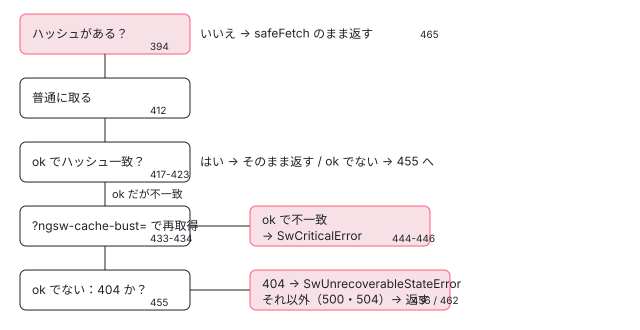

[目次](../README.md) › [Service Worker の内側](README.md) › 第 9 回 / 全 20 回

# ハッシュを確かめる：壊れたファイルと回復できない状態

> 取ってきたファイルの SHA-1 を ngsw.json の hashTable と比べ（sha1.ts）、違えば cache-bust を付けてもう一度取り、それでも違えば版を壊れたものとして扱う流れ。キャッシュから消えたファイルをもう取れないときの SwUnrecoverableStateError と、アプリ側の SwUpdate.unrecoverable。issue #45377。

angular/angular · 読了 約 12 分 · 発展 · [サイトで読む（デモが動きます）](https://angular-deep-dive-cyan.vercel.app/chapter/sw-hash-integrity)

---

ワーカーはサーバーから取ってきたファイルを、そのままキャッシュに入れるわけではありません。`ngsw.json` の `hashTable` に書かれた SHA-1 と、取ってきた中身の SHA-1 を比べ、違えば URL に `ngsw-cache-bust` を付けてもう一度取り、それでも違えば「この版は壊れている」と判断します。この章では、その比べる行、2 種類のエラー（`SwCriticalError` と `SwUnrecoverableStateError`）、エラーを受けた `Driver` がタブに `UNRECOVERABLE_STATE` を送るまでを、行番号を指して追います。最後に、開いている issue #45377（先読みの最中にネットワークが切れると戻れない）をこの章の行で読み解きます。

読む対象は `packages/service-worker/worker/src/` の `sha1.ts`・`error.ts`・`assets.ts`（`cacheBustedFetchFromNetwork`・`cacheBust`・`safeFetch`）・`driver.ts`（`versionFailed`・`notifyClientsAboutUnrecoverableState`）です。

1. [1. 全体像](01-sw-overview.md)
2. [2. Generator](02-sw-config-generator.md)
3. [3. ビルド](03-sw-cli-build.md)
4. [4. 登録](04-sw-register.md)
5. [5. Driver の起動](05-sw-driver-lifecycle.md)
6. [6. fetch の横取り](06-sw-driver-fetch.md)
7. [7. 版とタブ](07-sw-versions.md)
8. [8. アセット](08-sw-asset-groups.md)
9. **9. ハッシュ**（この章）
10. [10. データ](10-sw-data-groups.md)
11. [11. 小さな DB](11-sw-database.md)
12. [12. 更新の確認](12-sw-update-check.md)
13. [13. SwUpdate](13-sw-swupdate.md)
14. [14. アイドルと掃除](14-sw-idle-cleanup.md)
15. [15. 壊れたとき](15-sw-safe-mode.md)
16. [16. プッシュ](16-sw-push.md)
17. [17. デバッグ](17-sw-debug.md)
18. [18. ワーカーのテスト](18-sw-testing-harness.md)
19. [19. アプリ側のテスト](19-sw-testing-app.md)
20. [20. issue と PR を読む](20-sw-issues.md)

> [!TIP]
> **新卒エンジニアへ**
>
> **ハッシュ**は、ファイルの中身から計算する短い文字列です。中身が 1 バイトでも違えば、まったく別の文字列になります。SHA-1 はその計算方法の 1 つで、結果は 40 桁の 16 進数です。`hashTable` はビルドのときに Generator が作る「パス → SHA-1」の表です（作り方は [第 2 回](02-sw-config-generator.md)）。ワーカーはこの表を「サーバーにあるはずの正しい中身」として信じます。

## 1. ワーカーの中の SHA-1

📄 `angular/packages/service-worker/worker/src/sha1.ts` L9–29 （▶ の行: 14–15, 17, 26–28）

```ts
 9 │ /**
10 │  * Compute the SHA1 of the given string
11 │  *
12 │  * see https://csrc.nist.gov/publications/fips/fips180-4/fips-180-4.pdf
13 │  *
14 ▶  * WARNING: this function has not been designed not tested with security in mind.
15 ▶  *          DO NOT USE IT IN A SECURITY SENSITIVE CONTEXT.
16 │  *
17 ▶  * Borrowed from @angular/compiler/src/i18n/digest.ts
18 │  */
19 │ 
20 │ export function sha1(str: string): string {
21 │   const utf8 = str;
22 │   const words32 = stringToWords32(utf8, Endian.Big);
23 │   return _sha1(words32, utf8.length * 8);
24 │ }
25 │ 
26 ▶ export function sha1Binary(buffer: ArrayBuffer): string {
27 ▶   const words32 = arrayBufferToWords32(buffer, Endian.Big);
28 ▶   return _sha1(words32, buffer.byteLength * 8);
29 │ }
```

ワーカーは Web Crypto（`crypto.subtle.digest`）を使わず、自前の SHA-1 を持っています。17 行目のとおり、コンパイラの i18n の digest から借りてきたものです。14〜15 行目は「安全性のための設計も試験もしていない。安全性が要る場面に使うな」という注意で、ここでのハッシュは**改ざんを防ぐ署名ではなく、取り違えを見つける目印**だと分かります。

ファイルの中身を比べるときに使うのは 26〜29 行目の `sha1Binary` です。27 行目で `ArrayBuffer`（レスポンスの本文のバイト列）を 32 ビットの語の配列にし、28 行目で長さ（ビット数）と一緒に計算します。20 行目の文字列版 `sha1` は、ファイルではなく `ngsw.json` そのものを版の名前にするときに使います（`manifest.ts` の `hashManifest`。[第 7 回](07-sw-versions.md)）。

## 2. 比べる場所：cacheBustedFetchFromNetwork

ハッシュのあるファイルをネットワークから取るときは、必ずこの関数を通ります。呼ぶのは `fetchAndCacheOnce` → `fetchFromNetwork` の順で、同じ URL を 1 回だけ取る仕組みと、取れた応答をキャッシュに入れる行は [第 8 回](08-sw-asset-groups.md)で読みました。ここでは「取れた中身が正しいか」だけを見ます。

📄 `angular/packages/service-worker/worker/src/assets.ts` L389–424 （▶ の行: 390, 394, 397, 412, 417, 422–423）

```ts
389 │   protected async cacheBustedFetchFromNetwork(req: Request): Promise<Response> {
390 ▶     const url = this.adapter.normalizeUrl(req.url);
391 │ 
392 │     // If a hash is available for this resource, then compare the fetched version with the
393 │     // canonical hash. Otherwise, the network version will have to be trusted.
394 ▶     if (this.hashes.has(url)) {
395 │       // It turns out this resource does have a hash. Look it up. Unless the fetched version
396 │       // matches this hash, it's invalid and the whole manifest may need to be thrown out.
397 ▶       const canonicalHash = this.hashes.get(url)!;
398 │ 
399 │       // Ideally, the resource would be requested with cache-busting to guarantee the SW gets
400 │       // the freshest version. However, doing this would eliminate any chance of the response
401 │       // being in the HTTP cache. Given that the browser has recently actively loaded the page,
402 │       // it's likely that many of the responses the SW needs to cache are in the HTTP cache and
403 │       // are fresh enough to use. In the future, this could be done by setting cacheMode to
404 │       // *only* check the browser cache for a cached version of the resource, when cacheMode is
405 │       // fully supported. For now, the resource is fetched directly, without cache-busting, and
406 │       // if the hash test fails a cache-busted request is tried before concluding that the
407 │       // resource isn't correct. This gives the benefit of acceleration via the HTTP cache
408 │       // without the risk of stale data, at the expense of a duplicate request in the event of
409 │       // a stale response.
410 │ 
411 │       // Fetch the resource from the network (possibly hitting the HTTP cache).
412 ▶       let response = await this.safeFetch(req);
413 │ 
414 │       // Decide whether a cache-busted request is necessary. A cache-busted request is necessary
415 │       // only if the request was successful but the hash of the retrieved contents does not match
416 │       // the canonical hash from the manifest.
417 ▶       let makeCacheBustedRequest = response.ok;
418 │       if (makeCacheBustedRequest) {
419 │         // The request was successful. A cache-busted request is only necessary if the hashes
420 │         // don't match.
421 │         // (Make sure to clone the response so it can be used later if it proves to be valid.)
422 ▶         const fetchedHash = sha1Binary(await response.clone().arrayBuffer());
423 ▶         makeCacheBustedRequest = fetchedHash !== canonicalHash;
424 │       }
```

1. **390・394 行目：ハッシュのある URL か**

   390 行目で URL を正規化し（同じオリジンならパスだけにする。[第 11 回](11-sw-database.md)の `Adapter.normalizeUrl`）、394 行目で `this.hashes`（`hashTable` から作った `Map`）にあるかを見ます。無ければ確かめようがないので、末尾の 465 行目でそのまま取ります（次の引用）。
2. **397 行目：正しいハッシュを取り出す**

   `canonicalHash`（基準のハッシュ）と呼んでいます。`ngsw.json` に書かれた 40 桁です。
3. **412 行目：まず普通に取る**

   いきなり cache-bust は付けません。399〜409 行目のコメントが理由を書いています。ページを読み込んだ直後なら、ブラウザの HTTP キャッシュに新しい中身が残っていることが多く、それを使えれば速い。古い中身が返ってきたら、そのときだけもう一度取ればよい、という考えです。
4. **417〜423 行目：成功したときだけハッシュを計算する**

   417 行目、`response.ok`（200 番台）でなければハッシュを比べず、cache-bust もしません。成功していれば 422 行目で本文の SHA-1 を計算し（`clone()` するのは、本文を読むと使い切ってしまうから）、423 行目で基準と違えば `makeCacheBustedRequest` が `true` になります。

📄 `angular/packages/service-worker/worker/src/assets.ts` L426–450 （▶ の行: 427, 433–434, 437, 440, 444–446）

```ts
426 │       // Make a cache busted request to the network, if necessary.
427 ▶       if (makeCacheBustedRequest) {
428 │         // Hash failure, the version that was retrieved under the default URL did not have the
429 │         // hash expected. This could be because the HTTP cache got in the way and returned stale
430 │         // data, or because the version on the server really doesn't match. A cache-busting
431 │         // request will differentiate these two situations.
432 │         // TODO: handle case where the URL has parameters already (unlikely for assets).
433 ▶         const cacheBustReq = this.newRequestWithMetadata(this.cacheBust(req.url), req);
434 ▶         response = await this.safeFetch(cacheBustReq);
435 │ 
436 │         // If the response was successful, check the contents against the canonical hash.
437 ▶         if (response.ok) {
438 │           // Hash the contents.
439 │           // (Make sure to clone the response so it can be used later if it proves to be valid.)
440 ▶           const cacheBustedHash = sha1Binary(await response.clone().arrayBuffer());
441 │ 
442 │           // If the cache-busted version doesn't match, then the manifest is not an accurate
443 │           // representation of the server's current set of files, and the SW should give up.
444 ▶           if (canonicalHash !== cacheBustedHash) {
445 ▶             throw new SwCriticalError(
446 ▶               `Hash mismatch (cacheBustedFetchFromNetwork): ${req.url}: expected ${canonicalHash}, got ${cacheBustedHash} (after cache busting)`,
447 │             );
448 │           }
449 │         }
450 │       }
```

1. **433〜434 行目：cache-bust を付けてもう一度**

   428〜431 行目のコメントのとおり、違った原因は 2 つ考えられます。HTTP キャッシュが古い中身を返したか、サーバーの中身が本当に違うか。URL を毎回違うものにすれば HTTP キャッシュには当たらないので、2 回目の結果でこの 2 つを見分けられます。
2. **437〜440 行目：2 回目も成功なら、もう一度ハッシュ**

   2 回目が失敗（404 や 500）なら、ここは飛ばして次の引用の 455 行目へ進みます。
3. **444〜446 行目：それでも違えば SwCriticalError**

   442〜443 行目のコメントは「`ngsw.json` がサーバーのファイルを正しく表していない。ワーカーは諦めるべき」と書いています。メッセージには URL・基準のハッシュ・実際のハッシュが入り、デバッグのページ（[第 17 回](17-sw-debug.md)）にそのまま出ます。

📄 `angular/packages/service-worker/worker/src/assets.ts` L452–467 （▶ の行: 455–457, 462, 465）

```ts
452 │       // At this point, `response` is either successful with a matching hash or is unsuccessful.
453 │       // Before returning it, check whether it failed with a 404 status. This would signify an
454 │       // unrecoverable state.
455 ▶       if (!response.ok && response.status === 404) {
456 ▶         throw new SwUnrecoverableStateError(
457 ▶           `Failed to retrieve hashed resource from the server. (AssetGroup: ${this.config.name} | URL: ${url})`,
458 │         );
459 │       }
460 │ 
461 │       // Return the response (successful or unsuccessful).
462 ▶       return response;
463 │     } else {
464 │       // This URL doesn't exist in our hash database, so it must be requested directly.
465 ▶       return this.safeFetch(req);
466 │     }
467 │   }
```

452 行目のコメントのとおり、ここに来た `response` は「成功してハッシュも合っている」か「失敗している」かのどちらかです。**455 行目、失敗の中でも 404 だけ**を特別に扱い、456 行目で `SwUnrecoverableStateError`（回復できない状態）を投げます。ハッシュのあるファイルが 404 なら、サーバーにはもう別の版が置かれていて、この版のファイルは二度と手に入らないからです。

**500 や 504 は 462 行目でそのまま返ります。**エラーを投げるのは呼び出し元の `fetchAndCacheOnce` で、「Response not Ok」という**ふつうの `Error`** です（第 8 回）。この違いが 7 節の issue #45377 につながります。



*cacheBustedFetchFromNetwork の分かれ道（assets.ts 389〜467 行目）。四角の右下は行番号*

### cache-bust の URL と、落ちない safeFetch

📄 `angular/packages/service-worker/worker/src/assets.ts` L551–567 （▶ の行: 555, 560, 562–563）

```ts
551 │   /**
552 │    * Construct a cache-busting URL for a given URL.
553 │    */
554 │   private cacheBust(url: string): string {
555 ▶     return url + (url.indexOf('?') === -1 ? '?' : '&') + 'ngsw-cache-bust=' + Math.random();
556 │   }
557 │ 
558 │   protected async safeFetch(req: Request): Promise<Response> {
559 │     try {
560 ▶       return await this.scope.fetch(req);
561 │     } catch {
562 ▶       return this.adapter.newResponse('', {
563 ▶         status: 504,
564 │         statusText: 'Gateway Timeout',
565 │       });
566 │     }
567 │   }
```

555 行目、URL に `?` が無ければ `?`、あれば `&` を付けて `ngsw-cache-bust=` と `Math.random()` をつなぎます。サーバーはこの引数を知らなくても、ふつうは無視して同じファイルを返します。

560 行目の `safeFetch` は、`fetch` が例外を投げたとき（オフラインなど）に 562〜563 行目で **504 Gateway Timeout の偽の応答**を作って返します。だからオフラインは 417 行目では「ok でない」になり、455 行目で 404 でないので、462 行目でそのまま返ります。

## 3. 2 種類のエラー

📄 `angular/packages/service-worker/worker/src/error.ts` L9–23 （▶ の行: 9–10, 21–22）

```ts
 9 ▶ export class SwCriticalError extends Error {
10 ▶   readonly isCritical: boolean = true;
11 │ }
12 │ 
13 │ export function errorToString(error: any): string {
14 │   if (error instanceof Error) {
15 │     return `${error.message}\n${error.stack}`;
16 │   } else {
17 │     return `${error}`;
18 │   }
19 │ }
20 │ 
21 ▶ export class SwUnrecoverableStateError extends SwCriticalError {
22 ▶   readonly isUnrecoverableState: boolean = true;
23 │ }
```

9〜10 行目、`SwCriticalError` は `isCritical` が `true` の `Error` です。21〜22 行目、`SwUnrecoverableStateError` はその子クラスで、`isUnrecoverableState` も `true` です。子クラスなので `isCritical` も `true` のまま引き継ぎます。13 行目の `errorToString` は [第 17 回](17-sw-debug.md)で読みます。

この 2 つの印を読むのは `Driver.handleFetch` の `catch` です（[第 6 回](06-sw-driver-fetch.md)で引用した 601〜625 行目）。`isUnrecoverableState` なら先に `notifyClientsAboutUnrecoverableState`（5 節）を呼び、`isCritical` なら `versionFailed`（4 節）を呼んで、その要求はネットワークに回します。印の無いふつうの `Error` は投げ直され、ページから見るとネットワークエラーになります。

## 4. versionFailed：壊れた版をどう扱うか

📄 `angular/packages/service-worker/worker/src/driver.ts` L975–999 （▶ の行: 977–978, 981, 983, 986, 990–991, 993, 996, 998）

```ts
975 │   private async versionFailed(appVersion: AppVersion, err: Error): Promise<void> {
976 │     // This particular AppVersion is broken. First, find the manifest hash.
977 ▶     const broken = Array.from(this.versions.entries()).find(
978 ▶       ([hash, version]) => version === appVersion,
979 │     );
980 │ 
981 ▶     if (broken === undefined) {
982 │       // This version is no longer in use anyway, so nobody cares.
983 ▶       return;
984 │     }
985 │ 
986 ▶     const brokenHash = broken[0];
987 │ 
988 │     // The specified version is broken and new clients should not be served from it. However, it is
989 │     // deemed even riskier to switch the existing clients to a different version or to the network.
990 ▶     // Therefore, we keep clients on their current version (even if broken) and ensure that no new
991 ▶     // clients will be assigned to it.
992 │ 
993 ▶     // TODO: notify affected apps.
994 │ 
995 │     // The action taken depends on whether the broken manifest is the active (latest) or not.
996 ▶     // - If the broken version is not the latest, no further action is necessary, since new clients
997 │     //   will be assigned to the latest version anyway.
998 ▶     // - If the broken version is the latest, the SW cannot accept new clients (but can continue to
999 │     //   service old ones).
```

1. **977〜986 行目：壊れた版のハッシュを探す**

   `versions`（ハッシュ → `AppVersion` の `Map`）から、渡された `appVersion` と同じものを探します。981〜984 行目、もう一覧に無い（掃除された）版なら何もしません。
2. **988〜991 行目：開いているタブは動かさない**

   コメントがこの関数の方針です。「壊れた版を新しいタブに使ってはいけない。でも、開いているタブを別の版やネットワークに切り替えるのはもっと危ない」。だから**今その版を使っているタブは、壊れていてもその版のまま**です。993 行目の TODO（影響のあるアプリに知らせる）は、まだ実装されていません。
3. **996〜999 行目：最新の版かどうかで分かれる**

   壊れたのが最新でなければ、新しいタブはどのみち最新に割り当てられるので何もしなくてよい。最新が壊れたときは、`Driver` の状態を `EXISTING_CLIENTS_ONLY` に下げます。その 1000〜1005 行目と、戻る条件は [第 15 回](15-sw-safe-mode.md)で読みます。

`versionFailed` を呼ぶ場所は 2 つあります。1 つは 3 節の `Driver.handleFetch`（`isCritical` のときだけ）。もう 1 つは先読みを走らせる `scheduleInitialization` の `catch` で、こちらは**エラーの種類を見ずに**呼びます（[第 5 回](05-sw-driver-lifecycle.md)で引用した 964 行目）。先読みの最中なら、ふつうの `Error`（500 や 504 の「Response not Ok」）でも版が壊れた扱いになります。

## 5. UNRECOVERABLE\_STATE をタブに送る

📄 `angular/packages/service-worker/worker/src/driver.ts` L1215–1240 （▶ の行: 1219, 1222, 1228–1229, 1234, 1236）

```ts
1215 │   async notifyClientsAboutUnrecoverableState(
1216 │     appVersion: AppVersion,
1217 │     reason: string,
1218 │   ): Promise<void> {
1219 ▶     const broken = Array.from(this.versions.entries()).find(
1220 │       ([hash, version]) => version === appVersion,
1221 │     );
1222 ▶     if (broken === undefined) {
1223 │       // This version is no longer in use anyway, so nobody cares.
1224 │       return;
1225 │     }
1226 │ 
1227 │     const brokenHash = broken[0];
1228 ▶     const affectedClients = Array.from(this.clientVersionMap.entries())
1229 ▶       .filter(([clientId, hash]) => hash === brokenHash)
1230 │       .map(([clientId]) => clientId);
1231 │ 
1232 │     await Promise.all(
1233 │       affectedClients.map(async (clientId) => {
1234 ▶         const client = await this.scope.clients.get(clientId);
1235 │         if (client) {
1236 ▶           client.postMessage({type: 'UNRECOVERABLE_STATE', reason});
1237 │         }
1238 │       }),
1239 │     );
1240 │   }
```

1. **1219〜1225 行目：壊れた版のハッシュ**

   `versionFailed` の 977〜984 行目と同じ探し方です。
2. **1228〜1230 行目：その版を使っているタブだけ**

   `clientVersionMap`（タブの id → 版のハッシュ。[第 7 回](07-sw-versions.md)）から、壊れた版に割り当てられたタブの id を集めます。別の版のタブには送りません。
3. **1234〜1236 行目：postMessage**

   `clients.get(id)` でタブを探し、まだあれば `{type: 'UNRECOVERABLE_STATE', reason}` を送ります。`reason` は 457 行目のメッセージ（グループ名と URL）です。アプリの側でこれを受けるのが `SwUpdate.unrecoverable` です（[第 13 回](13-sw-swupdate.md)）。

> [!WARNING]
> **ハマりどころ**
>
> この知らせを送るのは `Driver.handleFetch` の `catch` だけです。先読み（`scheduleInitialization`）で 404 になっても `versionFailed` が呼ばれるだけで、`UNRECOVERABLE_STATE` はどのタブにも届きません。タブが「壊れた版のファイル」を実際に取りに来て、そこで 404 になったときにだけ届きます。

## 6. 本物のワーカーで確かめる

> **🧪 DEMO — ハッシュが合わない・ファイルが消えた・先読みの最中に切れた**
>
> 本物の `ngsw-worker.js`（npm の `@angular/service-worker` 22.1.6 の配布物そのもの）を、偽物のブラウザ（`sw-sandbox.ts`。キャッシュ・サーバー・タブ・時計をメモリの上の偽物にしたもの）の上で動かします。ngsw.json も本物の Generator で作ります。外には通信せず、このページの本物の Service Worker やキャッシュには触りません。ボタンを押すたびに新しい世界を作ります。
>
> ▶ [このデモはサイトで動かせます](https://angular-deep-dive-cyan.vercel.app/chapter/sw-hash-integrity)

A・B・C のそれぞれで、次のように出ます（私が 2026-11-03 に Node と同じ部品で確かめた結果です）。

- **A**：サーバーには `/main.js` と `/main.js?ngsw-cache-bust=0.…` の 2 回が届きます（412 行目と 434 行目）。状態は `EXISTING_CLIENTS_ONLY (Degraded due to: Hash mismatch (cacheBustedFetchFromNetwork): …/main.js: expected …, got … (after cache busting)`。446 行目のメッセージそのままです。app のキャッシュには `/index.html` だけが入っています。新しいタブ tab1 は v1 に割り当てられず（最新が壊れたので）、`/index.html` も `/main.js` もネットワークから返ります。
- **B**：`/lazy.js` は 2 回届きます。1 回目が 412 行目で 404、cache-bust はしません（417 行目で ok でないため）。2 回目は `Driver.handleFetch` がネットワークに回した分です。tab1 には `UNRECOVERABLE_STATE`（reason は `AssetGroup: lazy | URL: /lazy.js`）が届き、v1 は最新なので状態も `EXISTING_CLIENTS_ONLY` に下がります。
- **C**：先読みは `/index.html` で 504 になり、状態は `Degraded due to: Response not Ok (fetchAndCacheOnce) … 504 Gateway Timeout`。`UNRECOVERABLE_STATE` は届きません。online に戻して再読み込みしても、ナビゲーションはネットワークから返り、更新の確認は `NO_NEW_VERSION_DETECTED` で、状態は下がったままです。次の節で読みます。

## 7. issue #45377 をこの章の行で読む

#45377（2022-03-17、開いている）は「アプリがファイルを落としている最中にオフラインになると、キャッシュが戻れない状態になる。再読み込みしても取り直さず、オフラインで動けない。`SwUpdate.unrecoverable` も何も出さない」という報告です。デモの C がこの場面で、何が起きているかは次の順に読めます。

- `scheduleInitialization → initializeFully` — driver.ts:958（第 5 回） — *アイドルで先読み*
  - `fetchAndCacheOnce → cacheBustedFetchFromNetwork` — assets.ts:389
    - `safeFetch` が 504 の偽の応答 — assets.ts:562 — *オフライン*
    - `!response.ok && status === 404` は偽 — assets.ts:455 — *Unrecoverable にならない*
  - `Error('Response not Ok …')` — assets.ts（第 8 回） — *印の無いふつうのエラー*
- `catch → versionFailed` — driver.ts:964（第 5 回）
  - `latestHash === brokenHash` → `EXISTING_CLIENTS_ONLY` — driver.ts:1000（第 15 回）

- **unrecoverable が出ない理由**：455 行目は 404 しか見ず、5 節のとおり知らせは `Driver.handleFetch` の経路でしか送られないからです。
- **再読み込みで取り直さない理由**：再読み込みは新しいタブで、状態が `NORMAL` でないので版に割り当てられず、ネットワークに回ります（第 7 回の `assignVersion`）。更新の確認も、サーバーの `ngsw.json` が同じならハッシュが同じで「新しい版は無い」と答えるだけで、先読みはやり直しません（[第 12 回](12-sw-update-check.md)）。
- **戻るきっかけ**：新しいハッシュの版の取り込みが成功したとき（第 15 回の 1038〜1043 行目）か、`Driver` が作り直されたとき（状態はメモリの中の値で、DB には書かれません。[第 11 回](11-sw-database.md)の `sync`）。ブラウザがワーカーを止めて起こし直すと `main.ts` から作り直されるので、そこで先読みがやり直されます。

issue には 2 件のコメントがあり、1 件は再現の報告、もう 1 件は外部のコントリビューターによる「service worker は maintenance mode で、受け付けるのはセキュリティの修正だけなので閉じてよい」という書き込みです（2026-11-03 に `gh issue view 45377 --comments` で確認）。issue の一覧は [第 20 回](20-sw-issues.md)にまとめます。

## ここまでの呼び出し（ハッシュが合わないとき、タブからの要求で）

- 👤 `fetch('/main.js')` — ページ
  - `Driver.handleFetch → AppVersion.handleFetch → AssetGroup.handleFetch` — driver.ts / app-version.ts / assets.ts — *第 6〜8 回*
    - `fetchAndCacheOnce → fetchFromNetwork` — assets.ts:300・366
      - `cacheBustedFetchFromNetwork` — assets.ts:389
        - `safeFetch(req)` → `sha1Binary` が不一致 — assets.ts:412・422
        - `safeFetch(cacheBust(url))` → また不一致 — assets.ts:434・440
        - `throw new SwCriticalError('Hash mismatch …')` — assets.ts:445
  - `catch: isCritical → versionFailed` — driver.ts:975
  - `safeFetch(event.request)` — driver.ts — *その要求はネットワークへ*

## テストと直し方

### spec と describe

| spec | describe / it（行） | 確かめていること |
| --- | --- | --- |
| worker/test/happy\_spec.ts | `Driver`（257）› `bugs`（2216）› `does not crash with bad index hash`（2217） | index のハッシュが壊れた ngsw.json でも落ちずにネットワークの中身を返す |
| 同上 | `bugs` › `enters degraded mode when something goes wrong with the latest version`（2329） | lazy の `/bar.txt` のハッシュが合わない最新版 → `EXISTING_CLIENTS_ONLY`、開いているタブはその版のまま |
| 同上 | `bugs` › `unrecoverable state`（2523）› `notifies affected clients`（2554）・`enters degraded mode`（2642）・`is handled correctly even if some of the clients no longer exist`（2693） | キャッシュから消えたファイルが 404 → 割り当てられたタブだけに `UNRECOVERABLE_STATE` |
| worker/test/prefetch\_spec.ts | `throws if the server-side content does not match the manifest hash`（101） | `PrefetchAssetGroup.initializeFully` が `Hash mismatch` で reject（[第 8 回](08-sw-asset-groups.md)） |

📄 `angular/packages/service-worker/worker/test/happy_spec.ts` L2329–2356 （▶ の行: 2337–2338, 2341, 2353–2355）

```ts
2329 │       it('enters degraded mode when something goes wrong with the latest version', async () => {
2330 │         await driver.initialized;
2331 │ 
2332 │         // Two clients on initial version.
2333 │         expect(await makeRequest(scope, '/foo.txt', 'client1')).toBe('this is foo');
2334 │         expect(await makeRequest(scope, '/foo.txt', 'client2')).toBe('this is foo');
2335 │ 
2336 │         // Install a broken version (`bar.txt` has invalid hash).
2337 ▶         scope.updateServerState(brokenLazyServer);
2338 ▶         await driver.checkForUpdate();
2339 │ 
2340 │         // Update `client1` but not `client2`.
2341 ▶         await makeNavigationRequest(scope, '/', 'client1');
2342 │         server.clearRequests();
2343 │         brokenLazyServer.clearRequests();
2344 │ 
2345 │         expect(await makeRequest(scope, '/foo.txt', 'client1')).toBe('this is foo (broken)');
2346 │         expect(await makeRequest(scope, '/foo.txt', 'client2')).toBe('this is foo');
2347 │         server.assertNoOtherRequests();
2348 │         brokenLazyServer.assertNoOtherRequests();
2349 │ 
2350 │         // Trying to fetch `bar.txt` (which has an invalid hash) should invalidate the latest
2351 │         // version, enter degraded mode and "forget" clients that are on that version (i.e.
2352 │         // `client1`).
2353 ▶         expect(await makeRequest(scope, '/bar.txt', 'client1')).toBe('this is bar (broken)');
2354 ▶         expect(driver.state).toBe(DriverReadyState.EXISTING_CLIENTS_ONLY);
2355 ▶         brokenLazyServer.assertSawRequestFor('/bar.txt');
2356 │         brokenLazyServer.clearRequests();
```

2337 行目の `brokenLazyServer` は、`hashTable` の `/bar.txt` だけを逆さの文字列にした ngsw.json を返すサーバーです（`mock.ts` の `tmpHashTableForFs` の第 2 引数。偽物の作りは [第 18 回](18-sw-testing-harness.md)）。2353 行目でタブが `/bar.txt` を取ると、2 節の 444 行目で `SwCriticalError` になり、2354 行目で状態が下がっています。2353 行目の値が `'this is bar (broken)'` なのは、`Driver.handleFetch` がネットワークに回した応答だからです。

📄 `angular/packages/service-worker/worker/test/happy_spec.ts` L2604–2639 （▶ の行: 2609, 2618, 2620–2621, 2626–2628, 2630, 2633）

```ts
2604 │           // Update the ServiceWorker to the latest version
2605 │           scope.updateServerState(serverState3);
2606 │           expect(await driver.checkForUpdate()).toEqual(true);
2607 │ 
2608 │           // Remove `bar.hash.js` from the cache to emulate the browser evicting files from the cache.
2609 ▶           await removeAssetFromCache(scope, manifest2, '/bar.hash.js');
2610 │ 
2611 │           // Get all clients and verify their messages
2612 │           const mockClient1 = scope.clients.getMock('client1')!;
2613 │           const mockClient2 = scope.clients.getMock('client2')!;
2614 │           const mockClient3 = scope.clients.getMock('client3')!;
2615 │ 
2616 │           // Try to retrieve `bar.hash.js`, which is neither in the cache nor on the server.
2617 │           // This should put the SW in an unrecoverable state and notify clients.
2618 ▶           expect(await makeRequest(scope, '/bar.hash.js', 'client1')).toBeNull();
2619 │           serverState2.assertSawRequestFor('/bar.hash.js');
2620 ▶           const unrecoverableMessage = {
2621 ▶             type: 'UNRECOVERABLE_STATE',
2622 │             reason:
2623 │               'Failed to retrieve hashed resource from the server. (AssetGroup: assets | URL: /bar.hash.js)',
2624 │           };
2625 │ 
2626 ▶           expect(mockClient1.messages).toContain(unrecoverableMessage);
2627 ▶           expect(mockClient2.messages).toContain(unrecoverableMessage);
2628 ▶           expect(mockClient3.messages).not.toContain(unrecoverableMessage);
2629 │ 
2630 ▶           // Because `client1` failed, `client1` and `client2` have been moved to the latest version.
2631 │           // Verify that by retrieving `baz.hash.js`.
2632 │           expect(await makeRequest(scope, '/baz.hash.js', 'client1')).toBe('console.log("BAZ");');
2633 ▶           serverState2.assertNoRequestFor('/baz.hash.js');
2634 │           expect(await makeRequest(scope, '/baz.hash.js', 'client2')).toBe('console.log("BAZ");');
2635 │           serverState2.assertNoRequestFor('/baz.hash.js');
2636 │ 
2637 │           // Ensure that `client3` remains on the first version and can request `foo.hash.js`.
2638 │           expect(await makeRequest(scope, '/foo.hash.js', 'client3')).toBe('console.log("FOO");');
2639 │           serverState2.assertNoRequestFor('/foo.hash.js');
```

2609 行目でキャッシュから `/bar.hash.js` を消し、2618 行目で取らせます。サーバーはもう v3 なので 404 です。2626〜2628 行目、v2 に割り当てた client1・client2 には届き、v1 のままの client3 には届きません（5 節の 1228〜1230 行目）。

> [!NOTE]
> **さらに深く**
>
> 2630 行目のコメントは「client1 が失敗したので client1 と client2 は最新の版に移された」と書いていますが、ソースの行はそうしていません。4 節の 988〜991 行目のとおり `versionFailed` はタブを動かさず、5 節の関数も `clientVersionMap` を書き換えません。私は SwTestHarness でこの it と同じ手順を組み、`clientVersionMap` を前後で出して確かめました。client1 は v2 のままで、`/baz.hash.js` は v3 のサーバーからネットワーク越しに返り、client1 の `/index.html` は v2 の中身でした。2633 行目の `serverState2.assertNoRequestFor` は、2605 行目でサーバーを v3 に替えたあとなので、何を返しても通ります。

### 手元で走らせた結果

📄 `ターミナル（../angular で）`

```
cd ~/angular-research/angular
pnpm bazel test //packages/service-worker/worker/test:test --nocache_test_results --test_output=all '--test_arg=--filter=unrecoverable state|enters degraded mode|does not crash with bad index hash|throws if the server-side content does not match'
pnpm bazel test //packages/service-worker/worker/test:test --nocache_test_results --test_output=all
```

📄 `出力（2026-11-03 に実行。抜粋。ログは scratchpad/sw-logs/c-hash.log）`

```
# フィルタあり
Ran 8 of 153 specs
8 specs, 0 failures
//packages/service-worker/worker/test:test                               PASSED in 0.6s
# フィルタなし
153 specs, 0 failures
//packages/service-worker/worker/test:test                               PASSED in 0.7s
```

- フィルタは 4 つの名前の正規表現の「または」で、8 of 153（0.6 秒）。`unrecoverable state` の 3 件、名前に `enters degraded mode` を含む 3 件、`does not crash with bad index hash`、prefetch\_spec の 1 件です。
- フィルタ無しでは 153 specs, 0 failures（0.7 秒）でした（c-all.log）。

### 直すとしたら

- 比べ方そのものを変えるなら `assets.ts` の `cacheBustedFetchFromNetwork`（389〜467 行目）で、it は happy\_spec の `bugs` か prefetch\_spec に足します。サーバーの中身を変えるには `tmpHashTableForFs` の第 2 引数か、`MockFileSystemBuilder` で別の中身を作ります。
- #45377 を扱うなら入口は 2 つあります。455 行目（404 以外の失敗をどう扱うか）と、4 節の方針（先読みの失敗で最新の版を壊れた扱いにしてよいか。`scheduleInitialization` はエラーの種類を見ない）。どちらも振る舞いが大きく変わるので、本家に PR を出すことは勧めません。
- このパッケージは `PACKAGE.md` の 1 行目で「機能の限られた基本的なキャッシュの道具で、セキュリティの修正以外の新しい機能は受け付けない」と書いています（[第 1 回](01-sw-overview.md)）。新しい機能の PR は受け付けられず、不具合の直しも慎重に扱われます。
- 2630 行目のコメントと 2633・2635・2639 行目の確かめ方は、テストの読み手を誤らせます。2606 行目の更新の確認で v3 の `/baz.hash.js` は先読み済みなので、確かめるなら 2631 行目の前に `serverState3.clearRequests()` を入れてから `serverState3.assertSawRequestFor('/baz.hash.js')` とする形になります（私は SwTestHarness で同じ手順を組み、この形で通ることを確かめました）。手元で it を書き換えて試すのは、テストの読み方の練習になります。

## 聞かれそうな質問

**Q. ハッシュが合わないと、すぐ壊れた扱いになりますか？**

なりません。412 行目の 1 回目が合わなければ、433〜434 行目で `ngsw-cache-bust` を付けてもう一度取ります。HTTP キャッシュの古い中身が原因ならこれで合います。2 回目も合わないときだけ 445 行目で `SwCriticalError` です。

**Q. なぜ最初から cache-bust しないのですか？**

399〜409 行目のコメントのとおり、ページを読み込んだ直後は HTTP キャッシュに新しい中身があることが多く、それを使えば速いからです。その代わり、古かったときは 2 回取ることになります。

**Q. サーバーが 500 を返したら UNRECOVERABLE\_STATE になりますか？**

なりません。455 行目は 404 のときだけ `SwUnrecoverableStateError` を投げます。500 や、オフラインの 504（562〜563 行目）は 462 行目でそのまま返り、呼び出し元がふつうの `Error` にします。

**Q. UNRECOVERABLE\_STATE は全部のタブに届きますか？**

壊れた版に割り当てられたタブだけです（1228〜1230 行目）。しかも送るのは `Driver.handleFetch` の経路だけで、先読みの失敗では送りません。

**Q. 壊れた版を使っているタブはどうなりますか？**

その版のままです（988〜991 行目のコメント）。キャッシュにあるファイルは返り続け、取れないファイルの要求はネットワークに回ります。新しいタブだけが、最新が壊れていれば版に割り当てられずネットワークで動きます。

**Q. このハッシュで改ざんを防げますか？**

防げません。14〜15 行目が「安全性が要る場面に使うな」と書いています。`ngsw.json` も同じサーバーから来るので、両方を書き換えられれば合ってしまいます。取り違え（古い中身・別の版）を見つけるための目印です。

## 読み終えて

- ハッシュのあるファイルは `cacheBustedFetchFromNetwork` で SHA-1 を比べ、違えば cache-bust でもう一度、それでも違えば `SwCriticalError`。
- 404 だけが `SwUnrecoverableStateError`。500 やオフラインの 504 はふつうの `Error` になる。
- `versionFailed` は開いているタブを動かさず、最新が壊れたときだけ状態を下げる（下げる行は第 15 回）。
- `UNRECOVERABLE_STATE` はタブの要求で 404 になったときだけ、その版のタブに送られる。#45377 で何も出ないのはこのため。

---

← 前: [アセットグループ：prefetch と lazy](08-sw-asset-groups.md)  
次: [データグループ：performance と freshness](10-sw-data-groups.md) →
