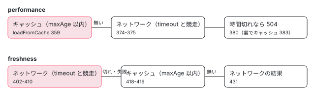

[目次](../README.md) › [Service Worker の内側](README.md) › 第 10 回 / 全 20 回

# データグループ：performance と freshness

> data.ts の DataGroup が API の応答をキャッシュする 2 つの戦略（performance はキャッシュを先に、freshness はネットワークを先に timeout まで待つ）、maxAge と maxSize（LruList で古いものから消す）、refreshAhead、cacheOpaqueResponses、version が変わったときにキャッシュを捨てる行。ページの上で本物のワーカーと仮想の時計で maxAge を過ぎさせるデモ。

angular/angular · 読了 約 13 分 · 中核 · [サイトで読む（デモが動きます）](https://angular-deep-dive-cyan.vercel.app/chapter/sw-data-groups)

---

アセットグループ（第 8 回）は「ビルドで中身が決まるファイル」をハッシュで管理しました。API の応答のように**中身がビルドのあとで変わるもの**は、ハッシュでは管理できません。そこで使うのがデータグループです。この章では `data.ts` の `DataGroup` が、`performance`（キャッシュを先に見る）と `freshness`（ネットワークを先に、`timeout` まで待つ）の 2 つの戦略で応答を返す順、`maxAge` で古いものを捨てる行、`maxSize` を超えたら `LruList` の一番古いものを消す行、`refreshAhead` と `cacheOpaqueResponses`、`version` が変わるとキャッシュが別になる仕組みを、行番号を指して追います。

読む対象は `packages/service-worker/worker/src/data.ts`（655 行）の全体です。

1. [1. 全体像](01-sw-overview.md)
2. [2. Generator](02-sw-config-generator.md)
3. [3. ビルド](03-sw-cli-build.md)
4. [4. 登録](04-sw-register.md)
5. [5. Driver の起動](05-sw-driver-lifecycle.md)
6. [6. fetch の横取り](06-sw-driver-fetch.md)
7. [7. 版とタブ](07-sw-versions.md)
8. [8. アセット](08-sw-asset-groups.md)
9. [9. ハッシュ](09-sw-hash-integrity.md)
10. **10. データ**（この章）
11. [11. 小さな DB](11-sw-database.md)
12. [12. 更新の確認](12-sw-update-check.md)
13. [13. SwUpdate](13-sw-swupdate.md)
14. [14. アイドルと掃除](14-sw-idle-cleanup.md)
15. [15. 壊れたとき](15-sw-safe-mode.md)
16. [16. プッシュ](16-sw-push.md)
17. [17. デバッグ](17-sw-debug.md)
18. [18. ワーカーのテスト](18-sw-testing-harness.md)
19. [19. アプリ側のテスト](19-sw-testing-app.md)
20. [20. issue と PR を読む](20-sw-issues.md)

> [!TIP]
> **新卒エンジニアへ**
>
> `ngsw-config.json` では `dataGroups` の 1 つに `name`・`urls`・`version`・`cacheConfig`（`strategy`・`maxSize`・`maxAge`・`timeout`・`refreshAhead`・`cacheOpaqueResponses`）を書きます。Generator がこれを `ngsw.json` に写すとき、`urls` の glob を正規表現の `patterns` に、`'1h'` のような長さを ms の `maxAge`・`timeoutMs`・`refreshAheadMs` に直し、`version` が無ければ 1 にします（[第 2 回](02-sw-config-generator.md)）。この章の `this.config` は、その写した後の形です。

## 1. DataGroup ができるとき

📄 `angular/packages/service-worker/worker/src/data.ts` L249–276 （▶ の行: 255, 257–260, 267, 270, 272）

```ts
249 │   constructor(
250 │     private scope: ServiceWorkerGlobalScope,
251 │     private adapter: Adapter,
252 │     private config: DataGroupConfig,
253 │     private db: Database,
254 │     private debugHandler: DebugHandler,
255 ▶     cacheNamePrefix: string,
256 │   ) {
257 ▶     this.patterns = config.patterns.map((pattern) => new RegExp(pattern));
258 ▶     this.cache = adapter.caches.open(`${cacheNamePrefix}:${config.name}:cache`);
259 ▶     this.lruTable = this.db.open(`${cacheNamePrefix}:${config.name}:lru`, config.cacheQueryOptions);
260 ▶     this.ageTable = this.db.open(`${cacheNamePrefix}:${config.name}:age`, config.cacheQueryOptions);
261 │   }
262 │ 
263 │   /**
264 │    * Lazily initialize/load the LRU chain.
265 │    */
266 │   private async lru(): Promise<LruList> {
267 ▶     if (this._lru === null) {
268 │       const table = await this.lruTable;
269 │       try {
270 ▶         this._lru = new LruList(await table.read<LruState>('lru'));
271 │       } catch {
272 ▶         this._lru = new LruList();
273 │       }
274 │     }
275 │     return this._lru;
276 │   }
```

1. **257 行目：patterns を RegExp にする**

   URL の判定は、このあと毎回この正規表現で行います。データグループには「ファイルの一覧」はありません。
2. **258〜260 行目：キャッシュ 1 つと表 2 つ**

   応答の本体は `…:cache` のキャッシュに、LRU の順番（2 節）は `…:lru` の表に、いつ入れたかは `…:age` の表に入ります。表は Cache Storage の上に作った小さな DB で、作りは [第 11 回](11-sw-database.md)で読みます。
3. **255 行目：名前の頭（cacheNamePrefix）**

   渡しているのは `AppVersion` で、`` `${config.version}:data` `` です（[第 7 回](07-sw-versions.md)の `app-version.ts`）。アセットグループの名前の頭には版のハッシュが入るのに、**データグループの名前には版のハッシュが入りません**。ですから `version` が同じなら、アプリの版が変わっても同じキャッシュを使い続けます。8 節で確かめます。
4. **266〜276 行目：LRU は初めて使うときに読む**

   270 行目で表の `'lru'` を読み、無ければ（初回や壊れたとき）272 行目で空の `LruList` を作ります。

## 2. 横取りするかどうかと、POST のとき

📄 `angular/packages/service-worker/worker/src/data.ts` L303–344 （▶ の行: 305–306, 313–314, 317–318, 321–322, 324, 331, 335, 339, 342）

```ts
303 │   async handleFetch(req: Request, event: ExtendableEvent): Promise<Response | null> {
304 │     // Do nothing
305 ▶     if (!this.patterns.some((pattern) => pattern.test(req.url))) {
306 ▶       return null;
307 │     }
308 │ 
309 │     // Lazily initialize the LRU cache.
310 │     const lru = await this.lru();
311 │ 
312 │     // The URL matches this cache. First, check whether this is a mutating request or not.
313 ▶     switch (req.method) {
314 ▶       case 'OPTIONS':
315 │         // Don't try to cache this - it's non-mutating, but is part of a mutating request.
316 │         // Most likely SWs don't even see this, but this guard is here just in case.
317 ▶         return null;
318 ▶       case 'GET':
319 │       case 'HEAD':
320 │         // Handle the request with whatever strategy was selected.
321 ▶         switch (this.config.strategy) {
322 ▶           case 'freshness':
323 │             return this.handleFetchWithFreshness(req, event, lru);
324 ▶           case 'performance':
325 │             return this.handleFetchWithPerformance(req, event, lru);
326 │           default:
327 │             throw new Error(`Unknown strategy: ${this.config.strategy}`);
328 │         }
329 │       default:
330 │         // This was a mutating request. Assume the cache for this URL is no longer valid.
331 ▶         const wasCached = lru.remove(req.url);
332 │ 
333 │         // If there was a cached entry, remove it.
334 │         if (wasCached) {
335 ▶           await this.clearCacheForUrl(req.url);
336 │         }
337 │ 
338 │         // Sync the LRU chain to non-volatile storage.
339 ▶         await this.syncLru();
340 │ 
341 │         // Finally, fall back on the network.
342 ▶         return this.safeFetch(req);
343 │     }
344 │   }
```

1. **305 行目：URL が patterns に当たるか**

   当たらなければ `null` を返し、`AppVersion` は次のグループに聞きます（アセットのあとにデータ。第 7 回）。`req.url` は `https://…` から始まる完全な URL で、正規表現はその一部に当たれば十分です。
2. **313〜317 行目：OPTIONS は扱わない**

   CORS の下見の要求です。`null` を返します。
3. **318〜325 行目：GET と HEAD だけが戦略へ**

   `freshness` は 3 節、`performance` は 4 節です。
4. **329〜342 行目：それ以外（POST・PUT・DELETE…）**

   330 行目のコメントのとおり、書き換える要求が来たら「この URL のキャッシュはもう正しくない」とみなします。331 行目で LRU から外し、335 行目でキャッシュと age を消し、339 行目で LRU を保存して、342 行目でネットワークに送ります。応答はキャッシュしません。

## 3. performance：キャッシュを先に

📄 `angular/packages/service-worker/worker/src/data.ts` L351–390 （▶ の行: 353, 359, 361, 363–364, 368, 374–375, 378, 380, 383, 386）

```ts
351 │     // The 'performance' strategy prioritizes cached response. Prefer to avoid caching opaque
352 │     // responses to avoid caching an error response.
353 ▶     const okToCacheOpaque = this.config.cacheOpaqueResponses ?? false;
354 │ 
355 │     let res: Response | null | undefined = null;
356 │ 
357 │     // Check the cache first. If the resource exists there (and is not expired), the cached
358 │     // version can be used.
359 ▶     const fromCache = await this.loadFromCache(req, lru);
360 │     if (fromCache !== null) {
361 ▶       res = fromCache.res;
362 │       // Check the age of the resource.
363 ▶       if (this.config.refreshAheadMs !== undefined && fromCache.age >= this.config.refreshAheadMs) {
364 ▶         event.waitUntil(this.safeCacheResponse(req, this.safeFetch(req), lru, okToCacheOpaque));
365 │       }
366 │     }
367 │ 
368 ▶     if (res !== null) {
369 │       return res;
370 │     }
371 │ 
372 │     // No match from the cache. Go to the network. Note that this is not an 'await'
373 │     // call, networkFetch is the actual Promise. This is due to timeout handling.
374 ▶     const [timeoutFetch, networkFetch] = this.networkFetchWithTimeout(req);
375 ▶     res = await timeoutFetch;
376 │ 
377 │     // Since fetch() will always return a response, undefined indicates a timeout.
378 ▶     if (res === undefined) {
379 │       // The request timed out. Return a Gateway Timeout error.
380 ▶       res = this.adapter.newResponse(null, {status: 504, statusText: 'Gateway Timeout'});
381 │ 
382 │       // Cache the network response eventually.
383 ▶       event.waitUntil(this.safeCacheResponse(req, networkFetch, lru, okToCacheOpaque));
384 │     } else {
385 │       // The request completed in time, so cache it inline with the response flow.
386 ▶       await this.safeCacheResponse(req, res, lru, okToCacheOpaque);
387 │     }
388 │ 
389 │     return res;
390 │   }
```

1. **353 行目：不透明な応答は既定でキャッシュしない**

   不透明（opaque）な応答は、`mode: 'no-cors'` で別のオリジンから取ったときの、中身もステータスも読めない応答です。エラーかどうか分からないので、`performance` の既定は入れない（`false`）。`cacheOpaqueResponses: true` で変えられます。
2. **359〜361 行目：まずキャッシュ**

   `loadFromCache`（5 節）が、`maxAge` を過ぎていないものだけを返します。
3. **363〜364 行目：refreshAhead**

   キャッシュの応答の年齢が `refreshAheadMs` 以上なら、**キャッシュの応答はそのまま返しつつ**、裏でネットワークから取り直して入れ替えます。`waitUntil` に渡すので、ワーカーは取り直しが終わるまで止められません。次に取ったときに新しい値が出ます。
4. **368 行目：キャッシュにあれば返して終わり**

   ネットワークには行きません。サーバーの値が変わっていても、`maxAge` までは古い値です。
5. **374〜387 行目：無ければネットワーク**

   `networkFetchWithTimeout`（6 節）は 2 つの Promise を返します。375 行目で待つのは timeout と競走する方です。378〜383 行目、時間切れなら 380 行目で 504 を返し、本物の応答は 383 行目で届いたら裏でキャッシュします。間に合えば 386 行目でキャッシュしてから返します。

## 4. freshness：ネットワークを先に

📄 `angular/packages/service-worker/worker/src/data.ts` L397–432 （▶ の行: 399, 402, 406–407, 409, 413–414, 416, 418–419, 421, 426, 431）

```ts
397 │     // The 'freshness' strategy prioritizes responses from the network. Therefore, it is OK to cache
398 │     // an opaque response, even if it is an error response.
399 ▶     const okToCacheOpaque = this.config.cacheOpaqueResponses ?? true;
400 │ 
401 │     // Start with a network fetch.
402 ▶     const [timeoutFetch, networkFetch] = this.networkFetchWithTimeout(req);
403 │     let res: Response | null | undefined;
404 │ 
405 │     // If that fetch errors, treat it as a timed out request.
406 ▶     try {
407 ▶       res = await timeoutFetch;
408 │     } catch {
409 ▶       res = undefined;
410 │     }
411 │ 
412 │     // If the network fetch times out or errors, fall back on the cache.
413 ▶     if (res === undefined) {
414 ▶       event.waitUntil(this.safeCacheResponse(req, networkFetch, lru, okToCacheOpaque));
415 │ 
416 ▶       // Ignore the age, the network response will be cached anyway due to the
417 │       // behavior of freshness.
418 ▶       const fromCache = await this.loadFromCache(req, lru);
419 ▶       res = fromCache !== null ? fromCache.res : null;
420 │     } else {
421 ▶       await this.safeCacheResponse(req, res, lru, okToCacheOpaque);
422 │     }
423 │ 
424 │     // Either the network fetch didn't time out, or the cache yielded a usable response.
425 │     // In either case, use it.
426 ▶     if (res !== null) {
427 │       return res;
428 │     }
429 │ 
430 │     // No response in the cache. No choice but to fall back on the full network fetch.
431 ▶     return networkFetch;
432 │   }
```

1. **399 行目：不透明な応答は既定でキャッシュする**

   397〜398 行目のコメントのとおり、こちらはネットワークを信じる戦略なので、エラーかもしれない不透明な応答も入れます（既定 `true`）。
2. **402〜410 行目：まずネットワーク。失敗も時間切れと同じ扱い**

   407 行目の `await` が投げたら、409 行目で `undefined`（時間切れと同じ）にします。
3. **413〜419 行目：時間切れか失敗ならキャッシュへ**

   414 行目で、遅れて届く本物の応答を裏でキャッシュする仕事を積み、418 行目でキャッシュを見ます。416〜417 行目のコメントは「年齢は無視する」と書いていますが、418 行目が呼ぶ `loadFromCache` は 5 節の 509 行目で `maxAge` を確かめます。**`maxAge` を過ぎたものは、オフラインでも返りません**（デモで確かめられます）。
4. **421 行目：間に合えば、その応答をキャッシュに入れて返す**

   500 のような失敗の応答もそのまま返ります。キャッシュに入らないだけです（7 節の 544 行目）。キャッシュの古い値に戻したりはしません。
5. **431 行目：キャッシュにも無ければ、本物のネットワークの結果**

   6 節のとおり、timeout がある設定なら失敗は 504 に、timeout が無い設定ならネットワークの失敗がそのまま返ります。



*2 つの戦略の順番（data.ts）。上が performance、下が freshness*

## 5. maxAge：loadFromCache

📄 `angular/packages/service-worker/worker/src/data.ts` L496–528 （▶ の行: 502, 507, 509, 512–513, 517, 521–522, 525）

```ts
496 │   private async loadFromCache(
497 │     req: Request,
498 │     lru: LruList,
499 │   ): Promise<{res: Response; age: number} | null> {
500 │     // Look for a response in the cache. If one exists, return it.
501 │     const cache = await this.cache;
502 ▶     let res = await cache.match(req, this.config.cacheQueryOptions);
503 │     if (res !== undefined) {
504 │       // A response was found in the cache, but its age is not yet known. Look it up.
505 │       try {
506 │         const ageTable = await this.ageTable;
507 ▶         const age = this.adapter.time - (await ageTable.read<AgeRecord>(req.url)).age;
508 │         // If the response is young enough, use it.
509 ▶         if (age <= this.config.maxAge) {
510 │           // Successful match from the cache. Use the response, after marking it as having
511 │           // been accessed.
512 ▶           lru.accessed(req.url);
513 ▶           return {res, age};
514 │         }
515 │ 
516 │         // Otherwise, or if there was an error, assume the response is expired, and evict it.
517 ▶       } catch {
518 │         // Some error getting the age for the response. Assume it's expired.
519 │       }
520 │ 
521 ▶       lru.remove(req.url);
522 ▶       await this.clearCacheForUrl(req.url);
523 │ 
524 │       // TODO: avoid duplicate in event of network timeout, maybe.
525 ▶       await this.syncLru();
526 │     }
527 │     return null;
528 │   }
```

1. **502 行目：キャッシュを探す**

   `cacheQueryOptions`（`ignoreSearch` など）はここで効きます。
2. **507 行目：年齢を計算する**

   `this.adapter.time`（今の時刻。`Date.now()`）から、age の表に書いた入れた時刻を引きます。**サーバーの `Cache-Control` や `Expires` は見ません。**年齢はワーカーがキャッシュに入れた時刻からだけ数えます。
3. **509〜513 行目：maxAge 以内なら使う**

   512 行目で LRU の先頭に動かし、513 行目で応答と年齢を返します（年齢は 3 節の refreshAhead が使う）。
4. **517〜525 行目：古いか、年齢が読めなければ捨てる**

   LRU から外し（521）、キャッシュと age を消し（522）、LRU を保存します（525）。返すのは `null` です。

## 6. timeout：2 つの Promise を返す

📄 `angular/packages/service-worker/worker/src/data.ts` L434–468 （▶ の行: 439–441, 445, 451, 455, 459, 462, 464, 466）

```ts
434 │   private networkFetchWithTimeout(
435 │     req: Request,
436 │   ): [Promise<Response | undefined>, Promise<Response>] {
437 │     // If there is a timeout configured, race a timeout Promise with the network fetch.
438 │     // Otherwise, just fetch from the network directly.
439 ▶     if (this.config.timeoutMs !== undefined) {
440 ▶       const networkFetch = this.scope.fetch(req);
441 ▶       const safeNetworkFetch = (async () => {
442 │         try {
443 │           return await networkFetch;
444 │         } catch {
445 ▶           return this.adapter.newResponse(null, {
446 │             status: 504,
447 │             statusText: 'Gateway Timeout',
448 │           });
449 │         }
450 │       })();
451 ▶       const networkFetchUndefinedError = (async () => {
452 │         try {
453 │           return await networkFetch;
454 │         } catch {
455 ▶           return undefined;
456 │         }
457 │       })();
458 │       // Construct a Promise<undefined> for the timeout.
459 ▶       const timeout = this.adapter.timeout(this.config.timeoutMs) as Promise<undefined>;
460 │       // Race that with the network fetch. This will either be a Response, or `undefined`
461 │       // in the event that the request errored or timed out.
462 ▶       return [Promise.race([networkFetchUndefinedError, timeout]), safeNetworkFetch];
463 │     } else {
464 ▶       const networkFetch = this.safeFetch(req);
465 │       // Do a plain fetch.
466 ▶       return [networkFetch, networkFetch];
467 │     }
468 │   }
```

1. **440 行目：fetch は 1 回だけ**

   同じ `networkFetch` から、扱いの違う 2 つの Promise を作ります。
2. **441〜450 行目：失敗したら 504 になる方**

   呼び出し元が「本物の結果」として使う方です（3 節の 383 行目、4 節の 414・431 行目）。
3. **451〜457 行目：失敗したら `undefined` になる方**

   459 行目の `adapter.timeout(ms)`（`setTimeout` で ms 後に `undefined` で解決する Promise。第 11 回）と 462 行目で競走させます。どちらが先でも「失敗か時間切れなら `undefined`」になります。
4. **463〜466 行目：timeout が無いとき**

   464 行目の `safeFetch` 1 つを、2 つの役に使い回します。次の引用が、この safeFetch です。

📄 `angular/packages/service-worker/worker/src/data.ts` L615–624 （▶ の行: 617–619）

```ts
615 │   private async safeFetch(req: Request): Promise<Response> {
616 │     try {
617 ▶       return this.scope.fetch(req);
618 ▶     } catch {
619 ▶       return this.adapter.newResponse(null, {
620 │         status: 504,
621 │         statusText: 'Gateway Timeout',
622 │       });
623 │     }
624 │   }
```

> [!WARNING]
> **ハマりどころ**
>
> 617 行目は `return this.scope.fetch(req)` で、`await` がありません。`async` 関数の中で Promise をそのまま `return` すると、その Promise の失敗は 618 行目の `catch` を通らずに呼び出し元に届きます。そのため **timeout の無いデータグループでは、オフラインのときに 504 ではなくネットワークエラー**になります（`performance` でキャッシュに無いとき、`freshness` でキャッシュにも無いとき）。第 9 回の `assets.ts` の `safeFetch` は `return await` なので 504 になります。私は SwTestHarness（`server.online = false`）と、このページのデモの両方で確かめました。どちらもページから見るとネットワークに繋がらないことに変わりはなく、違うのは「504 の応答」か「`fetch` の reject」かです。

## 7. キャッシュに入れる：maxSize と LRU

📄 `angular/packages/service-worker/worker/src/data.ts` L537–574 （▶ の行: 544, 550, 552, 554, 562, 566, 570, 573）

```ts
537 │   private async cacheResponse(
538 │     req: Request,
539 │     res: Response,
540 │     lru: LruList,
541 │     okToCacheOpaque = false,
542 │   ): Promise<void> {
543 │     // Only cache successful responses.
544 ▶     if (!(res.ok || (okToCacheOpaque && res.type === 'opaque'))) {
545 │       return;
546 │     }
547 │ 
548 │     // If caching this response would make the cache exceed its maximum size, evict something
549 │     // first.
550 ▶     if (lru.size >= this.config.maxSize) {
551 │       // The cache is too big, evict something.
552 ▶       const evictedUrl = lru.pop();
553 │       if (evictedUrl !== null) {
554 ▶         await this.clearCacheForUrl(evictedUrl);
555 │       }
556 │     }
557 │ 
558 │     // TODO: evaluate for possible race conditions during flaky network periods.
559 │ 
560 │     // Mark this resource as having been accessed recently. This ensures it won't be evicted
561 │     // until enough other resources are requested that it falls off the end of the LRU chain.
562 ▶     lru.accessed(req.url);
563 │ 
564 │     // Store the response in the cache (cloning because the browser will consume
565 │     // the body during the caching operation).
566 ▶     await (await this.cache).put(req, res.clone());
567 │ 
568 │     // Store the age of the cache.
569 │     const ageTable = await this.ageTable;
570 ▶     await ageTable.write(req.url, {age: this.adapter.time});
571 │ 
572 │     // Sync the LRU chain to non-volatile storage.
573 ▶     await this.syncLru();
574 │   }
```

1. **544 行目：入れるのは成功した応答だけ**

   `res.ok`（200 番台）か、許されているときの不透明な応答だけです。500 や 404 は入りません。
2. **550〜556 行目：maxSize に達していたら、先に 1 つ消す**

   552 行目で LRU の最後（一番長く使われていないもの）を取り出し、554 行目でキャッシュと age から消します。
3. **562〜573 行目：先頭に置き、入れ、時刻を書き、LRU を保存**

   570 行目の `{age: this.adapter.time}` が、5 節の 507 行目で引く時刻です。

### LruList は URL で繋いだ両方向のリスト

📄 `angular/packages/service-worker/worker/src/data.ts` L183–215 （▶ の行: 184, 187–188, 195–196, 201, 204, 207–208, 213–214）

```ts
183 │     // Look up the node in the map, and construct a new entry if it's
184 ▶     const node = this.state.map[url] || {url, next: null, previous: null};
185 │ 
186 │     // Step 1: remove the node from its position within the chain, if it is in the chain.
187 ▶     if (this.state.map[url] !== undefined) {
188 ▶       this.remove(url);
189 │     }
190 │ 
191 │     // Step 2: insert the node at the head of the chain.
192 │ 
193 │     // First, check if there's an existing head node. If there is, it has previous: null.
194 │     // Its previous pointer should be set to the node we're inserting.
195 ▶     if (this.state.head !== null) {
196 ▶       this.state.map[this.state.head]!.previous = url;
197 │     }
198 │ 
199 │     // The next pointer of the node being inserted gets set to the old head, before the head
200 │     // pointer is updated to this node.
201 ▶     node.next = this.state.head;
202 │ 
203 │     // The new head is the new node.
204 ▶     this.state.head = url;
205 │ 
206 │     // If there is no tail, then this is the first node, and is both the head and the tail.
207 ▶     if (this.state.tail === null) {
208 ▶       this.state.tail = url;
209 │     }
210 │ 
211 │     // Set the node in the map of nodes (if the URL has been seen before, this is a no-op)
212 │     // and count the insertion.
213 ▶     this.state.map[url] = node;
214 ▶     this.state.count++;
215 │   }
```

ノードは `{url, previous, next}` で、前後のノードを**参照ではなく URL の文字列で**指します（196 行目の `previous = url`、201 行目の `next = this.state.head`）。だから `state` をそのまま JSON にして表に保存できます。`accessed(url)` は、知っている URL なら 187〜188 行目でいったん外し、195〜208 行目で先頭に入れ直します。213〜214 行目で map に置いて数を足します。

📄 `angular/packages/service-worker/worker/src/data.ts` L90–111 （▶ の行: 93–94, 100, 102, 106–107, 110）

```ts
 90 │   /**
 91 │    * The current count of URLs in the list.
 92 │    */
 93 ▶   get size(): number {
 94 ▶     return this.state.count;
 95 │   }
 96 │ 
 97 │   /**
 98 │    * Remove the tail.
 99 │    */
100 ▶   pop(): string | null {
101 │     // If there is no tail, return null.
102 ▶     if (this.state.tail === null) {
103 │       return null;
104 │     }
105 │ 
106 ▶     const url = this.state.tail;
107 ▶     this.remove(url);
108 │ 
109 │     // This URL has been successfully evicted.
110 ▶     return url;
111 │   }
```

`size` は 94 行目の `count` で、7 節の 550 行目が比べる数です。`pop()` は 106 行目で tail（最後）の URL を取り、107 行目で外して返します。

### 保存に失敗しても止まらない

📄 `angular/packages/service-worker/worker/src/data.ts` L470–494 （▶ の行: 477, 479, 481–482, 488, 490, 492）

```ts
470 │   private async safeCacheResponse(
471 │     req: Request,
472 │     resOrPromise: Promise<Response> | Response,
473 │     lru: LruList,
474 │     okToCacheOpaque?: boolean,
475 │   ): Promise<void> {
476 │     try {
477 ▶       const res = await resOrPromise;
478 │       try {
479 ▶         await this.cacheResponse(req, res, lru, okToCacheOpaque);
480 │       } catch (err) {
481 ▶         // Saving the API response failed. This could be a result of a full storage.
482 ▶         // Since this data is cached lazily and temporarily, continue serving clients as usual.
483 │         this.debugHandler.log(
484 │           err as Error,
485 │           `DataGroup(${this.config.name}@${this.config.version}).safeCacheResponse(${req.url}, status: ${res.status})`,
486 │         );
487 │ 
488 ▶         await this.detectStorageFull();
489 │       }
490 ▶     } catch {
491 │       // Request failed
492 ▶       // TODO: Handle this error somehow?
493 │     }
494 │   }
```

481〜482 行目のコメントのとおり、データはその場限りのキャッシュなので、入れるのに失敗しても（容量が一杯など）ログを残して続けます。488 行目の `detectStorageFull` は [第 15 回](15-sw-safe-mode.md)で読みます。490〜492 行目、ネットワークの Promise そのものが失敗したときは何もしません（TODO が残っています）。

## 8. version が変わったとき

1 節の 255 行目のとおり、キャッシュの名前は `ngsw:/:<version>:data:<name>:cache` の形で、版のハッシュを含みません。ですからアプリの版が上がっても、`version` が同じなら新しい版の `DataGroup` は前の版と**同じキャッシュを開きます**。API の応答の形が変わってキャッシュを使ってほしくないときは、`ngsw-config.json` の `version` を上げます。すると名前が変わって空のキャッシュから始まり、前の名前のキャッシュは、前の版を使うタブが無くなったときの掃除（[第 14 回](14-sw-idle-cleanup.md)の `cleanupCaches`）で消えます。テストは 10 節の 222〜228 行目です。

## 9. 本物のワーカーで確かめる

> **🧪 DEMO — 戦略・maxAge・timeout・maxSize を選んで /api を取る**
>
> 本物の `ngsw-worker.js`（`@angular/service-worker` 22.1.6 の配布物）を、偽物のブラウザ（`sw-sandbox.ts`。キャッシュ・サーバー・タブ・時計をメモリの上の偽物にしたもの）の上で動かします。時計は仮想で、「時計を進める」は本物の時間を待たずに `Date.now()` を進めます。偽物のサーバーはすぐに答えるので、**freshness の timeout で時間切れになる場面はこのデモでは作れません**（4 節と 6 節の行で読んでください）。timeout の値は「有るか無いか」だけが効きます。
>
> ▶ [このデモはサイトで動かせます](https://angular-deep-dive-cyan.vercel.app/chapter/sw-data-groups)

試すと、次のように出ます（2026-11-03 に Node で同じ部品を使って確かめた結果）。

- 右の列は偽物のサーバーの記録で、offline のときも「出そうとした要求」が残ります（そのあと TypeError になる）。
- **performance・maxAge 1h**：1 回目だけサーバーに届き、値を変えても 2 回目以降は古い値。時計を 2 時間進めると 1 回だけ届いて新しい値になります（368 行目と 509 行目）。
- **performance で offline**：キャッシュにある URL は返ります。無い URL は timeout 3s なら 504、なしならネットワークエラー（6 節の注意）。
- **freshness**：毎回サーバーに届きます。offline ならキャッシュの値。ただし 2 時間進めて `maxAge` を過ぎると、offline では返りません（4 節）。/api/x を 500 にすると 500 がそのまま返ります（421 行目）。
- **maxSize 2**：x・y・z の順に取ると x が消え、キャッシュは y と z だけになります（552 行目）。

## ここまでの呼び出し（performance でキャッシュに無いとき）

- 👤 `http.get('/api/x')` — ページ
  - `Driver.handleFetch → AppVersion.handleFetch` — driver.ts / app-version.ts — *アセットに当たらなければデータへ（第 7 回）*
    - `DataGroup.handleFetch` — data.ts:303 — *patterns・メソッド*
      - `handleFetchWithPerformance` — data.ts:346
        - `loadFromCache` → `null` — data.ts:496
        - `networkFetchWithTimeout` — data.ts:434
        - `safeCacheResponse → cacheResponse` — data.ts:470・537 — *maxSize・LRU・age*

## テストと直し方

### spec と describe

| spec | describe（行） | it の例（行） |
| --- | --- | --- |
| worker/test/data\_spec.ts | `data cache`（145）› `in performance mode`（165）9 件 | `names the caches correctly`（166）・`caches a basic request`（172）・`does not cache opaque responses by default`（180）・`refreshes after awhile`（196）・`expires the least recently used entry`（204）・`does not carry over cache with new version`（222）など |
| 同上 | `data cache` › `in freshness mode`（255）7 件 | `goes to the server first`（256）・`caches opaque responses`（269）・`falls back on the cache when server times out`（279）・`refreshes ahead`（306）など |
| worker/test/happy\_spec.ts | `bugs`（2216） | `keeps serving api requests with freshness strategy when failing to write to cache`（2265）・同 performance（2285）・`keeps serving mutating api requests …`（2305） |

📄 `angular/packages/service-worker/worker/test/data_spec.ts` L196–228 （▶ の行: 199–201, 205, 209, 211, 214–215, 217, 224–225, 227）

```ts
196 │       it('refreshes after awhile', async () => {
197 │         expect(await makeRequest(scope, '/api/test')).toEqual('version 1');
198 │         server.clearRequests();
199 ▶         scope.advance(10000);
200 ▶         scope.updateServerState(serverUpdate);
201 ▶         expect(await makeRequest(scope, '/api/test')).toEqual('version 2');
202 │       });
203 │ 
204 │       it('expires the least recently used entry', async () => {
205 ▶         expect(await makeRequest(scope, '/api/a')).toEqual('version A');
206 │         expect(await makeRequest(scope, '/api/b')).toEqual('version B');
207 │         expect(await makeRequest(scope, '/api/c')).toEqual('version C');
208 │         expect(await makeRequest(scope, '/api/d')).toEqual('version D');
209 ▶         expect(await makeRequest(scope, '/api/e')).toEqual('version E');
210 │         server.clearRequests();
211 ▶         expect(await makeRequest(scope, '/api/c')).toEqual('version C');
212 │         expect(await makeRequest(scope, '/api/d')).toEqual('version D');
213 │         expect(await makeRequest(scope, '/api/e')).toEqual('version E');
214 ▶         server.assertNoOtherRequests();
215 ▶         expect(await makeRequest(scope, '/api/a')).toEqual('version A');
216 │         expect(await makeRequest(scope, '/api/b')).toEqual('version B');
217 ▶         server.assertSawRequestFor('/api/a');
218 │         server.assertSawRequestFor('/api/b');
219 │         server.assertNoOtherRequests();
220 │       });
221 │ 
222 │       it('does not carry over cache with new version', async () => {
223 │         expect(await makeRequest(scope, '/api/test')).toEqual('version 1');
224 ▶         scope.updateServerState(serverSeqUpdate);
225 ▶         expect(await driver.checkForUpdate()).toEqual(true);
226 │         await driver.updateClient(await scope.clients.get('default'));
227 ▶         expect(await makeRequest(scope, '/api/test')).toEqual('version 2');
228 │       });
```

この spec のデータグループ `testPerf` は `maxSize: 3`・`maxAge: 5000`（ms）です。199 行目で 10 秒進めると 5 節の 509 行目を過ぎ、201 行目で新しい値になります。205〜209 行目で a〜e の 5 つを取ると a と b が押し出され、211〜214 行目の c・d・e はサーバーに行かず、215〜218 行目の a・b はサーバーに行きます（7 節の 552 行目）。222〜228 行目は 8 節で、`version: 2` の ngsw.json に更新すると、同じ `/api/test` が新しい値で返ります。

📄 `angular/packages/service-worker/worker/test/data_spec.ts` L279–304 （▶ の行: 284–285, 291, 293, 296–297, 302–303）

```ts
279 │       it('falls back on the cache when server times out', async () => {
280 │         expect(await makeRequest(scope, '/fresh/data')).toEqual('this is fresh data');
281 │         server.assertSawRequestFor('/fresh/data');
282 │         server.clearRequests();
283 │         scope.updateServerState(serverUpdate);
284 ▶         serverUpdate.pause();
285 ▶         const [res, done] = makePendingRequest(scope, '/fresh/data');
286 │ 
287 │         await serverUpdate.nextRequest;
288 │ 
289 │         // Since the network request doesn't return within the timeout of 1,000ms,
290 │         // this should return cached data.
291 ▶         scope.advance(2000);
292 │ 
293 ▶         expect(await res).toEqual('this is fresh data');
294 │ 
295 │         // Unpausing allows the worker to continue with caching.
296 ▶         serverUpdate.unpause();
297 ▶         await done;
298 │ 
299 │         serverUpdate.pause();
300 │         const [res2, done2] = makePendingRequest(scope, '/fresh/data');
301 │         await serverUpdate.nextRequest;
302 ▶         scope.advance(2000);
303 ▶         expect(await res2).toEqual('this is fresher data');
304 │       });
```

このページのデモで作れない「時間切れ」は、SwTestHarness では作れます。284 行目の `pause()` でサーバーの返事を止め、291 行目で仮の時計を 2 秒進めると（timeout は 1000 ms）、4 節の 418 行目でキャッシュの値が返ります。296〜297 行目で止めていた返事を流すと 414 行目の裏の仕事がキャッシュを入れ替え、次の時間切れ（302 行目）では新しい値が返ります（303 行目）。偽物のサーバーの作りは [第 18 回](18-sw-testing-harness.md)で読みます。

### 手元で走らせた結果

📄 `ターミナル（../angular で）`

```
cd ~/angular-research/angular
pnpm bazel test //packages/service-worker/worker/test:test --nocache_test_results --test_output=all '--test_arg=--filter=data cache'
```

📄 `出力（2026-11-03 に実行。抜粋。ログは scratchpad/sw-logs/c-data.log）`

```
Ran 16 of 153 specs
16 specs, 0 failures
//packages/service-worker/worker/test:test                               PASSED in 0.6s
```

- `data cache` で 16 of 153（0.6 秒）。data\_spec.ts の it の数（performance 9・freshness 7）と一致します。

### 直すとしたら

- 6 節の 617 行目は、`return await this.scope.fetch(req)` にすれば 618 行目の `catch` が働きます。確かめる it は、data\_spec の manifest に `timeoutMs` の無いグループを足し、`server.online = false` でキャッシュに無い URL を取って 504 を期待する形です（今の data\_spec のグループは 5 つとも `timeoutMs: 1000` で、この経路を通りません）。
- 4 節の 416〜417 行目のコメントは 418 行目の動き（`maxAge` を確かめる）と合っていません。コメントを直すか、振る舞いを変えるかは設計の判断で、振る舞いを変えると「`maxAge` を過ぎたデータもオフラインでは返る」になります。
- どちらも本家に PR を出すことは勧めません。手元で it を足して確かめ、issue を読むときの手がかりにします（[第 20 回](20-sw-issues.md)）。
- このパッケージは `PACKAGE.md` の 1 行目で「機能の限られた基本的なキャッシュの道具で、セキュリティの修正以外の新しい機能は受け付けない」と書いています（[第 1 回](01-sw-overview.md)）。新しい機能の PR は受け付けられず、不具合の直しも慎重に扱われます。

## 聞かれそうな質問

**Q. performance と freshness の違いを一言で？**

performance は 359 行目でまずキャッシュを見て、`maxAge` 以内ならネットワークに行きません。freshness は 402 行目でまずネットワークに行き、失敗か時間切れのときだけ 418 行目でキャッシュを見ます。

**Q. maxAge はサーバーの Cache-Control で決まりますか？**

決まりません。507 行目の年齢は、570 行目でワーカーがキャッシュに入れた時刻からの差だけで、509 行目で `maxAge` と比べます。

**Q. maxSize を超えたらどれが消えますか？**

一番長く使われていないものです。512 行目と 562 行目で使うたびに LRU の先頭に動かし、550〜554 行目で入れる前に数が `maxSize` に達していれば tail を 1 つ消します。

**Q. freshness で timeout を書かないとどうなりますか？**

463〜466 行目で時間切れの競走が無くなり、ネットワークが返事をするまで待ちます。ネットワークが失敗したときはキャッシュに戻りますが（406〜419 行目）、キャッシュにも無ければ 617 行目の事情でネットワークエラーになります。

**Q. POST はキャッシュされますか？**

されません。329〜342 行目で、その URL のキャッシュを消してからネットワークに送ります。書き換えたあとに古い GET の応答が返らないようにするためです。

**Q. アプリを更新するとデータのキャッシュは消えますか？**

`version` が同じなら消えません。キャッシュの名前（255・258 行目）に版のハッシュが入らないからです。消したいときは `version` を上げます。

## 読み終えて

- データグループは 1 つのキャッシュと 2 つの表（lru・age）を持ち、名前は `<version>:data:<name>`。
- performance はキャッシュ → ネットワーク、freshness はネットワーク → キャッシュ。どちらも `maxAge` を過ぎたキャッシュは使わない。
- `maxSize` は `LruList` の tail を消して守る。リストは URL で繋いで JSON で保存する。
- timeout は 1 回の fetch から 2 つの Promise を作って競走させる。timeout が無いと、オフラインは 504 ではなくネットワークエラーになる（617 行目）。

---

← 前: [ハッシュを確かめる：壊れたファイルと回復できない状態](09-sw-hash-integrity.md)  
次: [キャッシュの中の小さな DB：CacheDatabase と名前の付け方](11-sw-database.md) →
