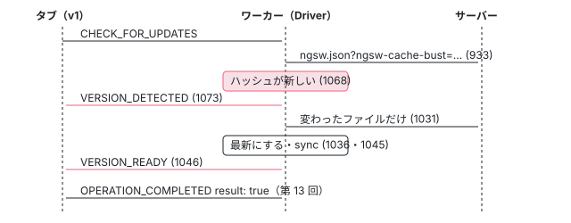

[目次](../README.md) › [Service Worker の内側](README.md) › 第 12 回 / 全 20 回

# 更新の確認：ngsw.json を取り直す

> checkForUpdate が ngsw.json を cache-bust 付きで取り、ハッシュが違えば新しい AppVersion を作って全部のファイルを取り込み、VERSION\_DETECTED・VERSION\_READY・VERSION\_INSTALLATION\_FAILED を全部のタブに知らせる流れ。ナビゲーションのたびの確認（scheduledNavUpdateCheck）、アイドルの確認、configVersion が違うときの扱い。

angular/angular · 読了 約 13 分 · 発展 · [サイトで読む（デモが動きます）](https://angular-deep-dive-cyan.vercel.app/chapter/sw-update-check)

---

アプリを新しくデプロイすると、サーバーの `ngsw.json` が変わります。ワーカーはそれを取り直して、自分の知っている版と違えば新しい版を丸ごと取り込み、タブに知らせます。この章では `Driver.checkForUpdate` が `ngsw.json` を cache-bust 付きで取り、ハッシュで「本当に新しいか」を決め、`setupUpdate` で新しい `AppVersion` を作って全部のファイルを取り込み、`VERSION_DETECTED`・`VERSION_READY`・`VERSION_INSTALLATION_FAILED`・`NO_NEW_VERSION_DETECTED` を誰に送るかを、行番号を指して追います。いつ確認が走るか（ナビゲーションのたび・起動のあと・アプリからの依頼）と、`configVersion` が違うときの扱いもここで見ます。

読む対象は `packages/service-worker/worker/src/driver.ts` の `fetchLatestManifest`・`checkForUpdate`・`setupUpdate`・`notifyClientsAbout*` です。

1. [1. 全体像](01-sw-overview.md)
2. [2. Generator](02-sw-config-generator.md)
3. [3. ビルド](03-sw-cli-build.md)
4. [4. 登録](04-sw-register.md)
5. [5. Driver の起動](05-sw-driver-lifecycle.md)
6. [6. fetch の横取り](06-sw-driver-fetch.md)
7. [7. 版とタブ](07-sw-versions.md)
8. [8. アセット](08-sw-asset-groups.md)
9. [9. ハッシュ](09-sw-hash-integrity.md)
10. [10. データ](10-sw-data-groups.md)
11. [11. 小さな DB](11-sw-database.md)
12. **12. 更新の確認**（この章）
13. [13. SwUpdate](13-sw-swupdate.md)
14. [14. アイドルと掃除](14-sw-idle-cleanup.md)
15. [15. 壊れたとき](15-sw-safe-mode.md)
16. [16. プッシュ](16-sw-push.md)
17. [17. デバッグ](17-sw-debug.md)
18. [18. ワーカーのテスト](18-sw-testing-harness.md)
19. [19. アプリ側のテスト](19-sw-testing-app.md)
20. [20. issue と PR を読む](20-sw-issues.md)

> [!TIP]
> **新卒エンジニアへ**
>
> ここでの「更新」は**アプリの版**（`ngsw.json` の中身）の更新です。`ngsw-worker.js` そのもののファイルが変わったときは、ブラウザが Service Worker の仕組みとして取り直し、`install` のイベントから始め直します（[第 5 回](05-sw-driver-lifecycle.md)）。この章の `checkForUpdate` は `ngsw-worker.js` を取りません。

## 1. いつ確認が走るか

`grep -n "checkForUpdate()" driver.ts` で、呼ぶ場所は 3 つです。

| きっかけ | 場所 | すぐ / あとで |
| --- | --- | --- |
| アプリが `SwUpdate.checkForUpdate()` を呼ぶ（`CHECK_FOR_UPDATES` のメッセージ） | `handleMessage`（[第 13 回](13-sw-swupdate.md)で引用した 402 行目） | すぐ。終わると `OPERATION_COMPLETED` で結果の `true`/`false` を返す |
| ナビゲーション（新しいタブ・再読み込み・ページの移動） | `handleFetch`（[第 6 回](06-sw-driver-fetch.md)で引用した 590〜596 行目） | アイドルの仕事 `check-updates-on-navigation` に積む。`scheduledNavUpdateCheck` が立っている間は積み足さない |
| ワーカーが起動して DB から状態を読めたとき | `initialize`（[第 5 回](05-sw-driver-lifecycle.md)で引用した 684〜686 行目） | アイドルの仕事 `init post-load (update)` に積む |

アイドルの仕事は、最後のイベントから 5 秒（遅くても 30 秒）たってから走ります（[第 14 回](14-sw-idle-cleanup.md)）。タイマーで定期的に確認する行は、ワーカーの中にはありません。定期的に確かめたいときは、アプリの側で `SwUpdate.checkForUpdate()` を呼びます。

## 2. ngsw.json を取る：fetchLatestManifest

📄 `angular/packages/service-worker/worker/src/driver.ts` L924–946 （▶ の行: 932–933, 935–936, 939–940, 942, 944–945）

```ts
924 │   /**
925 │    * Retrieve a copy of the latest manifest from the server.
926 │    * Return `null` if `ignoreOfflineError` is true (default: false) and the server or client are
927 │    * offline (detected as response status 503 (service unavailable) or 504 (gateway timeout)).
928 │    */
929 │   private async fetchLatestManifest(ignoreOfflineError?: false): Promise<Manifest>;
930 │   private async fetchLatestManifest(ignoreOfflineError: true): Promise<Manifest | null>;
931 │   private async fetchLatestManifest(ignoreOfflineError = false): Promise<Manifest | null> {
932 ▶     const res = await this.safeFetch(
933 ▶       this.adapter.newRequest('ngsw.json?ngsw-cache-bust=' + Math.random()),
934 │     );
935 ▶     if (!res.ok) {
936 ▶       if (res.status === 404) {
937 │         await this.deleteAllCaches();
938 │         await this.scope.registration.unregister();
939 ▶       } else if ((res.status === 503 || res.status === 504) && ignoreOfflineError) {
940 ▶         return null;
941 │       }
942 ▶       throw new Error(`Manifest fetch failed! (status: ${res.status})`);
943 │     }
944 ▶     this.lastUpdateCheck = this.adapter.time;
945 ▶     return res.json();
946 │   }
```

1. **932〜934 行目：いつも cache-bust 付き**

   `ngsw.json?ngsw-cache-bust=` に `Math.random()` を付けます。HTTP キャッシュに古い `ngsw.json` が残っていても当たりません。アセットのような「まず普通に取る」（第 9 回の 412 行目）はしません。`this.safeFetch` は `Driver` の `safeFetch` で、ネットワークの失敗を 504 にします（第 6 回）。
2. **935〜943 行目：失敗のとき**

   936〜938 行目、404 なら「このサイトはもう ngsw を使っていない」とみなし、全部のキャッシュを消して登録を外します（[第 15 回](15-sw-safe-mode.md)）。939〜940 行目、503・504 で、呼び出し元が `ignoreOfflineError` を `true` にしていれば `null` を返します。それ以外は 942 行目で投げます。
3. **944〜945 行目：成功したら時刻を覚えて JSON にする**

   944 行目の `lastUpdateCheck` はデバッグのページに出る「最後に確認した時刻」です（[第 17 回](17-sw-debug.md)）。

## 3. checkForUpdate：本当に新しいか

📄 `angular/packages/service-worker/worker/src/driver.ts` L1053–1086 （▶ の行: 1056, 1058, 1062, 1065, 1068–1070, 1073, 1075, 1077–1078, 1081–1082, 1084）

```ts
1053 │   async checkForUpdate(): Promise<boolean> {
1054 │     let hash: string = '(unknown)';
1055 │     try {
1056 ▶       const manifest = await this.fetchLatestManifest(true);
1057 │ 
1058 ▶       if (manifest === null) {
1059 │         // Client or server offline. Unable to check for updates at this time.
1060 │         // Continue to service clients (existing and new).
1061 │         this.debugger.log('Check for update aborted. (Client or server offline.)');
1062 ▶         return false;
1063 │       }
1064 │ 
1065 ▶       hash = hashManifest(manifest);
1066 │ 
1067 │       // Check whether this is really an update.
1068 ▶       if (this.versions.has(hash)) {
1069 ▶         await this.notifyClientsAboutNoNewVersionDetected(manifest, hash);
1070 ▶         return false;
1071 │       }
1072 │ 
1073 ▶       await this.notifyClientsAboutVersionDetected(manifest, hash);
1074 │ 
1075 ▶       await this.setupUpdate(manifest, hash);
1076 │ 
1077 ▶       return true;
1078 ▶     } catch (err) {
1079 │       this.debugger.log(err as Error, `Error occurred while updating to manifest ${hash}`);
1080 │ 
1081 ▶       this.state = DriverReadyState.EXISTING_CLIENTS_ONLY;
1082 ▶       this.stateMessage = `Degraded due to failed initialization: ${errorToString(err)}`;
1083 │ 
1084 ▶       return false;
1085 │     }
1086 │   }
```

1. **1056〜1063 行目：オフラインなら「確認できなかった」で終わる**

   `fetchLatestManifest(true)` なので、503・504 は `null` で返り、1062 行目で `false`。状態は変えません。
2. **1065 行目：ハッシュで版の名前を決める**

   `hashManifest` は `JSON.stringify(manifest)` の SHA-1 です（`manifest.ts`、第 7 回）。`ngsw.json` には Generator がビルドの時刻 `timestamp` を入れるので、ファイルが 1 つも変わらなくてもビルドし直せば別のハッシュになります。
3. **1068〜1071 行目：知っている版なら「新しい版は無い」**

   `versions`（いま持っている版の一覧）にあれば、1069 行目で全部のタブに `NO_NEW_VERSION_DETECTED` を送り、`false`。比べる相手は「最新」だけではなく、まだ掃除されていない古い版も含みます。
4. **1073〜1077 行目：新しい版**

   1073 行目で `VERSION_DETECTED` を送ってから、1075 行目の `setupUpdate`（4 節）で取り込み、`true`。
5. **1078〜1085 行目：途中で失敗したら**

   ログを残し、1081 行目で状態を `EXISTING_CLIENTS_ONLY` に下げ、`false` を返します。**今の最新の版が無事でも下がる**ので、新しいタブは版に割り当てられず、ネットワークで動きます（デモの C で確かめられます）。下がった状態から戻る条件は [第 15 回](15-sw-safe-mode.md)です。

## 4. setupUpdate：新しい版を取り込む

📄 `angular/packages/service-worker/worker/src/driver.ts` L1008–1031 （▶ の行: 1010, 1021–1024, 1031）

```ts
1008 │   private async setupUpdate(manifest: Manifest, hash: string): Promise<void> {
1009 │     try {
1010 ▶       const newVersion = new AppVersion(
1011 │         this.scope,
1012 │         this.adapter,
1013 │         this.db,
1014 │         this.idle,
1015 │         this.debugger,
1016 │         manifest,
1017 │         hash,
1018 │       );
1019 │ 
1020 │       // Firstly, check if the manifest version is correct.
1021 ▶       if (manifest.configVersion !== SUPPORTED_CONFIG_VERSION) {
1022 ▶         await this.deleteAllCaches();
1023 ▶         await this.scope.registration.unregister();
1024 ▶         throw new Error(
1025 │           `Invalid config version: expected ${SUPPORTED_CONFIG_VERSION}, got ${manifest.configVersion}.`,
1026 │         );
1027 │       }
1028 │ 
1029 │       // Cause the new version to become fully initialized. If this fails, then the
1030 │       // version will not be available for use.
1031 ▶       await newVersion.initializeFully(this);
```

1. **1010〜1018 行目：AppVersion を作る**

   グループを作るだけで、まだ何も取りません（[第 7 回](07-sw-versions.md)）。
2. **1021〜1027 行目：configVersion が 1 でなければ**

   `SUPPORTED_CONFIG_VERSION`（driver.ts の先頭の定数で、値は 1）と違えば、このワーカーには読めない形の `ngsw.json` です。1022〜1023 行目で全部のキャッシュを消して登録を外し、1024 行目で投げます（消す行の話は第 15 回）。
3. **1031 行目：全部のファイルを取り込む**

   `initializeFully(this)` の `this` は `Driver` 自身で、「前の版のキャッシュから、ハッシュが同じファイルを写してよい」という意味です（`UpdateSource`。[第 8 回](08-sw-asset-groups.md)）。変わっていないファイルはネットワークに行かず、変わったファイルだけが届きます。ハッシュの確かめ方は [第 9 回](09-sw-hash-integrity.md)です。

📄 `angular/packages/service-worker/worker/src/driver.ts` L1033–1051 （▶ の行: 1034, 1036, 1040, 1045–1049）

```ts
1033 │       // Install this as an active version of the app.
1034 ▶       this.versions.set(hash, newVersion);
1035 │       // Future new clients will use this hash as the latest version.
1036 ▶       this.latestHash = hash;
1037 │ 
1038 │       // If we are in `EXISTING_CLIENTS_ONLY` mode (meaning we didn't have a clean copy of the last
1039 │       // latest version), we can now recover to `NORMAL` mode and start accepting new clients.
1040 ▶       if (this.state === DriverReadyState.EXISTING_CLIENTS_ONLY) {
1041 │         this.state = DriverReadyState.NORMAL;
1042 │         this.stateMessage = '(nominal)';
1043 │       }
1044 │ 
1045 ▶       await this.sync();
1046 ▶       await this.notifyClientsAboutVersionReady(manifest, hash);
1047 ▶     } catch (e) {
1048 ▶       await this.notifyClientsAboutVersionInstallationFailed(manifest, hash, e);
1049 ▶       throw e;
1050 │     }
1051 │   }
```

1. **1034・1036 行目：取り込めてから、一覧に入れて最新にする**

   **順番が大事**です。1031 行目が投げたら、ここには来ません。`versions` に入らないので、次の確認では 1068 行目を通らず、もう一度取り込みを試します。
2. **1040〜1043 行目：下がった状態から戻る**

   `EXISTING_CLIENTS_ONLY` なら `NORMAL` に戻します（第 15 回）。
3. **1045 行目：DB に書く**

   manifests・assignments・latest を書く `sync` です（[第 11 回](11-sw-database.md)）。
4. **1046 行目：VERSION\_READY**

   知らせる相手は 5 節で見ます。
5. **1047〜1049 行目：失敗したら VERSION\_INSTALLATION\_FAILED を送ってから投げ直す**

   投げ直した先は 3 節の 1078 行目の `catch` で、そこで状態が下がります。

## 5. 誰に何を送るか

📄 `angular/packages/service-worker/worker/src/driver.ts` L1208–1213 （▶ の行: 1210–1211）

```ts
1208 │   private mergeHashWithAppData(manifest: Manifest, hash: string): {hash: string; appData: Object} {
1209 │     return {
1210 ▶       hash,
1211 ▶       appData: manifest.appData as Object,
1212 │     };
1213 │   }
```

どの知らせも、版を `{hash, appData}` の形で送ります。`appData` は `ngsw-config.json` に書いた任意の値で、アプリが「どんな更新か」を表示するのに使えます。

📄 `angular/packages/service-worker/worker/src/driver.ts` L1279–1300 （▶ の行: 1280, 1282, 1287–1288, 1290, 1295–1296）

```ts
1279 │   async notifyClientsAboutVersionDetected(manifest: Manifest, hash: string): Promise<void> {
1280 ▶     await this.initialized;
1281 │ 
1282 ▶     const clients = await this.scope.clients.matchAll();
1283 │ 
1284 │     await Promise.all(
1285 │       clients.map(async (client) => {
1286 │         // Firstly, determine which version this client is on.
1287 ▶         const version = this.clientVersionMap.get(client.id);
1288 ▶         if (version === undefined) {
1289 │           // Unmapped client - assume it's the latest.
1290 ▶           return;
1291 │         }
1292 │ 
1293 │         // Send a notice.
1294 │         client.postMessage({
1295 ▶           type: 'VERSION_DETECTED',
1296 ▶           version: this.mergeHashWithAppData(manifest, hash),
1297 │         });
1298 │       }),
1299 │     );
1300 │   }
```

📄 `angular/packages/service-worker/worker/src/driver.ts` L1302–1333 （▶ の行: 1310–1311, 1313, 1316, 1318, 1325–1327）

```ts
1302 │   async notifyClientsAboutVersionReady(manifest: Manifest, hash: string): Promise<void> {
1303 │     await this.initialized;
1304 │ 
1305 │     const clients = await this.scope.clients.matchAll();
1306 │ 
1307 │     await Promise.all(
1308 │       clients.map(async (client) => {
1309 │         // Firstly, determine which version this client is on.
1310 ▶         const version = this.clientVersionMap.get(client.id);
1311 ▶         if (version === undefined) {
1312 │           // Unmapped client - assume it's the latest.
1313 ▶           return;
1314 │         }
1315 │ 
1316 ▶         if (version === this.latestHash) {
1317 │           // Client is already on the latest version, no need for a notification.
1318 ▶           return;
1319 │         }
1320 │ 
1321 │         const current = this.versions.get(version)!;
1322 │ 
1323 │         // Send a notice.
1324 │         const notice = {
1325 ▶           type: 'VERSION_READY',
1326 ▶           currentVersion: this.mergeHashWithAppData(current.manifest, version),
1327 ▶           latestVersion: this.mergeHashWithAppData(manifest, hash),
1328 │         };
1329 │ 
1330 │         client.postMessage(notice);
1331 │       }),
1332 │     );
1333 │   }
```

📄 `angular/packages/service-worker/worker/src/driver.ts` L1242–1277 （▶ の行: 1247, 1249, 1255, 1257, 1266, 1272）

```ts
1242 │   async notifyClientsAboutVersionInstallationFailed(
1243 │     manifest: Manifest,
1244 │     hash: string,
1245 │     error: any,
1246 │   ): Promise<void> {
1247 ▶     await this.initialized;
1248 │ 
1249 ▶     const clients = await this.scope.clients.matchAll();
1250 │ 
1251 │     await Promise.all(
1252 │       clients.map(async (client) => {
1253 │         // Send a notice.
1254 │         client.postMessage({
1255 ▶           type: 'VERSION_INSTALLATION_FAILED',
1256 │           version: this.mergeHashWithAppData(manifest, hash),
1257 ▶           error: errorToString(error),
1258 │         });
1259 │       }),
1260 │     );
1261 │   }
1262 │ 
1263 │   async notifyClientsAboutNoNewVersionDetected(manifest: Manifest, hash: string): Promise<void> {
1264 │     await this.initialized;
1265 │ 
1266 ▶     const clients = await this.scope.clients.matchAll();
1267 │ 
1268 │     await Promise.all(
1269 │       clients.map(async (client) => {
1270 │         // Send a notice.
1271 │         client.postMessage({
1272 ▶           type: 'NO_NEW_VERSION_DETECTED',
1273 │           version: this.mergeHashWithAppData(manifest, hash),
1274 │         });
1275 │       }),
1276 │     );
1277 │   }
```

| 知らせ | 送る相手 | 中身 |
| --- | --- | --- |
| `VERSION_DETECTED` | 版に割り当てられたタブだけ（1287〜1291 行目。割り当ての無いタブには送らない） | `version`（新しい版） |
| `VERSION_READY` | 割り当てられていて、しかも最新でない版のタブだけ（1310〜1319 行目） | `currentVersion`（そのタブの版）と `latestVersion`（1325〜1327 行目） |
| `VERSION_INSTALLATION_FAILED` | 全部のタブ（1249 行目の `matchAll`。割り当てを見ない） | `version` と `error`（`errorToString`。メッセージとスタック） |
| `NO_NEW_VERSION_DETECTED` | 全部のタブ（1266 行目） | `version`（いま知っている同じ版） |

どの関数も最初に `await this.initialized`（1247・1264・1280・1303 行目）で初期化を待ちます。アプリの側でこれらを受けて `versionUpdates` に流すのが `SwUpdate` です（[第 13 回](13-sw-swupdate.md)）。`VERSION_READY` を受けても、そのタブの版はまだ古いままです。`activateUpdate` か再読み込みで初めて新しい版になります（第 7 回・第 13 回）。



*v1 のタブが CHECK\_FOR\_UPDATES を送ったときの順番*

## 6. 本物のワーカーで確かめる

> **🧪 DEMO — v1 から v2 への更新の確認と、タブに届く知らせ**
>
> 本物の `ngsw-worker.js`（`@angular/service-worker` 22.1.6 の配布物）を、偽物のブラウザ（`sw-sandbox.ts`。キャッシュ・サーバー・タブ・時計をメモリの上の偽物にしたもの）の上で動かします。v1 を入れたあと、tab1 だけをナビゲーションして v1 に割り当て、tab2 は開いているだけ（一度も要求を送っていない）にします。サーバーを替えてから、tab1 が `CHECK_FOR_UPDATES` を送ります。
>
> ▶ [このデモはサイトで動かせます](https://angular-deep-dive-cyan.vercel.app/chapter/sw-update-check)

A〜D は次のように出ます（2026-11-03 に Node で同じ部品を使って確かめた結果）。

- **A**：サーバーには `ngsw.json?ngsw-cache-bust=…`・`/index.html`・`/main.js`。tab1 には `VERSION_DETECTED` → `VERSION_READY`（current は v1、latest は v2）→ `OPERATION_COMPLETED`（result: true）。tab2 には何も届きません（割り当てが無いので 1288 行目と 1311 行目で飛ばされる）。tab1 の `/main.js` は `v1()` のままで、新しいタブ tab3 は v2 です。
- **B**：サーバーには `ngsw.json` だけ。tab1 にも tab2 にも `NO_NEW_VERSION_DETECTED` が届き、tab1 には `OPERATION_COMPLETED`（result: false）。
- **C**：tab1 には `VERSION_DETECTED` → `VERSION_INSTALLATION_FAILED`（error は `Response not Ok (fetchAndCacheOnce): … 500`）→ `OPERATION_COMPLETED`（result: false）。tab2 にも `VERSION_INSTALLATION_FAILED` は届きます。状態は `EXISTING_CLIENTS_ONLY (Degraded due to failed initialization: …)` で、500 を戻したあとの新しいタブ tab3 はネットワークから `<h1>v2</h1>` を受け取ります（版に割り当てられない）。
- **D**：サーバーには `ngsw.json` だけ（1031 行目まで進まない）。tab1 には `VERSION_DETECTED` → `VERSION_INSTALLATION_FAILED`（`Invalid config version: expected 1, got 2.`）、キャッシュは 0 個になります。

## ここまでの呼び出し（アプリから確認したとき）

- 👤 `swUpdate.checkForUpdate()` — ページ（第 13 回）
  - `Driver.handleMessage → checkForUpdate` — driver.ts:402
    - `fetchLatestManifest(true)` — driver.ts:931 — *ngsw.json?ngsw-cache-bust=*
    - `hashManifest` → `versions.has(hash)` — driver.ts:1065・1068
    - `notifyClientsAboutVersionDetected` — driver.ts:1279
    - `setupUpdate` — driver.ts:1008
      - `new AppVersion → initializeFully(this)` — driver.ts:1010・1031 — *第 8・9 回*
      - `versions.set → latestHash = hash → sync` — driver.ts:1034・1036・1045
      - `notifyClientsAboutVersionReady` — driver.ts:1302
  - `OPERATION_COMPLETED` — driver.ts（第 13 回）

## テストと直し方

### spec と describe

| it（happy\_spec.ts の行。どれも describe `Driver` の直下） | 確かめていること |
| --- | --- |
| `updates to new content when requested`（400） | 届くリクエストと、`VERSION_DETECTED`・`VERSION_READY` の中身 |
| ``detects new version even if only `manifest.timestamp` is different``（440） | 3 節の 1065 行目（timestamp だけ違っても別の版） |
| `checks for updates on restart`（511） | DB から起動したあとのアイドルの確認 |
| `checks for updates on navigation`（534）・`does not make concurrent checks for updates on navigation`（547） | ナビゲーションの確認と `scheduledNavUpdateCheck` |
| `updates when refreshed`（583） | 再読み込みで新しい版になる |
| `sends a notification message after finding the same version on the server and installed`（609） | `NO_NEW_VERSION_DETECTED` |

📄 `angular/packages/service-worker/worker/test/happy_spec.ts` L400–425 （▶ の行: 407–410, 413, 415, 417, 421–423）

```ts
400 │     it('updates to new content when requested', async () => {
401 │       expect(await makeRequest(scope, '/foo.txt')).toEqual('this is foo');
402 │       await driver.initialized;
403 │ 
404 │       const client = scope.clients.getMock('default')!;
405 │       expect(client.messages).toEqual([]);
406 │ 
407 ▶       scope.updateServerState(serverUpdate);
408 ▶       expect(await driver.checkForUpdate()).toEqual(true);
409 ▶       serverUpdate.assertSawRequestFor('/ngsw.json');
410 ▶       serverUpdate.assertSawRequestFor('/foo.txt');
411 │       serverUpdate.assertSawRequestFor('/redirected.txt');
412 │       serverUpdate.assertSawRequestFor('/redirect-target.txt');
413 ▶       serverUpdate.assertNoOtherRequests();
414 │ 
415 ▶       expect(client.messages).toEqual([
416 │         {
417 ▶           type: 'VERSION_DETECTED',
418 │           version: {hash: manifestUpdateHash, appData: {version: 'update'}},
419 │         },
420 │         {
421 ▶           type: 'VERSION_READY',
422 ▶           currentVersion: {hash: manifestHash, appData: {version: 'original'}},
423 ▶           latestVersion: {hash: manifestUpdateHash, appData: {version: 'update'}},
424 │         },
425 │       ]);
```

408 行目で `checkForUpdate()` を直接呼び、409〜413 行目で届いたリクエストを数えます。`/bar.txt` などが無いのは、4 節の 1031 行目で前の版から写したからです。415〜425 行目が 5 節の表の上の 2 行です。

📄 `angular/packages/service-worker/worker/test/happy_spec.ts` L534–561 （▶ の行: 539, 541–542, 544, 552, 554, 556, 559–560）

```ts
534 │     it('checks for updates on navigation', async () => {
535 │       expect(await makeRequest(scope, '/foo.txt')).toEqual('this is foo');
536 │       await driver.initialized;
537 │       server.clearRequests();
538 │ 
539 ▶       expect(await makeNavigationRequest(scope, '/foo.txt')).toEqual('this is foo');
540 │ 
541 ▶       scope.advance(12000);
542 ▶       await driver.idle.empty;
543 │ 
544 ▶       server.assertSawRequestFor('/ngsw.json');
545 │     });
546 │ 
547 │     it('does not make concurrent checks for updates on navigation', async () => {
548 │       expect(await makeRequest(scope, '/foo.txt')).toEqual('this is foo');
549 │       await driver.initialized;
550 │       server.clearRequests();
551 │ 
552 ▶       expect(await makeNavigationRequest(scope, '/foo.txt')).toEqual('this is foo');
553 │ 
554 ▶       expect(await makeNavigationRequest(scope, '/foo.txt')).toEqual('this is foo');
555 │ 
556 ▶       scope.advance(12000);
557 │       await driver.idle.empty;
558 │ 
559 ▶       server.assertSawRequestFor('/ngsw.json');
560 ▶       server.assertNoOtherRequests();
561 │     });
```

539 行目のナビゲーションのあと、541〜542 行目で仮の時計を 12 秒進めてアイドルの仕事を流すと、544 行目で `/ngsw.json` が届いています。552〜554 行目で 2 回ナビゲーションしても、559〜560 行目で `ngsw.json` は 1 回だけです（第 6 回の `scheduledNavUpdateCheck`）。

### 手元で走らせた結果

📄 `ターミナル（../angular で）`

```
cd ~/angular-research/angular
pnpm bazel test //packages/service-worker/worker/test:test --nocache_test_results --test_output=all '--test_arg=--filter=updates to new content when requested|detects new version even if only|checks for updates on|does not make concurrent checks|updates when refreshed|sends a notification message after finding'
```

📄 `出力（2026-11-03 に実行。抜粋。ログは scratchpad/sw-logs/c-update.log）`

```
Ran 7 of 153 specs
7 specs, 0 failures
//packages/service-worker/worker/test:test                               PASSED in 0.6s
```

- 6 つの名前の「または」で 7 of 153（0.6 秒）。`checks for updates on` が restart と navigation の 2 件に当たります。

### 直すとしたら

- **テストの穴**：`grep -rn "VERSION_INSTALLATION_FAILED\|configVersion: 2\|Invalid config version" worker/test` は 0 件でした。4 節の 1047〜1049 行目と 1021〜1027 行目は、worker の spec では確かめられていません（アプリの側の `src/low_level.ts` と `src/update.ts` に型の名前が出るだけ）。足すなら happy\_spec の `Driver` の中に、`MockServerStateBuilder` の `withManifest({...manifestUpdate, configVersion: 2})` や、v2 の 1 ファイルを 500 にしたサーバーで `checkForUpdate()` を呼び、`client.messages` に `VERSION_INSTALLATION_FAILED` が入ることを確かめる it です。手元で書いて走らせる練習に向いています。
- 3 節の 1081 行目（更新の失敗で今の最新が無事でも状態を下げる）を変えるのは振る舞いの変更で、`versionFailed`（第 9 回）の方針との整理が要ります。
- 関係する issue：#70658（閉じた。大きな `ngsw.json` を毎回取らずに、軽いバージョンのエンドポイントを先に見てほしいという要望。2 節の 932〜934 行目）は、コメントで「service worker のパッケージは maintenance mode で、セキュリティの修正だけを受け、新しい機能は受けない」と返され、NOT\_PLANNED で閉じられました（2026-09-10）。開いている #55975・#44402（`checkForUpdate` が効かない）と #54036（`VERSION_READY` が余分に出る）は [第 13 回](13-sw-swupdate.md)、一覧は [第 20 回](20-sw-issues.md)です。
- 本家に PR を出すことは勧めません。手元で spec を足して確かめ、issue を読むときの手がかりにします。
- このパッケージは `PACKAGE.md` の 1 行目で「機能の限られた基本的なキャッシュの道具で、セキュリティの修正以外の新しい機能は受け付けない」と書いています（[第 1 回](01-sw-overview.md)）。新しい機能の PR は受け付けられず、不具合の直しも慎重に扱われます。

## 聞かれそうな質問

**Q. ワーカーは何分ごとに更新を確認しますか？**

定期的には確認しません。呼ぶのはメッセージ（`handleMessage`）・ナビゲーション（`handleFetch`）・起動のあと（`initialize`）の 3 か所だけです（1 節の表）。定期的に確認するなら、アプリで `SwUpdate.checkForUpdate()` を呼びます。

**Q. 何をもって「新しい版」と判断しますか？**

取ってきた `ngsw.json` 全体の SHA-1（1065 行目）が、持っている版の一覧 `versions` に無いことです（1068 行目）。ファイルの中身が同じでも、`timestamp` が変われば新しい版です（spec の 440 行目）。

**Q. VERSION\_READY が来ないタブがあるのはなぜ？**

1311〜1314 行目で、まだ版に割り当てられていないタブには送らず、1316〜1319 行目で既に最新の版のタブにも送らないからです。`VERSION_DETECTED` も割り当ての無いタブには送りません（1288〜1291 行目）。

**Q. 更新の取り込みに失敗するとどうなりますか？**

全部のタブに `VERSION_INSTALLATION_FAILED` が届き（1048・1249 行目）、状態が `EXISTING_CLIENTS_ONLY` に下がります（1081 行目）。新しい版は `versions` に入らないので（1034 行目に来ない）、次の確認でもう一度取り込みを試します。

**Q. configVersion とは何ですか？**

`ngsw.json` の形の版です。ワーカーが読めるのは 1 だけで（1021 行目）、違えば全部のキャッシュを消して登録を外します（1022〜1023 行目）。新しい形の `ngsw.json` を古いワーカーが誤って読まないための止め方です。

**Q. オフラインで確認するとどうなりますか？**

504 になり（`safeFetch`）、939〜940 行目で `null`、1058〜1062 行目で `false` を返すだけです。状態も変えず、知らせも送りません。

## 読み終えて

- 確認は `ngsw.json?ngsw-cache-bust=` を取り、全体の SHA-1 が持っている版に無ければ新しい版。
- 新しい版は `setupUpdate` で全部取り込めてから一覧に入り、最新になり、DB に書かれる。失敗すれば入らないので次で再挑戦。
- `VERSION_DETECTED`・`VERSION_READY` は割り当てられたタブだけ、`VERSION_INSTALLATION_FAILED`・`NO_NEW_VERSION_DETECTED` は全部のタブ。
- 確認が走るのはメッセージ・ナビゲーション・起動のあとの 3 つ。定期的な確認はアプリの仕事。

---

← 前: [キャッシュの中の小さな DB：CacheDatabase と名前の付け方](11-sw-database.md)  
次: [アプリの側：SwUpdate と NgswCommChannel](13-sw-swupdate.md) →
