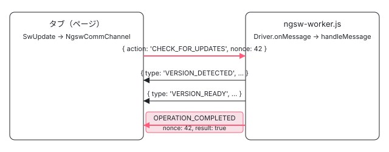

[目次](../README.md) › [Service Worker の内側](README.md) › 第 13 回 / 全 20 回

# アプリの側：SwUpdate と NgswCommChannel

> low\_level.ts の NgswCommChannel が navigator.serviceWorker の controller に postMessage し、nonce で答えを待つ仕組み（postMessageWithOperation・waitForOperationCompleted・eventsOfType）。SwUpdate の versionUpdates・unrecoverable・checkForUpdate・activateUpdate、ワーカーの側の msg.ts。issue #55975・#54036・#44402。

angular/angular · 読了 約 13 分 · 中核 · [サイトで読む（デモが動きます）](https://angular-deep-dive-cyan.vercel.app/chapter/sw-swupdate)

---

アプリのコードから見える Service Worker は、`SwUpdate` の `versionUpdates` と `checkForUpdate()` くらいです。この章では、その裏で `NgswCommChannel` が `navigator.serviceWorker.controller` に `postMessage` し、**nonce（その場で作る番号）の付いた `OPERATION_COMPLETED` が返ってくるまで Promise を開けておく**仕組みを、ページの側とワーカーの側の両方から 1 行ずつ追います。「`checkForUpdate()` がいつまでも終わらない」という issue が、どの行で起きているのかも読めるようになります。

読む対象は `packages/service-worker/src/low_level.ts`・`update.ts`・`errors.ts`、ワーカーの側の `worker/src/msg.ts` と `worker/src/driver.ts` の `onMessage`・`handleMessage`・`completeOperation`・`updateClient` です。

1. [1. 全体像](01-sw-overview.md)
2. [2. Generator](02-sw-config-generator.md)
3. [3. ビルド](03-sw-cli-build.md)
4. [4. 登録](04-sw-register.md)
5. [5. Driver の起動](05-sw-driver-lifecycle.md)
6. [6. fetch の横取り](06-sw-driver-fetch.md)
7. [7. 版とタブ](07-sw-versions.md)
8. [8. アセット](08-sw-asset-groups.md)
9. [9. ハッシュ](09-sw-hash-integrity.md)
10. [10. データ](10-sw-data-groups.md)
11. [11. 小さな DB](11-sw-database.md)
12. [12. 更新の確認](12-sw-update-check.md)
13. **13. SwUpdate**（この章）
14. [14. アイドルと掃除](14-sw-idle-cleanup.md)
15. [15. 壊れたとき](15-sw-safe-mode.md)
16. [16. プッシュ](16-sw-push.md)
17. [17. デバッグ](17-sw-debug.md)
18. [18. ワーカーのテスト](18-sw-testing-harness.md)
19. [19. アプリ側のテスト](19-sw-testing-app.md)
20. [20. issue と PR を読む](20-sw-issues.md)

> [!TIP]
> **新卒エンジニアへ**
>
> **postMessage** は、別々に動く 2 つの JavaScript（ここではページと Service Worker）が、構造化された値を 1 つずつ投げ合う仕組みです。戻り値は無く、答えが欲しければ相手にも `postMessage` してもらいます。「どの質問への答えか」を見分ける番号が **nonce** です。



*ページとワーカーのあいだを流れるもの。上向きの矢印は action を持ち、下向きの矢印は type を持つ。OPERATION\_COMPLETED だけが nonce で質問とつながる。*

## 1. NgswCommChannel を作る：Service Worker が無いとき

`NgswCommChannel` は `provideServiceWorker` の工場（`ngswCommChannelFactory`）が作ります。工場がいつ `navigator.serviceWorker` を渡し、いつ `undefined` を渡すかは[第 4 回](04-sw-register.md)で読みました。ここでは受け取った側を読みます。

📄 `angular/packages/service-worker/src/low_level.ts` L134–156 （▶ の行: 135, 137, 139, 145–146, 149–150, 152）

```ts
134 │ export class NgswCommChannel {
135 ▶   readonly worker: Observable<ServiceWorker>;
136 │ 
137 ▶   readonly registration: Observable<ServiceWorkerRegistration>;
138 │ 
139 ▶   readonly events: Observable<TypedEvent>;
140 │ 
141 │   constructor(
142 │     private serviceWorker: ServiceWorkerContainer | undefined,
143 │     injector?: Injector,
144 │   ) {
145 ▶     if (!serviceWorker) {
146 ▶       this.worker =
147 │         this.events =
148 │         this.registration =
149 ▶           new Observable<never>((subscriber) =>
150 ▶             subscriber.error(
151 │               new RuntimeError(
152 ▶                 RuntimeErrorCode.SERVICE_WORKER_DISABLED_OR_NOT_SUPPORTED_BY_THIS_BROWSER,
153 │                 (typeof ngDevMode === 'undefined' || ngDevMode) && ERR_SW_NOT_SUPPORTED,
154 │               ),
155 │             ),
156 │           );
```

135〜139 行目、公開している Observable は `worker`・`registration`・`events` の 3 つです。145 行目、`serviceWorker` が無いときは 146〜156 行目で 3 つに**同じ 1 つの Observable** を入れます。中身は 150 行目の `subscriber.error(...)` だけで、購読した瞬間に `RuntimeError`（152 行目のコード 5601）で終わります。

📄 `angular/packages/service-worker/src/errors.ts` L9–19 （▶ の行: 11, 15）

```ts
 9 │ /**
10 │  * The list of error codes used in runtime code of the `service-worker` package.
11 ▶  * Reserved error code range: 5600-5699.
12 │  */
13 │ export const enum RuntimeErrorCode {
14 │   UNKNOWN_REGISTRATION_STRATEGY = 5600,
15 ▶   SERVICE_WORKER_DISABLED_OR_NOT_SUPPORTED_BY_THIS_BROWSER = 5601,
16 │   NOT_SUBSCRIBED_TO_PUSH_NOTIFICATIONS = 5602,
17 │   PUSH_SUBSCRIPTION_UNSUBSCRIBE_FAILED = 5603,
18 │   SERVICE_WORKER_REGISTRATION_FAILED = 5604,
19 │ }
```

11 行目のとおり、service-worker のエラーコードは 5600〜5699 です。15 行目の 5601 が「無効か、このブラウザは対応していない」で、実行時には `NG05601` という形で出ます（`RuntimeError` が頭に `NG` と 0 を足す）。

## 2. controller を追いかける：worker

📄 `angular/packages/service-worker/src/low_level.ts` L157–176 （▶ の行: 158–159, 161–162, 164, 167–169, 171–172, 174–175）

```ts
157 │     } else {
158 ▶       let currentWorker: ServiceWorker | null = null;
159 ▶       const workerSubject = new Subject<ServiceWorker>();
160 │       this.worker = new Observable((subscriber) => {
161 ▶         if (currentWorker !== null) {
162 ▶           subscriber.next(currentWorker);
163 │         }
164 ▶         return workerSubject.subscribe((v) => subscriber.next(v));
165 │       });
166 │       const updateController = () => {
167 ▶         const {controller} = serviceWorker;
168 ▶         if (controller === null) {
169 ▶           return;
170 │         }
171 ▶         currentWorker = controller;
172 ▶         workerSubject.next(currentWorker);
173 │       };
174 ▶       serviceWorker.addEventListener('controllerchange', updateController);
175 ▶       updateController();
176 │ 
```

1. **158〜159 行目：今の値と Subject を持つ**

   `currentWorker` は「今このページを受け持っているワーカー」、`workerSubject` は変わったときに流す口です。
2. **160〜165 行目：購読したら、今の値を先に渡す**

   161〜163 行目、`currentWorker` が `null` でなければ、購読した人にすぐ 1 回渡します。そのあと 164 行目で Subject の続きをつなぎます。`BehaviorSubject` に近い動きですが、**`null` のあいだは何も渡しません**。
3. **166〜173 行目：`controller` を読む**

   167 行目で `navigator.serviceWorker.controller` を読み、168〜170 行目、`null` なら何もしないで戻ります。`controller` は「このページの fetch を受け持っている Service Worker」で、初めての訪問では登録が終わって `clients.claim()` されるまで `null` です。
4. **174〜175 行目：`controllerchange` を聞き、今の値も 1 回読む**

   ワーカーが入れ替わるたび（新しい `ngsw-worker.js` が activate されたときなど）に 171〜172 行目が走り直します。

> [!WARNING]
> **ハマりどころ**
>
> Shift を押しながらの再読み込み（強制リロード）では、ブラウザはそのページを Service Worker に受け持たせません。登録は生きていても `controller` は `null` のままで、`controllerchange` も来ません。すると 168 行目で毎回戻り、`worker` は**一度も値を出しません**。これが 5 節の「終わらない `checkForUpdate()`」の根です。

## 3. registration と events

📄 `angular/packages/service-worker/src/low_level.ts` L177–213 （▶ の行: 177–179, 183–184, 195–196, 198, 200–201, 204, 207–210）

```ts
177 ▶       this.registration = this.worker.pipe(
178 ▶         switchMap(() =>
179 ▶           serviceWorker.getRegistration().then((registration) => {
180 │             // The `getRegistration()` method may return undefined in
181 │             // non-secure contexts or incognito mode, where service worker
182 │             // registration might not be allowed.
183 ▶             if (!registration) {
184 ▶               throw new RuntimeError(
185 │                 RuntimeErrorCode.SERVICE_WORKER_DISABLED_OR_NOT_SUPPORTED_BY_THIS_BROWSER,
186 │                 (typeof ngDevMode === 'undefined' || ngDevMode) && ERR_SW_NOT_SUPPORTED,
187 │               );
188 │             }
189 │ 
190 │             return registration;
191 │           }),
192 │         ),
193 │       );
194 │ 
195 ▶       const _events = new Subject<TypedEvent>();
196 ▶       this.events = _events.asObservable();
197 │ 
198 ▶       const messageListener = (event: MessageEvent) => {
199 │         const {data} = event;
200 ▶         if (data?.type) {
201 ▶           _events.next(data);
202 │         }
203 │       };
204 ▶       serviceWorker.addEventListener('message', messageListener);
205 │ 
206 │       // The injector is optional to avoid breaking changes.
207 ▶       const appRef = injector?.get(ApplicationRef, null, {optional: true});
208 ▶       appRef?.onDestroy(() => {
209 ▶         serviceWorker.removeEventListener('controllerchange', updateController);
210 ▶         serviceWorker.removeEventListener('message', messageListener);
211 │       });
212 │     }
213 │   }
```

1. **177〜193 行目：`registration` は `worker` から作る**

   178 行目の `switchMap` で、`worker` が値を出すたびに 179 行目の `getRegistration()` を呼びます。183〜188 行目、登録が取れなければ（シークレットウィンドウなど）5601 のエラーを投げます。`worker` が値を出さなければ `registration` も出ません。`SwPush` はこの `registration` から `pushManager` を取るので、強制リロードで止まるのは `SwPush` も同じです（[第 16 回](16-sw-push.md)、issue #48702）。
2. **195〜204 行目：届いた message を全部 `events` に流す**

   198 行目の `messageListener` は、200 行目で `data?.type` があるものだけを 201 行目で Subject に流します。`controller` と違い、message の購読は 204 行目で**コンストラクタの中ですぐ**始まります。`events` は誰も購読していなくても捨てるだけで、溜めません（ただの `Subject`）。
3. **207〜211 行目：アプリを壊したら聞くのをやめる**

   `ApplicationRef.onDestroy` で 2 つのリスナーを外します。206 行目のコメントのとおり、`injector` は互換のために省略できる引数です。

## 4. postMessage と nonce

📄 `angular/packages/service-worker/src/low_level.ts` L215–240 （▶ の行: 217–220, 223, 233–235, 239）

```ts
215 │   postMessage(action: string, payload: Object): Promise<void> {
216 │     return new Promise<void>((resolve) => {
217 ▶       this.worker.pipe(take(1)).subscribe((sw) => {
218 ▶         sw.postMessage({
219 ▶           action,
220 ▶           ...payload,
221 │         });
222 │ 
223 ▶         resolve();
224 │       });
225 │     });
226 │   }
227 │ 
228 │   postMessageWithOperation(
229 │     type: string,
230 │     payload: Object,
231 │     operationNonce: number,
232 │   ): Promise<boolean> {
233 ▶     const waitForOperationCompleted = this.waitForOperationCompleted(operationNonce);
234 ▶     const postMessage = this.postMessage(type, payload);
235 ▶     return Promise.all([postMessage, waitForOperationCompleted]).then(([, result]) => result);
236 │   }
237 │ 
238 │   generateNonce(): number {
239 ▶     return Math.round(Math.random() * 10000000);
240 │   }
```

1. **217 行目：`worker` の最初の 1 つを待つ**

   `take(1)` なので、`controller` が既にあればすぐ、まだなら `controllerchange` まで待ちます。
2. **218〜221 行目：`{ action, ...payload }` を送る**

   `checkForUpdate` なら `{ action: 'CHECK_FOR_UPDATES', nonce }` になります。223 行目、送った時点で `resolve()` します（答えは待たない）。
3. **233〜235 行目：先に待ち、それから送る**

   233 行目で `waitForOperationCompleted(nonce)` を**先に**呼んで `events` の購読を始め、234 行目で送ります。答えが送るより早く来ても取りこぼしません（`events` は溜めない Subject なので、この順が要ります）。235 行目、2 つがそろったら答えの方（`result`）を返します。
4. **239 行目：nonce は 0〜1000 万の乱数**

   連番ではありません。複数のタブが同時に同じワーカーへ聞いても、答えは送り主のタブだけに返る（7 節の 538 行目）ので、タブの中で重ならなければ足ります。

📄 `angular/packages/service-worker/src/low_level.ts` L242–279 （▶ の行: 244–245, 247, 249, 253, 258, 260–261, 263–264, 266, 270–271, 277）

```ts
242 │   eventsOfType<T extends TypedEvent>(type: T['type'] | T['type'][]): Observable<T> {
243 │     let filterFn: (event: TypedEvent) => event is T;
244 ▶     if (typeof type === 'string') {
245 ▶       filterFn = (event: TypedEvent): event is T => event.type === type;
246 │     } else {
247 ▶       filterFn = (event: TypedEvent): event is T => type.includes(event.type);
248 │     }
249 ▶     return this.events.pipe(filter(filterFn));
250 │   }
251 │ 
252 │   nextEventOfType<T extends TypedEvent>(type: T['type']): Observable<T> {
253 ▶     return this.eventsOfType(type).pipe(take(1));
254 │   }
255 │ 
256 │   waitForOperationCompleted(nonce: number): Promise<boolean> {
257 │     return new Promise<boolean>((resolve, reject) => {
258 ▶       this.eventsOfType<OperationCompletedEvent>('OPERATION_COMPLETED')
259 │         .pipe(
260 ▶           filter((event) => event.nonce === nonce),
261 ▶           take(1),
262 │           map((event) => {
263 ▶             if (event.result !== undefined) {
264 ▶               return event.result;
265 │             }
266 ▶             throw new Error(event.error!);
267 │           }),
268 │         )
269 │         .subscribe({
270 ▶           next: resolve,
271 ▶           error: reject,
272 │         });
273 │     });
274 │   }
275 │ 
276 │   get isEnabled(): boolean {
277 ▶     return !!this.serviceWorker;
278 │   }
279 │ }
```

242〜250 行目の `eventsOfType` は、文字列なら 245 行目の `===`、配列なら 247 行目の `includes` で `events` を絞るだけです。256〜274 行目の `waitForOperationCompleted` は、258 行目で `OPERATION_COMPLETED` に絞り、260 行目で nonce が同じものに絞り、261 行目で 1 つ取ったら終わります。263〜264 行目、`result` があればそれで `resolve`、無ければ 266 行目で `error` の文字列から `Error` を作って `reject` します。277 行目の `isEnabled` は `serviceWorker` があるかどうか**だけ**で、`controller` の有無は見ません。

📄 `angular/packages/service-worker/src/low_level.ts` L112–129 （▶ の行: 112, 118, 122, 127–128）

```ts
112 ▶ export type IncomingEvent = UnrecoverableStateEvent | VersionEvent;
113 │ 
114 │ export interface TypedEvent {
115 │   type: string;
116 │ }
117 │ 
118 ▶ type OperationCompletedEvent =
119 │   | {
120 │       type: 'OPERATION_COMPLETED';
121 │       nonce: number;
122 ▶       result: boolean;
123 │     }
124 │   | {
125 │       type: 'OPERATION_COMPLETED';
126 │       nonce: number;
127 ▶       result?: undefined;
128 ▶       error: string;
129 │     };
```

答えの型は 118〜129 行目の 2 通りです。122 行目の `result: boolean` か、127〜128 行目の `result?: undefined` と `error: string` です。112 行目の `IncomingEvent` に `OPERATION_COMPLETED` は入っていません。アプリの側に公開しない内部の型です。

## 5. SwUpdate：3 つの Observable と 2 つのメソッド

📄 `angular/packages/service-worker/src/update.ts` L59–74 （▶ の行: 59, 62–64, 67–71, 73）

```ts
59 ▶   private ongoingCheckForUpdate: Promise<boolean> | null = null;
60 │ 
61 │   constructor(private sw: NgswCommChannel) {
62 ▶     if (!sw.isEnabled) {
63 ▶       this.versionUpdates = NEVER;
64 ▶       this.unrecoverable = NEVER;
65 │       return;
66 │     }
67 ▶     this.versionUpdates = this.sw.eventsOfType<VersionEvent>([
68 ▶       'VERSION_DETECTED',
69 ▶       'VERSION_INSTALLATION_FAILED',
70 ▶       'VERSION_READY',
71 ▶       'NO_NEW_VERSION_DETECTED',
72 │     ]);
73 ▶     this.unrecoverable = this.sw.eventsOfType<UnrecoverableStateEvent>('UNRECOVERABLE_STATE');
74 │   }
```

62〜65 行目、無効なら 2 つとも `NEVER`（何も出さず、終わりもしない Observable）です。1 節の「購読したらエラー」とは違い、`SwUpdate` は無効でも購読して安全にしてあります。67〜72 行目、`versionUpdates` は 4 つの type を 1 本にまとめたもの、73 行目の `unrecoverable` は `UNRECOVERABLE_STATE` だけです（その知らせを誰が出すかは[第 9 回](09-sw-hash-integrity.md)）。

📄 `angular/packages/service-worker/src/update.ts` L85–99 （▶ の行: 86–87, 89–90, 92–96）

```ts
85 │   checkForUpdate(): Promise<boolean> {
86 ▶     if (!this.sw.isEnabled) {
87 ▶       return Promise.reject(new Error(ERR_SW_NOT_SUPPORTED));
88 │     }
89 ▶     if (this.ongoingCheckForUpdate) {
90 ▶       return this.ongoingCheckForUpdate;
91 │     }
92 ▶     const nonce = this.sw.generateNonce();
93 ▶     this.ongoingCheckForUpdate = this.sw
94 ▶       .postMessageWithOperation('CHECK_FOR_UPDATES', {nonce}, nonce)
95 ▶       .finally(() => {
96 ▶         this.ongoingCheckForUpdate = null;
97 │       });
98 │     return this.ongoingCheckForUpdate;
99 │   }
```

1. **86〜88 行目：無効なら素の `Error` で reject**

   下の `activateUpdate` の 127〜132 行目は `RuntimeError`（5601）なのに、こちらは `new Error(ERR_SW_NOT_SUPPORTED)` です。メッセージは同じでもコードが付きません。
2. **89〜91 行目：確認中なら同じ Promise を返す**

   59 行目の `ongoingCheckForUpdate` に入っている間は、何度呼んでも 1 回しか送りません（2025-05 の #61443 で入った行）。
3. **92〜97 行目：nonce を作って送り、終わったら空ける**

   95〜97 行目の `finally` で、成功でも失敗でも次の確認ができるようにします。**答えが来なければ `finally` も走らない**ので、そのあと何度呼んでも 90 行目で同じ終わらない Promise が返ります。

📄 `angular/packages/service-worker/src/update.ts` L125–136 （▶ の行: 127, 129, 134–135）

```ts
125 │   activateUpdate(): Promise<boolean> {
126 │     if (!this.sw.isEnabled) {
127 ▶       return Promise.reject(
128 │         new RuntimeError(
129 ▶           RuntimeErrorCode.SERVICE_WORKER_DISABLED_OR_NOT_SUPPORTED_BY_THIS_BROWSER,
130 │           (typeof ngDevMode === 'undefined' || ngDevMode) && ERR_SW_NOT_SUPPORTED,
131 │         ),
132 │       );
133 │     }
134 ▶     const nonce = this.sw.generateNonce();
135 ▶     return this.sw.postMessageWithOperation('ACTIVATE_UPDATE', {nonce}, nonce);
136 │   }
```

`activateUpdate` には 89 行目のような重複よけがありません。134〜135 行目で毎回新しい nonce を作って `ACTIVATE_UPDATE` を送ります。

## 6. ワーカーの側：msg.ts と onMessage

📄 `angular/packages/service-worker/worker/src/msg.ts` L9–38 （▶ の行: 13–15, 19, 28, 31, 37）

```ts
 9 │ export interface MsgAny {
10 │   action: string;
11 │ }
12 │ 
13 ▶ export interface MsgCheckForUpdates {
14 ▶   action: 'CHECK_FOR_UPDATES';
15 ▶   nonce: number;
16 │ }
17 │ 
18 │ export function isMsgCheckForUpdates(msg: MsgAny): msg is MsgCheckForUpdates {
19 ▶   return msg.action === 'CHECK_FOR_UPDATES';
20 │ }
21 │ 
22 │ export interface MsgActivateUpdate {
23 │   action: 'ACTIVATE_UPDATE';
24 │   nonce: number;
25 │ }
26 │ 
27 │ export function isMsgActivateUpdate(msg: MsgAny): msg is MsgActivateUpdate {
28 ▶   return msg.action === 'ACTIVATE_UPDATE';
29 │ }
30 │ 
31 ▶ export interface MsgCheckVersion {
32 │   action: 'CHECK_VERSION';
33 │   nonce: number;
34 │ }
35 │ 
36 │ export function isMsgCheckVersion(msg: MsgAny): msg is MsgCheckVersion {
37 ▶   return msg.action === 'CHECK_VERSION';
38 │ }
```

ワーカーが知っているメッセージは 3 つです。13〜20 行目の `CHECK_FOR_UPDATES`、22〜29 行目の `ACTIVATE_UPDATE`、31〜38 行目の `CHECK_VERSION`。ところが `isMsgCheckVersion`（36 行目）を呼んでいる場所は、`grep -rn isMsgCheckVersion packages/service-worker` で探すとこの定義の 1 行だけです。次の `handleMessage` も使っていません。

📄 `angular/packages/service-worker/worker/src/driver.ts` L298–329 （▶ の行: 300–301, 306–307, 310, 314–315, 320–321, 325–326）

```ts
298 │   private onMessage(event: ExtendableMessageEvent): void {
299 │     // Ignore message events when the SW is in safe mode, for now.
300 ▶     if (this.state === DriverReadyState.SAFE_MODE) {
301 ▶       return;
302 │     }
303 │ 
304 │     // If the message doesn't have the expected signature, ignore it.
305 │     const data = event.data;
306 ▶     if (!data || !data.action) {
307 ▶       return;
308 │     }
309 │ 
310 ▶     event.waitUntil(
311 │       (async () => {
312 │         // Initialization is the only event which is sent directly from the SW to itself, and thus
313 │         // `event.source` is not a `Client`. Handle it here, before the check for `Client` sources.
314 ▶         if (data.action === 'INITIALIZE') {
315 ▶           return this.ensureInitialized(event);
316 │         }
317 │ 
318 │         // Only messages from true clients are accepted past this point.
319 │         // This is essentially a typecast.
320 ▶         if (!this.adapter.isClient(event.source)) {
321 ▶           return;
322 │         }
323 │ 
324 │         // Handle the message and keep the SW alive until it's handled.
325 ▶         await this.ensureInitialized(event);
326 ▶         await this.handleMessage(data, event.source);
327 │       })(),
328 │     );
329 │   }
```

1. **300〜302 行目：SAFE\_MODE なら何もしない**

   答えも返しません。SAFE\_MODE のワーカーに `checkForUpdate()` を送ると、ページの側は 4 節の 260 行目でいつまでも待ちます（SAFE\_MODE に入る行は[第 15 回](15-sw-safe-mode.md)）。
2. **305〜308 行目：`action` が無いものは捨てる**
3. **314〜316 行目：`INITIALIZE` だけは送り主を問わない**

   activate のときにワーカーが自分に送るものです（[第 5 回](05-sw-driver-lifecycle.md)）。
4. **320〜322 行目：送り主が `Client` でなければ捨てる**
5. **325〜326 行目：初期化を待ってから `handleMessage`**

   310 行目の `waitUntil` で、その間ブラウザがワーカーを止めないようにします。

## 7. handleMessage と completeOperation

📄 `angular/packages/service-worker/worker/src/driver.ts` L400–408 （▶ の行: 401–406）

```ts
400 │   private async handleMessage(msg: MsgAny & {action: string}, from: Client): Promise<void> {
401 ▶     if (isMsgCheckForUpdates(msg)) {
402 ▶       const action = this.checkForUpdate();
403 ▶       await this.completeOperation(from, action, msg.nonce);
404 ▶     } else if (isMsgActivateUpdate(msg)) {
405 ▶       const action = this.updateClient(from);
406 ▶       await this.completeOperation(from, action, msg.nonce);
407 │     }
408 │   }
```

401〜403 行目、`CHECK_FOR_UPDATES` なら `this.checkForUpdate()`（中身は[第 12 回](12-sw-update-check.md)）の Promise を、404〜406 行目、`ACTIVATE_UPDATE` なら `this.updateClient(from)` の Promise を、そのまま `completeOperation` に渡します。ほかの `action` は、どちらの `if` にも入らず何も返しません。

📄 `angular/packages/service-worker/worker/src/driver.ts` L531–548 （▶ の行: 536, 538, 540, 542–543, 545）

```ts
531 │   private async completeOperation(
532 │     client: Client,
533 │     promise: Promise<boolean>,
534 │     nonce: number,
535 │   ): Promise<void> {
536 ▶     const response = {type: 'OPERATION_COMPLETED', nonce};
537 │     try {
538 ▶       client.postMessage({
539 │         ...response,
540 ▶         result: await promise,
541 │       });
542 ▶     } catch (e) {
543 ▶       client.postMessage({
544 │         ...response,
545 ▶         error: (e as Error).toString(),
546 │       });
547 │     }
548 │   }
```

536 行目で `{ type: 'OPERATION_COMPLETED', nonce }` を作り、538〜541 行目で `await promise` の結果を `result` に入れて**送り主の 1 つのタブだけ**に送ります。Promise が reject したら 542〜546 行目、`error: e.toString()` を送ります。これがページの側の 266 行目で `new Error(...)` に戻ります。

なお、`Driver.checkForUpdate()` は失敗しても例外を投げずに `false` を返す作りなので（[第 12 回](12-sw-update-check.md)・[第 15 回](15-sw-safe-mode.md)）、`CHECK_FOR_UPDATES` の答えはほとんどいつも 540 行目の `result` の方になります。下のデモで確かめられます。

📄 `angular/packages/service-worker/worker/src/driver.ts` L550–577 （▶ の行: 553–554, 556, 560, 566, 570–571, 574, 576）

```ts
550 │   async updateClient(client: Client): Promise<boolean> {
551 │     // Figure out which version the client is on. If it's not on the latest,
552 │     // it needs to be moved.
553 ▶     const existing = this.clientVersionMap.get(client.id);
554 ▶     if (existing === this.latestHash) {
555 │       // Nothing to do, this client is already on the latest version.
556 ▶       return false;
557 │     }
558 │ 
559 │     // Switch the client over.
560 ▶     let previous: Object | undefined = undefined;
561 │ 
562 │     // Look up the application data associated with the existing version. If there
563 │     // isn't any, fall back on using the hash.
564 │     if (existing !== undefined) {
565 │       const existingVersion = this.versions.get(existing)!;
566 ▶       previous = this.mergeHashWithAppData(existingVersion.manifest, existing);
567 │     }
568 │ 
569 │     // Set the current version used by the client, and sync the mapping to disk.
570 ▶     this.clientVersionMap.set(client.id, this.latestHash!);
571 ▶     await this.sync();
572 │ 
573 │     // Notify the client about this activation.
574 ▶     const current = this.versions.get(this.latestHash!)!;
575 │ 
576 ▶     return true;
577 │   }
```

1. **553〜557 行目：もう最新なら `false`**
2. **570〜571 行目：タブの割り当てを最新に書き換えて DB に保存**

   これだけで、そのタブの次の fetch から新しい版のファイルが返ります（割り当ての表は[第 7 回](07-sw-versions.md)）。ページは読み込み直されないので、**読み込み済みの JS は古いまま**です。`activateUpdate` の上のドキュメントコメントが「ほとんどの場合は使わず、ページを再読み込みして」と言うのはこのためです。
3. **560〜567 行目と 574 行目：作るが使わない**

   `previous` と `current` は作られたあと、どこにも渡されません。576 行目は `true` を返すだけです。2023-03 の #49498 で、この 2 つを使ってタブに送っていた `UPDATE_ACTIVATED` の知らせを消したときの名残で、今は何も知らせません。

## 8. DEMO：本物のワーカーと話す

> **🧪 DEMO — CHECK\_FOR\_UPDATES と ACTIVATE\_UPDATE を nonce 付きで送り、タブに届いたものを分ける**
>
> **本物の ngsw-worker.js（@angular/service-worker 22.1.6 の配布物）を、偽物のブラウザの上で動かしています**。偽物にしたのは `self` の caches・fetch・clients とタイマーで、このページに本物の Service Worker は登録しません（`sw-sandbox.ts` の先頭のコメント）。タブ a の `postMessage` に届いたものを、**アプリの側のどの Observable が拾うかで色分け**します。この分け方は 3〜5 節の行（200 行目・245/247 行目・260〜266 行目・67〜73 行目）を文字列の比較で写した**移植**で、アプリの側のクラスは動かしていません。
>
> ▶ [このデモはサイトで動かせます](https://angular-deep-dive-cyan.vercel.app/chapter/sw-swupdate)

おすすめの順と、そのとき見えるもの（2026-11-03 に headless Chrome の開発ビルドと Node で確かめた結果）:

1. **サーバーを次の版にする → CHECK\_FOR\_UPDATES**

   `VERSION_DETECTED`・`VERSION_READY`（赤）のあとに、同じ nonce の `OPERATION_COMPLETED``result: true`（青）が届きます。知らせは割り当てのある全部のタブに、答えは送ったタブだけに届く、の違いは 538 行目です。
2. **もう一度 CHECK\_FOR\_UPDATES**

   `NO_NEW_VERSION_DETECTED` と `result: false` です。
3. **/main.js を取る → ACTIVATE\_UPDATE → /main.js を取る**

   1 回目は古い版、`result: true` のあとは新しい版の中身が返ります。ACTIVATE\_UPDATE の前後で、知らせ（赤）は 1 つも来ません（7 節の 574 行目）。もう一度 ACTIVATE\_UPDATE を送ると 556 行目の `false` です。
4. **CHECK\_VERSION**

   何も届きません。ページの側でこれを待っていたら、永久に待つことになります。

## 9. 終わらない checkForUpdate（#44402・#55975）と余分な VERSION\_READY（#54036）

- 👤 `swUpdate.checkForUpdate()` — アプリのコード
  - `SwUpdate.checkForUpdate` — update.ts L85 — *89 行目で確認中なら同じ Promise*
    - `NgswCommChannel.postMessageWithOperation` — low\_level.ts L228
      - `waitForOperationCompleted(nonce)` — low\_level.ts L256 — *events を購読して待つ*
      - `postMessage → worker.pipe(take(1))` — low\_level.ts L217 — *controller が null なら、ここで止まる*
        - `Driver.onMessage` — driver.ts L298 — *SAFE\_MODE なら捨てる*
          - `Driver.handleMessage` — driver.ts L400
            - `Driver.checkForUpdate` — driver.ts L1053（第 12 回） — *知らせは全部のタブへ*
            - `Driver.completeOperation` — driver.ts L531 — *OPERATION\_COMPLETED を送り主へ*
      - `filter(nonce) → take(1) → resolve(result)` — low\_level.ts L260-L264

- **#44402「強制リロードのあと checkForUpdate が効かない」（2021-12、open）と #55975「checkForUpdate が何もしない」（2024-05、open）**： どちらも「エラーも出ず、Promise が終わらない」です。trace の 5 段目、2 節の 168 行目で `controller` が `null` のまま戻り続けると、217 行目の `take(1)` が値を受け取れず、メッセージは送られません。#44402 では当時のメンテナーが「強制リロードで受け持たれていない状態と、これから受け持たれる状態を確実に見分ける方法を知らない」と書いています。#55975 の報告者は、スコープの末尾の `/` の違いでページが受け持たれていなかったと書いています（`controller` が `null` になる別の道）。加えて 5 節の 89〜90 行目があるので、1 回目が終わらないと 2 回目以降も同じ Promise が返ります。
- **#54036「freshness で余分な VERSION\_READY」（2024-01、open）**： `navigationRequestStrategy: 'freshness'` だと index.html はネットワークから新しいものが返りますが、ワーカーの割り当ての表ではそのタブは「ワーカーの知っている最新の版」（古い版）です（[第 7 回](07-sw-versions.md)）。そのあと更新の確認で新しい版が見つかると、ワーカーは表のとおり「このタブは古い版」として `VERSION_READY` を送ります（[第 12 回](12-sw-update-check.md)）。ページの側はそれを 67〜72 行目でそのまま流すだけです。
- 3 つとも、2026-09-29 に contributor が「Service Worker のパッケージは保守のみ（セキュリティの修正だけ受ける）なので閉じてよい」とコメントしています（gh で読んだだけ。[第 20 回](20-sw-issues.md)）。

## テストと直し方

### spec と describe

| spec | describe / it | ターゲット | 件数 |
| --- | --- | --- | --- |
| test/comm\_spec.ts | `ServiceWorker library`（30 行目）の `SwUpdate`（453 行目）。`activates updates when requested`（512）・`reports activation failure when requested`（523）・`with no SW`（540）など | `//packages/service-worker/test:test` | 11 |
| test/comm\_spec.ts | `NgswCommsChannel`（39 行目。クラス名と綴りが違う）の 2 つ（registration が購読の前・後） | 同上 | 2 |
| worker/test/happy\_spec.ts | `Driver`（257 行目）の `initializes the service worker on message …`（333）・`updates to new content when requested`（400）・`updates a specific client to new content on request`（453）・`sends a notification message after finding the same version …`（609） | `//packages/service-worker/worker/test:test` | 4 |

📄 `angular/packages/service-worker/test/comm_spec.ts` L512–533 （▶ の行: 513, 515, 517–518, 521, 529, 532）

```ts
512 │     it('activates updates when requested', async () => {
513 ▶       mock.messages.subscribe((msg: {action: string; nonce: number}) => {
514 │         expect(msg.action).toEqual('ACTIVATE_UPDATE');
515 ▶         mock.sendMessage({
516 │           type: 'OPERATION_COMPLETED',
517 ▶           nonce: msg.nonce,
518 ▶           result: true,
519 │         });
520 │       });
521 ▶       expect(await update.activateUpdate()).toBeTruthy();
522 │     });
523 │     it('reports activation failure when requested', async () => {
524 │       mock.messages.subscribe((msg: {action: string; nonce: number}) => {
525 │         expect(msg.action).toEqual('ACTIVATE_UPDATE');
526 │         mock.sendMessage({
527 │           type: 'OPERATION_COMPLETED',
528 │           nonce: msg.nonce,
529 ▶           error: 'Failed to activate',
530 │         });
531 │       });
532 ▶       await expectAsync(update.activateUpdate()).toBeRejectedWithError('Failed to activate');
533 │     });
```

ページの側の spec は、ワーカーを動かしません。`MockServiceWorkerContainer`（testing/mock.ts）の `messages` で送られたものを受け、515〜519 行目で**自分で**`OPERATION_COMPLETED` を返します。517 行目で受け取った nonce をそのまま返しているので、4 節の 260 行目の絞り込みが通ります。529 行目の `error` を返す it が 266 行目の `reject` を確かめています。

📄 `angular/packages/service-worker/test/comm_spec.ts` L540–564 （▶ の行: 542, 549–550, 552, 554, 558, 560）

```ts
540 │     describe('with no SW', () => {
541 │       beforeEach(() => {
542 ▶         comm = new NgswCommChannel(undefined);
543 │       });
544 │       it('can be instantiated', () => {
545 │         update = new SwUpdate(comm);
546 │       });
547 │       it('does not crash on subscription to observables', () => {
548 │         update = new SwUpdate(comm);
549 ▶         update.unrecoverable.toPromise().catch((err) => fail(err));
550 ▶         update.versionUpdates.toPromise().catch((err) => fail(err));
551 │       });
552 ▶       it('gives an error when checking for updates', (done) => {
553 │         update = new SwUpdate(comm);
554 ▶         update.checkForUpdate().catch((err) => {
555 │           done();
556 │         });
557 │       });
558 ▶       it('gives an error when activating updates', (done) => {
559 │         update = new SwUpdate(comm);
560 ▶         update.activateUpdate().catch((err) => {
561 │           done();
562 │         });
563 │       });
564 │     });
```

542 行目の `new NgswCommChannel(undefined)` が 1 節の「無いとき」です。552〜563 行目は `catch` に入れば通るだけで、エラーの種類（素の `Error` か `RuntimeError` か）は見ていません。

### 手元で走らせた結果

📄 `ターミナル（../angular で）`

```
cd ~/angular-research/angular
pnpm bazel test //packages/service-worker/test:test --nocache_test_results --test_output=all --test_arg=--filter=SwUpdate
pnpm bazel test //packages/service-worker/test:test --nocache_test_results --test_output=all --test_arg=--filter=NgswCommsChannel
pnpm bazel test //packages/service-worker/worker/test:test --nocache_test_results --test_output=all \
  "--test_arg=--filter=Driver (updates to new content|updates a specific client|sends a notification message after finding|initializes the service worker on message)"
```

📄 `出力（2026-11-03 に実行。抜粋。ログは scratchpad/sw-logs/d-swupdate-app.log・d-swupdate-comm.log・d-swupdate-worker.log）`

```
### //packages/service-worker/test:test filter=SwUpdate
Ran 11 of 41 specs
11 specs, 0 failures
Finished in 0.017 seconds
//packages/service-worker/test:test        PASSED in 0.7s

### //packages/service-worker/test:test filter=NgswCommsChannel
Ran 2 of 41 specs
2 specs, 0 failures
//packages/service-worker/test:test        PASSED in 0.6s

### //packages/service-worker/worker/test:test filter=Driver (updates to new content|...)
Ran 4 of 153 specs
4 specs, 0 failures
//packages/service-worker/worker/test:test PASSED in 0.7s
```

- `SwUpdate` で 11 of 41（jasmine 0.017 秒、ターゲット 0.7 秒）。filter は describe をつないだ名前への正規表現で、`ServiceWorker library SwUpdate …` に当たります。
- ワーカーの側は 153 のうち 4。0 件でも PASSED になるので、必ず「Ran 4 of 153」を見ます。

### 直すとしたら

先に 1 つ断っておきます。このパッケージの PACKAGE.md は冒頭で「機能の限られた基本的なキャッシュの道具で、セキュリティの修正以外の新しい機能は受け付けない」と書いています（[第 1 回](01-sw-overview.md)）。新しい機能の PR は受け付けられず、不具合の直しも慎重に扱われます。下の入口は、手元で確かめることと issue を読むことのためのものです。

- **ページの側の待ち方**は `low_level.ts` の `postMessage`（215 行目）と `constructor` の `updateController`（166 行目）です。spec は `comm_spec.ts` の `SwUpdate` に足します。`MockServiceWorkerContainer` は `setupSw()` を呼ぶまで `controller` が `null` なので、「`setupSw()` を呼ばずに `checkForUpdate()`」で強制リロードと同じ形を作れます。
- **重複よけ（89 行目）を確かめる it が comm\_spec にありません**（`grep -n ongoing test/comm_spec.ts` で 0 件）。`checkForUpdate` が `OPERATION_COMPLETED` の `result: true` で終わることを確かめる it もありません（512・523 行目はどちらも `activateUpdate`）。
- **ワーカーの側の nonce の往復**（`handleMessage` → `completeOperation`）を確かめる it も happy\_spec にありません。`CHECK_FOR_UPDATES` を送っている唯一の it（`cache naming` の describe、happy\_spec.ts L1615）は nonce を付けず、答えも見ていません。足すなら happy\_spec の `Driver` に、`scope.handleMessage({action, nonce}, 'default')` のあと `client.messages` を見る形です（ハーネスは[第 18 回](18-sw-testing-harness.md)）。
- 未使用の `isMsgCheckVersion` と、`updateClient` の使われない 2 つの変数は、動きに関係しない後片付けです。本家に PR を出すことは勧めません。issue を読むときの手がかりにします（[第 20 回](20-sw-issues.md)）。

## 聞かれそうな質問

**Q. `checkForUpdate()` は何を待っているのですか？新しい版のダウンロードまでですか？**

ワーカーからの `OPERATION_COMPLETED`（同じ nonce）です。ワーカーは 7 節の 540 行目で `await this.checkForUpdate()` の結果を送るので、新しい版のファイルを全部取り込み終えるまで答えません。つまり `true` が返った時点で `VERSION_READY` はもう届いています。

**Q. `SwUpdate.isEnabled` が true なのに `checkForUpdate()` が終わらないのはなぜ？**

`isEnabled` は 277 行目のとおり `navigator.serviceWorker` があるかどうかだけです。`controller` が `null` のまま（強制リロードなど）だと 168 行目で戻り続け、217 行目の `take(1)` に値が来ないので、メッセージ自体が送られません。ワーカーが SAFE\_MODE のときも 300〜302 行目で答えが返りません。

**Q. タブが 2 つあるとき、片方の `checkForUpdate()` の答えはもう片方にも届きますか？**

答え（`OPERATION_COMPLETED`）は 538 行目で送り主の `client` だけに送られます。`VERSION_DETECTED`・`VERSION_READY` はワーカーが割り当てを持っている全部のタブへの知らせ（[第 12 回](12-sw-update-check.md)）なので、もう片方の `versionUpdates` にも流れます。

**Q. `activateUpdate()` のあと、画面は新しい版になりますか？**

なりません。570 行目でワーカーの割り当てが変わるだけで、ページは読み込み直されません。次の fetch から新しい版のファイルが返るので、古い JS が新しい遅延読み込みのチャンクを取ると食い違います。普通は `location.reload()` します。

**Q. Service Worker が無効なとき、`versionUpdates` を購読するとエラーになりますか？**

なりません。`SwUpdate` は 62〜65 行目で `NEVER` を入れます。`NgswCommChannel.events` を直接購読した場合は 150 行目でエラーになります。`checkForUpdate()` と `activateUpdate()` は reject します（86〜88 行目は素の `Error`、127〜132 行目は 5601 の `RuntimeError`）。

## 読み終えて

- `NgswCommChannel` は `controller` を追う `worker`、そこから作る `registration`、全部の message を流す `events` の 3 本でできている。
- 答えの要る操作は、先に `waitForOperationCompleted(nonce)` で待ち、それから送る（233〜234 行目）。答えは送り主のタブにだけ返る。
- ワーカーが答えるのは `CHECK_FOR_UPDATES` と `ACTIVATE_UPDATE` だけ。SAFE\_MODE と未知の action には答えない。
- 「終わらない `checkForUpdate()`」は、`controller` が `null` のまま 217 行目で止まる形と、89 行目の重複よけが重なって起きる。

---

← 前: [更新の確認：ngsw.json を取り直す](12-sw-update-check.md)  
次: [アイドルの仕事と古い版の掃除](14-sw-idle-cleanup.md) →
