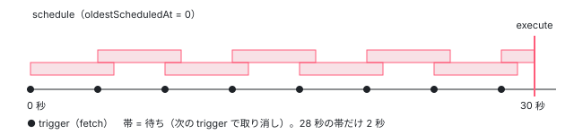

[目次](../README.md) › [Service Worker の内側](README.md) › 第 14 回 / 全 20 回

# アイドルの仕事と古い版の掃除

> idle.ts の IdleScheduler（最後の fetch から 5 秒、最初に積んでから遅くても 30 秒で、積んだ仕事を直列に走らせる）と、積まれる仕事の全部（ナビゲーションのたびの更新の確認・起動のときの更新の確認と掃除・版の取り込み・ハッシュの無いファイルの取り直し）。どのタブも使っていない古い版のキャッシュを消す cleanupCaches が、起動（初期化）のときにしか積まれないこと。applicationMaxAge がビルドの時刻から数えられること（issue #71720）。

angular/angular · 読了 約 12 分 · 中核 · [サイトで読む（デモが動きます）](https://angular-deep-dive-cyan.vercel.app/chapter/sw-idle-cleanup)

---

ngsw-worker.js は、更新の確認や古い版のキャッシュの掃除を「fetch に答えている最中」にはしません。`IdleScheduler` という小さな待ち行列に積み、**最後のイベントから 5 秒、ただし最初に積んでから 30 秒は超えない**ところで順に走らせます。この章では、その待ち方を `trigger` の 1 行ずつで追い、積まれる仕事を grep で全部数え、古い版を消す `cleanupCaches` が**いつ走り、いつ走らないか**を本物のワーカーで確かめます。

読む対象は `packages/service-worker/worker/src/idle.ts`（113 行）と、`worker/src/driver.ts` の `IDLE_DELAY`・`cleanupCaches`・`getCacheNames` です。

1. [1. 全体像](01-sw-overview.md)
2. [2. Generator](02-sw-config-generator.md)
3. [3. ビルド](03-sw-cli-build.md)
4. [4. 登録](04-sw-register.md)
5. [5. Driver の起動](05-sw-driver-lifecycle.md)
6. [6. fetch の横取り](06-sw-driver-fetch.md)
7. [7. 版とタブ](07-sw-versions.md)
8. [8. アセット](08-sw-asset-groups.md)
9. [9. ハッシュ](09-sw-hash-integrity.md)
10. [10. データ](10-sw-data-groups.md)
11. [11. 小さな DB](11-sw-database.md)
12. [12. 更新の確認](12-sw-update-check.md)
13. [13. SwUpdate](13-sw-swupdate.md)
14. **14. アイドルと掃除**（この章）
15. [15. 壊れたとき](15-sw-safe-mode.md)
16. [16. プッシュ](16-sw-push.md)
17. [17. デバッグ](17-sw-debug.md)
18. [18. ワーカーのテスト](18-sw-testing-harness.md)
19. [19. アプリ側のテスト](19-sw-testing-app.md)
20. [20. issue と PR を読む](20-sw-issues.md)

## 1. 2 つの数：IDLE\_DELAY と MAX\_IDLE\_DELAY

📄 `angular/packages/service-worker/worker/src/driver.ts` L38–41 （▶ の行: 38–39）

```ts
38 ▶ const IDLE_DELAY = 5000;
39 ▶ const MAX_IDLE_DELAY = 30000;
40 │ 
41 │ const SUPPORTED_CONFIG_VERSION = 1;
```

38 行目の 5000 ms が「静かになってから待つ時間」、39 行目の 30000 ms が「最初に積んでから待てる上限」です。`Driver` のコンストラクタが、この 2 つを `new IdleScheduler(adapter, IDLE_DELAY, MAX_IDLE_DELAY, debugger)` に渡します（[第 5 回](05-sw-driver-lifecycle.md)）。設定で変える口はありません。

> [!TIP]
> **新卒エンジニアへ**
>
> **アイドル**は「手が空いている」ことです。ワーカーは fetch に答えるのが本業なので、答えを遅らせる仕事（ngsw.json の取り直し、全部のファイルの取り込み、キャッシュの削除）は、fetch がしばらく来なくなってからまとめてします。人で言えば、電話が鳴りやんでから書類の整理をする係です。その係の実物が次の `IdleScheduler` です。

## 2. IdleScheduler の持ち物

📄 `angular/packages/service-worker/worker/src/idle.ts` L12–35 （▶ の行: 12–14, 22–28, 32–33）

```ts
12 ▶ export interface IdleTask {
13 ▶   run: () => Promise<void>;
14 ▶   desc: string;
15 │ }
16 │ 
17 │ interface ScheduledRun {
18 │   cancel: boolean;
19 │ }
20 │ 
21 │ export class IdleScheduler {
22 ▶   private queue: IdleTask[] = [];
23 ▶   private scheduled: ScheduledRun | null = null;
24 ▶   empty: Promise<void> = Promise.resolve();
25 ▶   private emptyResolve: Function | null = null;
26 ▶   lastTrigger: number | null = null;
27 ▶   lastRun: number | null = null;
28 ▶   oldestScheduledAt: number | null = null;
29 │ 
30 │   constructor(
31 │     private adapter: Adapter,
32 ▶     private delay: number,
33 ▶     private maxDelay: number,
34 │     private debug: DebugLogger,
35 │   ) {}
```

1. **12〜15 行目：仕事 1 つは `run` と `desc`**

   `desc` は名前だけで、デバッグのページ `/ngsw/state` の「Task queue」に出ます（[第 17 回](17-sw-debug.md)）。
2. **22〜23 行目：`queue` と `scheduled`**

   `queue` が待ち行列、`scheduled` は「今動いているタイマー 1 つ」の印です（17〜19 行目の `{ cancel }` だけの箱）。
3. **24〜25 行目：`empty`**

   行列が空になったら解決する Promise です。テストが `await driver.idle.empty` で「アイドルの仕事が全部終わるまで」待つのに使います。
4. **26〜28 行目：3 つの時刻**

   `lastTrigger`（最後に `trigger` された時刻）・`lastRun`（最後に走らせた時刻）は表示用、`oldestScheduledAt`（行列の中でいちばん古い仕事を積んだ時刻）は 30 秒の上限の計算に使います。
5. **32〜33 行目：`delay` と `maxDelay`**

   1 節の 5000 と 30000 が入ります。時刻と待ちは 31 行目の `adapter`（`adapter.time` と `adapter.timeout`）を通すので、テストでは偽物の時計に差し替えられます。

## 3. schedule：積むだけで走らせない

📄 `angular/packages/service-worker/worker/src/idle.ts` L92–113 （▶ の行: 93, 95–97, 101–102, 110–111）

```ts
 92 │   schedule(desc: string, run: () => Promise<void>): void {
 93 ▶     this.queue.push({desc, run});
 94 │ 
 95 ▶     if (this.emptyResolve === null) {
 96 ▶       this.empty = new Promise((resolve) => {
 97 ▶         this.emptyResolve = resolve;
 98 │       });
 99 │     }
100 │ 
101 ▶     if (this.oldestScheduledAt === null) {
102 ▶       this.oldestScheduledAt = this.adapter.time;
103 │     }
104 │   }
105 │ 
106 │   get size(): number {
107 │     return this.queue.length;
108 │   }
109 │ 
110 ▶   get taskDescriptions(): string[] {
111 ▶     return this.queue.map((task) => task.desc);
112 │   }
113 │ }
```

93 行目で行列の後ろに足すだけです。**タイマーは始めません**。95〜99 行目、行列が空から 1 つになったときだけ `empty` を「まだ解決しない Promise」に取り替えます。101〜103 行目、`oldestScheduledAt` は最初の 1 つのときだけ書きます。110〜112 行目の `taskDescriptions` が Task queue に出る文字列です。

## 4. trigger：5 秒待つ。ただし 30 秒は超えない

📄 `angular/packages/service-worker/worker/src/idle.ts` L37–66 （▶ の行: 38–40, 43–44, 47, 50, 53–55, 57, 59–60, 63, 65）

```ts
37 │   async trigger(): Promise<void> {
38 ▶     this.lastTrigger = this.adapter.time;
39 ▶     if (this.queue.length === 0) {
40 ▶       return;
41 │     }
42 │ 
43 ▶     if (this.scheduled !== null) {
44 ▶       this.scheduled.cancel = true;
45 │     }
46 │ 
47 ▶     const scheduled = {
48 │       cancel: false,
49 │     };
50 ▶     this.scheduled = scheduled;
51 │ 
52 │     // Ensure that no task remains pending for longer than `this.maxDelay` ms.
53 ▶     const now = this.adapter.time;
54 ▶     const maxDelay = Math.max(0, (this.oldestScheduledAt ?? now) + this.maxDelay - now);
55 ▶     const delay = Math.min(maxDelay, this.delay);
56 │ 
57 ▶     await this.adapter.timeout(delay);
58 │ 
59 ▶     if (scheduled.cancel) {
60 ▶       return;
61 │     }
62 │ 
63 ▶     this.scheduled = null;
64 │ 
65 ▶     await this.execute();
66 │   }
```

1. **38〜41 行目：時刻を書き、行列が空なら何もしない**
2. **43〜45 行目：前のタイマーを取り消す**

   前の `trigger` がまだ待っていれば、その箱の `cancel` を立てます。タイマー自体は止めないので、前の `trigger` の Promise は時間が来たら 59〜61 行目で何もせずに終わります。
3. **47〜50 行目：自分の箱を置く**
4. **53〜55 行目：待つ時間を決める**

   54 行目、`oldestScheduledAt + 30000 − 今`（0 未満なら 0）が「上限まであと何 ms か」です。55 行目でそれと 5000 の小さい方を取ります。積んでから 28 秒たって `trigger` されたなら、待つのは 5 秒ではなく 2 秒です。
5. **57〜65 行目：待って、取り消されていなければ走らせる**



*4 秒ごとに fetch が来る場合。毎回の trigger が前のタイマーを取り消すので 5 秒の待ちは満ちないが、最初に積んだ 0 秒から 30 秒のところで走る（54〜55 行目）。*

## 5. execute：1 つずつ、失敗しても次へ

📄 `angular/packages/service-worker/worker/src/idle.ts` L68–90 （▶ の行: 69–72, 74–75, 77–79, 84–85, 89）

```ts
68 │   async execute(): Promise<void> {
69 ▶     this.lastRun = this.adapter.time;
70 ▶     while (this.queue.length > 0) {
71 ▶       const queue = this.queue;
72 ▶       this.queue = [];
73 │ 
74 ▶       await queue.reduce(async (previous, task) => {
75 ▶         await previous;
76 │         try {
77 ▶           await task.run();
78 ▶         } catch (err) {
79 ▶           this.debug.log(err as Error, `while running idle task ${task.desc}`);
80 │         }
81 │       }, Promise.resolve());
82 │     }
83 │ 
84 ▶     if (this.emptyResolve !== null) {
85 ▶       this.emptyResolve();
86 │       this.emptyResolve = null;
87 │     }
88 │     this.empty = Promise.resolve();
89 ▶     this.oldestScheduledAt = null;
90 │   }
```

70〜72 行目、行列を取り出して空の配列に替えてから走らせます。仕事の途中で新しい仕事が積まれたら、それは新しい配列に入り、70 行目の `while` がもう 1 周して拾います。74〜81 行目の `reduce` は「前の仕事の `await` が終わってから次」なので、**並列ではなく直列**です。78〜80 行目、仕事が投げた例外はデバッグのログに書いて次へ進みます。84〜89 行目で `empty` を解決し、`oldestScheduledAt` を消します。

## 6. 誰が積み、誰が引き金を引くか

📄 `grep の結果（worker/src で）`

```
$ grep -n "idle\.\(schedule\|trigger\)" *.ts
assets.ts:157:            this.idle.schedule(`revalidate(${cache.name}): ${req.url}`, async () => {
driver.ts:256:      event.waitUntil(this.idle.trigger());
driver.ts:396:      event.waitUntil(this.idle.trigger());
driver.ts:592:      this.idle.schedule('check-updates-on-navigation', async () => {
driver.ts:641:      event.waitUntil(this.idle.trigger());
driver.ts:684:      this.idle.schedule('init post-load (update)', async () => {
driver.ts:709:    this.idle.schedule('init post-load (cleanup)', async () => {
driver.ts:972:    this.idle.schedule(`initialization(${appVersion.manifestHash})`, initialize);
```

| 場所 | 種類 | いつ | 中身（章） |
| --- | --- | --- | --- |
| driver.ts:592 | schedule | ナビゲーションの fetch のたび（確認が積まれていなければ） | 更新の確認（[第 12 回](12-sw-update-check.md)） |
| driver.ts:684 | schedule | 初期化で DB から状態を読めたとき | 更新の確認 |
| driver.ts:709 | schedule | 初期化のたび（読めても読めなくても） | `cleanupCaches`（この章の 7 節） |
| driver.ts:972 | schedule | 初期化で、版ごとに（スコープが localhost なら積まずにすぐ走らせる） | 版の全部のファイルの取り込み（[第 8 回](08-sw-asset-groups.md)） |
| assets.ts:157 | schedule | ハッシュの無いファイルをキャッシュから返し、古くなっていたとき | 取り直し（[第 8 回](08-sw-asset-groups.md)） |
| driver.ts:641 | trigger | 横取りした fetch のたび（`finally`） | — |
| driver.ts:396 | trigger | 初期化を試みた 1 回だけ（`finally`） | — |
| driver.ts:256 | trigger | SAFE\_MODE で横取りしなかった fetch のたび | —（[第 15 回](15-sw-safe-mode.md)） |

**message のイベント（`CHECK_FOR_UPDATES` など）は `trigger` を呼びません**。初期化のあとの `ensureInitialized` は 396 行目まで行かずに戻るからです（[第 5 回](05-sw-driver-lifecycle.md)）。引き金は実質「fetch が来たこと」で、fetch が 5 秒来なければ走り、来続けても 30 秒で走ります。

> [!NOTE]
> **さらに深く**
>
> ワーカーの寿命は `event.waitUntil` で延びます。641 行目は `trigger()` の Promise を `waitUntil` に渡すので、ブラウザは「アイドルの仕事が走り終わるまで」そのワーカーを止めません。取り消された `trigger` の Promise は 60 行目ですぐ終わるので、最後の 1 つだけがワーカーを生かします。

## 7. cleanupCaches：使われていない版を消す

📄 `angular/packages/service-worker/worker/src/driver.ts` L1120–1146 （▶ の行: 1124–1125, 1131, 1134–1135, 1138, 1141–1142, 1146）

```ts
1120 │   async cleanupCaches(): Promise<void> {
1121 │     try {
1122 │       // Query for all currently active clients, and list the client IDs. This may skip some clients
1123 │       // in the browser back-forward cache, but not much can be done about that.
1124 ▶       const activeClients = new Set<ClientId>(
1125 ▶         (await this.scope.clients.matchAll()).map((client) => client.id),
1126 │       );
1127 │ 
1128 │       // A simple list of client IDs that the SW has kept track of. Subtracting `activeClients` from
1129 │       // this list will result in the set of client IDs which are being tracked but are no longer
1130 │       // used in the browser, and thus can be cleaned up.
1131 ▶       const knownClients: ClientId[] = Array.from(this.clientVersionMap.keys());
1132 │ 
1133 │       // Remove clients in the `clientVersionMap` that are no longer active.
1134 ▶       const obsoleteClients = knownClients.filter((id) => !activeClients.has(id));
1135 ▶       obsoleteClients.forEach((id) => this.clientVersionMap.delete(id));
1136 │ 
1137 │       // Next, determine the set of versions which are still used. All others can be removed.
1138 ▶       const usedVersions = new Set(this.clientVersionMap.values());
1139 │ 
1140 │       // Collect all obsolete versions by filtering out used versions from the set of all versions.
1141 ▶       const obsoleteVersions = Array.from(this.versions.keys()).filter(
1142 ▶         (version) => !usedVersions.has(version) && version !== this.latestHash,
1143 │       );
1144 │ 
1145 │       // Remove all the versions which are no longer used.
1146 ▶       obsoleteVersions.forEach((version) => this.versions.delete(version));
```

1. **1124〜1126 行目：今開いているタブの ID を集める**

   `clients.matchAll()` の結果です。1122〜1123 行目のコメントのとおり、戻る・進むのキャッシュ（bfcache）に入ったタブは漏れることがあります。
2. **1131〜1135 行目：閉じたタブを割り当ての表から消す**

   表（`clientVersionMap`）にあって、今開いていない ID が「閉じたタブ」です。
3. **1138〜1143 行目：誰も使っていない版を選ぶ**

   1142 行目、**最新の版（`latestHash`）は、使っているタブが 0 でも残します**。次に開くタブがその版になるからです。
4. **1146 行目：`versions` から消す**

📄 `angular/packages/service-worker/worker/src/driver.ts` L1148–1161 （▶ の行: 1149, 1152–1156, 1159）

```ts
1148 │       // Commit all the changes to the saved state.
1149 ▶       await this.sync();
1150 │ 
1151 │       // Delete all caches that are no longer needed.
1152 ▶       const allCaches = await this.adapter.caches.keys();
1153 ▶       const usedCaches = new Set(await this.getCacheNames());
1154 ▶       const cachesToDelete = allCaches.filter((name) => !usedCaches.has(name));
1155 ▶       await Promise.all(cachesToDelete.map((name) => this.adapter.caches.delete(name)));
1156 ▶     } catch (err) {
1157 │       // Oh well? Not much that can be done here. These caches will be removed on the next attempt
1158 │       // or when the SW revs its format version, which happens from time to time.
1159 ▶       this.debugger.log(err as Error, 'cleanupCaches');
1160 │     }
1161 │   }
```

1149 行目で表を DB に書いてから、1152〜1155 行目で「今あるキャッシュ」から「使っているキャッシュ」を引いた残りを全部消します。`adapter.caches.keys()` は名前が `ngsw:/:`（スコープごとの頭）で始まるものだけを返すので（[第 11 回](11-sw-database.md)）、ほかのライブラリのキャッシュは消しません。1156〜1160 行目、失敗しても投げずにログに書くだけです。

📄 `angular/packages/service-worker/worker/src/driver.ts` L1387–1395 （▶ の行: 1388, 1390–1391, 1393）

```ts
1387 │   private async getCacheNames(): Promise<string[]> {
1388 ▶     const controlTable = (await this.controlTable) as CacheTable;
1389 │     const appVersions = Array.from(this.versions.values());
1390 ▶     const appVersionCacheNames = await Promise.all(
1391 ▶       appVersions.map((version) => version.getCacheNames()),
1392 │     );
1393 ▶     return [controlTable.cacheName].concat(...appVersionCacheNames);
1394 │   }
1395 │ }
```

「使っているキャッシュ」は、1388 行目の DB の `control` と、1390〜1392 行目の残った版ごとの名前（アセットグループの `cache` と `meta`、データグループの `cache`・`age`・`lru`）です。版のハッシュが名前に入っているので（`ngsw:/:<hash>:assets:app:cache`）、版を `versions` から消せば、その版のキャッシュは自動で「使っていない」側に入ります。

> [!NOTE]
> **ポイント**
>
> chapters.json の要約やブリーフに出てくる `cleanupOldSwCaches`（`ngsw:` の後ろに `/` が無い、古い形式の名前のキャッシュを消す関数）は、2023-08 の #51246（「後方互換のコードを消す」）で activate の仕事ごと消えました。v22 の driver.ts にはありません（`git log -S cleanupOldSwCaches` で確かめた）。

## 8. いつ掃除されるのか

6 節の表のとおり、`cleanupCaches` を積むのは 709 行目の 1 か所、つまり**初期化のときだけ**です。動いているワーカーの中で版が 3 つに増え、古い版のタブを全部閉じても、そのワーカーが生きている間は消えません。Service Worker の仕様では、ブラウザはイベントの無いワーカーをいつ止めてもよく、次のイベントで新しく起こします。起こされたワーカーは DB から状態を読んで初期化し、そこで 709 行目が積まれて、次のアイドルで掃除されます。下のデモ 2 では、まず同じワーカーを止めずに続けて掃除が走らないことを確かめ、次に偽物のブラウザの `restart()`（同じキャッシュ・サーバー・タブのまま、ngsw-worker.js をもう一度評価する。install と activate は来ない）で起こし直して、掃除が走ることを確かめます。

> **🧪 DEMO 1 — fetch を続けると、アイドルの仕事はいつ走るか**
>
> **本物の ngsw-worker.js（@angular/service-worker 22.1.6）を偽物のブラウザの上で動かしています**（タイマーと `Date.now` は仮想の時計。`sw-sandbox.ts` の先頭のコメント）。v1 を入れてからタブ a でナビゲーションし（592 行目の更新の確認が積まれる）、仮想の時計を 0.5 秒ずつ進めながら、選んだ間隔で `/main.js` を取り続けます。サーバーに `/ngsw.json?ngsw-cache-bust=…` が届いた時刻が「アイドルの仕事が走った時刻」です。
>
> ▶ [このデモはサイトで動かせます](https://angular-deep-dive-cyan.vercel.app/chapter/sw-idle-cleanup)

Node で同じものを動かした結果は、「1 回だけ」と「6 秒ごと」が 5.0 秒、「2 秒ごと」と「4 秒ごと」が 30.0 秒でした。4 秒ごとなら 28 秒の fetch のときに 54 行目が 2000 を出し、30 秒ちょうどで走ります。

> **🧪 DEMO 2 — v1 → v2 → v3 と更新し、古い版のタブを閉じる**
>
> 本物のワーカーで、v1 を入れる → タブ a を開く → サーバーを v2 にして `CHECK_FOR_UPDATES` → タブ b を開く → v3 → タブ c を開く → タブを閉じて待つ → `restart()` で起こし直す、と進め、各段でキャッシュの名前（`cacheContents()`。ハッシュは先頭 8 文字）と、本物の `/ngsw/state` の版ごとのタブと Task queue を並べます。
>
> ▶ [このデモはサイトで動かせます](https://angular-deep-dive-cyan.vercel.app/chapter/sw-idle-cleanup)

1. **① の Task queue**

   `init post-load (cleanup)` と `initialization(<hash>)` の 2 つです。初めての起動なので DB が空で、684 行目の更新の確認は積まれません。
2. **② キャッシュが 3 つ**

   `db:control` と v1 の `cache`・`meta`。Task queue は空です。
3. **③ キャッシュが 7 つ、版が 3 つ**

   タブ a は v1、b は v2、c は v3 です（新しいタブは最新の版。[第 7 回](07-sw-versions.md)）。
4. **④ と ⑤：タブを閉じても 7 つのまま**

   `/ngsw/state` の表にも a と b が残っています。閉じたタブを表から消すのは 1131〜1135 行目、つまり `cleanupCaches` だけで、それが積まれないからです。⑤ でタブ c が fetch して 31 秒進めても同じです（行列が空なので 39〜41 行目で戻る）。
5. **⑥ restart のあとのナビゲーション：Task queue に `init post-load (cleanup)`**

   新しい Driver が DB から状態を読んで初期化し、709 行目の掃除と 684 行目の更新の確認を積みます。キャッシュはまだ 7 個です。
6. **⑦ settle(6000)：キャッシュが 3 個に**

   アイドルで `cleanupCaches` が走り、1131〜1135 行目で閉じたタブ a・b が表から消え、1141〜1146 行目で v1・v2 が消え、1152〜1155 行目でその 4 つのキャッシュが消えました。残るのは `db:control` と v3 の 2 つです。④ でタブを閉じなかった場合は、⑦ でも 7 個のまま（どの版にもタブがある）です。

## 9. applicationMaxAge（#71720）

📄 `angular/packages/service-worker/worker/src/driver.ts` L601–604 （▶ の行: 602–604）

```ts
601 │     // If there's a configured max age, check whether this version is within that age.
602 ▶     const isVersionWithinMaxAge =
603 ▶       appVersion?.manifest.applicationMaxAge === undefined ||
604 ▶       this.adapter.time - appVersion.manifest.timestamp < appVersion.manifest.applicationMaxAge;
```

`handleFetch` の中の 4 行です（前後は[第 6 回](06-sw-driver-fetch.md)）。603 行目、`applicationMaxAge` が無ければ年齢は見ません。604 行目、**今の時刻 − `manifest.timestamp`** が `applicationMaxAge` 未満のときだけ、その版で答えます。`timestamp` は Generator がビルドのときに `Date.now()` で入れる値なので（[第 2 回](02-sw-config-generator.md)）、年齢は「端末にキャッシュした時刻から」ではなく**「ビルドした時刻から」**数えます。これを超えると、新しい版が出ていなくても、その版のキャッシュを使わずにネットワークへ行きます。オフラインでは起動しません。

issue #71720（2026-10-29、open）は、このことと「省略したときは上限なし」がドキュメントに書かれていない、という docs の issue です。同じ内容のドキュメントの PR が 2 つあり、#71721 は閉じられ、#71759 が開いています（2026-11-03 に `gh pr list --search 71720` で確かめた。読んだだけ）。この 4 行は掃除とは関係ありませんが、「キャッシュはいつまで使われるか」という同じ質問に答える行なので、この章に置きました。

## 10. ここまでを 1 本に

- `Driver.initialize` — driver.ts L648（第 5 回） — *起動のたびに 1 回*
  - `idle.schedule('init post-load (cleanup)')` — driver.ts L709 — *積むだけ*
  - `idle.schedule('initialization(hash)')` — driver.ts L972
- `Driver.handleFetch → finally` — driver.ts L641 — *fetch のたび*
  - `IdleScheduler.trigger` — idle.ts L37 — *前のタイマーを取り消し、min(5000, 30 秒の残り) 待つ*
    - `IdleScheduler.execute` — idle.ts L68 — *直列に 1 つずつ*
      - `Driver.cleanupCaches` — driver.ts L1120 — *閉じたタブ → 使われない版 → キャッシュ*
        - `Driver.getCacheNames` — driver.ts L1387

## テストと直し方

### spec と describe

| spec | describe / it | 件数 |
| --- | --- | --- |
| worker/test/idle\_spec.ts | `IdleScheduler`（19 行目）の 4 つ：`executes scheduled work on time`（32）・`waits for multiple tasks to complete serially`（58）・`does not execute work until timeout passes with no triggers`（98）・`executes tasks after max delay even with newer triggers`（142） | 4 |
| worker/test/happy\_spec.ts | `Driver` の `cleans up properly when manually requested`（627）・`cleans up properly on restart`（647）・`cleans up properly when failing to load stored state`（678） | 3 |
| worker/test/happy\_spec.ts | `applicationMaxAge`（2798 行目）の 2 つ | 2 |

📄 `angular/packages/service-worker/worker/test/idle_spec.ts` L142–185 （▶ の行: 151, 154, 158, 162, 167, 171, 176, 180–181, 184）

```ts
142 │     it('executes tasks after max delay even with newer triggers', async () => {
143 │       // Set up a single idle task to set the completed flag to true when it runs.
144 │       let completed: boolean = false;
145 │       idle.schedule('work', async () => {
146 │         completed = true;
147 │       });
148 │ 
149 │       // Trigger the queue once. This trigger will start a timer for the idle timeout,
150 │       // but another `trigger()` will be called before that timeout passes.
151 ▶       const firstTrigger = idle.trigger();
152 │ 
153 │       // Advance the clock a little, but not enough to actually cause tasks to execute.
154 ▶       scope.advance(999);
155 │       expect(completed).toBe(false);
156 │ 
157 │       // Next, trigger the queue again.
158 ▶       const secondTrigger = idle.trigger();
159 │ 
160 │       // Advance the clock beyond the timeout for the first trigger, but not the second.
161 │       // This should cause the first trigger to resolve, but without running the task.
162 ▶       scope.advance(999);
163 │       await firstTrigger;
164 │       expect(completed).toBe(false);
165 │ 
166 │       // Next, trigger the queue again.
167 ▶       const thirdTrigger = idle.trigger();
168 │ 
169 │       // Advance the clock beyond the timeout for the second trigger, but not the third.
170 │       // This should cause the second trigger to resolve, but without running the task.
171 ▶       scope.advance(999);
172 │       await secondTrigger;
173 │       expect(completed).toBe(false);
174 │ 
175 │       // Next, trigger the queue again.
176 ▶       const forthTrigger = idle.trigger();
177 │ 
178 │       // Finally, advance the clock beyond `maxDelay` (3000) from the first trigger, but not beyond
179 │       // the timeout for the forth. This should cause the task to be executed nonetheless.
180 ▶       scope.advance(3);
181 ▶       await Promise.all([thirdTrigger, forthTrigger]);
182 │ 
183 │       // The task should have executed.
184 ▶       expect(completed).toBe(true);
185 │     });
```

この spec の `beforeEach` は `new IdleScheduler(scope, 1000, 3000, …)` と短い数で作ります（本物は 5000 と 30000）。999 ms ずつ進めては `trigger()` し直し、`delay`（1000）には一度も届かせません。それでも 180 行目、最初から 3000 を超えた 3 ms 後に走ることを 184 行目で確かめます。4 節の 54 行目の式そのものです。

📄 `angular/packages/service-worker/worker/test/happy_spec.ts` L647–676 （▶ の行: 651–653, 655, 664, 666–667, 670–671, 675）

```ts
647 │     it('cleans up properly on restart', async () => {
648 │       expect(await makeRequest(scope, '/foo.txt')).toEqual('this is foo');
649 │       await driver.initialized;
650 │ 
651 ▶       scope = new SwTestHarnessBuilder()
652 ▶         .withCacheState(scope.caches.original.dehydrate())
653 ▶         .withServerState(serverUpdate)
654 │         .build();
655 ▶       driver = new Driver(scope, scope, new CacheDatabase(scope));
656 │       expect(await makeRequest(scope, '/foo.txt')).toEqual('this is foo');
657 │       await driver.initialized;
658 │       serverUpdate.assertNoOtherRequests();
659 │ 
660 │       let keys = await scope.caches.keys();
661 │       let hasOriginalCaches = keys.some((name) => name.startsWith(`${manifestHash}:`));
662 │       expect(hasOriginalCaches).toEqual(true);
663 │ 
664 ▶       scope.clients.remove('default');
665 │ 
666 ▶       scope.advance(12000);
667 ▶       await driver.idle.empty;
668 │       serverUpdate.clearRequests();
669 │ 
670 ▶       driver = new Driver(scope, scope, new CacheDatabase(scope));
671 ▶       expect(await makeRequest(scope, '/foo.txt')).toEqual('this is foo v2');
672 │ 
673 │       keys = await scope.caches.keys();
674 │       hasOriginalCaches = keys.some((name) => name.startsWith(`${manifestHash}:`));
675 ▶       expect(hasOriginalCaches).toEqual(false);
676 │     });
```

8 節の「起こし直し」を spec で作っているのがこの it です。651〜655 行目で、前のキャッシュの中身（`dehydrate()`）を持った新しいハーネスと新しい `Driver` を作ります。これがブラウザの「ワーカーを止めて起こす」に当たります。664 行目でタブを消し、666〜667 行目でアイドルを流し、670 行目でもう一度 `Driver` を作って、675 行目で元の版のキャッシュが消えたことを確かめます。627 行目の it は 709 行目を通らず、`driver.cleanupCaches()` を直接呼んでいます。

📄 `angular/packages/service-worker/worker/test/happy_spec.ts` L2821–2844 （▶ の行: 2828, 2830, 2832–2834, 2839, 2843）

```ts
2821 │       it('creates navigate requests outside the maxAge', async () => {
2822 │         const {server, scope, driver} = createSwForMaxAge();
2823 │ 
2824 │         await makeRequest(scope, '/foo.txt');
2825 │         await driver.initialized;
2826 │         await server.clearRequests();
2827 │ 
2828 ▶         await scope.advance(3000);
2829 │ 
2830 ▶         // Create multiple requests to prove the navigation and asset requests are all made
2831 │         // When enabled, the navigation request is made each time and not replaced
2832 ▶         // with the index request - thus, the `null` value.
2833 ▶         expect(await makeNavigationRequest(scope, '/', '')).toBe(null);
2834 ▶         expect(await makeNavigationRequest(scope, '/foo', '')).toBe(null);
2835 │ 
2836 │         expect(await makeRequest(scope, '/foo.txt')).toBe('this is foo');
2837 │         expect(await makeRequest(scope, '/bar.txt')).toBe('this is bar');
2838 │ 
2839 ▶         server.assertSawRequestFor('/');
2840 │         server.assertSawRequestFor('/foo');
2841 │         server.assertSawRequestFor('/foo.txt');
2842 │         server.assertSawRequestFor('/bar.txt');
2843 ▶         server.assertNoOtherRequests();
2844 │       });
```

この describe の `createSwForMaxAge` は、マニフェストの `timestamp` をハーネスの今の時刻にし、`applicationMaxAge` を 2000 ms にします。2828 行目で時計を 3 秒進めると、2833〜2834 行目のナビゲーションは index.html に置き換えられずネットワークに行き（2830〜2832 行目のコメントのとおり `null`）、2839〜2843 行目で全部がネットワークに行ったことを確かめます。ファイルを取り込んだ時刻は一度も出てこず、`timestamp` と時計の差だけで切り替わることが、#71720 の説明の裏づけになります。

### 手元で走らせた結果

📄 `ターミナル（../angular で）`

```
cd ~/angular-research/angular
pnpm bazel test //packages/service-worker/worker/test:test --nocache_test_results --test_output=all --test_arg=--filter=IdleScheduler
pnpm bazel test //packages/service-worker/worker/test:test --nocache_test_results --test_output=all "--test_arg=--filter=Driver cleans up"
pnpm bazel test //packages/service-worker/worker/test:test --nocache_test_results --test_output=all --test_arg=--filter=applicationMaxAge
```

📄 `出力（2026-11-03 に実行。抜粋。ログは scratchpad/sw-logs/d-idle-sched.log・d-idle-cleanup.log・d-idle-maxage.log）`

```
### filter=IdleScheduler
Ran 4 of 153 specs
4 specs, 0 failures
Finished in 0.005 seconds
//packages/service-worker/worker/test:test PASSED in 0.6s

### filter=Driver cleans up
Ran 3 of 153 specs
3 specs, 0 failures
Finished in 0.015 seconds
//packages/service-worker/worker/test:test PASSED in 0.6s

### filter=applicationMaxAge
Ran 2 of 153 specs
2 specs, 0 failures
Finished in 0.008 seconds
//packages/service-worker/worker/test:test PASSED in 0.7s
```

- 3 つとも、ターゲットの時間は 0.6〜0.7 秒、jasmine の中は 0.01 秒前後です。偽物の時計なので、30 秒を待つ spec も一瞬で終わります。
- `Driver cleans up` の filter は describe の `Driver` と it の名前をつないだ文字列に当たります（3 of 153）。

### 直すとしたら

先に 1 つ断っておきます。このパッケージの PACKAGE.md は冒頭で「機能の限られた基本的なキャッシュの道具で、セキュリティの修正以外の新しい機能は受け付けない」と書いています（[第 1 回](01-sw-overview.md)）。新しい機能の PR は受け付けられず、不具合の直しも慎重に扱われます。下の入口は、手元で確かめることと issue を読むことのためのものです。

- 待ち方を変えるなら `idle.ts` の `trigger`（37 行目）で、spec は idle\_spec.ts に足します。ハーネスを `new SwTestHarnessBuilder().build()` で作り、`scope.advance(ms)` で時計を進める形がそのまま使えます（[第 18 回](18-sw-testing-harness.md)）。
- 「動いているワーカーの中で掃除されない」ことを確かめる it はありません。掃除の時機を変える話（例えば更新のあとにも積む）を読むときは、happy\_spec の `cleans up properly on restart` の隣に「再起動せずに」版を書くと、今の動き（キャッシュが残る）を固定できます。
- `applicationMaxAge` の数え方は docs の話として PR が出ています（9 節）。ここに手を入れることは勧めません。issue を読むときの手がかりにします（[第 20 回](20-sw-issues.md)）。

## 聞かれそうな質問

**Q. アイドルの仕事は、最後の fetch から何秒で走りますか？**

5 秒です（38 行目）。ただし行列の中のいちばん古い仕事を積んでから 30 秒（39 行目）を超えるときは、その残りの分だけ待ちます（54〜55 行目）。fetch が 2 秒ごとに来続けても、30 秒で走ります。

**Q. アイドルの仕事は並列に走りますか？1 つが失敗したら残りはどうなりますか？**

直列です。74〜81 行目の `reduce` が前の `await` を待ってから次を呼びます。失敗した仕事は 78〜80 行目でログに書かれ、次の仕事に進みます。

**Q. 古い版のタブを全部閉じれば、その版のキャッシュはすぐ消えますか？**

消えません。`cleanupCaches` を積むのは初期化のときの 709 行目だけなので、同じワーカーが動いている間は残ります。ブラウザがワーカーを止め、次に起こされたときの初期化で積まれ、そのあとのアイドルで 1152〜1155 行目が消します。デモ 2 の ④・⑤ が前半、⑥・⑦ が後半です。

**Q. 最新の版を使っているタブが 1 つも無いとき、最新の版は消されますか？**

消されません。1142 行目で `latestHash` を残します。次に開くタブがその版を使うからです。

**Q. `applicationMaxAge: '1d'` は「端末に入れてから 1 日」ですか？**

いいえ。604 行目は `manifest.timestamp`（ビルドした時刻）からの差を見ます。ビルドから 1 日を過ぎると、新しい版を出していなくても全部の端末でキャッシュを使わなくなります（#71720）。

## 読み終えて

- `IdleScheduler` は「積む（`schedule`）」と「引き金（`trigger`）」が別で、引き金を引くのは fetch と初期化だけ。
- 待つのは min(5 秒, 最初に積んでから 30 秒の残り)。仕事は直列で、失敗しても次へ進む。
- `cleanupCaches` は閉じたタブ → 使われない版（最新は除く）→ その版のキャッシュ、の順に消す。積まれるのは初期化のときだけ。
- `applicationMaxAge` はビルドの時刻から数える。掃除とは別の行（604 行目）で効く。

---

← 前: [アプリの側：SwUpdate と NgswCommChannel](13-sw-swupdate.md)  
次: [壊れたときの状態：EXISTING\_CLIENTS\_ONLY・SAFE\_MODE・safety-worker](15-sw-safe-mode.md) →
