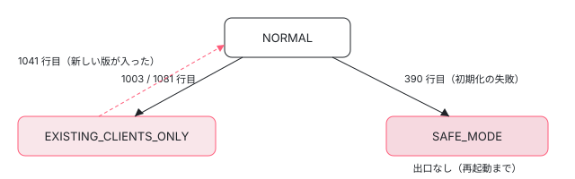

[目次](../README.md) › [Service Worker の内側](README.md) › 第 15 回 / 全 20 回

# 壊れたときの状態：EXISTING\_CLIENTS\_ONLY・SAFE\_MODE・safety-worker

> 版が壊れたときに Driver が EXISTING\_CLIENTS\_ONLY（開いているタブだけ面倒をみる）や SAFE\_MODE（何も横取りしない）に下がる行と、戻る条件。ngsw.json が 404 のときに全部のキャッシュを消して登録を外す行、ワーカーを止めるための safety-worker.js、ブラウザのキャッシュの容量（navigator.storage）。

angular/angular · 読了 約 12 分 · 発展 · [サイトで読む（デモが動きます）](https://angular-deep-dive-cyan.vercel.app/chapter/sw-safe-mode)

---

ngsw-worker.js は、壊れたときに「何もしない」方へ倒れるように作られています。この章では、`Driver.state` が `NORMAL` から `EXISTING_CLIENTS_ONLY`（開いているタブだけ面倒をみる）や `SAFE_MODE`（何も横取りしない）に**下がる行を全部**、戻る行と合わせて読みます。ngsw.json が 404 のときに自分のキャッシュを全部消して登録を外す行、それでも止まらないワーカーを止めるための `safety-worker.js`、容量がいっぱいのときの `navigator.storage.estimate()` も見ます。

読む対象は `packages/service-worker/worker/src/driver.ts` の状態を書き換える 4 行、ngsw.json の 404 と `configVersion` の行、`deleteAllCaches`、`worker/src/data.ts` の `detectStorageFull`、`packages/service-worker/safety-worker.js` です。3 つの状態そのものの定義（`DriverReadyState`）は[第 5 回](05-sw-driver-lifecycle.md)で読みました。

1. [1. 全体像](01-sw-overview.md)
2. [2. Generator](02-sw-config-generator.md)
3. [3. ビルド](03-sw-cli-build.md)
4. [4. 登録](04-sw-register.md)
5. [5. Driver の起動](05-sw-driver-lifecycle.md)
6. [6. fetch の横取り](06-sw-driver-fetch.md)
7. [7. 版とタブ](07-sw-versions.md)
8. [8. アセット](08-sw-asset-groups.md)
9. [9. ハッシュ](09-sw-hash-integrity.md)
10. [10. データ](10-sw-data-groups.md)
11. [11. 小さな DB](11-sw-database.md)
12. [12. 更新の確認](12-sw-update-check.md)
13. [13. SwUpdate](13-sw-swupdate.md)
14. [14. アイドルと掃除](14-sw-idle-cleanup.md)
15. **15. 壊れたとき**（この章）
16. [16. プッシュ](16-sw-push.md)
17. [17. デバッグ](17-sw-debug.md)
18. [18. ワーカーのテスト](18-sw-testing-harness.md)
19. [19. アプリ側のテスト](19-sw-testing-app.md)
20. [20. issue と PR を読む](20-sw-issues.md)

## 1. state を書き換える行を全部探す

`grep -n "this.state = " packages/service-worker/worker/src/driver.ts` の結果は 4 行です（2026-11-03）。1003・1081 行目が `EXISTING_CLIENTS_ONLY` へ、390 行目が `SAFE_MODE` へ、1041 行目が `NORMAL` へ戻す行です。初期値はフィールドの宣言の `NORMAL` です（第 5 回）。そのほかに「状態を読んで振る舞いを変える行」があります。表にすると次のとおりです。

| 書く行 | 関数 | きっかけ | 行き先 |
| --- | --- | --- | --- |
| 390 | `ensureInitialized` | 初期化が例外を投げた（2 節） | SAFE\_MODE |
| 1003 | `versionFailed` | 最新の版のファイルが壊れていると分かった（3 節） | EXISTING\_CLIENTS\_ONLY |
| 1081 | `checkForUpdate` | 更新の確認か取り込みが例外を投げた（4 節） | EXISTING\_CLIENTS\_ONLY |
| 1041 | `setupUpdate` | 新しい版を取り込めた（5 節） | NORMAL |



*状態の移り方。NORMAL に戻る矢印は EXISTING\_CLIENTS\_ONLY からの 1 本（1041 行目）だけで、SAFE\_MODE から出る矢印は無い。*

## 2. SAFE\_MODE：初期化に失敗したとき

📄 `angular/packages/service-worker/worker/src/driver.ts` L387–393 （▶ の行: 387, 390–391, 393）

```ts
387 ▶     } catch (error) {
388 │       // If initialization fails, the SW needs to enter a safe state, where it declines to respond
389 │       // to network requests.
390 ▶       this.state = DriverReadyState.SAFE_MODE;
391 ▶       this.stateMessage = `Initialization failed due to error: ${errorToString(error)}`;
392 │ 
393 ▶       throw error;
```

`ensureInitialized` の `catch` です（関数の全体は[第 5 回](05-sw-driver-lifecycle.md)）。初期化（DB から状態を読む、読めなければ ngsw.json を取る）が投げたら、390 行目で `SAFE_MODE`、391 行目で理由の文字列を入れ、393 行目で投げ直します。よくあるきっかけは「初めての起動で ngsw.json が取れない」です。DB が空なので ngsw.json を取りに行き、それが 404 や 500 だと 6 節の 942 行目が投げます。

📄 `angular/packages/service-worker/worker/src/driver.ts` L252–258 （▶ の行: 253, 256–257）

```ts
252 │     // request was handled by the SW.
253 ▶     if (this.state === DriverReadyState.SAFE_MODE) {
254 │       // Even though the worker is in safe mode, idle tasks still need to happen so
255 │       // things like update checks, etc. can take place.
256 ▶       event.waitUntil(this.idle.trigger());
257 ▶       return;
258 │     }
```

SAFE\_MODE のワーカーは、`onFetch` の 253 行目で `respondWith` を呼ばずに戻ります（ブラウザがそのままネットワークへ行く）。256 行目でアイドルの引き金だけは引きます。message も無視します（`onMessage` の先頭。[第 13 回](13-sw-swupdate.md)）。

> [!WARNING]
> **ハマりどころ**
>
> **SAFE\_MODE から戻る行はありません**。1 節の表のとおり `NORMAL` に戻すのは 1041 行目だけで、そこは `EXISTING_CLIENTS_ONLY` のときしか通りません（5 節）。しかも初期化は 1 回きりで（`this.initialized` に失敗した Promise が残る）、SAFE\_MODE では更新の確認もメッセージも受け付けません。戻るのは、ブラウザがこのワーカーを止めて新しく起こし、`state` が初期値の `NORMAL` から始まったときです。`DriverReadyState` の定義のコメントが「次の再起動まで（until the next restart）」と書いているのはこのことです。

## 3. EXISTING\_CLIENTS\_ONLY（1）：最新の版が壊れていたとき

📄 `angular/packages/service-worker/worker/src/driver.ts` L1000–1005 （▶ の行: 1000, 1003–1004）

```ts
1000 ▶     if (this.latestHash === brokenHash) {
1001 │       // The latest manifest is broken. This means that new clients are at the mercy of the network,
1002 │       // but caches continue to be valid for previous versions. This is unfortunate but unavoidable.
1003 ▶       this.state = DriverReadyState.EXISTING_CLIENTS_ONLY;
1004 ▶       this.stateMessage = `Degraded due to: ${errorToString(err)}`;
1005 │     }
```

`versionFailed` は、ある版のファイルのハッシュが合わない（`SwCriticalError`）と分かったときに呼ばれます（呼ばれ方は[第 9 回](09-sw-hash-integrity.md)）。1000 行目、壊れた版が**最新の版のときだけ** 1003 行目で下げます。古い版が壊れていても、新しいタブはどうせ最新の版を使うので、状態は変えません。

`EXISTING_CLIENTS_ONLY` で変わるのは、**まだ版の割り当てが無いタブ**の扱いです。`assignVersion` が `null` を返し（`state !== NORMAL` の 2 か所。[第 7 回](07-sw-versions.md)）、`handleFetch` はその fetch をネットワークに回します。すでに割り当てのあるタブは、壊れた版でも自分の版のまま答えてもらえます。ナビゲーションのたびにタブを最新の版へ移す処理も `state === NORMAL` のときだけです（同じく第 7 回）。

## 4. EXISTING\_CLIENTS\_ONLY（2）：更新の確認が失敗したとき

📄 `angular/packages/service-worker/worker/src/driver.ts` L1078–1084 （▶ の行: 1078, 1081–1082, 1084）

```ts
1078 ▶     } catch (err) {
1079 │       this.debugger.log(err as Error, `Error occurred while updating to manifest ${hash}`);
1080 │ 
1081 ▶       this.state = DriverReadyState.EXISTING_CLIENTS_ONLY;
1082 ▶       this.stateMessage = `Degraded due to failed initialization: ${errorToString(err)}`;
1083 │ 
1084 ▶       return false;
```

`Driver.checkForUpdate` の `catch` です（関数の全体は[第 12 回](12-sw-update-check.md)）。ngsw.json が 404 や 500 だったとき、新しい版のファイルのハッシュが合わなかったとき（取り込みの `setupUpdate` が投げる）に、ここに来ます。1081 行目で下げ、1084 行目で `false` を**返します**（投げない）。だからページの側の `checkForUpdate()` は reject せず `false` で終わります。1082 行目の文字列は「failed initialization」と言いますが、ここは更新の失敗です（デモの `/ngsw/state` にもこの文言で出ます）。

> [!NOTE]
> **ポイント**
>
> オフラインのときは下げません。ngsw.json の取得が 503・504（偽物の 504 を含む）なら 6 節の 939〜940 行目で `null` が返り、`checkForUpdate` は「オフラインなので確かめられない」として `false` を返すだけです（第 12 回）。

## 5. NORMAL に戻る行

📄 `angular/packages/service-worker/worker/src/driver.ts` L1038–1043 （▶ の行: 1038, 1040–1042）

```ts
1038 ▶       // If we are in `EXISTING_CLIENTS_ONLY` mode (meaning we didn't have a clean copy of the last
1039 │       // latest version), we can now recover to `NORMAL` mode and start accepting new clients.
1040 ▶       if (this.state === DriverReadyState.EXISTING_CLIENTS_ONLY) {
1041 ▶         this.state = DriverReadyState.NORMAL;
1042 ▶         this.stateMessage = '(nominal)';
1043 │       }
```

`setupUpdate` で新しい版を全部取り込めた直後です。1040 行目、`EXISTING_CLIENTS_ONLY` なら 1041〜1042 行目で `NORMAL` に戻します。つまり**壊れた版を直した新しい版を出せば、次の更新の確認で戻ります**。1038〜1039 行目のコメントのとおり、新しい「最新」はきれいに入ったからです。

📄 `angular/packages/service-worker/worker/src/driver.ts` L1021–1027 （▶ の行: 1021–1024）

```ts
1021 ▶       if (manifest.configVersion !== SUPPORTED_CONFIG_VERSION) {
1022 ▶         await this.deleteAllCaches();
1023 ▶         await this.scope.registration.unregister();
1024 ▶         throw new Error(
1025 │           `Invalid config version: expected ${SUPPORTED_CONFIG_VERSION}, got ${manifest.configVersion}.`,
1026 │         );
1027 │       }
```

同じ `setupUpdate` の少し前に、もう 1 つの「全部やめる」道があります。1021 行目、新しい ngsw.json の `configVersion` が 1（このワーカーが知っている形式）でなければ、1022〜1023 行目でキャッシュを全部消して登録を外し、1024 行目で投げます（そのあと 4 節の 1081 行目で `EXISTING_CLIENTS_ONLY`）。

## 6. ngsw.json が 404：キャッシュを全部消して登録を外す

📄 `angular/packages/service-worker/worker/src/driver.ts` L936–942 （▶ の行: 936–940, 942）

```ts
936 ▶       if (res.status === 404) {
937 ▶         await this.deleteAllCaches();
938 ▶         await this.scope.registration.unregister();
939 ▶       } else if ((res.status === 503 || res.status === 504) && ignoreOfflineError) {
940 ▶         return null;
941 │       }
942 ▶       throw new Error(`Manifest fetch failed! (status: ${res.status})`);
```

📄 `angular/packages/service-worker/worker/src/driver.ts` L948–951 （▶ の行: 949–950）

```ts
948 │   private async deleteAllCaches(): Promise<void> {
949 ▶     const cacheNames = await this.adapter.caches.keys();
950 ▶     await Promise.all(cacheNames.map((name) => this.adapter.caches.delete(name)));
951 │   }
```

1. **936 行目：404 だけ特別**

   「サーバーにもう ngsw.json が無い」＝「このアプリは Service Worker をやめた」と読みます。500 などとは扱いが違います。
2. **937 行目 → 949〜950 行目：自分のキャッシュを全部消す**

   `adapter.caches` は名前の頭（`ngsw:/:` などスコープごと）で絞ったものなので（[第 11 回](11-sw-database.md)）、消えるのはこのスコープの ngsw のキャッシュ全部です。DB の `control` も消えます。
3. **938 行目：`registration.unregister()`**

   登録を外しても、今動いているワーカーはすぐには消えません。開いているタブはこのワーカーに受け持たれたままで、タブを全部閉じる（か再読み込みする）と受け持ちが切れ、次からは Service Worker 無しで読み込まれます。
4. **942 行目：それでも投げる**

   404 でも、呼び出し元には失敗として返します。起動のときなら 2 節の SAFE\_MODE、更新の確認なら 4 節の `EXISTING_CLIENTS_ONLY` になります。

## 7. safety-worker.js：ワーカーを止めるためのワーカー

📄 `angular/packages/service-worker/safety-worker.js` L9–30 （▶ の行: 11–12, 15–16, 19, 25–27）

```js
 9 │ // tslint:disable:no-console
10 │ 
11 ▶ self.addEventListener('install', (event) => {
12 ▶   self.skipWaiting();
13 │ });
14 │ 
15 ▶ self.addEventListener('activate', (event) => {
16 ▶   event.waitUntil(self.clients.claim());
17 │ 
18 │   event.waitUntil(
19 ▶     self.registration.unregister().then(() => {
20 │       console.log('NGSW Safety Worker - unregistered old service worker');
21 │     }),
22 │   );
23 │ 
24 │   event.waitUntil(
25 ▶     caches.keys().then((cacheNames) => {
26 ▶       const ngswCacheNames = cacheNames.filter((name) => /^ngsw:/.test(name));
27 ▶       return Promise.all(ngswCacheNames.map((name) => caches.delete(name)));
28 │     }),
29 │   );
30 │ });
```

Angular を使わない 20 行です。12 行目で待たずに入れ替わり、16 行目で開いているタブを受け持ち、19 行目で自分の登録を外し、25〜27 行目で名前が `ngsw:` で始まるキャッシュを全部消します。6 節の `deleteAllCaches` と違い、26 行目の正規表現はスコープを見ません（同じオリジンの、全部のスコープの ngsw のキャッシュが消えます）。

使い方は「サーバーの `ngsw-worker.js` を、この中身に差し替える」です。ブラウザは登録済みのワーカーのスクリプトを取り直したとき中身が違えば新しいワーカーとして入れるので、次の確認でこれが入り、上の手順で自分ごと消えます。CLI はビルドのとき、このファイルを `safety-worker.js` と `worker-basic.min.js` の 2 つの名前で出力に置きます（[第 3 回](03-sw-cli-build.md)）。ngsw.json を消す（6 節）のは「動いているワーカーが自分で降りる」方法、safety-worker は「ワーカーのスクリプトそのものを入れ替える」方法です。

## 8. 容量：navigator.storage.estimate()

📄 `angular/packages/service-worker/worker/src/data.ts` L630–645 （▶ の行: 630, 632–633, 636, 642–643, 645）

```ts
630 ▶   private async detectStorageFull() {
631 │     try {
632 ▶       const estimate = await navigator.storage.estimate();
633 ▶       const {quota, usage} = estimate;
634 │ 
635 │       // Handle cases where quota or usage might be undefined
636 ▶       if (typeof quota !== 'number' || typeof usage !== 'number') {
637 │         return;
638 │       }
639 │ 
640 │       // Consider storage "full" if usage is >= 95% of quota
641 │       // This provides a safety buffer before actual storage exhaustion
642 ▶       const usagePercentage = (usage / quota) * 100;
643 ▶       const isStorageFull = usagePercentage >= 95;
644 │ 
645 ▶       if (isStorageFull) {
```

`navigator.storage` を使うのは、ワーカー全体でこの 1 か所です（`grep -rn "navigator.storage" worker/src`）。データグループの `syncLru` と `safeCacheResponse` で、キャッシュへの書き込みが失敗したときの `catch` から呼ばれます（データグループは[第 10 回](10-sw-data-groups.md)）。632 行目で使用量と上限を聞き、642〜643 行目で 95% 以上なら「いっぱい」とみなします。そのときにするのは**ログを書くことだけ**で（645 行目から）、状態は下げません。入ったのは 2025-07 の #62737（`git log -S navigator.storage`）です。

アセットグループの書き込みが失敗した場合はこの関数を通りません。そちらは版の取り込みの失敗として 3・4 節の道に入ります（happy\_spec の `enters degraded mode when failing to write to cache`）。

## 9. DEMO：3 つの壊れ方

> **🧪 DEMO — 本物のワーカーを壊して、Driver state とキャッシュを見る**
>
> **本物の ngsw-worker.js（@angular/service-worker 22.1.6）を偽物のブラウザの上で動かしています**（`sw-sandbox.ts` の先頭のコメント）。「Driver state」は本物の `/ngsw/state` の 1 行、キャッシュは偽物の Cache Storage の名前です（ハッシュは先頭 8 文字）。「unregister の回数」は偽物の `registration.unregister()` が呼ばれた回数（`effects.unregistered`）で、938 行目が走ったかどうかが分かります。A の最後の段の `restart()` は、同じキャッシュ・サーバー・タブのまま ngsw-worker.js をもう一度評価する「ブラウザがワーカーを止めて起こし直した」形です（install と activate は来ない）。偽物のサーバーは、ワーカーが横取りしなかったナビゲーションに「ネットワークの /」を返します。
>
> ▶ [このデモはサイトで動かせます](https://angular-deep-dive-cyan.vercel.app/chapter/sw-safe-mode)

headless Chrome の開発ビルドと Node で同じ手順を動かした結果（2026-11-03）:

- **A**：activate の直後から `SAFE_MODE (Initialization failed due to error: Manifest fetch failed! (status: 404)`。ナビゲーションは横取りされず、CHECK\_FOR\_UPDATES には何も返りません。unregister は 1 回呼ばれています（938 行目）。サーバーを直して 6 秒待っても SAFE\_MODE のままで、ngsw.json へのリクエストは最初の 1 回だけでした（2 節の warn）。`restart()` で起こし直すと、新しい Driver は `NORMAL` から初期化をやり直し、ngsw.json が取れたので `NORMAL ((nominal))`・キャッシュ 3 個になり、タブ c は v1 の index.html を受け取りました。本物のブラウザでは 938 行目で登録が外れているので、ページを開き直すと Service Worker 無しで読み込まれ、この起こし直しは起きません。デモの restart はコードの上の「再起動すれば戻る」を見せるためのものです。
- **B**：`OPERATION_COMPLETED(result: false)` が返り、unregister が 1 回呼ばれ、キャッシュは 3 個から 0 個に、状態は `EXISTING_CLIENTS_ONLY`。タブ a の `/main.js` は（キャッシュが無いので）サーバーから取って答え、新しいタブ b はネットワークの / になります。
- **C**：`VERSION_DETECTED`・`VERSION_INSTALLATION_FAILED`・`result: false` のあと `EXISTING_CLIENTS_ONLY`。タブ a は v1 のまま、新しいタブ b はネットワークへ。main.js を直して確認すると `VERSION_READY`・`result: true` で `NORMAL` に戻り、タブ c は v2 の index.html を受け取ります（5 節）。

## 10. ここまでを 1 本に

- `Driver.ensureInitialized` — driver.ts L374（第 5 回）
  - `initialize → fetchLatestManifest` — driver.ts L931 — *DB が空のとき*
    - `404 → deleteAllCaches → unregister → throw` — driver.ts L936-L942
  - `catch → state = SAFE_MODE` — driver.ts L390 — *戻らない（再起動まで）*
- `Driver.checkForUpdate` — driver.ts L1053（第 12 回）
  - `setupUpdate → initializeFully` — driver.ts L1008 — *ハッシュ違い・configVersion 違いで投げる*
  - `catch → state = EXISTING_CLIENTS_ONLY` — driver.ts L1081 — *false を返す*
  - `次の成功した setupUpdate → state = NORMAL` — driver.ts L1041
- `AppVersion.handleFetch が SwCriticalError` — 第 9 回
  - `versionFailed → 最新なら EXISTING_CLIENTS_ONLY` — driver.ts L1003

## テストと直し方

### spec と describe

| spec | describe / it | 件数 |
| --- | --- | --- |
| worker/test/happy\_spec.ts | `Driver` の `unregisters when manifest 404s`（1393）・`does not unregister or change state when offline (i.e. manifest 504s)`（1403）・`… status code is 503 …`（1414） | 3 |
| worker/test/happy\_spec.ts | `Driver bugs`（2216 行目）のうち名前に degraded を含む it：`enters degraded mode when update has a bad index`（2225）・`… when failing to write to cache`（2243）・`… something goes wrong with the latest version`（2329）・`… with an older version`（2372）・``recovers from degraded `EXISTING_CLIENTS_ONLY` mode …``（2424）・`should not enter degraded mode if manifest for latest hash is missing …`（2439）ほか | 8 |
| worker/test/happy\_spec.ts | `serving ngsw/state`（1431 行目）の 4 つ | 4 |

📄 `angular/packages/service-worker/worker/test/happy_spec.ts` L1393–1412 （▶ の行: 1397–1400, 1406, 1409–1411）

```ts
1393 │     it('unregisters when manifest 404s', async () => {
1394 │       expect(await makeRequest(scope, '/foo.txt')).toEqual('this is foo');
1395 │       await driver.initialized;
1396 │ 
1397 ▶       scope.updateServerState(server404);
1398 ▶       expect(await driver.checkForUpdate()).toEqual(false);
1399 ▶       expect(scope.unregistered).toEqual(true);
1400 ▶       expect(await scope.caches.keys()).toEqual([]);
1401 │     });
1402 │ 
1403 │     it('does not unregister or change state when offline (i.e. manifest 504s)', async () => {
1404 │       expect(await makeRequest(scope, '/foo.txt')).toEqual('this is foo');
1405 │       await driver.initialized;
1406 ▶       server.online = false;
1407 │ 
1408 │       expect(await driver.checkForUpdate()).toEqual(false);
1409 ▶       expect(driver.state).toEqual(DriverReadyState.NORMAL);
1410 ▶       expect(scope.unregistered).toBeFalsy();
1411 ▶       expect(await scope.caches.keys()).not.toEqual([]);
1412 │     });
```

1397〜1400 行目が 6 節の 937〜938 行目を確かめます。ハーネスの `registration.unregister()` は `scope.unregistered` を立てます（デモの「unregister の回数」と同じ役目）。1406 行目の `server.online = false` は 504 になり、1409 行目で状態が `NORMAL` のままを確かめます（4 節の note）。

📄 `angular/packages/service-worker/worker/test/happy_spec.ts` L2424–2437 （▶ の行: 2429–2431, 2434–2436）

```ts
2424 │       it('recovers from degraded `EXISTING_CLIENTS_ONLY` mode as soon as there is a valid update', async () => {
2425 │         await driver.initialized;
2426 │         expect(driver.state).toBe(DriverReadyState.NORMAL);
2427 │ 
2428 │         // Install a broken version.
2429 ▶         scope.updateServerState(brokenServer);
2430 ▶         await driver.checkForUpdate();
2431 ▶         expect(driver.state).toBe(DriverReadyState.EXISTING_CLIENTS_ONLY);
2432 │ 
2433 │         // Install a good version.
2434 ▶         scope.updateServerState(serverUpdate);
2435 ▶         await driver.checkForUpdate();
2436 ▶         expect(driver.state).toBe(DriverReadyState.NORMAL);
2437 │       });
```

デモの C と同じ流れです。2431 行目で 1081 行目の結果を、2436 行目で 1041 行目の結果を確かめます。

📄 `angular/packages/service-worker/worker/test/happy_spec.ts` L2225–2241 （▶ の行: 2230–2232, 2234–2235, 2237–2238, 2240）

```ts
2225 │       it('enters degraded mode when update has a bad index', async () => {
2226 │         expect(await makeRequest(scope, '/foo.txt')).toEqual('this is foo');
2227 │         await driver.initialized;
2228 │         server.clearRequests();
2229 │ 
2230 ▶         scope = new SwTestHarnessBuilder()
2231 ▶           .withCacheState(scope.caches.original.dehydrate())
2232 ▶           .withServerState(brokenServer)
2233 │           .build();
2234 ▶         driver = new Driver(scope, scope, new CacheDatabase(scope));
2235 ▶         await driver.checkForUpdate();
2236 │ 
2237 ▶         scope.advance(12000);
2238 ▶         await driver.idle.empty;
2239 │ 
2240 ▶         expect(driver.state).toEqual(DriverReadyState.EXISTING_CLIENTS_ONLY);
2241 │       });
```

2230〜2234 行目は「前のキャッシュを持ったままワーカーを起こし直す」形です（[第 14 回](14-sw-idle-cleanup.md)の restart と同じ）。起こし直したワーカーで壊れたサーバーを確認し、2237〜2238 行目でアイドルを流し切ってから 2240 行目を見ます。

### 手元で走らせた結果

📄 `ターミナル（../angular で）`

```
cd ~/angular-research/angular
pnpm bazel test //packages/service-worker/worker/test:test --nocache_test_results --test_output=all \
  "--test_arg=--filter=Driver (unregisters when manifest 404s|does not unregister)"
pnpm bazel test //packages/service-worker/worker/test:test --nocache_test_results --test_output=all \
  "--test_arg=--filter=Driver bugs .*degraded"
pnpm bazel test //packages/service-worker/worker/test:test --nocache_test_results --test_output=all \
  "--test_arg=--filter=serving ngsw/state"
```

📄 `出力（2026-11-03 に実行。抜粋。ログは scratchpad/sw-logs/d-safe-404.log・d-safe-degraded.log・d-safe-state.log）`

```
### filter=Driver (unregisters when manifest 404s|does not unregister)
Ran 3 of 153 specs
3 specs, 0 failures
//packages/service-worker/worker/test:test PASSED in 0.6s

### filter=Driver bugs .*degraded
Ran 8 of 153 specs
8 specs, 0 failures
Finished in 0.025 seconds
//packages/service-worker/worker/test:test PASSED in 0.7s

### filter=serving ngsw/state
Ran 4 of 153 specs
4 specs, 0 failures
//packages/service-worker/worker/test:test PASSED in 0.6s
```

- filter の `Driver bugs .*degraded` は正規表現です。`unrecoverable state` の describe の `enters degraded mode` も拾って 8 件になります。

### 直すとしたら

先に 1 つ断っておきます。このパッケージの PACKAGE.md は冒頭で「機能の限られた基本的なキャッシュの道具で、セキュリティの修正以外の新しい機能は受け付けない」と書いています（[第 1 回](01-sw-overview.md)）。新しい機能の PR は受け付けられず、不具合の直しも慎重に扱われます。下の入口は、手元で確かめることと issue を読むことのためのものです。

- **SAFE\_MODE に「入る」ことを確かめる it がありません**。`grep -n SAFE_MODE worker/test/*.ts` で当たる it は `serving ngsw/state` の 1 つ（happy\_spec.ts L1445）だけで、そこは `driver.state = DriverReadyState.SAFE_MODE` と**手で代入**してデバッグのページを見ています。初めての起動で ngsw.json が 404 の形（デモの A）は、`SwTestHarnessBuilder().withServerState(server404)` で作れます。足すなら happy\_spec の `Driver` の 404 の it の隣です。
- `configVersion` が違うときの 1021〜1027 行目を確かめる it も見当たりません（`grep -n "configVersion: 2\|Invalid config version" worker/test` で 0 件）。
- `versionFailed` の中には「影響を受けるアプリに知らせる（TODO: notify affected apps）」のコメントがあります。2025-07 に `VERSION_FAILED` を送る変更（#62718）が入り、2025-11-11 に #63500 を直すために取り消されました（コミット 4af408afcb6）。この辺りを読むときは、その取り消しの理由から読みます。本家に PR を出すことは勧めません（[第 20 回](20-sw-issues.md)）。

## 聞かれそうな質問

**Q. SAFE\_MODE になったワーカーは、いつ元に戻りますか？**

同じワーカーの中では戻りません。`NORMAL` に戻す行は 1041 行目だけで、`EXISTING_CLIENTS_ONLY` のときしか通りません。SAFE\_MODE では 253 行目で fetch を横取りせず、message も無視します。ブラウザがワーカーを止めて新しく起こしたときに、初期値の `NORMAL` から初期化をやり直します。

**Q. `EXISTING_CLIENTS_ONLY` のとき、ユーザーには何が起きますか？**

開いているタブは自分の版のまま動きます。新しく開いたタブ（割り当ての無いタブ）は、ワーカーが版を割り当てず、fetch をネットワークに回します。オンラインなら普通に見え、オフラインでは開けません。新しい版がきれいに入れば 1041 行目で戻ります。

**Q. ngsw.json を消すと、何が起きますか？**

次に ngsw.json を取りに来たとき（更新の確認か、起動のとき）に 936〜938 行目で、このスコープの ngsw のキャッシュを全部消して登録を外します。開いているタブはまだそのワーカーに受け持たれていて、閉じて開き直すと Service Worker 無しになります。

**Q. ネットワークが落ちていて ngsw.json が取れないと、状態は下がりますか？**

更新の確認では下がりません。503・504 は 939〜940 行目で `null` になり、「確かめられない」として終わります（happy\_spec の 1403 行目の it と、その次の 503 の it）。初期化で ngsw.json が要るときにオフラインだと 942 行目が投げるので、SAFE\_MODE になります。

**Q. safety-worker.js と ngsw.json を消すのは何が違いますか？**

ngsw.json を消すのは、今動いている ngsw-worker.js が自分で気づいて降りる方法です（気づくのは次に ngsw.json を取るとき）。safety-worker.js は ngsw-worker.js のファイルそのものと入れ替え、install（12 行目）と activate（16〜29 行目）で受け持ち・登録の解除・キャッシュの削除をします。こちらは ngsw-worker.js の中身が壊れていて自分で降りられない場合にも効きます。

## 読み終えて

- 状態を書く行は 4 つ（390・1003・1081・1041）。下がる道は 3 つ、戻る道は 1 つ。
- SAFE\_MODE は初期化の失敗で入り、同じワーカーの中では戻らない。EXISTING\_CLIENTS\_ONLY は新しい版がきれいに入ると戻る。
- ngsw.json の 404 は「やめる」の合図。自分のスコープのキャッシュを全部消して登録を外す。オフライン（503・504）とは分けている。
- safety-worker.js はスクリプトそのものの入れ替えで止める。容量のチェックはログを書くだけ。

---

← 前: [アイドルの仕事と古い版の掃除](14-sw-idle-cleanup.md)  
次: [プッシュ通知：SwPush と push・notificationclick](16-sw-push.md) →
