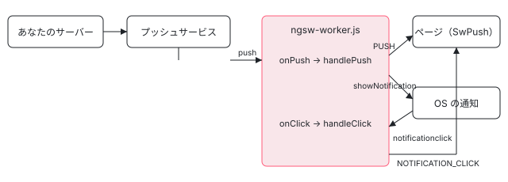

[目次](../README.md) › [Service Worker の内側](README.md) › 第 16 回 / 全 20 回

# プッシュ通知：SwPush と push・notificationclick

> アプリの側の SwPush（requestSubscription・subscription・messages・notificationClicks・notificationCloses・pushSubscriptionChanges・unsubscribe、push.ts）と、ワーカーの側の onPush・handlePush（決まった 15 個の欄だけを showNotification に渡す）、onClick・handleClick が notification.data.onActionClick の operation（openWindow・focusLastFocusedOrOpen・navigateLastFocusedOrOpen・sendRequest）を実行する行。強制リロードで止まる issue #48702。

angular/angular · 読了 約 12 分 · 中核 · [サイトで読む（デモが動きます）](https://angular-deep-dive-cyan.vercel.app/chapter/sw-push)

---

プッシュ通知は、ページが閉じていてもサーバーからワーカーを起こして通知を出す仕組みです。Angular の側でしていることは 2 つだけです。ワーカーの側は **push を受けたら `notification` の欄をそのまま `showNotification` に渡し、クリックされたら `data.onActionClick` に書かれた operation を実行する**。ページの側の `SwPush` は、ブラウザの `PushManager` を包み、ワーカーからの知らせを Observable にする。この章では両方を 1 行ずつ読み、4 つの operation の違いを本物のワーカーで表にします。

読む対象は `packages/service-worker/src/push.ts` と、`worker/src/driver.ts` の `NOTIFICATION_OPTION_NAMES`・`onPush`・`handlePush`・`handleClick`・`handleClose`・`handlePushSubscriptionChange` です。

1. [1. 全体像](01-sw-overview.md)
2. [2. Generator](02-sw-config-generator.md)
3. [3. ビルド](03-sw-cli-build.md)
4. [4. 登録](04-sw-register.md)
5. [5. Driver の起動](05-sw-driver-lifecycle.md)
6. [6. fetch の横取り](06-sw-driver-fetch.md)
7. [7. 版とタブ](07-sw-versions.md)
8. [8. アセット](08-sw-asset-groups.md)
9. [9. ハッシュ](09-sw-hash-integrity.md)
10. [10. データ](10-sw-data-groups.md)
11. [11. 小さな DB](11-sw-database.md)
12. [12. 更新の確認](12-sw-update-check.md)
13. [13. SwUpdate](13-sw-swupdate.md)
14. [14. アイドルと掃除](14-sw-idle-cleanup.md)
15. [15. 壊れたとき](15-sw-safe-mode.md)
16. **16. プッシュ**（この章）
17. [17. デバッグ](17-sw-debug.md)
18. [18. ワーカーのテスト](18-sw-testing-harness.md)
19. [19. アプリ側のテスト](19-sw-testing-app.md)
20. [20. issue と PR を読む](20-sw-issues.md)

> [!TIP]
> **新卒エンジニアへ**
>
> Web Push の登場人物は 3 つです。**ブラウザの `PushManager`**（購読を作り、送り先の URL と鍵を返す）、**プッシュサービス**（ブラウザの会社が持つ中継のサーバー）、**あなたのサーバー**（購読の情報を保存し、VAPID の秘密鍵で署名して中継に送る）。中継から届いたものは、ページではなく Service Worker の `push` イベントに来ます。Angular はこのうち「ブラウザの中」の 2 か所だけを受け持ちます。



*push は中継からワーカーへ、クリックは OS の通知からワーカーへ届く。ページ（SwPush）にはワーカーが postMessage で知らせる。*

## 1. ワーカーの側：4 つのイベントの入口

📄 `angular/packages/service-worker/worker/src/driver.ts` L331–354 （▶ の行: 333–334, 338, 343, 348, 353）

```ts
331 │   private onPush(msg: PushEvent): void {
332 │     // Push notifications without data have no effect.
333 ▶     if (!msg.data) {
334 ▶       return;
335 │     }
336 │ 
337 │     // Handle the push and keep the SW alive until it's handled.
338 ▶     msg.waitUntil(this.handlePush(msg.data.json()));
339 │   }
340 │ 
341 │   private onClick(event: NotificationEvent): void {
342 │     // Handle the click event and keep the SW alive until it's handled.
343 ▶     event.waitUntil(this.handleClick(event.notification, event.action));
344 │   }
345 │ 
346 │   private onClose(event: NotificationEvent): void {
347 │     // Handle the close event and keep the SW alive until it's handled.
348 ▶     event.waitUntil(this.handleClose(event.notification, event.action));
349 │   }
350 │ 
351 │   private onPushSubscriptionChange(event: PushSubscriptionChangeEvent): void {
352 │     // Handle the pushsubscriptionchange event and keep the SW alive until it's handled.
353 ▶     event.waitUntil(this.handlePushSubscriptionChange(event));
354 │   }
```

4 つとも「`waitUntil` に `handle〇〇` の Promise を渡す」だけです（登録はコンストラクタ。[第 5 回](05-sw-driver-lifecycle.md)）。333〜335 行目、本文（data）の無い push は何もしません。338 行目、本文は `msg.data.json()` で **JSON として**読みます。JSON でない文字列を送ると、ここで例外になります。fetch や message と違い、**ここには `state` の確かめも `ensureInitialized` もありません**。SAFE\_MODE（[第 15 回](15-sw-safe-mode.md)）でも通知は出ます。

## 2. handlePush：PUSH を流してから通知を出す

📄 `angular/packages/service-worker/worker/src/driver.ts` L410–424 （▶ の行: 411–413, 415–416, 418, 420–421, 423）

```ts
410 │   private async handlePush(data: any): Promise<void> {
411 ▶     await this.broadcast({
412 ▶       type: 'PUSH',
413 ▶       data,
414 │     });
415 ▶     if (!data.notification || !data.notification.title) {
416 ▶       return;
417 │     }
418 ▶     const desc = data.notification as {[key: string]: string | undefined};
419 │     let options: {[key: string]: string | undefined} = {};
420 ▶     NOTIFICATION_OPTION_NAMES.filter((name) => Object.hasOwn(desc, name)).forEach(
421 ▶       (name) => (options[name] = desc[name]),
422 │     );
423 ▶     await this.scope.registration.showNotification(desc['title']!, options);
424 │   }
```

1. **411〜414 行目：まず全部のタブに `{ type: 'PUSH', data }`**

   本文の全体です。`notification` が無くても流れます。ページの側の `SwPush.messages` がこれです（5 節）。
2. **415〜417 行目：`notification.title` が無ければ通知は出さない**

   「データだけの push」はこの形です。タブが 1 つも開いていなければ、誰にも見えずに終わります。
3. **418〜422 行目：決まった名前の欄だけを写す**

   420 行目、`Object.hasOwn` で、次の `NOTIFICATION_OPTION_NAMES` にある名前だけを `options` に入れます。
4. **423 行目：`registration.showNotification(title, options)`**

📄 `angular/packages/service-worker/worker/src/driver.ts` L43–59 （▶ の行: 44, 47, 55, 57）

```ts
43 │ const NOTIFICATION_OPTION_NAMES = [
44 ▶   'actions',
45 │   'badge',
46 │   'body',
47 ▶   'data',
48 │   'dir',
49 │   'icon',
50 │   'image',
51 │   'lang',
52 │   'renotify',
53 │   'requireInteraction',
54 │   'silent',
55 ▶   'tag',
56 │   'timestamp',
57 ▶   'title',
58 │   'vibrate',
59 │ ] as (keyof Notification)[];
```

15 個です。`actions`（44 行目。ボタン）、`data`（47 行目。operation を入れる場所）、`tag`（55 行目）、`title`（57 行目）など。ここに無い名前（たとえば `unknownField`）は捨てられます。`title` も入っているので、`options.title` にも題名が残ります。

サーバーが送る本文の形はこうなります（デモ 1 の初期値と同じ）:

📄 `push の本文（JSON）`

```
{
  "notification": {
    "title": "新着メッセージ",
    "body": "1 件届いています",
    "icon": "/icon.png",
    "unknownField": "これは通知に渡らない",
    "data": {
      "onActionClick": {
        "default": { "operation": "navigateLastFocusedOrOpen", "url": "/inbox?id=1" }
      }
    }
  }
}
```

## 3. handleClick：operation を選ぶ

📄 `angular/packages/service-worker/worker/src/driver.ts` L426–441 （▶ の行: 427, 432–433, 436, 438, 440）

```ts
426 │   private async handleClick(notification: Notification, action?: string): Promise<void> {
427 ▶     notification.close();
428 │ 
429 │     const options: {-readonly [K in keyof Notification]?: Notification[K]} = {};
430 │     // The filter uses `name in notification` because the properties are on the prototype so
431 │     // hasOwnProperty does not work here
432 ▶     NOTIFICATION_OPTION_NAMES.filter((name) => name in notification).forEach(
433 ▶       (name) => (options[name] = notification[name]),
434 │     );
435 │ 
436 ▶     const notificationAction = action === '' || action === undefined ? 'default' : action;
437 │ 
438 ▶     const onActionClick = notification?.data?.onActionClick?.[notificationAction];
439 │ 
440 ▶     const urlToOpen = new URL(onActionClick?.url ?? '', this.scope.registration.scope).href;
441 │ 
```

1. **427 行目：まず通知を閉じる**
2. **429〜434 行目：通知の欄を写し直す**

   今度は `name in notification` です。430〜431 行目のコメントのとおり、`Notification` の欄はプロトタイプの getter なので `hasOwn` では取れません。
3. **436 行目：ボタンでなく本文をクリックしたら `'default'`**

   ブラウザは本文のクリックの `event.action` を空文字にします。
4. **438 行目：`notification.data.onActionClick[action]` を引く**

   ボタンの `action` の名前で引きます。`'reply'` ボタンを押したのに `onActionClick.reply` が無ければ、`default` にはフォールバックしません（`undefined` のまま）。
5. **440 行目：URL をスコープから解決する**

   `new URL(url ?? '', scope)` なので、`'inbox'` はスコープの下、`'/inbox'` はオリジンの直下、`https://other.example/` はそのまま。url が無ければスコープそのものです。

📄 `angular/packages/service-worker/worker/src/driver.ts` L442–477 （▶ の行: 443–444, 447, 449, 451, 456, 458–459, 461, 466, 469, 473–475）

```ts
442 │     switch (onActionClick?.operation) {
443 ▶       case 'openWindow':
444 ▶         await this.scope.clients.openWindow(urlToOpen);
445 │         break;
446 │       case 'focusLastFocusedOrOpen': {
447 ▶         let matchingClient = await this.getLastFocusedMatchingClient(this.scope);
448 │         if (matchingClient) {
449 ▶           await matchingClient?.focus();
450 │         } else {
451 ▶           await this.scope.clients.openWindow(urlToOpen);
452 │         }
453 │         break;
454 │       }
455 │       case 'navigateLastFocusedOrOpen': {
456 ▶         let matchingClient = await this.getLastFocusedMatchingClient(this.scope);
457 │         if (matchingClient) {
458 ▶           matchingClient = await matchingClient.navigate(urlToOpen);
459 ▶           await matchingClient?.focus();
460 │         } else {
461 ▶           await this.scope.clients.openWindow(urlToOpen);
462 │         }
463 │         break;
464 │       }
465 │       case 'sendRequest': {
466 ▶         await this.scope.fetch(urlToOpen);
467 │         break;
468 │       }
469 ▶       default:
470 │         break;
471 │     }
472 │ 
473 ▶     await this.broadcast({
474 ▶       type: 'NOTIFICATION_CLICK',
475 ▶       data: {action, notification: options},
476 │     });
477 │   }
```

| operation | タブがあるとき | タブが無いとき |
| --- | --- | --- |
| `openWindow` | 444 行目：いつも新しい窓で `urlToOpen` |   |
| `focusLastFocusedOrOpen` | 449 行目：そのタブに `focus()`（URL は変えない） | 451 行目：`openWindow` |
| `navigateLastFocusedOrOpen` | 458〜459 行目：`navigate(url)` してから `focus()` | 461 行目：`openWindow` |
| `sendRequest` | 466 行目：`scope.fetch(urlToOpen)`（GET。窓は開かない） |   |
| それ以外・無し | 469〜471 行目：何もしない |   |

どの場合も、最後に 473〜476 行目で全部のタブに `{ type: 'NOTIFICATION_CLICK', data: { action, notification } }` を送ります。`action` は 436 行目で直す**前**の値（本文のクリックなら空文字）です。

📄 `angular/packages/service-worker/worker/src/driver.ts` L522–529 （▶ の行: 525, 527–528）

```ts
522 │   private async getLastFocusedMatchingClient(
523 │     scope: ServiceWorkerGlobalScope,
524 │   ): Promise<WindowClient | null> {
525 ▶     const windowClients = await scope.clients.matchAll({type: 'window'});
526 │ 
527 ▶     // As per the spec windowClients are `sorted in the most recently focused order`
528 ▶     return windowClients[0];
529 │   }
```

「最後にフォーカスしたタブ」は、525 行目の `matchAll({type: 'window'})` の先頭です。527 行目のコメントのとおり、仕様がこの順（最近フォーカスした順）を決めています。タブが無ければ 528 行目は `undefined` を返し、447〜448 行目の `if` で `openWindow` の側に行きます。なお、`matchAll` は既定で**このワーカーが受け持っているタブ**だけを返すので、強制リロードしたタブ（[第 13 回](13-sw-swupdate.md)）は数に入りません。

> [!WARNING]
> **ハマりどころ**
>
> 466 行目の `sendRequest` は `safeFetch` ではなく `scope.fetch` を直接 `await` し、`try` もありません。ネットワークが無くて fetch が reject すると、そこで `handleClick` が終わり、473 行目の `NOTIFICATION_CLICK` は送られません。デモの偽物のサーバーを offline にすると、そのとおり `PUSH` しか届きませんでした（2026-11-03、Node）。

## 4. 閉じたとき・購読が変わったとき

📄 `angular/packages/service-worker/worker/src/driver.ts` L490–520 （▶ の行: 491–492, 496–497, 514, 516–517）

```ts
490 │   private async handleClose(notification: Notification, action: string): Promise<void> {
491 ▶     const options: {-readonly [K in keyof Notification]?: Notification[K]} = {};
492 ▶     NOTIFICATION_OPTION_NAMES.filter((name) => name in notification).forEach(
493 │       (name) => (options[name] = notification[name]),
494 │     );
495 │ 
496 ▶     await this.broadcast({
497 ▶       type: 'NOTIFICATION_CLOSE',
498 │       data: {action, notification: options},
499 │     });
500 │   }
501 │ 
502 │   /**
503 │    * Handles changes to the push subscription by capturing the old and new
504 │    * subscription details and broadcasting a `PUSH_SUBSCRIPTION_CHANGE` message.
505 │    *
506 │    * This method is triggered when the browser invalidates an existing push
507 │    * subscription and creates a new one, which can happen without user interaction.
508 │    * It ensures that clients listening for service worker events are informed
509 │    * of the subscription update.
510 │    *
511 │    * @param event - The `PushSubscriptionChangeEvent` containing the old and new subscriptions.
512 │    */
513 │   private async handlePushSubscriptionChange(event: PushSubscriptionChangeEvent): Promise<void> {
514 ▶     const {oldSubscription, newSubscription} = event;
515 │ 
516 ▶     await this.broadcast({
517 ▶       type: 'PUSH_SUBSCRIPTION_CHANGE',
518 │       data: {oldSubscription, newSubscription},
519 │     });
520 │   }
```

通知を閉じたとき（`notificationclose`）は 496〜499 行目で `NOTIFICATION_CLOSE` を送るだけです。operation はありません。ブラウザが購読を作り直したとき（`pushsubscriptionchange`）は 516〜519 行目で古い購読と新しい購読を `PUSH_SUBSCRIPTION_CHANGE` で送ります。この 2 つは 2025-05 の #61442 と 2025-06 の #61856 で入った新しい行です（`git log -S NOTIFICATION_CLOSE`・`-S PUSH_SUBSCRIPTION_CHANGE`）。

## 5. ページの側：SwPush の Observable

📄 `angular/packages/service-worker/src/push.ts` L179–201 （▶ の行: 180–181, 185, 189, 191–193, 195, 199）

```ts
179 │   constructor(private sw: NgswCommChannel) {
180 ▶     if (!sw.isEnabled) {
181 ▶       this.messages = NEVER;
182 │       this.notificationClicks = NEVER;
183 │       this.notificationCloses = NEVER;
184 │       this.pushSubscriptionChanges = NEVER;
185 ▶       this.subscription = NEVER;
186 │       return;
187 │     }
188 │ 
189 ▶     this.messages = this.sw.eventsOfType<PushEvent>('PUSH').pipe(map((message) => message.data));
190 │ 
191 ▶     this.notificationClicks = this.sw
192 ▶       .eventsOfType('NOTIFICATION_CLICK')
193 ▶       .pipe(map((message: any) => message.data));
194 │ 
195 ▶     this.notificationCloses = this.sw
196 │       .eventsOfType('NOTIFICATION_CLOSE')
197 │       .pipe(map((message: any) => message.data));
198 │ 
199 ▶     this.pushSubscriptionChanges = this.sw
200 │       .eventsOfType('PUSH_SUBSCRIPTION_CHANGE')
201 │       .pipe(map((message: any) => message.data));
```

180〜187 行目、無効なら全部 `NEVER` です（`SwUpdate` と同じ）。189 行目の `messages` は `PUSH` の `data`（push の本文の全体）、191〜193 行目の `notificationClicks` は `NOTIFICATION_CLICK` の `data`（`{ action, notification }`）、195 行目と 199 行目が閉じたときと購読が変わったときです。どれも `NgswCommChannel.eventsOfType` で絞って `data` を取り出すだけです（[第 13 回](13-sw-swupdate.md)の 3〜4 節）。

📄 `angular/packages/service-worker/src/push.ts` L203–221 （▶ の行: 203, 206, 210–211, 213–215）

```ts
203 ▶     this.pushManager = this.sw.registration.pipe(
204 │       map(
205 │         (registration) =>
206 ▶           (registration as ServiceWorkerRegistration & {pushManager: PushManager}).pushManager,
207 │       ),
208 │     );
209 │ 
210 ▶     const workerDrivenSubscriptions = this.pushManager.pipe(
211 ▶       switchMap((pm) => pm.getSubscription()),
212 │     );
213 ▶     this.subscription = new Observable((subscriber) => {
214 ▶       const workerDrivenSubscription = workerDrivenSubscriptions.subscribe(subscriber);
215 ▶       const subscriptionChanges = this.subscriptionChanges.subscribe(subscriber);
216 │       return () => {
217 │         workerDrivenSubscription.unsubscribe();
218 │         subscriptionChanges.unsubscribe();
219 │       };
220 │     });
221 │   }
```

1. **203〜208 行目：`pushManager` は `registration` から取る**

   `registration` は `worker`（`controller`）が値を出したときに `getRegistration()` で取るものでした（第 13 回 3 節）。
2. **210〜212 行目：今の購読を `getSubscription()` で聞く**
3. **213〜220 行目：`subscription` は 2 本をつないだもの**

   214 行目の「ワーカーが変わるたびに聞いた今の購読」と、215 行目の「このタブで購読した・やめたときに自分で流す値」です。

> [!WARNING]
> **ハマりどころ**
>
> **issue #48702（2023-01、open）**：強制リロードのあと `SwPush.subscription` も `requestSubscription()` も何も返さない。203 行目の `registration` は `worker` からしか作られず、強制リロードでは `controller` が `null` のままなので（第 13 回 2 節）、`pushManager` が出ず、210 行目も 243 行目も先に進みません。登録自体は生きているので、`navigator.serviceWorker.getRegistration()` を直接呼べば取れます。issue のコメントにもその直し方の案（`controller` が `null` でも `getRegistration()` を呼ぶ）があります。PR は見当たりませんでした（2026-11-03、`gh pr list --search 48702`）。

## 6. requestSubscription と unsubscribe

📄 `angular/packages/service-worker/src/push.ts` L230–254 （▶ の行: 231–232, 234–236, 238, 240, 244–245, 248–249）

```ts
230 │   requestSubscription(options: {serverPublicKey: string}): Promise<PushSubscription> {
231 ▶     if (!this.sw.isEnabled || this.pushManager === null) {
232 ▶       return Promise.reject(new Error(ERR_SW_NOT_SUPPORTED));
233 │     }
234 ▶     const pushOptions: PushSubscriptionOptionsInit = {userVisibleOnly: true};
235 ▶     let key = this.decodeBase64(options.serverPublicKey.replace(/_/g, '/').replace(/-/g, '+'));
236 ▶     let applicationServerKey = new Uint8Array(new ArrayBuffer(key.length));
237 │     for (let i = 0; i < key.length; i++) {
238 ▶       applicationServerKey[i] = key.charCodeAt(i);
239 │     }
240 ▶     pushOptions.applicationServerKey = applicationServerKey;
241 │ 
242 │     return new Promise((resolve, reject) => {
243 │       this.pushManager!.pipe(
244 ▶         switchMap((pm) => pm.subscribe(pushOptions)),
245 ▶         take(1),
246 │       ).subscribe({
247 │         next: (sub) => {
248 ▶           this.subscriptionChanges.next(sub);
249 ▶           resolve(sub);
250 │         },
251 │         error: reject,
252 │       });
253 │     });
254 │   }
```

1. **234 行目：`userVisibleOnly: true` を固定**

   Chrome は「必ず通知を見せる」約束の無い購読を許しません。Angular の側で変える口はありません。
2. **235〜240 行目：VAPID の公開鍵を base64url からバイト列へ**

   `_` を `/` に、`-` を `+` に直して普通の base64 にし、295〜297 行目の `decodeBase64`（中身は `atob`）で文字列に、236〜239 行目で 1 文字 1 バイトの `Uint8Array` にします。
3. **243〜245 行目：`pm.subscribe(options)` を 1 回**

   ここで初めてブラウザが通知の許可を聞きます（まだ聞いていなければ）。
4. **248 行目：`subscription` に新しい購読を流す**

   この購読の中身（送り先の URL と鍵）を、あなたのサーバーに送って保存するのはアプリの仕事です。

📄 `angular/packages/service-worker/src/push.ts` L262–298 （▶ の行: 263, 268, 270, 276–277, 279, 284, 290, 296）

```ts
262 │   unsubscribe(): Promise<void> {
263 ▶     if (!this.sw.isEnabled) {
264 │       return Promise.reject(new Error(ERR_SW_NOT_SUPPORTED));
265 │     }
266 │ 
267 │     const doUnsubscribe = (sub: PushSubscription | null) => {
268 ▶       if (sub === null) {
269 │         throw new RuntimeError(
270 ▶           RuntimeErrorCode.NOT_SUBSCRIBED_TO_PUSH_NOTIFICATIONS,
271 │           (typeof ngDevMode === 'undefined' || ngDevMode) &&
272 │             'Not subscribed to push notifications.',
273 │         );
274 │       }
275 │ 
276 ▶       return sub.unsubscribe().then((success) => {
277 ▶         if (!success) {
278 │           throw new RuntimeError(
279 ▶             RuntimeErrorCode.PUSH_SUBSCRIPTION_UNSUBSCRIBE_FAILED,
280 │             (typeof ngDevMode === 'undefined' || ngDevMode) && 'Unsubscribe failed!',
281 │           );
282 │         }
283 │ 
284 ▶         this.subscriptionChanges.next(null);
285 │       });
286 │     };
287 │ 
288 │     return new Promise((resolve, reject) => {
289 │       this.subscription
290 ▶         .pipe(take(1), switchMap(doUnsubscribe))
291 │         .subscribe({next: resolve, error: reject});
292 │     });
293 │   }
294 │ 
295 │   private decodeBase64(input: string): string {
296 ▶     return atob(input);
297 │   }
298 │ }
```

290 行目、今の購読を 1 つ取り、268〜274 行目で無ければ 5602（`NOT_SUBSCRIBED_TO_PUSH_NOTIFICATIONS`）、276 行目でブラウザの `unsubscribe()` を呼び、`false` なら 279 行目の 5603 です。成功したら 284 行目で `null` を流します。サーバーに保存した購読を消すのも、アプリの仕事です。

## 7. DEMO：通知を出し、クリックする

> **🧪 DEMO 1 — 書いた本文で push する**
>
> **本物の ngsw-worker.js（@angular/service-worker 22.1.6）を偽物のブラウザの上で動かしています**。偽物の `registration.showNotification` は呼ばれた引数を記録するだけで、このページは本物の通知を出しません（`sw-sandbox.ts` の先頭のコメント）。アプリの側の `SwPush` は動かしません。購読を作るには本物のブラウザの `PushManager` と本物の Service Worker の登録が要るからです。
>
> ▶ [このデモはサイトで動かせます](https://angular-deep-dive-cyan.vercel.app/chapter/sw-push)

初期値のまま押すと、`options` から `unknownField` が消え（2 節の 420 行目）、タブには `unknownField` を含んだ本文の全体が `PUSH` で届きます（411〜414 行目）。`"notification"` を消して押すと、`showNotification` は呼ばれず `PUSH` だけが届きます（415〜417 行目）。

> **🧪 DEMO 2 — operation ごとに、クリックで何が起きるか**
>
> 1 行ごとに新しいワーカーを作り、`onActionClick.default` に operation を入れた通知を push → 記録された `options` で `notificationclick` を起こします。「窓を開いた」は偽物の `clients.openWindow` の記録、「タブの動き」は偽物のタブの `focus`・`navigate` の記録、「サーバーに届いた」は偽物のサーバーの log です。
>
> ▶ [このデモはサイトで動かせます](https://angular-deep-dive-cyan.vercel.app/chapter/sw-push)

Node で同じ手順を動かした結果（2026-11-03）は 3 節の表のとおりでした。`navigateLastFocusedOrOpen` でタブがあると `navigate /inbox?id=1 → focus`、url を `inbox`（相対）にした `openWindow` は `/inbox`（スコープが `/` なので）、`action` を `reply` にした行は `onActionClick.reply` が無いので何もせず、`NOTIFICATION_CLICK` だけが届きます。

## 8. ここまでを 1 本に

- 👤 `swPush.requestSubscription({serverPublicKey})` — アプリのコード
  - `pushManager.subscribe({userVisibleOnly, applicationServerKey})` — push.ts L244 — *購読をサーバーへ送るのはアプリ*
- `push イベント` — ブラウザ — *中継から*
  - `Driver.onPush → handlePush` — driver.ts L331・L410
    - `broadcast(PUSH)` — driver.ts L411 — *→ SwPush.messages*
    - `showNotification(title, options)` — driver.ts L423
- `notificationclick イベント` — ブラウザ
  - `Driver.onClick → handleClick` — driver.ts L341・L426
    - `onActionClick[action] の operation` — driver.ts L442-L471 — *openWindow / focus / navigate / sendRequest*
    - `broadcast(NOTIFICATION_CLICK)` — driver.ts L473 — *→ SwPush.notificationClicks*

## テストと直し方

### spec と describe

| spec | describe / it | 件数 |
| --- | --- | --- |
| test/comm\_spec.ts | `SwPush`（166 行目）：`requestSubscription()`（186）・`unsubscribe()`（228）・`messages`（317）・`notificationClicks`（337）・`notificationCloses`（356）・`subscription`（372）・`with no SW`（427） | 18 |
| worker/test/happy\_spec.ts | `Driver` の `shows notifications for push notifications`（714）・`notification click events`（742。operation ごとの describe と `URL resolution`）・`notification close events`（1234） | 22 |

📄 `angular/packages/service-worker/worker/test/happy_spec.ts` L714–740 （▶ の行: 717, 723, 726, 729, 731）

```ts
714 │     it('shows notifications for push notifications', async () => {
715 │       expect(await makeRequest(scope, '/foo.txt')).toEqual('this is foo');
716 │       await driver.initialized;
717 ▶       await scope.handlePush({
718 │         notification: {
719 │           title: 'This is a test',
720 │           body: 'Test body',
721 │         },
722 │       });
723 ▶       expect(scope.notifications).toEqual([
724 │         {
725 │           title: 'This is a test',
726 ▶           options: {title: 'This is a test', body: 'Test body'},
727 │         },
728 │       ]);
729 ▶       expect(scope.clients.getMock('default')!.messages).toEqual([
730 │         {
731 ▶           type: 'PUSH',
732 │           data: {
733 │             notification: {
734 │               title: 'This is a test',
735 │               body: 'Test body',
736 │             },
737 │           },
738 │         },
739 │       ]);
740 │     });
```

717 行目の `scope.handlePush` はハーネスが `push` のイベントを作って流すものです（[第 18 回](18-sw-testing-harness.md)）。723〜728 行目が `showNotification` の記録、729〜739 行目がタブに届いた `PUSH` で、デモ 1 と同じものを見ています。726 行目、`options` にも `title` が入ることがここでも分かります。

📄 `angular/packages/service-worker/worker/test/happy_spec.ts` L1126–1150 （▶ の行: 1128, 1141, 1147–1148）

```ts
1126 │         describe('URL resolution', () => {
1127 │           it('should resolve relative to service worker scope', async () => {
1128 ▶             (scope.registration.scope as string) = 'http://localhost/foo/bar/';
1129 │ 
1130 │             expect(await makeRequest(scope, '/foo.txt')).toEqual('this is foo');
1131 │ 
1132 │             spyOn(scope.clients, 'openWindow');
1133 │ 
1134 │             await driver.initialized;
1135 │             await scope.handleClick(
1136 │               {
1137 │                 title: 'This is a test with a relative url',
1138 │                 body: 'Test body with a relative url',
1139 │                 data: {
1140 │                   onActionClick: {
1141 ▶                     foo: {operation: 'openWindow', url: 'baz/qux'},
1142 │                   },
1143 │                 },
1144 │               },
1145 │               'foo',
1146 │             );
1147 ▶             expect(scope.clients.openWindow).toHaveBeenCalledWith(
1148 ▶               'http://localhost/foo/bar/baz/qux',
1149 │             );
1150 │           });
```

1128 行目でスコープを `/foo/bar/` にし、相対の `baz/qux` が 1148 行目のとおりスコープの下に解決されることを確かめます（3 節の 440 行目）。

📄 `angular/packages/service-worker/test/comm_spec.ts` L195–217 （▶ の行: 201–203, 209, 211, 216）

```ts
195 │       it('calls `PushManager.subscribe()` (with appropriate options)', async () => {
196 │         const decode = (charCodeArr: Uint8Array) =>
197 │           Array.from(charCodeArr)
198 │             .map((c) => String.fromCharCode(c))
199 │             .join('');
200 │ 
201 ▶         // atob('c3ViamVjdHM/') === 'subjects?'
202 ▶         const serverPublicKey = 'c3ViamVjdHM_';
203 ▶         const appServerKeyStr = 'subjects?';
204 │ 
205 │         const pmSubscribeSpy = spyOn(MockPushManager.prototype, 'subscribe').and.callThrough();
206 │         await push.requestSubscription({serverPublicKey});
207 │ 
208 │         expect(pmSubscribeSpy).toHaveBeenCalledTimes(1);
209 ▶         expect(pmSubscribeSpy).toHaveBeenCalledWith({
210 │           applicationServerKey: jasmine.any(Uint8Array) as any,
211 ▶           userVisibleOnly: true,
212 │         });
213 │ 
214 │         const actualAppServerKey = pmSubscribeSpy.calls.first().args[0]!.applicationServerKey;
215 │         const actualAppServerKeyStr = decode(actualAppServerKey as Uint8Array);
216 ▶         expect(actualAppServerKeyStr).toBe(appServerKeyStr);
217 │       });
```

202 行目の鍵 `c3ViamVjdHM_` は base64url で、235 行目の置き換えで `c3ViamVjdHM/` になり、`atob` で `subjects?` になります（201 行目のコメント）。この describe は `beforeAll` で `patchDecodeBase64` を呼び、295 行目の `decodeBase64` を差し替えてから動きます（そこのコメントは「Node.js には `atob` が無いため」と書いています）。

📄 `angular/packages/service-worker/test/comm_spec.ts` L337–354 （▶ の行: 340, 347–348, 352）

```ts
337 │     describe('notificationClicks', () => {
338 │       it('receives notification clicked messages', () => {
339 │         const sendMessage = (type: string, action: string) =>
340 ▶           mock.sendMessage({type, data: {action}});
341 │ 
342 │         const receivedMessages: string[] = [];
343 │         push.notificationClicks.subscribe((msg: {action: string}) =>
344 │           receivedMessages.push(msg.action),
345 │         );
346 │ 
347 ▶         sendMessage('NOTIFICATION_CLICK', 'this was a click');
348 ▶         sendMessage('NOT_IFICATION_CLICK', 'this was not a click');
349 │         sendMessage('NOTIFICATION_CLICK', 'this was a click too');
350 │         sendMessage('KCILC_NOITACIFITON', 'this was a KCILC_NOITACIFITON message');
351 │ 
352 ▶         expect(receivedMessages).toEqual(['this was a click', 'this was a click too']);
353 │       });
354 │     });
```

ページの側は、ワーカーを動かさず `mock.sendMessage` で `NOTIFICATION_CLICK` を直接流し、似た名前の type が混ざらないことだけを確かめます（191〜193 行目の絞り込み）。

### 手元で走らせた結果

📄 `ターミナル（../angular で）`

```
cd ~/angular-research/angular
pnpm bazel test //packages/service-worker/test:test --nocache_test_results --test_output=all --test_arg=--filter=SwPush
pnpm bazel test //packages/service-worker/worker/test:test --nocache_test_results --test_output=all \
  "--test_arg=--filter=Driver (shows notifications for push|notification click events|notification close events)"
```

📄 `出力（2026-11-03 に実行。抜粋。ログは scratchpad/sw-logs/d-push-app.log・d-push-worker.log）`

```
### //packages/service-worker/test:test filter=SwPush
Ran 18 of 41 specs
18 specs, 0 failures
Finished in 0.013 seconds
//packages/service-worker/test:test        PASSED in 0.6s

### //packages/service-worker/worker/test:test filter=Driver (shows notifications for push|...)
Ran 22 of 153 specs
22 specs, 0 failures
Finished in 0.025 seconds
//packages/service-worker/worker/test:test PASSED in 0.7s
```

### 直すとしたら

先に 1 つ断っておきます。このパッケージの PACKAGE.md は冒頭で「機能の限られた基本的なキャッシュの道具で、セキュリティの修正以外の新しい機能は受け付けない」と書いています（[第 1 回](01-sw-overview.md)）。新しい機能の PR は受け付けられず、不具合の直しも慎重に扱われます。下の入口は、手元で確かめることと issue を読むことのためのものです。

- **`pushSubscriptionChanges` と `PUSH_SUBSCRIPTION_CHANGE` の it がどちらの spec にもありません**（`grep -rn "PUSH_SUBSCRIPTION_CHANGE\|pushSubscriptionChanges" test worker/test` で 0 件）。足すなら comm\_spec の `SwPush` に `notificationCloses`（356 行目）と同じ形で、happy\_spec に `notification close events` と同じ形です。ハーネスに `pushsubscriptionchange` を流す口があるかは scope.ts を読んで確かめます（第 18 回）。
- `sendRequest` の fetch が失敗したときに `NOTIFICATION_CLICK` が出ない（3 節の warn）ことを確かめる it もありません。``describe('`sendRequest` operation')`` の隣で `server.online = false` にすれば作れます。直すなら `handleClick` の 465〜468 行目ですが、これが意図した動きかどうかは issue で確かめてからです（`gh search issues` では見つかりませんでした）。
- #48702 の入口は `low_level.ts` の `registration` の作り方で、`SwUpdate` の #44402 と同じ根です（第 13 回）。本家に PR を出すことは勧めません。issue を読むときの手がかりにします（[第 20 回](20-sw-issues.md)）。

## 聞かれそうな質問

**Q. 通知を出すのに、アプリ（ページ）のコードは要りますか？**

要りません。ワーカーが 423 行目で `showNotification` を呼びます。ページが要るのは購読を作るとき（`requestSubscription`）だけで、届いた通知は全部のタブが閉じていても出ます。サーバーが送る本文に `notification.title` があることが条件です（415 行目）。

**Q. 通知のクリックで特定の画面を開くには？**

本文の `notification.data.onActionClick.default` に `{ "operation": "navigateLastFocusedOrOpen", "url": "/inbox" }` のように書きます。開いているタブがあればそのタブを移して前に出し（458〜459 行目）、無ければ新しい窓を開きます（461 行目）。ボタンごとに変えるなら `actions` の各ボタンの `action` の名前をキーにします（438 行目）。

**Q. `notificationClicks` を購読していれば、クリックで画面遷移できますか？**

開いているタブがあれば届きます（473 行目の broadcast）。ただしタブが 1 つも無ければ受け取る人がいないので、画面を開くのは `onActionClick` の operation に任せるのが確実です。

**Q. 強制リロードのあと `SwPush.subscription` が何も出さないのはなぜ？**

`pushManager` を 203 行目で `registration` から取っていて、`registration` は `controller` が値を出したときにしか取られないからです。強制リロードでは `controller` が `null` のままです（#48702、第 13 回 2〜3 節）。

**Q. 本文に好きな欄を足すと、通知に出ますか？**

43〜59 行目の 15 個の名前だけが `showNotification` に渡ります（420 行目）。ほかの欄は通知には渡りませんが、411〜414 行目の `PUSH` にはそのまま入るので、`SwPush.messages` では読めます。

## 読み終えて

- ワーカーの push は「全部のタブに PUSH → `title` があれば決まった 15 個の欄で `showNotification`」。状態（SAFE\_MODE）も初期化も見ない。
- クリックは `data.onActionClick[action]`（本文なら `default`）の operation 4 つのどれか。URL はスコープから解決する。最後に NOTIFICATION\_CLICK を全部のタブへ。
- `SwPush` は `eventsOfType` の 4 本と、`registration` から取る `pushManager` の薄い包み。購読をサーバーに保存するのはアプリの仕事。
- 強制リロードで止まるのは `SwUpdate` と同じ根（`controller` が `null`）。

---

← 前: [壊れたときの状態：EXISTING\_CLIENTS\_ONLY・SAFE\_MODE・safety-worker](15-sw-safe-mode.md)  
次: [デバッグのページ：/ngsw/state と DebugHandler](17-sw-debug.md) →
