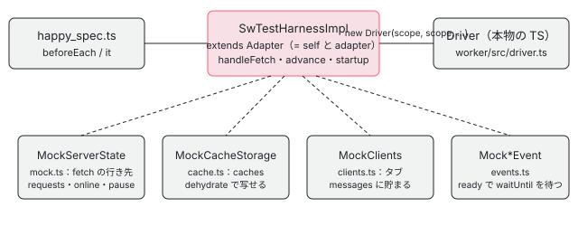

[目次](../README.md) › [Service Worker の内側](README.md) › 第 18 回 / 全 20 回

# ワーカーのテスト：SwTestHarness と偽物のブラウザ

> worker/testing/ の SwTestHarness（scope.ts）・MockServerState（mock.ts）・MockCacheStorage（cache.ts）・MockClients（clients.ts）・MockRequest と MockResponse（fetch.ts）・イベント（events.ts）で、Driver を Node の中で動かす仕組み。happy\_spec.ts の書き方（サーバーを作る、版を入れる、fetch を送る、時計を進める）と、このシリーズのデモの偽物との違い。

angular/angular · 読了 約 13 分 · 中核 · [サイトで読む（デモが動きます）](https://angular-deep-dive-cyan.vercel.app/chapter/sw-testing-harness)

---

ワーカーの spec（happy\_spec.ts など 5 つのファイル、153 本）は、ブラウザを使わずに Node の jasmine で走ります。この章では、そのために `worker/testing/` が用意している偽物のブラウザ（`SwTestHarness`・`MockServerState`・`MockCacheStorage`・`MockClients`・`MockRequest` と `MockResponse`・イベント）を 1 つずつ読み、happy\_spec.ts の 1 本が「サーバーを作る → Driver を作る → fetch を送る → 時計を進める → 確かめる」をどの行でしているかを追います。最後に、このシリーズのデモの偽物（sw-sandbox.ts）とどこが違うかを表にします。

読む対象は `packages/service-worker/worker/testing/` の `scope.ts`・`mock.ts`・`cache.ts`・`clients.ts`・`events.ts`・`fetch.ts`・`utils.ts` と、`worker/test/happy_spec.ts` の先頭と最後のヘルパーです。

1. [1. 全体像](01-sw-overview.md)
2. [2. Generator](02-sw-config-generator.md)
3. [3. ビルド](03-sw-cli-build.md)
4. [4. 登録](04-sw-register.md)
5. [5. Driver の起動](05-sw-driver-lifecycle.md)
6. [6. fetch の横取り](06-sw-driver-fetch.md)
7. [7. 版とタブ](07-sw-versions.md)
8. [8. アセット](08-sw-asset-groups.md)
9. [9. ハッシュ](09-sw-hash-integrity.md)
10. [10. データ](10-sw-data-groups.md)
11. [11. 小さな DB](11-sw-database.md)
12. [12. 更新の確認](12-sw-update-check.md)
13. [13. SwUpdate](13-sw-swupdate.md)
14. [14. アイドルと掃除](14-sw-idle-cleanup.md)
15. [15. 壊れたとき](15-sw-safe-mode.md)
16. [16. プッシュ](16-sw-push.md)
17. [17. デバッグ](17-sw-debug.md)
18. **18. ワーカーのテスト**（この章）
19. [19. アプリ側のテスト](19-sw-testing-app.md)
20. [20. issue と PR を読む](20-sw-issues.md)

> [!TIP]
> **新卒エンジニアへ**
>
> **ハーネス**（harness）は、テストの対象を本物の代わりの部品につないで動かすための道具一式のことです。ここでは「ワーカーのグローバル `self` のふりをするオブジェクト」とその周りの偽物を指します。`Driver` は `self` と `Adapter` と `Database` の 3 つを受け取るだけなので（[第 5 回](05-sw-driver-lifecycle.md)の入口の 3 行）、この 3 つを偽物にすれば Node の中で本物の Driver を動かせます。



*spec が組み立てるもの。SwTestHarness は self と Adapter の両方として Driver に渡る*

## 1. SwTestHarnessBuilder：サーバーとキャッシュを決めてから作る

📄 `angular/packages/service-worker/worker/testing/scope.ts` L27–54 （▶ の行: 27, 34, 36, 39–40, 44, 49–50, 54）

```ts
27 ▶ const EMPTY_SERVER_STATE = new MockServerStateBuilder().build();
28 │ 
29 │ export class SwTestHarnessBuilder {
30 │   private origin: string;
31 │   private server = EMPTY_SERVER_STATE;
32 │   private caches: MockCacheStorage;
33 │ 
34 ▶   constructor(private scopeUrl = 'http://localhost/') {
35 │     this.origin = parseUrl(this.scopeUrl).origin;
36 ▶     this.caches = new MockCacheStorage(this.origin);
37 │   }
38 │ 
39 ▶   withCacheState(cache: string): SwTestHarnessBuilder {
40 ▶     this.caches = new MockCacheStorage(this.origin, cache);
41 │     return this;
42 │   }
43 │ 
44 ▶   withServerState(state: MockServerState): SwTestHarnessBuilder {
45 │     this.server = state;
46 │     return this;
47 │   }
48 │ 
49 ▶   build(): SwTestHarness {
50 ▶     return new SwTestHarnessImpl(this.server, this.caches, this.scopeUrl) as SwTestHarness;
51 │   }
52 │ }
53 │ 
54 ▶ export type SwTestHarness = SwTestHarnessImpl & ServiceWorkerGlobalScope;
```

1. **27 行目：既定のサーバーは空**

   何も置いていない `MockServerState` を 1 つ作っておき、`withServerState` を呼ばなければそれを使います。
2. **34〜36 行目：スコープは http://localhost/**

   登録のスコープ（`registration.scope`）の既定は `http://localhost/`。そのオリジンで空の `MockCacheStorage` を作ります。
3. **39〜40 行目：withCacheState で「前のワーカーのキャッシュ」から始める**

   JSON の文字列から Cache Storage を作り直します。ワーカーを止めて起こし直す場面は、この形で書きます（8 節）。
4. **49〜54 行目：build と型**

   作るのは `SwTestHarnessImpl` ですが、54 行目で `SwTestHarnessImpl & ServiceWorkerGlobalScope` という型にしています。Driver のコンストラクタが求める `ServiceWorkerGlobalScope` の型に合わせるためで、中身が足りない所は使われないので困らない、という作りです。

## 2. SwTestHarnessImpl：self と Adapter を 1 つで兼ねる

📄 `angular/packages/service-worker/worker/testing/scope.ts` L56–85 （▶ の行: 57, 60–61, 64–67, 70–71, 75–76, 78–79, 83–84）

```ts
56 │ export class SwTestHarnessImpl
57 ▶   extends Adapter<MockCacheStorage>
58 │   implements Partial<ServiceWorkerGlobalScope>
59 │ {
60 ▶   readonly clients = new MockClients();
61 ▶   private eventHandlers = new Map<string, EventListener>();
62 │   private skippedWaiting = false;
63 │ 
64 ▶   private selfMessageQueue: any[] = [];
65 ▶   autoAdvanceTime = false;
66 ▶   unregistered: boolean = false;
67 ▶   readonly notifications: {title: string; options: Object}[] = [];
68 │   readonly registration: ServiceWorkerRegistration = {
69 │     active: {
70 ▶       postMessage: (msg: any) => {
71 ▶         this.selfMessageQueue.push(msg);
72 │       },
73 │     },
74 │     scope: this.scopeUrl,
75 ▶     showNotification: (title: string, options: Object) => {
76 ▶       this.notifications.push({title, options});
77 │     },
78 ▶     unregister: () => {
79 ▶       this.unregistered = true;
80 │     },
81 │   } as any;
82 │ 
83 ▶   override get time() {
84 ▶     return this.mockTime;
85 │   }
```

📄 `angular/packages/service-worker/worker/testing/scope.ts` L87–104 （▶ の行: 87, 89, 96, 103）

```ts
 87 ▶   private mockTime = Date.now();
 88 │ 
 89 ▶   private timers: {
 90 │     at: number;
 91 │     duration: number;
 92 │     fn: Function;
 93 │     fired: boolean;
 94 │   }[] = [];
 95 │ 
 96 ▶   override parseUrl = parseUrl;
 97 │ 
 98 │   constructor(
 99 │     private server: MockServerState,
100 │     caches: MockCacheStorage,
101 │     scopeUrl: string,
102 │   ) {
103 ▶     super(scopeUrl, caches);
104 │   }
```

1. **57 行目：Adapter を継ぐ**

   本物の `Adapter`（Request・Response・時刻・caches をまとめた層、[第 11 回](11-sw-database.md)）を継ぎ、103 行目で `super(scopeUrl, caches)` を呼びます。だから `scope.caches` は Adapter が包んだ `NamedCacheStorage`（名前に `ngsw:/:` を付けるもの）で、包む前の `MockCacheStorage` は `scope.caches.original` です（8 節の 516 行目）。
2. **60〜61 行目：タブとハンドラー**

   `clients` は `MockClients`（5 節）。`eventHandlers` は**Map**で、種類ごとに 1 つのハンドラーしか持ちません（3 節）。
3. **64・70〜71 行目：自分あての postMessage は列に貯める**

   Driver は activate のあと `registration.active.postMessage` で自分に「初期化して」を送ります（[第 5 回](05-sw-driver-lifecycle.md)）。ハーネスはそれを `selfMessageQueue` に積むだけで、spec が `resolveSelfMessages()` を呼んだときに流します（3 節）。
4. **65〜67・75〜80 行目：記録**

   `autoAdvanceTime`（6 節）、`unregister` されたか、`showNotification` の記録。404 で登録を外す spec（[第 15 回](15-sw-safe-mode.md)）やプッシュの spec（[第 16 回](16-sw-push.md)）はこれを見ます。
5. **83〜84・87・89・96 行目：時刻・タイマー・URL**

   Adapter の `time` を上書きして、87 行目の `mockTime`（作った瞬間の `Date.now()`）を返します。89 行目のタイマーの表と 6 節の `advance` で、この時刻だけを進めます。96 行目の `parseUrl` は utils.ts のもの（7 節）です。

## 3. install・activate とイベントの登録

📄 `angular/packages/service-worker/worker/testing/scope.ts` L106–134 （▶ の行: 107, 112, 118–119, 122, 124–126, 130–131, 133）

```ts
106 │   async resolveSelfMessages(): Promise<void> {
107 ▶     while (this.selfMessageQueue.length > 0) {
108 │       const queue = this.selfMessageQueue;
109 │       this.selfMessageQueue = [];
110 │       await queue.reduce(async (previous, msg) => {
111 │         await previous;
112 ▶         await this.handleMessage(msg, null);
113 │       }, Promise.resolve());
114 │     }
115 │   }
116 │ 
117 │   async startup(firstTime: boolean = false): Promise<boolean | null> {
118 ▶     if (!firstTime) {
119 ▶       return null;
120 │     }
121 │     let skippedWaiting: boolean = false;
122 ▶     if (this.eventHandlers.has('install')) {
123 │       const installEvent = new MockInstallEvent();
124 ▶       this.eventHandlers.get('install')!(installEvent);
125 ▶       await installEvent.ready;
126 ▶       skippedWaiting = this.skippedWaiting;
127 │     }
128 │     if (this.eventHandlers.has('activate')) {
129 │       const activateEvent = new MockActivateEvent();
130 ▶       this.eventHandlers.get('activate')!(activateEvent);
131 ▶       await activateEvent.ready;
132 │     }
133 ▶     return skippedWaiting;
134 │   }
```

1. **117〜120 行目：startup(true) だけが install と activate を送る**

   引数なしの `startup()` は何もせず `null` を返します。happy\_spec の多くの it は `startup` を呼ばず、最初の fetch で初期化させます（[第 5 回](05-sw-driver-lifecycle.md)の spec）。
2. **122〜126 行目：install**

   Driver が登録したハンドラーを `MockInstallEvent` で呼び、125 行目の `ready` で `waitUntil` に渡された Promise を全部待ちます。126 行目で、その間に `skipWaiting()` が呼ばれたかを返します。
3. **128〜131 行目：activate**

   同じ形で `MockActivateEvent`。ここで Driver が自分に送った postMessage は、まだ列に残っています。
4. **106〜115 行目：resolveSelfMessages**

   列を空になるまで 1 つずつ `handleMessage(msg, null)`（4 節）で流します。112 行目の `null` は「送り主のタブが無い」です。

📄 `angular/packages/service-worker/worker/testing/scope.ts` L136–174 （▶ の行: 137, 140, 142, 144–146, 155–156, 161）

```ts
136 │   updateServerState(server?: MockServerState): void {
137 ▶     this.server = server || EMPTY_SERVER_STATE;
138 │   }
139 │ 
140 ▶   fetch(req: RequestInfo): Promise<Response> {
141 │     if (typeof req === 'string') {
142 ▶       return this.server.fetch(new MockRequest(normalizeUrl(req, this.scopeUrl)));
143 │     } else {
144 ▶       const mockReq = req.clone() as MockRequest;
145 ▶       mockReq.url = normalizeUrl(mockReq.url, this.scopeUrl);
146 ▶       return this.server.fetch(mockReq);
147 │     }
148 │   }
149 │ 
150 │   addEventListener(
151 │     type: string,
152 │     listener: EventListenerOrEventListenerObject,
153 │     options?: boolean | AddEventListenerOptions,
154 │   ): void {
155 ▶     if (options !== undefined) {
156 ▶       throw new Error('Mock `addEventListener()` does not support `options`.');
157 │     }
158 │ 
159 │     const handler: EventListener =
160 │       typeof listener === 'function' ? listener : (evt) => listener.handleEvent(evt);
161 ▶     this.eventHandlers.set(type, handler);
162 │   }
163 │ 
164 │   removeEventListener(
165 │     type: string,
166 │     listener: EventListenerOrEventListenerObject,
167 │     options?: boolean | AddEventListenerOptions,
168 │   ): void {
169 │     if (options !== undefined) {
170 │       throw new Error('Mock `removeEventListener()` does not support `options`.');
171 │     }
172 │ 
173 │     this.eventHandlers.delete(type);
174 │   }
```

136〜138 行目の `updateServerState` は、サーバーを丸ごと差し替えます（v1 のサーバーから v2 のサーバーへ）。140〜148 行目の `fetch` が、Driver から見た `self.fetch` です。144 行目で Request を `clone()` し、145 行目で URL を正規化してから 146 行目でサーバーに渡します。161 行目の `eventHandlers.set` は同じ種類の 2 つ目のハンドラーで 1 つ目を**上書き**し、155〜156 行目で `options` 付きの登録は例外にします。Driver は種類ごとに 1 回しか登録しないので、これで足ります。

## 4. handleFetch と handleMessage：イベントを 1 つ送る

📄 `angular/packages/service-worker/worker/testing/scope.ts` L192–216 （▶ の行: 196, 201, 203–204, 208–209, 211–213, 215）

```ts
192 │   handleFetch(
193 │     req: Request,
194 │     clientId = '',
195 │     resultingClientId?: string,
196 ▶   ): [Promise<Response | undefined>, Promise<void>] {
197 │     if (!this.eventHandlers.has('fetch')) {
198 │       throw new Error('No fetch handler registered');
199 │     }
200 │ 
201 ▶     const isNavigation = req.mode === 'navigate';
202 │ 
203 ▶     if (clientId && !this.clients.getMock(clientId)) {
204 ▶       this.clients.add(clientId, isNavigation ? req.url : this.scopeUrl);
205 │     }
206 │ 
207 │     const event =
208 ▶       clientId && resultingClientId
209 ▶         ? new MockFetchEvent(req, clientId, resultingClientId)
210 │         : isNavigation
211 ▶           ? new MockFetchEvent(req, '', clientId)
212 ▶           : new MockFetchEvent(req, clientId, '');
213 ▶     this.eventHandlers.get('fetch')!.call(this, event);
214 │ 
215 ▶     return [event.response, event.ready];
216 │   }
```

1. **203〜205 行目：知らないタブは自動で作る**

   clientId のタブがまだ無ければ `clients.add` します。ナビゲーションならそのタブの URL はリクエストの URL、そうでなければスコープの URL です。
2. **207〜212 行目：clientId と resultingClientId**

   本物のブラウザでは、ナビゲーションの fetch の `clientId` は空で、これから開くタブの ID が `resultingClientId` に入ります。211 行目はそれをまねて、ナビゲーションなら渡された clientId を `resultingClientId` の側に置きます。ふつうのリクエストは 212 行目で clientId だけ。両方を渡したとき（208〜209 行目）は、ワーカーの中から出た fetch（`destination: 'worker'`）の spec で使います。
3. **213・215 行目：ハンドラーを呼んで 2 つの Promise を返す**

   `[event.response, event.ready]` の 1 つ目は `respondWith` に渡されたもの（呼ばれなければ `undefined` で解決）、2 つ目は `waitUntil` の全部が終わるまで。spec は 2 つ目を待ってから 1 つ目を読みます（8 節の `makeRequest`）。

📄 `angular/packages/service-worker/worker/testing/scope.ts` L218–234 （▶ の行: 223–224, 227–229, 231, 233）

```ts
218 │   handleMessage(data: Object, clientId: string | null): Promise<void> {
219 │     if (!this.eventHandlers.has('message')) {
220 │       throw new Error('No message handler registered');
221 │     }
222 │ 
223 ▶     if (clientId && !this.clients.getMock(clientId)) {
224 ▶       this.clients.add(clientId, this.scopeUrl);
225 │     }
226 │ 
227 ▶     const event = new MockExtendableMessageEvent(
228 ▶       data,
229 ▶       (clientId && this.clients.getMock(clientId)) || null,
230 │     );
231 ▶     this.eventHandlers.get('message')!.call(this, event);
232 │ 
233 ▶     return event.ready;
234 │   }
```

メッセージも同じ形で、227〜230 行目の `MockExtendableMessageEvent` の `source` がそのタブ（`MockClient`）になります。Driver の答え（`OPERATION_COMPLETED` など）は、そのタブの `messages` に貯まります（5 節）。同じ並びに `handleMessageError`・`handlePush`・`handleClick`・`handleClose`・`handleUnhandledRejection` があり、[第 17 回](17-sw-debug.md)の log の spec と、第 16 回のプッシュの spec が使います。

## 5. MockClients：タブの一覧

📄 `angular/packages/service-worker/worker/testing/clients.ts` L51–81 （▶ の行: 54–55, 57, 60, 66–67, 79–80）

```ts
51 │ export class MockClients implements Clients {
52 │   private clients = new Map<string, MockClient>();
53 │ 
54 ▶   add(clientId: string, url: string, type: ClientTypes = 'window'): void {
55 ▶     if (this.clients.has(clientId)) {
56 │       const existingClient = this.clients.get(clientId)!;
57 ▶       if (existingClient.url === url) {
58 │         return;
59 │       }
60 ▶       throw new Error(
61 │         `Trying to add mock client with same ID (${existingClient.id}) and different URL ` +
62 │           `(${existingClient.url} --> ${url})`,
63 │       );
64 │     }
65 │ 
66 ▶     const client =
67 ▶       type === 'window' ? new MockWindowClient(clientId, url) : new MockClient(clientId, url, type);
68 │     this.clients.set(clientId, client);
69 │   }
70 │ 
71 │   remove(clientId: string): void {
72 │     this.clients.delete(clientId);
73 │   }
74 │ 
75 │   async get(id: string): Promise<Client> {
76 │     return this.clients.get(id)!;
77 │   }
78 │ 
79 ▶   getMock(id: string): MockClient | undefined {
80 ▶     return this.clients.get(id);
81 │   }
```

54〜64 行目で、同じ ID のタブを違う URL で足そうとすると例外です。66〜67 行目の既定は `'window'` の `MockWindowClient` で、`focus` と `navigate` を持ち、`postMessage` されたものを `messages` の配列と `queue`（rxjs の Subject）に入れます。79〜81 行目の `getMock` は spec から偽物そのものを取り出す入口で、`scope.clients.getMock('default')!.messages` の形で「タブに何が届いたか」を見ます。`matchAll` は spec の決まりに合わせて、最後にフォーカスしたもの・新しく作ったものの順に並べます。

## 6. 時計：timeout と advance

📄 `angular/packages/service-worker/worker/testing/scope.ts` L296–322 （▶ の行: 296, 298–299, 301, 306–307, 313–314, 317, 319–320）

```ts
296 ▶   override timeout(ms: number): Promise<void> {
297 │     const promise = new Promise<void>((resolve) => {
298 ▶       this.timers.push({
299 ▶         at: this.mockTime + ms,
300 │         duration: ms,
301 ▶         fn: resolve,
302 │         fired: false,
303 │       });
304 │     });
305 │ 
306 ▶     if (this.autoAdvanceTime) {
307 ▶       this.advance(ms);
308 │     }
309 │ 
310 │     return promise;
311 │   }
312 │ 
313 ▶   advance(by: number): void {
314 ▶     this.mockTime += by;
315 │     this.timers
316 │       .filter((timer) => !timer.fired)
317 ▶       .filter((timer) => timer.at <= this.mockTime)
318 │       .forEach((timer) => {
319 ▶         timer.fired = true;
320 ▶         timer.fn();
321 │       });
322 │   }
```

1. **296〜304 行目：Adapter の timeout を上書き**

   Driver と IdleScheduler は待つときに必ず `adapter.timeout(ms)` を使うので（[第 14 回](14-sw-idle-cleanup.md)）、ここで「`mockTime + ms` に解決する」タイマーを表に積むだけにすれば、本物の時間は 1 ミリ秒も経ちません。
2. **306〜308 行目：autoAdvanceTime**

   true の間は、タイマーを積んだその場で時計を進めます。「アイドルの 5 秒を待たずに全部流したい」ときの近道です。
3. **313〜321 行目：advance は同期**

   `mockTime` を足し、期限が来たタイマーの `resolve` を呼ぶだけです。`advance` 自身は Promise を返さないので、そのあとの仕事（IdleScheduler の列など）が終わるのを待つには、spec の側で `await driver.idle.empty` などを待ちます（8 節の 524〜525 行目）。`Date.now()` そのものは差し替えていませんが、worker/src の中で `Date.now()` を読むのは adapter.ts の `time` だけなので（`grep -n "Date.now"`）、この上書きでワーカーの時刻は全部この時計にそろいます。

## 7. 偽物のサーバー：MockServerStateBuilder と MockServerState

📄 `angular/packages/service-worker/worker/testing/mock.ts` L18–47 （▶ の行: 26–27, 34–35, 39–40）

```ts
18 │ export class MockFile {
19 │   constructor(
20 │     readonly path: string,
21 │     readonly contents: string,
22 │     readonly headers = {},
23 │     readonly hashThisFile: boolean,
24 │   ) {}
25 │ 
26 ▶   get hash(): string {
27 ▶     return sha1(this.contents);
28 │   }
29 │ }
30 │ 
31 │ export class MockFileSystemBuilder {
32 │   private resources = new Map<string, MockFile>();
33 │ 
34 ▶   addFile(path: string, contents: string, headers?: HeaderMap): MockFileSystemBuilder {
35 ▶     this.resources.set(path, new MockFile(path, contents, headers, true));
36 │     return this;
37 │   }
38 │ 
39 ▶   addUnhashedFile(path: string, contents: string, headers?: HeaderMap): MockFileSystemBuilder {
40 ▶     this.resources.set(path, new MockFile(path, contents, headers, false));
41 │     return this;
42 │   }
43 │ 
44 │   build(): MockFileSystem {
45 │     return new MockFileSystem(this.resources);
46 │   }
47 │ }
```

ファイルの一覧は `MockFileSystemBuilder` で作ります。`addFile`（34 行目）はハッシュを取るファイル、`addUnhashedFile`（39 行目）はハッシュを取らないファイルで、26〜28 行目の `hash` は本物の `worker/src/sha1.ts` の `sha1` です。これで作ったファイルの一覧から、ngsw.json の `hashTable` を作ったり（`tmpHashTableForFs`、下）、サーバーに置いたりします。

📄 `angular/packages/service-worker/worker/testing/mock.ts` L96–130 （▶ の行: 97, 99, 101, 107, 109, 113–114, 118–119, 125–126, 128）

```ts
 96 │   withStaticFiles(dir: MockFileSystem): MockServerStateBuilder {
 97 ▶     dir.list().forEach((path) => {
 98 │       const file = dir.lookup(path)!;
 99 ▶       this.resources.set(
100 │         joinPaths(this.rootDir, path),
101 ▶         new MockResponse(file.contents, {headers: file.headers}),
102 │       );
103 │     });
104 │     return this;
105 │   }
106 │ 
107 ▶   withManifest(manifest: Manifest): MockServerStateBuilder {
108 │     const manifestPath = joinPaths(this.rootDir, 'ngsw.json');
109 ▶     this.resources.set(manifestPath, new MockResponse(JSON.stringify(manifest)));
110 │     return this;
111 │   }
112 │ 
113 ▶   withRedirect(from: string, to: string): MockServerStateBuilder {
114 ▶     this.resources.set(from, new MockResponse('', {redirected: true, url: to}));
115 │     return this;
116 │   }
117 │ 
118 ▶   withError(url: string): MockServerStateBuilder {
119 ▶     this.errors.add(url);
120 │     return this;
121 │   }
122 │ 
123 │   build(): MockServerState {
124 │     // Take a "snapshot" of the current `resources` and `errors`.
125 ▶     const resources = new Map(this.resources.entries());
126 ▶     const errors = new Set(this.errors.values());
127 │ 
128 ▶     return new MockServerState(resources, errors);
129 │   }
130 │ }
```

97〜103 行目でファイルを `MockResponse` にして URL の表に置き、107〜110 行目で ngsw.json を置き、113〜115 行目でリダイレクト、118〜120 行目で「取ると例外になる URL」を足します。125〜126 行目で、その時点の表を**写して**から `MockServerState` を作るので、同じ Builder から続けて `withManifest(…).build()` すると、ngsw.json だけが違うサーバーをいくつも作れます（8 節の 230〜234 行目）。

📄 `angular/packages/service-worker/worker/testing/mock.ts` L132–158 （▶ の行: 133–135, 137, 149–150, 155, 157–158）

```ts
132 │ export class MockServerState {
133 ▶   private requests: Request[] = [];
134 ▶   private gate: Promise<void> = Promise.resolve();
135 ▶   private resolve: Function | null = null;
136 │   private resolveNextRequest?: Function;
137 ▶   online = true;
138 │   nextRequest: Promise<Request>;
139 │ 
140 │   constructor(
141 │     private resources: Map<string, Response>,
142 │     private errors: Set<string>,
143 │   ) {
144 │     this.nextRequest = new Promise((resolve) => {
145 │       this.resolveNextRequest = resolve;
146 │     });
147 │   }
148 │ 
149 ▶   async fetch(req: Request): Promise<Response> {
150 ▶     this.resolveNextRequest?.(req);
151 │     this.nextRequest = new Promise((resolve) => {
152 │       this.resolveNextRequest = resolve;
153 │     });
154 │ 
155 ▶     await this.gate;
156 │ 
157 ▶     if (!this.online) {
158 ▶       throw new Error('Offline.');
```

📄 `angular/packages/service-worker/worker/testing/mock.ts` L160–178 （▶ の行: 160, 162–163, 165–166, 168, 174–175, 177）

```ts
160 ▶ 
161 │     this.requests.push(req);
162 ▶ 
163 ▶     if (req.credentials === 'include' || req.mode === 'no-cors') {
164 │       return new MockResponse(null, {status: 0, statusText: '', type: 'opaque'});
165 ▶     }
166 ▶     const url = req.url.split('?')[0];
167 │     if (this.resources.has(url)) {
168 ▶       const response = this.resources.get(url)!.clone();
169 │       if (response.redirected && req.redirect === 'error') {
170 │         throw new Error('Redirect disallowed by request policy.');
171 │       }
172 │       return response;
173 │     }
174 ▶     if (this.errors.has(url)) {
175 ▶       throw new Error('Intentional failure!');
176 │     }
177 ▶     return new MockResponse(null, {status: 404, statusText: 'Not Found'});
178 │   }
```

1. **150〜153 行目：nextRequest**

   リクエストが来るたびに解決する Promise です。spec は `await server.nextRequest` で「ワーカーがサーバーに取りに来た」瞬間を待てます。
2. **155 行目：gate と pause**

   `pause()` すると、`unpause()` までどのリクエストも答えません。freshness の timeout を確かめる spec（[第 10 回](10-sw-data-groups.md)）が使います。
3. **157〜158 行目：online が false なら例外**

   本物のブラウザの「ネットワークが無い」と同じく、Response ではなく Promise の拒否になります。
4. **160・165〜177 行目：記録してから答える**

   160 行目で `requests` に積み、162〜164 行目の `credentials: 'include'` か `no-cors` は不透明（opaque）な Response、166 行目で表にあればその複製、174〜175 行目で `withError` の URL は例外、どれでもなければ 177 行目で 404 です。表は 165 行目で `?` から後ろを切った URL で引きます。

📄 `angular/packages/service-worker/worker/testing/mock.ts` L194–231 （▶ の行: 198–200, 210–211, 213, 219–220, 222）

```ts
194 │   getRequestsFor(url: string): Request[] {
195 │     return this.requests.filter((req) => req.url.split('?')[0] === url);
196 │   }
197 │ 
198 ▶   assertSawRequestFor(url: string): void {
199 ▶     if (!this.sawRequestFor(url)) {
200 ▶       throw new Error(`Expected request for ${url}, got none.`);
201 │     }
202 │   }
203 │ 
204 │   assertNoRequestFor(url: string): void {
205 │     if (this.sawRequestFor(url)) {
206 │       throw new Error(`Expected no request for ${url} but saw one.`);
207 │     }
208 │   }
209 │ 
210 ▶   sawRequestFor(url: string): boolean {
211 ▶     const matching = this.getRequestsFor(url);
212 │     if (matching.length > 0) {
213 ▶       this.requests = this.requests.filter((req) => req !== matching[0]);
214 │       return true;
215 │     }
216 │     return false;
217 │   }
218 │ 
219 ▶   assertNoOtherRequests(): void {
220 ▶     if (!this.noOtherRequests()) {
221 │       throw new Error(
222 ▶         `Expected no other requests, got requests for ${this.requests
223 │           .map((req) => req.url.split('?')[0])
224 │           .join(', ')}`,
225 │       );
226 │     }
227 │   }
228 │ 
229 │   noOtherRequests(): boolean {
230 │     return this.requests.length === 0;
231 │   }
```

spec が最後に確かめるのはこの記録です。`assertSawRequestFor`（198 行目）は、その URL のリクエストがあれば記録から**1 件取り除いて**（213 行目）成功します。だから同じ URL を 2 回取ったことを確かめるには 2 回呼びます。`assertNoOtherRequests`（219 行目）は、取り除かれずに残ったものがあれば失敗します。「余計なリクエストをしていない」を確かめる決まり文句です。

📄 `angular/packages/service-worker/worker/testing/mock.ts` L274–291 （▶ の行: 276, 281, 283, 285–286）

```ts
274 │ export function tmpHashTableForFs(
275 │   fs: MockFileSystem,
276 ▶   breakHashes: {[url: string]: boolean} = {},
277 │   baseHref = '/',
278 │ ): {[url: string]: string} {
279 │   const table: {[url: string]: string} = {};
280 │   fs.list().forEach((filePath) => {
281 ▶     const urlPath = joinPaths(baseHref, filePath);
282 │     const file = fs.lookup(filePath)!;
283 ▶     if (file.hashThisFile) {
284 │       table[urlPath] = file.hash;
285 ▶       if (breakHashes[filePath]) {
286 ▶         table[urlPath] = table[urlPath].split('').reverse().join('');
287 │       }
288 │     }
289 │   });
290 │   return table;
291 │ }
```

ngsw.json の `hashTable` を作る関数です。283 行目でハッシュを取らないファイルは表に入れず、285〜286 行目の `breakHashes` に名前を書いたファイルは、ハッシュの文字列を逆さにして**わざと合わない**ようにします。壊れた版の spec（[第 9 回](09-sw-hash-integrity.md)）はこれで作ります。

## 8. キャッシュ・イベント・Request の偽物

📄 `angular/packages/service-worker/worker/testing/cache.ts` L26–54 （▶ の行: 33–34, 36, 49–51）

```ts
26 │ export class MockCacheStorage implements CacheStorage {
27 │   private caches = new Map<string, MockCache>();
28 │ 
29 │   constructor(
30 │     private origin: string,
31 │     hydrateFrom?: string,
32 │   ) {
33 ▶     if (hydrateFrom !== undefined) {
34 ▶       const hydrated = JSON.parse(hydrateFrom) as DehydratedCacheStorage;
35 │       Object.keys(hydrated).forEach((name) => {
36 ▶         this.caches.set(name, new MockCache(this.origin, hydrated[name]));
37 │       });
38 │     }
39 │   }
40 │ 
41 │   async has(name: string): Promise<boolean> {
42 │     return this.caches.has(name);
43 │   }
44 │ 
45 │   async keys(): Promise<string[]> {
46 │     return Array.from(this.caches.keys());
47 │   }
48 │ 
49 ▶   async open(name: string): Promise<Cache> {
50 ▶     if (!this.caches.has(name)) {
51 ▶       this.caches.set(name, new MockCache(this.origin));
52 │     }
53 │     return this.caches.get(name) as any;
54 │   }
```

📄 `angular/packages/service-worker/worker/testing/cache.ts` L141–178 （▶ の行: 142, 144, 152, 169, 171, 175）

```ts
141 │   async match(request: RequestInfo, options?: CacheQueryOptions): Promise<Response> {
142 ▶     let url = this.getRequestUrl(request);
143 │     let res = this.cache.get(url);
144 ▶     if (!res && options?.ignoreSearch) {
145 │       // check if cache has url by ignoring search
146 │       url = this.stripQueryAndHash(url);
147 │       const matchingReq = [...this.cache.keys()].find((key) => url === this.stripQueryAndHash(key));
148 │       if (matchingReq !== undefined) res = this.cache.get(matchingReq);
149 │     }
150 │ 
151 │     if (res !== undefined) {
152 ▶       res = res.clone();
153 │     }
154 │     return res!;
155 │   }
156 │ 
157 │   async matchAll(request?: Request | string, options?: CacheQueryOptions): Promise<Response[]> {
158 │     if (request === undefined) {
159 │       return Array.from(this.cache.values());
160 │     }
161 │     const res = await this.match(request, options);
162 │     if (res) {
163 │       return [res];
164 │     } else {
165 │       return [];
166 │     }
167 │   }
168 │ 
169 ▶   async put(request: RequestInfo, response: Response): Promise<void> {
170 │     const url = this.getRequestUrl(request);
171 ▶     this.cache.set(url, response.clone());
172 │ 
173 │     // Even though the body above is cloned, consume it here because the
174 │     // real cache consumes the body.
175 ▶     await response.text();
176 │ 
177 │     return;
178 │   }
```

`MockCacheStorage` は名前 → `MockCache` の Map で、33〜38 行目で `dehydrate()` の JSON から作り直せます（ワーカーを起こし直すため）。`MockCache` は URL → Response の Map で、142 行目で URL を正規化して引き、152 行目で複製を返します。171 行目で複製をしまったあと、175 行目でわざと元の本文を読みます。本物の `cache.put` も本文を読み切るので、「put したあとに同じ Response を読む」間違いがテストでも失敗になります。

📄 `angular/packages/service-worker/worker/testing/cache.ts` L212–229 （▶ の行: 212–214, 220, 223）

```ts
212 ▶ // This can be used to simulate a situation (bug?), where the user clears the caches from DevTools,
213 ▶ // while the SW is still running (e.g. serving another tab) and keeps references to the deleted
214 ▶ // caches.
215 │ export async function clearAllCaches(caches: CacheStorage): Promise<void> {
216 │   const cacheNames = await caches.keys();
217 │   const cacheInstances = await Promise.all(cacheNames.map((name) => caches.open(name)));
218 │ 
219 │   // Delete all cache instances from `CacheStorage`.
220 ▶   await Promise.all(cacheNames.map((name) => caches.delete(name)));
221 │ 
222 │   // Delete all entries from each cache instance.
223 ▶   await Promise.all(
224 │     cacheInstances.map(async (cache) => {
225 │       const keys = await cache.keys();
226 │       await Promise.all(keys.map((key) => cache.delete(key)));
227 │     }),
228 │   );
229 │ }
```

212〜214 行目のコメントのとおり、開発者ツールでキャッシュを消したのにワーカーは古い `Cache` の参照を持ったまま、という場面を作ります。名前を消し（220 行目）、持っている参照の中身も空にします（223〜228 行目）。

📄 `angular/packages/service-worker/worker/testing/events.ts` L51–89 （▶ の行: 54, 56–57, 62–63, 76, 86–87）

```ts
51 │ export class MockExtendableEvent extends MockEvent implements ExtendableEvent {
52 │   private queue: Promise<unknown>[] = [];
53 │ 
54 ▶   get ready(): Promise<void> {
55 │     return (async () => {
56 ▶       while (this.queue.length > 0) {
57 ▶         await this.queue.shift();
58 │       }
59 │     })();
60 │   }
61 │ 
62 ▶   waitUntil(promise: Promise<unknown>): void {
63 ▶     this.queue.push(promise);
64 │   }
65 │ }
66 │ 
67 │ export class MockActivateEvent extends MockExtendableEvent {
68 │   constructor() {
69 │     super('activate');
70 │   }
71 │ }
72 │ 
73 │ export class MockFetchEvent extends MockExtendableEvent implements FetchEvent {
74 │   readonly preloadResponse = Promise.resolve();
75 │   handled = Promise.resolve(undefined);
76 ▶   response: Promise<Response | undefined> = Promise.resolve(undefined);
77 │ 
78 │   constructor(
79 │     readonly request: Request,
80 │     readonly clientId: string,
81 │     readonly resultingClientId: string,
82 │   ) {
83 │     super('fetch');
84 │   }
85 │ 
86 ▶   respondWith(r: Response | Promise<Response>): void {
87 ▶     this.response = Promise.resolve(r);
88 │   }
89 │ }
```

`ready`（54〜60 行目）は `waitUntil` の列を先頭から 1 つずつ待ち、待っている間に足されたものも待ちます。`MockFetchEvent` の `response`（76 行目）は、`respondWith` が呼ばれなければ `undefined` で解決し、呼ばれれば 87 行目でその Promise に置き換わります。respondWith に渡した Promise が拒否されれば、spec が `await` したところで例外になります（下の 9 節の 3 つ目）。

📄 `angular/packages/service-worker/worker/testing/fetch.ts` L177–191 （▶ の行: 177, 181–182, 185）

```ts
177 ▶   clone(): Request {
178 │     if (this.bodyUsed) {
179 │       throw 'Body already consumed';
180 │     }
181 ▶     return new MockRequest(this.url, {
182 ▶       body: this._body,
183 │       cache: this.cache,
184 │       mode: this.mode,
185 ▶       credentials: this.credentials,
186 │       headers: this.headers,
187 │       redirect: this.redirect,
188 │       referrer: this.referrer,
189 │       referrerPolicy: this.referrerPolicy,
190 │     });
191 │   }
```

`MockRequest.clone()` は 181〜190 行目で 7 つの値を写しますが、`method` と `destination` は写しません。3 節の 144 行目で `scope.fetch` は必ず `clone()` するので、POST の Request もサーバーには GET として届きます（9 節で確かめた結果）。`MockServerState` は method を見ないので今の spec は困りませんが、「ワーカーがサーバーに POST を送ったか」をこのハーネスで確かめることはできません。

📄 `angular/packages/service-worker/worker/testing/utils.ts` L11–38 （▶ の行: 16–17, 33–35, 37）

```ts
11 │ /**
12 │  * Determine whether the current environment provides all necessary APIs to run ServiceWorker tests.
13 │  *
14 │  * @return Whether ServiceWorker tests can be run in the current environment.
15 │  */
16 ▶ export function envIsSupported(): boolean {
17 ▶   return typeof URL === 'function';
18 │ }
19 │ 
20 │ /**
21 │  * Get a normalized representation of a URL relative to a provided base URL.
22 │  *
23 │  * More specifically:
24 │  * 1. Resolve the URL relative to the provided base URL.
25 │  * 2. If the URL is relative to the base URL, then strip the origin (and only return the path and
26 │  *    search parts). Otherwise, return the full URL.
27 │  *
28 │  * @param url The raw URL.
29 │  * @param relativeTo The base URL to resolve `url` relative to.
30 │  *     (This is usually the ServiceWorker's origin or registration scope).
31 │  * @return A normalized representation of the URL.
32 │  */
33 ▶ export function normalizeUrl(url: string, relativeTo: string): NormalizedUrl {
34 ▶   const {origin, path, search} = parseUrl(url, relativeTo);
35 ▶   const {origin: relativeToOrigin} = parseUrl(relativeTo);
36 │ 
37 ▶   return (origin === relativeToOrigin ? path + search : url) as NormalizedUrl;
38 │ }
```

16〜18 行目の `envIsSupported` は `URL` があるかだけを見ます。spec のファイルは全体を `(function () { if (!envIsSupported()) return; … })()` で包んでいて、今の Node とブラウザでは必ず true です。33〜38 行目の `normalizeUrl` は、同じオリジンならパスとクエリだけ（`/foo.txt`）、違えば URL 全体にします。キャッシュの表も、サーバーの表も、この形で引きます。

## 9. happy\_spec.ts の 1 本を追う

📄 `angular/packages/service-worker/worker/test/happy_spec.ts` L219–256 （▶ の行: 219–220, 228, 230, 232–233, 236, 252, 254–255）

```ts
219 ▶   const serverBuilderBase = new MockServerStateBuilder()
220 ▶     .withStaticFiles(dist)
221 │     .withRedirect('/redirected.txt', '/redirect-target.txt')
222 │     .withRedirect('/lazy/redirected.txt', '/lazy/redirect-target.txt')
223 │     .withRedirect(
224 │       '/lazy/cross-origin-redirected.txt',
225 │       'https://example.com/lazy/redirect-target.txt',
226 │     )
227 │     .withRedirect('https://example.com/lazy/redirect-target.txt', '/lazy/redirect-target.txt')
228 ▶     .withError('/error.txt');
229 │ 
230 ▶   const server = serverBuilderBase.withManifest(manifest).build();
231 │ 
232 ▶   const serverRollback = serverBuilderBase
233 ▶     .withManifest({...manifest, timestamp: manifest.timestamp + 1})
234 │     .build();
235 │ 
236 ▶   const serverUpdate = new MockServerStateBuilder()
237 │     .withStaticFiles(distUpdate)
238 │     .withManifest(manifestUpdate)
239 │     .withRedirect('/redirected.txt', '/redirect-target.txt')
240 │     .build();
241 │ 
242 │   const brokenServer = new MockServerStateBuilder()
243 │     .withStaticFiles(brokenFs)
244 │     .withManifest(brokenManifest)
245 │     .build();
246 │ 
247 │   const brokenLazyServer = new MockServerStateBuilder()
248 │     .withStaticFiles(brokenFs)
249 │     .withManifest(brokenLazyManifest)
250 │     .build();
251 │ 
252 ▶   const server404 = new MockServerStateBuilder().withStaticFiles(dist).build();
253 │ 
254 ▶   const manifestHash = sha1(JSON.stringify(manifest));
255 ▶   const manifestUpdateHash = sha1(JSON.stringify(manifestUpdate));
256 │ 
```

ファイルの先頭で、`dist`（v1 のファイル）・`distUpdate`（v2）・`manifest`・`manifestUpdate` などを組み立てたあと、219〜228 行目で v1 のファイルとリダイレクトと例外の URL を持つ Builder を作り、230 行目の `server`（v1 の ngsw.json）と、232〜234 行目の `serverRollback`（`timestamp` だけ 1 違う）を同じ Builder から作ります。236 行目の `serverUpdate` が v2、252 行目の `server404` は ngsw.json の無いサーバーです。254〜255 行目のハッシュは、ngsw.json の JSON の文字列の SHA-1 で、本物の Driver が版を呼ぶ名前と同じ作り方です。

📄 `angular/packages/service-worker/worker/test/happy_spec.ts` L257–269 （▶ の行: 262–263, 267–268）

```ts
257 │   describe('Driver', () => {
258 │     let scope: SwTestHarness;
259 │     let driver: Driver;
260 │ 
261 │     beforeEach(() => {
262 ▶       server.reset();
263 ▶       serverUpdate.reset();
264 │       server404.reset();
265 │       brokenServer.reset();
266 │ 
267 ▶       scope = new SwTestHarnessBuilder().withServerState(server).build();
268 ▶       driver = new Driver(scope, scope, new CacheDatabase(scope));
269 │     });
```

サーバーはファイルの先頭で 1 回だけ作るので、262〜265 行目の `reset()` で毎回、記録・`pause`・`online` を元に戻します（`serverRollback` と `brokenLazyServer` はここで reset されていません）。267 行目でハーネス、268 行目で `new Driver(scope, scope, new CacheDatabase(scope))`。**scope を self と adapter の 2 か所に渡す**のがこのハーネスの使い方です。

📄 `angular/packages/service-worker/worker/test/happy_spec.ts` L2877–2890 （▶ の行: 2880, 2883–2887, 2889）

```ts
2877 │ async function makeRequest(
2878 │   scope: SwTestHarness,
2879 │   url: string,
2880 ▶   clientId = 'default',
2881 │   init?: Object,
2882 │ ): Promise<string | null> {
2883 ▶   const [resPromise, done] = scope.handleFetch(new MockRequest(url, init), clientId);
2884 ▶   await done;
2885 ▶   const res = await resPromise;
2886 ▶   if (res !== undefined && res.ok) {
2887 ▶     return res.text();
2888 │   }
2889 ▶   return null;
2890 │ }
```

📄 `angular/packages/service-worker/worker/test/happy_spec.ts` L2912–2926 （▶ の行: 2918, 2920, 2923）

```ts
2912 │ function makeNavigationRequest(
2913 │   scope: SwTestHarness,
2914 │   url: string,
2915 │   clientId?: string,
2916 │   init: Object = {},
2917 │ ): Promise<string | null> {
2918 ▶   return makeRequest(scope, url, clientId, {
2919 │     headers: {
2920 ▶       Accept: 'text/plain, text/html, text/css',
2921 │       ...(init as any).headers,
2922 │     },
2923 ▶     mode: 'navigate',
2924 │     ...init,
2925 │   });
2926 │ }
```

`makeRequest` は、2880 行目で既定のタブ `'default'` から、2883 行目で fetch のイベントを送り、2884 行目で `waitUntil` の全部を待ってから、2885〜2887 行目で ok な Response の本文を返します（ok でなければ 2889 行目の `null`）。`makeNavigationRequest` は 2920 行目の `Accept` に `text/html` を含め、2923 行目で `mode: 'navigate'` にします（ナビゲーションの見分け方は[第 7 回](07-sw-versions.md)）。

📄 `angular/packages/service-worker/worker/test/happy_spec.ts` L511–532 （▶ の行: 512–513, 515–517, 519–520, 522, 524–525, 527, 531）

```ts
511 │     it('checks for updates on restart', async () => {
512 ▶       expect(await makeRequest(scope, '/foo.txt')).toEqual('this is foo');
513 ▶       await driver.initialized;
514 │ 
515 ▶       scope = new SwTestHarnessBuilder()
516 ▶         .withCacheState(scope.caches.original.dehydrate())
517 ▶         .withServerState(serverUpdate)
518 │         .build();
519 ▶       driver = new Driver(scope, scope, new CacheDatabase(scope));
520 ▶       expect(await makeRequest(scope, '/foo.txt')).toEqual('this is foo');
521 │       await driver.initialized;
522 ▶       serverUpdate.assertNoOtherRequests();
523 │ 
524 ▶       scope.advance(12000);
525 ▶       await driver.idle.empty;
526 │ 
527 ▶       serverUpdate.assertSawRequestFor('/ngsw.json');
528 │       serverUpdate.assertSawRequestFor('/foo.txt');
529 │       serverUpdate.assertSawRequestFor('/redirected.txt');
530 │       serverUpdate.assertSawRequestFor('/redirect-target.txt');
531 ▶       serverUpdate.assertNoOtherRequests();
532 │     });
```

1. **512〜513 行目：v1 で初期化**

   最初の fetch で Driver が ngsw.json を取り、ファイルを先読みします。`driver.initialized` はその Promise です。
2. **515〜519 行目：ワーカーを起こし直す**

   516 行目で今の Cache Storage を JSON にし、517 行目でサーバーを v2 にした新しいハーネスと、新しい Driver を作ります。ブラウザがワーカーを止めて、次のイベントで起こし直したのと同じ状態です。
3. **520〜522 行目：まだ v1 を返し、サーバーには行かない**

   DB とキャッシュから v1 を読んで答えるので、522 行目の `assertNoOtherRequests` が通ります。
4. **524〜525 行目：時計を 12 秒進め、アイドルの列が空になるのを待つ**

   起動のあとの「更新の確認」はアイドルの仕事（[第 12 回](12-sw-update-check.md)）なので、6 節の `advance` で 5 秒を過ぎさせ、`idle.empty` を待ちます。
5. **527〜531 行目：取りに来たものを数える**

   v2 の prefetch のグループは `/foo.txt`・`/bar.txt`・`/redirected.txt` です。取りに来たのは ngsw.json と、中身の変わった `/foo.txt` と、`/redirected.txt`・`/redirect-target.txt` だけで、中身の同じ `/bar.txt` は取らない（前の版のキャッシュから写す、[第 8 回](08-sw-asset-groups.md)）ことを、531 行目の `assertNoOtherRequests` までで確かめます。

### bazel の外で同じ部品を動かす

ハーネスはただの TypeScript なので、scratchpad に小さなスクリプトを書き、サイトの node\_modules の esbuild で ../angular のファイルを**読むだけ**で束ねれば、Node でそのまま動きます（../angular のファイルは変えていません）。第 17 回の「起こし直した直後の /ngsw/state」と、4 節のデータグループのオフラインも、この形で確かめました。

📄 `ターミナル`

```
# scratchpad/sw-e-work/（../angular のファイルは読むだけ。esbuild でここに束ねる）
node build-harness.mjs harness-datagroup.ts harness-datagroup.mjs && node harness-datagroup.mjs
node build-harness.mjs harness-clone.ts harness-clone.mjs && node harness-clone.mjs

# build-harness.mjs の中身（サイトの node_modules の esbuild を使い、rxjs は ../angular の node_modules から）
await esbuild.build({ entryPoints: [process.argv[2]], bundle: true, format: 'esm', platform: 'node',
  outfile: process.argv[3], nodePaths: ['~/angular-research/angular/node_modules'] });
```

📄 `出力（2026-11-03。ログは scratchpad/sw-logs/e-harness-scratch.log）`

```
# harness-datagroup.mjs（asset の /index.html と、performance のデータグループ ^/api/.*$）
# 初期化のあと server.online = false にして 3 つ取る
/index.html -> 200 OK
/other.txt -> 504 Gateway Timeout
/api/b -> rejected: Error: Offline.

# harness-clone.mjs（POST の MockRequest を scope.fetch に渡す）
元の Request : POST worker
clone()     : GET document
サーバーが見た: [ 'GET /api/x' ]
```

1 つ目は、オフラインのとき、asset の `/index.html` はキャッシュから 200、どのグループにも無い `/other.txt` は `Driver.safeFetch` の 504、データグループの `/api/b` は**拒否**のまま、という結果です（[第 17 回](17-sw-debug.md)の 4 節）。2 つ目は 8 節の `clone()` の確かめです。

## 10. このシリーズのデモの偽物との違い

このシリーズのページの上のデモは、sw-sandbox.ts の `createSwWorld` で動いています。どちらも「本物の Driver を偽物の self の上で動かす」ですが、作りが違います。

|   | SwTestHarness（本家の spec） | sw-sandbox（このサイトのデモ） |
| --- | --- | --- |
| Driver | TypeScript の `Driver` を spec が直接 new する（268 行目） | npm の配布物の `ngsw-worker.js`（esbuild で 1 つにした IIFE）を `new Function` で評価し、入口の 3 行が Driver を作る |
| self と Adapter | 1 つのオブジェクト（`SwTestHarnessImpl extends Adapter`）が両方を兼ねる | self だけが偽物。Adapter は配布物の中の本物で、偽物の self の `caches` を包む |
| Request・Response・Headers | `MockRequest`・`MockResponse`・`MockHeaders`（本文は文字列。`clone` は method を写さない） | ブラウザの本物（相対の URL を解決するだけの子クラス） |
| 時計 | `adapter.time` と `adapter.timeout` を上書き。`advance(ms)` は同期で、続きは spec が待つ | `setTimeout`・`clearTimeout`・`Date` を差し替え。`settle(ms)` は非同期で、本物のマクロタスクを回して続きまで進める |
| サーバー | `MockServerState`：記録を取り除きながら確かめる `assert*`、`pause`、`nextRequest`、`withError` | `server.files`・`manifest`・`offline`・`status`・`log`（記録は貯めるだけ） |
| キャッシュ | `MockCacheStorage`。`dehydrate` で写して、ワーカーの起こし直しを作れる | メモリの上の Map。起こし直しは無い |
| タブ | fetch やメッセージの clientId から自動で作る（203〜205 行目） | `addClient` で自分で足す |
| イベントの登録 | 種類ごとに 1 つ（Map の `set`） | 種類ごとに配列 |
| respondWith の拒否 | `event.response` が拒否になり、spec の `await` で例外 | `world.fetch` が `error` を入れて返す作りだが、今の sandbox では例外として投げる（第 17 回のデモで捕まえている） |
| Driver version | `0.0.0-PLACEHOLDER` | `22.1.6` |
| 走る場所 | bazel の jasmine（Node、zoneless）。`//packages/service-worker/worker/test:test` | このページのボタン（ブラウザの中。登録はしない） |

> [!NOTE]
> **ポイント**
>
> デモで見えた振る舞いが本物のワーカーの不具合かどうかを決めるときは、ハーネスでも同じことが起きるか、ソースの行で説明できるかを必ず見ます。例えば第 17 回のデータグループのオフラインの拒否は、ハーネスでも `rejected: Error: Offline.` になり、data.ts の `safeFetch` の `await` の無い `return` で説明できるので、偽物のせいではありません。一方 sandbox の `world.fetch` が投げるのは sandbox の `dispatch` の作りのせいで、本物のワーカーとは関係ありません。

- 👤 `makeRequest(scope, '/foo.txt')` — worker/test/happy\_spec.ts 2877
  - `SwTestHarnessImpl.handleFetch(req, 'default')` — worker/testing/scope.ts 192 — *タブを足し、MockFetchEvent を作る*
    - `Driver.onFetch(event)` — worker/src/driver.ts — *本物。respondWith(handleFetch)*
      - `scope.fetch(req)` — worker/testing/scope.ts 140 — *clone して URL を正規化*
        - `MockServerState.fetch(req)` — worker/testing/mock.ts 149 — *gate → online → requests に記録 → 表から答える*
      - `scope.caches` → `MockCache.put / match` — worker/testing/cache.ts 141〜178
  - `await event.ready` → `await event.response` — worker/testing/events.ts 54・86
- 👤 `server.assertSawRequestFor / assertNoOtherRequests` — worker/testing/mock.ts 198・219

## テストと直し方

📄 `ターミナル`

```
cd ~/angular-research/angular
git status --short          # 走らせる前と後で同じか（ソースは変えない）
# 8 節で追った it と、同じく「起こし直し」を使う 2 本
pnpm bazel test //packages/service-worker/worker/test:test \
  --nocache_test_results --test_output=all \
  '--test_arg=--filter=^Driver (checks for updates on restart|preserves multiple client assignments across restarts|cleans up properly on restart)$'
# ファイルごとの本数（describe の名前で絞る）
pnpm bazel test //packages/service-worker/worker/test:test --nocache_test_results --test_output=all '--test_arg=--filter=^Driver '
pnpm bazel test //packages/service-worker/worker/test:test --nocache_test_results --test_output=all '--test_arg=--filter=^(data cache|prefetch assets|IdleScheduler)'
pnpm bazel test //packages/service-worker/worker/test:test --nocache_test_results --test_output=all '--test_arg=--filter=^isLocalhost'
```

📄 `出力（2026-11-03）`

```
# 起こし直しの 3 本（scratchpad/sw-logs/e-harness-restart.log）
Ran 3 of 153 specs
3 specs, 0 failures
Finished in 0.012 seconds
//packages/service-worker/worker/test:test   PASSED in 0.6s
# ^Driver （happy_spec.ts、e-harness-driver.log）           Ran 117 of 153  0.071 秒
# data cache・prefetch assets・IdleScheduler（e-harness-others.log）  Ran 26 of 153  0.026 秒
# isLocalhost（localhost_spec.ts、e-localhost.log）          Ran 10 of 153  0.026 秒
# フィルタ無し（e-worker-all.log）                           153 specs   0.084 秒
```

worker のターゲットは 1 つ（`//packages/service-worker/worker/test:test`）で、5 つの spec ファイルの 153 本が 0.1 秒かからずに走ります。BUILD.bazel とターゲットの表は[第 19 回](19-sw-testing-app.md)にまとめました。describe の名前は、happy\_spec.ts が `Driver`（117 本）、data\_spec.ts が `data cache`、prefetch\_spec.ts が `prefetch assets`、idle\_spec.ts が `IdleScheduler`、localhost\_spec.ts が `isLocalhost`（10 本）です。

- **このパッケージの方針**：packages/service-worker/PACKAGE.md の 1 行目（[第 1 回](01-sw-overview.md)に引用）のとおり、セキュリティの修正以外の新しい機能の PR は受け付けられず、不具合の直しも慎重に扱われます（PR #67918 は「security の脆弱性以外の貢献は受け付けていない」として 2026-04-10 に閉じられた。[第 20 回](20-sw-issues.md)）。「直すとしたら」は、手元で確かめて issue を読むための入口です。
- **worker/testing/ の spec は無い**：ハーネス自身を確かめる spec はありません。ハーネスを直したら、worker/test:test と、ハーネスを使うアプリ側の integration\_spec.ts（`//packages/service-worker/test:test`、第 19 回）の両方を走らせます。
- **使われていない部品**：scope.ts の最後の `AssetGroupBuilder` と `ConfigBuilder` は、packages の中のどの .ts からも使われていません（`grep -rn` で 0 件）。`toManifestGroup()` は `null!` を返すだけです。
- **直すとしたら**：`MockRequest.clone` に method を足すなら fetch.ts の 177〜191 行目。spec に「ワーカーが POST をそのままサーバーに送る」を足すなら、happy\_spec.ts の `describe('request metadata')` の近くに、`server.getRequestsFor(url)[0].method` を見る it を足す形です。データグループのオフラインは data\_spec.ts の `data cache` に足します。
- 本家に PR を出すことは勧めません。手元で spec を足して走らせ、issue を読むときの手がかりにします（[第 20 回](20-sw-issues.md)）。

## 聞かれそうな質問

**Q. ワーカーのテストは、本物のブラウザの Service Worker を使っていますか？**

使っていません。spec が 268 行目で TypeScript の `Driver` を直接 new し、self と Adapter の両方に `SwTestHarnessImpl`（57 行目で Adapter を継ぐ）を渡します。fetch は 146 行目で `MockServerState` に、キャッシュは `MockCacheStorage` に行くので、Node の jasmine だけで走ります。

**Q. アイドルの 5 秒を待つ spec は遅くなりませんか？**

なりません。Driver と IdleScheduler は `adapter.timeout` で待ち、ハーネスは 296〜304 行目でそれを「表にタイマーを積むだけ」にしています。spec が 313 行目の `advance(12000)` で時計を進め、`await driver.idle.empty` で続きを待ちます（524〜525 行目）。

**Q. ワーカーが止められて起こし直される場面はどう書きますか？**

516 行目のように `scope.caches.original.dehydrate()` で Cache Storage を JSON にし、`withCacheState`（39〜40 行目）で新しいハーネスを作って、新しい `Driver` を new します。`.original` が要るのは、`scope.caches` が Adapter の包んだ `NamedCacheStorage` だからです（103 行目の `super`）。

**Q. 「サーバーに余計なリクエストをしていない」はどう確かめますか？**

`assertSawRequestFor` で期待するものを 1 件ずつ記録から取り除き（213 行目）、最後に `assertNoOtherRequests`（219 行目）で残りが 0 件かを見ます。途中の記録を捨てたいときは `clearRequests()` です。

**Q. デモ（sw-sandbox）で見えた変な動きは、本物の不具合ですか？**

それだけでは決められません。10 節の表のとおり、sandbox は配布物の ngsw-worker.js を、ハーネスとは違う偽物の上で動かしています。ハーネスでも同じ結果になるか、ソースの行で説明できるかを確かめます。第 17 回のデータグループのオフラインは両方で同じでした。

## 読み終えて

- ワーカーの spec は、本物の TS の `Driver` に `SwTestHarnessImpl` を self と Adapter として渡して、Node の中で動かす。
- サーバーは `MockServerStateBuilder` で作り、`assertSawRequestFor` で記録を取り除きながら確かめ、`assertNoOtherRequests` で締める。
- 時計は `adapter.time` と `adapter.timeout` の上書きで、`advance` は同期。続きは `idle.empty` などを待つ。
- 起こし直しは `caches.original.dehydrate()` と `withCacheState`。sandbox にはこれが無い。
- `MockRequest.clone` は method を写さないなど、ハーネスにも限界がある。デモとハーネスとソースの行の 3 つで確かめる。

---

← 前: [デバッグのページ：/ngsw/state と DebugHandler](17-sw-debug.md)  
次: [アプリ側のテストとテストの走らせ方](19-sw-testing-app.md) →
