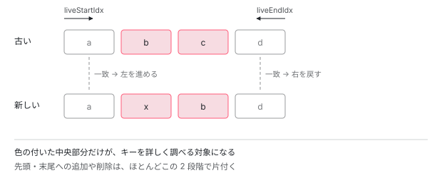

[目次](../README.md) › [テンプレートと DOM](README.md) › 第 1 回 / 全 8 回

# track は何に使われているのか

> @for の差分アルゴリズムを読む。両端から詰める走査と、入れ替えを 1 回の操作で済ませる判定。track を書き間違えたときに何が起きるかが分かる。

angular/angular · 読了 約 12 分 · 中核 · [サイトで読む（デモが動きます）](https://angular-deep-dive-cyan.vercel.app/chapter/for-track)

---

`@for` には `track` が必須です。「書かないとエラーになるから書く」で済ませがちですが、**何に使われているのか**を読むと、書き方の良し悪しが分かります。読む対象は `packages/core/src/render3/list_reconciliation.ts` です。

## 1. 操作は 5 つだけ

📄 `angular/packages/core/src/render3/list_reconciliation.ts` L15–31 （▶ の行: 21–25）

```ts
15 │ /**
16 │  * A type representing the live collection to be reconciled with any new (incoming) collection. This
17 │  * is an adapter class that makes it possible to work with different internal data structures,
18 │  * regardless of the actual values of the incoming collection.
19 │  */
20 │ export abstract class LiveCollection<T, V> {
21 ▶   abstract get length(): number;
22 ▶   abstract at(index: number): V;
23 ▶   abstract attach(index: number, item: T): void;
24 ▶   abstract detach(index: number): T;
25 ▶   abstract create(index: number, value: V): T;
26 │   destroy(item: T): void {
27 │     // noop by default
28 │   }
29 │   updateValue(index: number, value: V): void {
30 │     // noop by default
31 │   }
```

21 行目から 25 行目。差分を反映するのに必要な操作は、この 5 つだけです。**件数を知る、取り出す、差し込む、抜き取る、作る**。

17 行目のコメントにあるとおり、これは**アダプタ**です。実際のデータ構造が何であれ、この 5 つさえ実装すれば 同じ差分アルゴリズムが使えます。

## 2. 入れ替えは特別扱いされている

📄 `angular/packages/core/src/render3/list_reconciliation.ts` L33–47 （▶ の行: 33–36）

```ts
33 ▶   // operations below could be implemented on top of the operations defined so far, but having
34 ▶   // them explicitly allow clear expression of intent and potentially more performant
35 ▶   // implementations
36 ▶   swap(index1: number, index2: number): void {
37 │     const startIdx = Math.min(index1, index2);
38 │     const endIdx = Math.max(index1, index2);
39 │     const endItem = this.detach(endIdx);
40 │     if (endIdx - startIdx > 1) {
41 │       const startItem = this.detach(startIdx);
42 │       this.attach(startIdx, endItem);
43 │       this.attach(endIdx, startItem);
44 │     } else {
45 │       this.attach(startIdx, endItem);
46 │     }
47 │   }
```

33 行目からのコメントが理由を説明しています。**「これらは既存の操作の組み合わせでも実装できるが、意図をはっきり表せるし、より速く実装できる可能性がある」**。

2 つの要素の入れ替えは「抜いて差す」を 2 回やれば実現できます。でも `swap` として名前を付けておけば、**DOM の操作回数を減らす実装に差し替えられます**。

## 3. 一致の判定は 3 値を返す

📄 `angular/packages/core/src/render3/list_reconciliation.ts` L57–73 （▶ の行: 64, 67, 72）

```ts
57 │ function valuesMatching<V>(
58 │   liveIdx: number,
59 │   liveValue: V,
60 │   newIdx: number,
61 │   newValue: V,
62 │   trackBy: TrackByFunction<V>,
63 │ ): number {
64 ▶   if (liveIdx === newIdx && Object.is(liveValue, newValue)) {
65 │     // matching and no value identity to update
66 │     return 1;
67 ▶   } else if (Object.is(trackBy(liveIdx, liveValue), trackBy(newIdx, newValue))) {
68 │     // matching but requires value identity update
69 │     return -1;
70 │   }
71 │ 
72 ▶   return 0;
73 │ }
```

真偽値ではなく 3 通りの答えを返します。ここが肝心です。

| 行 | 戻り値 | 意味 | やること |
| --- | --- | --- | --- |
| 64 | `1` | 位置も値も同じ | **何もしない** |
| 67 | `-1` | キーは同じだが値が別のオブジェクト | DOM はそのまま、値だけ差し替える |
| 72 | `0` | 別物 | 移動か作り直しが必要 |

> [!NOTE]
> **さらに深く**
>
> 67 行目が `track` の本体です。**値そのものではなく `trackBy` の結果を比べています**。だから `map()` で新しいオブジェクトを作っても、`track item.id` と書いてあれば「同じ行だ」と判定され、DOM は作り直されません。値だけが更新されます。

## 4. 両端から詰めていく

📄 `angular/packages/core/src/render3/list_reconciliation.ts` L111–129 （▶ の行: 120–121）

```ts
111 │ export function reconcile<T, V>(
112 │   liveCollection: LiveCollection<T, V>,
113 │   newCollection: Iterable<V> | undefined | null,
114 │   trackByFn: TrackByFunction<V>,
115 │   reactiveConsumer: ReactiveNode | null,
116 │ ): void {
117 │   let detachedItems: UniqueValueMultiKeyMap<unknown, T> | undefined = undefined;
118 │   let liveKeysInTheFuture: Set<unknown> | undefined = undefined;
119 │ 
120 ▶   let liveStartIdx = 0;
121 ▶   let liveEndIdx = liveCollection.length - 1;
122 │ 
123 │   const duplicateKeys = ngDevMode ? new Map<unknown, Set<number>>() : undefined;
124 │ 
125 │   if (Array.isArray(newCollection)) {
126 │     setActiveConsumer(reactiveConsumer);
127 │     let newEndIdx = newCollection.length - 1;
128 │     setActiveConsumer(null);
129 │ 
```

120 行目と 121 行目。**先頭と末尾の 2 つのポインタ**を持ちます。そして両側から中央に向かって詰めていきます。

📄 `angular/packages/core/src/render3/list_reconciliation.ts` L130–152 （▶ の行: 139, 146–147）

```ts
130 │     while (liveStartIdx <= liveEndIdx && liveStartIdx <= newEndIdx) {
131 │       // compare from the beginning
132 │       const liveStartValue = liveCollection.at(liveStartIdx);
133 │       const newStartValue = newCollection[liveStartIdx];
134 │ 
135 │       if (ngDevMode) {
136 │         recordDuplicateKeys(duplicateKeys!, trackByFn(liveStartIdx, newStartValue), liveStartIdx);
137 │       }
138 │ 
139 ▶       const isStartMatching = valuesMatching(
140 │         liveStartIdx,
141 │         liveStartValue,
142 │         liveStartIdx,
143 │         newStartValue,
144 │         trackByFn,
145 │       );
146 ▶       if (isStartMatching !== 0) {
147 ▶         if (isStartMatching < 0) {
148 │           liveCollection.updateValue(liveStartIdx, newStartValue);
149 │         }
150 │         liveStartIdx++;
151 │         continue;
152 │       }
```

まず先頭どうしを比べます。139 行目で判定し、146 行目で 「0 でなければ一致」。147 行目で `-1` なら値だけ更新して、ポインタを 1 つ進めます。**DOM は動きません**。

📄 `angular/packages/core/src/render3/list_reconciliation.ts` L154–176 （▶ の行: 154, 170–171）

```ts
154 ▶       // compare from the end
155 │       // TODO(perf): do _all_ the matching from the end
156 │       const liveEndValue = liveCollection.at(liveEndIdx);
157 │       const newEndValue = newCollection[newEndIdx];
158 │ 
159 │       if (ngDevMode) {
160 │         recordDuplicateKeys(duplicateKeys!, trackByFn(newEndIdx, newEndValue), newEndIdx);
161 │       }
162 │ 
163 │       const isEndMatching = valuesMatching(
164 │         liveEndIdx,
165 │         liveEndValue,
166 │         newEndIdx,
167 │         newEndValue,
168 │         trackByFn,
169 │       );
170 ▶       if (isEndMatching !== 0) {
171 ▶         if (isEndMatching < 0) {
172 │           liveCollection.updateValue(liveEndIdx, newEndValue);
173 │         }
174 │         liveEndIdx--;
175 │         newEndIdx--;
176 │         continue;
```

154 行目、次は末尾どうしです。同じ判定をして、一致すれば両方のポインタを戻します。

この 2 段構えによって、**リストの先頭や末尾への追加・削除は ほとんど無駄なく処理されます**。真ん中だけが残るからです。



*両端から中央へ詰めていく。先頭が一致すれば左を進め、末尾が一致すれば右を戻す。どちらも一致しなくなった中央部分だけが、移動や作り直しの対象になる。*

## 5. 入れ替えと移動を見分ける

📄 `angular/packages/core/src/render3/list_reconciliation.ts` L178–199 （▶ の行: 186–187, 191）

```ts
178 │ 
179 │       // Detect swap and moves:
180 │       const liveStartKey = trackByFn(liveStartIdx, liveStartValue);
181 │       const liveEndKey = trackByFn(liveEndIdx, liveEndValue);
182 │       const newStartKey = trackByFn(liveStartIdx, newStartValue);
183 │       if (Object.is(newStartKey, liveEndKey)) {
184 │         const newEndKey = trackByFn(newEndIdx, newEndValue);
185 │         // detect swap on both ends;
186 ▶         if (Object.is(newEndKey, liveStartKey)) {
187 ▶           liveCollection.swap(liveStartIdx, liveEndIdx);
188 │           liveCollection.updateValue(liveEndIdx, newEndValue);
189 │           newEndIdx--;
190 │           liveEndIdx--;
191 ▶         } else {
192 │           // the new item is the same as the live item with the end pointer - this is a move forward
193 │           // to an earlier index;
194 │           liveCollection.move(liveEndIdx, liveStartIdx);
195 │         }
196 │         liveCollection.updateValue(liveStartIdx, newStartValue);
197 │         liveStartIdx++;
198 │         continue;
199 │       }
```

両端が一致しなかったとき、初めてキーを詳しく調べます。186 行目、**「新しい先頭が古い末尾で、かつ新しい末尾が古い先頭」**なら、それは入れ替えです。187 行目で `swap` を 1 回呼んで終わり。

そうでなければ 191 行目に進み、移動として扱います。**作り直しは最後の手段**で、まず「動かせないか」を探します。

## 6. 動かして確かめる

> **🧪 DEMO — 変更の種類と DOM 操作**
>
> 元のリストは \[a, b, c, d\]。変更の種類によって、必要な操作がどう変わるかを見ます。
>
> ▶ [このデモはサイトで動かせます](https://angular-deep-dive-cyan.vercel.app/chapter/for-track)

「track が不安定」を選んだときだけ、全件の破棄と作成になります。これが `track $index` や毎回新しい id を使ったときに起きることです。

## 7. 重複キーは警告される

📄 `angular/packages/core/src/render3/list_reconciliation.ts` L340–351 （▶ の行: 343–344）

```ts
340 │     if (duplicatedKeysMsg.length > 0) {
341 │       const message = formatRuntimeError(
342 │         RuntimeErrorCode.LOOP_TRACK_DUPLICATE_KEYS,
343 ▶         'The provided track expression resulted in duplicated keys for a given collection. ' +
344 ▶           'Adjust the tracking expression such that it uniquely identifies all the items in the collection. ' +
345 │           'Duplicated keys were: \n' +
346 │           duplicatedKeysMsg.join(', \n') +
347 │           '.',
348 │       );
349 │ 
350 │       console.warn(message);
351 │     }
```

343 行目からのメッセージが親切です。**「track 式が重複したキーを生んだ。すべての項目を一意に識別できるよう調整せよ」**。実際にどのキーが何番目と何番目で重複したかも表示されます。

ただしこの検査は `ngDevMode` の中にあるので、**本番ビルドでは走りません**。開発中に気づけ、という設計です。

## 読み終えて

`track` は「Angular に要求される呪文」ではなく、**差分アルゴリズムに渡す識別子**でした。

| 書き方 | 何が起きるか |
| --- | --- |
| `track item.id` | 安定。オブジェクトが別でも同じ行だと分かる |
| `track $index` | 並び替えに弱い。要素の順番が変わると、全部「別物」になる |
| `track item` | 参照で比べる。`map()` で作り直すと全件再生成 |

テーブルの章で見た `_cachedRenderRowsMap` も、結局は同じ問題への対処でした。**「同じものを同じと認識させる」**ことが、Angular のリスト描画では一貫して重要になります。

1 万件のうち見えている行だけを描き、外れたビューを使い回す仕組みは [仮想スクロール](../cdk/15-virtual-scroll.md)と [DataSource と選択](../cdk/14-cdk-collections.md)の章で追います。

---

← 前: [スタイルのカプセル化：shadow\_css.ts が CSS セレクタを書き換える](../compiler/18-compiler-shadow-css.md)  
次: [ng-content のセレクタは CSS ではない](02-projection.md) →
