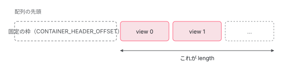
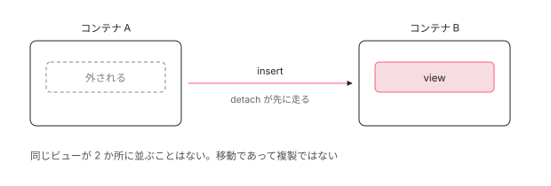

[目次](../README.md) › [テンプレートと DOM](README.md) › 第 4 回 / 全 8 回

# あとからビューを差し込む場所

> ViewContainerRef を読む。LContainer もまた先頭に固定の枠を持つ配列で、insert はすでに刺さっているビューを黙って外してから挿す。

angular/angular · 読了 約 9 分 · 中核 · [サイトで読む（デモが動きます）](https://angular-deep-dive-cyan.vercel.app/chapter/view-container)

---

`ViewContainerRef` は「あとからビューを差し込む場所」です。`@if` も `@for` も、内部ではこれと同じ仕組みで動いています。読むと**コンテナもまた配列だった**ことが分かります。読む対象は `packages/core/src/linker/view_container_ref.ts` です。

## 1. 実体は 3 つの参照だけ

📄 `angular/packages/core/src/linker/view_container_ref.ts` L319–334 （▶ の行: 321–323）

```ts
319 │ class R3ViewContainerRef extends ViewContainerRef {
320 │   constructor(
321 ▶     private _lContainer: LContainer,
322 ▶     private _hostTNode: TElementNode | TContainerNode | TElementContainerNode,
323 ▶     private _hostLView: LView,
324 │   ) {
325 │     super();
326 │   }
327 │ 
328 │   override get element(): ElementRef {
329 │     return createElementRef(this._hostTNode, this._hostLView);
330 │   }
331 │ 
332 │   override get injector(): Injector {
333 │     return new NodeInjector(this._hostTNode, this._hostLView);
334 │   }
```

321 行目の `_lContainer` が置き場所そのもの、322 行目と 323 行目が**「どこに刺さっているか」**です。クラスはこの 3 つを受け取るだけで、状態を自分では持ちません。

## 2. 個数の数え方が LView と同じ

📄 `angular/packages/core/src/linker/view_container_ref.ts` L356–367 （▶ の行: 363–364）

```ts
356 │   }
357 │ 
358 │   override get(index: number): ViewRef | null {
359 │     const viewRefs = getViewRefs(this._lContainer);
360 │     return (viewRefs !== null && viewRefs[index]) || null;
361 │   }
362 │ 
363 ▶   override get length(): number {
364 ▶     return this._lContainer.length - CONTAINER_HEADER_OFFSET;
365 │   }
366 │ 
367 │   override createEmbeddedView<C>(
```

364 行目。**配列の長さから固定の枠の分を引いている**だけです。コンポーネントの章で読んだ `HEADER_OFFSET = 28` と同じ考え方で、`LContainer` も**先頭に固定の枠があり、その後ろにビューが並ぶ配列**でした。



*LContainer は先頭に固定の枠を持つ配列。ビューはその後ろに並ぶので、個数は「長さ引くヘッダ」で求まる。*

## 3. 挿す前に、黙って外している

この章でいちばん面白いのが `insert()` の中身です。**すでにどこかに刺さっているビューを渡すと、先に外してから挿します**。

📄 `angular/packages/core/src/linker/view_container_ref.ts` L570–621 （▶ の行: 580, 589–590, 600–602）

```ts
570 │   private insertImpl(viewRef: ViewRef, index?: number, addToDOM?: boolean): ViewRef {
571 │     const lView = (viewRef as R3ViewRef<any>)._lView!;
572 │ 
573 │     if (ngDevMode && viewRef.destroyed) {
574 │       throw new RuntimeError(
575 │         RuntimeErrorCode.VIEW_DESTROYED_INSERT_ERROR,
576 │         ngDevMode && 'Cannot insert a destroyed View in a ViewContainer!',
577 │       );
578 │     }
579 │ 
580 ▶     if (viewAttachedToContainer(lView)) {
581 │       // If view is already attached, detach it first so we clean up references appropriately.
582 │ 
583 │       const prevIdx = this.indexOf(viewRef);
584 │ 
585 │       // A view might be attached either to this or a different container. The `prevIdx` for
586 │       // those cases will be:
587 │       // equal to -1 for views attached to this ViewContainerRef
588 │       // >= 0 for views attached to a different ViewContainerRef
589 ▶       if (prevIdx !== -1) {
590 ▶         this.detach(prevIdx);
591 │       } else {
592 │         const prevLContainer = lView[PARENT] as LContainer;
593 │         ngDevMode &&
594 │           assertEqual(
595 │             isLContainer(prevLContainer),
596 │             true,
597 │             'An attached view should have its PARENT point to a container.',
598 │           );
599 │ 
600 ▶         // We need to re-create a R3ViewContainerRef instance since those are not stored on
601 ▶         // LView (nor anywhere else).
602 ▶         const prevVCRef = new R3ViewContainerRef(
603 │           prevLContainer,
604 │           prevLContainer[T_HOST] as TDirectiveHostNode,
605 │           prevLContainer[PARENT],
606 │         );
607 │ 
608 │         prevVCRef.detach(prevVCRef.indexOf(viewRef));
609 │       }
610 │     }
611 │ 
612 │     // Logical operation of adding `LView` to `LContainer`
613 │     const adjustedIdx = this._adjustIndex(index);
614 │     const lContainer = this._lContainer;
615 │ 
616 │     addLViewToLContainer(lContainer, lView, adjustedIdx, addToDOM);
617 │ 
618 │     (viewRef as R3ViewRef<any>).attachToViewContainerRef();
619 │     addToArray(getOrCreateViewRefs(lContainer), adjustedIdx, viewRef);
620 │ 
621 │     return viewRef;
```

580 行目、**すでに刺さっているか**を調べます。刺さっていたら 2 つに分かれます。589 行目は**同じコンテナの中**にいた場合で、590 行目でそのまま外します。

面白いのは、そうでなかった場合です。600 行目のコメントが理由を語っています。**「ViewContainerRef は LView にも、どこにも保存されていないので、作り直す必要がある」**。だから 602 行目で**その場で新しく組み立てて**、それを使って外しています。

> [!NOTE]
> **さらに深く**
>
> ここは設計の割り切りが見えるところです。`LContainer` は配列なので、`ViewContainerRef` を 持ち歩くための枠を用意していません。必要になったら **手元の 3 つの参照から組み直せばいい**、という判断です。配列を軽く保つことを優先した結果、こういうコードになりました。



*別のコンテナにあるビューを insert すると、まず元のコンテナから外される。ビューが 2 か所に同時に存在することはない。*

> **🧪 DEMO — insert は移動であって複製ではない**
>
> どれだけ動かしても、ビューの合計は増えません。
>
> ▶ [このデモはサイトで動かせます](https://angular-deep-dive-cyan.vercel.app/chapter/view-container)

## 4. ここから何が見えるか

`@if` や `@for` が速いのは、**DOM を作り直さずにこの配列を並べ替えているから**です。`@for` の章で読んだ両端からの突き合わせは、最終的にこのコンテナへの `insert` と `detach` に変換されます。

そして 3 節の「黙って外す」があるおかげで、**移動を「外す」と「挿す」の 2 手で書かなくてよい**ようになっています。呼ぶ側は挿すことだけ考えればよく、後始末は `insert` が引き受けます。

## 読み終えて

- `ViewContainerRef` は 3 つの参照を包んだだけの薄い層
- `LContainer` も先頭に固定の枠を持つ配列。`length` は「長さ引くヘッダ」
- すでに刺さっているビューを `insert` すると、先に外される。移動であって複製ではない
- `ViewContainerRef` はどこにも保存されていないので、必要なときにその場で組み直している

ViewContainerRef と ApplicationRef.attachView を使って、ビューを別の場所や body の下に出す部品は [CDK の Portal](../cdk/04-cdk-portal.md) と [Overlay](../cdk/05-cdk.md) の章で読めます。

---

← 前: [@defer の中身は状態機械](03-defer.md)  
次: [DOM を実際に出し入れする層](05-dom.md) →
