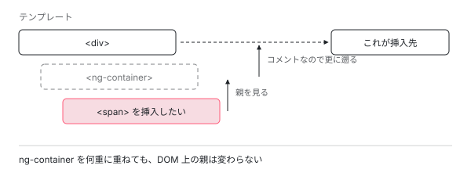

[目次](../README.md) › [テンプレートと DOM](README.md) › 第 5 回 / 全 8 回

# DOM を実際に出し入れする層

> すべての章の終着点。Angular は document を直接触らず renderer を経由する。挿入の難しさは「どこに」を決める部分にあった。

angular/angular · 読了 約 11 分 · 発展 · [サイトで読む（デモが動きます）](https://angular-deep-dive-cyan.vercel.app/chapter/dom)

---

ここまで読んできた仕組みは、最後にどこかで**本物の DOM を触ります**。その一番下の層を読みます。対象は `dom_node_manipulation.ts` と `node_manipulation.ts` です。

## 1. document を直接触らない

📄 `angular/packages/core/src/render3/dom_node_manipulation.ts` L16–27 （▶ の行: 17, 21, 25）

```ts
16 │ export function createTextNode(renderer: Renderer, value: string): RText {
17 ▶   return renderer.createText(value);
18 │ }
19 │ 
20 │ export function updateTextNode(renderer: Renderer, rNode: RText, value: string): void {
21 ▶   renderer.setValue(rNode, value);
22 │ }
23 │ 
24 │ export function createCommentNode(renderer: Renderer, value: string): RComment {
25 ▶   return renderer.createComment(escapeCommentText(value));
26 │ }
27 │ 
```

要素を作る、文字を書き換える、コメントを作る。どれも **`renderer` に頼んでいるだけ**です。`document.createElement` は 1 度も出てきません。

実際、このファイル全体を検索しても `document.` は**ゼロ件**でした。なぜそうしているのか、interface のドキュメントに書かれています。

📄 `angular/packages/core/src/render3/interfaces/renderer.ts` L28–34 （▶ の行: 31–32）

```ts
28 │ /**
29 │  * Procedural style of API needed to create elements and text nodes.
30 │  *
31 ▶  * In non-native browser environments (e.g. platforms such as web-workers), this is the
32 ▶  * facade that enables element manipulation. In practice, this is implemented by `Renderer2`.
33 │  */
34 │ export interface Renderer {
```

31 行目から 32 行目。**「ブラウザ以外の環境では、これが要素操作を可能にする窓口になる」**。

> [!NOTE]
> **さらに深く**
>
> この 1 枚の抽象があるおかげで、サーバーサイドレンダリングが成立します。サーバーには `document` がありませんが、**`renderer` を差し替えれば同じコードが動きます**。ハイドレーションの章で読んだサーバー側の HTML は、この仕組みで文字列として組み立てられたものです。

## 2. 足すか差し込むかは 1 つの分岐

📄 `angular/packages/core/src/render3/dom_node_manipulation.ts` L62–74 （▶ の行: 69–70, 72）

```ts
62 │ export function nativeAppendOrInsertBefore(
63 │   renderer: Renderer,
64 │   parent: RElement,
65 │   child: RNode,
66 │   beforeNode: RNode | null,
67 │   isMove: boolean,
68 │ ) {
69 ▶   if (beforeNode !== null) {
70 ▶     nativeInsertBefore(renderer, parent, child, beforeNode, isMove);
71 │   } else {
72 ▶     nativeAppendChild(renderer, parent, child);
73 │   }
74 │ }
```

69 行目、**目印のノードがあれば「その前に差し込む」、なければ「末尾に足す」**。DOM 操作の本体はこれだけです。

## 3. 難しいのは「どこに」を決めること

📄 `angular/packages/core/src/render3/node_manipulation.ts` L670–691 （▶ の行: 676, 679, 686）

```ts
670 │ export function appendChild(
671 │   tView: TView,
672 │   lView: LView,
673 │   childRNode: RNode | RNode[],
674 │   childTNode: TNode,
675 │ ): void {
676 ▶   const parentRNode = getParentRElement(tView, childTNode, lView);
677 │   const renderer = lView[RENDERER];
678 │   const parentTNode: TNode = childTNode.parent || lView[T_HOST]!;
679 ▶   const anchorNode = getInsertInFrontOfRNode(parentTNode, childTNode, lView);
680 │   if (parentRNode != null) {
681 │     if (Array.isArray(childRNode)) {
682 │       for (let i = 0; i < childRNode.length; i++) {
683 │         nativeAppendOrInsertBefore(renderer, parentRNode, childRNode[i], anchorNode, false);
684 │       }
685 │     } else {
686 ▶       nativeAppendOrInsertBefore(renderer, parentRNode, childRNode, anchorNode, false);
687 │     }
688 │   }
689 │ 
690 │   _processI18nInsertBefore !== undefined &&
691 │     _processI18nInsertBefore(renderer, childTNode, lView, childRNode, parentRNode);
```

676 行目で**親の要素**を探し、679 行目で**どのノードの前に置くか**を決め、686 行目でようやく挿入します。**実際の挿入は 1 行で、その前の 2 行が本番**です。

## 4. 親を探すのがなぜ難しいか

📄 `angular/packages/core/src/render3/node_manipulation.ts` L532–554 （▶ の行: 538–539, 541, 554）

```ts
532 │ export function getClosestRElement(
533 │   tView: TView,
534 │   tNode: TNode | null,
535 │   lView: LView,
536 │ ): RElement | null {
537 │   let parentTNode: TNode | null = tNode;
538 ▶   // Skip over element and ICU containers as those are represented by a comment node and
539 ▶   // can't be used as a render parent. Also skip let declarations since they don't have a
540 │   // corresponding DOM node at all.
541 ▶   while (
542 │     parentTNode !== null &&
543 │     parentTNode.type & (TNodeType.ElementContainer | TNodeType.Icu | TNodeType.LetDeclaration)
544 │   ) {
545 │     tNode = parentTNode;
546 │     parentTNode = tNode.parent;
547 │   }
548 │ 
549 │   // If the parent tNode is null, then we are inserting across views: either into an embedded view
550 │   // or a component view.
551 │   if (parentTNode === null) {
552 │     // We are inserting a root element of the component view into the component host element and
553 │     // it should always be eager.
554 ▶     return lView[HOST];
```

538 行目からのコメントが理由を説明しています。**`<ng-container>` はコメントノードなので、親になれない**。だから 541 行目の `while` で、親になれるものが見つかるまで遡ります。

`@let` の宣言も同じ扱いです。DOM 上に対応するノードが無いので、飛ばされます。



*ng-container はコメントノードなので親になれない。while ループで遡り、実際の要素が見つかったところが挿入先になる。*

> **🧪 DEMO — 親を探す**
>
> ng-container をいくつ挟んでも、たどり着く親は同じです。
>
> ▶ [このデモはサイトで動かせます](https://angular-deep-dive-cyan.vercel.app/chapter/dom)

## 5. 目印のノード

📄 `angular/packages/core/src/render3/node_manipulation.ts` L609–618 （▶ の行: 614–615, 617）

```ts
609 │ export function getInsertInFrontOfRNodeWithNoI18n(
610 │   parentTNode: TNode,
611 │   currentTNode: TNode,
612 │   lView: LView,
613 │ ): RNode | null {
614 ▶   if (parentTNode.type & (TNodeType.ElementContainer | TNodeType.Icu)) {
615 ▶     return getNativeByTNode(parentTNode, lView);
616 │   }
617 ▶   return null;
618 │ }
```

614 行目、**親が `<ng-container>` なら、そのコメントノード自身を目印にします**。そうでなければ 617 行目で `null`、つまり「末尾に足す」です。

`@if` や `@for` がコメントノードを残すのは、この目印のためです。中身が空でも位置が分かるので、あとから正しい場所に差し込めます。ブラウザの開発者ツールで見える `<!--container-->` がそれです。

## 6. 削除も renderer 経由

📄 `angular/packages/core/src/render3/dom_node_manipulation.ts` L76–94 （▶ の行: 78–80）

```ts
76 │ /**
77 │  * Removes a native node itself using a given renderer. To remove the node we are looking up its
78 ▶  * parent from the native tree as not all platforms / browsers support the equivalent of
79 ▶  * node.remove().
80 ▶  *
81 │  * @param renderer A renderer to be used
82 │  * @param rNode The native node that should be removed
83 │  * @param isHostElement A flag indicating if a node to be removed is a host of a component.
84 │  * @param requireSynchronousElementRemoval A flag indicating if a node requires synchronous
85 │  * removal from the DOM.
86 │  */
87 │ export function nativeRemoveNode(
88 │   renderer: Renderer,
89 │   rNode: RNode,
90 │   isHostElement?: boolean,
91 │   requireSynchronousElementRemoval?: boolean,
92 │ ): void {
93 │   renderer.removeChild(null, rNode, isHostElement, requireSynchronousElementRemoval);
94 │ }
```

78 行目からのコメントが正直です。**「ノードを消すには親を探す必要がある。すべての環境が `node.remove()` に相当するものを持っているとは限らないから」**。

ブラウザなら `node.remove()` で済みますが、サーバーや WebWorker では使えないかもしれない。**いちばん低い共通項に合わせている**わけです。

## 読み終えて

この層で分かったのは、**Angular が DOM を直接触らない**ということでした。すべて `renderer` を経由します。

| やること | 実際の処理 |
| --- | --- |
| 要素を作る | `renderer.createElement` |
| 挿入する | 親を探す → 目印を探す → `insertBefore` か `appendChild` |
| 消す | 親をたどって `removeChild` |

コンパイラの章で見た `ɵɵdomElementStart` も、変更検知の章で見た `refreshView` も、最後はここに降りてきます。**すべての章の終着点**がこの薄い層でした。

---

← 前: [あとからビューを差し込む場所](04-view-container.md)  
次: [数値 1 つに 3 つの情報を詰める](06-i18n.md) →
