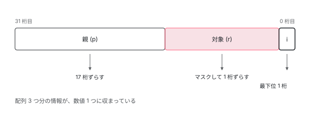
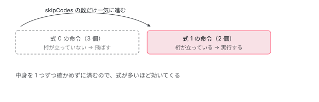

[目次](../README.md) › [テンプレートと DOM](README.md) › 第 6 回 / 全 8 回

# 数値 1 つに 3 つの情報を詰める

> 多言語化の命令はビットで詰められている。ソースに描かれたビットの地図を読み、変更マスクで変わった式だけを塗り直す仕組みまで追う。

angular/angular · 読了 約 12 分 · 発展 · [サイトで読む（デモが動きます）](https://angular-deep-dive-cyan.vercel.app/chapter/i18n)

---

多言語化は「文字を差し替えるだけ」に見えますが、中身は**1 つの数値に 3 つの情報を詰め込む**という、かなり攻めた作りでした。読む対象は `packages/core/src/render3/interfaces/i18n.ts` と `i18n/i18n_apply.ts` です。

## 1. ソースに図が描いてある

この章の主役は、コメントとして書かれた**ビットの地図**です。説明文より先に、これを見てください。

📄 `angular/packages/core/src/render3/interfaces/i18n.ts` L25–68 （▶ の行: 33–35, 38–40, 51, 55, 64）

````ts
25 │  * OpCodes are efficient operations which can be applied to the DOM to update it. (For example to
26 │  * update to a new ICU case requires that we clean up previous elements and create new ones.)
27 │  *
28 │  * OpCodes contain three parts:
29 │  *  1) Parent node index offset. (p)
30 │  *  2) Reference node index offset. (r)
31 │  *  3) The instruction to execute. (i)
32 │  *
33 ▶  * pppp pppp pppp pppp rrrr rrrr rrrr riii
34 ▶  * 3322 2222 2222 1111 1111 1110 0000 0000
35 ▶  * 1098 7654 3210 9876 5432 1098 7654 3210
36 │  *
37 │  * ```ts
38 ▶  * var parent = lView[opCode >>> SHIFT_PARENT];
39 ▶  * var refNode = lView[((opCode & MASK_REF) >>> SHIFT_REF)];
40 ▶  * var instruction = opCode & MASK_OPCODE;
41 │  * ```
42 │  *
43 │  * See: `I18nCreateOpCodes` for example of usage.
44 │  */
45 │ export const enum IcuCreateOpCode {
46 │   /* tslint:disable:no-duplicate-enum-values */
47 │ 
48 │   /**
49 │    * Stores shift amount for bits 17-3 that contain reference index.
50 │    */
51 ▶   SHIFT_REF = 1,
52 │   /**
53 │    * Stores shift amount for bits 31-17 that contain parent index.
54 │    */
55 ▶   SHIFT_PARENT = 17,
56 │   /**
57 │    * Mask for OpCode
58 │    */
59 │   MASK_INSTRUCTION = 0b1,
60 │ 
61 │   /**
62 │    * Mask for the Reference node (bits 16-3)
63 │    */
64 ▶   MASK_REF = 0b11111111111111110,
65 │   //           11111110000000000
66 │   //           65432109876543210
67 │ 
68 │   /**
````

33 行目が地図そのものです。`p` が親、`r` が対象、`i` が命令。34 行目と 35 行目は**桁の番号を縦に読ませるための目盛り**です。いちばん右が 0 桁目、いちばん左が 31 桁目だと分かります。

そして 38 行目から 40 行目に**取り出し方がそのまま書いてあります**。親は 17 桁ぶん右にずらす、対象はマスクで抜いてから 1 桁ずらす、命令は最下位ビット。51 行目と 55 行目の数字が、この「ずらす量」の正体です。



*32 ビットの整数 1 つに、親・対象・命令の 3 つを詰めている。読み出しはずらし算とマスクだけで済む。*

> **🧪 DEMO — 詰めて、取り出す**
>
> ソースの 38〜40 行目とまったく同じ式で計算しています。
>
> ▶ [このデモはサイトで動かせます](https://angular-deep-dive-cyan.vercel.app/chapter/i18n)

> [!NOTE]
> **さらに深く**
>
> なぜここまでするのか。翻訳された文章は**ノードの数だけ命令が並ぶ**ので、素直にオブジェクトで書くと数が一気に増えます。数値なら配列にそのまま詰められて、読み出しもずらし算だけです。**ビルド時に決まっていて、実行時には読むだけ**という性質に合わせた作りです。

## 2. 2 桁ずらして 2 つの印を付ける

📄 `angular/packages/core/src/render3/interfaces/i18n.ts` L237–255 （▶ の行: 243, 248, 253）

```ts
237 │ export enum I18nCreateOpCode {
238 │   /* tslint:disable:no-duplicate-enum-values */
239 │   /**
240 │    * Number of bits to shift index so that it can be combined with the `APPEND_EAGERLY` and
241 │    * `COMMENT`.
242 │    */
243 ▶   SHIFT = 2,
244 │ 
245 │   /**
246 │    * Should the node be appended to parent immediately after creation.
247 │    */
248 ▶   APPEND_EAGERLY = 0b01,
249 │ 
250 │   /**
251 │    * If set the node should be comment (rather than a text) node.
252 │    */
253 ▶   COMMENT = 0b10,
254 │   /* tslint:enable:no-duplicate-enum-values */
255 │ }
```

こちらは作成用で、詰め方がもっと単純です。248 行目と 253 行目の**2 つの印**を下の 2 桁に置き、その上に番号を載せます。だから 243 行目でずらす量が 2 なのです。

253 行目の `COMMENT` が立っていれば、文字ではなく**コメントノードを作る**という意味になります。ハイドレーションの章で見た `<!--ngetn-->` のような目印が、こうして作られています。

## 3. 変わった式だけを塗り直す

ここからが実行時の話です。翻訳文の中に式が複数あるとき、**変わったものだけを更新したい**。その仕組みがビットマスクです。

📄 `angular/packages/core/src/render3/i18n/i18n_apply.ts` L92–103 （▶ の行: 99–100, 102）

```ts
 92 │  * Keep track of which input bindings in `ɵɵi18nExp` have changed.
 93 │  *
 94 │  * `setMaskBit` gets invoked by each call to `ɵɵi18nExp`.
 95 │  *
 96 │  * @param hasChange did `ɵɵi18nExp` detect a change.
 97 │  */
 98 │ export function setMaskBit(hasChange: boolean) {
 99 ▶   if (hasChange) {
100 ▶     changeMask = changeMask | (1 << Math.min(changeMaskCounter, 31));
101 │   }
102 ▶   changeMaskCounter++;
103 │ }
```

100 行目。**式の N 番目が変わったら N 桁目を立てる**。それだけです。102 行目でカウンタを進めるので、式が現れた順に桁が割り当たります。

> [!WARNING]
> **ハマりどころ**
>
> 100 行目の `Math.min(..., 31)` に注目してください。**式が 32 個を超えると、それ以降はすべて同じ桁に潰されます**。上のコメントが「必要以上に更新してしまうかもしれないが、32 個も使う翻訳文は稀なので実際には問題にならない」と認めています。正しさは保ったまま、無駄が増えるだけに留める。よくある割り切り方です。

> **🧪 DEMO — 変更マスク**
>
> 式ごとに 1 桁。立っている桁のぶんだけ、あとで更新が走ります。
>
> ▶ [このデモはサイトで動かせます](https://angular-deep-dive-cyan.vercel.app/chapter/i18n)

## 4. まとめて適用し、必ず戻す

📄 `angular/packages/core/src/render3/i18n/i18n_apply.ts` L105–122 （▶ の行: 107, 114–115, 119–120）

```ts
105 │ export function applyI18n(tView: TView, lView: LView, index: number) {
106 │   try {
107 ▶     if (changeMaskCounter > 0) {
108 │       ngDevMode && assertDefined(tView, `tView should be defined`);
109 │       const tI18n = tView.data[index] as TI18n | I18nUpdateOpCodes;
110 │       // When `index` points to an `ɵɵi18nAttributes` then we have an array otherwise `TI18n`
111 │       const updateOpCodes: I18nUpdateOpCodes = Array.isArray(tI18n)
112 │         ? (tI18n as I18nUpdateOpCodes)
113 │         : (tI18n as TI18n).update;
114 ▶       const bindingsStartIndex = getBindingIndex() - changeMaskCounter - 1;
115 ▶       applyUpdateOpCodes(tView, lView, updateOpCodes, bindingsStartIndex, changeMask);
116 │     }
117 │   } finally {
118 │     // Reset changeMask & maskBit to default for the next update cycle
119 ▶     changeMask = 0b0;
120 ▶     changeMaskCounter = 0;
121 │   }
122 │ }
```

107 行目、**1 つも式が来ていなければ何もしません**。115 行目でまとめて適用し、119 行目と 120 行目で次の回に備えて戻します。

`finally` になっているのが要点です。途中で例外が出ても**マスクは必ず初期化される**ので、次の変更検知に前回の印が漏れません。`| async` の章で見た「一時的に変えたら必ず戻す」と同じ型です。

## 5. 立っていない桁は、まとめて飛ばす

📄 `angular/packages/core/src/render3/i18n/i18n_apply.ts` L402–425 （▶ の行: 411, 413–414, 417）

```ts
402 │ function applyUpdateOpCodes(
403 │   tView: TView,
404 │   lView: LView,
405 │   updateOpCodes: I18nUpdateOpCodes,
406 │   bindingsStartIndex: number,
407 │   changeMask: number,
408 │ ) {
409 │   for (let i = 0; i < updateOpCodes.length; i++) {
410 │     // bit code to check if we should apply the next update
411 ▶     const checkBit = updateOpCodes[i] as number;
412 │     // Number of opCodes to skip until next set of update codes
413 ▶     const skipCodes = updateOpCodes[++i] as number;
414 ▶     if (checkBit & changeMask) {
415 │       // The value has been updated since last checked
416 │       let value = '';
417 ▶       for (let j = i + 1; j <= i + skipCodes; j++) {
418 │         const opCode = updateOpCodes[j];
419 │         if (typeof opCode == 'string') {
420 │           value += opCode;
421 │         } else if (typeof opCode == 'number') {
422 │           if (opCode < 0) {
423 │             // Negative opCode represent `i18nExp` values offset.
424 │             value += renderStringify(lView[bindingsStartIndex - opCode]);
425 │           } else {
```

414 行目が心臓部です。**その式が変わっていなければ、中に入りません**。そして 413 行目の `skipCodes` がうまい。**飛ばすべき命令の数が、あらかじめ書き込まれている**のです。

おかげで、変わっていない式に属する命令を**1 つずつ見ていく必要がありません**。417 行目のループは、桁が立っていたときだけ回ります。



*命令列は「判定用の桁・飛ばす数・中身」の組で並ぶ。桁が立っていなければ、その組ごと読み飛ばせる。*

## 読み終えて

- 作成用の命令は 32 ビット整数 1 つ。親・対象・命令をずらし算で詰めている
- 取り出し方はソースのコメントにそのまま書いてある。33 行目の地図が読めれば十分
- 更新は変更マスク。式の N 番目が変わったら N 桁目を立てる
- 式が 32 個を超えると桁が潰れるが、余分に更新されるだけで壊れはしない
- 変わっていない式の命令は `skipCodes` の数だけまとめて飛ばす

---

← 前: [DOM を実際に出し入れする層](05-dom.md)  
次: [innerHTML のタグが消える理由](07-sanitize.md) →
