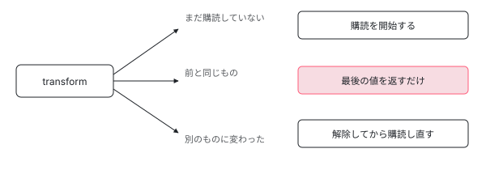

[目次](../README.md) › [テンプレートと DOM](README.md) › 第 8 回 / 全 8 回

# | async が面倒をみている 3 つのこと

> 購読・解除・変更検知。毎回新しい Observable を渡すと購読し直しになる理由と、同期的な値では通知しない工夫を読む。

angular/angular · 読了 約 9 分 · 基礎 · [サイトで読む（デモが動きます）](https://angular-deep-dive-cyan.vercel.app/chapter/async-pipe)

---

`| async` は「Observable を書くだけで表示できる」便利な道具です。中身は 250 行ほどで、**購読・解除・変更検知の 3 つを面倒みている**だけでした。読む対象は `packages/common/src/pipes/async_pipe.ts` です。

## 1. transform は 3 つの場合分け

📄 `angular/packages/common/src/pipes/async_pipe.ts` L178–200 （▶ の行: 179, 186, 194–196）

```ts
178 │   transform<T>(obj: Observable<T> | Subscribable<T> | PromiseLike<T> | null | undefined): T | null {
179 ▶     if (!this._obj) {
180 │       if (obj) {
181 │         try {
182 │           // Only call `markForCheck` if the value is updated asynchronously.
183 │           // Synchronous updates _during_ subscription should not wastefully mark for check -
184 │           // this value is already going to be returned from the transform function.
185 │           this.markForCheckOnValueUpdate = false;
186 ▶           this._subscribe(obj);
187 │         } finally {
188 │           this.markForCheckOnValueUpdate = true;
189 │         }
190 │       }
191 │       return this._latestValue;
192 │     }
193 │ 
194 ▶     if (obj !== this._obj) {
195 ▶       this._dispose();
196 ▶       return this.transform(obj);
197 │     }
198 │ 
199 │     return this._latestValue;
200 │   }
```

179 行目、**まだ何も購読していないなら**購読を始めます。194 行目、**前と違うものが渡されたら**195 行目で解除してやり直します。どちらでもなければ、最後に受け取った値を返すだけです。



*テンプレートは変更検知のたびに transform を呼ぶ。同じ Observable なら何もせず最後の値を返し、別のものに変わったときだけ購読し直す。*

> [!WARNING]
> **ハマりどころ**
>
> 194 行目が、よくある不具合の正体です。テンプレートに `items$ | async` を補間で と書いたとき、**`items$` が毎回新しい Observable だと購読し直しになります**。たとえばゲッターの中で `this.http.get(...)` を返していると、変更検知のたびに通信が走ります。

> **🧪 DEMO — 購読が切り替わるとき**
>
> 同じものを渡し続ければ購読は 1 回きりです。
>
> ▶ [このデモはサイトで動かせます](https://angular-deep-dive-cyan.vercel.app/chapter/async-pipe)

## 2. 値が来たら変更検知を起こす

📄 `angular/packages/common/src/pipes/async_pipe.ts` L235–242 （▶ の行: 236, 238–239）

```ts
235 │   private _updateLatestValue(async: any, value: Object): void {
236 ▶     if (async === this._obj) {
237 │       this._latestValue = value;
238 ▶       if (this.markForCheckOnValueUpdate) {
239 ▶         this._ref?.markForCheck();
240 │       }
241 │     }
242 │   }
```

236 行目で**「いま購読しているものからの値か」を確かめます**。切り替え直後に古い購読から値が来ても、ここで弾かれます。

そして 239 行目、`markForCheck()`。変更検知の章で読んだ、**先祖を全部 dirty にする**あの関数です。`| async` が OnPush のコンポーネントでも動くのは、これがあるからです。

## 3. 同期的な値だけは通知しない

238 行目の `if` に注目してください。無条件ではありません。1 節のコードに、このフラグを切り替えている箇所がありました。

📄 `angular/packages/common/src/pipes/async_pipe.ts` L178–200 （▶ の行: 182–185, 188）

```ts
178 │   transform<T>(obj: Observable<T> | Subscribable<T> | PromiseLike<T> | null | undefined): T | null {
179 │     if (!this._obj) {
180 │       if (obj) {
181 │         try {
182 ▶           // Only call `markForCheck` if the value is updated asynchronously.
183 ▶           // Synchronous updates _during_ subscription should not wastefully mark for check -
184 ▶           // this value is already going to be returned from the transform function.
185 ▶           this.markForCheckOnValueUpdate = false;
186 │           this._subscribe(obj);
187 │         } finally {
188 ▶           this.markForCheckOnValueUpdate = true;
189 │         }
190 │       }
191 │       return this._latestValue;
192 │     }
193 │ 
194 │     if (obj !== this._obj) {
195 │       this._dispose();
196 │       return this.transform(obj);
197 │     }
198 │ 
199 │     return this._latestValue;
200 │   }
```

182 行目からのコメントが理由を説明しています。**「値が非同期に更新されたときだけ markForCheck を呼ぶ。購読中の同期的な更新で無駄に印を付けない。その値はこの transform から返るのだから」**。

`of(1)` や `BehaviorSubject` は、購読した瞬間に値を流します。その値は**いま実行中の `transform` がそのまま返す**ので、再描画を頼む必要がありません。185 行目で一時的にフラグを倒し、188 行目の `finally` で必ず戻しています。

> [!NOTE]
> **さらに深く**
>
> `finally` を使っているのが丁寧なところです。購読の途中で例外が出ても、フラグは必ず元に戻ります。ハーネスの章で見た「例外が出ても変更検知を再開する」のと同じ考え方で、**一時的に状態を変えるときは必ず戻す**という型が守られています。

## 4. 後始末

📄 `angular/packages/common/src/pipes/async_pipe.ts` L160–169 （▶ の行: 161–162, 168）

```ts
160 │   ngOnDestroy(): void {
161 ▶     if (this._subscription) {
162 ▶       this._dispose();
163 │     }
164 │     // Clear the `ChangeDetectorRef` and its association with the view data, to mitigate
165 │     // potential memory leaks in Observables that could otherwise cause the view data to
166 │     // be retained.
167 │     // https://github.com/angular/angular/issues/17624
168 ▶     this._ref = null;
169 │   }
```

161 行目で購読を解除します。**これがあるので `| async` は 購読の解除を書かなくてよい**のです。自分で `subscribe()` すると、この後始末を自分で書く必要があります。

168 行目も見どころです。`ChangeDetectorRef` への参照を `null` にしています。上のコメントに issue 番号が書かれていて、**参照を残すとメモリが解放されない**という問題への対処だと分かります。

## 5. Signal と比べると

|   | \| async | Signal |
| --- | --- | --- |
| 購読の解除 | パイプがやってくれる | そもそも購読という概念がない |
| 変更検知 | `markForCheck()` を呼ぶ | テンプレートが consumer として反応する |
| 毎回新しい値を渡すと | 購読し直しになる | 起きない（値そのものを持つ） |

やっていることは似ていますが、**Signal のほうは「間に挟まるもの」が要りません**。テンプレート自身が consumer なので、パイプという仲介役が不要になりました。

## 読み終えて

- `transform` は「未購読 / 同じ / 別物」の 3 分岐だけ
- 値が来たら `markForCheck()`。だから OnPush でも動く
- 購読直後の同期的な値では通知しない。無駄な再描画を避けるため
- 毎回新しい Observable を渡すと購読し直しになる。実務でいちばん踏みやすい罠

---

← 前: [innerHTML のタグが消える理由](07-sanitize.md)  
次: [HttpClient の概観：get() から fetch() まで、関数 6 つの 1 本道](../http/01-http-overview.md) →
