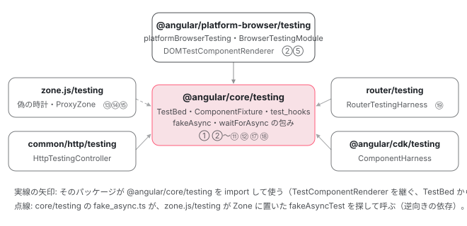

[目次](../README.md) › [テストの内側](README.md) › 第 1 回 / 全 20 回

# テストの全体像：@angular/core/testing と、テストを支えるパッケージの地図

> @angular/core/testing・platform-browser/testing・zone.js/testing・common/http/testing・router/testing・cdk/testing が何を受け持つか。test\_hooks.ts が import されただけで beforeEach / afterEach を登録する仕組みと、ng test では CLI の setup も同じフックを登録して 2 組になること。ng test（Vitest）と Angular 自身の bazel test の初期化の違い。core のテストが 4 つの shard に分かれて走るときの Ran N of M の読み方（N の合計が走った本数、M = 全 spec 数 − (filter に一致した総数 − N)）。

angular/angular · 読了 約 12 分 · 基礎 · [サイトで読む（デモが動きます）](https://angular-deep-dive-cyan.vercel.app/chapter/testing-overview)

---

`TestBed.configureTestingModule` と `fixture.detectChanges()` は毎日書くのに、「`afterEach` を書いていないのに、なぜ前のテストのコンポーネントが消えているのか」と聞かれると答えに詰まります。この章では、`@angular/core/testing` を import した瞬間に何が登録されるのか、テストを支えるパッケージがそれぞれ何を受け持つのか、そして Angular 自身のテストを `bazel test` で走らせたときに出る「`Ran N of M specs`」が 4 回出る理由と、M の決まり方を、ソースの行で確かめます。

読む対象は `packages/core/testing/public_api.ts`・`src/testing.ts`・`src/test_hooks.ts`・`packages/core/test/BUILD.bazel` と、bazel が使う jasmine の 2 ファイル（`jasmine-core` 6.3.0 と `@jasminejs/reporters` 1.1.0）です（angular リポジトリ、v22.2.0-next.7）。

1. **1. 全体像**（この章）
2. [2. initTestEnvironment](02-testing-init-environment.md)
3. [3. 後片付け](03-testing-reset-teardown.md)
4. [4. TestBed.inject](04-testing-inject.md)
5. [5. createComponent](05-testing-create-component.md)
6. [6. 入力の渡し方](06-testing-component-bindings.md)
7. [7. createDirective](07-testing-directive-fixture.md)
8. [8. DebugElement と By](08-testing-debug-element.md)
9. [9. detectChanges](09-testing-detect-changes.md)
10. [10. 自動の変更検知](10-testing-auto-detect.md)
11. [11. whenStable](11-testing-when-stable.md)
12. [12. エラーの伝わり方](12-testing-errors.md)
13. [13. fakeAsync](13-testing-fake-async.md)
14. [14. 偽の時計](14-testing-fake-async-scheduler.md)
15. [15. waitForAsync と ProxyZone](15-testing-wait-for-async.md)
16. [16. zone なしの時間](16-testing-zoneless-time.md)
17. [17. effect と signal](17-testing-effects.md)
18. [18. @defer](18-testing-defer.md)
19. [19. RouterTestingHarness](19-testing-router-harness.md)
20. [20. issue と変更を読む](20-testing-issues.md)

## 1. import しただけで beforeEach と afterEach が登録される

テストファイルの先頭に `import { TestBed } from '@angular/core/testing'` と書くと、パッケージの入口 `public_api.ts` が読み込まれます。

📄 `angular/packages/core/testing/public_api.ts` L9–19 （▶ の行: 16–18）

```ts
 9 │ /// <reference types="jasmine" />
10 │ 
11 │ /**
12 │  * @module
13 │  * @description
14 │  * Entry point for all public APIs of this package.
15 │  */
16 ▶ export * from './src/testing';
17 ▶ export * from './src/testing_private_export';
18 ▶ export {Log as ɵLog} from './src/testing_internal';
19 │ // This file only reexports content of the `src` folder. Keep it that way.
```

16 行目が公開 API の `src/testing.ts`、17 行目が `ɵ` 付きの非公開 export を集めた `src/testing_private_export.ts` です。17 行目の先を開きます。

📄 `angular/packages/core/testing/src/testing_private_export.ts` L1–10 （▶ の行: 10）

```ts
 1 │ /**
 2 │  * @license
 3 │  * Copyright Google LLC All Rights Reserved.
 4 │  *
 5 │  * Use of this source code is governed by an MIT-style license that can be
 6 │  * found in the LICENSE file at https://angular.dev/license
 7 │  */
 8 │ 
 9 │ export {FakeNavigation as ɵFakeNavigation} from '../../primitives/dom-navigation/testing';
10 ▶ export {getCleanupHook as ɵgetCleanupHook} from './test_hooks';
```

10 行目で `test_hooks.ts` の `getCleanupHook` を `ɵgetCleanupHook` という名前で外に出しています。ES モジュールは、export を 1 つでも取り出すとファイル全体を 1 回評価します。つまり `@angular/core/testing` を import すると、`test_hooks.ts` の上から下までが必ず 1 回走ります。

📄 `angular/packages/core/testing/src/test_hooks.ts` L9–28 （▶ の行: 10–12, 21, 28）

```ts
 9 │ /**
10 ▶  * Public Test Library for unit testing Angular applications. Assumes that you are running
11 ▶  * with Jasmine, Mocha, or a similar framework which exports a beforeEach function and
12 ▶  * allows tests to be asynchronous by either returning a promise or using a 'done' parameter.
13 │  */
14 │ 
15 │ import {resetFakeAsyncZoneIfExists} from './fake_async';
16 │ import {TestBedImpl} from './test_bed';
17 │ 
18 │ // Reset the test providers and the fake async zone before each test.
19 │ // We keep a guard because somehow this file can make it into a bundle and be executed
20 │ // beforeEach is only defined when executing the tests
21 ▶ globalThis.beforeEach?.(getCleanupHook(false));
22 │ 
23 │ // We provide both a `beforeEach` and `afterEach`, because the updated behavior for
24 │ // tearing down the module is supposed to run after the test so that we can associate
25 │ // teardown errors with the correct test.
26 │ // We keep a guard because somehow this file can make it into a bundle and be executed
27 │ // afterEach is only defined when executing the tests
28 ▶ globalThis.afterEach?.(getCleanupHook(true));
```

1. **21 行目：`globalThis.beforeEach?.(getCleanupHook(false))`**

   `globalThis.beforeEach` は jasmine や Vitest（`globals: true` のとき）が置くグローバル関数です。`?.` なので、テストランナーがいない環境（誤って本番のバンドルに入った場合など。19〜20 行目のコメント）では何も起きません。いるときは、**このファイルの全テストの前に走る `beforeEach` が 1 つ登録されます**。
2. **28 行目：`globalThis.afterEach?.(getCleanupHook(true))`**

   同じ形の `afterEach` も登録します。23〜25 行目のコメントのとおり、後片付けをテストの*後*に走らせると、片付けで出たエラーを「そのテストの失敗」として報告できるからです。
3. **引数の `false` / `true` が「どちらで片付けるか」を決める**

   `getCleanupHook(expected)` は、`shouldTearDownTestingModule()` の値が `expected` と一致したときだけ `resetTestingModule()` を呼ぶ関数を返します。既定では `destroyAfterEach` が `true` なので afterEach 側が働き、`false` にすると beforeEach 側に移ります。中身は [第 3 回](03-testing-reset-teardown.md)で 1 行ずつ読みます。

> [!TIP]
> **新卒エンジニアへ**
>
> 10〜12 行目のコメントが、このパッケージの前提を書いています。「jasmine や Mocha のように `beforeEach` をグローバルに置き、非同期のテストを Promise か `done` で書ける」ランナーなら動く。`@angular/core/testing` は jasmine にも Vitest にも依存していません。依存しているのは `globalThis.beforeEach` と `globalThis.afterEach` という 2 つの名前だけです。

## 2. @angular/core/testing の中身

📄 `angular/packages/core/testing/src/testing.ts` L15–49 （▶ の行: 15–17, 25–26, 35–37, 46, 49）

```ts
15 ▶ export * from './async';
16 ▶ export {ComponentFixture, DirectiveFixture} from './fixture';
17 ▶ export {
18 │   resetFakeAsyncZone,
19 │   discardPeriodicTasks,
20 │   fakeAsync,
21 │   flush,
22 │   flushMicrotasks,
23 │   tick,
24 │ } from './fake_async';
25 ▶ export {
26 ▶   TestBed,
27 │   getTestBed,
28 │   TestBedStatic,
29 │   inject,
30 │   InjectSetupWrapper,
31 │   withModule,
32 │   TestComponentOptions,
33 │   TestDirectiveOptions,
34 │ } from './test_bed';
35 ▶ export {
36 ▶   TestComponentRenderer,
37 ▶   ComponentFixtureAutoDetect,
38 │   ComponentFixtureNoNgZone,
39 │   TestModuleMetadata,
40 │   TestEnvironmentOptions,
41 │   ModuleTeardownOptions,
42 │ } from './test_bed_common';
43 │ export * from './metadata_override';
44 │ export {MetadataOverrider as ɵMetadataOverrider} from './metadata_overrider';
45 │ export {
46 ▶   ɵDeferBlockBehavior as DeferBlockBehavior,
47 │   ɵDeferBlockState as DeferBlockState,
48 │ } from '../../src/core';
49 ▶ export {DeferBlockFixture} from './defer';
```

15 行目の `async.ts` は `waitForAsync`、16 行目が fixture、17〜24 行目が `fakeAsync` の一式、25〜34 行目が `TestBed` と古い `inject()` / `withModule`、35〜42 行目が設定の型とトークン、46〜49 行目が `@defer` 用です。ファイルごとに、このシリーズのどの回で読むかを並べます。

| src/ のファイル | 中身 | 読む回 |
| --- | --- | --- |
| `test_bed.ts` | `TestBedImpl`（`TestBed` の実体）。static の委ね、`initTestEnvironment`・`resetTestingModule`・`inject`・`createComponent`・`tick` | [2](02-testing-init-environment.md)・[3](03-testing-reset-teardown.md)・[4](04-testing-inject.md)・[5](05-testing-create-component.md)・[17](17-testing-effects.md) |
| `test_bed_compiler.ts` | `TestBedCompiler`。テストモジュールを組み立て、override を当てて再コンパイルする | [NgModule シリーズ](../ngmodule/17-ngmodule-testbed.md)・[standalone シリーズ](../standalone/12-standalone-testbed-override.md) |
| `test_bed_common.ts` | `TestModuleMetadata`・`TestEnvironmentOptions`・`TestComponentRenderer`・既定値の定数 | [2](02-testing-init-environment.md) |
| `test_hooks.ts` | 1 節の自動登録と `getCleanupHook` | 1・[3](03-testing-reset-teardown.md) |
| `fixture.ts` | `ComponentFixture`・`DirectiveFixture`。`detectChanges`・`autoDetectChanges`・`whenStable`・`destroy` | [5](05-testing-create-component.md)・[7](07-testing-directive-fixture.md)・[9](09-testing-detect-changes.md)・[10](10-testing-auto-detect.md)・[11](11-testing-when-stable.md) |
| `application_error_handler.ts` | `TestBedApplicationErrorHandler`。変更検知中のエラーをテストに投げ直す | [12](12-testing-errors.md) |
| `fake_async.ts`・`async.ts` | zone.js の `fakeAsyncTest` / `AsyncTestZoneSpec` を呼ぶ薄い包み | [13](13-testing-fake-async.md)・[15](15-testing-wait-for-async.md) |
| `defer.ts` | `DeferBlockFixture` | [18](18-testing-defer.md) |
| `metadata_override.ts`・`metadata_overrider.ts`・`resolvers.ts` | `overrideComponent` などのメタデータ書き換え | [standalone シリーズ](../standalone/12-standalone-testbed-override.md) |
| `logger.ts`・`testing_internal.ts` | Angular 自身の spec 用の `Log`（`public_api.ts` 18 行目の `ɵLog`） | — |
| `styling.ts` | クラスとスタイルを並べ替えて文字列にする関数。`testing.ts` に無いので公開されず、`packages/core/test` の styling の spec が相対パスで直接 import する | — |

## 3. テストを支えるパッケージの地図

`@angular/core/testing` は「プラットフォームに依存しない」部分だけを持ちます。DOM にコンポーネントを置く方法や、zone.js の時計、HTTP の偽物は、それぞれ別のパッケージにあります。



*テストを支える 6 つのパッケージ。core/testing が中心で、platform-browser/testing がそれに DOM を足す。zone.js/testing は fakeAsync・waitForAsync を使うときだけ要る。丸数字はこのシリーズの回。*

| パッケージ | 主な中身 | 読む場所 |
| --- | --- | --- |
| `@angular/core/testing` | 2 節の表のとおり | このシリーズの大半 |
| `@angular/platform-browser/testing` | `platformBrowserTesting`・`BrowserTestingModule`（`APP_ID`・偽の Navigation・`DOMTestComponentRenderer`） | [第 2 回](02-testing-init-environment.md)・[第 5 回](05-testing-create-component.md) |
| `zone.js/testing` | `packages/zone.js/lib/testing/` の `fake-async.ts`・`async-testing.ts`。`ProxyZoneSpec` と偽の時計 | [第 13 回](13-testing-fake-async.md)〜[第 15 回](15-testing-wait-for-async.md) |
| `@angular/common/http/testing` | `provideHttpClientTesting`・`HttpTestingController`・`TestRequest` | [HTTP シリーズのテストの回](../http/12-http-testing.md) |
| `@angular/router/testing` | `RouterTestingHarness`・非推奨の `RouterTestingModule` | [第 19 回](19-testing-router-harness.md) |
| `@angular/cdk/testing`（components リポジトリ） | `ComponentHarness`・`TestbedHarnessEnvironment` | [CDK シリーズのハーネスの回](../cdk/20-harness.md) |

## 4. ng test と bazel test：同じ TestBed を、誰が初期化するか

`TestBed` は使う前に 1 回だけ `initTestEnvironment` で「どのプラットフォームで、どのモジュールを土台にするか」を決める必要があります（[第 2 回](02-testing-init-environment.md)）。この呼び出しを書くのは、テストを書く人ではなくテストランナーの設定です。`ng test` と Angular 自身の `bazel test` では、この設定が違います。

|   | ng test（このサイト） | bazel test //packages/core/test:test |
| --- | --- | --- |
| ランナー | Vitest 4.1.11 + jsdom（`@angular/build:unit-test`） | Node の jasmine 6.3.0（`angular_jasmine_test`） |
| initTestEnvironment を呼ぶ場所 | unit-test builder が生成する setup（[CLI シリーズの unit-test の回](../cli/12-cli-unit-test.md)） | `tools/testing/node_tests.init.mts`（[contrib シリーズの spec を読む回](../contrib/06-contrib-reading-specs.md)） |
| プラットフォームとモジュール | `platformBrowserTesting()` と `[BrowserTestingModule, TestModule]` | `platformServerTesting()` と `[ServerTestingModule, TestModule]`（DOM は domino） |
| zone.js | 読み込まない（`typeof Zone` は `"undefined"`） | 読み込む。`TestModule` が `provideZonelessChangeDetection()` を足すので、ログに NG0914 の警告が出る |
| beforeEach / afterEach の登録 | 1 節の test\_hooks.ts と、setup が明示的に登録するもの（下）の 2 組 | 1 節の test\_hooks.ts の 1 組 |

📄 `angular-cli/packages/angular/build/src/builders/unit-test/runners/vitest/build-options.ts` L77–81 （▶ の行: 80–81）

```ts
77 │     // The beforeEach and afterEach hooks are registered outside the globalThis guard.
78 │     // This ensures that the hooks are always applied, even in non-isolated browser environments.
79 │     // Same as https://github.com/angular/angular/blob/05a03d3f975771bb59c7eefd37c01fa127ee2229/packages/core/testing/srcs/test_hooks.ts#L21-L29
80 ▶     beforeEach(getCleanupHook(false));
81 ▶     afterEach(getCleanupHook(true));
```

80〜81 行目で、CLI の setup も同じ `ɵgetCleanupHook` を `beforeEach` / `afterEach` に登録しています。一方、Vitest は CLI の設定で `globals: true` なので `globalThis.afterEach` もあり、1 節の 28 行目も働きます。本当に 2 回走るのかを、このサイトの ng test（Vitest + jsdom、`@angular/core` 22.1.6）で確かめました。1 本目のテストで `resetTestingModule` を数える関数に差し替え、2 本目で回数を読みます。

📄 `src/verify-a/env.spec.ts（要点だけ）`

```
// src/verify-a/env.spec.ts（確かめたあと消した）
const g = globalThis as any;
g.__resetCalls = 0;

describe('env probe', () => {
  it('first', () => {
    const tb = getTestBed() as any;
    const orig = tb.resetTestingModule.bind(tb);
    tb.resetTestingModule = () => { g.__resetCalls++; return orig(); };
    g.__first = { beforeEach: typeof g.beforeEach, zone: typeof g.Zone /* ほか */ };
  });
  it('second', () => {
    // first の afterEach と second の beforeEach のあいだに何回呼ばれたか
    const r = { ...g.__first, resetCallsBetween: g.__resetCalls };
    throw new Error('PROBE ' + JSON.stringify(r));
  });
});
```

| 読んだもの | 結果 | 意味 |
| --- | --- | --- |
| `typeof globalThis.beforeEach` | `"function"` | test\_hooks.ts 21・28 行目の `?.` の先が呼ばれる |
| `typeof Zone` | `"undefined"` | zone.js なし |
| 1 本目の afterEach 〜 2 本目の beforeEach での `resetTestingModule` の回数 | **2** | afterEach が 2 つ登録されていて、両方が `resetTestingModule()` を呼んだ。beforeEach 側は `false` と一致しないので 0 回 |

2 回目の `resetTestingModule()` は、1 回目で fixture もモジュールも片付いたあとなので、実質なにもしません（片付けの中身は [第 3 回](03-testing-reset-teardown.md)）。害はありませんが、「片付けは 1 回」と思い込んで `resetTestingModule` に spy を仕掛けると数が合わない、という形で出会うことがあります。

## 5. テスト 1 本の一生

ここまでの話を、1 本の `it` の前後に並べます。各段の中身は右のリンクの回で読みます。

> **🧪 DEMO — テスト 1 本の一生（再現）**
>
> 本物の TestBed は動かしていません（ページの上で TestBed を初期化すると、このサイト自身のアプリと衝突するため）。test\_hooks.ts と test\_bed.ts の行の順番を、そのまま段にしています。「次へ」で 1 段ずつ進みます。
>
> ▶ [このデモはサイトで動かせます](https://angular-deep-dive-cyan.vercel.app/chapter/testing-overview)

## 6. テストの地図：packages/core/test と、4 回出る Ran

このシリーズで読む仕組みを確かめている spec は、ほとんどが `packages/core/test/` の直下にあります。

| spec（packages/core/test/） | 一番外の describe | 試しているもの |
| --- | --- | --- |
| `test_bed_spec.ts` | `describe('TestBed')`（:646）ほか一番外に 8 個 | override・`TestBed.inject`（:2474）・`TestBed.tick`（:2521）。`TestBed module teardown`（:2673）・`` TestBed module `errorOnUnknownElements` ``（:2911）・`TestBed.createDirective`（:2969）は外側の describe |
| `component_fixture_spec.ts` | `describe('ComponentFixture')`（:164）/ `describe('ComponentFixture with zoneless')`（:581） | `detectChanges`・`autoDetect`・`whenStable`・`errors during ApplicationRef.tick`（:424） |
| `fake_async_spec.ts` | `describe('fake async')`（:16）/ `describe('ProxyZone')`（:410） | `tick`・`flush`・Promise と timer |
| `defer_fixture_spec.ts` | `describe('DeferFixture')`（:23） | `DeferBlockFixture.render` |
| `test_bed_effect_spec.ts` | `describe('effects in TestBed')`（:22） | effect がいつ走るか |
| `debug/debug_node_spec.ts` | `describe('debug element')`（:315） | `DebugElement.query`・`properties`・`componentInstance` |

`platform-browser/test/testing_public_spec.ts` の `describe('public testing API')`（:156）も TestBed の公開 API を広く試しています（[第 4 回](04-testing-inject.md)で使います）。これらを束ねる bazel のターゲットはこれです。

📄 `angular/packages/core/test/BUILD.bazel` L78–93 （▶ の行: 78–79, 84, 87–88）

```python
78 ▶ angular_jasmine_test(
79 ▶     name = "test",
80 │     data = [
81 │         ":test_lib",
82 │         ":test_node_only_lib",
83 │     ],
84 ▶     shard_count = 4,
85 │ )
86 │ 
87 ▶ ng_web_test_suite(
88 ▶     name = "test_web",
89 │     external = ["@angular/platform-server"],
90 │     deps = [
91 │         ":test_lib",
92 │     ],
93 │ )
```

78〜85 行目の `test` が Node の jasmine で走るターゲット、87〜93 行目の `test_web` が同じ spec（`_node_only_spec.ts` を除く `test_lib`）をブラウザで走らせるターゲットです（この章では走らせません）。84 行目の `shard_count = 4` で、**spec が 4 つのプロセスに分けて並列に走ります**。`angular_jasmine_test` から先の bzl の読み方は [contrib シリーズの Bazel の回](../contrib/04-contrib-bazel.md)にあります。

📄 `ターミナル`

```
cd ~/angular-research/angular

# packages/core/test の spec（Node の jasmine、4 つに分けて走る）
pnpm bazel test //packages/core/test:test \
  --test_arg=--filter="TestBed" --test_output=all
```

📄 `出力（抜粋。2026-11-01 に ~/angular-research/angular で実行）`

```
==================== Test output for //packages/core/test:test (shard 2 of 4):
Pending:
1) TestBed should throw errors in listeners
  Temporarily disabled with xit
Ran 36 of 1294 specs
36 specs, 0 failures, 1 pending spec
==================== Test output for //packages/core/test:test (shard 3 of 4):
Ran 36 of 1294 specs
36 specs, 0 failures
==================== Test output for //packages/core/test:test (shard 4 of 4):
Ran 36 of 1294 specs
36 specs, 0 failures
==================== Test output for //packages/core/test:test (shard 1 of 4):
Ran 35 of 1293 specs
35 specs, 0 failures
INFO: Elapsed time: 3.799s, Critical Path: 1.86s
//packages/core/test:test                                                PASSED in 1.8s
```

`Ran N of M specs` が 4 回出ます。走った本数は 4 つの N の合計で、35 + 36 + 36 + 36 = **143 本**です（そのうち 1 本は `xit` の pending）。では M（1293 や 1294）は何でしょうか。「全 spec の数」でも「4 分の 1」でもありません。3 つのファイルを順に読むと決まり方が分かります。

### (1) 誰がどの shard に入るか：runner.cjs

📄 `aspect_rules_jasmine/jasmine/private/runner.cjs（bazel の external。angular リポジトリの外）` L75–107 （▶ の行: 92–94, 96–97）

```
 75 │   const Order = jasmine.Order;
 76 │   jasmine.Order = ($j) => {
 77 │     const DefaultOrder = Order($j);
 78 │     return class ShardingOrder {
 79 │       constructor(options) {
 80 │         this.default = new DefaultOrder(options);
 81 │       }
 82 │       sort(items) {
 83 │         const filterItems = [];
 84 │         for (const item of items) {
 85 │           // See: https://github.com/jasmine/jasmine/blob/d0a9931ae6bfa63c73952a07b1cff05b2a8b38e8/src/core/SuiteBuilder.js#L170
 86 │           if (item.id.startsWith("suite")) {
 87 │             filterItems.push(item);
 88 │             continue;
 89 │           }
 90 │ 
 91 │           // See: https://github.com/jasmine/jasmine/blob/d0a9931ae6bfa63c73952a07b1cff05b2a8b38e8/src/core/SuiteBuilder.js#L201
 92 ▶           const index = Number(item.id.replace("spec", ""));
 93 ▶           const assignedShard = index % shardCount;
 94 ▶           if (assignedShard !== shardIndex) {
 95 │             // Bazel shards are not 0 indexed, so we add 1 to the shard index.
 96 ▶             item.exclude(
 97 ▶               `${shardReasonPrefix} ${assignedShard + 1} per strategy (Current: ${shardIndex + 1}).`,
 98 │             );
 99 │           } else {
100 │             filterItems.push(item);
101 │           }
102 │         }
103 │ 
104 │         return this.default.sort(shouldUseFilteredItems ? filterItems : items);
105 │       }
106 │     };
107 │   };
```

92〜93 行目、spec の id（`spec0`, `spec1`, …。jasmine が定義順に振る）の番号を `shardCount`（4）で割った余りで、担当の shard が決まります。94〜98 行目、自分の担当でない spec には `item.exclude('Skipped: Assigned to shard …')` を呼びます。走らないように印を付けるだけで、spec そのものは残ります。

📄 `aspect_rules_jasmine/jasmine/private/runner.cjs` L41–57 （▶ の行: 48–49, 52）

```js
41 │     Object.defineProperty(env, "addReporter", {
42 │       value: function (reporter) {
43 │         const wrappedReporter = new Proxy(reporter, {
44 │           get(target, prop) {
45 │             if (prop === "specDone") {
46 │               return function (result) {
47 │                 if (
48 ▶                   result.status === "pending" &&
49 ▶                   result.pendingReason?.startsWith(shardReasonPrefix)
50 │                 ) {
51 │                   // These specs are skipped due to sharding, so we don't want to report them as pending.
52 ▶                   return;
53 │                 }
54 │ 
55 │                 return target.specDone?.apply(target, arguments);
56 │               };
57 │             }
```

48〜52 行目、結果を報告するとき、**状態が `pending` で理由が「Assigned to shard」で始まるものだけ**を捨てます。

### (2) 2 つの印が重なったら：jasmine-core の status()

📄 `angular/node_modules/jasmine-core/lib/jasmine-core/jasmine.js` L1048–1065 （▶ の行: 1050, 1055, 1059–1060, 1063–1064）

```js
1048 │     // Like pend(), but pending state will survive reset().
1049 │     // Useful for fit, xit, where pending state remains.
1050 ▶     exclude(message) {
1051 │       this.markedExcluding = true;
1052 │       if (message) {
1053 │         this.excludeMessage = message;
1054 │       }
1055 ▶       this.pend(message);
1056 │     }
1057 │ 
1058 │     status() {
1059 ▶       if (this.#executionState.dynamicallyExcluded) {
1060 ▶         return 'excluded';
1061 │       }
1062 │ 
1063 ▶       if (this.markedPending) {
1064 ▶         return 'pending';
1065 │       }
```

1050〜1055 行目の `exclude` は pending の印です。ところが 1059〜1061 行目、`--filter` に一致せず外された spec（`dynamicallyExcluded`）は、それより先に `'excluded'` を返します。つまり「**ほかの shard の担当で、しかも filter にも一致しない**」spec は `pending` ではなく `excluded` になり、(1) の 48 行目の条件をすり抜けて報告されます。

### (3) 報告された数が M：console\_reporter.js

📄 `angular/node_modules/.pnpm/@jasminejs+reporters@1.1.0/node_modules/@jasminejs/reporters/lib/console_reporter.js` L265–291 （▶ の行: 266, 271, 281, 288）

```js
265 │   specDone(result) {
266 ▶     this._specCount++;
267 │ 
268 │     switch (result.status) {
269 │       case 'pending':
270 │         this.#pendingSpecs.push(result);
271 ▶         this._executableSpecCount++;
272 │         this.#print(this.#colored('yellow', '*'));
273 │         break;
274 │ 
275 │       case 'notApplicable':
276 │         this.#notApplicableSpecs.push(result);
277 │         this._executableSpecCount++;
278 │         break;
279 │ 
280 │       case 'passed':
281 ▶         this._executableSpecCount++;
282 │         this.#print(this.#colored('green', '.'));
283 │         break;
284 │ 
285 │       case 'failed':
286 │         this._failureCount++;
287 │         this.#failedSpecs.push(result);
288 ▶         this._executableSpecCount++;
289 │         this.#print(this.#colored('red', 'F'));
290 │         break;
291 │     }
```

266 行目、報告された spec はすべて `_specCount`（M）に数えられ、271・281・288 行目、pending・passed・failed だけが `_executableSpecCount`（N）に数えられます。`excluded` は M にだけ入ります。ここから、1 つの shard の M は次のように決まります。

1. **自分の担当の spec は全部 M に入る**

   filter に一致すれば passed など（N にも入る）、一致しなければ excluded（M だけ）。
2. **ほかの担当で filter に一致しない spec も M に入る**

   (2) のとおり excluded になり、捨てられないからです。
3. **ほかの担当で filter に一致する spec だけが M から消える**

   これだけが pending + 「Assigned to shard」のまま残り、(1) の 52 行目で捨てられます。全 spec 数を T、filter に一致した総数を F、その shard で走った数を N とすると、**M = T − (F − N)** です。

このマシンで走らせた 6 回の結果は、どれも T = 1401 で説明がつきます。

| --filter | 4 つの N（合計 F） | 4 つの M | T − (F − N) |
| --- | --- | --- | --- |
| `"TestBed"` | 35 / 36 / 36 / 36（143） | 1293 / 1294 / 1294 / 1294 | 1401 − 108 = 1293、1401 − 107 = 1294 |
| `"ComponentFixture"` | 6 / 7 / 7 / 6（26） | 1381 / 1382 / 1382 / 1381 | 1401 − 20 = 1381、1401 − 19 = 1382 |
| `"fake async"` | 8 / 8 / 8 / 10（34） | 1375 / 1375 / 1375 / 1377 | 1401 − 26 = 1375、1401 − 24 = 1377 |
| `"TestBed module teardown"` | 4 / 4 / 4 / 4（16） | 1389 × 4 | 1401 − 12 = 1389 |
| `"TestBed module .errorOnUnknown"` | 2 / 2 / 2 / 2（8） | 1395 × 4 | 1401 − 6 = 1395 |
| `"…TestBed TestBed.inject\|runInInjectionContext"` | 1 / 1 / 1 / 1（4） | 1398 × 4 | 1401 − 3 = 1398 |

M の合計が実行ごとに 5526・5502 と揺れて見えたのは、合計が 4T − 3F（= 5604 − 3F）で、filter に一致した数 F によって変わるからです。`//packages/core/test:test` の spec は 1401 本です（`acceptance/` などは BUILD.bazel が別にあるので、このターゲットに入りません）。この式は、20 本の spec を書いた小さなファイルを同じ `runner.cjs` と jasmine 6.3.0 で 4 つに分けて走らせても成り立ちました（filter なしでは各 shard が `5 specs` で Ran の行が出ず、`--filter=alpha` では 13 / 13 / 12 / 12）。

> [!WARNING]
> **ハマりどころ**
>
> `--filter` を付けずに走らせると、各 shard の M と N が一致するので `Ran N of M` の行そのものが出ず、`N specs, 0 failures` だけが 4 回出ます。どちらの場合も「走った本数」は 4 つの N の合計です。M は走った本数ではありません。filter が 1 本も一致しなくても `PASSED` になる落とし穴は [forms シリーズの第 1 回](../forms/01-forms-overview.md)と同じです。

## テストと直し方

1. **1 節の仕組みを確かめている spec**

   `getCleanupHook` を直接呼ぶ spec は `packages/` の下にありません（`grep -rn getCleanupHook --include='*.ts' packages` で `core/testing/src` の外は 0 件）。自動登録が働いていることは、`test_bed_spec.ts` の `describe('TestBed module teardown')`（:2673）の 16 本が、afterEach を書かずに前提にしています（[第 3 回](03-testing-reset-teardown.md)で走らせます）。
2. **走らせ方**

   6 節のコマンドの形で、`--test_arg=--filter=` に describe と it をスペースでつないだ名前の一部を渡し、`--test_output=all` で 4 つの N を足します。ビルド済みならこのマシンで 3〜4 秒（Elapsed）でした。
3. **直すとしたら**

   自動登録の条件は `test_hooks.ts` の 21・28 行目、どちらで片付けるかは 30〜38 行目の `getCleanupHook` です。変えたら `test_bed_spec.ts` の `TestBed module teardown` に足すのが入口です。本家に出す前に、手元で走らせて N を確かめるところまでにします。issue を読むときは「どのランナーで、フックが何組登録されているか」（4 節）をまず確かめると、片付けの回数の食い違いを説明できます（[第 20 回](20-testing-issues.md)）。

## 聞かれそうな質問

**Q. ng test と bazel test で、TestBed は同じものですか？**

クラスは同じ `TestBedImpl` です（`@angular/core/testing` の同じソース）。違うのは初期化の引数で、ng test は `platformBrowserTesting()` と `BrowserTestingModule`、Angular 自身の Node のテストは `platformServerTesting()` と `ServerTestingModule` を渡しています（4 節の表）。さらに bazel のほうは zone.js と fakeAsync 用のプラグイン（`tools/testing/zone_base_setup.mts` が `zone.js/plugins/fake-async-test` などを import する）を読み込むので、`fakeAsync` が使えます。ng test（このサイトの設定）は zone.js が無いので使えません。どちらも TestBed のテストモジュール自体は既定で zoneless です（[第 16 回](16-testing-zoneless-time.md)）。

**Q. afterEach を自分で書かなくても前のテストが片付くのはなぜですか？**

`@angular/core/testing` を import した時点で、public\_api.ts 17 行目 → testing\_private\_export.ts 10 行目 → test\_hooks.ts が評価され、28 行目で `globalThis.afterEach(getCleanupHook(true))` が登録されるからです。既定の `destroyAfterEach: true` ではこのフックが `resetTestingModule()` を呼びます。ng test では CLI の setup も同じフックを登録するので、実際には 2 回呼ばれます（4 節で確かめた）。

**Q. jest や Vitest でも動くのはなぜですか？**

`@angular/core/testing` がランナーに求めるのは、`globalThis.beforeEach` と `globalThis.afterEach` という名前だけだからです（test\_hooks.ts 21・28 行目、10〜12 行目のコメント）。jasmine の API（`spyOn` など）には依存していません。ただし `initTestEnvironment` は誰かが 1 回呼ぶ必要があり、Vitest では CLI の unit-test builder がそれを生成します。

**Q. bazel test の「Ran 36 of 1294 specs」の 1294 は何ですか？**

その shard の reporter に届いた spec の数です。runner.cjs が捨てるのは「ほかの shard の担当で、filter に一致した」spec だけなので、M = 全 spec 数 − (filter に一致した総数 − その shard で走った数) になります。`--filter="TestBed"` なら 1401 − (143 − 36) = 1294 です。走った本数は 4 つの N の合計（143）で読みます。

## 読み終えて

- `@angular/core/testing` を import すると test\_hooks.ts が評価され、`globalThis.beforeEach` / `afterEach` があれば片付けのフックが 1 組登録される。ng test では CLI の setup がもう 1 組登録する。
- core/testing はプラットフォームに依存しない部分だけを持ち、DOM は platform-browser/testing、偽の時計は zone.js/testing、HTTP・Router・CDK はそれぞれの testing パッケージが持つ。
- ng test と bazel test は同じ `TestBedImpl` を、違う `initTestEnvironment` の引数で使っている。
- `//packages/core/test:test` は 4 つの shard に分かれ、走った本数は 4 つの N の合計。M は M = T − (F − N) で決まり、T は 1401。

---

← 前: [forms の issue と PR を読む：どこから関わるか](../forms/20-forms-issues.md)  
次: [initTestEnvironment：テスト用のプラットフォームと BrowserTestingModule](02-testing-init-environment.md) →
