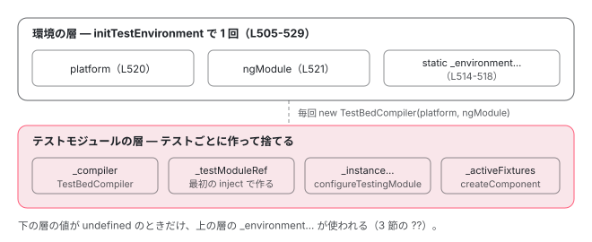

[目次](../README.md) › [テストの内側](README.md) › 第 2 回 / 全 20 回

# initTestEnvironment：テスト用のプラットフォームと BrowserTestingModule

> TestBed がクラス TestBedImpl そのもので、static のメソッドが 1 つだけの TestBedImpl.INSTANCE へ委ねる作り。initTestEnvironment が platform・ngModule・最初の TestBedCompiler と static の環境オプションを持ち、2 回目を拒む行。platformBrowserTesting（platformBrowser + 印のトークン）と BrowserTestingModule（APP\_ID・偽の Navigation・DOMTestComponentRenderer）、TestEnvironmentOptions（teardown・errorOnUnknownElements・errorOnUnknownProperties）が instance ?? 環境 ?? 既定 の順で効く場所、resetTestEnvironment が戻すものと戻さないもの。

angular/angular · 読了 約 12 分 · 中核 · [サイトで読む（デモが動きます）](https://angular-deep-dive-cyan.vercel.app/chapter/testing-init-environment)

---

`TestBed.configureTestingModule(...)` と書くとき、`TestBed` はクラスでしょうか、インスタンスでしょうか。この章では、`TestBed` の実体が 1 つだけの `TestBedImpl.INSTANCE` で、static のメソッドがそこへ委ねていること、`initTestEnvironment` が「1 回だけ」受け取る 3 つ（プラットフォーム・土台のモジュール・オプション）と、それを 2 回目に拒む行、`platformBrowserTesting` と `BrowserTestingModule` が何を provide しているかを、ソースの行で確かめます。

読む対象は `packages/core/testing/src/test_bed.ts`・`test_bed_common.ts`・`packages/platform-browser/testing/src/browser.ts` と、非推奨の `platform-browser-dynamic/testing`・`platform-server/testing` です（angular リポジトリ、v22.2.0-next.7）。

1. [1. 全体像](01-testing-overview.md)
2. **2. initTestEnvironment**（この章）
3. [3. 後片付け](03-testing-reset-teardown.md)
4. [4. TestBed.inject](04-testing-inject.md)
5. [5. createComponent](05-testing-create-component.md)
6. [6. 入力の渡し方](06-testing-component-bindings.md)
7. [7. createDirective](07-testing-directive-fixture.md)
8. [8. DebugElement と By](08-testing-debug-element.md)
9. [9. detectChanges](09-testing-detect-changes.md)
10. [10. 自動の変更検知](10-testing-auto-detect.md)
11. [11. whenStable](11-testing-when-stable.md)
12. [12. エラーの伝わり方](12-testing-errors.md)
13. [13. fakeAsync](13-testing-fake-async.md)
14. [14. 偽の時計](14-testing-fake-async-scheduler.md)
15. [15. waitForAsync と ProxyZone](15-testing-wait-for-async.md)
16. [16. zone なしの時間](16-testing-zoneless-time.md)
17. [17. effect と signal](17-testing-effects.md)
18. [18. @defer](18-testing-defer.md)
19. [19. RouterTestingHarness](19-testing-router-harness.md)
20. [20. issue と変更を読む](20-testing-issues.md)

## 1. TestBed はクラスで、実体は 1 つ

📄 `angular/packages/core/testing/src/test_bed.ts` L1031–1040 （▶ の行: 1039）

```ts
1031 │  * @description
1032 │  * Configures and initializes environment for unit testing and provides methods for
1033 │  * creating components and services in unit tests.
1034 │  *
1035 │  * `TestBed` is the primary api for writing unit tests for Angular applications and libraries.
1036 │  *
1037 │  * @publicApi
1038 │  */
1039 ▶ export const TestBed: TestBedStatic = TestBedImpl;
1040 │ 
```

1039 行目、公開されている `TestBed` は **`TestBedImpl` というクラスそのもの**です（型 `TestBedStatic` は「static のメソッドを持ち、new もできる」という意味）。だから `TestBed.configureTestingModule(...)` は static メソッドの呼び出しです。では static メソッドは何をしているのか。

📄 `angular/packages/core/testing/src/test_bed.ts` L215–237 （▶ の行: 220–221, 232, 234–235）

```ts
215 │ /**
216 │  * Returns a singleton of the `TestBed` class.
217 │  *
218 │  * @publicApi
219 │  */
220 ▶ export function getTestBed(): TestBed {
221 ▶   return TestBedImpl.INSTANCE;
222 │ }
223 │ 
224 │ /**
225 │  * @description
226 │  * Configures and initializes environment for unit testing and provides methods for
227 │  * creating components and services in unit tests.
228 │  *
229 │  * TestBed is the primary api for writing unit tests for Angular applications and libraries.
230 │  */
231 │ export class TestBedImpl implements TestBed {
232 ▶   private static _INSTANCE: TestBedImpl | null = null;
233 │ 
234 ▶   static get INSTANCE(): TestBedImpl {
235 ▶     return (TestBedImpl._INSTANCE = TestBedImpl._INSTANCE || new TestBedImpl());
236 │   }
237 │ 
```

232 行目の `_INSTANCE` は最初 `null` で、234〜236 行目の getter が初めて読まれたときに `new TestBedImpl()` を 1 回だけ作ります。220〜222 行目の `getTestBed()` も同じ `INSTANCE` を返すだけです。

📄 `angular/packages/core/testing/src/test_bed.ts` L315–345 （▶ の行: 320–321, 331, 343）

```ts
315 │   static initTestEnvironment(
316 │     ngModule: Type<any> | Type<any>[],
317 │     platform: PlatformRef,
318 │     options?: TestEnvironmentOptions,
319 │   ): TestBed {
320 ▶     const testBed = TestBedImpl.INSTANCE;
321 ▶     testBed.initTestEnvironment(ngModule, platform, options);
322 │     return testBed;
323 │   }
324 │ 
325 │   /**
326 │    * Reset the providers for the test injector.
327 │    *
328 │    * @publicApi
329 │    */
330 │   static resetTestEnvironment(): void {
331 ▶     TestBedImpl.INSTANCE.resetTestEnvironment();
332 │   }
333 │ 
334 │   static configureCompiler(config: {providers?: any[]; useJit?: boolean}): TestBed {
335 │     return TestBedImpl.INSTANCE.configureCompiler(config);
336 │   }
337 │ 
338 │   /**
339 │    * Allows overriding default providers, directives, pipes, modules of the test injector,
340 │    * which are defined in test_injector.js
341 │    */
342 │   static configureTestingModule(moduleDef: TestModuleMetadata): TestBed {
343 ▶     return TestBedImpl.INSTANCE.configureTestingModule(moduleDef);
344 │   }
345 │ 
```

320〜321 行目、331 行目、343 行目。static のメソッドはどれも `TestBedImpl.INSTANCE` の同じ名前のインスタンスメソッドを呼ぶだけです。この先の `inject`・`createComponent`・`resetTestingModule` まで、static は全部この形の 1 行です。つまり **テストファイルがいくつあっても、同じ JavaScript の実行環境の中では状態を持つ `TestBedImpl` は 1 つ**で、テストのたびに中身を入れ替えて使い回します（入れ替えは [第 3 回](03-testing-reset-teardown.md)）。

> [!TIP]
> **新卒エンジニアへ**
>
> このサイトの ng test で `typeof TestBed` は `"function"`（クラス）、`TestBed.inject(TestBed) === getTestBed()` は `true` でした。`TestBed.inject(TestBed)` が実体を返す行は [第 4 回](04-testing-inject.md)で読みます。

## 2. initTestEnvironment が受け取って持つもの

実体が持つフィールドのうち、環境に関わるものはこれだけです。

📄 `angular/packages/core/testing/src/test_bed.ts` L476–490 （▶ の行: 478–479, 481–483）

```ts
476 │   // Properties
477 │ 
478 ▶   platform: PlatformRef = null!;
479 ▶   ngModule: Type<any> | Type<any>[] = null!;
480 │ 
481 ▶   private _compiler: TestBedCompiler | null = null;
482 ▶   private _testModuleRef: NgModuleRef<any> | null = null;
483 ▶   private _activeFixtures: AbstractFixture<unknown>[] = [];
484 │ 
485 │   /**
486 │    * Internal-only flag to indicate whether a module
487 │    * scoping queue has been checked and flushed already.
488 │    * @docs-private
489 │    */
490 │   globalCompilationChecked = false;
```

478〜479 行目の `platform` と `ngModule` は、最初 `null!` です。481 行目の `_compiler`（`TestBedCompiler`）、482 行目の `_testModuleRef`（テストごとに作るモジュール）、483 行目の `_activeFixtures` もまだ空です。`initTestEnvironment` がこのうち上の 3 つを埋めます（[NgModule シリーズの TestBed の回](../ngmodule/17-ngmodule-testbed.md)でも 505〜522 行目を短く見ました）。

📄 `angular/packages/core/testing/src/test_bed.ts` L505–543 （▶ の行: 510–511, 514, 516, 518, 520–522, 528, 537–542）

```ts
505 │   initTestEnvironment(
506 │     ngModule: Type<any> | Type<any>[],
507 │     platform: PlatformRef,
508 │     options?: TestEnvironmentOptions,
509 │   ): void {
510 ▶     if (this.platform || this.ngModule) {
511 ▶       throw new Error('Cannot set base providers because it has already been called');
512 │     }
513 │ 
514 ▶     TestBedImpl._environmentTeardownOptions = options?.teardown;
515 │ 
516 ▶     TestBedImpl._environmentErrorOnUnknownElementsOption = options?.errorOnUnknownElements;
517 │ 
518 ▶     TestBedImpl._environmentErrorOnUnknownPropertiesOption = options?.errorOnUnknownProperties;
519 │ 
520 ▶     this.platform = platform;
521 ▶     this.ngModule = ngModule;
522 ▶     this._compiler = new TestBedCompiler(this.platform, this.ngModule);
523 │ 
524 │     // TestBed does not have an API which can reliably detect the start of a test, and thus could be
525 │     // used to track the state of the NgModule registry and reset it correctly. Instead, when we
526 │     // know we're in a testing scenario, we disable the check for duplicate NgModule registration
527 │     // completely.
528 ▶     setAllowDuplicateNgModuleIdsForTest(true);
529 │   }
530 │ 
531 │   /**
532 │    * Reset the providers for the test injector.
533 │    *
534 │    * @publicApi
535 │    */
536 │   resetTestEnvironment(): void {
537 ▶     this.resetTestingModule();
538 ▶     this._compiler = null;
539 ▶     this.platform = null!;
540 ▶     this.ngModule = null!;
541 ▶     TestBedImpl._environmentTeardownOptions = undefined;
542 ▶     setAllowDuplicateNgModuleIdsForTest(false);
543 │   }
```

1. **510〜512 行目：2 回目は投げる**

   `platform` か `ngModule` がすでに入っていたら `'Cannot set base providers because it has already been called'` を投げます。このサイトの ng test で、CLI がもう呼んだあとにテストの中からもう一度 `TestBed.initTestEnvironment(BrowserTestingModule, platformBrowserTesting())` を呼ぶと、この文がそのまま返りました。
2. **514〜518 行目：オプションは static に入る**

   `teardown`・`errorOnUnknownElements`・`errorOnUnknownProperties` を `TestBedImpl._environment…` という **static のフィールド**にしまいます。インスタンスではなくクラスに置くのは、どのテストからも「環境の既定値」として読むためです（3 節）。
3. **520〜522 行目：プラットフォーム・土台のモジュール・最初のコンパイラ**

   `platform` と `ngModule` を覚え、それを渡して最初の `TestBedCompiler` を作ります。`ngModule` は配列でもよく（506 行目の型）、CLI は `[BrowserTestingModule, TestModule]` を渡します（4 節）。`TestBedCompiler` はこのあとテストごとに `resetTestingModule` の中で作り直されますが（[第 3 回](03-testing-reset-teardown.md)）、そのたびに同じ `platform` と `ngModule` を受け取ります。
4. **528 行目：NgModule の id の重複チェックを止める**

   524〜527 行目のコメントのとおり、TestBed にはテストの始まりを確実に知る手段が無いので、同じ id の NgModule が何度登録されてもエラーにしないよう切り替えます。
5. **536〜543 行目：resetTestEnvironment**

   537 行目でまずテストモジュールを片付け、538〜540 行目でコンパイラ・プラットフォーム・モジュールを `null` に戻し、542 行目で重複チェックを戻します。541 行目で戻すのは `_environmentTeardownOptions` だけで、516・518 行目の 2 つは戻しません。次の `initTestEnvironment` が 516・518 行目で上書きするので（渡さなければ `undefined`）、値が残るのはその間だけです。`platform` そのものの `destroy()` は呼びません。

## 3. TestEnvironmentOptions と、「環境の値」が効く順番

📄 `angular/packages/core/testing/src/test_bed_common.ts` L107–141 （▶ の行: 110, 114, 121, 128, 135, 137, 140）

```ts
107 │ /**
108 │  * @publicApi
109 │  */
110 ▶ export interface TestEnvironmentOptions {
111 │   /**
112 │    * Configures the test module teardown behavior in `TestBed`.
113 │    */
114 ▶   teardown?: ModuleTeardownOptions;
115 │   /**
116 │    * Whether errors should be thrown when unknown elements are present in component's template.
117 │    * Defaults to `false`, where the error is simply logged.
118 │    * If set to `true`, the error is thrown.
119 │    * @see [NG8001](/errors/NG8001) for the description of the error and how to fix it
120 │    */
121 ▶   errorOnUnknownElements?: boolean;
122 │   /**
123 │    * Whether errors should be thrown when unknown properties are present in component's template.
124 │    * Defaults to `false`, where the error is simply logged.
125 │    * If set to `true`, the error is thrown.
126 │    * @see [NG8002](/errors/NG8002) for the description of the error and how to fix it
127 │    */
128 ▶   errorOnUnknownProperties?: boolean;
129 │ }
130 │ 
131 │ /**
132 │  * Configures the test module teardown behavior in `TestBed`.
133 │  * @publicApi
134 │  */
135 ▶ export interface ModuleTeardownOptions {
136 │   /** Whether the test module should be destroyed after every test. Defaults to `true`. */
137 ▶   destroyAfterEach: boolean;
138 │ 
139 │   /** Whether errors during test module destruction should be re-thrown. Defaults to `true`. */
140 ▶   rethrowErrors?: boolean;
141 │ }
```

110〜129 行目、環境に渡せるのは 3 つです。114 行目の `teardown` は 135〜141 行目の `ModuleTeardownOptions`（`destroyAfterEach` と `rethrowErrors`）。同じ 3 つは `configureTestingModule` に渡す `TestModuleMetadata` にもあり、そちらは「そのテストだけ」の値です。2 つを持つフィールドが並んでいます。

📄 `angular/packages/core/testing/src/test_bed.ts` L238–260 （▶ の行: 242, 248, 254, 260）

```ts
238 │   /**
239 │    * Teardown options that have been configured at the environment level.
240 │    * Used as a fallback if no instance-level options have been provided.
241 │    */
242 ▶   private static _environmentTeardownOptions: ModuleTeardownOptions | undefined;
243 │ 
244 │   /**
245 │    * "Error on unknown elements" option that has been configured at the environment level.
246 │    * Used as a fallback if no instance-level option has been provided.
247 │    */
248 ▶   private static _environmentErrorOnUnknownElementsOption: boolean | undefined;
249 │ 
250 │   /**
251 │    * "Error on unknown properties" option that has been configured at the environment level.
252 │    * Used as a fallback if no instance-level option has been provided.
253 │    */
254 ▶   private static _environmentErrorOnUnknownPropertiesOption: boolean | undefined;
255 │ 
256 │   /**
257 │    * Teardown options that have been configured at the `TestBed` instance level.
258 │    * These options take precedence over the environment-level ones.
259 │    */
260 ▶   private _instanceTeardownOptions: ModuleTeardownOptions | undefined;
```

242・248・254 行目が static（環境）、260 行目以降が instance（テストごと）です。239〜241 行目と 257〜259 行目のコメントに「instance が優先、環境は fallback」と書いてあり、その通りに読むのが次の関数です。

📄 `angular/packages/core/testing/src/test_bed.ts` L950–959 （▶ の行: 953–955）

```ts
950 │   shouldThrowErrorOnUnknownProperties(): boolean {
951 │     // Check if a configuration has been provided to throw when an unknown property is found
952 │     return (
953 ▶       this._instanceErrorOnUnknownPropertiesOption ??
954 ▶       TestBedImpl._environmentErrorOnUnknownPropertiesOption ??
955 ▶       THROW_ON_UNKNOWN_PROPERTIES_DEFAULT
956 │     );
957 │   }
958 │ 
959 │   shouldTearDownTestingModule(): boolean {
```

953〜955 行目、`instance ?? 環境 ?? 既定`。`??` は `undefined`（と `null`）のときだけ次へ進むので、**`false` を明示すると環境の `true` より優先されます**。要素版の `shouldThrowErrorOnUnknownElements`（この引用のすぐ上）も同じ形で、[NgModule シリーズの schemas の回](../ngmodule/16-ngmodule-schemas.md)で読みました。`destroyAfterEach` の `shouldTearDownTestingModule` も同じ形です（[第 3 回](03-testing-reset-teardown.md)）。

> **🧪 DEMO — errorOnUnknownProperties はどの段の値になるか（再現）**
>
> test\_bed.ts 953〜955 行目の `??` の連なりを、そのまま小さな関数にしています。TestBed は動かしていません。
>
> ▶ [このデモはサイトで動かせます](https://angular-deep-dive-cyan.vercel.app/chapter/testing-init-environment)

> [!NOTE]
> **さらに深く**
>
> この戻り値が実際に効くのは `configureTestingModule` の中だけです。`packages/core` で `setUnknownElementStrictMode` を呼んでいるのは test\_bed.ts の 2 か所（`resetTestingModule` の中と `configureTestingModule` の中）しかありません（grep で確認）。`configureTestingModule` の側は [schemas の回](../ngmodule/16-ngmodule-schemas.md)の引用にあります。ソースの上では、`configureTestingModule` を 1 回も呼ばずに `createComponent` したテストには、環境の `errorOnUnknownElements: true` がまだ反映されていないことになります（この振る舞いは手元で走らせて確かめてはいません）。

## 4. platformBrowserTesting と BrowserTestingModule

📄 `angular/packages/platform-browser/testing/src/browser.ts` L8–36 （▶ の行: 8, 20–21, 29, 31–33）

```ts
 8 ▶ import {ɵprovideFakePlatformNavigation} from '@angular/common/testing';
 9 │ import {APP_ID, createPlatformFactory, NgModule, StaticProvider, PlatformRef} from '@angular/core';
10 │ import {TestComponentRenderer} from '@angular/core/testing';
11 │ // g3-only import {BrowserModule, platformBrowser} from '@angular/platform-browser';
12 │ import {BrowserModule, platformBrowser} from '../../index'; // 3p-only
13 │ import {DOMTestComponentRenderer} from './dom_test_component_renderer';
14 │ 
15 │ /**
16 │  * Platform for testing
17 │  *
18 │  * @publicApi
19 │  */
20 ▶ export const platformBrowserTesting: (extraProviders?: StaticProvider[]) => PlatformRef =
21 ▶   createPlatformFactory(platformBrowser, 'browserTesting');
22 │ 
23 │ /**
24 │  * NgModule for testing.
25 │  *
26 │  * @publicApi
27 │  */
28 │ @NgModule({
29 ▶   exports: [BrowserModule],
30 │   providers: [
31 ▶     {provide: APP_ID, useValue: 'a'},
32 ▶     ɵprovideFakePlatformNavigation(),
33 ▶     {provide: TestComponentRenderer, useClass: DOMTestComponentRenderer},
34 │   ],
35 │ })
36 │ export class BrowserTestingModule {}
```

1. **20〜21 行目：platformBrowserTesting は platformBrowser に名前を 1 つ足しただけ**

   `createPlatformFactory(platformBrowser, 'browserTesting')` は、3 つ目の引数（足す providers）を渡していません。`createPlatformFactory` は「親の factory に、自分の印のトークン（`Platform: browserTesting`）を足して呼ぶ」関数なので（中身は [NgModule シリーズの bootstrapModule の回](../ngmodule/11-ngmodule-bootstrap-module.md)）、プラットフォームのインジェクタの中身は `platformBrowser()` と同じで、違いはこの印だけです。ng test で `TestBed.platform.constructor.name` は `"PlatformRef"` でした。
2. **29 行目：BrowserModule を export する**

   テストモジュールは `BrowserTestingModule` を import するので、`BrowserModule` の providers（DOM の Renderer やイベント）が入ります。テスト用に別の Renderer があるわけではありません。
3. **31 行目：APP\_ID は 'a'**

   ng test で `TestBed.inject(APP_ID)` は `"a"` でした。アプリでは `APP_ID` を provide しなければ既定の値が使われますが、テストでは毎回この固定の値です。
4. **32 行目：偽の Navigation**

   8 行目で `@angular/common/testing` から取ってくる `ɵprovideFakePlatformNavigation()` は、`PlatformNavigation` を `FAKE_NAVIGATION` に、`PlatformLocation` を `FakeNavigationPlatformLocation` にします。テストの中でルーターが本物の `window.navigation` や URL バーに触らないためです（[第 19 回](19-testing-router-harness.md)）。
5. **33 行目：TestComponentRenderer → DOMTestComponentRenderer**

   `createComponent` がコンポーネントの根の要素を `document.body` に置くときに使う部品です。中身は [第 5 回](05-testing-create-component.md)で読みます。ng test ではこれが `DynamicDOMTestComponentRenderer` になっていました。CLI の setup の `TestModule` が同じトークンを provide し、`ngModule` の配列で `BrowserTestingModule` より後ろにあるので、そちらが勝ちます（テストモジュールの組み立ては [NgModule シリーズの TestBed の回](../ngmodule/17-ngmodule-testbed.md)）。

### 非推奨の 2 つ

📄 `angular/packages/platform-browser-dynamic/testing/src/testing.ts` L9–28 （▶ の行: 14, 17–18, 23, 26）

```ts
 9 │ import {createPlatformFactory, NgModule, PlatformRef, StaticProvider} from '@angular/core';
10 │ import {platformBrowserDynamic} from '../../index';
11 │ import {BrowserTestingModule} from '@angular/platform-browser/testing';
12 │ 
13 │ /**
14 ▶  * @deprecated Use the `platformBrowserTesting` function instead from `@angular/platform-browser/testing`.
15 │  * In case you are not in a CLI app and rely on JIT compilation, you might also need to import `@angular/compiler`
16 │  */
17 ▶ export const platformBrowserDynamicTesting: (extraProviders?: StaticProvider[]) => PlatformRef =
18 ▶   createPlatformFactory(platformBrowserDynamic, 'browserDynamicTesting');
19 │ 
20 │ /**
21 │  * NgModule for testing.
22 │  *
23 ▶  * @deprecated Use the `BrowserTestingModule` from `@angular/platform-browser/testing` instead.
24 │  */
25 │ @NgModule({
26 ▶   exports: [BrowserTestingModule],
27 │ })
28 │ export class BrowserDynamicTestingModule {}
```

17〜18 行目、`platformBrowserDynamicTesting` は親が `platformBrowserDynamic` なだけで、26 行目の `BrowserDynamicTestingModule` は `BrowserTestingModule` を export し直すだけです。14 行目と 23 行目のとおり非推奨で、古いプロジェクトの `test.ts` に残っていることがあります。

📄 `angular/packages/platform-server/testing/src/server.ts` L22–49 （▶ の行: 30, 32–34, 46–47）

```ts
22 │ const INTERNAL_SERVER_DYNAMIC_PLATFORM_TESTING_PROVIDERS: StaticProvider[] = [
23 │   ...INTERNAL_SERVER_PLATFORM_PROVIDERS,
24 │ ];
25 │ 
26 │ /**
27 │  * Platform for testing
28 │  *
29 │  * @publicApi
30 ▶  * @deprecated from v20.0.0, use e2e testing to verify SSR behavior.
31 │  */
32 ▶ export const platformServerTesting: (extraProviders?: StaticProvider[]) => PlatformRef =
33 ▶   createPlatformFactory(
34 ▶     platformCore,
35 │     'serverTesting',
36 │     INTERNAL_SERVER_DYNAMIC_PLATFORM_TESTING_PROVIDERS,
37 │   );
38 │ 
39 │ /**
40 │  * NgModule for testing.
41 │  *
42 │  * @publicApi
43 │  * @deprecated from v20.0.0, use e2e testing to verify SSR behavior.
44 │  */
45 │ @NgModule({
46 ▶   exports: [BrowserDynamicTestingModule],
47 ▶   providers: SERVER_RENDER_PROVIDERS,
48 │ })
49 │ export class ServerTestingModule {}
```

32〜37 行目、`platformServerTesting` は `platformCore` にサーバー用のプラットフォーム providers を足したもの、46〜47 行目の `ServerTestingModule` はブラウザ用のモジュールの上にサーバーの描画 providers を重ねたものです。30 行目のとおり v20 から非推奨ですが、**Angular 自身の Node のテスト（`//packages/core/test:test`）はこれで初期化されています**（`tools/testing/node_tests.init.mts`。[contrib シリーズの spec を読む回](../contrib/06-contrib-reading-specs.md)）。

## 5. 2 つの層：環境（1 回）とテストモジュール（毎回）



*initTestEnvironment が埋めるのは上の層だけ。下の層は configureTestingModule と最初の inject / createComponent で毎テスト作られ、resetTestingModule で捨てられる。*

## 6. このサイトの ng test で確かめたこと

このサイトの ng test（Vitest + jsdom、`@angular/core` 22.1.6）で、CLI が初期化したあとの TestBed を読みました。

📄 `src/verify-a/env.spec.ts（要点と結果）`

```
// src/verify-a/env.spec.ts の 2 本目（確かめたあと消した）
let err = '';
try {
  TestBed.initTestEnvironment(BrowserTestingModule, platformBrowserTesting());
} catch (e: any) { err = e.message; }

// PROBE（抜粋）
{
  "platformCtor": "PlatformRef",
  "ngModule": ["BrowserTestingModule", "TestModule"],
  "sameInstance": true,            // TestBed.inject(TestBed) === getTestBed()
  "testBedIsClass": "function",    // typeof TestBed
  "renderer": "DynamicDOMTestComponentRenderer",
  "appId": "a",
  "throwUnknownEl": true,
  "throwUnknownProp": true,
  "envTeardown": "undefined",
  "initAgain": "Cannot set base providers because it has already been called"
}
```

| 読んだもの | 結果 | 説明する行 |
| --- | --- | --- |
| `TestBed.ngModule` の名前 | `["BrowserTestingModule", "TestModule"]` | 521 行目。CLI が配列で渡す |
| `TestBed.inject(TestComponentRenderer)` | `DynamicDOMTestComponentRenderer` | browser.ts 33 行目を CLI の `TestModule` が上書き |
| `shouldThrowErrorOnUnknownElements()` / `…Properties()` | `true` / `true` | CLI が環境に `true` を渡し、953〜955 行目の 2 段目が使われる |
| `_environmentTeardownOptions` | `undefined` | CLI は `teardown` を渡さない（`build-options.ts` は `teardown` 引数に `!options.debug` を渡すので、`ng test --debug` のときだけ `destroyAfterEach: false` を渡す。[CLI シリーズの unit-test の回](../cli/12-cli-unit-test.md)） |
| もう一度 `initTestEnvironment` | `Cannot set base providers because it has already been called` | 510〜512 行目 |

## ここまでの呼び出し

- 👤 `getTestBed().initTestEnvironment([BrowserTestingModule, TestModule], platformBrowserTesting(), { errorOnUnknownElements: true, errorOnUnknownProperties: true })` — CLI が生成する Vitest の setup
  - `platformBrowserTesting()` — platform-browser/testing/src/browser.ts L20 — *platformBrowser + 印のトークン*
  - `TestBedImpl.INSTANCE` — core/testing/src/test\_bed.ts L234 — *初回だけ new TestBedImpl()*
  - `initTestEnvironment(ngModule, platform, options)` — test\_bed.ts L505
    - `if (this.platform || this.ngModule) throw …` — L510 — *2 回目はここで止まる*
    - `TestBedImpl._environment… = options?.…` — L514-518 — *static に置く*
    - `new TestBedCompiler(platform, ngModule)` — L522
    - `setAllowDuplicateNgModuleIdsForTest(true)` — L528

## テストと直し方

📄 `angular/packages/core/test/test_bed_spec.ts` L2911–2938 （▶ の行: 2911, 2913, 2917, 2928–2929, 2935–2936）

```ts
2911 ▶ describe('TestBed module `errorOnUnknownElements`', () => {
2912 │   beforeEach(() => {
2913 ▶     TestBed.resetTestingModule();
2914 │   });
2915 │ 
2916 │   it('should not throw based on the default behavior', () => {
2917 ▶     expect(TestBedImpl.INSTANCE.shouldThrowErrorOnUnknownElements()).toBe(
2918 │       THROW_ON_UNKNOWN_ELEMENTS_DEFAULT,
2919 │     );
2920 │   });
2921 │ 
2922 │   it('should not throw if the option is omitted', () => {
2923 │     TestBed.configureTestingModule({});
2924 │     expect(TestBedImpl.INSTANCE.shouldThrowErrorOnUnknownElements()).toBe(false);
2925 │   });
2926 │ 
2927 │   it('should be able to configure the option', () => {
2928 ▶     TestBed.configureTestingModule({errorOnUnknownElements: true});
2929 ▶     expect(TestBedImpl.INSTANCE.shouldThrowErrorOnUnknownElements()).toBe(true);
2930 │   });
2931 │ 
2932 │   it('should reset the option back to the default when TestBed is reset', () => {
2933 │     TestBed.configureTestingModule({errorOnUnknownElements: true});
2934 │     expect(TestBedImpl.INSTANCE.shouldThrowErrorOnUnknownElements()).toBe(true);
2935 ▶     TestBed.resetTestingModule();
2936 ▶     expect(TestBedImpl.INSTANCE.shouldThrowErrorOnUnknownElements()).toBe(false);
2937 │   });
2938 │ });
```

``describe('TestBed module `errorOnUnknownElements`')``（test\_bed\_spec.ts:2911）の 4 本は、2913 行目で毎回 `resetTestingModule` してから、instance の値（2928 行目）が優先されること、2935〜2936 行目で reset すると既定に戻ることを確かめています。すぐ下の `errorOnUnknownProperties`（:2940）も同じ 4 本です。Angular 自身の Node のテストは環境にこのオプションを渡していないので、2917 行目は「環境が未指定なら既定値」の確かめになっています。

📄 `ターミナル`

```
cd ~/angular-research/angular

pnpm bazel test //packages/core/test:test \
  --test_arg=--filter="TestBed module .errorOnUnknown" --test_output=all
```

📄 `出力（抜粋。2026-11-01 に実行）`

```
==================== Test output for //packages/core/test:test (shard 3 of 4):
Ran 2 of 1395 specs
2 specs, 0 failures
==================== Test output for //packages/core/test:test (shard 4 of 4):
Ran 2 of 1395 specs
2 specs, 0 failures
==================== Test output for //packages/core/test:test (shard 1 of 4):
Ran 2 of 1395 specs
2 specs, 0 failures
==================== Test output for //packages/core/test:test (shard 2 of 4):
Ran 2 of 1395 specs
2 specs, 0 failures
INFO: Elapsed time: 2.343s, Critical Path: 1.70s
//packages/core/test:test                                                PASSED in 1.6s
```

1. **名前の作り方と件数**

   describe の名前にバッククォートが入っているので、シェルで困らないよう正規表現の `.` で受けています。`TestBed module .errorOnUnknown` が 2 つの describe に一致し、2 + 2 + 2 + 2 = **8 本**が走りました（4 つの Ran の読み方は [第 1 回](01-testing-overview.md)）。
2. **initTestEnvironment そのものの spec は少ない**

   `packages/` の `*_spec.ts` で `initTestEnvironment` を呼んでいるのは `core/test/acceptance/animation_spec.ts` と `platform-browser-dynamic/test/testing_public_browser_spec.ts`（ブラウザで走る）だけで、どちらも `resetTestEnvironment()` してから別の設定で初期化し直す使い方です。510 行目のエラーや、541 行目で戻すものと戻さないものを直接確かめる spec はありません。
3. **直すとしたら**

   環境の扱いは test\_bed.ts の `initTestEnvironment`（505 行目）と `resetTestEnvironment`（536 行目）、優先順位は `shouldThrowErrorOnUnknownProperties`（950 行目）とその上の要素版です。足すなら `test_bed_spec.ts` の `errorOnUnknownElements` / `errorOnUnknownProperties` の describe の並びが入口です。手元で `resetTestEnvironment()` → `initTestEnvironment(…, { errorOnUnknownProperties: true })` と書いて、テストの最後に元の環境へ戻す形になります（戻さないと後ろの spec が全部影響を受けます）。issue で「テストの環境の設定が効かない」と言われたら、まず 3 節の `??` のどの段で決まっているかを確かめます（[第 20 回](20-testing-issues.md)）。

## 聞かれそうな質問

**Q. initTestEnvironment はどこで呼ばれていますか？自分で書いた覚えがありません。**

`ng test`（`@angular/build:unit-test`）では、CLI が Vitest 用の setup を生成し、その中で `getTestBed().initTestEnvironment([BrowserTestingModule, TestModule], platformBrowserTesting(), { errorOnUnknownElements: true, errorOnUnknownProperties: true })` を呼んでいます（[CLI シリーズの unit-test の回](../cli/12-cli-unit-test.md)）。このサイトの ng test で `TestBed.ngModule` がその 2 つの配列だったことで確かめました。Karma の時代は、プロジェクトの `src/test.ts` に自分で書いていました。

**Q. 2 回呼ぶとどうなりますか？**

510〜512 行目で `Cannot set base providers because it has already been called` を投げます。環境を変えたいテストは、536 行目の `resetTestEnvironment()` で `platform` と `ngModule` を `null` に戻してから呼び直します。戻したら最後に元の環境で初期化し直さないと、同じ実行環境の後ろのテストが TestBed を使えなくなります（`compiler` の getter が `Need to call TestBed.initTestEnvironment() first` を投げる。[第 4 回](04-testing-inject.md)）。

**Q. platformBrowserTesting は platformBrowser と何が違いますか？**

browser.ts 20〜21 行目のとおり、`createPlatformFactory(platformBrowser, 'browserTesting')` で、足す providers がありません。違いは「`Platform: browserTesting`」という印のトークンだけです。テスト用の違いは、プラットフォームではなく `BrowserTestingModule` の 3 つの providers（`APP_ID: 'a'`・偽の Navigation・`DOMTestComponentRenderer`）にあります。

**Q. 環境に errorOnUnknownElements: true を渡しているのに、あるテストだけ false にできますか？**

できます。そのテストで `configureTestingModule({ errorOnUnknownElements: false })` と書くと、`??` は `false` を「値がある」とみなすので、環境の `true` は見られません（3 節のデモの instance を false）。次のテストの前に `resetTestingModule` が instance の値を `undefined` に戻すので（[第 3 回](03-testing-reset-teardown.md)）、ほかのテストには残りません。

## 読み終えて

- 公開の `TestBed` はクラス `TestBedImpl` そのもの。static のメソッドは全部 `TestBedImpl.INSTANCE`（1 つだけの実体）へ委ねる。
- `initTestEnvironment` は `platform`・`ngModule`・環境のオプション（static）を 1 回だけ受け取り、2 回目は 510 行目で投げる。
- オプションは「instance ?? 環境 ?? 既定」の順で決まる。`false` の明示も「値あり」。
- `platformBrowserTesting` は `platformBrowser` に印を足しただけ。テスト用の差は `BrowserTestingModule` の `APP_ID`・偽の Navigation・`TestComponentRenderer` にあり、ng test では CLI が renderer を差し替えている。

---

← 前: [テストの全体像：@angular/core/testing と、テストを支えるパッケージの地図](01-testing-overview.md)  
次: [テストごとの後片付け：resetTestingModule と destroyAfterEach](03-testing-reset-teardown.md) →
