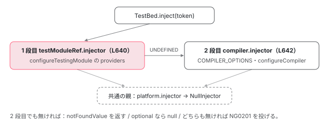

[目次](../README.md) › [テストの内側](README.md) › 第 4 回 / 全 20 回

# TestBed.inject と注入コンテキスト：テストモジュールはいつ作られるか

> TestBed.inject が testModuleRef を初めて読んだときに compiler.finalize() でテストモジュールを作る遅延、そのあと configureTestingModule や override を呼ぶと assertNotInstantiated が投げるエラー。inject が テストモジュールのインジェクタ → コンパイラのインジェクタの 2 段で探す行、TestBed.inject(TestBed)、runInInjectionContext、古い inject() / withModule。

angular/angular · 読了 約 12 分 · 中核 · [サイトで読む（デモが動きます）](https://angular-deep-dive-cyan.vercel.app/chapter/testing-inject)

---

「`beforeEach` で `TestBed.inject` したあとに `overrideProvider` を呼んだら怒られた」という経験はないでしょうか。この章では、テストモジュールが `configureTestingModule` のときではなく**最初に `testModuleRef` が読まれた瞬間**に作られること、そのあとの設定変更を `assertNotInstantiated` が拒む行、`TestBed.inject` がテストモジュールのインジェクタ → コンパイラのインジェクタの 2 段で探す行、`runInInjectionContext` と古い `inject()` / `withModule` の中身を、ソースの行で確かめます。

読む対象は `packages/core/testing/src/test_bed.ts` と `test_bed_compiler.ts` の `injector` の getter です（angular リポジトリ、v22.2.0-next.7）。

1. [1. 全体像](01-testing-overview.md)
2. [2. initTestEnvironment](02-testing-init-environment.md)
3. [3. 後片付け](03-testing-reset-teardown.md)
4. **4. TestBed.inject**（この章）
5. [5. createComponent](05-testing-create-component.md)
6. [6. 入力の渡し方](06-testing-component-bindings.md)
7. [7. createDirective](07-testing-directive-fixture.md)
8. [8. DebugElement と By](08-testing-debug-element.md)
9. [9. detectChanges](09-testing-detect-changes.md)
10. [10. 自動の変更検知](10-testing-auto-detect.md)
11. [11. whenStable](11-testing-when-stable.md)
12. [12. エラーの伝わり方](12-testing-errors.md)
13. [13. fakeAsync](13-testing-fake-async.md)
14. [14. 偽の時計](14-testing-fake-async-scheduler.md)
15. [15. waitForAsync と ProxyZone](15-testing-wait-for-async.md)
16. [16. zone なしの時間](16-testing-zoneless-time.md)
17. [17. effect と signal](17-testing-effects.md)
18. [18. @defer](18-testing-defer.md)
19. [19. RouterTestingHarness](19-testing-router-harness.md)
20. [20. issue と変更を読む](20-testing-issues.md)

## 1. テストモジュールは「最初に読まれたとき」に作られる

📄 `angular/packages/core/testing/src/test_bed.ts` L815–845 （▶ の行: 819–821, 830–832, 834, 837–841）

```ts
815 │   /**
816 │    * @internal strip this from published d.ts files due to
817 │    * https://github.com/microsoft/TypeScript/issues/36216
818 │    */
819 ▶   private get compiler(): TestBedCompiler {
820 ▶     if (this._compiler === null) {
821 ▶       throw new Error(`Need to call TestBed.initTestEnvironment() first`);
822 │     }
823 │     return this._compiler;
824 │   }
825 │ 
826 │   /**
827 │    * @internal strip this from published d.ts files due to
828 │    * https://github.com/microsoft/TypeScript/issues/36216
829 │    */
830 ▶   private get testModuleRef(): NgModuleRef<any> {
831 ▶     if (this._testModuleRef === null) {
832 ▶       this._testModuleRef = this.compiler.finalize();
833 │     }
834 ▶     return this._testModuleRef;
835 │   }
836 │ 
837 ▶   private assertNotInstantiated(methodName: string, methodDescription: string) {
838 ▶     if (this._testModuleRef !== null) {
839 ▶       throw new Error(
840 ▶         `Cannot ${methodDescription} when the test module has already been instantiated. ` +
841 ▶           `Make sure you are not using \`inject\` before \`${methodName}\`.`,
842 │       );
843 │     }
844 │   }
845 │ 
```

1. **819〜824 行目：compiler の getter**

   `_compiler` が `null` なら `Need to call TestBed.initTestEnvironment() first` を投げます。`initTestEnvironment` を呼んでいない、または `resetTestEnvironment` したまま（[第 2 回](02-testing-init-environment.md)）のときに出る文です。
2. **830〜835 行目：testModuleRef の getter**

   `_testModuleRef` が `null` のときだけ、832 行目で `this.compiler.finalize()` を呼んでテストモジュールを作り、覚えます。`finalize` が溜めた宣言・imports・providers・override から `DynamicTestModule` をコンパイルし、プラットフォームのインジェクタを親にした `NgModuleRef` を作って `APP_INITIALIZER` まで走らせる中身は、[NgModule シリーズの TestBed の回](../ngmodule/17-ngmodule-testbed.md)で読みました（830〜835 行目もそこで短く見ました）。
3. **837〜844 行目：assertNotInstantiated**

   838 行目、もう作ってあれば 839〜842 行目の文を投げます。`methodDescription` は「Cannot」と「when …」のあいだに入る動詞句で、`methodName` は最後の「before \`…\`」に入ります。

では、誰が `testModuleRef` を読むのか。test\_bed.ts の中で `this.testModuleRef` と書いてあるのは、`inject`（2 節の 640 行目）と、`createComponent` が使う `createComponentRef`（[第 5 回](05-testing-create-component.md)）の 2 か所です。`createComponent` もまず `inject(TestComponentRenderer)` を呼ぶので、**どちらの道でも、最初の `inject` がモジュールを作ります**。

### assertNotInstantiated を呼ぶ側

📄 `angular/packages/core/testing/src/test_bed.ts` L667–698 （▶ の行: 668–670, 677, 683, 695）

```ts
667 │   overrideTemplateUsingTestingModule(component: Type<any>, template: string): this {
668 ▶     this.assertNotInstantiated(
669 ▶       'TestBed.overrideTemplateUsingTestingModule',
670 ▶       'Cannot override template when the test module has already been instantiated',
671 │     );
672 │     this.compiler.overrideTemplateUsingTestingModule(component, template);
673 │     return this;
674 │   }
675 │ 
676 │   overrideDirective(directive: Type<any>, override: MetadataOverride<Directive>): this {
677 ▶     this.assertNotInstantiated('overrideDirective', 'override directive metadata');
678 │     this.compiler.overrideDirective(directive, override);
679 │     return this;
680 │   }
681 │ 
682 │   overridePipe(pipe: Type<any>, override: MetadataOverride<Pipe>): this {
683 ▶     this.assertNotInstantiated('overridePipe', 'override pipe metadata');
684 │     this.compiler.overridePipe(pipe, override);
685 │     return this;
686 │   }
687 │ 
688 │   /**
689 │    * Overwrites all providers for the given token with the given provider definition.
690 │    */
691 │   overrideProvider(
692 │     token: any,
693 │     provider: {useFactory?: Function; useValue?: any; deps?: any[]},
694 │   ): this {
695 ▶     this.assertNotInstantiated('overrideProvider', 'override provider');
696 │     this.compiler.overrideProvider(token, provider);
697 │     return this;
698 │   }
```

677・683・695 行目、override の系統はどれも最初に `assertNotInstantiated` を呼びます（`overrideModule` と `overrideComponent` もこの上で同じ形です。[standalone シリーズの override の回](../standalone/12-standalone-testbed-override.md)）。`configureTestingModule` も最初の行で `assertNotInstantiated('TestBed.configureTestingModule', 'configure the test module')` を呼びます（[NgModule シリーズの TestBed の回](../ngmodule/17-ngmodule-testbed.md)の引用）。

> [!WARNING]
> **ハマりどころ**
>
> 668〜671 行目だけ、2 つ目の引数が「動詞句」ではなく、文をまるごと渡しています。839〜840 行目に埋め込まれるので、出てくる文は `Cannot Cannot override template when the test module has already been instantiated when the test module has already been instantiated. Make sure …` と「Cannot」と「when …」が 2 回ずつになります。このサイトの ng test でもこの文がそのまま返りました。最新の main（74961c66242）でも同じ行のままです。spec（「テストと直し方」の節）は正規表現で前半の一部だけを見ているので、通ってしまいます。

> **🧪 DEMO — いつモジュールが作られ、いつ怒られるか（再現）**
>
> test\_bed.ts 830〜844 行目を再現した小さな状態機械です。エラー文は 839〜841 行目と同じ組み立て方で作っています。TestBed は動かしていません。
>
> ▶ [このデモはサイトで動かせます](https://angular-deep-dive-cyan.vercel.app/chapter/testing-inject)

## 2. TestBed.inject の 2 段の探索

📄 `angular/packages/core/testing/src/test_bed.ts` L626–653 （▶ の行: 636–637, 639–643, 647, 651–652）

```ts
626 │   inject<T>(
627 │     token: ProviderToken<T>,
628 │     notFoundValue: undefined,
629 │     options: InjectOptions & {
630 │       optional: true;
631 │     },
632 │   ): T | null;
633 │   inject<T>(token: ProviderToken<T>, notFoundValue?: T, options?: InjectOptions): T;
634 │   inject<T>(token: ProviderToken<T>, notFoundValue: null, options?: InjectOptions): T | null;
635 │   inject<T>(token: ProviderToken<T>, notFoundValue?: T | null, options?: InjectOptions): T | null {
636 ▶     if ((token as unknown) === TestBed) {
637 ▶       return this as any;
638 │     }
639 ▶     const UNDEFINED = {} as unknown as T;
640 ▶     const result = this.testModuleRef.injector.get(token, UNDEFINED, options);
641 ▶     return result === UNDEFINED
642 ▶       ? (this.compiler.injector.get(token, notFoundValue, options) as any)
643 ▶       : result;
644 │   }
645 │ 
646 │   runInInjectionContext<T>(fn: () => T): T {
647 ▶     return runInInjectionContext(this.inject(EnvironmentInjector), fn);
648 │   }
649 │ 
650 │   execute(tokens: any[], fn: Function, context?: any): any {
651 ▶     const params = tokens.map((t) => this.inject(t));
652 ▶     return fn.apply(context, params);
653 │   }
```

1. **636〜638 行目：TestBed を頼まれたら自分を返す**

   `TestBed` は [第 2 回](02-testing-init-environment.md)で見たとおりクラス `TestBedImpl` そのものなので、トークンとして比べられます。インジェクタを見ないので、**`TestBed.inject(TestBed)` ではモジュールは作られません**（ng test で確かめた。4 節）。
2. **639〜640 行目：1 段目はテストモジュールのインジェクタ**

   `UNDEFINED` はこの関数の中で作った空のオブジェクトで、「見つからなかった」を表す番兵（sentinel。ほかの値と絶対に一致しない目印）です。これを notFoundValue に渡すので、テストモジュールにも親のプラットフォームのインジェクタにも無いとき、1 段目は**投げずに番兵を返します**。利用者が渡した `notFoundValue` は、まだ使いません。
3. **641〜643 行目：2 段目はコンパイラのインジェクタ**

   番兵が返ったときだけ、`this.compiler.injector` に、今度は利用者の `notFoundValue` と `options` をそのまま渡して探します。ここで無ければ投げるか、`notFoundValue` / `null` を返します。

📄 `angular/packages/core/testing/src/test_bed_compiler.ts` L1043–1061 （▶ の行: 1049–1051, 1055–1056, 1059）

```ts
1043 │   get injector(): Injector {
1044 │     if (this._injector !== null) {
1045 │       return this._injector;
1046 │     }
1047 │ 
1048 │     const providers: StaticProvider[] = [];
1049 ▶     const compilerOptions = this.platform.injector.get(COMPILER_OPTIONS, []);
1050 ▶     compilerOptions.forEach((opts) => {
1051 ▶       if (opts.providers) {
1052 │         providers.push(opts.providers);
1053 │       }
1054 │     });
1055 ▶     if (this.compilerProviders !== null) {
1056 ▶       providers.push(...(this.compilerProviders as StaticProvider[]));
1057 │     }
1058 │ 
1059 ▶     this._injector = Injector.create({providers, parent: this.platform.injector});
1060 │     return this._injector;
1061 │   }
```

2 段目のインジェクタの中身はこれだけです。1049〜1054 行目、プラットフォームに provide された `COMPILER_OPTIONS` の providers と、1055〜1057 行目、`TestBed.configureCompiler({ providers })` で渡した providers。1059 行目で、それを **プラットフォームのインジェクタを親にして**`Injector.create` します。テストモジュールの `NgModuleRef` も同じプラットフォームのインジェクタを親にしているので、2 段は兄弟の関係です。



*TestBed.inject の探索。1 段目は番兵 UNDEFINED を notFoundValue にして投げさせない。番兵が返ったときだけ 2 段目へ進み、そこで初めて利用者の notFoundValue / options を使う。*

> **🧪 DEMO — どの段で見つかるか（再現）**
>
> test\_bed.ts 636〜643 行目の分かれ道です。トークンの置き場所は 4 節の ng test と同じにしてあり、最後の値も ng test で返った値です。
>
> ▶ [このデモはサイトで動かせます](https://angular-deep-dive-cyan.vercel.app/chapter/testing-inject)

## 3. runInInjectionContext と execute

2 節の引用の 646〜653 行目です。647 行目、`runInInjectionContext(fn)` は `this.inject(EnvironmentInjector)` を取り出し、`@angular/core` の同名の関数でその中で `fn` を呼びます。注入コンテキスト（`inject()` 関数を呼んでよい状態）の仕組みは [DI シリーズの注入コンテキストの回](../di/03-di-injection-context.md)のとおりです。`EnvironmentInjector` は 1 段目のテストモジュールのインジェクタで見つかるので、**中で作ったものはテストモジュールに結びつきます**。651〜652 行目の `execute` は、トークンの配列を 1 つずつ `this.inject` して `fn` に引数で渡すだけで、次の古い `inject()` が使います。

### 古い inject() と withModule

📄 `angular/packages/core/testing/src/test_bed.ts` L1047–1069 （▶ の行: 1050, 1063–1064, 1066–1067）

````ts
1047 │  * Example:
1048 │  *
1049 │  * ```ts
1050 ▶  * beforeEach(inject([Dependency, AClass], (dep, object) => {
1051 │  *   // some code that uses `dep` and `object`
1052 │  *   // ...
1053 │  * }));
1054 │  *
1055 │  * it('...', inject([AClass], (object) => {
1056 │  *   object.doSomething();
1057 │  *   expect(...);
1058 │  * })
1059 │  * ```
1060 │  *
1061 │  * @publicApi
1062 │  */
1063 ▶ export function inject(tokens: any[], fn: Function): () => any {
1064 ▶   const testBed = TestBedImpl.INSTANCE;
1065 │   // Not using an arrow function to preserve context passed from call site
1066 ▶   return function (this: unknown) {
1067 ▶     return testBed.execute(tokens, fn, this);
1068 │   };
1069 │ }
````

1063〜1069 行目、`@angular/core/testing` の `inject(tokens, fn)` は「呼ばれたら `execute` する関数」を返すだけです。1050 行目の例のように `it` や `beforeEach` にそのまま渡します。注入コンテキストは作らないので、`fn` の中で `@angular/core` の `inject()` を呼ぶことはできません。値は引数で受け取ります。

📄 `angular/packages/core/testing/src/test_bed.ts` L1084–1114 （▶ の行: 1088–1089, 1103, 1107–1108, 1110, 1113）

```ts
1084 │   inject(tokens: any[], fn: Function): () => any {
1085 │     const self = this;
1086 │     // Not using an arrow function to preserve context passed from call site
1087 │     return function (this: unknown) {
1088 ▶       self._addModule();
1089 ▶       return inject(tokens, fn).call(this);
1090 │     };
1091 │   }
1092 │ }
1093 │ 
1094 │ /**
1095 │  * @publicApi
1096 │  */
1097 │ export function withModule(moduleDef: TestModuleMetadata): InjectSetupWrapper;
1098 │ export function withModule(moduleDef: TestModuleMetadata, fn: Function): () => any;
1099 │ export function withModule(
1100 │   moduleDef: TestModuleMetadata,
1101 │   fn?: Function | null,
1102 │ ): (() => any) | InjectSetupWrapper {
1103 ▶   if (fn) {
1104 │     // Not using an arrow function to preserve context passed from call site
1105 │     return function (this: unknown) {
1106 │       const testBed = TestBedImpl.INSTANCE;
1107 ▶       if (moduleDef) {
1108 ▶         testBed.configureTestingModule(moduleDef);
1109 │       }
1110 ▶       return fn.apply(this);
1111 │     };
1112 │   }
1113 ▶   return new InjectSetupWrapper(() => moduleDef);
1114 │ }
```

1103〜1111 行目、`withModule(def, fn)` は「`configureTestingModule(def)` してから `fn` を呼ぶ関数」を返します。`fn` が無ければ 1113 行目で `InjectSetupWrapper` を返し、その `.inject(tokens, fn)` は 1088〜1089 行目で「configure してから `inject`」をします。どれも順番を 1 つの関数に包んでいるだけで、1 節の「configure が先、inject が後」の規則はそのまま効きます。今は `TestBed.inject` と `TestBed.runInInjectionContext` を直接書くのが普通です。

## 4. このサイトの ng test で確かめたこと

このサイトの ng test（Vitest + jsdom、`@angular/core` 22.1.6）で、1 本の it の中で順に読みました。`_testModuleRef` は private ですが、実行時にはそのままの名前で読めます。

📄 `src/verify-a/inject.spec.ts（要点）`

```
// src/verify-a/inject.spec.ts（要点。確かめたあと消した）
const ONLY_COMPILER = new InjectionToken<string>('ONLY_COMPILER');
const MISSING = new InjectionToken<string>('MISSING');
const IN_MODULE = new InjectionToken<string>('IN_MODULE');

const tb = getTestBed() as any;
r.beforeAny = tb._testModuleRef === null;
TestBed.configureCompiler({ providers: [{ provide: ONLY_COMPILER, useValue: 'from compiler injector' }] });
TestBed.configureTestingModule({ providers: [{ provide: IN_MODULE, useValue: 'from test module' }] });
r.afterConfigure = tb._testModuleRef === null;
r.injectTestBed = TestBed.inject(TestBed as any) === getTestBed();
r.afterInjectTestBed = tb._testModuleRef === null;
r.inModule = TestBed.inject(IN_MODULE);
r.afterInject = tb._testModuleRef === null;
r.onlyCompiler = TestBed.inject(ONLY_COMPILER);
r.missingDefault = TestBed.inject(MISSING, 'fallback' as any);
r.missingOptional = TestBed.inject(MISSING, null, { optional: true });
r.missingThrow = err(() => TestBed.inject(MISSING));
r.configureAfter = err(() => TestBed.configureTestingModule({}));
r.overrideTemplateAfter = err(() => TestBed.overrideTemplateUsingTestingModule(C, 'b'));

const s = signal(0); const runs: number[] = []; let destroyed = false;
TestBed.runInInjectionContext(() => {
  effect(() => { runs.push(s()); });
  inject(DestroyRef).onDestroy(() => { destroyed = true; });
});
// runs を tick の前後で読む → s.set(1) → tick → resetTestingModule → destroyed を読む
```

📄 `PROBE の結果（読みやすく並べ替えた）`

```
beforeAny            true
afterConfigure       true
injectTestBed        true
afterInjectTestBed   true      ← TestBed.inject(TestBed) ではモジュールは作られない
inModule             "from test module"
afterInject          false     ← ここで初めて作られた
onlyCompiler         "from compiler injector"
platformRefSame      true
missingDefault       "fallback"
missingOptional      null
missingThrow         "NG0201: No provider found for `InjectionToken MISSING`. Find more at https://v22.angular.dev/errors/NG0201"
configureAfter       "Cannot configure the test module when the test module has already been instantiated. Make sure you are not using `inject` before `TestBed.configureTestingModule`."
overrideProviderAfter "Cannot override provider when the test module has already been instantiated. Make sure you are not using `inject` before `overrideProvider`."
overrideTemplateAfter "Cannot Cannot override template when the test module has already been instantiated when the test module has already been instantiated. Make sure you are not using `inject` before `TestBed.overrideTemplateUsingTestingModule`."
envInjSame           true      ← runInInjectionContext の inject(EnvironmentInjector) と TestBed.inject(EnvironmentInjector)
injectorIsModule     true      ← TestBed.inject(Injector) はテストモジュールのインジェクタ
runsBeforeTick       []
runsAfterTick        [0]
runsAfterSet         [0,1]
destroyedAfterReset  true
legacyAfterReset     "NG0201: No provider found for `InjectionToken IN_MODULE`. …"
moduleCreatedByFailedInject true ← 見つからずに投げた inject でも、モジュールは作られている
```

1. **作られるのは 1 回目の本物の inject**

   `configureTestingModule` のあとも、`TestBed.inject(TestBed)` のあとも `_testModuleRef` は `null`。`TestBed.inject(IN_MODULE)` のあとで初めて `null` でなくなりました（832 行目、636 行目）。
2. **2 段目でだけ見つかるトークン**

   `configureCompiler` で渡した `ONLY_COMPILER` は、テストモジュールには無いのに `'from compiler injector'` が返りました（642 行目と 1055〜1057 行目）。
3. **見つからずに投げても、モジュールは作られる**

   `resetTestingModule` のあとで `IN_MODULE` を古い `inject()` で頼むと NG0201 で投げましたが、そのあと `_testModuleRef` は `null` ではありませんでした。640 行目で `testModuleRef` を読んだ時点で 832 行目が走り、投げるのはその後の 642 行目だからです。続けて `configureTestingModule` を呼ぶと 1 節のエラーになりました。
4. **runInInjectionContext の中の effect と DestroyRef**

   中で作った effect は、作った直後は走らず、`TestBed.tick()` で `[0]`、`s.set(1)` → `tick()` で `[0, 1]`（いつ走るかは [第 17 回](17-testing-effects.md)）。中で登録した `DestroyRef.onDestroy` は `resetTestingModule()` で呼ばれました。テストモジュールのインジェクタに結びついていて、[第 3 回](03-testing-reset-teardown.md)の `tearDownTestingModule` がモジュールを壊すときに一緒に壊れます。

## ここまでの呼び出し

- 👤 `TestBed.inject(MyService)` — spec
  - `TestBedImpl.INSTANCE.inject(token, notFoundValue, options)` — test\_bed.ts の static → L635
    - `token === TestBed` ? — L636 — *なら自分を返して終わり*
    - `this.testModuleRef` — L830
      - `this.compiler.finalize()` — L832（初回だけ） — *DynamicTestModule をコンパイルして NgModuleRef を作る*
    - `testModuleRef.injector.get(token, UNDEFINED, options)` — L640 — *1 段目。無ければ番兵*
    - `this.compiler.injector.get(token, notFoundValue, options)` — L642 — *2 段目。初回は L1059 で Injector.create*

## テストと直し方

📄 `angular/packages/platform-browser/test/testing_public_spec.ts` L1128–1151 （▶ の行: 1128–1130, 1133, 1139, 1146）

```ts
1128 ▶   describe('calling override methods after TestBed initialization', () => {
1129 ▶     const getExpectedErrorMessage = (methodName: string, methodDescription: string) =>
1130 ▶       `Cannot ${methodDescription} when the test module has already been instantiated. Make sure you are not using \`inject\` before \`${methodName}\`.`;
1131 │ 
1132 │     it('should throw if TestBed.overrideProvider is called after TestBed initialization', () => {
1133 ▶       TestBed.inject(Injector);
1134 │ 
1135 │       expect(() =>
1136 │         TestBed.overrideProvider(aTok, {
1137 │           useValue: 'mockValue',
1138 │         }),
1139 ▶       ).toThrowError(getExpectedErrorMessage('overrideProvider', 'override provider'));
1140 │     });
1141 │ 
1142 │     it('should throw if TestBed.overrideModule is called after TestBed initialization', () => {
1143 │       @NgModule()
1144 │       class MyModule {}
1145 │ 
1146 ▶       TestBed.inject(Injector);
1147 │ 
1148 │       expect(() => TestBed.overrideModule(MyModule, {})).toThrowError(
1149 │         getExpectedErrorMessage('overrideModule', 'override module metadata'),
1150 │       );
1151 │     });
```

`platform-browser/test/testing_public_spec.ts` の `describe('public testing API')` の中の `describe('calling override methods after TestBed initialization')`（:1128）です。1129〜1130 行目で 839〜841 行目と同じ形の期待する文を組み、1133 行目で `TestBed.inject(Injector)` してから override を呼んで投げることを確かめます。5 本のうち最後の `overrideTemplateUsingTestingModule`（:1182）だけは文字列ではなく正規表現で比べているので、1 節の「Cannot Cannot」が見逃されています。

📄 `angular/packages/core/test/test_bed_spec.ts` L2495–2519 （▶ の行: 2495, 2501–2502, 2507, 2518）

```ts
2495 ▶       it('should be able to use skipSelf injection', () => {
2496 │         const TOKEN = new InjectionToken<string>('TOKEN');
2497 │         TestBed.configureTestingModule({
2498 │           providers: [{provide: TOKEN, useValue: 'from TestBed'}],
2499 │         });
2500 │ 
2501 ▶         expect(TestBed.inject(TOKEN)).toBe('from TestBed');
2502 ▶         expect(TestBed.inject(TOKEN, undefined, {skipSelf: true, optional: true})).toBeNull();
2503 │       });
2504 │     });
2505 │   });
2506 │ 
2507 ▶   it('should be able to call Testbed.runInInjectionContext in tests', () => {
2508 │     const expectedValue = 'testValue';
2509 │     @Injectable({providedIn: 'root'})
2510 │     class SomeInjectable {
2511 │       readonly instanceValue = expectedValue;
2512 │     }
2513 │ 
2514 │     function functionThatUsesInject(): string {
2515 │       return inject(SomeInjectable).instanceValue;
2516 │     }
2517 │ 
2518 ▶     expect(TestBed.runInInjectionContext(functionThatUsesInject)).toEqual(expectedValue);
2519 │   });
```

`test_bed_spec.ts` の `describe('TestBed')` の中の `describe('TestBed.inject')`（:2474）と、そのすぐ後の `it('should be able to call Testbed.runInInjectionContext in tests')`（2507 行目）です。2502 行目は `skipSelf` を付けるとテストモジュールを飛ばして親を探すので `null` になる、という 2 段の探索の確かめです。

📄 `ターミナル`

```
cd ~/angular-research/angular

pnpm bazel test //packages/core/test:test //packages/platform-browser/test:test \
  --test_arg=--filter="calling override methods after TestBed initialization|TestBed TestBed.inject|runInInjectionContext" \
  --test_output=all
```

📄 `出力（抜粋。2026-11-01 に実行）`

```
==================== Test output for //packages/platform-browser/test:test:
Ran 5 of 159 specs
5 specs, 0 failures
==================== Test output for //packages/core/test:test (shard 2 of 4):
Ran 1 of 1398 specs
1 spec, 0 failures
（shard 3・4・1 も Ran 1 of 1398 specs）
INFO: Elapsed time: 3.055s, Critical Path: 2.26s
//packages/platform-browser/test:test                                    PASSED in 1.3s
//packages/core/test:test                                                PASSED in 1.8s
```

1. **2 つのターゲットを 1 回で**

   `bazel test` にターゲットを 2 つ並べ、`--test_arg` の正規表現を `|` でつないでいます。platform-browser のほうは shard が無いので Ran は 1 回で **5 本**、core のほうは 1 + 1 + 1 + 1 = **4 本**（`TestBed.inject` の 3 本と `runInInjectionContext` の 1 本。読み方は [第 1 回](01-testing-overview.md)）でした。
2. **直すとしたら**

   いつ作るかは `testModuleRef` の getter（830 行目）、拒む文は `assertNotInstantiated`（837 行目）、探索は `inject`（635 行目）と `TestBedCompiler` の `injector`（1043 行目）です。1 節の「Cannot Cannot」なら、直す場所は 668〜671 行目の 2 つ目の引数で、確かめる場所は `testing_public_spec.ts` の同じ describe の最後の it（:1182）で、正規表現を文字列の比較に変えることです。ただしこのシリーズでは本家に PR は出しません。手元で直して 5 本が通ることを確かめ、似た報告の issue が無いかを探すところまでにします（[第 20 回](20-testing-issues.md)）。

## 聞かれそうな質問

**Q. beforeEach で inject したあとに configureTestingModule を呼ぶと、なぜ怒られるのですか？**

最初の `inject` が 832 行目で `compiler.finalize()` を呼び、溜めていた設定からテストモジュールを作り終えているからです。作り終えたモジュールに providers を足す方法は無いので、`configureTestingModule` や override は 838 行目で `_testModuleRef !== null` を見て投げます。外側の `beforeEach` で inject し、内側の `describe` の `beforeEach` で configure している、という並びがよくある原因です。順番を入れ替えるか、inject を `it` の中に移します。

**Q. TestBed.inject と、@angular/core の inject() 関数は何が違いますか？**

`TestBed.inject` はどこからでも呼べる普通のメソッドで、636〜643 行目の 2 段で探します。`@angular/core` の `inject()` は注入コンテキストの中でしか呼べず、その時のインジェクタだけを見ます。テストの中で後者を使いたいときは `TestBed.runInInjectionContext(() => inject(X))` と書きます（647 行目でテストモジュールの `EnvironmentInjector` を使う）。`@angular/core/testing` の古い `inject([X], fn)` は 3 つ目の別物で、1063〜1069 行目のとおり `TestBed.inject` を配列で呼んで引数に渡すだけです。

**Q. runInInjectionContext で effect を作ると、何に紐づきますか？**

テストモジュールのインジェクタです。647 行目の `this.inject(EnvironmentInjector)` は 1 段目で見つかり、ng test でも `TestBed.inject(EnvironmentInjector)` と同じものでした。だから `resetTestingModule()` がモジュールを壊すと、中で登録した `DestroyRef.onDestroy` が呼ばれました（4 節）。effect を走らせるのは `TestBed.tick()` です（[第 17 回](17-testing-effects.md)）。

**Q. 見つからないトークンを TestBed.inject すると、どこで投げられますか？**

2 段目の 642 行目です。1 段目は番兵 `UNDEFINED` を notFoundValue にしているので投げません。ng test のスタックトレースも `TestBedImpl.inject` → `R3Injector.get`（コンパイラのインジェクタ）→ `R3Injector.get`（プラットフォーム）→ `NullInjector.get` の順で、文は `NG0201: No provider found for …` でした。第 2 引数か `{ optional: true }` を渡せば、2 段目がそれを使って投げずに返します。

## 読み終えて

- テストモジュールは `testModuleRef` の getter が初めて読まれたとき（＝最初の `inject` か `createComponent`）に `compiler.finalize()` で作られる。`TestBed.inject(TestBed)` は作らない。
- 作ったあとの `configureTestingModule`・override は `assertNotInstantiated` が拒む。`overrideTemplateUsingTestingModule` の文だけは「Cannot」が 2 回出る。
- `TestBed.inject` は、テストモジュールのインジェクタを番兵つきで探し、無ければコンパイラのインジェクタを利用者の引数で探す。2 段とも親はプラットフォーム。
- `runInInjectionContext` はテストモジュールの `EnvironmentInjector` を使うので、中で作ったものは `resetTestingModule` で一緒に壊れる。古い `inject()` / `withModule` は順番を包むだけ。

---

← 前: [テストごとの後片付け：resetTestingModule と destroyAfterEach](03-testing-reset-teardown.md)  
次: [createComponent：根の要素を置いて、コンポーネントを作るまで](05-testing-create-component.md) →
