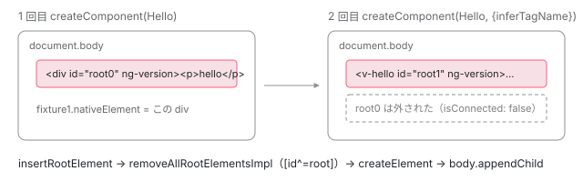

[目次](../README.md) › [テストの内側](README.md) › 第 5 回 / 全 20 回

# createComponent：根の要素を置いて、コンポーネントを作るまで

> TestBed.createComponent が TestComponentRenderer.insertRootElement で root0 のような id の要素を body に置き、ComponentFactory.create にテストモジュールを環境インジェクタとして渡す手順。コンパイルされていないときの 2 種類のエラー、inferTagName、NgZone.run で包む条件、\_activeFixtures への登録と getLastFixture。

angular/angular · 読了 約 13 分 · 中核 · [サイトで読む（デモが動きます）](https://angular-deep-dive-cyan.vercel.app/chapter/testing-create-component)

---

テストで最初に書く 1 行は、たいてい `TestBed.createComponent(App)` です。この章では、その 1 行が **body に「root0」のような id の要素を置き、その要素をホスト（コンポーネントを載せる要素）にしてコンポーネントを作り、`ComponentFixture` に包んで記録する**までを、行番号を指して 1 ステップずつ追います。2 個目を作ると 1 個目の DOM が消える理由と、`inferTagName` でタグ名が変わる理由も、ここで説明がつきます。

読む対象は `packages/core/testing/src/test_bed.ts`（`createComponent` / `createComponentRef` / `getLastFixture`）、`test_bed_common.ts`、`packages/platform-browser/testing/src/dom_test_component_renderer.ts`、`packages/core/src/render3/component_ref.ts`、`packages/core/testing/src/fixture.ts` です。

1. [1. 全体像](01-testing-overview.md)
2. [2. initTestEnvironment](02-testing-init-environment.md)
3. [3. 後片付け](03-testing-reset-teardown.md)
4. [4. TestBed.inject](04-testing-inject.md)
5. **5. createComponent**（この章）
6. [6. 入力の渡し方](06-testing-component-bindings.md)
7. [7. createDirective](07-testing-directive-fixture.md)
8. [8. DebugElement と By](08-testing-debug-element.md)
9. [9. detectChanges](09-testing-detect-changes.md)
10. [10. 自動の変更検知](10-testing-auto-detect.md)
11. [11. whenStable](11-testing-when-stable.md)
12. [12. エラーの伝わり方](12-testing-errors.md)
13. [13. fakeAsync](13-testing-fake-async.md)
14. [14. 偽の時計](14-testing-fake-async-scheduler.md)
15. [15. waitForAsync と ProxyZone](15-testing-wait-for-async.md)
16. [16. zone なしの時間](16-testing-zoneless-time.md)
17. [17. effect と signal](17-testing-effects.md)
18. [18. @defer](18-testing-defer.md)
19. [19. RouterTestingHarness](19-testing-router-harness.md)
20. [20. issue と変更を読む](20-testing-issues.md)

> [!NOTE]
> **ポイント**
>
> この章の引用は `../angular`（22.2.0-next.7）です。このサイトの `@angular/core` は 22.1.6 で、`createComponent` の中身が少し違います（22.1.6 には `createComponentRef` への切り出しが無く、id の番号を増やす行が「コンパイル済みか」の確認より前にある）。切り出しはコミット 05c4d5a8354（`TestBed.createDirective` の追加、[第 7 回](07-testing-directive-fixture.md)）で入りました。違いが結果に出るところは、その都度書きます。

## 1. createComponent の全体

📄 `angular/packages/core/testing/src/test_bed.ts` L704–730 （▶ の行: 706–707, 709, 718–721, 723–725, 729）

```ts
704 │   createComponent<T>(type: Type<T>, options?: TestComponentOptions): ComponentFixture<T> {
705 │     // Note: injecting the renderer before accessing the definition appears to be load-bearing.
706 ▶     const renderer = this.inject(TestComponentRenderer);
707 ▶     const componentDef = getComponentDef(type);
708 │ 
709 ▶     if (!componentDef) {
710 │       throw new Error(
711 │         getAsyncClassMetadataFn(type)
712 │           ? `Component '${type.name}' has unresolved metadata. ` +
713 │               `Please call \`await TestBed.compileComponents()\` before running this test.`
714 │           : `It looks like '${stringify(type)}' has not been compiled.`,
715 │       );
716 │     }
717 │ 
718 ▶     const shouldInferTagName = options?.inferTagName ?? this._instanceInferTagName ?? false;
719 ▶     const tagName = shouldInferTagName ? inferTagNameFromDefinition(componentDef) : null;
720 ▶     const noNgZone = this.inject(ComponentFixtureNoNgZone, false);
721 ▶     const ngZone = noNgZone ? null : this.inject(NgZone, null);
722 │     const init = () => {
723 ▶       const ref = this.createComponentRef(type, tagName, renderer, options?.bindings);
724 ▶       const fixture = this.runInInjectionContext(() => new ComponentFixture(ref));
725 ▶       this._activeFixtures.push(fixture);
726 │       return fixture;
727 │     };
728 │ 
729 ▶     return ngZone ? ngZone.run(init) : init();
730 │   }
```

27 行しかありません。上から順に、何をしているかを 1 つずつ見ます。

1. **706 行目：`TestComponentRenderer` を inject する**

   「根の要素（コンポーネントを載せる要素）を DOM に置く係」を取り出します。中身は 3 節で見ます。705 行目のコメントは「定義を読む前に renderer を inject するのが効いているようだ」とだけ書いていて、理由は書いていません。読める事実は、`this.inject` がテスト用のモジュールを初めて作るときに `compiler.finalize()` を呼び、その最初で溜まっていたコンパイル（override を含む）を済ませることです （[第 4 回](04-testing-inject.md)、[ngmodule-testbed](../ngmodule/17-ngmodule-testbed.md)）。だから 707 行目で読む定義は、override を反映したあとのものです。
2. **707〜716 行目：コンパイル済みかを確かめる**

   `getComponentDef(type)` はクラスに付いた `ɵcmp`（コンパイラが作るコンポーネントの定義）を読みます。無ければ 2 種類のどちらかのエラーです（2 節）。
3. **718〜719 行目：タグ名を決めるか決めないか**

   `options.inferTagName` → `configureTestingModule` で設定した値 → `false` の順に見ます。`false` なら `tagName` は `null` で、3 節の `insertRootElement` が `div` を作ります（4 節）。
4. **720〜721 行目：`NgZone` を使うか決める**

   `ComponentFixtureNoNgZone` が `true` なら `null`、そうでなければ `NgZone` を inject します（6 節）。
5. **722〜727 行目：作る手順を関数にまとめる**

   723 行目で `ComponentRef` を作り（3〜5 節）、724 行目で `ComponentFixture` に包み、725 行目で `_activeFixtures` に積みます（7 節）。
6. **729 行目：`ngZone.run` の中か、そのまま呼ぶ**

   まとめた関数を、`NgZone` があればその `run` の中で、無ければそのまま呼びます。

## 2. コンパイルされていないときの 2 種類のエラー

711〜714 行目の三項演算子が、2 種類の文面を出し分けます。

| 条件 | エラーの文面 | どうすればよいか |
| --- | --- | --- |
| `getAsyncClassMetadataFn(type)` が関数を返す（711 行目） | ``Component 'X' has unresolved metadata. Please call `await TestBed.compileComponents()` ...``（712〜713 行目） | テンプレートに `@defer` があり、遅延する依存がある場合、コンパイラはクラスのメタデータを `setClassMetadataAsync` で包みます。その依存を読み込むまで定義が揃わないので、先に `await TestBed.compileComponents()` を呼びます（[第 18 回](18-testing-defer.md)）。 |
| それ以外（714 行目） | `It looks like 'X' has not been compiled.` | デコレータが付いていないクラスを渡した、など。コンポーネントではないものを渡していないか確かめます。 |

このサイトの ng test（Vitest + jsdom、`@angular/core` 22.1.6）で、デコレータの無いクラスを渡すと `It looks like 'NotCompiled' has not been compiled.` が投げられました。

## 3. 根の要素を置く：insertRootElement

723 行目から呼ばれる `createComponentRef` です。

📄 `angular/packages/core/testing/src/test_bed.ts` L867–889 （▶ の行: 875–877, 880, 882–885, 887）

```ts
867 │   private createComponentRef<T>(
868 │     type: Type<T>,
869 │     tagName: string | null,
870 │     renderer: TestComponentRenderer,
871 │     rootTypeBindings?: Binding[],
872 │     directives?: (Type<unknown> | DirectiveWithBindings<unknown>)[],
873 │     allowNonStandaloneDirectives?: boolean,
874 │   ) {
875 ▶     const rootElId = `root${_nextRootElementId++}`;
876 ▶     renderer.insertRootElement(rootElId, tagName ?? undefined);
877 ▶     const factory = new ComponentFactory(getComponentDef(type)!);
878 │ 
879 │     return factory.create(
880 ▶       Injector.NULL,
881 │       [],
882 ▶       `#${rootElId}`,
883 ▶       this.testModuleRef,
884 ▶       directives,
885 ▶       rootTypeBindings,
886 │       undefined,
887 ▶       allowNonStandaloneDirectives,
888 │     ) as ComponentRef<T>;
889 │   }
```

875 行目で `root` + 番号の id を作り、876 行目で renderer に「その id の要素を置いて」と頼みます。877 行目以降は 5 節で見ます。番号を数えている変数はここです。

📄 `angular/packages/core/testing/src/test_bed.ts` L211–214 （▶ の行: 213）

```ts
211 │ }
212 │ 
213 ▶ let _nextRootElementId = 0;
214 │ 
```

213 行目、`_nextRootElementId` は**モジュールの一番外側の変数**です。`TestBedImpl` のフィールドではないので、`resetTestingModule` でも 0 に戻りません（`test_bed.ts` の中で代入しているのは 875 行目の `++` だけ）。このサイトの ng test では、1 つ目の `it` で `root0`〜`root4` まで使ったあと、2 つ目の `it` の最初の `createComponent` は `root5` になりました （22.1.6 では「コンパイルされていない」で投げる場合も番号を 1 つ使います。番号を増やす行が確認より前にあるため）。

### renderer の型と、DOM 用の実装

📄 `angular/packages/core/testing/src/test_bed_common.ts` L30–39 （▶ の行: 35–37）

```ts
30 │ /**
31 │  * An abstract class for inserting the root test component element in a platform independent way.
32 │  *
33 │  * @publicApi
34 │  */
35 ▶ export class TestComponentRenderer {
36 ▶   insertRootElement(rootElementId: string, tagName?: string) {}
37 ▶   removeAllRootElements?() {}
38 │ }
39 │ 
```

35〜38 行目、`TestComponentRenderer` 自体は**何もしない**クラスです。ブラウザ（と jsdom）のテストでは、`BrowserTestingModule` が `DOMTestComponentRenderer` に差し替えます（[第 2 回](02-testing-init-environment.md)）。

📄 `angular/packages/platform-browser/testing/src/dom_test_component_renderer.ts` L13–45 （▶ の行: 22–26, 41–43）

```ts
13 │ /**
14 │  * A DOM based implementation of the TestComponentRenderer.
15 │  */
16 │ @Injectable()
17 │ export class DOMTestComponentRenderer extends TestComponentRenderer {
18 │   constructor(@Inject(DOCUMENT) private _doc: any) {
19 │     super();
20 │   }
21 │ 
22 ▶   override insertRootElement(rootElId: string, tagName = 'div') {
23 ▶     this.removeAllRootElementsImpl();
24 ▶     const rootElement = getDOM().getDefaultDocument().createElement(tagName);
25 ▶     rootElement.setAttribute('id', rootElId);
26 ▶     this._doc.body.appendChild(rootElement);
27 │   }
28 │ 
29 │   override removeAllRootElements() {
30 │     // Check whether the `DOCUMENT` instance retrieved from DI contains
31 │     // the necessary function to complete the cleanup. In tests that don't
32 │     // interact with DOM, the `DOCUMENT` might be mocked and some functions
33 │     // might be missing. For such tests, DOM cleanup is not required and
34 │     // we skip the logic if there are missing functions.
35 │     if (typeof this._doc.querySelectorAll === 'function') {
36 │       this.removeAllRootElementsImpl();
37 │     }
38 │   }
39 │ 
40 │   private removeAllRootElementsImpl() {
41 ▶     const oldRoots = this._doc.querySelectorAll('[id^=root]');
42 ▶     for (let i = 0; i < oldRoots.length; i++) {
43 ▶       getDOM().remove(oldRoots[i]);
44 │     }
45 │   }
```

1. **23 行目：まず古い根をすべて消す**

   `removeAllRootElementsImpl`（40〜45 行目）は、41 行目で `[id^=root]`、つまり**id が「root」で始まる要素を document 全体から**探し、43 行目で 1 つずつ外します。前のテストの残りだけでなく、同じテストで先に作った根も消えます。
2. **24〜25 行目：要素を作って id を付ける**

   22 行目の引数の既定値で、タグ名が渡されなければ `div` です。
3. **26 行目：body の末尾に入れる**

   これで `document.body` の子は、いま作った根 1 つだけになります（テストが自分で body に足したものが無ければ）。

> [!WARNING]
> **ハマりどころ**
>
> 41 行目のセレクタは id の**前方一致**です。テストの中で `id="rootMenu"` の要素を body に置いてから `createComponent` を呼ぶと、その要素も外されます。このサイトの ng test で `<section id="rootMenu">` を先に置いたところ、`createComponent` のあとで `isConnected` が `false` になり、body の子は `DIV#root0` だけでした。



*createComponent を 2 回呼んだときの body。2 回目の insertRootElement が \[id^=root\] を外してから root1 を入れる。1 回目の ComponentRef と fixture は壊されず、DOM から外れるだけ。*

## 4. inferTagName：タグ名をセレクタから決める

719 行目で `shouldInferTagName` が `true` のときだけ、`inferTagNameFromDefinition` を呼びます。

📄 `angular/packages/core/src/render3/component_ref.ts` L209–217 （▶ の行: 216）

```ts
209 │ /**
210 │  * Infers the tag name that should be used for a component based on its definition.
211 │  * @param componentDef Definition for which to resolve the tag name.
212 │  */
213 │ export function inferTagNameFromDefinition(componentDef: ComponentDef<unknown>): string {
214 │   // Take the tag name from the first selector in the
215 │   // definition. If there is none, fall back to `div`.
216 ▶   return ((componentDef.selectors[0][0] as string) || 'div').toLowerCase();
217 │ }
```

216 行目、**最初のセレクタの 0 番目**（タグ名の位置）を小文字にして返し、空なら `div` です。セレクタの配列の形（`[['v-hello']]`、`[['', 'v-attr', '']]` など）は [第 7 回](07-testing-directive-fixture.md)で詳しく見ます。同じ関数は、テストではない普通の動的生成でも使われています。

📄 `angular/packages/core/src/render3/component_ref.ts` L177–193 （▶ の行: 185）

```ts
177 │ function createHostElement(
178 │   componentDef: ComponentDef<unknown>,
179 │   renderer: Renderer,
180 │   hostElementNamespace: string | null,
181 │ ): RElement {
182 │   // Determine a tag name used for creating host elements when this component is created
183 │   // dynamically. Default to 'div' if this component did not specify any tag name in its
184 │   // selector.
185 ▶   const tagName = inferTagNameFromDefinition(componentDef);
186 │   const namespace =
187 │     tagName === 'svg'
188 │       ? SVG_NAMESPACE
189 │       : tagName === 'math'
190 │         ? MATH_ML_NAMESPACE
191 │         : hostElementNamespace;
192 │   return createElementNode(renderer, tagName, namespace);
193 │ }
```

185 行目。`createComponent`（`@angular/core` の公開 API）にホスト要素を渡さなかったときは、**いつも**セレクタからタグ名を決めます。テストの `createComponent` だけが既定で `div` にしていて、`inferTagName: true` で普通の動的生成と同じ決め方に揃えられる、という関係です。

| コンポーネントの selector | inferTagName なし | inferTagName: true |
| --- | --- | --- |
| `'v-hello'` | `DIV` | `V-HELLO` |
| `'[v-attr]'`（属性だけ） | `DIV` | `DIV`（216 行目の `\|\| 'div'`） |
| selector を書かない | `DIV` | `NG-COMPONENT` |

表はこのサイトの ng test で確かめた値です。selector を書かないコンポーネントで `NG-COMPONENT` になるのは、コンパイラが selector の無いコンポーネントに `ng-component` を入れるからです （`packages/compiler/src/schema/dom_element_schema_registry.ts` の `getDefaultComponentElementName`）。

## 5. ComponentFactory.create に何を渡しているか

3 節の引用の 877〜888 行目に戻ります。`new ComponentFactory(def).create(...)` の引数を 1 つずつ見ると、テストの `createComponent` が何者かが分かります。

| 行 | 渡しているもの | 意味 |
| --- | --- | --- |
| 880 | `Injector.NULL` | 要素インジェクタの親。テストのルートコンポーネントの上には要素が無いので空 |
| 882 | `` `#${rootElId}` `` | ホスト要素を**セレクタの文字列**で渡す。3 節で body に置いた要素が document から探される |
| 883 | `this.testModuleRef` | 環境インジェクタ。`configureTestingModule` の providers / imports からできたテスト用モジュール |
| 884 | `directives` | ホストに一緒に載せるディレクティブ。`createComponent` からは渡さない（`createDirective` が使う） |
| 885 | `rootTypeBindings` | `options.bindings`（[第 6 回](06-testing-component-bindings.md)） |
| 887 | `allowNonStandaloneDirectives` | `createDirective` だけが `true` を渡す（[第 7 回](07-testing-directive-fixture.md)） |

つまり**テストの `createComponent` は、アプリの bootstrap と同じ `ComponentFactory.create` を、テストモジュールを環境インジェクタにして呼んでいるだけ**です。`create` の中（ルートの `LView` を作る、セレクタでホストを探して中身を消す、`renderView` で作成モードを走らせる）は [ApplicationRef の章](../boot/10-boot-application-ref.md)で 1 行ずつ読んでいます。作成モードでテンプレートの静的な部分ができるので、ng test では `createComponent` の直後で `nativeElement.outerHTML` が `<div id="root0" ng-version="22.1.6"><p>hello</p></div>` でした（`ng-version` 属性はホストをセレクタで渡したときに付く）。バインディングの値が入るのは、そのあとの変更検知です（[第 9 回](09-testing-detect-changes.md)）。

## 6. NgZone.run で包まれるのはどんなとき

720〜721 行目と 729 行目です。`ngZone` が `null` になるのは、`ComponentFixtureNoNgZone` を `true` で provide したか、`NgZone` がどこにも無いときです。ところが TestBed のテストモジュールは**既定で zoneless**で、`NgZone` には `NoopNgZone`（`run(fn)` が `fn` を呼ぶだけ）が入っています （[第 1 回](01-testing-overview.md)、[zoneless の第 1 回](../zoneless/01-zoneless-default.md)）。

このサイトの ng test では `TestBed.inject(NgZone)` も `fixture.ngZone` も `NoopNgZone` で、`typeof Zone` は `"undefined"` でした。つまり既定では 729 行目の `ngZone.run(init)` は `init()` と同じです。**本当に zone の中で作られるのは、providers に `provideZoneChangeDetection()` を入れて本物の `NgZone` にしたときだけ**です。

## 7. ComponentFixture に包んで記録する

📄 `angular/packages/core/testing/src/fixture.ts` L265–286 （▶ の行: 277, 280–282）

```ts
265 │ /**
266 │  * Fixture for debugging and testing a component.
267 │  *
268 │  * @publicApi
269 │  */
270 │ export class ComponentFixture<T> extends AbstractFixture<any> {
271 │   /**
272 │    * The instance of the root component class.
273 │    */
274 │   componentInstance: T;
275 │ 
276 │   // TODO(atscott): Remove this from public API
277 ▶   ngZone = this._noZoneOptionIsSet ? null : this._ngZone;
278 │ 
279 │   /** @docs-private */
280 ▶   constructor(public componentRef: ComponentRef<T>) {
281 ▶     super(componentRef);
282 ▶     this.componentInstance = componentRef.instance;
283 │   }
284 │ 
285 │   /**
286 │    * Retrieves all defer block fixtures in the component fixture.
```

281 行目で親の `AbstractFixture` のコンストラクタに `ComponentRef` を渡し、282 行目で `componentInstance` を覚えます（ng test で `fixture.componentInstance === fixture.componentRef.instance` は `true`）。親のコンストラクタは `debugElement` や `nativeElement` を決め、`ApplicationRef` の「テスト用ビューの集合」に登録します（[第 10 回](10-testing-auto-detect.md)）。親のフィールドは `inject()` で初期化されるので、724 行目は `runInInjectionContext` の中で `new` しています。277 行目の `ngZone` は、6 節のとおり既定では `NoopNgZone` です。

725 行目で積んだ `_activeFixtures` は、後片付け（[第 3 回](03-testing-reset-teardown.md)）と、次の関数が読みます。

📄 `angular/packages/core/testing/src/test_bed.ts` L803–813 （▶ の行: 804, 807, 812）

```ts
803 │   getLastFixture<T = unknown>(): ComponentFixture<T> {
804 ▶     for (let i = this._activeFixtures.length - 1; i > -1; i--) {
805 │       const fixture = this._activeFixtures[i];
806 │ 
807 ▶       if (fixture instanceof ComponentFixture) {
808 │         return fixture as ComponentFixture<T>;
809 │       }
810 │     }
811 │ 
812 ▶     throw new Error('No fixture has been created yet.');
813 │   }
```

804 行目で後ろから探し、807 行目で `ComponentFixture` だけを返します。`createDirective` が積む `DirectiveFixture` は飛ばされます。ng test では、2 個作ったあとの `TestBed.getLastFixture()` は 2 個目と同じオブジェクトでした。以前の `TestBed.getFixture` は「2 個以上あると投げる」関数でしたが、コミット dc3131c6395 で「最後のものを返す」`getLastFixture` に変わりました。

> **🧪 DEMO — ページの上で、テストと同じ「根を置いてから作る」をする**
>
> 本物の `createComponent`（`@angular/core` の公開 API）に、先に作った要素を `hostElement` として渡します。「テストと同じ」をオンにすると、作る前に箱の中の `[id^=tcc-root]` を外します（`removeAllRootElementsImpl` を箱の中だけで再現）。外された要素の `ComponentRef` は壊されずに残ることも見てください。
>
> ▶ [このデモはサイトで動かせます](https://angular-deep-dive-cyan.vercel.app/chapter/testing-create-component)

|   | TestBed.createComponent | デモ（公開 API の createComponent） |
| --- | --- | --- |
| ホスト要素 | body に `root`+番号の要素を置き、`'#root0'` の文字列で渡す | 箱の中に要素を置き、要素そのものを渡す |
| 前の根 | `[id^=root]` を document 全体から外す | チェックを入れたときだけ、箱の中から外す |
| 環境インジェクタ | テストモジュール（`testModuleRef`） | このサイトの `EnvironmentInjector` |
| 変更検知 | `ComponentFixture` がテスト用ビューとして登録（第 10 回） | `appRef.attachView(ref.hostView)` で普通のビューとして登録 |
| 作る関数 | どちらも `new ComponentFactory(def).create(...)` |   |

## ここまでの呼び出し

- 👤 `TestBed.createComponent(App)` — あなたの spec
  - `this.inject(TestComponentRenderer)` — test\_bed.ts L706 — *初回はここでテストモジュールができる（finalize）*
  - `getComponentDef(App)` — test\_bed.ts L707 — *無ければ 2 種類のエラー*
  - `ngZone.run(init)` または `init()` — test\_bed.ts L729 — *既定は NoopNgZone なので同じ*
    - `createComponentRef(App, tagName, renderer, bindings)` — test\_bed.ts L867
      - `renderer.insertRootElement('root0', tagName)` — dom\_test\_component\_renderer.ts L22 — *\[id^=root\] を外し、div（または推定したタグ）を body に入れる*
      - `new ComponentFactory(def).create(Injector.NULL, [], '#root0', testModuleRef, ...)` — component\_ref.ts L266 — *中身は ApplicationRef の章*
    - `runInInjectionContext(() => new ComponentFixture(ref))` — test\_bed.ts L724 / fixture.ts L280
    - `this._activeFixtures.push(fixture)` — test\_bed.ts L725 — *getLastFixture と後片付けが読む*

## テストと直し方

📄 `angular/packages/core/test/test_bed_spec.ts` L2576–2606 （▶ の行: 2576, 2582, 2590, 2598, 2606）

```ts
2576 ▶   describe('inferTagName', () => {
2577 │     it('should not infer the tag name of the root component by default', () => {
2578 │       @Component({selector: 'my-test-comp[foo]', template: ''})
2579 │       class TestComp {}
2580 │ 
2581 │       const fixture = TestBed.createComponent(TestComp);
2582 ▶       expect(fixture.nativeElement.tagName).toBe('DIV');
2583 │     });
2584 │ 
2585 │     it('should be able to opt into inferring the tag of the root component from the selector', () => {
2586 │       @Component({selector: 'my-test-comp[foo]', template: ''})
2587 │       class TestComp {}
2588 │ 
2589 │       const fixture = TestBed.createComponent(TestComp, {inferTagName: true});
2590 ▶       expect(fixture.nativeElement.tagName).toBe('MY-TEST-COMP');
2591 │     });
2592 │ 
2593 │     it('should fall back to `div` if the test component does not have a tag selector', () => {
2594 │       @Component({selector: '[foo]', template: ''})
2595 │       class TestComp {}
2596 │ 
2597 │       const fixture = TestBed.createComponent(TestComp, {inferTagName: true});
2598 ▶       expect(fixture.nativeElement.tagName).toBe('DIV');
2599 │     });
2600 │ 
2601 │     it('should fall back to `ng-component` if the test component does not have any selector', () => {
2602 │       @Component({template: ''})
2603 │       class TestComp {}
2604 │ 
2605 │       const fixture = TestBed.createComponent(TestComp, {inferTagName: true});
2606 ▶       expect(fixture.nativeElement.tagName).toBe('NG-COMPONENT');
```

`packages/core/test/test_bed_spec.ts` の `describe('TestBed')`（:646）の中の `describe('inferTagName')`（:2576）です。4 節の表と同じことを、2582 行目（既定は `DIV`）、2590 行目（推定すると `MY-TEST-COMP`）、2598 行目（属性だけなら `DIV`）、2606 行目（selector なしは `NG-COMPONENT`）で確かめています。このあと 2 本、`configureTestingModule({inferTagName})` と、その上書きの順番（718 行目）を確かめる `it` が続きます。

📄 `ターミナル`

```
cd ~/angular-research/angular
pnpm bazel test //packages/core/test:test --test_arg=--filter="TestBed inferTagName" --test_output=all
```

📄 `出力（抜粋。2026-11-01 に実行）`

```
Ran 1 of 1396 specs
1 spec, 0 failures
Ran 1 of 1396 specs
1 spec, 0 failures
Ran 2 of 1397 specs
2 specs, 0 failures
Ran 2 of 1397 specs
2 specs, 0 failures
INFO: Elapsed time: 3.662s, Critical Path: 1.75s
//packages/core/test:test                                                PASSED in 1.7s
```

1. **名前の作り方と、4 回出る Ran**

   フルネームは「`TestBed inferTagName should ...`」なので、`"TestBed inferTagName"` で 6 本すべてに一致します。`//packages/core/test:test` は 4 つに分けて並列に走るので（`shard_count = 4`）、`Ran N of M specs` が 4 回出ます。合計は 1 + 1 + 2 + 2 = **6 本**です。名前が 1 本も一致しなくても PASSED になる点は [forms の第 1 回](../forms/01-forms-overview.md)と同じなので、いつも Ran の合計を見ます。
2. **直すとしたら**

   根の要素の置き方は `dom_test_component_renderer.ts` の `insertRootElement` / `removeAllRootElementsImpl`、id の数え方とタグ名の決め方は `test_bed.ts` の `createComponent` と `createComponentRef`、セレクタからのタグ名は `component_ref.ts` の `inferTagNameFromDefinition` です。テストを足すなら、`TestBed` の振る舞いは `test_bed_spec.ts` の `describe('TestBed')` の中、`getLastFixture` は `packages/platform-browser/test/testing_public_spec.ts`（dc3131c6395 が直した spec）が入口です。
3. **issue を読むときの手がかり**

   「テストで作った要素が途中で消えた」「body に置いた要素が無い」という報告は、まず 41 行目の `[id^=root]` と、2 個目の `createComponent` を疑います。「タグ名で CSS が当たらない」は 4 節の `div` の既定です。issue の読み方そのものは [第 20 回](20-testing-issues.md)で扱います。

### このサイトの ng test で確かめたこと

このサイトの ng test（Vitest + jsdom、`@angular/core` 22.1.6）で、次の spec を走らせました（要点だけ。結果は `throw new Error('PROBE ' + ...)` で取り出した）。

📄 `src/verify-b/create.spec.ts（確かめたあと削除）`

```
@Component({selector: 'v-hello', template: '<p>hello</p>'})
class Hello {}

it('probe1', () => {
  const stray = document.createElement('section');
  stray.id = 'rootMenu';                       // 「root」で始まる id を先に置いておく
  document.body.appendChild(stray);

  const f1 = TestBed.createComponent(Hello);
  // f1.nativeElement.outerHTML, stray.isConnected, body の子を記録
  const f2 = TestBed.createComponent(Hello, {inferTagName: true});
  // f2 の id / tagName、f1.nativeElement.isConnected、TestBed.getLastFixture() === f2 を記録
  throw new Error('PROBE ' + JSON.stringify(r));
});

it('probe2', () => {
  // 1 つ前の it のあとで body に何が残っているか、次の id は何か
  const f = TestBed.createComponent(Hello);
  throw new Error('PROBE ' + JSON.stringify(r));
});
```

| 見たもの | 結果 |
| --- | --- |
| 1 個目の id とタグ | `root0` / `DIV`、outerHTML は `<div id="root0" ng-version="22.1.6"><p>hello</p></div>` |
| 先に置いた `section#rootMenu` | 1 個目のあとで `isConnected: false`。body の子は `DIV#root0` だけ |
| 2 個目（`inferTagName: true`） | `root1` / `V-HELLO`。1 個目の要素は `isConnected: false`。body の子は `V-HELLO#root1` だけ |
| `getLastFixture()` | 2 個目と同じ（`true`） |
| `NgZone` / `fixture.ngZone` | どちらも `NoopNgZone`。`typeof Zone` は `"undefined"` |
| 次の `it` の最初 | body の子は 0 個（後片付けで外れた）。id は `root5`（0 に戻らない） |

## 聞かれそうな質問

**Q. なぜ 2 個目の createComponent で 1 個目の DOM が消えるのですか？**

`DOMTestComponentRenderer.insertRootElement` が、要素を作る前に必ず `removeAllRootElementsImpl` を呼ぶからです（dom\_test\_component\_renderer.ts 23 行目）。41 行目で `[id^=root]` を document 全体から探して外すので、1 個目の `root0` も外れます。外れるのは DOM だけで、1 個目の `ComponentRef` と fixture は `_activeFixtures` に残り、後片付けで壊されます（[第 3 回](03-testing-reset-teardown.md)）。2 つを同時に画面に置いて比べたいなら、2 つを子に持つテスト用のホストコンポーネントを 1 つ作ります。

**Q. compileComponents はいつ要りますか？**

`createComponent` が自分で確かめているのは 711 行目の `getAsyncClassMetadataFn(type)` で、テンプレートの `@defer` に遅延する依存があり、クラスのメタデータが `setClassMetadataAsync` で包まれている場合です。このときは `await TestBed.compileComponents()` を先に呼ばないと 712 行目のエラーになります。ほかに、JIT で `templateUrl` / `styleUrl` を読み込む必要があるときも `compileComponents` が要ります（判定は `TestBedCompiler` の側。[ngmodule-testbed](../ngmodule/17-ngmodule-testbed.md)）。

**Q. createComponent が NgZone.run で包まれるのはどんなときですか？**

720〜721 行目で `ComponentFixtureNoNgZone` が `true` でなく、`NgZone` が inject できたときです。ただし TestBed は既定で zoneless なので `NgZone` は `NoopNgZone` で、`run` は関数を呼ぶだけです（ng test で確認）。意味のある「包み」になるのは、`provideZoneChangeDetection()` を providers に入れたときだけです。

**Q. 根の要素の id は、テストごとに root0 に戻りますか？**

戻りません。`_nextRootElementId` は test\_bed.ts 213 行目のモジュール変数で、増やす場所は 875 行目だけです。ng test でも、2 つ目の `it` の最初の id は `root5` でした。だから spec の中で `document.querySelector('#root0')` のように id を決め打ちせず、`fixture.nativeElement` を使います。

**Q. アプリの bootstrap と、テストの createComponent は何が違いますか？**

作る関数は同じ `ComponentFactory.create` です（test\_bed.ts 877〜879 行目）。違うのは、ホスト要素をテスト用に毎回作って `'#root0'` で渡すこと（875〜876・882 行目）、環境インジェクタがテストモジュールであること（883 行目）、そして `ApplicationRef` の普通のビューではなく、fixture が「テスト用ビュー」として登録すること（[第 10 回](10-testing-auto-detect.md)）です。

## 読み終えて

- `TestBed.createComponent` は、renderer を inject → 定義の確認 → 根の要素を置く → `ComponentFactory.create` → `ComponentFixture` に包んで `_activeFixtures` に積む、の順
- 根の要素は `root` + 番号の id で body に入る。番号はモジュール変数で、テストをまたいで増え続ける
- `insertRootElement` は毎回 `[id^=root]` を document 全体から外すので、2 個目を作ると 1 個目の DOM（と id が root で始まる要素）が消える
- 既定のタグは `div`。`inferTagName` で、公開 API の `createComponent` と同じ `inferTagNameFromDefinition` の決め方になる
- 既定の TestBed では `NgZone` は `NoopNgZone` なので、729 行目の `ngZone.run` は関数をそのまま呼ぶだけ

---

← 前: [TestBed.inject と注入コンテキスト：テストモジュールはいつ作られるか](04-testing-inject.md)  
次: [入力の渡し方：setInput と bindings（inputBinding・outputBinding・twoWayBinding）](06-testing-component-bindings.md) →
