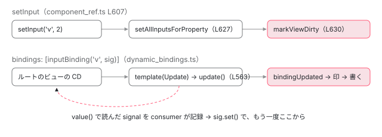

[目次](../README.md) › [テストの内側](README.md) › 第 6 回 / 全 20 回

# 入力の渡し方：setInput と bindings（inputBinding・outputBinding・twoWayBinding）

> fixture.componentRef.setInput が入力を書き込み、OnPush のビューに印を付ける流れと、createComponent の bindings に inputBinding / outputBinding / twoWayBinding を渡すと、signal の値がテンプレートのバインディングのように入力へ流れ続ける仕組み（dynamic\_bindings.ts）。componentInstance に直接代入してはいけない理由。

angular/angular · 読了 約 13 分 · 中核 · [サイトで読む（デモが動きます）](https://angular-deep-dive-cyan.vercel.app/chapter/testing-component-bindings)

---

テストでコンポーネントに入力を渡す方法は 2 つあります。作ったあとで `fixture.componentRef.setInput('name', value)` を呼ぶ方法と、`TestBed.createComponent(Cmp, { bindings: [inputBinding('name', sig)] })` のように作るときに渡す方法です。この章では、`setInput` が値を書いてビューに印を付ける行と、`bindings` が**ルートのビューの「テンプレート関数」になって**変更検知のたびに値を流し込む仕組みを追います。最後に、`componentInstance.x = ...` と代入してはいけない理由を、実際の結果で確かめます。

読む対象は `packages/core/testing/src/test_bed.ts`（`TestComponentOptions`）、`packages/core/src/render3/component_ref.ts`（`ComponentRef.setInput` と、`bindings` を受け取る側）、`packages/core/src/render3/dynamic_bindings.ts`（`inputBinding` / `outputBinding` / `twoWayBinding`）です。

1. [1. 全体像](01-testing-overview.md)
2. [2. initTestEnvironment](02-testing-init-environment.md)
3. [3. 後片付け](03-testing-reset-teardown.md)
4. [4. TestBed.inject](04-testing-inject.md)
5. [5. createComponent](05-testing-create-component.md)
6. **6. 入力の渡し方**（この章）
7. [7. createDirective](07-testing-directive-fixture.md)
8. [8. DebugElement と By](08-testing-debug-element.md)
9. [9. detectChanges](09-testing-detect-changes.md)
10. [10. 自動の変更検知](10-testing-auto-detect.md)
11. [11. whenStable](11-testing-when-stable.md)
12. [12. エラーの伝わり方](12-testing-errors.md)
13. [13. fakeAsync](13-testing-fake-async.md)
14. [14. 偽の時計](14-testing-fake-async-scheduler.md)
15. [15. waitForAsync と ProxyZone](15-testing-wait-for-async.md)
16. [16. zone なしの時間](16-testing-zoneless-time.md)
17. [17. effect と signal](17-testing-effects.md)
18. [18. @defer](18-testing-defer.md)
19. [19. RouterTestingHarness](19-testing-router-harness.md)
20. [20. issue と変更を読む](20-testing-issues.md)

## 1. createComponent の options

📄 `angular/packages/core/testing/src/test_bed.ts` L74–88 （▶ の行: 81, 87）

```ts
74 │ /**
75 │  * Options that can be configured for a test component.
76 │  *
77 │  * @publicApi
78 │  */
79 │ export interface TestComponentOptions {
80 │   /** Bindings to apply to the test component. */
81 ▶   bindings?: Binding[];
82 │ 
83 │   /**
84 │    * Whether to infer the tag name of the test component from its selector.
85 │    * Otherwise `div` will be used as its tag name.
86 │    */
87 ▶   inferTagName?: boolean;
88 │ }
```

`TestBed.createComponent` の 2 つ目の引数で渡せるのは、81 行目の `bindings` と 87 行目の `inferTagName`（[第 5 回](05-testing-create-component.md)）の 2 つだけです。`bindings` は [第 5 回](05-testing-create-component.md)で見たとおり、`createComponentRef` を通って `ComponentFactory.create` の 6 番目の引数 `componentBindings` にそのまま渡ります。つまり**テスト専用の仕組みではなく、公開 API の `createComponent(Cmp, { bindings })` と同じもの**です。

## 2. setInput：値を書いて、ビューに印を付ける

先に、昔からある `setInput` を見ます（[ivy-refs](../ivy/16-ivy-refs.md) と [OnPush の章](../cd/04-cd-onpush-markforcheck.md)でも短く見ました）。

📄 `angular/packages/core/src/render3/component_ref.ts` L607–638 （▶ の行: 608, 616, 619–621, 623, 627–628, 630, 632, 636）

```ts
607 │   override setInput(name: string, value: unknown): void {
608 ▶     if (this._hasInputBindings && ngDevMode) {
609 │       throw new RuntimeError(
610 │         RuntimeErrorCode.INVALID_SET_INPUT_CALL,
611 │         'Cannot call `setInput` on a component that is using the `inputBinding` or `twoWayBinding` functions.',
612 │       );
613 │     }
614 │ 
615 │     const tNode = this._tNode;
616 ▶     this.previousInputValues ??= new Map();
617 │     // Do not set the input if it is the same as the last value
618 │     // This behavior matches `bindingUpdated` when binding inputs in templates.
619 ▶     if (
620 ▶       this.previousInputValues.has(name) &&
621 ▶       Object.is(this.previousInputValues.get(name), value)
622 │     ) {
623 ▶       return;
624 │     }
625 │ 
626 │     const lView = this._rootLView;
627 ▶     const hasSetInput = setAllInputsForProperty(tNode, lView[TVIEW], lView, name, value);
628 ▶     this.previousInputValues.set(name, value);
629 │     const childComponentLView = getComponentLViewByIndex(tNode.index, lView);
630 ▶     markViewDirty(childComponentLView, NotificationSource.SetInput);
631 │ 
632 ▶     if (ngDevMode && !hasSetInput) {
633 │       const cmpNameForError = stringifyForError(this.componentType);
634 │       let message = `Can't set value of the '${name}' input on the '${cmpNameForError}' component. `;
635 │       message += `Make sure that the '${name}' property is declared as an input using the input() or model() function or the @Input() decorator.`;
636 ▶       reportUnknownPropertyError(message);
637 │     }
638 │   }
```

1. **608〜613 行目：bindings で入力を渡したコンポーネントには使えない**

   `_hasInputBindings` は作るときに決まります（4 節）。開発モードでは `NG0317` を投げます。条件に `ngDevMode` が入っているので、**本番ビルドではこの確認自体がありません**。
2. **616〜624 行目：前と同じ値なら何もしない**

   入力の名前ごとに前の値を `Map` に覚えていて、`Object.is` で同じなら 623 行目で帰ります。618 行目のコメントのとおり、テンプレートのバインディングの `bindingUpdated` と同じ振る舞いです。
3. **627 行目：入力を書く**

   `setAllInputsForProperty` が、ホストの要素にある入力のうち、その名前のものをすべて書きます。入力の transform、`ngOnChanges`、signal の `input()` への書き込みは、すべてこの経路を通ります。
4. **630 行目：コンポーネントのビューに印を付ける**

   `markViewDirty(childComponentLView, NotificationSource.SetInput)`。OnPush のビューでも Dirty になり、同時にスケジューラへ通知が行きます （[通知の種類の章](../zoneless/02-zoneless-notification-source.md)）。だから `setInput` のあとは `await fixture.whenStable()` だけで表示が変わります。
5. **632〜637 行目：そんな名前の入力が無いとき**

   `reportUnknownPropertyError` を呼びます。既定では `console.error` を出すだけで、投げません。投げさせたいときは `configureTestingModule({ errorOnUnknownProperties: true })` です（[ngmodule-schemas](../ngmodule/16-ngmodule-schemas.md)）。

このサイトの ng test（Vitest + jsdom、`@angular/core` 22.1.6）で確かめると、`setInput('v', 2)` の直後は表示が `0` のままで `isStable()` が `false`、`await whenStable()` のあとで `2` になりました。`detectChanges()` でもすぐ変わります。無い名前の `setInput('nope', 1)` は投げませんでした。

## 3. inputBinding / outputBinding / twoWayBinding は「あとで呼ばれる関数」

📄 `angular/packages/core/src/render3/dynamic_bindings.ts` L133–157 （▶ の行: 133, 151–153, 156）

```ts
133 ▶ export function inputBinding(publicName: string, value: () => unknown): Binding {
134 │   if (publicName === 'formField') {
135 │     const binding: BindingInternal = {
136 │       [BINDING]: INPUT_BINDING_METADATA,
137 │       create: () => {
138 │         controlCreateInternal();
139 │       },
140 │       update: () => {
141 │         // Update the [formField] input binding, regardless of whether this targets a 'FormField' directive.
142 │         inputBindingUpdate(binding.targetIdx!, publicName, value());
143 │         controlUpdateInternal();
144 │       },
145 │     };
146 │     return binding;
147 │   }
148 │ 
149 │   // Note: ideally we would use a class here, but it seems like they
150 │   // don't get tree shaken when constructed by a function like this.
151 ▶   const binding: BindingInternal = {
152 ▶     [BINDING]: INPUT_BINDING_METADATA,
153 ▶     update: () => inputBindingUpdate(binding.targetIdx!, publicName, value()),
154 │   };
155 │ 
156 ▶   return binding;
157 │ }
```

`inputBinding` を呼んだ時点では、何も起きません。151〜154 行目で、`update` という関数を 1 つ持ったオブジェクトを作って返すだけです。152 行目の `[BINDING]` には、種類（`'input'`）と、必要なバインディングの枠の数（`requiredVars: 1`）を入れた定数 `INPUT_BINDING_METADATA` が入ります。`update` の中で `value()` を呼ぶので、**値は「関数」で渡します**。signal はそのまま関数として渡せます。134〜147 行目は `formField` という名前のときだけの特別扱いで、Signal Forms 用です（[signal-forms](../signals/17-signal-forms.md)）。

📄 `angular/packages/core/src/render3/dynamic_bindings.ts` L80–112 （▶ の行: 82–83, 88, 91, 100, 104）

```ts
 80 │ function inputBindingUpdate(targetDirectiveIdx: number, publicName: string, value: unknown) {
 81 │   const lView = getLView();
 82 ▶   const bindingIndex = nextBindingIndex();
 83 ▶   if (bindingUpdated(lView, bindingIndex, value)) {
 84 │     const tView = lView[TVIEW];
 85 │     const tNode = getSelectedTNode();
 86 │ 
 87 │     const componentLView = getComponentLViewByIndex(tNode.index, lView);
 88 ▶     markViewDirty(componentLView, NotificationSource.SetInput);
 89 │ 
 90 │     // TODO(pk): don't check on each and every binding, just assert in dev mode
 91 ▶     const targetDef = tView.directiveRegistry![targetDirectiveIdx];
 92 │     if (ngDevMode && !targetDef) {
 93 │       throw new RuntimeError(
 94 │         RuntimeErrorCode.NO_BINDING_TARGET,
 95 │         `Input binding to property "${publicName}" does not have a target.`,
 96 │       );
 97 │     }
 98 │ 
 99 │     // TODO(pk): the hasSet check should be replaced by one-off check in the first creation pass
100 ▶     const hasSet = setDirectiveInput(tNode, tView, lView, targetDef, publicName, value);
101 │ 
102 │     if (ngDevMode) {
103 │       if (!hasSet) {
104 ▶         throw new RuntimeError(
105 │           RuntimeErrorCode.NO_BINDING_TARGET,
106 │           `${stringifyForError(targetDef.type)} does not have an input with a public name of "${publicName}".`,
107 │         );
108 │       }
109 │       storePropertyBindingMetadata(tView.data, tNode, publicName, bindingIndex);
110 │     }
111 │   }
112 │ }
```

`update` から呼ばれる本体です（83〜88 行目は[通知の種類の章](../zoneless/02-zoneless-notification-source.md)でも見ました）。82 行目で次のバインディングの枠を取り、83 行目の `bindingUpdated` で前の値と比べ、変わったときだけ 88 行目で印を付けて 100 行目で入力を書きます。2 節の `setInput` と同じ「比べる → 印を付ける → 書く」の 3 つを、テンプレートのバインディングと同じ形でしています。91 行目の `targetDirectiveIdx` は「ホストに載っているディレクティブのうち何番目に書くか」で、4 節で決まります。104〜106 行目、無い名前の入力なら開発モードで**投げます**（`setInput` は投げないのと違う点です）。

📄 `angular/packages/core/src/render3/dynamic_bindings.ts` L181–196 （▶ の行: 184, 186, 190–191）

```ts
181 │ export function outputBinding<T>(eventName: string, listener: (event: T) => unknown): Binding {
182 │   // Note: ideally we would use a class here, but it seems like they
183 │   // don't get tree shaken when constructed by a function like this.
184 ▶   const binding: BindingInternal = {
185 │     [BINDING]: OUTPUT_BINDING_METADATA,
186 ▶     create: () => {
187 │       const lView = getLView<{} | null>();
188 │       const tNode = getCurrentTNode()!;
189 │       const tView = lView[TVIEW];
190 ▶       const targetDef = tView.directiveRegistry![binding.targetIdx!];
191 ▶       createOutputListener(tNode, lView, listener, targetDef, eventName);
192 │     },
193 │   };
194 │ 
195 │   return binding;
196 │ }
```

`outputBinding` は `update` ではなく `create` を持ちます。作成のときに 1 回だけ、191 行目の `createOutputListener` で output を購読します。テンプレートの `(event)="..."` と違い、ネイティブの DOM イベントには登録しません（`create_component_spec.ts` の `should not listen to native event when creating an output binding`、:1437）。

📄 `angular/packages/core/src/render3/dynamic_bindings.ts` L219–245 （▶ の行: 220–222, 241–242）

```ts
219 │ export function twoWayBinding(publicName: string, value: WritableSignal<unknown>): Binding {
220 ▶   const input = inputBinding(publicName, value) as BindingInternal;
221 ▶   const output = outputBinding(publicName + 'Change', (eventValue) =>
222 ▶     value.set(eventValue),
223 │   ) as BindingInternal;
224 │ 
225 │   // We take advantage of inputs only having a `create` block and outputs only having an `update`
226 │   // block by passing them through directly instead of creating dedicated functions here. This
227 │   // assumption can break down if one of them starts targeting both blocks. These assertions
228 │   // are here to help us catch it if something changes in the future.
229 │   ngDevMode && assertNotDefined(input.create, 'Unexpected `create` callback in inputBinding');
230 │   ngDevMode && assertNotDefined(output.update, 'Unexpected `update` callback in outputBinding');
231 │ 
232 │   const binding: BindingInternal = {
233 │     [BINDING]: {
234 │       kind: 'twoWay',
235 │       requiredVars: input[BINDING].requiredVars + output[BINDING].requiredVars,
236 │     },
237 │     set targetIdx(idx: number) {
238 │       (input as Writable<BindingInternal>).targetIdx = idx;
239 │       (output as Writable<BindingInternal>).targetIdx = idx;
240 │     },
241 ▶     create: output.create,
242 ▶     update: input.update,
243 │   };
244 │   return binding;
245 │ }
```

`twoWayBinding` は、220 行目の `inputBinding` と、221〜223 行目の「`名前 + 'Change'` の output を受けたら signal に `set` する」`outputBinding` の 2 つを作り、241〜242 行目で `create` と `update` を 1 つのオブジェクトにまとめます。テンプレートの `[(value)]="sig"` と同じ組み合わせです。

## 4. bindings を受け取る側：ルートのビューのテンプレートになる

では `update` と `create` は、誰がいつ呼ぶのでしょうか。`ComponentFactory.create` がルートの `TView` を作るところです。

📄 `angular/packages/core/src/render3/component_ref.ts` L453–471 （▶ の行: 457, 459, 461–463, 466–468）

```ts
453 │   let creationBindings: Binding[] | null = null;
454 │   let updateBindings: Binding[] | null = null;
455 │   let varsToAllocate = 0;
456 │ 
457 ▶   if (componentBindings) {
458 │     for (const binding of componentBindings as BindingInternal[]) {
459 ▶       varsToAllocate += binding[BINDING].requiredVars;
460 │ 
461 ▶       if (binding.create) {
462 ▶         binding.targetIdx = 0;
463 ▶         (creationBindings ??= []).push(binding);
464 │       }
465 │ 
466 ▶       if (binding.update) {
467 ▶         binding.targetIdx = 0;
468 ▶         (updateBindings ??= []).push(binding);
469 │       }
470 │     }
471 │   }
```

457 行目で `bindings` を 1 つずつ見て、459 行目で枠の数を足し、`create` を持つものを `creationBindings` に、`update` を持つものを `updateBindings` に分けます。462・467 行目の `targetIdx = 0` は「0 番目のディレクティブ、つまりコンポーネント自身に書く」という意味です（ルートの `TView` に載せる配列の先頭がコンポーネントの定義）。分けた 2 つの配列は、次の関数に渡されます。

📄 `angular/packages/core/src/render3/component_ref.ts` L546–572 （▶ の行: 550, 554–555, 557, 561, 563, 571）

```ts
546 │ function getRootTViewTemplate(
547 │   creationBindings: Binding[] | null,
548 │   updateBindings: Binding[] | null,
549 │ ): ComponentTemplate<unknown> | null {
550 ▶   if (!creationBindings && !updateBindings) {
551 │     return null;
552 │   }
553 │ 
554 ▶   return (flags) => {
555 ▶     if (flags & RenderFlags.Create && creationBindings) {
556 │       for (const binding of creationBindings as BindingInternal[]) {
557 ▶         binding.create!();
558 │       }
559 │     }
560 │ 
561 ▶     if (flags & RenderFlags.Update && updateBindings) {
562 │       for (const binding of updateBindings as BindingInternal[]) {
563 ▶         binding.update!();
564 │       }
565 │     }
566 │   };
567 │ }
568 │ 
569 │ function isInputBinding(binding: Binding): boolean {
570 │   const kind = (binding as BindingInternal)[BINDING].kind;
571 ▶   return kind === 'input' || kind === 'twoWay';
572 │ }
```

1. **550〜552 行目：bindings が無ければ、テンプレートは無し**

   普通の `createComponent` では、ルートの `TView` にテンプレート関数はありません。
2. **554〜566 行目：あれば、それ自体がテンプレート関数になる**

   `(flags) => { ... }` は、コンパイラが作るテンプレート関数と同じ形です（[テンプレート関数の章](../ivy/03-ivy-template-function.md)）。作成モード（555 行目）で `create` を、更新モード（561 行目）で `update` を呼びます。**ルートのビューを変更検知するたびに 563 行目が走り、`value()` が読まれ、変わっていれば入力に書かれる**わけです。
3. **signal を渡すと「流れ続ける」理由**

   ルートの `TView` は `Embedded` ではないので、`refreshView` はこのテンプレート関数を reactive consumer（signal の読み取りを記録する係）の中で走らせます（[signal consumer の章](../cd/05-cd-signal-consumer.md)）。563 行目の `update` の中で `value()`、つまり signal を読むので、その signal はルートのビューの依存として記録されます。あとで `sig.set()` すると consumer が汚れ、ルートのビューに印が付き、スケジューラが動きます。だから `await whenStable()` だけで新しい値が入ります。

📄 `angular/packages/core/src/render3/component_ref.ts` L344–355 （▶ の行: 352–354）

```ts
344 │ 
345 │     const sharedStylesHost = rootViewInjector.get(SHARED_STYLES_HOST, null);
346 │     const styleHost = getStyleHost(
347 │       hostElement,
348 │       () => rootViewInjector.get(DOCUMENT, null) ?? getDocument(),
349 │     );
350 │     if (sharedStylesHost) sharedStylesHost.addHost(styleHost);
351 │ 
352 ▶     const hasInputBindings =
353 ▶       componentBindings?.some(isInputBinding) ||
354 ▶       directives?.some((d) => typeof d !== 'function' && d.bindings.some(isInputBinding));
355 │ 
```

📄 `angular/packages/core/src/render3/component_ref.ts` L425–439 （▶ の行: 438）

```ts
425 │     } catch (e) {
426 │       // Stop tracking the views if creation failed since
427 │       // the consumer won't have a way to dereference them.
428 │       if (componentView !== null) {
429 │         unregisterLView(componentView);
430 │       }
431 │       unregisterLView(rootLView);
432 │       throw e;
433 │     } finally {
434 │       profiler(ProfilerEvent.DynamicComponentEnd);
435 │       leaveView();
436 │     }
437 │ 
438 ▶     return new ComponentRef(this.componentType, rootLView, !!hasInputBindings);
439 │   }
```

352〜354 行目で、`bindings` に入力の種類（`'input'` か `'twoWay'`、569〜572 行目）が 1 つでもあれば `hasInputBindings` を `true` にし、438 行目で `ComponentRef` に渡します。これが 2 節の 608 行目の `_hasInputBindings` です。`outputBinding` だけなら `false` なので、`setInput` も使えます。



*2 つの経路。setInput は呼んだその場で書いて印を付ける。inputBinding はルートのビューのテンプレート関数になり、変更検知のたびに value() を読んで書く。*

## 5. 確かめた結果：setInput・signal・普通の関数・代入

このサイトの ng test（Vitest + jsdom、`@angular/core` 22.1.6、zone.js なし）で確かめた spec の要点です。

📄 `src/verify-b/bindings.spec.ts（要点。確かめたあと削除）`

```
@Component({selector: 'v-sig', template: '<p>{{ v() }}</p>'})
class SigCmp {
  readonly v = input(0);
  readonly out = output<string>();
}

// 1) setInput
const f1 = TestBed.createComponent(SigCmp);
await f1.whenStable();                 // <p>0</p>
f1.componentRef.setInput('v', 2);      // 直後: まだ 0、isStable() は false
await f1.whenStable();                 // <p>2</p>

// 2) bindings に signal
const v = signal(10);
const f2 = TestBed.createComponent(SigCmp, {
  bindings: [inputBinding('v', v), outputBinding<string>('out', (e) => log.push(e))],
});
await f2.whenStable();                 // <p>10</p>
v.set(11);                             // 直後: まだ 10、isStable() は false
await f2.whenStable();                 // <p>11</p>

// 3) bindings に普通の関数
let plain = 1;
const f3 = TestBed.createComponent(SigCmp, {bindings: [inputBinding('v', () => plain)]});
await f3.whenStable();                 // <p>1</p>
plain = 2;                             // isStable() は true のまま
f3.detectChanges();                    // まだ <p>1</p>
```

| やったこと | 直後 | await whenStable() のあと | fixture.detectChanges() のあと |
| --- | --- | --- | --- |
| `setInput('v', 2)` | `0`（`isStable()` は `false`） | `2` | `3`（`setInput('v', 3)` のあと） |
| `inputBinding('v', sig)` で `sig.set(11)` | `10`（`isStable()` は `false`） | `11` | — |
| `inputBinding('v', () => plain)` で `plain = 2` | `1`（`isStable()` は `true`） | `1` | `1`（変わらない） |
| `outputBinding('out', fn)` で `componentInstance.out.emit('hi')` | `fn` が `'hi'` で呼ばれた |   |   |
| `twoWayBinding('m', sig)` で子が `m.set('fromChild')` | 親の `sig()` が `'fromChild'` になり、表示も `fromChild` |   |   |
| `bindings` で作ったあと `setInput('v', 99)` | ``NG0317: Cannot call `setInput` on a component that is using the `inputBinding` or `twoWayBinding` functions.`` |   |   |

3 行目が大事です。普通の関数を渡すと、値が変わっても**誰も通知しない**ので、スケジューラは動かず `isStable()` は `true` のままです。さらに `fixture.detectChanges()` を呼んでも `1` のままでした。zoneless の TestBed では `fixture.detectChanges()` が `ApplicationRef.tick()` を呼び、印の付いていないビューは走らないからです（[第 9 回](09-testing-detect-changes.md)）。ルートのビューに印が無いので、563 行目の `update` まで届きません。テストで値を動かすなら signal を渡します。

### componentInstance に直接代入すると

| コンポーネント | やったこと | 結果 |
| --- | --- | --- |
| `changeDetection` を書かない（`@Input() v = 0`） | `componentInstance.v = 5` → `detectChanges()` → `whenStable()` | 表示は `0` のまま |
| 同じコンポーネント | `componentRef.setInput('v', 6)` → `whenStable()` | `6` |
| `ChangeDetectionStrategy.Eager` | `componentInstance.v = 5` → `whenStable()` | `0` のまま |
| 同じコンポーネント | 続けて `fixture.detectChanges()` | `NG0100: ExpressionChangedAfterItHasBeenCheckedError ... Previous value: '0'. Current value: '5'` |
| 同じコンポーネント | 続けて `fixture.changeDetectorRef.detectChanges()` | `5` |

1 行目、`changeDetection` を書かないコンポーネントの定義は、このサイトの 22.1.6 で `ɵcmp.onPush === true` でした。既定の変更検知はコミット eae8f7e30b9（v22.0.0）で OnPush になっていて、`../angular`（22.2.0-next.7）にも 22.1.6 にも入っています。代入では 630 行目の `markViewDirty` が呼ばれないので、OnPush のビューは Dirty にならず、表示は変わりません。

Eager（以前の Default）にしても、zoneless では代入を誰も通知しないので `whenStable()` では変わりません。`fixture.detectChanges()` は、`tick` の本体ではビューを走らせず、そのあとの開発モードの確認（`checkNoChanges`）だけが新しい値に気づいて `NG0100` を投げました（[第 9 回](09-testing-detect-changes.md)、[checkNoChanges の章](../cd/07-cd-check-no-changes.md)）。ビューを直接 `detectChanges` すれば `5` になりますが、それは「テンプレートの親が値を渡す」のとは別のことをしています。

> [!WARNING]
> **ハマりどころ**
>
> `componentInstance` への代入は、2 節の 616〜630 行目を**すべて飛ばします**。同じ値の確認、入力の transform、`ngOnChanges`、そして印。さらに `input()` で宣言した入力は signal そのものがプロパティなので、型を無視して代入すると signal が別の値に置き換わってしまいます。テストでは `setInput` か `bindings` を使います。

> **🧪 DEMO — 本物の createComponent に bindings を渡す**
>
> ページの上に `TcbCounter`（`input` の `label`、`model` の `count`、`output` の `picked`）を作ります。親（この章）の signal を動かすと子の表示が変わり、子が `count` を書くと親の signal が変わり、子が emit すると `outputBinding` の関数がログに出ます。
>
> ▶ [このデモはサイトで動かせます](https://angular-deep-dive-cyan.vercel.app/chapter/testing-component-bindings)

## ここまでの呼び出し

- 👤 `TestBed.createComponent(Cmp, { bindings: [inputBinding('v', sig)] })` — あなたの spec
  - `inputBinding('v', sig)` — dynamic\_bindings.ts L133 — *update を持つオブジェクトを返すだけ*
  - `createComponentRef(type, tagName, renderer, bindings)` — test\_bed.ts L867 — *第 5 回*
    - `ComponentFactory.create(..., componentBindings)` — component\_ref.ts L266
      - `createRootTView(..., componentBindings)` — component\_ref.ts L442 — *targetIdx = 0、create / update に振り分け*
        - `getRootTViewTemplate(creationBindings, updateBindings)` — component\_ref.ts L546 — *これがルートのテンプレート関数*
      - `new ComponentRef(type, rootLView, hasInputBindings)` — component\_ref.ts L438
  - `await fixture.whenStable()` → 変更検知 — 第 11 回
    - `template(RenderFlags.Update)` → `binding.update()` — component\_ref.ts L563
      - `inputBindingUpdate(0, 'v', sig())` — dynamic\_bindings.ts L80 — *bindingUpdated → markViewDirty → setDirectiveInput*
- 👤 `sig.set(11)` → ルートのビューの consumer が汚れる → もう一度上から

## テストと直し方

📄 `angular/packages/core/test/test_bed_spec.ts` L1230–1268 （▶ の行: 1230, 1239, 1244, 1246, 1258, 1264, 1266）

```ts
1230 ▶   describe('bindings', () => {
1231 │     it('should be able to bind to inputs', () => {
1232 │       @Component({template: ''})
1233 │       class TestComp {
1234 │         @Input() value = 0;
1235 │       }
1236 │ 
1237 │       const value = signal(1);
1238 │       const fixture = TestBed.createComponent(TestComp, {
1239 ▶         bindings: [inputBinding('value', value)],
1240 │       });
1241 │       fixture.detectChanges();
1242 │       expect(fixture.componentInstance.value).toBe(1);
1243 │ 
1244 ▶       value.set(2);
1245 │       fixture.detectChanges();
1246 ▶       expect(fixture.componentInstance.value).toBe(2);
1247 │     });
1248 │ 
1249 │     it('should be able to bind to outputs', () => {
1250 │       let count = 0;
1251 │ 
1252 │       @Component({template: '<button (click)="event.emit()">Click me</button>'})
1253 │       class TestComp {
1254 │         @Output() event = new EventEmitter<void>();
1255 │       }
1256 │ 
1257 │       const fixture = TestBed.createComponent(TestComp, {
1258 ▶         bindings: [outputBinding('event', () => count++)],
1259 │       });
1260 │       fixture.detectChanges();
1261 │       const button = fixture.nativeElement.querySelector('button');
1262 │       expect(count).toBe(0);
1263 │ 
1264 ▶       button.click();
1265 │       fixture.detectChanges();
1266 ▶       expect(count).toBe(1);
1267 │     });
1268 │ 
```

`packages/core/test/test_bed_spec.ts` の `describe('TestBed')`（:646）の中の `describe('bindings')`（:1230）です。1239 行目で signal を `inputBinding` に渡し、1244 行目で `set` して 1246 行目で入力が変わったことを、1258 行目の `outputBinding` がボタンのクリック（1264 行目）で呼ばれることを確かめています。このあと `it('should be able to bind two-way bindings')`（:1269）が続きます。`bindings` の仕組みそのもの（公開 API の `createComponent`）は、別のファイル `packages/core/test/acceptance/create_component_spec.ts` の `describe('root component inputs')`（:660）・`describe('root component outputs')`（:1197）・`describe('root component two-way bindings')`（:1457）にあります。

📄 `ターミナル`

```
cd ~/angular-research/angular
pnpm bazel test //packages/core/test:test \
  --test_arg=--filter="(TestBed bindings|createComponent root component (inputs|outputs|two-way bindings))" \
  --test_output=all
```

📄 `出力（抜粋。2026-11-01 に実行）`

```
Ran 0 of 1398 specs
0 specs, 0 failures
Ran 1 of 1399 specs
1 spec, 0 failures
Ran 1 of 1399 specs
1 spec, 0 failures
Ran 1 of 1399 specs
1 spec, 0 failures
INFO: Elapsed time: 2.973s, Critical Path: 1.67s
//packages/core/test:test                                                PASSED in 1.5s
```

1. **3 本しか走っていない：acceptance は別のターゲット**

   正規表現の前半「`TestBed bindings`」は 3 本（0 + 1 + 1 + 1）に一致しましたが、後半の `createComponent root component ...` は 1 本も一致していません。`create_component_spec.ts` は `packages/core/test/acceptance/` にあり、このディレクトリには自分の `BUILD.bazel` があるからです。

   📄 `angular/packages/core/test/acceptance/BUILD.bazel` L58–74 （▶ の行: 60–61）

   ```python
   58 │ )
   59 │ 
   60 ▶ angular_jasmine_test(
   61 ▶     name = "acceptance",
   62 │     data = [
   63 │         ":acceptance_lib",
   64 │         ":forward_ref_test_lib",
   65 │     ],
   66 │ )
   67 │ 
   68 │ ng_web_test_suite(
   69 │     name = "acceptance_web",
   70 │     deps = [
   71 │         ":acceptance_lib",
   72 │         ":forward_ref_test_lib",
   73 │     ],
   74 │ )
   ```

   60〜61 行目、`//packages/core/test/acceptance:acceptance` という別のターゲットです（`shard_count` が無いので、走らせれば `Ran` は 1 回だけ出ます）。`//packages/core/test:test` の `glob` はサブパッケージの中まで入りません（[リポジトリの地図](../contrib/02-contrib-repo-map.md)）。**フィルタが合っていてもターゲットが違えば 0 本で PASSED**、という [forms の第 1 回](../forms/01-forms-overview.md)の落とし穴のもう 1 つの形です。このターゲットに同じ `--test_arg=--filter="createComponent root component"` を付けて走らせると、`Ran 33 of 2693 specs` / `33 specs, 0 failures` / `PASSED in 1.8s` でした（2026-11-01、このマシン）。
2. **直すとしたら**

   `setInput` の振る舞いは `component_ref.ts` の `ComponentRef.setInput`、`bindings` の振り分けは同じファイルの `createRootTView` と `getRootTViewTemplate`、値を書く本体は `dynamic_bindings.ts` の `inputBindingUpdate` です。TestBed の options から渡る経路は `test_bed_spec.ts` の `describe('bindings')`、`bindings` 自体の振る舞いは `create_component_spec.ts` の 3 つの describe に足します。
3. **issue を読むときの手がかり**

   「`inputBinding` に渡した値が更新されない」は、まず signal ではなく普通の関数を渡していないか（5 節の 3 行目）を見ます。「本番だけ `setInput` が効いてしまう / 開発だけ投げる」は 608 行目の `ngDevMode` です（[第 20 回](20-testing-issues.md)）。

## 聞かれそうな質問

**Q. setInput と bindings のどちらを使えばよいですか？**

テストの途中で値を何度も変えるなら `bindings` に signal を渡すのが素直です。`sig.set()` がそのままルートのビューの依存になり（component\_ref.ts 563 行目の `update` の中で読まれる）、`await whenStable()` だけで反映されます。テンプレートの親から渡すのと同じ形なので、`output` や `model` も `outputBinding` / `twoWayBinding` で同じように扱えます。`setInput` は 1 回だけ渡したいとき、または `bindings` を使えないとき（例えば作ったあとの fixture しか手元に無いとき）に使います。両方を同じコンポーネントに使うことはできません（608 行目、`NG0317`）。

**Q. input.required の入力を渡さずに作るとどうなりますか？**

作るところ（`createComponent`）では何も起きません。最初の変更検知でテンプレートが `r()` を読んだときに `NG0950: Input "r" is required but no value is available yet.` になります。このサイトの ng test では、`await fixture.whenStable()` がこのエラーで reject されました。作るときに `bindings: [inputBinding('r', () => 1)]` を渡すか、最初の変更検知より前に `setInput('r', 1)` を呼びます。

**Q. componentInstance に代入してはいけないのはなぜですか？**

`setInput`（component\_ref.ts 607〜638 行目）がしている「同じ値の確認（619〜624 行目）・入力の書き込み（627 行目、transform と `ngOnChanges` を含む）・ビューへの印（630 行目）」を全部飛ばすからです。v22 では `changeDetection` を書かないコンポーネントは OnPush なので、印が無いと表示は変わりません。ng test でも `detectChanges()` のあとで `0` のままでした。`input()` の入力は、型を無視して代入すると signal ごと置き換わってしまいます。

**Q. inputBinding に普通の関数を渡してもよいですか？**

作るときの値を渡すだけなら使えます（`test_bed_spec.ts` の createDirective の spec も `() => 'hello'` を渡しています）。ただし値が変わっても誰も通知しないので、zoneless の TestBed では `whenStable()` でも `detectChanges()` でも反映されませんでした（5 節）。変える値は signal にします。

**Q. outputBinding はテンプレートの (event) と同じですか？**

output の購読という点では同じですが、DOM のイベントには登録しません。`outputBinding` は作成のときに `createOutputListener`（dynamic\_bindings.ts 191 行目）で output を購読するだけです。テンプレートの `(event)` は要素に DOM のリスナーも付けます（[第 8 回](08-testing-debug-element.md)）。

## 読み終えて

- `setInput` は「同じ値なら何もしない → `setAllInputsForProperty` で書く → `markViewDirty`」。だから `whenStable()` だけで表示が変わる
- `inputBinding` / `outputBinding` / `twoWayBinding` は `update` / `create` を持つオブジェクトを返すだけ。呼ぶのはルートのビューのテンプレート関数（`getRootTViewTemplate`）
- signal を渡すと、ルートのビューの consumer がそれを読むので、`set()` が変更検知を起こす。普通の関数は誰も通知しない
- `bindings` に入力があると `setInput` は開発モードで `NG0317`（本番ビルドでは確認が無い）
- `componentInstance` への代入は印も `ngOnChanges` も飛ばす。v22 の既定は OnPush なので、表示は変わらない

---

← 前: [createComponent：根の要素を置いて、コンポーネントを作るまで](05-testing-create-component.md)  
次: [createDirective と DirectiveFixture：ディレクティブだけをテストする](07-testing-directive-fixture.md) →
