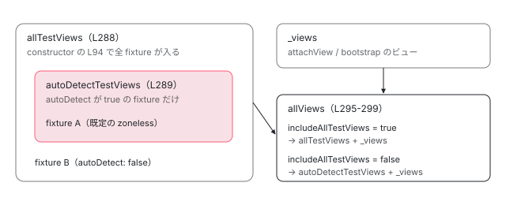

[目次](../README.md) › [テストの内側](README.md) › 第 9 回 / 全 20 回

# fixture.detectChanges：zoneless では appRef.tick、zone では detectChanges

> AbstractFixture の constructor が ApplicationRef の allTestViews に自分のビューを登録する行と、detectChanges が zoneless なら includeAllTestViews を立てて appRef.tick()、zone なら ngZone.run の中で root effect → detectChanges → checkNoChanges を回す違い。checkNoChanges 引数、テストで ExpressionChangedAfterItHasBeenChecked が出る理由。

angular/angular · 読了 約 14 分 · 発展 · [サイトで読む（デモが動きます）](https://angular-deep-dive-cyan.vercel.app/chapter/testing-detect-changes)

---

テストで一番よく書く 1 行が `fixture.detectChanges()` です。この章では、その 1 行が **zoneless（v22 の既定）では `ApplicationRef.tick()` を呼び、zone では fixture 自身のビューだけを `detectChanges` する**こと、そして tick がどのビューを相手にするかを決める `ApplicationRef` の 3 つの集合を、行番号で 1 つずつ確かめます。最後に、テストでだけ `ExpressionChangedAfterItHasBeenCheckedError`（NG0100）が出る理由を、このサイトの ng test で実際に起こして見ます。

読む対象は `packages/core/testing/src/fixture.ts` と `packages/core/src/application/application_ref.ts`、確かめる spec は `packages/core/test/component_fixture_spec.ts` です。

1. [1. 全体像](01-testing-overview.md)
2. [2. initTestEnvironment](02-testing-init-environment.md)
3. [3. 後片付け](03-testing-reset-teardown.md)
4. [4. TestBed.inject](04-testing-inject.md)
5. [5. createComponent](05-testing-create-component.md)
6. [6. 入力の渡し方](06-testing-component-bindings.md)
7. [7. createDirective](07-testing-directive-fixture.md)
8. [8. DebugElement と By](08-testing-debug-element.md)
9. **9. detectChanges**（この章）
10. [10. 自動の変更検知](10-testing-auto-detect.md)
11. [11. whenStable](11-testing-when-stable.md)
12. [12. エラーの伝わり方](12-testing-errors.md)
13. [13. fakeAsync](13-testing-fake-async.md)
14. [14. 偽の時計](14-testing-fake-async-scheduler.md)
15. [15. waitForAsync と ProxyZone](15-testing-wait-for-async.md)
16. [16. zone なしの時間](16-testing-zoneless-time.md)
17. [17. effect と signal](17-testing-effects.md)
18. [18. @defer](18-testing-defer.md)
19. [19. RouterTestingHarness](19-testing-router-harness.md)
20. [20. issue と変更を読む](20-testing-issues.md)

## 1. fixture は ApplicationRef の「隠しフィールド」を使う

fixture.ts の先頭近くに、ファイルの中だけで使う型が 1 つあります。

📄 `angular/packages/core/testing/src/fixture.ts` L36–40 （▶ の行: 37–39）

```ts
36 │ interface TestAppRef {
37 ▶   allTestViews: Set<ViewRef>;
38 ▶   includeAllTestViews: boolean;
39 ▶   autoDetectTestViews: Set<ViewRef>;
40 │ }
```

37〜39 行目の 3 つは、`ApplicationRef` の公開 API にはありません。fixture は `ApplicationRef` をこの型だと見なおして（キャストして）、中の private なフィールドを直接読み書きします（フィールドの宣言は[第 10 回](10-testing-auto-detect.md)で見ます）。その本体が `ApplicationRef` 側にあります。

📄 `angular/packages/core/src/application/application_ref.ts` L285–300 （▶ の行: 286, 288–289, 291, 295, 297–298）

```ts
285 │ 
286 ▶   // Needed for ComponentFixture temporarily during migration of autoDetect behavior
287 │   // Eventually the hostView of the fixture should just attach to ApplicationRef.
288 ▶   private allTestViews: Set<InternalViewRef<unknown>> = new Set();
289 ▶   private autoDetectTestViews: Set<InternalViewRef<unknown>> = new Set();
290 │   /** @internal */
291 ▶   includeAllTestViews = false;
292 │   /** @internal */
293 │   afterTick = new Subject<void>();
294 │   /** @internal */
295 ▶   get allViews(): Array<InternalViewRef<unknown>> {
296 │     return [
297 ▶       ...(this.includeAllTestViews ? this.allTestViews : this.autoDetectTestViews).keys(),
298 ▶       ...this._views,
299 │     ];
300 │   }
```

1. **288 行目 allTestViews**

   テストで作った fixture のビューが**全部**入る `Set` です。286 行目のコメントのとおり「autoDetect の移行のあいだ fixture のために一時的に要る」ものです。
2. **289 行目 autoDetectTestViews**

   そのうち「自動の変更検知（autoDetect）」が有効な fixture のビューだけが入る `Set` です。
3. **291 行目 includeAllTestViews**

   ふだんは `false` の旗です。これが立っている間だけ、tick の対象が「全部のテストビュー」に広がります。
4. **295〜299 行目 allViews**

   tick が回す相手の一覧です。297 行目で、旗が立っていれば `allTestViews`、立っていなければ `autoDetectTestViews` を選び、298 行目で `_views`（`attachView` や `bootstrap` で ApplicationRef に付いたふつうのビュー）を後ろに足します。



*ApplicationRef が持つ 3 つの集合。allViews（L295-299）は includeAllTestViews で左の 2 つのどちらかを選び、\_views を足す。autoDetectTestViews は allTestViews の部分集合。*

## 2. constructor が自分のビューを登録する

fixture は `TestBed.createComponent` の中で new されます（作られるまでは[第 5 回](05-testing-create-component.md)）。constructor の前半がこの集合に登録します。

📄 `angular/packages/core/testing/src/fixture.ts` L88–104 （▶ の行: 89, 93–94, 96–97, 101–103）

```ts
 88 │   constructor(protected readonly hostRef: ComponentRef<unknown>) {
 89 ▶     this.changeDetectorRef = hostRef.changeDetectorRef;
 90 │     this.debugElement = getDebugNode(hostRef.location.nativeElement) as DebugElement;
 91 │     this.nativeElement = hostRef.location.nativeElement;
 92 │     this.elementRef = hostRef.location;
 93 ▶     this.hostView = hostRef.hostView;
 94 ▶     this._testAppRef.allTestViews.add(this.hostView);
 95 │ 
 96 ▶     if (this.autoDetect) {
 97 ▶       this._testAppRef.autoDetectTestViews.add(this.hostView);
 98 │       this.scheduler?.notify(ɵNotificationSource.ViewAttached);
 99 │       this.scheduler?.notify(ɵNotificationSource.MarkAncestorsForTraversal);
100 │     }
101 ▶     this.hostView.onDestroy(() => {
102 ▶       this._testAppRef.allTestViews.delete(this.hostView);
103 ▶       this._testAppRef.autoDetectTestViews.delete(this.hostView);
104 │     });
```

1. **89・93 行目**

   `hostRef`（`ComponentRef`）から `changeDetectorRef` と `hostView` を取り出します。`ComponentRef` の実装（render3/component\_ref.ts）では、この 2 つは**同じ `ViewRef` オブジェクト**です。どちらも「根の要素（host）のビュー」を指します。
2. **94 行目**

   どんな設定でも、まず `allTestViews` に入ります。
3. **96〜97 行目**

   autoDetect が有効なら `autoDetectTestViews` にも入れ、スケジューラに通知します。ここは[第 10 回](10-testing-auto-detect.md)の主題です。
4. **101〜103 行目**

   ビューが壊されたら両方の集合から抜きます。fixture を作るたびに集合が増えたままにならないのはこのためです（テストごとの破棄は[第 3 回](03-testing-reset-teardown.md)）。

## 3. detectChanges の 2 本の道

本題です。[spec の読み方の章](../contrib/06-contrib-reading-specs.md)や [harness の章](../cdk/20-harness.md)でも短く見た関数ですが、ここでは 1 行ずつ追います。

📄 `angular/packages/core/testing/src/fixture.ts` L129–167 （▶ の行: 132–133, 137, 140, 142–143, 145, 150, 152–154, 158, 166）

```ts
129 │   /**
130 │    * Trigger a change detection cycle for the component.
131 │    */
132 ▶   detectChanges(checkNoChanges = true): void {
133 ▶     const originalCheckNoChanges = (this.changeDetectorRef as InternalViewRef<unknown>)
134 │       .checkNoChanges;
135 │     try {
136 │       if (!checkNoChanges) {
137 ▶         (this.changeDetectorRef as InternalViewRef<unknown>).checkNoChanges = () => {};
138 │       }
139 │ 
140 ▶       if (this.zonelessEnabled) {
141 │         try {
142 ▶           this._testAppRef.includeAllTestViews = true;
143 ▶           this._appRef.tick();
144 │         } finally {
145 ▶           this._testAppRef.includeAllTestViews = false;
146 │         }
147 │       } else {
148 │         // Run the change detection inside the NgZone so that any async tasks as part of the change
149 │         // detection are captured by the zone and can be waited for in isStable.
150 ▶         this._ngZone.run(() => {
151 │           // Flush root effects before `detectChanges()`, to emulate the sequencing of `tick()`.
152 ▶           this.rootEffectScheduler.flush();
153 ▶           this.changeDetectorRef.detectChanges();
154 ▶           this.checkNoChanges();
155 │         });
156 │       }
157 │     } finally {
158 ▶       (this.changeDetectorRef as InternalViewRef<unknown>).checkNoChanges = originalCheckNoChanges;
159 │     }
160 │   }
161 │ 
162 │   /**
163 │    * Do a change detection run to make sure there were no changes.
164 │    */
165 │   checkNoChanges(): void {
166 ▶     (this.changeDetectorRef as InternalViewRef<unknown>).checkNoChanges();
167 │   }
```

1. **132〜138 行目 checkNoChanges を一時的に差し替える**

   引数 `checkNoChanges` の既定は `true` です。`false` が渡されると、133 行目で本物の `checkNoChanges` を退避し、137 行目で **自分のビューの**`checkNoChanges` を何もしない関数に置き換えます。158 行目の `finally` で必ず戻します。
2. **140〜146 行目 zoneless の道**

   142 行目で `includeAllTestViews` を立て、143 行目で `ApplicationRef.tick()` を呼び、145 行目の `finally` で旗を下ろします。つまり zoneless の `detectChanges` は「**旗を立てた ApplicationRef.tick**」です。fixture 自身のビューを直接触る行はありません。
3. **147〜155 行目 zone の道**

   `provideZoneChangeDetection()` を入れたテストでは 150 行目の `NgZone.run` の中で、152 行目で root effect を流し、153 行目で**この fixture のビューだけ**を `detectChanges` し、154 行目で `checkNoChanges`（165〜167 行目、つまり 166 行目でビューの `checkNoChanges`）を呼びます。ApplicationRef.tick は通りません。151 行目のコメントのとおり、152 行目は「tick と同じ順番に見せる」ための真似です。

## 4. zoneless の道で tick が実際にすること

143 行目の先です。tick の中身は [zoneless-tick](../zoneless/05-zoneless-tick.md) と [cd-check-no-changes](../cd/07-cd-check-no-changes.md) で詳しく読みました。ここではテストに効く 3 か所だけ見ます。

📄 `angular/packages/core/src/application/application_ref.ts` L533–552 （▶ の行: 534–535, 537, 541, 550）

```ts
533 │   tick(): void {
534 ▶     if (!this.zonelessEnabled) {
535 ▶       this.dirtyFlags |= ApplicationRefDirtyFlags.ViewTreeGlobal;
536 │     }
537 ▶     this._tick();
538 │   }
539 │ 
540 │   /** @internal */
541 ▶   _tick(): void {
542 │     profiler(ProfilerEvent.ChangeDetectionStart);
543 │ 
544 │     if (this.tracingSnapshot !== null) {
545 │       // Ensure we always run `tickImpl()` in the context of the most recent snapshot,
546 │       // if one exists. Snapshots may be reference counted by the implementation so
547 │       // we want to ensure that if we request a snapshot that we use it.
548 │       this.tracingSnapshot.run(TracingAction.CHANGE_DETECTION, this.tickImpl);
549 │     } else {
550 ▶       this.tickImpl();
551 │     }
552 │   }
```

534〜536 行目。**zoneless では `ViewTreeGlobal`（全部のビューを見よ、という印）を立てません**。537 行目で `_tick` に進み、550 行目で `tickImpl` を呼びます。`tick` と `_tick` の違いはこの 534〜536 行目だけで、スケジューラは 541 行目の `_tick` のほうを呼びます（[第 10 回](10-testing-auto-detect.md)）。

📄 `angular/packages/core/src/application/application_ref.ts` L593–602 （▶ の行: 594）

```ts
593 │     let runs = 0;
594 ▶     while (this.dirtyFlags !== ApplicationRefDirtyFlags.None && runs++ < MAXIMUM_REFRESH_RERUNS) {
595 │       profiler(ProfilerEvent.ChangeDetectionSyncStart);
596 │       try {
597 │         this.synchronizeOnce();
598 │       } finally {
599 │         profiler(ProfilerEvent.ChangeDetectionSyncEnd);
600 │       }
601 │     }
602 │ 
```

594 行目。`dirtyFlags` が `None` なら、ビューを更新するループは**1 回も回りません**。`dirtyFlags` を立てるのはスケジューラへの通知（signal の set、`markForCheck`、イベントのリスナーなど。[zoneless-notify](../zoneless/03-zoneless-notify.md)）だけです。ふつうのフィールドに代入しただけでは、誰も通知しません。

📄 `angular/packages/core/src/application/application_ref.ts` L563–572 （▶ の行: 567–570）

```ts
563 │ 
564 │     const prevConsumer = setActiveConsumer(null);
565 │     try {
566 │       this._runningTick = true;
567 ▶       this.synchronize();
568 ▶       if (typeof ngDevMode === 'undefined' || ngDevMode) {
569 ▶         for (let view of this.allViews) {
570 ▶           view.checkNoChanges();
571 │         }
572 │       }
```

567 行目で更新したあと、568〜571 行目で開発モードなら `allViews` の全部に `checkNoChanges` をかけます。いま 142 行目で旗が立っているので、`allViews` は**全部の fixture のビュー**です。差し替えられているのは 137 行目の「自分のビュー」だけなので、`detectChanges(false)` を呼んでも、同じテストの**ほかの fixture**は検査されます。

## 5. このサイトの ng test で起こしてみる

このサイトの ng test（Vitest + jsdom、zone.js なし、`@angular/core` 22.1.6）で確かめた結果です。v22 ではコンポーネントの既定が OnPush なので、`ChangeDetectionStrategy.Eager`（以前の Default）も並べました。テンプレートは `<p>{{ n }}</p>` で、`n` はふつうのフィールドです。

| やったこと | 結果 | 理由（行） |
| --- | --- | --- |
| Eager。`detectChanges()` → `n = 2` → `detectChanges()` | NG0100 が投げられ、DOM は `<p>1</p>` のまま | 通知が無いので 594 行目のループが回らず、569〜570 行目の検査だけが「1 と 2 が違う」と気づく |
| 上のあと、**別の** fixture を作って `detectChanges()` | 同じ NG0100（Previous '1' / Current '2'） | 297 行目で全 fixture が allViews に入り、前の fixture も検査される |
| OnPush（v22 の既定）で同じこと | 投げない。DOM は `<p>1</p>` のまま | 汚れていない OnPush のビューは更新も検査も飛ばされる |
| OnPush で `fixture.changeDetectorRef.markForCheck()` → `detectChanges()` | それでも `<p>1</p>` | 89 行目のとおりこれは host のビュー。`markForCheck` は自分から上へ印を付けるので（[cd-onpush-markforcheck](../cd/04-cd-onpush-markforcheck.md)）、下にあるコンポーネントのビューには付かない |
| `ngAfterViewChecked` で `thing++`（Eager）に `detectChanges(false)` | 投げない | 137 行目で自分のビューの検査が空になる |
| 同じものに `detectChanges()` | NG0100（Previous '1' / Current '2'） | 更新のあとの 570 行目の検査で値が変わっている |
| テンプレートの式が呼ぶたび違う値（`next()` が `++c`） | NG0100（Previous '1' / Current '2'） | 同じ。検査のために式をもう一度評価するので 2 になる |

> [!WARNING]
> **ハマりどころ**
>
> NG0100 がテストでだけ出るのは、568 行目の `ngDevMode` の条件のためです。テストは開発モードで走り、本番ビルドではこの検査そのものがありません。「テストでだけ壊れる」のではなく、「本番では検査していない」のです。

## 6. 呼び出しの連なり

zoneless（既定）の `fixture.detectChanges()`：

- 👤 `fixture.detectChanges()` — あなたの spec
  - `AbstractFixture.detectChanges(checkNoChanges = true)` — testing/src/fixture.ts L132 — *false なら自分のビューの checkNoChanges を空に（L137）*
    - `_testAppRef.includeAllTestViews = true` — fixture.ts L142
    - `ApplicationRef.tick()` — application\_ref.ts L533 — *zoneless なので ViewTreeGlobal は立てない（L534）*
      - `_tick() → tickImpl()` — application\_ref.ts L537 → L541 → L550
        - `synchronize()` — application\_ref.ts L567 — *dirtyFlags が None なら何もしない（L594）*
        - `view.checkNoChanges()` × allViews — application\_ref.ts L569 — *全部の fixture のビュー（L297）*
    - `includeAllTestViews = false` — fixture.ts L145 — *finally*
  - `checkNoChanges を元に戻す` — fixture.ts L158 — *finally*

`provideZoneChangeDetection()` を入れたときの `fixture.detectChanges()`：

- 👤 `fixture.detectChanges()` — あなたの spec
  - `NgZone.run(() => ...)` — fixture.ts L150
    - `rootEffectScheduler.flush()` — fixture.ts L152 — *root effect を先に*
    - `changeDetectorRef.detectChanges()` — fixture.ts L153 — *この fixture のビューだけ*
    - `this.checkNoChanges()` — fixture.ts L154 → L166

## 7. デモ：どのビューが tick の相手になるか

> **🧪 DEMO — includeAllTestViews のオン・オフ（再現）**
>
> 本物の ApplicationRef ではなく、297〜298 行目の `allViews` と 594 行目の「dirtyFlags が None なら回らない」、それに「相手にしたビューに汚れが無ければ dirtyFlags を下ろす」（application\_ref.ts の syncDirtyFlagsWithViews）だけを小さな関数で再現しています。「値を +1」は signal の set のつもりで、ビューを汚し、dirtyFlags を立てます。
>
> appRef.dirtyFlags:
>
> ▶ [このデモはサイトで動かせます](https://angular-deep-dive-cyan.vercel.app/chapter/testing-detect-changes)

「+1」→「スケジューラの \_tick」と押すと、fixture B だけが汚れたまま残り、dirtyFlags は None に戻ります。そのあと「旗あり」を押しても B は更新されません。594 行目のループが回らないからです。B を更新したいなら、汚したあと**スケジューラより先に**旗ありの tick を呼ぶ必要があります（このずれは[第 10 回](10-testing-auto-detect.md)で ng test でも確かめます）。

## テストと直し方

📄 `angular/packages/core/test/component_fixture_spec.ts` L581–612 （▶ の行: 585–586, 591, 603, 605, 607–611）

```ts
581 │ describe('ComponentFixture with zoneless', () => {
582 │   beforeEach(() => {
583 │     TestBed.configureTestingModule({
584 │       providers: [
585 ▶         provideZonelessChangeDetection(),
586 ▶         {provide: ErrorHandler, useValue: {handleError: () => {}}},
587 │       ],
588 │     });
589 │   });
590 │ 
591 ▶   it('will not refresh CheckAlways views when detectChanges is called if not marked dirty', () => {
592 │     @Component({
593 │       template: '{{signalThing()}}|{{regularThing}}',
594 │       changeDetection: ChangeDetectionStrategy.Eager,
595 │     })
596 │     class CheckAlwaysCmp {
597 │       regularThing = 'initial';
598 │       signalThing = signal('initial');
599 │     }
600 │ 
601 │     const fixture = TestBed.createComponent(CheckAlwaysCmp);
602 │     // components are created dirty
603 ▶     fixture.detectChanges();
604 │     expect(fixture.nativeElement.innerText).toEqual('initial|initial');
605 ▶     fixture.componentInstance.regularThing = 'new';
606 │     // Expression changed after checked
607 ▶     expect(() => fixture.detectChanges()).toThrow();
608 ▶     expect(fixture.nativeElement.innerText).toEqual('initial|initial');
609 ▶     fixture.componentInstance.signalThing.set('new');
610 ▶     fixture.detectChanges();
611 ▶     expect(fixture.nativeElement.innerText).toEqual('new|new');
612 │   });
```

`describe('ComponentFixture with zoneless')`（component\_fixture\_spec.ts:581）の最初の it です。586 行目で `ErrorHandler` を何もしないものにしているのは、エラーの投げ直し（[第 12 回](12-testing-errors.md)）と混ざらないようにするためです。605 行目のふつうの代入のあと 607 行目で `toThrow()`、608 行目で DOM が古いまま、609〜611 行目で signal を set すると両方が更新される、を確かめています。5 節の表の 1 段目と同じことです。

📄 `angular/packages/core/test/component_fixture_spec.ts` L642–658 （▶ の行: 649–650, 655, 657）

```ts
642 │   it('can disable checkNoChanges', () => {
643 │     @Component({
644 │       template: '{{thing}}',
645 │       changeDetection: ChangeDetectionStrategy.Eager,
646 │     })
647 │     class App {
648 │       thing = 1;
649 ▶       ngAfterViewChecked() {
650 ▶         ++this.thing;
651 │       }
652 │     }
653 │ 
654 │     const fixture = TestBed.createComponent(App);
655 ▶     expect(() => fixture.detectChanges(false /*checkNoChanges*/)).not.toThrow();
656 │     // still throws if checkNoChanges is not disabled
657 ▶     expect(() => fixture.detectChanges()).toThrowError(/ExpressionChanged/);
658 │   });
```

`it('can disable checkNoChanges')`（:642）。649〜651 行目で毎回値を変え、655 行目で `detectChanges(false)` は投げず、657 行目で引数なしなら `/ExpressionChanged/` を投げることを見ています。zone の道の同じ確かめは `describe('ComponentFixture')`（:164。beforeEach の :175 で `provideZoneChangeDetection()`）の中にあります。

📄 `ターミナル`

```
cd ~/angular-research/angular
pnpm bazel test //packages/core/test:test --test_arg=--filter="ComponentFixture with zoneless" --test_output=all
```

📄 `出力（抜粋。2026-11-01 に実行）`

```
Ran 2 of 1398 specs
2 specs, 0 failures
Ran 1 of 1397 specs
1 spec, 0 failures
Ran 1 of 1397 specs
1 spec, 0 failures
Ran 1 of 1397 specs
1 spec, 0 failures
INFO: Elapsed time: 5.395s, Critical Path: 1.69s
//packages/core/test:test                                                PASSED in 1.6s
```

1. **件数の読み方**

   `//packages/core/test:test` は 4 つに分かれて（shard）走るので、`Ran N of M specs` が 4 回出ます。N の合計 2 + 1 + 1 + 1 = 5 が、`describe('ComponentFixture with zoneless')` の 5 本の it（:591・:614・:628・:642・:660）と一致します。名前が 1 文字でも違うと `Ran 0` のまま PASSED になるので、必ず N を見ます（[forms の第 1 回](../forms/01-forms-overview.md)の落とし穴）。
2. **直すとしたら**

   fixture 側は `AbstractFixture.detectChanges`（fixture.ts 132 行目）、tick の対象の選び方は `ApplicationRef.allViews`（application\_ref.ts 295 行目）です。zoneless の振る舞いを変えたら `describe('ComponentFixture with zoneless')` に、zone の振る舞いなら `describe('ComponentFixture')` に it を足すのが入口です。test\_bed.ts の `tick` にある TODO（[第 10 回](10-testing-auto-detect.md)）のとおり、`includeAllTestViews` は移行のための仕組みで、将来 ApplicationRef 側へ移る予定が書かれています。
3. **issue を読むときの手がかり**

   「zoneless にしたら detectChanges で画面が変わらない」「関係ない fixture で NG0100 が出る」という報告は、594 行目（通知が無いと回らない）と 297 行目（全 fixture が検査される）でたいてい説明がつきます。手元では 5 節の表の形の spec を書けば再現できます（読み方は[第 20 回](20-testing-issues.md)）。

## 聞かれそうな質問

**Q. zoneless でも fixture.detectChanges() を呼ぶべきですか？**

必須ではありません。既定では autoDetect が有効なので、signal の set などで通知されれば、スケジューラが tick して `await fixture.whenStable()` で待てます（[第 11 回](11-testing-when-stable.md)）。`detectChanges()` は 142〜143 行目で**その場で** tick を回したいときに使います。ただし 594 行目のとおり、通知が無ければ何も更新されません。「代入して detectChanges」で動いていた zone 時代のテストは、zoneless では signal にするか、代入をやめるかが必要です。

**Q. fixture.detectChanges() と TestBed.tick() は何が違いますか？**

zoneless では、どちらも「`includeAllTestViews` を立てて `ApplicationRef.tick()`」で、相手にするビューは同じです（TestBed.tick は[第 10 回](10-testing-auto-detect.md)）。違いは 137 行目の `checkNoChanges` の引数があるかどうかと、zone のときの道です。zone では `detectChanges` は 153 行目で**その fixture だけ**を見ますが、`TestBed.tick()` は ApplicationRef.tick なので、535 行目で `ViewTreeGlobal` を立てて全部を見ます。

**Q. OnPush の子コンポーネントは detectChanges で更新されますか？**

入力が変われば更新されます。ng test で、親の signal を `[label]` に渡して set し `detectChanges()` すると、子の DOM は新しい値になりました。子のフィールドに外から代入しただけでは更新されず、NG0100 も出ません（汚れていない OnPush のビューは更新も検査も飛ばされる）。5 節の表のとおり `fixture.changeDetectorRef.markForCheck()` も効きません。入力は `setInput` か bindings で渡します（[第 6 回](06-testing-component-bindings.md)）。

**Q. detectChanges(false) はいつ使いますか？**

「わざと 1 回のチェックで値が落ち着かないコンポーネント」を、NG0100 を出さずに 1 回だけ進めたいときです（spec の 655 行目）。137 行目で消えるのは**自分のビューの**検査だけなので、同じテストの別の fixture に問題があれば、569 行目でそちらは検査されて投げられます。

## 読み終えて

- zoneless の `fixture.detectChanges()` は「`includeAllTestViews` を立てた `ApplicationRef.tick()`」（L142-145）。zone では NgZone.run の中で自分のビューだけを detectChanges（L150-155）。
- ApplicationRef は allTestViews / autoDetectTestViews / \_views を持ち、`allViews`（L297）が旗で前の 2 つを選ぶ。
- zoneless の tick は ViewTreeGlobal を立てず（L534）、dirtyFlags が None ならループが回らない（L594）。ふつうの代入は通知しないので更新されない。
- 開発モードの tick は allViews 全部に checkNoChanges をかける（L568-571）。NG0100 はそこで出て、別の fixture のぶんも検査される。

---

← 前: [DebugElement と By：テストから DOM とコンポーネントを覗く](08-testing-debug-element.md)  
次: [自動の変更検知：autoDetect が zoneless で既定になる理由と TestBed.tick](10-testing-auto-detect.md) →
