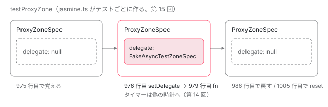

[目次](../README.md) › [テストの内側](README.md) › 第 13 回 / 全 20 回

# fakeAsync：@angular/core/testing から zone.js の FakeAsyncTestZoneSpec へ

> core の fakeAsync・tick・flush・flushMicrotasks が Zone\[\_\_symbol\_\_("fakeAsyncTest")\] に委ねるだけの薄い包みであること。zone.js 側の fakeAsync が新しいゾーンを作らず ProxyZone の delegate を FakeAsyncTestZoneSpec に差し替えて fn を同期で呼び、終わりに flush（既定）して戻す手順。残ったタイマーをエラーにするのは flush: false のときだけであること、入れ子の禁止、Date の差し替え。

angular/angular · 読了 約 14 分 · 発展 · [サイトで読む（デモが動きます）](https://angular-deep-dive-cyan.vercel.app/chapter/testing-fake-async)

---

`it('...', fakeAsync(() => { ... }))` と書くと、テストの中の `setTimeout` が「待たずに」進められるようになります。この章では、`@angular/core/testing` の `fakeAsync` が実は zone.js に仕事を渡すだけの薄い包みであること、zone.js 側の `fakeAsync` がテスト関数をどの順で包み、終わったあとに何を確かめているかを、行を 1 つずつ指して追います。偽の時計そのもの（`Scheduler`）の中身は[次の回](14-testing-fake-async-scheduler.md)で読みます。

読む対象は `packages/core/testing/src/fake_async.ts` と `packages/zone.js/lib/zone-spec/fake-async-test.ts` の後半（906〜1148 行目）、それと `Date` の差し替え（37〜66 行目・513〜564 行目）です。

1. [1. 全体像](01-testing-overview.md)
2. [2. initTestEnvironment](02-testing-init-environment.md)
3. [3. 後片付け](03-testing-reset-teardown.md)
4. [4. TestBed.inject](04-testing-inject.md)
5. [5. createComponent](05-testing-create-component.md)
6. [6. 入力の渡し方](06-testing-component-bindings.md)
7. [7. createDirective](07-testing-directive-fixture.md)
8. [8. DebugElement と By](08-testing-debug-element.md)
9. [9. detectChanges](09-testing-detect-changes.md)
10. [10. 自動の変更検知](10-testing-auto-detect.md)
11. [11. whenStable](11-testing-when-stable.md)
12. [12. エラーの伝わり方](12-testing-errors.md)
13. **13. fakeAsync**（この章）
14. [14. 偽の時計](14-testing-fake-async-scheduler.md)
15. [15. waitForAsync と ProxyZone](15-testing-wait-for-async.md)
16. [16. zone なしの時間](16-testing-zoneless-time.md)
17. [17. effect と signal](17-testing-effects.md)
18. [18. @defer](18-testing-defer.md)
19. [19. RouterTestingHarness](19-testing-router-harness.md)
20. [20. issue と変更を読む](20-testing-issues.md)

> [!TIP]
> **新卒エンジニアへ**
>
> この章は zone.js の用語を使います。**ゾーン**（`Zone`）は「いま動いているコードの実行文脈」を表す物で、`setTimeout` や `Promise.then` は zone.js に書き換えられて、予約されるたびに今のゾーンの `ZoneSpec`（ゾーンの振る舞いを決めるフックの集まり）を呼びます。その仕組みは [zone-task](../zone/04-zone-task.md)・[zone-delegate](../zone/05-zone-delegate.md)・[zone-microtask](../zone/06-zone-microtask.md) で読みました。ここでは再説明しません。

## 1. core の fakeAsync は 1 行

📄 `angular/packages/core/testing/src/fake_async.ts` L44–72 （▶ の行: 45, 55–56, 70–71）

```ts
44 │ /**
45 ▶  * IMPORTANT: This API requires Zone.js and cannot be used with the Vitest test runner
46 │  *
47 │  * Wraps a function to be executed in the `fakeAsync` zone:
48 │  * - Microtasks are manually executed by calling `flushMicrotasks()`.
49 │  * - Timers are synchronous; `tick()` simulates the asynchronous passage of time.
50 │  *
51 │  * Can be used to wrap `inject()` calls.
52 │  *
53 │  * @param fn The function that you want to wrap in the `fakeAsync` zone.
54 │  * @param options
55 ▶  *   - flush: When true, will drain the macrotask queue after the test function completes.
56 ▶  *     When false, will throw an exception at the end of the function if there are pending timers.
57 │  *
58 │  * @usageNotes
59 │  * ### Example
60 │  *
61 │  * {@example core/testing/ts/fake_async.ts region='basic'}
62 │  *
63 │  *
64 │  * @returns The function wrapped to be executed in the `fakeAsync` zone.
65 │  * Any arguments passed when calling this returned function will be passed through to the `fn`
66 │  * function in the parameters when it is called.
67 │  *
68 │  * @publicApi
69 │  */
70 ▶ export function fakeAsync(fn: Function, options?: {flush?: boolean}): (...args: any[]) => any {
71 ▶   return withFakeAsyncTestModule((v) => v.fakeAsync(fn, options));
72 │ }
```

70〜72 行目が本体のすべてです。71 行目で `withFakeAsyncTestModule` に関数を渡し、受け取った `v`（zone.js が置いた窓口のオブジェクト）の `v.fakeAsync(fn, options)` を呼んで、**その戻り値をそのまま返します**。`@angular/core/testing` の中には偽の時計も、タイマーの待ち行列もありません。`withFakeAsyncTestModule` が窓口を探す部分と、見つからないときのエラーは [第 16 回](16-testing-zoneless-time.md)で読みます。

45 行目の「Zone.js が必要で、Vitest では使えない」という注意書きは 2025-11-24 のコミット `b34e48bdff4` で、このファイルの 6 つの公開関数すべてに足されました。55〜56 行目の `flush` オプションの意味は、4 節で zone.js 側の実装と突き合わせます。

📄 `angular/packages/core/testing/src/fake_async.ts` L138–164 （▶ の行: 140–143, 146, 162–163）

```ts
138 │  * @publicApi
139 │  */
140 ▶ export function tick(
141 ▶   millis: number = 0,
142 ▶   tickOptions: {processNewMacroTasksSynchronously: boolean} = {
143 ▶     processNewMacroTasksSynchronously: true,
144 │   },
145 │ ): void {
146 ▶   return withFakeAsyncTestModule((m) => m.tick(millis, tickOptions));
147 │ }
148 │ 
149 │ /**
150 │  * IMPORTANT: This API requires Zone.js and cannot be used with the Vitest test runner
151 │  *
152 │  * Flushes any pending microtasks and simulates the asynchronous passage of time for the timers in
153 │  * the `fakeAsync` zone by
154 │  * draining the macrotask queue until it is empty.
155 │  *
156 │  * @param maxTurns The maximum number of times the scheduler attempts to clear its queue before
157 │  *     throwing an error.
158 │  * @returns The simulated time elapsed, in milliseconds.
159 │  *
160 │  * @publicApi
161 │  */
162 ▶ export function flush(maxTurns?: number): number {
163 ▶   return withFakeAsyncTestModule((m) => m.flush(maxTurns));
164 │ }
```

📄 `angular/packages/core/testing/src/fake_async.ts` L166–186 （▶ の行: 173–174, 184–185）

```ts
166 │ /**
167 │  * IMPORTANT: This API requires Zone.js and cannot be used with the Vitest test runner
168 │  *
169 │  * Discard all remaining periodic tasks.
170 │  *
171 │  * @publicApi
172 │  */
173 ▶ export function discardPeriodicTasks(): void {
174 ▶   return withFakeAsyncTestModule((m) => m.discardPeriodicTasks());
175 │ }
176 │ 
177 │ /**
178 │  * IMPORTANT: This API requires Zone.js and cannot be used with the Vitest test runner
179 │  *
180 │  * Flush any pending microtasks.
181 │  *
182 │  * @publicApi
183 │  */
184 ▶ export function flushMicrotasks(): void {
185 ▶   return withFakeAsyncTestModule((m) => m.flushMicrotasks());
186 │ }
```

`tick`（146 行目）・`flush`（163 行目）・`discardPeriodicTasks`（174 行目）・`flushMicrotasks`（185 行目）も同じ形で、窓口 `m` の同じ名前の関数を呼ぶだけです。1 つだけ覚えておく点は、`tick` の 2 つ目の引数の既定値が `{processNewMacroTasksSynchronously: true}` という**オブジェクト**であること（142〜144 行目）。これが zone.js 側でどの引数に入るかを 5 節で見ます。

## 2. zone.js が Zone に置く窓口

窓口のオブジェクトは、zone.js の `fakeAsyncTest` パッチが読み込まれたときに作られます。

📄 `angular/packages/zone.js/lib/zone-spec/fake-async-test.ts` L1117–1148 （▶ の行: 1120, 1122, 1125–1126, 1131–1132, 1138, 1143–1144, 1147）

```ts
1117 │ export function patchFakeAsyncTest(Zone: ZoneType): void {
1118 │   // Export the class so that new instances can be created with proper
1119 │   // constructor params.
1120 ▶   (Zone as any)['FakeAsyncTestZoneSpec'] = FakeAsyncTestZoneSpec;
1121 │ 
1122 ▶   Zone.__load_patch(
1123 │     'fakeasync',
1124 │     (global: any, Zone: ZoneType, api: _ZonePrivate) => {
1125 ▶       (Zone as any)[api.symbol('fakeAsyncTest')] = {
1126 ▶         resetFakeAsyncZone,
1127 │         flushMicrotasks,
1128 │         discardPeriodicTasks,
1129 │         tick,
1130 │         flush,
1131 ▶         fakeAsync,
1132 ▶         withProxyZone,
1133 │       };
1134 │     },
1135 │     true,
1136 │   );
1137 │ 
1138 ▶   patchedTimers = {
1139 │     setTimeout: global.setTimeout,
1140 │     setInterval: global.setInterval,
1141 │     clearTimeout: global.clearTimeout,
1142 │     clearInterval: global.clearInterval,
1143 ▶     nativeSetTimeout: global[Zone.__symbol__('setTimeout')],
1144 ▶     nativeClearTimeout: global[Zone.__symbol__('clearTimeout')],
1145 │   };
1146 │ 
1147 ▶   Scheduler.nextId = Scheduler.getNextId();
1148 │ }
```

1. **1120 行目：クラスを Zone に置く**

   `Zone['FakeAsyncTestZoneSpec']` にクラスそのものを置きます。4 節の 966 行目がここから取り出して `new` します。
2. **1122〜1136 行目：パッチとして窓口を登録**

   `Zone.__load_patch('fakeasync', ...)` の中で、1125 行目 `Zone[api.symbol('fakeAsyncTest')]` に 7 つの関数を並べたオブジェクトを置きます。`api.symbol` は名前に zone.js の接頭辞（既定は `__zone_symbol__`）を付けるだけなので、core の 14 行目 `_Zone[_Zone.__symbol__('fakeAsyncTest')]` と同じキーになります。1131 行目の `fakeAsync` と 1132 行目の `withProxyZone`（第 15 回）もこの中です。`__load_patch` の仕組みは [zone-patching](../zone/03-zone-patching.md) で見ました。
3. **1138〜1145 行目：その時点のタイマー関数を覚える**

   `global.setTimeout` など（zone.js が書き換えたあとの版）と、1143〜1144 行目の書き換える前の本物（`Zone.__symbol__('setTimeout')` に退避されている）を `patchedTimers` に覚えます。7 節の `checkTimerPatch` と、次の回の `Scheduler.getNextId` がこれを使います。1147 行目で最初の id をここで 1 つ取ります。

この関数を呼ぶのは `zone.js/testing` の入口（`rollupTesting`）です。Angular のリポジトリの Node のテストは `tools/testing/zone_base_setup.mts` で `zone.js/plugins/fake-async-test` などを 1 つずつ読み込みます（[第 15 回](15-testing-wait-for-async.md)で引用します）。

## 3. 包みの中身（前半）：delegate を差し替えて fn を呼ぶ

📄 `angular/packages/zone.js/lib/zone-spec/fake-async-test.ts` L951–988 （▶ の行: 951–955, 959–961, 964–965, 967–968, 971, 975–977, 979–981, 983, 986）

```ts
951 ▶ export function fakeAsync(fn: Function, options: {flush?: boolean} = {}): (...args: any[]) => any {
952 ▶   const {flush = true} = options;
953 ▶   // Not using an arrow function to preserve context passed from call site
954 ▶   const fakeAsyncFn: any = function (this: unknown, ...args: any[]) {
955 ▶     const ProxyZoneSpec = getProxyZoneSpec();
956 │     if (!ProxyZoneSpec) {
957 │       throwProxyZoneError();
958 │     }
959 ▶     const proxyZoneSpec = ProxyZoneSpec.assertPresent();
960 ▶     if (Zone.current.get('FakeAsyncTestZoneSpec')) {
961 ▶       throw new Error('fakeAsync() calls can not be nested');
962 │     }
963 │     try {
964 ▶       // in case jasmine.clock init a fakeAsyncTestZoneSpec
965 ▶       if (!_fakeAsyncTestZoneSpec) {
966 │         const FakeAsyncTestZoneSpec = Zone && (Zone as any)['FakeAsyncTestZoneSpec'];
967 ▶         if (proxyZoneSpec.getDelegate() instanceof FakeAsyncTestZoneSpec) {
968 ▶           throw new Error('fakeAsync() calls can not be nested');
969 │         }
970 │ 
971 ▶         _fakeAsyncTestZoneSpec = new FakeAsyncTestZoneSpec() as FakeAsyncTestZoneSpec;
972 │       }
973 │ 
974 │       let res: any;
975 ▶       const lastProxyZoneSpec = proxyZoneSpec.getDelegate();
976 ▶       proxyZoneSpec.setDelegate(_fakeAsyncTestZoneSpec);
977 ▶       _fakeAsyncTestZoneSpec.lockDatePatch();
978 │       try {
979 ▶         res = fn.apply(this, args);
980 ▶         if (flush) {
981 ▶           _fakeAsyncTestZoneSpec.flush(20, true);
982 │         } else {
983 ▶           flushMicrotasks();
984 │         }
985 │       } finally {
986 ▶         proxyZoneSpec.setDelegate(lastProxyZoneSpec);
987 │       }
988 │ 
```

1. **951〜954 行目：包みを作って返すだけ**

   `fakeAsync(fn, options)` を呼んだ時点では何も実行しません。952 行目で `flush` を取り出し（**既定は `true`**）、954 行目の `fakeAsyncFn` を返します。jasmine が `it` の本体としてこの `fakeAsyncFn` を呼んだときに、955 行目からが動きます。アロー関数でなく `function` なのは、呼び出し元の `this`（jasmine の文脈オブジェクト）を 979 行目に渡すためです（953 行目の注記）。
2. **955〜959 行目：ProxyZone の中にいるか**

   `Zone['ProxyZoneSpec']` が無ければ（zone.js/testing を読み込んでいない）`throwProxyZoneError()`、あれば 959 行目 `assertPresent()` で「今のゾーンが ProxyZone の中か」を確かめ、その `ProxyZoneSpec` を受け取ります。jasmine の `it` を ProxyZone の中で走らせる仕組みとエラー文は[第 15 回](15-testing-wait-for-async.md)の主題です。
3. **960〜972 行目：入れ子を 2 か所で止める**

   960 行目、今のゾーンから `'FakeAsyncTestZoneSpec'` という名前のプロパティが見つかれば、すでに fakeAsync の中です。967 行目は、`_fakeAsyncTestZoneSpec`（モジュールの変数。906 行目）が空なのに ProxyZone の delegate がもう `FakeAsyncTestZoneSpec` になっている場合です。どちらも `'fakeAsync() calls can not be nested'` を投げます。通れば 971 行目で `new FakeAsyncTestZoneSpec()`。965 行目の `if` のとおり、すでに作られていれば新しくは作りません（964 行目の注記は `jasmine.clock()` の自動 fakeAsync に備えたもの。第 15 回）。
4. **975〜977 行目：ProxyZone の delegate を差し替える**

   975 行目で今の delegate（ふつうは `null`）を覚え、976 行目 `proxyZoneSpec.setDelegate(_fakeAsyncTestZoneSpec)`。**新しいゾーンを fork するのではなく、すでにある ProxyZone の「中の人」を入れ替えます**。だから `beforeEach` で作った子ゾーンの中のタイマーも、この時点から偽の時計に入ります。977 行目 `lockDatePatch()` で `Date` の差し替えを fakeAsync が終わるまで固定します（7 節）。
5. **979〜984 行目：fn を呼び、残りを流す**

   979 行目、テストの本体を**同期で**呼びます。戻り値 `res` は 1003 行目でそのまま返されます。`flush` が `true` なら 981 行目 `flush(20, true)`。2 つ目の `true` は `flushPeriodic` で、周期タイマーも含めて**待ち行列の最後の締め切りまで**時計を進めます（中身は第 14 回）。`false` なら 983 行目でマイクロタスクだけを流します。
6. **985〜987 行目：delegate を元に戻す**

   fn が投げても投げなくても、`finally` で 975 行目に覚えた delegate に戻します。



*fakeAsync は新しいゾーンを作らない。jasmine が用意した ProxyZone の delegate を、976 行目で差し替え、986 行目で戻す。*

## 4. 包みの中身（後半）：残ったタイマーを数えるのは flush: false のときだけ

📄 `angular/packages/zone.js/lib/zone-spec/fake-async-test.ts` L989–1010 （▶ の行: 989–990, 992, 997, 999, 1003–1005, 1008）

```ts
 989 ▶       if (!flush) {
 990 ▶         if (_fakeAsyncTestZoneSpec.pendingPeriodicTimers.length > 0) {
 991 │           throw new Error(
 992 ▶             `${_fakeAsyncTestZoneSpec.pendingPeriodicTimers.length} ` +
 993 │               `periodic timer(s) still in the queue.`,
 994 │           );
 995 │         }
 996 │ 
 997 ▶         if (_fakeAsyncTestZoneSpec.pendingTimers.length > 0) {
 998 │           throw new Error(
 999 ▶             `${_fakeAsyncTestZoneSpec.pendingTimers.length} timer(s) still in the queue.`,
1000 │           );
1001 │         }
1002 │       }
1003 ▶       return res;
1004 ▶     } finally {
1005 ▶       resetFakeAsyncZone();
1006 │     }
1007 │   };
1008 ▶   fakeAsyncFn.isFakeAsync = true;
1009 │   return fakeAsyncFn;
1010 │ }
```

989 行目の `if (!flush)` に注目してください。**残ったタイマーを数えてエラーにするのは `flush: false` を渡したときだけ**です。990 行目で周期タイマー（`setInterval`）の数、997 行目でふつうのタイマーの数を見て、0 でなければ `'1 periodic timer(s) still in the queue.'` / `'1 timer(s) still in the queue.'` を投げます。

既定（`flush: true`）では 981 行目で最後の締め切りまで進めたあと、この検査を通りません。`setInterval` を止め忘れてもテストは成功します。この既定は 2024-07-25 のコミット `70e8b40750e`（「fakeAsync の既定を、テストのあとに flush する動きに変える」）で入りました。それより前の Angular のテストで「`periodic timer(s) still in the queue`」をよく見たのは、当時の既定が今の `flush: false` の動きだったからです。変更の読み方は[第 20 回](20-testing-issues.md)で扱います。

1004〜1006 行目、成功しても失敗しても最後に `resetFakeAsyncZone()` を呼びます。1008 行目の `isFakeAsync` は包んだ関数の目印で、このリポジトリで読んでいるのは jest 用のパッチ（`lib/jest/jest.ts`）だけです。

📄 `angular/packages/zone.js/lib/zone-spec/fake-async-test.ts` L906–928 （▶ の行: 921–923, 925–927）

```ts
906 │ let _fakeAsyncTestZoneSpec: FakeAsyncTestZoneSpec | null = null;
907 │ 
908 │ function getProxyZoneSpec(): typeof ProxyZoneSpec | undefined {
909 │   return Zone && (Zone as any)['ProxyZoneSpec'];
910 │ }
911 │ 
912 │ let _sharedProxyZoneSpec: ProxyZoneSpec | null = null;
913 │ let _sharedProxyZone: Zone | null = null;
914 │ 
915 │ /**
916 │  * Clears out the shared fake async zone for a test.
917 │  * To be called in a global `beforeEach`.
918 │  *
919 │  * @experimental
920 │  */
921 ▶ export function resetFakeAsyncZone() {
922 ▶   if (_fakeAsyncTestZoneSpec) {
923 ▶     _fakeAsyncTestZoneSpec.unlockDatePatch();
924 │   }
925 ▶   _fakeAsyncTestZoneSpec = null;
926 ▶   getProxyZoneSpec()?.get()?.resetDelegate();
927 ▶   _sharedProxyZoneSpec?.resetDelegate();
928 │ }
```

923 行目で `Date` の固定を外し（7 節）、925 行目でモジュールの変数を空にし、926〜927 行目で ProxyZone の delegate を既定に戻します。この関数はテストの後片付けからも呼ばれます。`test_hooks.ts` の `getCleanupHook` が `resetFakeAsyncZoneIfExists` を呼ぶ道は[第 3 回](03-testing-reset-teardown.md)で見ました。

> **🧪 DEMO — fakeAsync の包みを 1 行ずつ通る**
>
> zone.js は読み込まず、fake-async-test.ts 951〜1010 行目の分岐だけを再現しています。オプションと本体を選び、「次へ」で 1 ステップずつ進めます。
>
> ▶ [このデモはサイトで動かせます](https://angular-deep-dive-cyan.vercel.app/chapter/testing-fake-async)

## 5. tick と flush の窓口：ProxyZone を探さない

📄 `angular/packages/zone.js/lib/zone-spec/fake-async-test.ts` L1012–1036 （▶ の行: 1013–1016, 1034–1035）

```ts
1012 │ function _getFakeAsyncZoneSpec(): any {
1013 ▶   if (_fakeAsyncTestZoneSpec == null) {
1014 ▶     _fakeAsyncTestZoneSpec = Zone.current.get('FakeAsyncTestZoneSpec');
1015 ▶     if (_fakeAsyncTestZoneSpec == null) {
1016 ▶       throw new Error('The code should be running in the fakeAsync zone to call this function');
1017 │     }
1018 │   }
1019 │   return _fakeAsyncTestZoneSpec;
1020 │ }
1021 │ 
1022 │ /**
1023 │  * Simulates the asynchronous passage of time for the timers in the fakeAsync zone.
1024 │  *
1025 │  * The microtasks queue is drained at the very start of this function and after any timer
1026 │  * callback has been executed.
1027 │  *
1028 │  * ## Example
1029 │  *
1030 │  * {@example core/testing/ts/fake_async.ts region='basic'}
1031 │  *
1032 │  * @experimental
1033 │  */
1034 ▶ export function tick(millis: number = 0, ignoreNestedTimeout = false): void {
1035 ▶   _getFakeAsyncZoneSpec().tick(millis, null, ignoreNestedTimeout);
1036 │ }
```

窓口の `tick` は 1035 行目で `_getFakeAsyncZoneSpec()` から `FakeAsyncTestZoneSpec` を取り出し、そのインスタンスの `tick`（第 14 回）を呼びます。1013〜1016 行目、モジュールの変数が空なら今のゾーンから探し、それも無ければ `'The code should be running in the fakeAsync zone to call this function'`。fakeAsync の外で `tick()` を呼んだときのエラーはこれです。

1034 行目の 2 つ目の引数の名前は `ignoreNestedTimeout` ですが、1 節の core の 146 行目は `{processNewMacroTasksSynchronously: true}` という**オブジェクトを渡しています**。1035 行目はそれを 3 つ目の引数としてそのまま渡し、インスタンスの `tick(millis, doTick, tickOptions)` の `tickOptions` に入ります。名前は古いままですが、中身は tick のオプションです。

📄 `angular/packages/zone.js/lib/zone-spec/fake-async-test.ts` L1048–1061 （▶ の行: 1048–1049, 1057, 1060）

```ts
1048 ▶ export function flush(maxTurns?: number): number {
1049 ▶   return _getFakeAsyncZoneSpec().flush(maxTurns);
1050 │ }
1051 │ 
1052 │ /**
1053 │  * Discard all remaining periodic tasks.
1054 │  *
1055 │  * @experimental
1056 │  */
1057 ▶ export function discardPeriodicTasks(): void {
1058 │   const zoneSpec = _getFakeAsyncZoneSpec();
1059 │   const pendingTimers = zoneSpec.pendingPeriodicTimers;
1060 ▶   zoneSpec.pendingPeriodicTimers.length = 0;
1061 │ }
```

1049 行目の `flush` は 2 つ目の引数を渡さないので `flushPeriodic` は付きません。**テストの中で呼ぶ `flush()` と、3 節 981 行目の終わりの `flush(20, true)` は別の道を通ります**（第 14 回）。1060 行目、`discardPeriodicTasks` は `pendingPeriodicTimers` の配列を空にするだけで、待ち行列からは消しません。それで何が起きるかも第 14 回で見ます。

## 6. Date の差し替え

fakeAsync の中では `Date.now()` も偽の時計に合わせて進みます。差し替える物は、ファイルを読み込んだ時点で作られています。

📄 `angular/packages/zone.js/lib/zone-spec/fake-async-test.ts` L37–66 （▶ の行: 40, 45–46, 48, 52, 56–57, 59, 61）

```ts
37 │ // Need this because mock clocks might be installed (other than fakeAsync!)
38 │ const originalSetImmediate = global.setImmediate;
39 │ const originalTimeout = global.setTimeout;
40 ▶ const OriginalDate = global.Date;
41 │ // Since when we compile this file to `es2015`, and if we define
42 │ // this `FakeDate` as `class FakeDate`, and then set `FakeDate.prototype`
43 │ // there will be an error which is `Cannot assign to read only property 'prototype'`
44 │ // so we need to use function implementation here.
45 ▶ function FakeDate() {
46 ▶   if (arguments.length === 0) {
47 │     const d = new OriginalDate();
48 ▶     d.setTime(FakeDate.now());
49 │     return d;
50 │   } else {
51 │     const args = Array.prototype.slice.call(arguments);
52 ▶     return new OriginalDate(...args);
53 │   }
54 │ }
55 │ 
56 ▶ FakeDate.now = function (this: unknown) {
57 ▶   const fakeAsyncTestZoneSpec = Zone.current.get('FakeAsyncTestZoneSpec');
58 │   if (fakeAsyncTestZoneSpec) {
59 ▶     return fakeAsyncTestZoneSpec.getFakeSystemTime();
60 │   }
61 ▶   return OriginalDate.now.apply(this, arguments);
62 │ };
63 │ 
64 │ FakeDate.UTC = OriginalDate.UTC;
65 │ FakeDate.parse = OriginalDate.parse;
66 │ 
```

40 行目でファイルを読み込んだ瞬間の本物の `Date` を `OriginalDate` に取っておきます。45〜54 行目の `FakeDate` は、引数なしで呼ばれたときだけ 48 行目で時刻を `FakeDate.now()` に合わせ、引数があれば本物と同じです。56〜62 行目の `FakeDate.now` は、**そのたびに今のゾーンから `FakeAsyncTestZoneSpec` を探し**、見つかれば 59 行目の偽の時刻（基準の時刻 + 偽の時計の経過。第 14 回）、無ければ 61 行目で本物を返します。

📄 `angular/packages/zone.js/lib/zone-spec/fake-async-test.ts` L513–540 （▶ の行: 514, 523, 527–528, 533, 537–538）

```ts
513 │   static patchDate() {
514 ▶     if (!!global[Zone.__symbol__('disableDatePatching')]) {
515 │       // we don't want to patch global Date
516 │       // because in some case, global Date
517 │       // is already being patched, we need to provide
518 │       // an option to let user still use their
519 │       // own version of Date.
520 │       return;
521 │     }
522 │ 
523 ▶     if (global['Date'] === FakeDate) {
524 │       // already patched
525 │       return;
526 │     }
527 ▶     global['Date'] = FakeDate;
528 ▶     FakeDate.prototype = OriginalDate.prototype;
529 │ 
530 │     // try check and reset timers
531 │     // because jasmine.clock().install() may
532 │     // have replaced the global timer
533 ▶     FakeAsyncTestZoneSpec.checkTimerPatch();
534 │   }
535 │ 
536 │   static resetDate() {
537 ▶     if (global['Date'] === FakeDate) {
538 ▶       global['Date'] = OriginalDate;
539 │     }
540 │   }
```

📄 `angular/packages/zone.js/lib/zone-spec/fake-async-test.ts` L542–564 （▶ の行: 547–548, 551–552, 557–559, 562–563）

```ts
542 │   static checkTimerPatch() {
543 │     if (!patchedTimers) {
544 │       throw new Error('Expected timers to have been patched.');
545 │     }
546 │ 
547 ▶     if (global.setTimeout !== patchedTimers.setTimeout) {
548 ▶       global.setTimeout = patchedTimers.setTimeout;
549 │       global.clearTimeout = patchedTimers.clearTimeout;
550 │     }
551 ▶     if (global.setInterval !== patchedTimers.setInterval) {
552 ▶       global.setInterval = patchedTimers.setInterval;
553 │       global.clearInterval = patchedTimers.clearInterval;
554 │     }
555 │   }
556 │ 
557 ▶   lockDatePatch() {
558 ▶     this.patchDateLocked = true;
559 ▶     FakeAsyncTestZoneSpec.patchDate();
560 │   }
561 │   unlockDatePatch() {
562 ▶     this.patchDateLocked = false;
563 ▶     FakeAsyncTestZoneSpec.resetDate();
564 │   }
```

📄 `angular/packages/zone.js/lib/zone-spec/fake-async-test.ts` L861–878 （▶ の行: 871–872, 874–875）

```ts
861 │   onInvoke(
862 │     delegate: ZoneDelegate,
863 │     current: Zone,
864 │     target: Zone,
865 │     callback: Function,
866 │     applyThis: any,
867 │     applyArgs?: any[],
868 │     source?: string,
869 │   ): any {
870 │     try {
871 ▶       FakeAsyncTestZoneSpec.patchDate();
872 ▶       return delegate.invoke(target, callback, applyThis, applyArgs, source);
873 │     } finally {
874 ▶       if (!this.patchDateLocked) {
875 ▶         FakeAsyncTestZoneSpec.resetDate();
876 │       }
877 │     }
878 │   }
```

1. **527 行目：global.Date を入れ替える**

   `patchDate()` はグローバルの `Date` を `FakeDate` にし、528 行目で `prototype` を本物に合わせます（`instanceof Date` が通るように）。514 行目、`__zone_symbol__disableDatePatching` が立っていれば何もしません。
2. **533 行目・547〜554 行目：jasmine.clock() に取られたタイマーを取り返す**

   `jasmine.clock().install()` はグローバルの `setTimeout` を自分の物に替えます。`checkTimerPatch` は、それが 2 節 1138〜1145 行目で覚えた zone.js 版と違えば、zone.js 版に戻します。
3. **557〜563 行目と 871〜876 行目：いつ戻すか**

   3 節 977 行目の `lockDatePatch()` で `patchDateLocked` が立つと、`onInvoke`（このゾーンで関数が呼ばれるたびの入口）の 874 行目で戻さなくなります。fakeAsync の間は `Date` がずっと `FakeDate` で、4 節 923 行目の `unlockDatePatch()` → 563 行目 `resetDate()` で本物に戻ります。

## ここまでの呼び出し

- 👤 `it('...', fakeAsync(() => { ... }))` — あなたの spec
  - `fakeAsync(fn, options)` — core/testing/src/fake\_async.ts L70
    - `withFakeAsyncTestModule(v => v.fakeAsync(fn, options))` — fake\_async.ts L71（中身は第 16 回） — *Zone\[\_\_symbol\_\_('fakeAsyncTest')\] を取り出す*
      - `fakeAsync(fn, options)` — zone.js/lib/zone-spec/fake-async-test.ts L951 — *包み fakeAsyncFn を返すだけ*
- 👤 `jasmine が fakeAsyncFn() を呼ぶ` — testProxyZone.run の中（第 15 回）
  - `ProxyZoneSpec.assertPresent()` — fake-async-test.ts L959 — *無ければエラー（第 15 回）*
  - `new FakeAsyncTestZoneSpec()` — L971 — *入れ子なら L961 / L968 でエラー*
  - `proxyZoneSpec.setDelegate(_fakeAsyncTestZoneSpec)` — L976 — *+ lockDatePatch() L977*
  - `fn.apply(this, args)` — L979 — *タイマーは onScheduleTask で偽の時計へ（第 14 回）*
  - `_fakeAsyncTestZoneSpec.flush(20, true)` — L981 — *flush: false なら flushMicrotasks() L983*
  - `proxyZoneSpec.setDelegate(lastProxyZoneSpec)` — L986
  - `pendingPeriodicTimers / pendingTimers の検査` — L989-1002 — *flush: false のときだけ*
  - `resetFakeAsyncZone()` — L1005 → L921 — *Date を戻し、delegate を既定に*

## テストと直し方

この仕組みを確かめている spec は `packages/core/test/fake_async_spec.ts` です。`describe('fake async')`（fake\_async\_spec.ts:16）の中に `describe('Promise')`（:63）・`describe('timers')`（:121）・`describe('outside of the fakeAsync zone')`（:370）・``describe('only one `fakeAsync` zone per test')``（:396）があり、ファイルの一番外にもう 1 つ `describe('ProxyZone')`（:410）があります。この章の 3〜5 節にあたる行を 2 つ引きます。

📄 `angular/packages/core/test/fake_async_spec.ts` L39–57 （▶ の行: 39, 41–42, 44, 47, 50–51, 56）

```ts
39 ▶   it('should throw on nested calls', () => {
40 │     expect(() => {
41 ▶       fakeAsync(() => {
42 ▶         fakeAsync((): null => null)();
43 │       })();
44 ▶     }).toThrowError('fakeAsync() calls can not be nested');
45 │   });
46 │ 
47 ▶   it('should flush microtasks before returning', () => {
48 │     let thenRan = false;
49 │ 
50 ▶     fakeAsync(() => {
51 ▶       resolvedPromise.then((_) => {
52 │         thenRan = true;
53 │       });
54 │     })();
55 │ 
56 ▶     expect(thenRan).toEqual(true);
57 │   });
```

39〜45 行目は 3 節の入れ子の検出（960〜961 行目）、47〜57 行目は 981 行目の終わりの `flush` がマイクロタスクも流すこと（`then` が fakeAsync を出る前に走っている）を確かめています。

📄 `angular/packages/core/test/fake_async_spec.ts` L198–218 （▶ の行: 204, 206, 215, 217）

```ts
198 │     it('should throw an error on dangling timers', () => {
199 │       expect(() => {
200 │         fakeAsync(
201 │           () => {
202 │             setTimeout(() => {}, 10);
203 │           },
204 ▶           {flush: false},
205 │         )();
206 ▶       }).toThrowError('1 timer(s) still in the queue.');
207 │     });
208 │ 
209 │     it('should throw an error on dangling periodic timers', () => {
210 │       expect(() => {
211 │         fakeAsync(
212 │           () => {
213 │             setInterval(() => {}, 10);
214 │           },
215 ▶           {flush: false},
216 │         )();
217 ▶       }).toThrowError('1 periodic timer(s) still in the queue.');
218 │     });
```

どちらの it も 204 行目・215 行目で `{flush: false}` を渡しています。4 節の 989 行目のとおり、そうしないとエラーにならないからです。

📄 `ターミナル`

```
cd ~/angular-research/angular
pnpm bazel test //packages/core/test:test --test_arg=--filter="^(fake async|ProxyZone) " --test_output=all
```

📄 `出力（抜粋。2026-11-01 に実行）`

```
Ran 9 of 1376 specs
9 specs, 0 failures
Ran 8 of 1375 specs
8 specs, 0 failures
Ran 9 of 1376 specs
9 specs, 0 failures
Ran 8 of 1375 specs
8 specs, 0 failures
INFO: Elapsed time: 3.460s, Critical Path: 2.55s
//packages/core/test:test                                                PASSED in 2.3s
```

1. **名前の作り方と数**

   `"^(fake async|ProxyZone) "` は、フルネームが「`fake async `」か「`ProxyZone `」で始まる spec を選びます。`//packages/core/test:test` は 4 つに分けて走る（`shard_count = 4`）ので `Ran N of M specs` が 4 回出ます。9 + 8 + 9 + 8 = **34 本**で、ファイルの `it` の数（:16 の describe の下に 33 本、:410 の下に 1 本）と一致します。名前に一致しないフィルタが 0 本でも PASSED になる落とし穴は[forms の第 1 回](../forms/01-forms-overview.md)で見ました。
2. **zone.js 側の spec は Node では走っていない**

   zone.js にも `packages/zone.js/test/zone-spec/fake-async-test.spec.ts` があり、`describe('FakeAsyncTestZoneSpec')` と、core と同じ名前の `describe('fake async')` を持ちます。ただしこのファイルを import しているのは `test/common_tests.ts` で、`test/BUILD.bazel` ではブラウザの karma のターゲット（`browser_test` など）だけがそれを含みます。Node の `//packages/zone.js/test:test_node` の `data` は `node/*.ts` だけです。だからこの章では走らせていません。Node で走る zone.js の fakeAsync の spec は `test/zone-spec/clock-tests/` の 2 つで、[第 15 回](15-testing-wait-for-async.md)で走らせます。
3. **直すとしたら**

   包みの順番・入れ子・終わりの検査は `fake-async-test.ts` の `fakeAsync`（951 行目）、後片付けは `resetFakeAsyncZone`（921 行目）、`Date` は `patchDate` / `FakeDate` です。core の `fake_async.ts` は窓口を呼ぶだけなので、ここを直すことはまずありません。振る舞いを足したら、利用者から見た形は `fake_async_spec.ts` の `describe('fake async')` に、zone.js の内部の形は `fake-async-test.spec.ts` に足すのが入口です。
4. **issue を読むときの手がかり**

   「`setInterval` が残っているのにテストが通る」「昔は落ちていた」という報告は、4 節の 989 行目と既定の変更（`70e8b40750e`）で説明がつきます。「`Date.now()` が進まない」は 6 節の 514 行目（`disableDatePatching`）か、fakeAsync の外（`FakeDate.now` の 61 行目）で呼んでいないかを見ます。issue の探し方は[第 20 回](20-testing-issues.md)で扱います。

## 聞かれそうな質問

**Q. fakeAsync の中で await できますか？**

書くことはできますが、fakeAsync は待ってくれません。3 節 979 行目は `fn.apply(this, args)` を同期で呼ぶだけで、async 関数なら最初の `await` で Promise が返ります。そのあと 981 行目の `flush`（中で `flushMicrotasks`）が、偽の時計の待ち行列に入っているマイクロタスクを流し、986 行目で delegate を戻し、1003 行目で Promise をそのまま返します。`await` の続きが偽の時計の待ち行列に入るのは、その `await` が zone.js の書き換えた `Promise` を通るときだけです。zone.js はネイティブの `async/await` を横取りできないので、CLI は zone.js を使うビルドで `async/await` を書き換えます（[boot-application-build](../boot/04-boot-application-build.md)）。確実なのは「fakeAsync の中では await を使わず、`tick` / `flush` で進める」です。

**Q. flush: false にすると何が変わりますか？**

2 つ変わります。1 つ目は 981 行目の代わりに 983 行目を通り、終わりにタイマーを進めません（マイクロタスクだけ流す）。2 つ目は 989〜1002 行目の検査が動き、`setInterval` が残っていれば `'N periodic timer(s) still in the queue.'`、`setTimeout` が残っていれば `'N timer(s) still in the queue.'` で失敗します。「止め忘れたタイマーを見つけたい」ときに付けます。spec の 198〜218 行目がこの 2 つのエラーを確かめています。

**Q. なぜ fakeAsync は入れ子にできないのですか？**

偽の時計がモジュールに 1 つ（906 行目の `_fakeAsyncTestZoneSpec`）で、ProxyZone の delegate も 1 つしか持てないからです。内側の fakeAsync が自分の `FakeAsyncTestZoneSpec` を 976 行目で差し込むと外側の時計が見えなくなり、内側の 1005 行目の `resetFakeAsyncZone()` が外側の時計まで消してしまいます。それを防ぐため 960 行目（今のゾーンにある）と 967 行目（delegate にある）の 2 か所で止めます。

**Q. fakeAsync の外で tick() を呼ぶとどうなりますか？**

core の 146 行目から窓口の `tick`（1034 行目）に入り、1013〜1016 行目で `FakeAsyncTestZoneSpec` が見つからず `'The code should be running in the fakeAsync zone to call this function'` を投げます。`flush`・`flushMicrotasks`・`discardPeriodicTasks` も同じ `_getFakeAsyncZoneSpec` を通るので同じエラーです（spec の `describe('outside of the fakeAsync zone')`、fake\_async\_spec.ts:370）。zone.js をそもそも読み込んでいないときは、その手前の core の `withFakeAsyncTestModule` で別のエラーになります（[第 16 回](16-testing-zoneless-time.md)）。

**Q. fakeAsync の中で new Date() は進みますか？**

進みます。977 行目の `lockDatePatch()` で 527 行目の `global['Date'] = FakeDate` になり、引数なしの `new Date()` は 48 行目で `FakeDate.now()` に合わせられ、`FakeDate.now()` は 59 行目で偽の時計の時刻を返します。`tick(1000)` すれば 1000ms 進みます。ただし fakeAsync が終わると 923 行目 → 563 行目で本物に戻るので、テストの外に持ち出した `Date` の参照は本物です。

## 読み終えて

- `@angular/core/testing` の `fakeAsync`・`tick`・`flush` などは、`Zone[__symbol__('fakeAsyncTest')]` の同じ名前の関数を呼ぶだけ（fake\_async.ts 71・146・163 行目）。
- zone.js の `fakeAsync` は新しいゾーンを作らず、jasmine が用意した ProxyZone の delegate を `FakeAsyncTestZoneSpec` に差し替えて fn を同期で呼ぶ（976・979 行目）。
- 既定の `flush: true` は終わりに最後の締め切りまで進めるだけで、残りのタイマーをエラーにしない。数えてエラーにするのは `flush: false` のときだけ（989 行目）。
- 入れ子は 960 行目と 967 行目で止まる。`Date` は 977 行目から 923 行目まで `FakeDate` に固定される。
- core の spec は `"^(fake async|ProxyZone) "` で 34 本（4 つに分かれて 9 + 8 + 9 + 8）。zone.js の `fake-async-test.spec.ts` はブラウザのターゲットでしか走らない。

---

← 前: [エラーがテストの失敗になるまで：TestBedApplicationErrorHandler](12-testing-errors.md)  
次: [偽の時計：Scheduler が setTimeout と setInterval を並べて進める](14-testing-fake-async-scheduler.md) →
