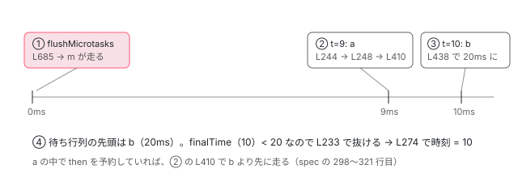

[目次](../README.md) › [テストの内側](README.md) › 第 14 回 / 全 20 回

# 偽の時計：Scheduler が setTimeout と setInterval を並べて進める

> FakeAsyncTestZoneSpec.onScheduleTask が setTimeout・setInterval・requestAnimationFrame を Scheduler の待ち行列に入れる行、tick(ms) が締め切りの早い順に関数を実行して時刻を進め、周期タイマーを入れ直す仕組み、flush の上限 20 回、マイクロタスクを毎回流す順番、tick の processNewMacroTasksSynchronously。

angular/angular · 読了 約 14 分 · 発展 · [サイトで読む（デモが動きます）](https://angular-deep-dive-cyan.vercel.app/chapter/testing-fake-async-scheduler)

---

[前の回](13-testing-fake-async.md)で、fakeAsync が ProxyZone の delegate を `FakeAsyncTestZoneSpec` に差し替えるところまで見ました。この章はその先です。テストの中の `setTimeout` が本物のタイマーにならずにどこへ行くのか、`tick(ms)` がどの順でコールバックを呼んで時計を進めるのか、`flush()` がなぜ 20 回で止まるのかを、`Scheduler` クラスの行で 1 つずつ確かめます。

読む対象は `packages/zone.js/lib/zone-spec/fake-async-test.ts` の前半（81〜488 行目）と `FakeAsyncTestZoneSpec` の ZoneSpec のフック（744〜891 行目）です。

1. [1. 全体像](01-testing-overview.md)
2. [2. initTestEnvironment](02-testing-init-environment.md)
3. [3. 後片付け](03-testing-reset-teardown.md)
4. [4. TestBed.inject](04-testing-inject.md)
5. [5. createComponent](05-testing-create-component.md)
6. [6. 入力の渡し方](06-testing-component-bindings.md)
7. [7. createDirective](07-testing-directive-fixture.md)
8. [8. DebugElement と By](08-testing-debug-element.md)
9. [9. detectChanges](09-testing-detect-changes.md)
10. [10. 自動の変更検知](10-testing-auto-detect.md)
11. [11. whenStable](11-testing-when-stable.md)
12. [12. エラーの伝わり方](12-testing-errors.md)
13. [13. fakeAsync](13-testing-fake-async.md)
14. **14. 偽の時計**（この章）
15. [15. waitForAsync と ProxyZone](15-testing-wait-for-async.md)
16. [16. zone なしの時間](16-testing-zoneless-time.md)
17. [17. effect と signal](17-testing-effects.md)
18. [18. @defer](18-testing-defer.md)
19. [19. RouterTestingHarness](19-testing-router-harness.md)
20. [20. issue と変更を読む](20-testing-issues.md)

> [!TIP]
> **新卒エンジニアへ**
>
> **マクロタスク**は `setTimeout` や `setInterval` のように「あとで 1 回（または何回も）呼ぶ」予約、**マイクロタスク**は `Promise.then` のように「今の処理が終わったらすぐ呼ぶ」予約です。zone.js はどちらも `Task` という物にして、今のゾーンの `onScheduleTask` を呼びます（[zone-task](../zone/04-zone-task.md)・[zone-microtask](../zone/06-zone-microtask.md)）。

## 1. 偽の時計が持っている物

📄 `angular/packages/zone.js/lib/zone-spec/fake-async-test.ts` L81–118 （▶ の行: 87, 89, 91, 93, 97–99, 105, 112–113）

```ts
 81 │ class Scheduler {
 82 │   // Next scheduler id.
 83 │   public static nextNodeJSId: number = 1;
 84 │   public static nextId: number = -1;
 85 │ 
 86 │   // Scheduler queue with the tuple of end time and callback function - sorted by end time.
 87 ▶   private _schedulerQueue: ScheduledFunction[] = [];
 88 │   // Current simulated time in millis.
 89 ▶   private _currentTickTime: number = 0;
 90 │   // Current fake system base time in millis.
 91 ▶   private _currentFakeBaseSystemTime: number = OriginalDate.now();
 92 │   // track requeuePeriodicTimer
 93 ▶   private _currentTickRequeuePeriodicEntries: any[] = [];
 94 │ 
 95 │   constructor() {}
 96 │ 
 97 ▶   static getNextId() {
 98 ▶     const id = patchedTimers!.nativeSetTimeout.call(global, timeoutCallback, 0);
 99 ▶     patchedTimers!.nativeClearTimeout.call(global, id);
100 │     if (typeof id === 'number') {
101 │       return id;
102 │     }
103 │     // in NodeJS, we just use a number for fakeAsync, since it will not
104 │     // conflict with native TimeoutId
105 ▶     return Scheduler.nextNodeJSId++;
106 │   }
107 │ 
108 │   getCurrentTickTime() {
109 │     return this._currentTickTime;
110 │   }
111 │ 
112 ▶   getFakeSystemTime() {
113 ▶     return this._currentFakeBaseSystemTime + this._currentTickTime;
114 │   }
115 │ 
116 │   setFakeBaseSystemTime(fakeBaseSystemTime: number) {
117 │     this._currentFakeBaseSystemTime = fakeBaseSystemTime;
118 │   }
```

偽の時計の状態は 3 つだけです。87 行目の `_schedulerQueue`（**締め切りの早い順に並んだ**予約の配列）、89 行目の `_currentTickTime`（偽の時計が 0 から何 ms 進んだか）、91 行目の `_currentFakeBaseSystemTime`（作った瞬間の本物の時刻）。112〜113 行目の `getFakeSystemTime` はその 2 つの和で、前の回の `FakeDate.now()` が返すのはこの値です。

97〜106 行目の `getNextId` は予約の id の作り方です。98〜99 行目で**本物の**`setTimeout`（前の回の `patchedTimers.nativeSetTimeout`）を 1 回呼んですぐ消し、その id を使います。ブラウザでは本物の id と重ならない番号になり、Node では返り値が数でない（`Timeout` オブジェクト）ので 105 行目の連番を使います。

## 2. 予約の入口：onScheduleTask が種類で振り分ける

fakeAsync の中で `setTimeout` を呼ぶと、zone.js の書き換えた `setTimeout` が Task を作り、ProxyZone 経由でこのフックに届きます。

📄 `angular/packages/zone.js/lib/zone-spec/fake-async-test.ts` L744–779 （▶ の行: 746, 758–759, 766–767, 769–770, 773, 776）

```ts
744 │   onScheduleTask(delegate: ZoneDelegate, current: Zone, target: Zone, task: Task): Task {
745 │     switch (task.type) {
746 ▶       case 'microTask':
747 │         let args = task.data && (task.data as any).args;
748 │         // should pass additional arguments to callback if have any
749 │         // currently we know process.nextTick will have such additional
750 │         // arguments
751 │         let additionalArgs: any[] | undefined;
752 │         if (args) {
753 │           let callbackIndex = (task.data as any).cbIdx;
754 │           if (typeof args.length === 'number' && args.length > callbackIndex + 1) {
755 │             additionalArgs = Array.prototype.slice.call(args, callbackIndex + 1);
756 │           }
757 │         }
758 ▶         this._microtasks.push({
759 ▶           func: task.invoke,
760 │           args: additionalArgs,
761 │           target: task.data && (task.data as any).target,
762 │         });
763 │         break;
764 │       case 'macroTask':
765 │         switch (task.source) {
766 ▶           case 'setTimeout':
767 ▶             task.data!['handleId'] = this._setTimeout(
768 │               task.invoke,
769 ▶               task.data!['delay']!,
770 ▶               Array.prototype.slice.call((task.data as any)['args'], 2),
771 │             );
772 │             break;
773 ▶           case 'setImmediate':
774 │             task.data!['handleId'] = this._setTimeout(
775 │               task.invoke,
776 ▶               0,
777 │               Array.prototype.slice.call((task.data as any)['args'], 1),
778 │             );
779 │             break;
```

📄 `angular/packages/zone.js/lib/zone-spec/fake-async-test.ts` L780–809 （▶ の行: 780–781, 787–789, 796, 798, 803, 805, 807）

```ts
780 ▶           case 'setInterval':
781 ▶             task.data!['handleId'] = this._setInterval(
782 │               task.invoke,
783 │               task.data!['delay']!,
784 │               Array.prototype.slice.call((task.data as any)['args'], 2),
785 │             );
786 │             break;
787 ▶           case 'XMLHttpRequest.send':
788 ▶             if (this.tickMode.mode === 'manual') {
789 ▶               throw new Error(
790 │                 'Cannot make XHRs from within a fake async test. Request URL: ' +
791 │                   (task.data as any)['url'],
792 │               );
793 │             }
794 │             // When using automatic ticking, we allow the XHR to be handled in a truly async form
795 │             // by the parent/delegate Zone because auto ticking FakeAsync is not strictly synchronous.
796 ▶             task = delegate.scheduleTask(target, task);
797 │             break;
798 ▶           case 'requestAnimationFrame':
799 │           case 'webkitRequestAnimationFrame':
800 │           case 'mozRequestAnimationFrame':
801 │             // Simulate a requestAnimationFrame by using a setTimeout with 16 ms.
802 │             // (60 frames per second)
803 ▶             task.data!['handleId'] = this._setTimeout(
804 │               task.invoke,
805 ▶               16,
806 │               (task.data as any)['args'],
807 ▶               this.trackPendingRequestAnimationFrame,
808 │             );
809 │             break;
```

📄 `angular/packages/zone.js/lib/zone-spec/fake-async-test.ts` L810–836 （▶ の行: 813, 816, 818, 820, 824, 828, 831–832）

```ts
810 │           default:
811 │             // user can define which macroTask they want to support by passing
812 │             // macroTaskOptions
813 ▶             const macroTaskOption = this.findMacroTaskOption(task);
814 │             if (macroTaskOption) {
815 │               const args = task.data && (task.data as any)['args'];
816 ▶               const delay = args && args.length > 1 ? args[1] : 0;
817 │               let callbackArgs = macroTaskOption.callbackArgs ? macroTaskOption.callbackArgs : args;
818 ▶               if (!!macroTaskOption.isPeriodic) {
819 │                 // periodic macroTask, use setInterval to simulate
820 ▶                 task.data!['handleId'] = this._setInterval(task.invoke, delay, callbackArgs);
821 │                 task.data!.isPeriodic = true;
822 │               } else {
823 │                 // not periodic, use setTimeout to simulate
824 ▶                 task.data!['handleId'] = this._setTimeout(task.invoke, delay, callbackArgs);
825 │               }
826 │               break;
827 │             }
828 ▶             throw new Error('Unknown macroTask scheduled in fake async test: ' + task.source);
829 │         }
830 │         break;
831 ▶       case 'eventTask':
832 ▶         task = delegate.scheduleTask(target, task);
833 │         break;
834 │     }
835 │     return task;
836 │   }
```

1. **746〜763 行目：マイクロタスクは配列に積むだけ**

   758 行目で `this._microtasks` に `task.invoke` を積み、**親のゾーンに渡しません**（`delegate.scheduleTask` を呼ばない）。だから fakeAsync の中の `then` は、誰かが `flushMicrotasks` を呼ぶまで走りません。
2. **766〜786 行目：setTimeout・setImmediate・setInterval**

   766 行目の `setTimeout` は `_setTimeout(task.invoke, delay, args)`（3 節）。770 行目の `slice(..., 2)` は `setTimeout(fn, delay, ...args)` の 3 つ目以降をコールバックの引数にするためです。`setImmediate` は 776 行目で遅れ 0 の `setTimeout` 扱い、`setInterval` は 781 行目で `_setInterval`。戻り値の id は `task.data.handleId` に入り、`clearTimeout` のときに使われます。
3. **787〜797 行目：XHR は投げる**

   手動のモード（既定。8 節）では 789 行目で `'Cannot make XHRs from within a fake async test. Request URL: ...'`。偽の時計では応答の時刻を決められないからです。HTTP を fakeAsync で試すなら `HttpTestingController`（[http-testing](../http/12-http-testing.md)）を使います。
4. **798〜809 行目：requestAnimationFrame は 16ms の setTimeout**

   801〜802 行目の注記のとおり 60fps とみなし、803〜805 行目で遅れ 16 の `_setTimeout` にします。807 行目の 4 つ目の引数は `trackPendingRequestAnimationFrame`（コンストラクタの引数。既定 `false`）で、`false` のときは「残りのタイマー」に数えません（3 節）。
5. **810〜828 行目：知らないマクロタスクはエラー**

   813 行目の `findMacroTaskOption`（下の引用）で、利用者が登録した種類なら 818〜825 行目で周期か 1 回かを選んで同じ待ち行列に入れます。登録が無ければ 828 行目 `'Unknown macroTask scheduled in fake async test: ' + task.source`。831〜832 行目、`addEventListener` などの eventTask だけは親に渡します。

📄 `angular/packages/zone.js/lib/zone-spec/fake-async-test.ts` L880–891 （▶ の行: 881, 886）

```ts
880 │   findMacroTaskOption(task: Task) {
881 ▶     if (!this.macroTaskOptions) {
882 │       return null;
883 │     }
884 │     for (let i = 0; i < this.macroTaskOptions.length; i++) {
885 │       const macroTaskOption = this.macroTaskOptions[i];
886 ▶       if (macroTaskOption.source === task.source) {
887 │         return macroTaskOption;
888 │       }
889 │     }
890 │     return null;
891 │   }
```

登録先の `macroTaskOptions` はコンストラクタの 3 つ目の引数か、それが無ければグローバル変数 `__zone_symbol__FakeAsyncTestMacroTask` です（コンストラクタで読む）。取り消しも同じ形で振り分けます。

📄 `angular/packages/zone.js/lib/zone-spec/fake-async-test.ts` L838–859 （▶ の行: 840–841, 844–846, 857）

```ts
838 │   onCancelTask(delegate: ZoneDelegate, current: Zone, target: Zone, task: Task): any {
839 │     switch (task.source) {
840 ▶       case 'setTimeout':
841 ▶       case 'requestAnimationFrame':
842 │       case 'webkitRequestAnimationFrame':
843 │       case 'mozRequestAnimationFrame':
844 ▶         return this._clearTimeout(<number>task.data!['handleId']);
845 ▶       case 'setInterval':
846 ▶         return this._clearInterval(<number>task.data!['handleId']);
847 │       default:
848 │         // user can define which macroTask they want to support by passing
849 │         // macroTaskOptions
850 │         const macroTaskOption = this.findMacroTaskOption(task);
851 │         if (macroTaskOption) {
852 │           const handleId: number = <number>task.data!['handleId'];
853 │           return macroTaskOption.isPeriodic
854 │             ? this._clearInterval(handleId)
855 │             : this._clearTimeout(handleId);
856 │         }
857 ▶         return delegate.cancelTask(target, task);
858 │     }
859 │   }
```

## 3. 待ち行列に入れる前の包み：\_setTimeout と \_setInterval

📄 `angular/packages/zone.js/lib/zone-spec/fake-async-test.ts` L397–420 （▶ の行: 401–402, 404, 406–407, 410, 413–414, 418）

```ts
397 │   private _fnAndFlush(
398 │     fn: Function,
399 │     completers: {onSuccess?: Function; onError?: Function},
400 │   ): Function {
401 ▶     return (...args: any[]): boolean => {
402 ▶       fn.apply(global, args);
403 │ 
404 ▶       if (this._lastError === null) {
405 │         // Success
406 ▶         if (completers.onSuccess != null) {
407 ▶           completers.onSuccess.apply(global);
408 │         }
409 │         // Flush microtasks only on success.
410 ▶         this.flushMicrotasks();
411 │       } else {
412 │         // Failure
413 ▶         if (completers.onError != null) {
414 ▶           completers.onError.apply(global);
415 │         }
416 │       }
417 │       // Return true if there were no errors, false otherwise.
418 ▶       return this._lastError === null;
419 │     };
420 │   }
```

待ち行列に入るのはコールバックそのものではなく、`_fnAndFlush` の包みです。402 行目で本物のコールバックを呼び、エラーが無ければ（404 行目）**406〜407 行目で後始末（onSuccess）をしてから、410 行目でマイクロタスクを全部流します**。418 行目、成功なら `true` を返します。この戻り値を 5 節の 252 行目が見ます。エラーが起きたかどうかは `_lastError` で見ていて、これを立てるのは `onHandleError` です（[第 12 回](12-testing-errors.md)）。

📄 `angular/packages/zone.js/lib/zone-spec/fake-async-test.ts` L429–464 （▶ の行: 431, 438–439, 441, 443, 456, 458–461）

```ts
429 │   private _dequeueTimer(id: number): Function {
430 │     return () => {
431 ▶       FakeAsyncTestZoneSpec._removeTimer(this.pendingTimers, id);
432 │     };
433 │   }
434 │ 
435 │   private _requeuePeriodicTimer(fn: Function, interval: number, args: any[], id: number): Function {
436 │     return () => {
437 │       // Requeue the timer callback if it's not been canceled.
438 ▶       if (this.pendingPeriodicTimers.indexOf(id) !== -1) {
439 ▶         this._scheduler.scheduleFunction(fn, interval, {
440 │           args,
441 ▶           isPeriodic: true,
442 │           id,
443 ▶           isRequeuePeriodic: true,
444 │         });
445 │       }
446 │     };
447 │   }
448 │ 
449 │   private _dequeuePeriodicTimer(id: number): Function {
450 │     return () => {
451 │       FakeAsyncTestZoneSpec._removeTimer(this.pendingPeriodicTimers, id);
452 │     };
453 │   }
454 │ 
455 │   private _setTimeout(fn: Function, delay: number, args: any[], isTimer = true): number {
456 ▶     let removeTimerFn = this._dequeueTimer(Scheduler.nextId);
457 │     // Queue the callback and dequeue the timer on success and error.
458 ▶     let cb = this._fnAndFlush(fn, {onSuccess: removeTimerFn, onError: removeTimerFn});
459 ▶     let id = this._scheduler.scheduleFunction(cb, delay, {args, isRequestAnimationFrame: !isTimer});
460 ▶     if (isTimer) {
461 ▶       this.pendingTimers.push(id);
462 │     }
463 │     return id;
464 │   }
```

📄 `angular/packages/zone.js/lib/zone-spec/fake-async-test.ts` L466–488 （▶ の行: 473, 477, 480–481, 486–487）

```ts
466 │   private _clearTimeout(id: number): void {
467 │     FakeAsyncTestZoneSpec._removeTimer(this.pendingTimers, id);
468 │     this._scheduler.removeScheduledFunctionWithId(id);
469 │   }
470 │ 
471 │   private _setInterval(fn: Function, interval: number, args: any[]): number {
472 │     let id = Scheduler.nextId;
473 ▶     let completers = {onSuccess: null as any, onError: this._dequeuePeriodicTimer(id)};
474 │     let cb = this._fnAndFlush(fn, completers);
475 │ 
476 │     // Use the callback created above to requeue on success.
477 ▶     completers.onSuccess = this._requeuePeriodicTimer(cb, interval, args, id);
478 │ 
479 │     // Queue the callback and dequeue the periodic timer only on error.
480 ▶     this._scheduler.scheduleFunction(cb, interval, {args, isPeriodic: true});
481 ▶     this.pendingPeriodicTimers.push(id);
482 │     return id;
483 │   }
484 │ 
485 │   private _clearInterval(id: number): void {
486 ▶     FakeAsyncTestZoneSpec._removeTimer(this.pendingPeriodicTimers, id);
487 ▶     this._scheduler.removeScheduledFunctionWithId(id);
488 │   }
```

1. **455〜464 行目：1 回のタイマー**

   458 行目、成功しても失敗しても `removeTimerFn`（431 行目で `pendingTimers` から自分の id を外す）を呼ぶ包みを作り、459 行目で待ち行列へ。460〜461 行目、`isTimer` のときだけ `pendingTimers` に id を足します。requestAnimationFrame は 2 節の 807 行目でここが `false` になるので、足されません。
2. **471〜483 行目：周期タイマー**

   473 行目、失敗したときだけ `pendingPeriodicTimers` から外します。成功したときは 477 行目の `_requeuePeriodicTimer` が呼ばれ、438 行目で **まだ `pendingPeriodicTimers` に id があれば**、439〜444 行目で同じ id・同じ間隔で待ち行列に入れ直します。443 行目の `isRequeuePeriodic` は 5 節で使う印です。
3. **466〜469 行目・485〜488 行目：取り消し**

   `clearTimeout` / `clearInterval` は、配列から id を外し、待ち行列からも消します。

## 4. 並べ方：scheduleFunction

📄 `angular/packages/zone.js/lib/zone-spec/fake-async-test.ts` L124–146 （▶ の行: 135, 145–146）

```ts
124 │   scheduleFunction(
125 │     cb: Function,
126 │     delay: number,
127 │     options?: {
128 │       args?: any[];
129 │       isPeriodic?: boolean;
130 │       isRequestAnimationFrame?: boolean;
131 │       id?: number;
132 │       isRequeuePeriodic?: boolean;
133 │     },
134 │   ): number {
135 ▶     options = {
136 │       ...{
137 │         args: [],
138 │         isPeriodic: false,
139 │         isRequestAnimationFrame: false,
140 │         id: -1,
141 │         isRequeuePeriodic: false,
142 │       },
143 │       ...options,
144 │     };
145 ▶     let currentId = options.id! < 0 ? Scheduler.nextId : options.id!;
146 ▶     Scheduler.nextId = Scheduler.getNextId();
```

📄 `angular/packages/zone.js/lib/zone-spec/fake-async-test.ts` L147–171 （▶ の行: 147, 159–160, 163, 165–166, 169–170）

```ts
147 ▶     let endTime = this._currentTickTime + delay;
148 │ 
149 │     // Insert so that scheduler queue remains sorted by end time.
150 │     let newEntry: ScheduledFunction = {
151 │       endTime: endTime,
152 │       id: currentId,
153 │       func: cb,
154 │       args: options.args!,
155 │       delay: delay,
156 │       isPeriodic: options.isPeriodic!,
157 │       isRequestAnimationFrame: options.isRequestAnimationFrame!,
158 │     };
159 ▶     if (options.isRequeuePeriodic!) {
160 ▶       this._currentTickRequeuePeriodicEntries.push(newEntry);
161 │     }
162 │     let i = 0;
163 ▶     for (; i < this._schedulerQueue.length; i++) {
164 │       let currentEntry = this._schedulerQueue[i];
165 ▶       if (newEntry.endTime < currentEntry.endTime) {
166 ▶         break;
167 │       }
168 │     }
169 ▶     this._schedulerQueue.splice(i, 0, newEntry);
170 ▶     return currentId;
171 │   }
```

147 行目、締め切り `endTime` は「今の偽の時刻 + 遅れ」です。163〜168 行目で先頭から見ていき、**自分より締め切りが遅い最初の予約**の前に 169 行目で差し込みます。165 行目の比べ方が `<` なので、**締め切りが同じなら先に予約したほうが前**のままです。`setTimeout(a, 10); setTimeout(b, 10)` は必ず a、b の順に呼ばれます。145 行目、入れ直しのときは渡された id を使い、新しい予約なら前に取っておいた `Scheduler.nextId` を使って 146 行目で次の id を取ります。

## 5. tick(ms)：締め切りの早い順に呼び、最後に時刻を合わせる

テストから `tick(10)` を呼ぶと、前の回の窓口を通ってインスタンスの `tick` に来ます。

📄 `angular/packages/zone.js/lib/zone-spec/fake-async-test.ts` L677–715 （▶ の行: 684–688, 693, 700–702, 704, 708–710）

```ts
677 │   tick(
678 │     millis: number = 0,
679 │     doTick?: (elapsed: number) => void,
680 │     tickOptions: {
681 │       processNewMacroTasksSynchronously: boolean;
682 │     } = {processNewMacroTasksSynchronously: true},
683 │   ): void {
684 ▶     FakeAsyncTestZoneSpec.assertInZone();
685 ▶     this.flushMicrotasks();
686 ▶     this._scheduler.tick(millis, doTick, tickOptions);
687 ▶     if (this._lastError !== null) {
688 ▶       this._resetLastErrorAndThrow();
689 │     }
690 │   }
691 │ 
692 │   flushMicrotasks(): void {
693 ▶     FakeAsyncTestZoneSpec.assertInZone();
694 │     const flushErrors = () => {
695 │       if (this._lastError !== null || this._uncaughtPromiseErrors.length) {
696 │         // If there is an error stop processing the microtask queue and rethrow the error.
697 │         this._resetLastErrorAndThrow();
698 │       }
699 │     };
700 ▶     while (this._microtasks.length > 0) {
701 ▶       let microtask = this._microtasks.shift()!;
702 ▶       microtask.func.apply(microtask.target, microtask.args);
703 │     }
704 ▶     flushErrors();
705 │   }
706 │ 
707 │   flush(limit?: number, flushPeriodic?: boolean, doTick?: (elapsed: number) => void): number {
708 ▶     FakeAsyncTestZoneSpec.assertInZone();
709 ▶     this.flushMicrotasks();
710 ▶     const elapsed = this._scheduler.flush(limit, flushPeriodic, doTick);
711 │     if (this._lastError !== null) {
712 │       this._resetLastErrorAndThrow();
713 │     }
714 │     return elapsed;
715 │   }
```

685 行目、**時計を進める前にマイクロタスクを全部流します**。そのあと 686 行目で `Scheduler.tick`、687〜689 行目で途中のエラーを投げ直します。`flushMicrotasks`（692〜705 行目）は `_microtasks` を先頭から 1 つずつ呼ぶだけで、時計には触りません。`flush`（707〜715 行目）も、最初にマイクロタスクを流す点は同じです。

📄 `angular/packages/zone.js/lib/zone-spec/fake-async-test.ts` L207–226 （▶ の行: 214, 216–217, 220–222）

```ts
207 │   tick(
208 │     millis: number = 0,
209 │     doTick?: (elapsed: number) => void,
210 │     tickOptions?: {
211 │       processNewMacroTasksSynchronously: boolean;
212 │     },
213 │   ): void {
214 ▶     let finalTime = this._currentTickTime + millis;
215 │     let lastCurrentTime = 0;
216 ▶     tickOptions = Object.assign({processNewMacroTasksSynchronously: true}, tickOptions);
217 ▶     // we need to copy the schedulerQueue so nested timeout
218 │     // will not be wrongly called in the current tick
219 │     // https://github.com/angular/angular/issues/33799
220 ▶     const schedulerQueue = tickOptions.processNewMacroTasksSynchronously
221 ▶       ? this._schedulerQueue
222 ▶       : this._schedulerQueue.slice();
223 │     if (schedulerQueue.length === 0 && doTick) {
224 │       doTick(millis);
225 │       return;
226 │     }
```

📄 `angular/packages/zone.js/lib/zone-spec/fake-async-test.ts` L227–256 （▶ の行: 227, 230–233, 236–238, 244, 248, 250, 252, 254）

```ts
227 ▶     while (schedulerQueue.length > 0) {
228 │       // clear requeueEntries before each loop
229 │       this._currentTickRequeuePeriodicEntries = [];
230 ▶       let current = schedulerQueue[0];
231 ▶       if (finalTime < current.endTime) {
232 ▶         // Done processing the queue since it's sorted by endTime.
233 ▶         break;
234 │       } else {
235 │         // Time to run scheduled function. Remove it from the head of queue.
236 ▶         let current = schedulerQueue.shift()!;
237 ▶         if (!tickOptions.processNewMacroTasksSynchronously) {
238 ▶           const idx = this._schedulerQueue.indexOf(current);
239 │           if (idx >= 0) {
240 │             this._schedulerQueue.splice(idx, 1);
241 │           }
242 │         }
243 │         lastCurrentTime = this._currentTickTime;
244 ▶         this._currentTickTime = current.endTime;
245 │         if (doTick) {
246 │           doTick(this._currentTickTime - lastCurrentTime);
247 │         }
248 ▶         let retval = current.func.apply(
249 │           global,
250 ▶           current.isRequestAnimationFrame ? [this._currentTickTime] : current.args,
251 │         );
252 ▶         if (!retval) {
253 │           // Uncaught exception in the current scheduled function. Stop processing the queue.
254 ▶           break;
255 │         }
256 │ 
```

📄 `angular/packages/zone.js/lib/zone-spec/fake-async-test.ts` L257–278 （▶ の行: 259–260, 268, 274）

```ts
257 │         // check is there any requeue periodic entry is added in
258 │         // current loop, if there is, we need to add to current loop
259 ▶         if (!tickOptions.processNewMacroTasksSynchronously) {
260 ▶           this._currentTickRequeuePeriodicEntries.forEach((newEntry) => {
261 │             let i = 0;
262 │             for (; i < schedulerQueue.length; i++) {
263 │               const currentEntry = schedulerQueue[i];
264 │               if (newEntry.endTime < currentEntry.endTime) {
265 │                 break;
266 │               }
267 │             }
268 ▶             schedulerQueue.splice(i, 0, newEntry);
269 │           });
270 │         }
271 │       }
272 │     }
273 │     lastCurrentTime = this._currentTickTime;
274 ▶     this._currentTickTime = finalTime;
275 │     if (doTick) {
276 │       doTick(this._currentTickTime - lastCurrentTime);
277 │     }
278 │   }
```

1. **214 行目：止まる時刻を決める**

   `finalTime` は「今 + millis」。216 行目でオプションの既定を `processNewMacroTasksSynchronously: true` にします。
2. **220〜222 行目：どの配列を回すか**

   `true`（既定）なら本物の待ち行列そのもの、`false` なら `slice()` した写しを回します。217〜219 行目の注記のとおり、写しを回すと、**コールバックの中で新しく予約したタイマーは今回の tick では呼ばれません**。
3. **227〜233 行目：先頭の締め切りが finalTime より後なら終わり**

   並んでいるので先頭だけ見れば足ります（232 行目の注記）。
4. **236〜250 行目：取り出して、時刻を締め切りに合わせて、呼ぶ**

   236 行目で先頭を取り出し、写しを回しているときは 237〜241 行目で本物の待ち行列からも消します。244 行目で偽の時刻を**そのタイマーの締め切りに**合わせてから、248 行目で 3 節の包みを呼びます。だからコールバックの中の `Date.now()` は締め切りの時刻です。250 行目、requestAnimationFrame には引数として今の時刻を渡します（本物の rAF のタイムスタンプの代わり）。
5. **252〜255 行目：エラーなら止める**

   包みが `false`（コールバックが投げた）を返したら、残りを呼ばずにループを抜けます。エラーは 687 行目で投げ直されます。
6. **259〜270 行目：写しを回しているときの周期タイマー**

   写しには、コールバックの中で入れ直された周期タイマーが入っていません。3 節の 443 行目の印で集めておいた物を、268 行目で写しにも差し込みます。つまり `processNewMacroTasksSynchronously: false` でも **`setInterval` は同じ tick の中で何回も呼ばれます**。止まるのは新しい `setTimeout` だけです。
7. **273〜277 行目：最後に時刻を finalTime に**

   呼ぶ物が無くなったら、274 行目で偽の時刻を `finalTime` まで進めます。`tick(10)` のあとの時刻は、途中で何が呼ばれても「元 + 10」です。



*tick(10) の中の順番。setTimeout(a, 9)・setInterval(b, 10)・then(m) を予約したあと。spec の 282〜296 行目と同じ並び。*

## 6. flush()：周期を除いて、20 回まで

📄 `angular/packages/zone.js/lib/zone-spec/fake-async-test.ts` L305–324 （▶ の行: 305–307, 309, 313, 320–321）

```ts
305 ▶   flush(limit = 20, flushPeriodic = false, doTick?: (elapsed: number) => void): number {
306 ▶     if (flushPeriodic) {
307 ▶       return this.flushPeriodic(doTick);
308 │     } else {
309 ▶       return this.flushNonPeriodic(limit, doTick);
310 │     }
311 │   }
312 │ 
313 ▶   private flushPeriodic(doTick?: (elapsed: number) => void): number {
314 │     if (this._schedulerQueue.length === 0) {
315 │       return 0;
316 │     }
317 │     // Find the last task currently queued in the scheduler queue and tick
318 │     // till that time.
319 │     const startTime = this._currentTickTime;
320 ▶     const lastTask = this._schedulerQueue[this._schedulerQueue.length - 1];
321 ▶     this.tick(lastTask.endTime - startTime, doTick);
322 │     return this._currentTickTime - startTime;
323 │   }
324 │ 
```

📄 `angular/packages/zone.js/lib/zone-spec/fake-async-test.ts` L325–362 （▶ の行: 329–333, 335, 341–342, 345, 348, 350, 355, 361）

```ts
325 │   private flushNonPeriodic(limit: number, doTick?: (elapsed: number) => void): number {
326 │     const startTime = this._currentTickTime;
327 │     let lastCurrentTime = 0;
328 │     let count = 0;
329 ▶     while (this._schedulerQueue.length > 0) {
330 ▶       count++;
331 ▶       if (count > limit) {
332 ▶         throw new Error(
333 ▶           'flush failed after reaching the limit of ' +
334 │             limit +
335 ▶             ' tasks. Does your code use a polling timeout?',
336 │         );
337 │       }
338 │ 
339 │       // flush only non-periodic timers.
340 │       // If the only remaining tasks are periodic(or requestAnimationFrame), finish flushing.
341 ▶       if (
342 ▶         this._schedulerQueue.filter((task) => !task.isPeriodic && !task.isRequestAnimationFrame)
343 │           .length === 0
344 │       ) {
345 ▶         break;
346 │       }
347 │ 
348 ▶       const current = this._schedulerQueue.shift()!;
349 │       lastCurrentTime = this._currentTickTime;
350 ▶       this._currentTickTime = current.endTime;
351 │       if (doTick) {
352 │         // Update any secondary schedulers like Jasmine mock Date.
353 │         doTick(this._currentTickTime - lastCurrentTime);
354 │       }
355 ▶       const retval = current.func.apply(global, current.args);
356 │       if (!retval) {
357 │         // Uncaught exception in the current scheduled function. Stop processing the queue.
358 │         break;
359 │       }
360 │     }
361 ▶     return this._currentTickTime - startTime;
362 │   }
```

`flush` には 2 つの道があります。305 行目の 2 つ目の引数 `flushPeriodic` が `true` なら 313〜323 行目、**待ち行列の最後の締め切りまで tick するだけ**（回数の上限なし）。前の回の fakeAsync の終わり（`flush(20, true)`）はこちらです。

テストの中で呼ぶ `flush()` は 2 つ目の引数を渡さないので 325〜362 行目です。

1. **329〜337 行目：回数を数える**

   1 回取り出すたびに `count` を足し、`limit`（既定 20、305 行目）を超えたら `'flush failed after reaching the limit of 20 tasks. Does your code use a polling timeout?'`。コールバックが自分をまた予約する「ポーリング」は、待ち行列がいつまでも空にならないからです。
2. **341〜346 行目：周期と rAF だけになったら終わり**

   残りが全部 `isPeriodic` か `isRequestAnimationFrame` なら抜けます。`setInterval` は永遠に空にならないので、ここで止めないと必ず上限に当たります。その代わり、**requestAnimationFrame だけが残っていると `flush()` は呼ばずに終わります**。
3. **348〜359 行目：先頭を呼ぶ**

   取り出す物は先頭なので、周期タイマーが先頭なら周期タイマーも呼ばれます（3 節の入れ直しで、また後ろに並ぶ）。361 行目、戻り値は進んだ ms です。spec の `should move periodic tasks` は 35ms の setTimeout と 10ms の setInterval で `elapsed = 35`、`count = 3` を確かめています。

> **🧪 DEMO — 偽の時計を手で動かす**
>
> Scheduler と FakeAsyncTestZoneSpec のタイマー部分（並べ方・tick のループ・flush の上限・コールバックのあとのマイクロタスク）を、zone.js を使わずに書き直した再現です。id は本物と違い 1 からの連番です。予約してから tick / flush を押すと、どの順で呼ばれるかがログに出ます。
>
> ▶ [このデモはサイトで動かせます](https://angular-deep-dive-cyan.vercel.app/chapter/testing-fake-async-scheduler)

試してほしい組み合わせは 3 つです。「setInterval → tick(10) → discardPeriodicTasks → tick(10) → tick(10)」で、discard のあとにもう 1 回だけ呼ばれること（理由は 7 節）。「setTimeout(自分を入れ直す) → flush()」で 20 回目のあとにエラーになること。「requestAnimationFrame → flush()」で何も呼ばれず、「fakeAsync の終わり」なら 16ms で呼ばれること。

## 7. discardPeriodicTasks のあとに 1 回呼ばれる理由

📄 `angular/packages/core/test/fake_async_spec.ts` L262–280 （▶ の行: 271, 273–275, 277, 279）

```ts
262 │     it('should clear periodic timers', fakeAsync(() => {
263 │       let cycles = 0;
264 │       setInterval(() => {
265 │         cycles++;
266 │       }, 10);
267 │ 
268 │       tick(10);
269 │       expect(cycles).toEqual(1);
270 │ 
271 ▶       discardPeriodicTasks();
272 │ 
273 ▶       // Tick once to clear out the timer which already started.
274 ▶       tick(10);
275 ▶       expect(cycles).toEqual(2);
276 │ 
277 ▶       tick(10);
278 │       // Nothing should change
279 ▶       expect(cycles).toEqual(2);
280 │     }));
```

前の回で見たとおり `discardPeriodicTasks` は `pendingPeriodicTimers` の配列を空にするだけです。待ち行列にはもう次の回の予約が入っているので、274 行目の `tick(10)` でそれが呼ばれ（275 行目で 2 回目）、その成功時の 438 行目で「配列に id が無い」ので入れ直されず、277 行目の tick ではもう何も起きません。273 行目の注記「すでに始まったタイマーを掃除するために 1 回 tick する」はこのことです。

## 8. setTickMode：手で進めない時計（実験中）

📄 `angular/packages/zone.js/lib/zone-spec/fake-async-test.ts` L566–581 （▶ の行: 566, 568, 571–572, 576, 578–579）

```ts
566 ▶   private tickMode: {counter: number; mode: 'manual' | 'automatic'} = {
567 │     counter: 0,
568 ▶     mode: 'manual',
569 │   };
570 │ 
571 ▶   /** @experimental */
572 ▶   setTickMode(mode: 'manual' | 'automatic', doTick?: (elapsed: number) => void) {
573 │     if (mode === this.tickMode.mode) {
574 │       return;
575 │     }
576 ▶     this.tickMode.counter++;
577 │     this.tickMode.mode = mode;
578 ▶     if (mode === 'automatic') {
579 ▶       this.advanceUntilModeChanges(doTick);
580 │     }
581 │   }
```

📄 `angular/packages/zone.js/lib/zone-spec/fake-async-test.ts` L583–619 （▶ の行: 588, 594, 597, 605–606, 608, 614）

```ts
583 │   private advanceUntilModeChanges(doTick?: (elapsed: number) => void): void {
584 │     FakeAsyncTestZoneSpec.assertInZone();
585 │     const specZone = Zone.current;
586 │     const {counter} = this.tickMode;
587 │ 
588 ▶     Zone.root.run(async () => {
589 │       // autoTick with fakeAsync is a bit awkward because microtasks are
590 │       // controlled by the scheduler as well. This means that we have to
591 │       // manually flush microtasks before allowing real macrotasks to execute.
592 │       // Waiting for a macrotask would otherwise allow the browser to execute
593 │       // other macrotasks before the currently scheduled microtasks are flushed.
594 ▶       await safeAsync(async () => {
595 │         await void 0;
596 │         specZone.run(() => {
597 ▶           this.flushMicrotasks();
598 │         });
599 │       });
600 │ 
601 │       if (this.tickMode.counter !== counter) {
602 │         return;
603 │       }
604 │ 
605 ▶       while (true) {
606 ▶         await safeAsync(() => this.newMacrotask(specZone));
607 │ 
608 ▶         if (this.tickMode.counter !== counter) {
609 │           return;
610 │         }
611 │ 
612 │         await safeAsync(() =>
613 │           specZone.run(() => {
614 ▶             this._scheduler.executeNextTask(doTick);
615 │           }),
616 │         );
617 │       }
618 │     });
619 │   }
```

566〜569 行目、時計には `'manual'`（既定）と `'automatic'` のモードがあります。571 行目のとおり `@experimental` で、`packages/` の中でこれを呼んでいるのは zone.js 自身の spec（`fake-async-test.spec.ts` の `describe('setTickMode')`）だけです。

`'automatic'` にすると 579 行目から `advanceUntilModeChanges` が動きます。588 行目で fakeAsync の外（`Zone.root`）の async 関数を始め、597 行目でマイクロタスクを流したあと、605〜616 行目で「本物のマクロタスクを 1 つ待つ（606 行目）→ 偽の待ち行列の先頭を 1 つ呼ぶ（614 行目）」を、モードが変わる（608 行目の `counter` が変わる）まで繰り返します。2 節の 788 行目で XHR を許すのもこのモードのときだけです。2025-06-04 のコミット `0a827f92842` で「自動で進む fakeAsync の内部実装」として入りました。

## ここまでの呼び出し

- 👤 `setTimeout(fn, 10)` — fakeAsync の中のあなたのコード
  - `ProxyZoneSpec.onScheduleTask` — zone-spec/proxy.ts（第 15 回） — *delegate へ*
    - `FakeAsyncTestZoneSpec.onScheduleTask` — fake-async-test.ts L744 — *task.source で振り分け*
      - `_setTimeout(task.invoke, 10, args)` — L455 — *\_fnAndFlush で包む / pendingTimers に id*
        - `Scheduler.scheduleFunction(cb, 10)` — L124 — *endTime = now + 10 を &lt; で探して splice*
- 👤 `tick(10)` — あなたの spec
  - `FakeAsyncTestZoneSpec.tick` — L677 — *先に flushMicrotasks（L685）*
    - `Scheduler.tick(10)` — L207 — *締め切りが finalTime 以下の先頭を順に*
      - `current.func.apply(...)` — L248 — *= \_fnAndFlush の包み（L401）*
        - `fn() → onSuccess → flushMicrotasks()` — L402 / L407 / L410
    - `this._currentTickTime = finalTime` — L274

## テストと直し方

core の spec では `describe('fake async')` の中の `describe('timers')`（fake\_async\_spec.ts:121）に 17 本の it があり、この章の順番の話はほぼここで確かめられています。2 つ引きます。

📄 `angular/packages/core/test/fake_async_spec.ts` L282–321 （▶ の行: 285, 287, 289, 293–294, 305, 313–314, 316, 318）

```ts
282 │     it('should process microtasks before timers', fakeAsync(() => {
283 │       const log = new Log();
284 │ 
285 ▶       resolvedPromise.then((_) => log.add('microtask'));
286 │ 
287 ▶       setTimeout(() => log.add('timer'), 9);
288 │ 
289 ▶       const id = setInterval(() => log.add('periodic timer'), 10);
290 │ 
291 │       expect(log.result()).toEqual('');
292 │ 
293 ▶       tick(10);
294 ▶       expect(log.result()).toEqual('microtask; timer; periodic timer');
295 │       clearInterval(id);
296 │     }));
297 │ 
298 │     it('should process micro-tasks created in timers before next timers', fakeAsync(() => {
299 │       const log = new Log();
300 │ 
301 │       resolvedPromise.then((_) => log.add('microtask'));
302 │ 
303 │       setTimeout(() => {
304 │         log.add('timer');
305 ▶         resolvedPromise.then((_) => log.add('t microtask'));
306 │       }, 9);
307 │ 
308 │       const id = setInterval(() => {
309 │         log.add('periodic timer');
310 │         resolvedPromise.then((_) => log.add('pt microtask'));
311 │       }, 10);
312 │ 
313 ▶       tick(10);
314 ▶       expect(log.result()).toEqual('microtask; timer; t microtask; periodic timer; pt microtask');
315 │ 
316 ▶       tick(10);
317 │       expect(log.result()).toEqual(
318 ▶         'microtask; timer; t microtask; periodic timer; pt microtask; periodic timer; pt microtask',
319 │       );
320 │       clearInterval(id);
321 │     }));
```

294 行目は 5 節の順番（685 行目のマイクロタスク → 9ms の timer → 10ms の periodic timer）、314 行目はコールバックのあとの 410 行目のマイクロタスクが次のタイマーより先に走ることです。318 行目、2 回目の tick では periodic timer が入れ直されて 20ms で呼ばれています。

📄 `angular/packages/core/test/fake_async_spec.ts` L147–169 （▶ の行: 149, 154–155, 160, 165–168）

```ts
147 │     it('should run new macro tasks created by timer callback', fakeAsync(() => {
148 │       function nestedTimer(callback: () => any): void {
149 ▶         setTimeout(() => setTimeout(() => callback()));
150 │       }
151 │       const callback = jasmine.createSpy('callback');
152 │       nestedTimer(callback);
153 │       expect(callback).not.toHaveBeenCalled();
154 ▶       tick(0);
155 ▶       expect(callback).toHaveBeenCalled();
156 │     }));
157 │ 
158 │     it('should not queue nested timer on tick with processNewMacroTasksSynchronously=false', fakeAsync(() => {
159 │       function nestedTimer(callback: () => any): void {
160 ▶         setTimeout(() => setTimeout(() => callback()));
161 │       }
162 │       const callback = jasmine.createSpy('callback');
163 │       nestedTimer(callback);
164 │       expect(callback).not.toHaveBeenCalled();
165 ▶       tick(0, {processNewMacroTasksSynchronously: false});
166 ▶       expect(callback).not.toHaveBeenCalled();
167 ▶       flush();
168 ▶       expect(callback).toHaveBeenCalled();
169 │     }));
```

154〜155 行目、既定の `tick(0)` は入れ子の `setTimeout` まで呼びます（220 行目で本物の待ち行列を回すので、中で足した締め切り 0 の予約も 231 行目の条件を通る）。165〜166 行目、`processNewMacroTasksSynchronously: false` では写しを回すので呼ばれず、167 行目の `flush()` で呼ばれます。

📄 `ターミナル`

```
cd ~/angular-research/angular
pnpm bazel test //packages/core/test:test --test_arg=--filter="^fake async timers " --test_output=all
```

📄 `出力（抜粋。2026-11-01 に実行）`

```
Ran 4 of 1388 specs
4 specs, 0 failures
Ran 4 of 1388 specs
4 specs, 0 failures
Ran 4 of 1388 specs
4 specs, 0 failures
Ran 5 of 1389 specs
5 specs, 0 failures
INFO: Elapsed time: 2.245s, Critical Path: 1.54s
//packages/core/test:test                                                PASSED in 1.4s
```

1. **名前と数**

   フルネームは「`fake async timers should ...`」なので、`"^fake async timers "` で 4 + 4 + 4 + 5 = **17 本**（4 つの shard に分かれて出る）。ファイルの it の数と一致します。
2. **Scheduler そのものの spec**

   zone.js の `packages/zone.js/test/zone-spec/fake-async-test.spec.ts` の `describe('FakeAsyncTestZoneSpec')` に、`describe('timers')`・`describe('flushing all tasks')`・`describe('requestAnimationFrame')`・`describe('setTickMode')` などがあります。[前の回](13-testing-fake-async.md)で見たとおり、このファイルはブラウザのターゲットでしか走らないので、ここでは名前の確認までです。
3. **直すとしたら**

   並べ方は `Scheduler.scheduleFunction`、進め方は `Scheduler.tick`、上限と打ち切りは `flushNonPeriodic`、予約の種類の振り分けは `FakeAsyncTestZoneSpec.onScheduleTask` です。利用者から見える順番を変えるなら、まず `fake_async_spec.ts` の `describe('timers')` に「今の順番」を固定する it があるか探し、無ければそこに足します。
4. **issue を読むときの手がかり**

   「flush が 20 回で落ちる」は 6 節の 331 行目、「rAF が呼ばれない」は 341〜346 行目、「tick(0) で入れ子が呼ばれる / 呼ばれない」は 220〜222 行目、「Unknown macroTask」は 828 行目が入口です。217〜219 行目の注記には issue の URL があります。issue の追い方は[第 20 回](20-testing-issues.md)で扱います。

## 聞かれそうな質問

**Q. tick(0) と flushMicrotasks() は何が違いますか？**

`flushMicrotasks()`（692〜705 行目）は `_microtasks` を空になるまで呼ぶだけで、タイマーには触りません。`tick(0)` は 685 行目で同じことをしたあと、686 行目の `Scheduler.tick(0)` で**締め切りが今の時刻以下のタイマー**（`setTimeout(fn)`・`setTimeout(fn, 0)`・`setImmediate`）も呼びます。その中で予約された遅れ 0 のタイマーも、既定では同じ tick で呼ばれます（spec の 154〜155 行目）。

**Q. setInterval が残っているとなぜエラーになるのですか？**

今の既定（`flush: true`）ではエラーになりません。fakeAsync の終わりの `flush(20, true)` は 313〜323 行目で最後の締め切りまで tick するだけで、残りを数えないからです。エラーになるのは `fakeAsync(fn, {flush: false})` のときで、`pendingPeriodicTimers`（481 行目で足され、成功しても外れない）が空でないと `'1 periodic timer(s) still in the queue.'` です（[前の回](13-testing-fake-async.md)の 4 節）。止めたいときは `clearInterval`（486〜487 行目）か `discardPeriodicTasks()` を呼びます。

**Q. requestAnimationFrame は何 ms 扱いですか？**

16ms です（801〜805 行目）。`tick(16)` で呼ばれ、コールバックには 250 行目で偽の時刻が渡ります。807 行目で `isTimer` が `false` になるので `pendingTimers` に数えられず、`flush()` も 342 行目で「周期か rAF だけなら終わり」として呼びません。確実に呼ぶなら `tick(16)` と書きます。

**Q. flush() と、fakeAsync の終わりの flush は同じですか？**

違います。テストで呼ぶ `flush()` は 2 つ目の引数が無いので 309 行目から `flushNonPeriodic`（20 回の上限あり・周期と rAF は残す）。fakeAsync の終わりは `flush(20, true)` なので 307 行目から `flushPeriodic`（上限なし・最後の締め切りまで tick。周期タイマーも rAF も呼ばれる）です。

**Q. 同じ締め切りのタイマーはどの順ですか？**

予約した順です。165 行目が `newEntry.endTime < currentEntry.endTime`（等しいときは進む）なので、同じ締め切りの予約の後ろに入ります。

## 読み終えて

- fakeAsync の中のタイマーは `onScheduleTask`（744 行目）で本物にならず、`Scheduler._schedulerQueue` に締め切り順で並ぶ。マイクロタスクは `_microtasks` に積まれるだけ。
- `tick(ms)` は「マイクロタスクを流す → 締め切りが来た先頭を、時刻を締め切りに合わせて呼ぶ（呼ぶたびにマイクロタスクを流す）→ 最後に時刻を ms 進める」。
- `processNewMacroTasksSynchronously: false` はコールバックの中の新しい `setTimeout` を今回は呼ばない。周期タイマーの入れ直しは呼ぶ（268 行目）。
- `flush()` は 20 回で止まり、周期と rAF だけになったら終わる。fakeAsync の終わりの flush は別の道（`flushPeriodic`）。
- core の `describe('timers')` は `"^fake async timers "` で 17 本（4 + 4 + 4 + 5）。

---

← 前: [fakeAsync：@angular/core/testing から zone.js の FakeAsyncTestZoneSpec へ](13-testing-fake-async.md)  
次: [waitForAsync と ProxyZone：zone.js/testing が jasmine に入れるもの](15-testing-wait-for-async.md) →
