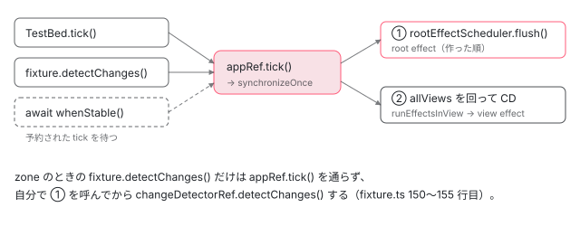

[目次](../README.md) › [テストの内側](README.md) › 第 17 回 / 全 20 回

# テストの中の effect と signal：TestBed.tick で何が流れるか

> root effect と view effect が、テストの TestBed.tick()・fixture.detectChanges()・await fixture.whenStable() からどこで流れるか（zoneless ではどれも appRef.tick の synchronizeOnce で root → view の順、zone の detectChanges だけは自分で root effect を flush する）。TestBed.runInInjectionContext で作る effect が必ず root effect になる理由。core/test/test\_bed\_effect\_spec.ts の 5 本の it が確かめていることと、render3/reactivity\_spec.ts が別のターゲットにあること。

angular/angular · 読了 約 12 分 · 中核 · [サイトで読む（デモが動きます）](https://angular-deep-dive-cyan.vercel.app/chapter/testing-effects)

---

テストで `signal.set()` を呼んだあと「effect がまだ走っていない」と戸惑ったことがあると思います。この章では、テストの中で effect が**いつ・どの関数から**走るのかを、`TestBed.tick()`・`fixture.detectChanges()`・`await fixture.whenStable()` の 3 つについて追い、最後に `test_bed_effect_spec.ts` の 5 本の it が何を固定しているかを表にします。

読む対象は `packages/core/test/test_bed_effect_spec.ts`、`packages/core/test/render3/reactivity_spec.ts`、`packages/core/testing/src/test_bed.ts` です。effect そのものの仕組み（root effect と view effect、`EffectScheduler`）は [cd-effects](../cd/09-cd-effects.md) で読んだので、ここでは「テストの API からそこへどうつながるか」だけを見ます。

1. [1. 全体像](01-testing-overview.md)
2. [2. initTestEnvironment](02-testing-init-environment.md)
3. [3. 後片付け](03-testing-reset-teardown.md)
4. [4. TestBed.inject](04-testing-inject.md)
5. [5. createComponent](05-testing-create-component.md)
6. [6. 入力の渡し方](06-testing-component-bindings.md)
7. [7. createDirective](07-testing-directive-fixture.md)
8. [8. DebugElement と By](08-testing-debug-element.md)
9. [9. detectChanges](09-testing-detect-changes.md)
10. [10. 自動の変更検知](10-testing-auto-detect.md)
11. [11. whenStable](11-testing-when-stable.md)
12. [12. エラーの伝わり方](12-testing-errors.md)
13. [13. fakeAsync](13-testing-fake-async.md)
14. [14. 偽の時計](14-testing-fake-async-scheduler.md)
15. [15. waitForAsync と ProxyZone](15-testing-wait-for-async.md)
16. [16. zone なしの時間](16-testing-zoneless-time.md)
17. **17. effect と signal**（この章）
18. [18. @defer](18-testing-defer.md)
19. [19. RouterTestingHarness](19-testing-router-harness.md)
20. [20. issue と変更を読む](20-testing-issues.md)

## 1. テストで作る effect は 2 種類

`effect()` は、渡された注入器から `ViewContext` が取れるかどうかで 2 つに分かれます。取れれば **view effect**（ビューにぶら下がり、変更検知の途中で走る）、取れなければ **root effect**（`EffectScheduler` の待ち行列に入る）です。分かれ目は [cd-effects](../cd/09-cd-effects.md) で引いた `effect.ts` の 163〜176 行目です。テストでは、どちらを作っているかを書き方で見分けられます。

| テストでの書き方 | 渡る注入器 | できる effect |
| --- | --- | --- |
| コンポーネントのコンストラクタで `effect(...)` | そのコンポーネントの NodeInjector（`ViewContext` が取れる） | view effect |
| `TestBed.runInInjectionContext(() => effect(...))` | テストモジュールの `EnvironmentInjector` | root effect |
| `effect(..., { injector: TestBed.inject(Injector) })` や `appRef.injector` | 環境の注入器 | root effect |

📄 `angular/packages/core/testing/src/test_bed.ts` L425–432 （▶ の行: 430–431）

```ts
425 │   /**
426 │    * Runs the given function in the `EnvironmentInjector` context of `TestBed`.
427 │    *
428 │    * @see {@link https://angular.dev/api/core/EnvironmentInjector#runInContext}
429 │    */
430 ▶   static runInInjectionContext<T>(fn: () => T): T {
431 ▶     return TestBedImpl.INSTANCE.runInInjectionContext(fn);
432 │   }
```

📄 `angular/packages/core/testing/src/test_bed.ts` L645–649 （▶ の行: 647）

```ts
645 │ 
646 │   runInInjectionContext<T>(fn: () => T): T {
647 ▶     return runInInjectionContext(this.inject(EnvironmentInjector), fn);
648 │   }
649 │ 
```

430〜431 行目の static メソッドは、ただ単一のインスタンスへ渡すだけです（`TestBedImpl.INSTANCE` の仕組みは [第 4 回](04-testing-inject.md)）。647 行目で `this.inject(EnvironmentInjector)` を注入コンテキストにして `fn` を呼びます。`EnvironmentInjector` から `ViewContext` は取れないので、**この中で作った effect は必ず root effect** になります。コンポーネントのテストの中で書いても、コンポーネントのビューとは関係のない effect です。

## 2. view effect は「最初の変更検知」まで走らない

📄 `angular/packages/core/test/test_bed_effect_spec.ts` L22–58 （▶ の行: 35, 45, 50, 53, 56）

```ts
22 │ describe('effects in TestBed', () => {
23 │   let prev: boolean;
24 │ 
25 │   it('created in the constructor should run with detectChanges()', () => {
26 │     const log: string[] = [];
27 │     @Component({
28 │       selector: 'test-cmp',
29 │       template: '',
30 │     })
31 │     class Cmp {
32 │       constructor() {
33 │         log.push('Ctor');
34 │ 
35 ▶         effect(() => {
36 │           log.push('Effect');
37 │         });
38 │       }
39 │ 
40 │       ngDoCheck() {
41 │         log.push('DoCheck');
42 │       }
43 │     }
44 │ 
45 ▶     TestBed.createComponent(Cmp).detectChanges();
46 │ 
47 │     expect(log).toEqual([
48 │       // The component gets constructed, which creates the effect. Since the effect is created in a
49 │       // component, it doesn't get scheduled until the component is first change detected.
50 ▶       'Ctor',
51 │ 
52 │       // Next, the first change detection (update pass) happens.
53 ▶       'DoCheck',
54 │ 
55 │       // Then the effect runs.
56 ▶       'Effect',
57 │     ]);
58 │   });
```

35 行目でコンストラクタの中に effect を作り、45 行目で `createComponent` と `detectChanges` を続けて呼びます。期待している順番は 50 行目 `'Ctor'` → 53 行目 `'DoCheck'` → 56 行目 `'Effect'` です。

1. **コンストラクタ：effect は作られるが走らない**

   view effect は作られたときに `consumerMarkedDirty` を呼んで、自分のビューに `HasChildViewsToRefresh` を立て、スケジューラに通知するだけです（cd-effects の `effect.ts` 284〜288 行目・318 行目）。関数本体はまだ呼ばれません。だから 48〜49 行目のコメントのとおり、`createComponent` の時点では log は `['Ctor']` です。
2. **`detectChanges()`：テンプレート → DoCheck → effect**

   zoneless の `fixture.detectChanges()` は `appRef.tick()` を呼びます（[第 9 回](09-testing-detect-changes.md)の `fixture.ts` 140〜146 行目）。ビューの更新は `refreshView` の中で、前置きのフック（`OnInit`・`DoCheck`）を走らせたあとに `runEffectsInView` を呼びます（cd-effects の `change_detection.ts` 273 行目）。effect は**根のコンポーネントのホストのビュー**にぶら下がっていて、`DoCheck` も同じビューのフックなので、53 行目 → 56 行目の順になります。

📄 `angular/packages/core/test/test_bed_effect_spec.ts` L127–147 （▶ の行: 134, 137, 143–144, 146）

```ts
127 │   it('will run an effect with an input signal on the first CD', () => {
128 │     let observed: string | null = null;
129 │ 
130 │     @Component({
131 │       template: '',
132 │     })
133 │     class Cmp {
134 ▶       @Input() input!: string;
135 │       constructor() {
136 │         effect(() => {
137 ▶           observed = this.input;
138 │         });
139 │       }
140 │     }
141 │ 
142 │     const fix = TestBed.createComponent(Cmp);
143 ▶     fix.componentRef.setInput('input', 'hello');
144 ▶     fix.detectChanges();
145 │ 
146 ▶     expect(observed as string | null).toBe('hello');
147 │   });
```

同じ理由で、134 行目の `@Input()` を 137 行目で読む effect も、143 行目の `setInput` のあと 144 行目の最初の `detectChanges` で走れば、146 行目で `'hello'` が見えます。effect がコンストラクタで同期に走っていたら、入力はまだ `undefined` です。「view effect は最初の変更検知で走る」から、入力を読んでも安全になっています。

## 3. 3 つの API はどこで effect を流すか

テストで effect を進める API は 3 つです。どれも最後は同じ `ApplicationRef` の中を通ります。

1. **`TestBed.tick()`**

   `appRef.tick()` を、`includeAllTestViews = true` にはさんで呼ぶだけです（[第 10 回](10-testing-auto-detect.md)で引いた `test_bed.ts` 1013〜1027 行目）。`synchronizeOnce` はまず `RootEffects` の印を見て `rootEffectScheduler.flush()` を呼び（cd-effects の `application_ref.ts` 619〜621 行目）、そのあと `allViews` を回って変更検知をします。`includeAllTestViews` が `true` なので、`autoDetect` でない fixture も含めた全部のテストのビューが入ります（第 9 回で引いた `application_ref.ts` 295〜300 行目）。そこで view effect が走ります。**root が先、view が後**です。
2. **`fixture.detectChanges()`**

   zoneless なら中身は 1 と同じ `appRef.tick()` です。だから root effect も流れます（4 節の表の「root:2」）。zone のときは `appRef.tick()` を通らず、`changeDetectorRef.detectChanges()` の直前に自分で `rootEffectScheduler.flush()` を呼びます（第 9 回の `fixture.ts` 150〜155 行目）。下の spec の 149〜184 行目がこの「zone でも root が先」を固定しています。
3. **`await fixture.whenStable()`**

   effect が dirty になると、root なら `NotificationSource.RootEffect`、view なら `ViewEffect` でスケジューラに通知されます。`ChangeDetectionSchedulerImpl.notify` は tick を予約すると同時に `PendingTasks` に 1 つ足します（[zoneless-notify](../zoneless/03-zoneless-notify.md)）。だから `isStable()` が `false` になり、`whenStable()` は予約された tick が終わるまで待ちます（[第 11 回](11-testing-when-stable.md)）。予約された tick の中身は 1 と同じ `synchronize` です。

📄 `angular/packages/core/test/test_bed_effect_spec.ts` L102–125 （▶ の行: 118, 120–124）

```ts
102 │   it('will flush effects automatically when using autoDetectChanges', async () => {
103 │     const val = signal('initial');
104 │     let observed = '';
105 │     @Component({
106 │       selector: 'test-cmp',
107 │       template: '',
108 │     })
109 │     class Cmp {
110 │       constructor() {
111 │         effect(() => {
112 │           observed = val();
113 │         });
114 │       }
115 │     }
116 │ 
117 │     const fixture = TestBed.createComponent(Cmp);
118 ▶     fixture.autoDetectChanges();
119 │ 
120 ▶     expect(observed).toBe('initial');
121 ▶     val.set('new');
122 ▶     expect(observed).toBe('initial');
123 ▶     await fixture.whenStable();
124 ▶     expect(observed).toBe('new');
125 │   });
```

118 行目の `autoDetectChanges()` は 1 回 `detectChanges()` するので、120 行目で `'initial'` が見えます（[第 10 回](10-testing-auto-detect.md)）。121 行目で `set` しても、122 行目ではまだ `'initial'`。**`set` は通知を出すだけで、effect を同期では走らせない**からです。123 行目の `await fixture.whenStable()` で予約された tick が終わり、124 行目で `'new'` になります。

📄 `angular/packages/core/test/test_bed_effect_spec.ts` L149–184 （▶ の行: 151, 173–174, 179–180, 183）

```ts
149 │   it('should run root effects before detectChanges() when in zone mode', async () => {
150 │     TestBed.configureTestingModule({
151 ▶       providers: [provideZoneChangeDetection()],
152 │     });
153 │     const log: string[] = [];
154 │ 
155 │     @Component({
156 │       template: `{{ sentinel }}`,
157 │       changeDetection: ChangeDetectionStrategy.Eager,
158 │     })
159 │     class TestCmp {
160 │       get sentinel(): string {
161 │         log.push('CD');
162 │         return '';
163 │       }
164 │     }
165 │ 
166 │     // Instantiate the component and CD it once.
167 │     const fix = TestBed.createComponent(TestCmp);
168 │     fix.detectChanges();
169 │ 
170 │     // Instantiate a root effect and run it once.
171 │     const counter = signal(0);
172 │     const appRef = TestBed.inject(ApplicationRef);
173 ▶     effect(() => log.push(`effect: ${counter()}`), {injector: appRef.injector});
174 ▶     await appRef.whenStable();
175 │ 
176 │     log.length = 0;
177 │ 
178 │     // Trigger the effect and call `detectChanges()` on the fixture.
179 ▶     counter.set(1);
180 ▶     fix.detectChanges(false);
181 │ 
182 │     // The effect should run before the component CD.
183 ▶     expect(log).toEqual(['effect: 1', 'CD']);
184 │   });
```

151 行目で zone のテストにします。173 行目の effect は `appRef.injector`（環境の注入器）で作るので root effect です。174 行目で 1 回流してから log を空にし、179 行目で `set`、180 行目で `detectChanges(false)`（`checkNoChanges` を省く）。183 行目、effect が CD より先に走ることを確かめています。zone のときの `fixture.detectChanges()` は `appRef.tick()` を通らないので、`fixture.ts` がわざわざ flush を先に呼ぶ、というのがこの it の意味です。



*TestBed.tick と zoneless の fixture.detectChanges は同じ appRef.tick に入る。synchronizeOnce は root effect を先に流し、そのあとテストのビューを回って view effect を流す。*

## 4. このサイトの ng test で確かめた

このサイトの `ng test`（Vitest + jsdom、zone.js なし、@angular/core 22.1.6）で、同じ 1 本の it の中に root effect（`TestBed.runInInjectionContext` で作る）と view effect（コンポーネントのコンストラクタで作る）を置き、`set` のあとどの API で走るかを記録しました。`typeof Zone` は `"undefined"` でした。

| した操作 | root effect | view effect |
| --- | --- | --- |
| effect を作った直後（同期） | 走っていない（\[\]） | 走っていない（createComponent 直後も \[\]） |
| TestBed.tick() | 走る（root:0） | 走る（view:1） |
| signal.set() の直後（同期） | 走らない | 走らない（fixture.isStable() は false） |
| fixture.detectChanges() | 走る（root:2） | 走る（初回は view:0、2 回目は view:2） |
| await fixture.whenStable() | 走る（root:3） | 走る（view:3、DOM も &lt;p&gt;3&lt;/p&gt;） |
| 同じ tick の中の順番 | 先（root:1） | 後（view:1） |

- **3 つのどれでも、root も view も流れる**（zoneless のとき）。違いは「同期で今すぐ」（`TestBed.tick()` と `detectChanges()`）か「予約された tick を待つ」（`whenStable()`）かだけです。
- `set` の直後に `fixture.isStable()` が `false` になったことが、3 節の 3 番目（通知が `PendingTasks` を足す）の証拠です。
- 同じ `TestBed.tick()` の中では `['root:1', 'view:1']` の順でした。図の ① → ② です。

📄 `angular/packages/core/test/render3/reactivity_spec.ts` L82–97 （▶ の行: 90–91, 93–94, 96）

```ts
82 │     it('should contribute to application stableness when an effect is pending', async () => {
83 │       const someSignal = signal('initial');
84 │       const appRef = TestBed.inject(ApplicationRef);
85 │ 
86 │       const isStable: boolean[] = [];
87 │       const sub = appRef.isStable.subscribe((stable) => isStable.push(stable));
88 │       expect(isStable).toEqual([true]);
89 │ 
90 ▶       TestBed.runInInjectionContext(() => effect(() => someSignal()));
91 ▶       expect(isStable).toEqual([true, false]);
92 │ 
93 ▶       appRef.tick();
94 ▶       await appRef.whenStable();
95 │ 
96 ▶       expect(isStable).toEqual([true, false, true]);
97 │     });
```

本家にも同じことを確かめる it があります。90 行目で root effect を作ると、91 行目で `isStable` が `false` になります（`createRootEffect` の中の通知で tick が予約されるため。cd-effects の `effect.ts` 334 行目）。93 行目で手で `tick()` し、94 行目で待つと 96 行目で `true` に戻ります。

> **🧪 DEMO — 本物の root effect と view effect（このページの上で）**
>
> この章のコンポーネントのコンストラクタに、`source` を読む effect を 2 つ置いてあります。1 つは普通の `effect()`（view effect）、もう 1 つは `{ injector: inject(EnvironmentInjector) }` を渡した root effect です。テストではなく、このサイトの本物のアプリの中で動いています。ログは effect の中で配列に足し、microtask で画面に写しています（effect の中から画面用の signal を直接書かないため）。
>
> 「set だけ」では、set の直後の行で回数が増えていません。effect の行はそのあと、スケジューラが予約した tick の中で（root → view の順に）出ます。テストの `await whenStable()` が待っているのはこの tick です。「set → すぐ appRef.tick()」では、`tick()` から戻った直後の行で、もう両方の回数が増えています。テストの `TestBed.tick()` は、これを `includeAllTestViews` 付きで呼んでいるだけです。
>
> ▶ [このデモはサイトで動かせます](https://angular-deep-dive-cyan.vercel.app/chapter/testing-effects)

## 5. root effect だけのテスト

📄 `angular/packages/core/test/render3/reactivity_spec.ts` L269–293 （▶ の行: 272, 274–275, 277–279, 285）

```ts
269 │     it('should create root effects when outside of a component, using injection context', () => {
270 │       const counter = signal(0);
271 │       const log: number[] = [];
272 ▶       TestBed.runInInjectionContext(() => effect(() => log.push(counter())));
273 │ 
274 ▶       TestBed.tick();
275 ▶       expect(log).toEqual([0]);
276 │ 
277 ▶       counter.set(1);
278 ▶       TestBed.tick();
279 ▶       expect(log).toEqual([0, 1]);
280 │     });
281 │ 
282 │     it('should create root effects when outside of a component, using an injector', () => {
283 │       const counter = signal(0);
284 │       const log: number[] = [];
285 ▶       effect(() => log.push(counter()), {injector: TestBed.inject(Injector)});
286 │ 
287 │       TestBed.tick();
288 │       expect(log).toEqual([0]);
289 │ 
290 │       counter.set(1);
291 │       TestBed.tick();
292 │       expect(log).toEqual([0, 1]);
293 │     });
```

コンポーネントの無い effect のテストの基本形です。272 行目で `runInInjectionContext` の中に作り、274 行目の `TestBed.tick()` で最初の 1 回（275 行目 `[0]`）。277 行目で `set`、278 行目でもう一度 `tick()` すると 279 行目で `[0, 1]`。285 行目は注入器を直接渡す書き方で、結果は同じです。**この形では `await` が要りません**。`TestBed.tick()` が同期で flush まで済ませるからです。

## 6. test\_bed\_effect\_spec.ts の 5 本

| 行 | it の名前 | 確かめていること |
| --- | --- | --- |
| 25 | `created in the constructor should run with detectChanges()` | コンストラクタの view effect は最初の CD で、DoCheck のあとに走る（2 節） |
| 60 | `created in ngOnInit should run with detectChanges()` | `ngOnInit` で `{injector}` を渡して作った effect も同じ CD の中で走る（DoCheck のあと） |
| 102 | `will flush effects automatically when using autoDetectChanges` | set だけでは走らず、`whenStable()` で走る（3 節） |
| 127 | `will run an effect with an input signal on the first CD` | 最初の CD で走るので、`setInput` した値が読める（2 節） |
| 149 | `should run root effects before detectChanges() when in zone mode` | zone のとき、`fixture.detectChanges()` が root effect を CD より先に流す（3 節） |

23 行目に `let prev: boolean;` がありますが、どの it も使っていません（ファイル全体を `grep -n prev` すると 23 行目だけ）。読むときに「何か前提があるのか」と迷わなくてよい行です。

## ここまでの呼び出し

- 👤 `signal.set(v)` — テストのコード — *effect は dirty になり、スケジューラに通知するだけ*
- 👤 `TestBed.tick()` — core/testing/src/test\_bed.ts L472 → L1013
  - `appRef.tick()` — core/src/application/application\_ref.ts L533 — *includeAllTestViews = true の間に呼ぶ*
    - `synchronize()` → `synchronizeOnce()` — application\_ref.ts L588 / L617
      - `rootEffectScheduler.flush()` — application\_ref.ts L621 — *root effect がここで走る*
      - `detectChangesInternal(_lView, mode)` — application\_ref.ts L653 — *allViews = テストの fixture のビューを含む*
        - `runEffectsInView(lView)` — core/src/render3/instructions/change\_detection.ts L273 / L547 — *view effect がここで走る*

## テストと直し方

この章の spec は `packages/core/test/test_bed_effect_spec.ts` の `describe('effects in TestBed')`（22 行目）です。`//packages/core/test:test` に入っています。

📄 `ターミナル（../angular で実行）`

```
cd ~/angular-research/angular
pnpm bazel test //packages/core/test:test --test_output=all \
  --test_arg=--filter="effects in TestBed|reactivity effects should create root effects"
```

📄 `出力（抜粋。2026-11-01 に実行）`

```
==================== Test output for //packages/core/test:test (shard 3 of 4):
Ran 1 of 1397 specs
1 spec, 0 failures
==================== Test output for //packages/core/test:test (shard 1 of 4):
Ran 1 of 1397 specs
==================== Test output for //packages/core/test:test (shard 4 of 4):
Ran 1 of 1397 specs
==================== Test output for //packages/core/test:test (shard 2 of 4):
Ran 2 of 1398 specs
2 specs, 0 failures
INFO: Elapsed time: 2.768s, Critical Path: 1.85s
//packages/core/test:test                                  PASSED in 1.6s
  Stats over 4 runs: max = 1.6s, min = 1.6s, avg = 1.6s, dev = 0.0s
```

1. **Ran の数の読み方**

   `shard_count = 4` なので `Ran N of M specs` が 4 回出ます。1 + 1 + 1 + 2 = **5 本**で、22 行目の describe の it の数（25・60・102・127・149 行目）と合います。どの shard にどの it が入るかは決まっていないので、「1 つの shard が 0 本」でも失敗ではありません。合計で数えます。0 本で PASSED になる落とし穴は [forms-overview](../forms/01-forms-overview.md) で見ました。
2. **`reactivity_spec.ts` は別のターゲット**

   フィルタに `reactivity effects should create root effects` も入れましたが、合計は 5 本で増えていません。`packages/core/test/render3/` には自分の `BUILD.bazel` があり、`//packages/core/test:test` の `glob(["**/*.ts"])` は BUILD.bazel のあるディレクトリの中には入らないからです（Bazel の glob はパッケージの境目を越えない。[contrib-bazel](../contrib/04-contrib-bazel.md)）。5 節の it を走らせるターゲットは `//packages/core/test/render3:render3`（render3/BUILD.bazel の `angular_jasmine_test(name = "render3")`。`shard_count` の指定は無い）です。この章では走らせていません。
3. **直すとしたら**

   「テストの API が effect を流すか」の入口は 3 つです。`TestBed.tick`（`test_bed.ts` 1013 行目）、`AbstractFixture.detectChanges`（`fixture.ts` 132 行目。zone の分岐の 152 行目）、そして両方が入る `ApplicationRef.synchronizeOnce`（`application_ref.ts` 617 行目）。effect の種類の決まり方は `effect.ts` の `effect()`（137 行目）です。テストの API の振る舞いなら `test_bed_effect_spec.ts` に、effect そのものの振る舞いなら `render3/reactivity_spec.ts` の `describe('effects')`（50 行目）に足します。
4. **issue を読むときの手がかり**

   「テストで effect が走らない」という報告は、まず (1) その effect が root か view か（1 節の表）、(2) `set` のあと 3 つの API のどれかを呼んでいるか、(3) zone のテストで `fixture.detectChanges()` を使っているか、を確かめます。zone のテストで root effect だけを流したいときに `fixture` が無ければ、`TestBed.tick()` を呼びます。

## 聞かれそうな質問

**Q. effect のテストで TestBed.tick() を呼ぶのはなぜですか？**

`set` は effect を dirty にしてスケジューラに通知するだけで、関数本体は呼ばないからです（spec の 121〜122 行目）。本物のアプリなら、予約された tick が少しあとに来て流します。テストではその「少しあと」を待たずに、`TestBed.tick()` で同じ `appRef.tick()` を**今すぐ同期で**呼び、`synchronizeOnce` の中で root effect の flush とビューの CD を済ませます（5 節の 274・278 行目）。待ってよいなら `await fixture.whenStable()` でも流れます。`TestBed.flushEffects()` は非推奨で、中身は `tick()` と同じです（第 10 回で引いた `test_bed.ts` 1004〜1006 行目）。

**Q. root effect と view effect、どちらが先に走りますか？**

同じ tick の中なら root が先です。`synchronizeOnce` が root effect の flush（`application_ref.ts` 619〜621 行目）をビューの CD より前に置いているからで、このサイトの ng test でも `['root:1', 'view:1']` でした。zone のときの `fixture.detectChanges()` も、spec の 183 行目のとおり root が先です。

**Q. untracked な読みはテストでどう見えますか？**

`untracked(u)` で読んだ signal は依存に入らないので、`u.set()` のあと `TestBed.tick()` しても effect は走りません。このサイトの ng test では、`effect(() => t() + '/' + untracked(u))` に対して `u.set('Y')` → `tick()` のあとも log は `['x/y']` のまま、`t.set('X')` → `tick()` で初めて `'X/Y'` が足されました（このとき `u` の新しい値も読まれる）。依存の追跡のしくみは [signals-tracking](../signals/03-signals-tracking.md) です。

**Q. resource のテストはどう書きますか？**

`resource()` は内部で effect を 1 つ作り、その effect の中で loader を呼びます（[resource](../signals/15-resource.md) の章で引いた `resource.ts` 323 行目）。だから作っただけでは loader は呼ばれず、まず `TestBed.tick()` で effect を流し、そのあと loader の Promise を待ちます。本家の `packages/core/test/resource/resource_spec.ts` の `it('should expose data and status based on reactive request')`（88 行目）が、`TestBed.tick()` → `await backend.flush()` を 2 回繰り返す形で書かれています。

**Q. runInInjectionContext の中で作った effect は、テストが終わると消えますか？**

消えます。`manualCleanup` でなければ、effect は注入器の `DestroyRef` に破棄を登録します（cd-effects の `effect.ts` 159 行目・179〜181 行目）。`runInInjectionContext` の注入器はテストモジュールの `EnvironmentInjector` なので、テストごとの `resetTestingModule` でモジュールが壊されるときに一緒に破棄されます（[第 3 回](03-testing-reset-teardown.md)）。

## 読み終えて

- `TestBed.runInInjectionContext` は `EnvironmentInjector` を使うので、中で作る effect は必ず root effect。コンポーネントのコンストラクタの effect は view effect
- `signal.set()` は effect を走らせない。走らせるのは `TestBed.tick()`・`fixture.detectChanges()`・`await fixture.whenStable()` で、zoneless ではどれも同じ `appRef.tick()` に入る
- `synchronizeOnce` は root effect の flush → ビューの CD（view effect）の順。zone の `fixture.detectChanges()` だけは自分で flush を先に呼ぶ
- `test_bed_effect_spec.ts` は `//packages/core/test:test` で 5 本。`reactivity_spec.ts` は `//packages/core/test/render3:render3` という別のターゲット

---

← 前: [zone を使わないテストの時間：whenStable・偽タイマー・zone 依存の道具の境目](16-testing-zoneless-time.md)  
次: [@defer のテスト：DeferBlockBehavior と DeferBlockFixture](18-testing-defer.md) →
