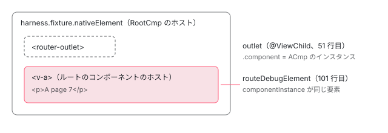

[目次](../README.md) › [テストの内側](README.md) › 第 19 回 / 全 20 回

# RouterTestingHarness：ルーティングを本物の Router でテストする

> RouterTestingHarness.create が RootCmp を createComponent し、navigateByUrl が Router.navigateByUrl を待ったあと fixture を更新し、出てきたコンポーネントの型を確かめる手順。routeDebugElement と routeNativeElement、BrowserTestingModule が入れる偽の Navigation、RouterTestingModule との違い。最新の main に入った変更も 1 つ読む。

angular/angular · 読了 約 13 分 · 中核 · [サイトで読む（デモが動きます）](https://angular-deep-dive-cyan.vercel.app/chapter/testing-router-harness)

---

ルーティングのテストで知りたいのは「この URL に行ったら、どのコンポーネントが出るか」です。`RouterTestingHarness` は、本物の `Router` に本物のナビゲーションをさせ、終わるのを待ってから `RouterOutlet` の中身を返す小さなクラスです。この章では、`create` が根のコンポーネントを作る手順、`navigateByUrl` が待つ 2 つの Promise と型の確認、非推奨の `RouterTestingModule` との違いを、ソースの行を指して追います。最後に、最新の main に入った `navigate` メソッドの差分を読みます。

読む対象は `packages/router/testing/src/router_testing_harness.ts`（179 行）、`router_testing_module.ts`、`packages/router/testing/test/router_testing_harness.spec.ts` です。

1. [1. 全体像](01-testing-overview.md)
2. [2. initTestEnvironment](02-testing-init-environment.md)
3. [3. 後片付け](03-testing-reset-teardown.md)
4. [4. TestBed.inject](04-testing-inject.md)
5. [5. createComponent](05-testing-create-component.md)
6. [6. 入力の渡し方](06-testing-component-bindings.md)
7. [7. createDirective](07-testing-directive-fixture.md)
8. [8. DebugElement と By](08-testing-debug-element.md)
9. [9. detectChanges](09-testing-detect-changes.md)
10. [10. 自動の変更検知](10-testing-auto-detect.md)
11. [11. whenStable](11-testing-when-stable.md)
12. [12. エラーの伝わり方](12-testing-errors.md)
13. [13. fakeAsync](13-testing-fake-async.md)
14. [14. 偽の時計](14-testing-fake-async-scheduler.md)
15. [15. waitForAsync と ProxyZone](15-testing-wait-for-async.md)
16. [16. zone なしの時間](16-testing-zoneless-time.md)
17. [17. effect と signal](17-testing-effects.md)
18. [18. @defer](18-testing-defer.md)
19. **19. RouterTestingHarness**（この章）
20. [20. issue と変更を読む](20-testing-issues.md)

## 1. 根のコンポーネント RootCmp と、それを 1 つだけ作るサービス

📄 `angular/packages/router/testing/src/router_testing_harness.ts` L45–53 （▶ の行: 46, 48, 51）

```ts
45 │ @Component({
46 ▶   template: '<router-outlet [routerOutletData]="routerOutletData()"></router-outlet>',
47 │   imports: [RouterOutlet],
48 ▶   changeDetection: ChangeDetectionStrategy.Eager,
49 │ })
50 │ export class RootCmp {
51 ▶   @ViewChild(RouterOutlet) outlet?: RouterOutlet;
52 │   readonly routerOutletData = signal<unknown>(undefined);
53 │ }
```

46 行目、テンプレートは `<router-outlet>` 1 つだけです。51 行目の `@ViewChild(RouterOutlet)` で、その outlet のディレクティブのインスタンスを持ちます。48 行目の `ChangeDetectionStrategy.Eager` は、2026 年にコンポーネントの既定が OnPush に変わった流れで明示されたもので（`git blame` すると d2054c7c1a1「prepare for required `changeDetection` prop」）、`Eager` は以前の `Default`（毎回チェックする）と同じ値です。

📄 `angular/packages/router/testing/src/router_testing_harness.ts` L22–43 （▶ の行: 22, 28–29, 31, 36, 39–40）

```ts
22 ▶ @Service()
23 │ export class RootFixtureService {
24 │   private fixture?: ComponentFixture<RootCmp>;
25 │   private harness?: RouterTestingHarness;
26 │ 
27 │   createHarness(): RouterTestingHarness {
28 ▶     if (this.harness) {
29 ▶       throw new Error('Only one harness should be created per test.');
30 │     }
31 ▶     this.harness = new RouterTestingHarness(this.getRootFixture());
32 │     return this.harness;
33 │   }
34 │ 
35 │   private getRootFixture(): ComponentFixture<RootCmp> {
36 ▶     if (this.fixture !== undefined) {
37 │       return this.fixture;
38 │     }
39 ▶     this.fixture = TestBed.createComponent(RootCmp);
40 ▶     this.fixture.detectChanges();
41 │     return this.fixture;
42 │   }
43 │ }
```

1. **22 行目：root に自動で入るサービス**

   `@Service()` は既定で root の注入器に自動で provide されます（[di-injectable-compile](../di/05-di-injectable-compile.md)）。テストモジュールに何も書かなくても `TestBed.inject(RootFixtureService)` できます。
2. **28〜30 行目：1 テストに 1 つ**

   すでに作っていれば投げます。サービスは root にいるので、「テストごとに 1 つ」は `resetTestingModule` で注入器ごと捨てられることで守られます（[第 3 回](03-testing-reset-teardown.md)）。
3. **39〜40 行目：RootCmp を createComponent して 1 回 CD**

   `TestBed.createComponent(RootCmp)` は普通のコンポーネントのテストと同じ道です（[第 5 回](05-testing-create-component.md)）。40 行目の `detectChanges()` で `<router-outlet>` が作られ、51 行目の `outlet` が埋まります。36 行目で、2 回目からは同じ fixture を返します。

📄 `angular/packages/router/testing/src/router_testing_harness.ts` L61–89 （▶ の行: 69, 74–76, 84）

```ts
61 │ export class RouterTestingHarness {
62 │   /**
63 │    * Creates a `RouterTestingHarness` instance.
64 │    *
65 │    * The `RouterTestingHarness` also creates its own root component with a `RouterOutlet` for the
66 │    * purposes of rendering route components.
67 │    *
68 │    * Throws an error if an instance has already been created.
69 ▶    * Use of this harness also requires `destroyAfterEach: true` in the `ModuleTeardownOptions`
70 │    *
71 │    * @param initialUrl The target of navigation to trigger before returning the harness.
72 │    */
73 │   static async create(initialUrl?: string): Promise<RouterTestingHarness> {
74 ▶     const harness = TestBed.inject(RootFixtureService).createHarness();
75 ▶     if (initialUrl !== undefined) {
76 ▶       await harness.navigateByUrl(initialUrl);
77 │     }
78 │     return harness;
79 │   }
80 │ 
81 │   /**
82 │    * Fixture of the root component of the RouterTestingHarness
83 │    */
84 ▶   public readonly fixture: ComponentFixture<{routerOutletData: WritableSignal<unknown>}>;
85 │ 
86 │   /** @internal */
87 │   constructor(fixture: ComponentFixture<{routerOutletData: WritableSignal<unknown>}>) {
88 │     this.fixture = fixture;
89 │   }
```

74 行目で上のサービスから harness を作り、75〜76 行目、`initialUrl` を渡したときだけ最初のナビゲーションを `await` します。69 行目のドキュメントは `destroyAfterEach: true` が要ると書いています。v22 では既定が `true` なので、普通は何もしなくて満たされます（[第 3 回](03-testing-reset-teardown.md)）。

## 2. navigateByUrl：2 つの await と型の確認

📄 `angular/packages/router/testing/src/router_testing_harness.ts` L108–145 （▶ の行: 113, 124, 145）

```ts
108 │   /**
109 │    * Triggers a `Router` navigation and waits for it to complete.
110 │    *
111 │    * The root component with a `RouterOutlet` created for the harness is used to render `Route`
112 │    * components. The root component is reused within the same test in subsequent calls to
113 ▶    * `navigateForTest`.
114 │    *
115 │    * When testing `Routes` with a guards that reject the navigation, the `RouterOutlet` might not be
116 │    * activated and the `activatedComponent` may be `null`.
117 │    *
118 │    * {@example router/testing/test/router_testing_harness_examples.spec.ts region='Guard'}
119 │    *
120 │    * @param url The target of the navigation. Passed to `Router.navigateByUrl`.
121 │    * @returns The activated component instance of the `RouterOutlet` after navigation completes
122 │    *     (`null` if the outlet does not get activated).
123 │    */
124 ▶   async navigateByUrl(url: string): Promise<null | {}>;
125 │   /**
126 │    * Triggers a router navigation and waits for it to complete.
127 │    *
128 │    * The root component with a `RouterOutlet` created for the harness is used to render `Route`
129 │    * components.
130 │    *
131 │    * {@example router/testing/test/router_testing_harness_examples.spec.ts region='RoutedComponent'}
132 │    *
133 │    * The root component is reused within the same test in subsequent calls to `navigateByUrl`.
134 │    *
135 │    * This function also makes it easier to test components that depend on `ActivatedRoute` data.
136 │    *
137 │    * {@example router/testing/test/router_testing_harness_examples.spec.ts region='ActivatedRoute'}
138 │    *
139 │    * @param url The target of the navigation. Passed to `Router.navigateByUrl`.
140 │    * @param requiredRoutedComponentType After navigation completes, the required type for the
141 │    *     activated component of the `RouterOutlet`. If the outlet is not activated or a different
142 │    *     component is activated, this function will throw an error.
143 │    * @returns The activated component instance of the `RouterOutlet` after navigation completes.
144 │    */
145 ▶   async navigateByUrl<T>(url: string, requiredRoutedComponentType: Type<T>): Promise<T>;
```

オーバーロードは 2 つです。124 行目は型を渡さない形で、戻り値は `Promise<null | {}>`。145 行目は型を渡す形で、`Promise<T>` を返し、違えば投げます。

📄 `angular/packages/router/testing/src/router_testing_harness.ts` L146–178 （▶ の行: 147, 152–156, 159, 162–163, 165, 169, 171, 173, 176）

```ts
146 │   async navigateByUrl<T>(url: string, requiredRoutedComponentType?: Type<T>): Promise<T | null> {
147 ▶     const router = TestBed.inject(Router);
148 │     let resolveFn!: () => void;
149 │     const redirectTrackingPromise = new Promise<void>((resolve) => {
150 │       resolveFn = resolve;
151 │     });
152 ▶     afterNextNavigation(TestBed.inject(Router), resolveFn);
153 ▶     await router.navigateByUrl(url);
154 ▶     await redirectTrackingPromise;
155 ▶     this.fixture.detectChanges();
156 ▶     const outlet = (this.fixture.componentInstance as RootCmp).outlet;
157 │     // The outlet might not be activated if the user is testing a navigation for a guard that
158 │     // rejects
159 ▶     if (outlet && outlet.isActivated && outlet.activatedRoute.component) {
160 │       const activatedComponent = outlet.component;
161 │       if (
162 ▶         requiredRoutedComponentType !== undefined &&
163 ▶         !(activatedComponent instanceof requiredRoutedComponentType)
164 │       ) {
165 ▶         throw new Error(
166 │           `Unexpected routed component type. Expected ${requiredRoutedComponentType.name} but got ${activatedComponent.constructor.name}`,
167 │         );
168 │       }
169 ▶       return activatedComponent as T;
170 │     } else {
171 ▶       if (requiredRoutedComponentType !== undefined) {
172 │         throw new Error(
173 ▶           `Unexpected routed component type. Expected ${requiredRoutedComponentType.name} but the navigation did not activate any component.`,
174 │         );
175 │       }
176 ▶       return null;
177 │     }
178 │   }
```

1. **152 行目：「次のナビゲーションが終わったら」を先に予約**

   `afterNextNavigation(router, resolveFn)` は `router.events` を購読し、`NavigationEnd`・`NavigationSkipped`・`NavigationError`・`NavigationCancel` のどれかが来たら `resolveFn` を呼びます。ただし `NavigationCancel` の理由が「リダイレクト」か「新しいナビゲーションに追い越された」なら数えず、その先のナビゲーションの終わりを待ちます （[router-initial-navigation](../router/06-router-initial-navigation.md) で引いた `navigations.ts` 47〜61 行目）。
2. **153 行目：本物の Router.navigateByUrl を待つ**

   ここは本物の `Router` のナビゲーションです（[router-navigation-request](../router/07-router-navigation-request.md)）。ルートが一致しなければこの Promise が reject され、`await` がそのまま投げます（このサイトの ng test では `NG04002`）。
3. **154 行目：リダイレクトの先まで待つ**

   ガードの中で別の URL へ `navigateByUrl` すると、153 行目の Promise は最初のナビゲーションが追い越された時点で先に解決します。154 行目で 152 行目の予約を待つので、追い越した側のナビゲーションの終わりまで待てます。5 節の spec の 125〜145 行目がこれを確かめています。
4. **155 行目：根の fixture を CD**

   ナビゲーションで outlet に置かれたコンポーネントのテンプレートを描くために `detectChanges()` を呼びます（[第 9 回](09-testing-detect-changes.md)）。だから戻ってきた時点で DOM はもう新しい中身です。
5. **156〜169 行目：outlet にいるものを返す**

   159 行目、outlet が有効で、有効なルートにコンポーネントがあれば、160 行目の `outlet.component` を返します。型が渡されていて 163 行目の `instanceof` が外れれば、165〜167 行目のエラーです。**見ているのは「いま outlet にいるもの」で、「今回のナビゲーションで出たもの」ではありません**。ガードで止まったナビゲーションでは、前のコンポーネントがそのまま返ります（4 節の表、6 節のレビュー）。
6. **171〜176 行目：何もいなければ null か、型を求めていればエラー**

   型が渡されていれば 173 行目の「the navigation did not activate any component」、渡されていなければ 176 行目で `null`。

📄 `angular/packages/router/testing/src/router_testing_harness.ts` L91–106 （▶ の行: 93, 98–99, 101, 105）

```ts
 91 │   /** Instructs the root fixture to run change detection. */
 92 │   detectChanges(): void {
 93 ▶     this.fixture.detectChanges();
 94 │   }
 95 │   /** The `DebugElement` of the `RouterOutlet` component. `null` if the outlet is not activated. */
 96 │   get routeDebugElement(): DebugElement | null {
 97 │     const outlet = (this.fixture.componentInstance as RootCmp).outlet;
 98 ▶     if (!outlet || !outlet.isActivated) {
 99 ▶       return null;
100 │     }
101 ▶     return this.fixture.debugElement.query((v) => v.componentInstance === outlet.component);
102 │   }
103 │   /** The native element of the `RouterOutlet` component. `null` if the outlet is not activated. */
104 │   get routeNativeElement(): HTMLElement | null {
105 ▶     return this.routeDebugElement?.nativeElement ?? null;
106 │   }
```

93 行目の `detectChanges()` は根の fixture の CD をするだけです。`routeDebugElement` は 98〜99 行目で outlet が有効でなければ `null`、101 行目で根の fixture の `debugElement` から「`componentInstance` が outlet のコンポーネントと同じもの」を探します（`DebugElement.query` は [第 8 回](08-testing-debug-element.md)）。つまり返るのは**ルートのコンポーネントのホスト要素**です。105 行目の `routeNativeElement` はその `nativeElement` です。



*harness.fixture は RootCmp。outlet の兄弟に置かれたルートのコンポーネントのホスト要素が routeDebugElement / routeNativeElement になる。*

## 3. URL はどこが変わるのか：偽の Navigation

テストの中で `Router` が「URL を変える」とき、書き込む先は `Location` → `PlatformLocation` です。`BrowserTestingModule` は 32 行目で `ɵprovideFakePlatformNavigation()` を provide していて、`PlatformLocation` は `FakeNavigationPlatformLocation`（メモリの中の偽の Navigation API）になります（[第 2 回](02-testing-init-environment.md)）。だから `Location.path()` は変わっても、ブラウザ（jsdom）の本物の `location.href` は変わりません。このサイトの ng test でも、`Location.path()` は `'/a'`、`location.href` は `'http://localhost:3000/'` のままでした。

## 4. このサイトの ng test で確かめた

このサイトの `ng test`（Vitest + jsdom、@angular/router 22.1.6）で、`provideRouter([{path: 'a', component: ACmp}, {path: 'a/:id', ...}, {path: 'b', component: BCmp}, {path: 'no', canActivate: [() => false], ...}, {path: 'old', redirectTo: 'b'}])` を入れて確かめました。22.1.6 の `RootFixtureService` も `@Service()`・`Eager` で、上で読んだ ../angular（22.2.0-next.7）と同じ形でした（node\_modules の `fesm2022/testing.mjs` で確かめた）。

| した操作 | 結果 |
| --- | --- |
| RouterTestingHarness.create('/a') のあと routeNativeElement.outerHTML | &lt;v-a&gt;&lt;p&gt;A page &lt;/p&gt;&lt;/v-a&gt;（ルートのコンポーネントのホスト要素） |
| harness.fixture.nativeElement.innerHTML | &lt;router-outlet&gt;&lt;/router-outlet&gt;&lt;v-a&gt;…&lt;/v-a&gt;（outlet の兄弟に置かれる） |
| Router.url / Location.path() | '/a' / '/a'。jsdom の本物の location.href は 'http://localhost:3000/' のまま |
| navigateByUrl('/a/7', ACmp) | ACmp のインスタンスが返り、routeNativeElement.textContent は 'A page 7' |
| navigateByUrl('/b', ACmp)（違う型） | throw「Unexpected routed component type. Expected \_ACmp but got \_BCmp」 |
| /b にいる状態で navigateByUrl('/no', BCmp)（ガードが false） | 投げない。BCmp（前のまま）が返り、Router.url も '/b' のまま |
| navigateByUrl('/old')（redirectTo: 'b'） | BCmp が返り、Router.url は '/b' |
| 同じテストで RouterTestingHarness.create() をもう一度 | throw「Only one harness should be created per test.」 |
| provideRouter(\[\]) で create() したあと navigateByUrl('/zzz') | throw「NG04002: Cannot match any routes. URL Segment: 'zzz'」 |
| typeof harness.navigate | 'undefined'（22.1.6 にはまだ無い。6 節） |

- エラー文のクラス名に `_` が付いているのは、166 行目が `constructor.name` をそのまま出していて、Vitest のビルドではその値が `_ACmp` だったためです。名前で `toThrow` を書くときは気をつけます。
- `/no` の行が「投げない」のは、2 節の 5 番目の手順のとおり、ガードで止まっても outlet には前の `BCmp` がいるからです。「ガードで止まった」ことを確かめたいなら、型ではなく `Router.url` が変わっていないことを見ます。

> **🧪 DEMO — navigateByUrl の「outlet を見て型を比べる」部分の再現**
>
> **再現です。**このページで本物の `RouterTestingHarness` は動かせない（サイト自身の Router と衝突する）ので、2 節の 156〜177 行目の判定だけを小さな関数で真似ています。153 行目の本物の `Router` の結果は、下の 5 つのルートの表で置き換えています。
>
> 試してほしい順番：第 2 引数を BCmp にして `/b` → `/no`。2 回目も「BCmp のインスタンス」が返り、ガードで止まったことは戻り値からは分かりません。次に何も無い状態（クリア）で第 2 引数を ACmp にして `/no` を押すと、173 行目の「did not activate any component」になります。
>
> ▶ [このデモはサイトで動かせます](https://angular-deep-dive-cyan.vercel.app/chapter/testing-router-harness)

## 5. RouterTestingModule との違い

📄 `angular/packages/router/testing/src/router_testing_module.ts` L45–74 （▶ の行: 46, 49–50, 55–58, 69）

```ts
45 │  * @publicApi
46 ▶  * @deprecated Use `provideRouter` or `RouterModule`/`RouterModule.forRoot` instead.
47 │  * This module was previously used to provide a helpful collection of test fakes,
48 │  * most notably those for `Location` and `LocationStrategy`.  These are generally not
49 ▶  * required anymore, as `MockPlatformLocation` is provided in `TestBed` by default.
50 ▶  * However, you can use them directly with `provideLocationMocks`.
51 │  */
52 │ @NgModule({
53 │   exports: [RouterModule],
54 │   providers: [
55 ▶     ROUTER_PROVIDERS,
56 ▶     provideLocationMocks(),
57 ▶     withPreloading(NoPreloading).ɵproviders,
58 ▶     {provide: ROUTES, multi: true, useValue: []},
59 │   ],
60 │ })
61 │ export class RouterTestingModule {
62 │   static withRoutes(
63 │     routes: Routes,
64 │     config?: ExtraOptions,
65 │   ): ModuleWithProviders<RouterTestingModule> {
66 │     return {
67 │       ngModule: RouterTestingModule,
68 │       providers: [
69 ▶         {provide: ROUTES, multi: true, useValue: routes},
70 │         {provide: ROUTER_CONFIGURATION, useValue: config ? config : {}},
71 │       ],
72 │     };
73 │   }
74 │ }
```

46 行目で **非推奨**です。中身は 55 行目の `ROUTER_PROVIDERS`（`router_module.ts` で定義され、`RouterModule.forRoot` も使う配列。`provideRouter` との違いは [router-provide-router](../router/05-router-provide-router.md)）、56 行目の `provideLocationMocks()`、57 行目のプリロードなし、58 行目と 69 行目の `ROUTES` です。48〜50 行目の説明のとおり、`Location` の偽物は今は `TestBed` が最初から入れているので（3 節）、このモジュールが要る理由はほぼ残っていません。`RouterTestingModule` は**ルーターを用意するだけ**で、ナビゲーションを待つ・outlet を描く・型を確かめる、は自分で書きます。それをまとめたのが `RouterTestingHarness` です。2 つは別の役目なので、`provideRouter(routes)` ＋ `RouterTestingHarness` の組み合わせが今の書き方です。

## 6. 最新の main に入った navigate メソッド

../angular（22.2.0-next.7、8576f161ae4）にはまだ無く、../angular-main（74961c66242、2026-10-30）に入っている変更です。このサイトの 22.1.6 でも `typeof harness.navigate` は `'undefined'` でした。

📄 `../angular-main（読むだけ）`

```
$ git -C ../angular-main show --stat e7f04bd20c5
feat(router): add navigate method to RouterTestingHarness

 goldens/public-api/router/testing/index.api.md     |  2 +
 .../router/testing/src/router_testing_harness.ts   | 64 +++++++++++++++++++++-
 .../testing/test/router_testing_harness.spec.ts    | 19 +++++++
 3 files changed, 82 insertions(+), 3 deletions(-)

# 差分の要点（router_testing_harness.ts）
  async navigateByUrl<T>(url, requiredRoutedComponentType?) {
+   return this.runNavigation((router) => router.navigateByUrl(url), requiredRoutedComponentType);
+ }
+ async navigate(commands: readonly any[], extras?: NavigationExtras): Promise<null | {}>;
+ async navigate<T>(commands, extras: NavigationExtras | undefined, requiredRoutedComponentType: Type<T>): Promise<T>;
+ async navigate<T>(commands, extras?, requiredRoutedComponentType?) {
+   return this.runNavigation((router) => router.navigate(commands, extras), requiredRoutedComponentType);
+ }
+ private async runNavigation<T>(startNavigation: (router: Router) => Promise<unknown>, requiredRoutedComponentType?) {
    const router = TestBed.inject(Router);
    ...
-   afterNextNavigation(TestBed.inject(Router), resolveFn);
-   await router.navigateByUrl(url);
+   afterNextNavigation(router, resolveFn);
+   await startNavigation(router);
    await redirectTrackingPromise;
    this.fixture.detectChanges();
    ...（ここから下は今の 156〜177 行目と同じ）
```

- **何を足したか**：`Router.navigate(commands, extras)` と同じ引数の `navigate`。`queryParams` や `fragment` を URL の文字列を組み立てずに渡せます。足した spec は `'/a?q=1#frag'` になることを確かめています。
- **どう足したか**：今の 147〜177 行目をそのまま `runNavigation` という private メソッドに移し、「ナビゲーションを始める関数」だけを引数にしました。`navigateByUrl` と `navigate` はその関数を渡すだけです。2 節の手順は 1 行も変わっていません。
- **同じ PR の 2 つ目のコミット**（63e21a76ded、2026-10-20）で、`navigate(['/a'], TestCmp)` のように extras を飛ばして型を渡せるオーバーロードが足され、`runNavigation` のドキュメントに 「ガードがナビゲーションを止めたら outlet は今のコンポーネントのままなので、それを返す（`null` ではなく）。利用者が今のページに留まったことを確かめられる」と書き足されました。4 節の `/no` の行が、意図した振る舞いだと明文化されたことになります。PR のやりとりは [第 20 回](20-testing-issues.md)で読みます。

## ここまでの呼び出し

- 👤 `await RouterTestingHarness.create('/a')` — router/testing/src/router\_testing\_harness.ts L73
  - `TestBed.inject(RootFixtureService).createHarness()` — L74 → L27
    - `TestBed.createComponent(RootCmp)` → `detectChanges()` — L39〜40 — *&lt;router-outlet&gt; ができる*
  - `harness.navigateByUrl('/a')` — L146
    - `afterNextNavigation(router, resolveFn)` — router/src/utils/navigations.ts L36 — *リダイレクトで止まったものは数えない*
    - `await router.navigateByUrl(url)` — L153 — *本物の Router。一致しなければ reject*
    - `await redirectTrackingPromise` — L154
    - `this.fixture.detectChanges()` — L155
    - `outlet.component instanceof requiredRoutedComponentType` — L159〜169 — *いま outlet にいるものを返す*

## テストと直し方

📄 `angular/packages/router/testing/test/router_testing_harness.spec.ts` L19–37 （▶ の行: 19, 22–23, 32–33, 36）

```ts
19 ▶ describe('navigateForTest', () => {
20 │   it('gives null for the activatedComponent when no routes are configured', async () => {
21 │     TestBed.configureTestingModule({providers: [provideRouter([])]});
22 ▶     const harness = await RouterTestingHarness.create('/');
23 ▶     expect(harness.routeDebugElement).toBeNull();
24 │   });
25 │   it('navigates to routed component', async () => {
26 │     @Component({template: 'hello {{name}}'})
27 │     class TestCmp {
28 │       name = 'world';
29 │     }
30 │ 
31 │     TestBed.configureTestingModule({providers: [provideRouter([{path: '', component: TestCmp}])]});
32 ▶     const harness = await RouterTestingHarness.create();
33 ▶     const activatedComponent = await harness.navigateByUrl('/', TestCmp);
34 │ 
35 │     expect(activatedComponent).toBeInstanceOf(TestCmp);
36 ▶     expect(harness.routeNativeElement?.innerHTML).toContain('hello world');
37 │   });
```

describe の名前は 19 行目の `'navigateForTest'` です。113 行目のドキュメントにも `navigateForTest` という古い名前が残っていて、メソッドの名前（`navigateByUrl`）とは違います。`--filter` にメソッド名を書くと 1 本も選ばれないので、describe の名前で選びます。22〜23 行目は空のルートで `'/'` に行くと outlet が有効にならず `null`、32〜36 行目は型付きの基本形です。

📄 `angular/packages/router/testing/test/router_testing_harness.spec.ts` L39–59 （▶ の行: 46, 48, 57–58）

```ts
39 │   it('executes guards on the path', async () => {
40 │     let guardCalled = false;
41 │     TestBed.configureTestingModule({
42 │       providers: [
43 │         provideRouter([
44 │           {
45 │             path: '',
46 ▶             canActivate: [
47 │               () => {
48 ▶                 guardCalled = true;
49 │                 return true;
50 │               },
51 │             ],
52 │             children: [],
53 │           },
54 │         ]),
55 │       ],
56 │     });
57 ▶     await RouterTestingHarness.create('/');
58 ▶     expect(guardCalled).toBeTrue();
59 │   });
```

📄 `angular/packages/router/testing/test/router_testing_harness.spec.ts` L61–82 （▶ の行: 70, 76, 81）

```ts
61 │   it('throws error if routing throws', async () => {
62 │     TestBed.configureTestingModule({
63 │       providers: [
64 │         provideRouter(
65 │           [
66 │             {
67 │               path: 'e',
68 │               canActivate: [
69 │                 () => {
70 ▶                   throw new Error('oh no');
71 │                 },
72 │               ],
73 │               children: [],
74 │             },
75 │           ],
76 ▶           withRouterConfig({resolveNavigationPromiseOnError: true}),
77 │         ),
78 │       ],
79 │     });
80 │     const harness = await RouterTestingHarness.create();
81 ▶     await expectAsync(harness.navigateByUrl('e')).toBeResolvedTo(null);
82 │   });
```

46〜48 行目のガードが呼ばれたかをフラグで見るのが、ガードのテストの基本形です（58 行目）。70 行目でガードが投げても、76 行目の `resolveNavigationPromiseOnError: true` があるので 153 行目の Promise は reject されず、81 行目で `null` に解決します（最初のナビゲーションなので outlet は空）。

📄 `angular/packages/router/testing/test/router_testing_harness.spec.ts` L101–123 （▶ の行: 108, 111, 119, 122）

```ts
101 │   it('throws an error if the routed component instance does not match the one required', async () => {
102 │     @Component({template: ''})
103 │     class TestCmp {}
104 │     @Component({template: ''})
105 │     class OtherCmp {}
106 │ 
107 │     TestBed.configureTestingModule({
108 ▶       providers: [provideRouter([{path: '**', component: TestCmp}])],
109 │     });
110 │     const harness = await RouterTestingHarness.create();
111 ▶     await expectAsync(harness.navigateByUrl('/123', OtherCmp)).toBeRejected();
112 │   });
113 │ 
114 │   it('throws an error if navigation fails but expected a component instance', async () => {
115 │     @Component({template: ''})
116 │     class TestCmp {}
117 │ 
118 │     TestBed.configureTestingModule({
119 ▶       providers: [provideRouter([{path: '**', canActivate: [() => false], component: TestCmp}])],
120 │     });
121 │     const harness = await RouterTestingHarness.create();
122 ▶     await expectAsync(harness.navigateByUrl('/123', TestCmp)).toBeRejected();
123 │   });
```

111 行目と 122 行目は `toBeRejected()` だけで、エラー文は確かめていません。4 節で見た 2 つの文（165〜167 行目と 172〜174 行目）のどちらで落ちたかは、この spec からは分かりません。119 行目は `canActivate: [() => false]` ですが、最初のナビゲーションなので outlet は空で、173 行目の側に入ります。

📄 `angular/packages/router/testing/test/router_testing_harness.spec.ts` L125–145 （▶ の行: 136, 139, 143–144）

```ts
125 │   it('waits for redirects using router.navigate', async () => {
126 │     @Component({template: 'test'})
127 │     class TestCmp {}
128 │     @Component({template: 'redirect'})
129 │     class OtherCmp {}
130 │ 
131 │     TestBed.configureTestingModule({
132 │       providers: [
133 │         provideRouter([
134 │           {
135 │             path: 'test',
136 ▶             canActivate: [() => inject(Router).navigateByUrl('/redirect')],
137 │             component: TestCmp,
138 │           },
139 ▶           {path: 'redirect', canActivate: [() => of(true).pipe(delay(100))], component: OtherCmp},
140 │         ]),
141 │       ],
142 │     });
143 ▶     await RouterTestingHarness.create('test');
144 ▶     expect(TestBed.inject(Router).url).toEqual('/redirect');
145 │   });
```

136 行目のガードが別の URL へナビゲーションし、139 行目の行き先のガードは 100 ms 遅れて `true` を返します。143 行目の `create('test')` が、2 節の 154 行目のおかげで最後まで待つので、144 行目で `'/redirect'` です。

📄 `ターミナル（../angular で実行）`

```
cd ~/angular-research/angular
pnpm bazel test //packages/router/testing/test:test --test_output=all \
  --test_arg=--filter="navigateForTest"
```

📄 `出力（抜粋。2026-11-01 に実行）`

```
==================== Test output for //packages/router/testing/test:test:
Randomized with seed 77681
Started
........

8 specs, 0 failures
Finished in 0.155 seconds
Randomized with seed 77681 (jasmine --random=true --seed=77681)
INFO: Elapsed time: 2.045s, Critical Path: 1.45s
//packages/router/testing/test:test                        PASSED in 1.2s
```

1. **ターゲットと Ran の数**

   ターゲットは `packages/router/testing/test/BUILD.bazel` の `angular_jasmine_test(name = "test")` で、`//packages/router/testing/test:test` です。`shard_count` は無いので出力は 1 回だけです。8 本（spec の it の数と同じ）が走り、`Ran 8 of 8` の行は出ませんでした。jasmine は、フィルタで**一部だけ**を選んだときにだけ `Ran N of M specs` を出すので、全部が一致すると `8 specs, 0 failures` だけになります。core と違って `Randomized with seed` が出ていて、このターゲットは毎回順番を変えて走ります。落ちたときは出力の seed を控えておくと同じ順で再現できます。
2. **RouterTestingHarness を使っている spec**

   `grep -rln "RouterTestingHarness" packages/router/test` では、`integration/navigation.spec.ts`・`integration/guards.spec.ts`・`router_link_spec.ts` など 12 ファイルが見つかります。これらは `//packages/router/test:test` という別のターゲットで、harness そのものではなく Router の振る舞いを、harness を道具にして確かめています。この章では走らせていません。
3. **直すとしたら**

   harness の振る舞いは `router_testing_harness.ts` の `navigateByUrl`（146 行目。main では `runNavigation`）、待ち方は `router/src/utils/navigations.ts` の `afterNextNavigation` です。足す spec は `router/testing/test/router_testing_harness.spec.ts`。公開 API を変えると `goldens/public-api/router/testing/index.api.md` も変わります（6 節の差分の 1 行目。[contrib-public-api](../contrib/08-contrib-public-api.md)）。

## 聞かれそうな質問

**Q. RouterTestingModule と RouterTestingHarness、どちらを使えばよいですか？**

`provideRouter(routes)` ＋ `RouterTestingHarness` です。`RouterTestingModule` は router\_testing\_module.ts 46 行目で非推奨で、ルーターと `Location` の偽物を用意するだけです。harness はそのうえで「ナビゲーションを待つ（153〜154 行目）→ CD する（155 行目）→ outlet の中身を返す（159〜169 行目）」をまとめてくれます。役目が違うので、置き換えの関係ではありません。

**Q. Location のモックは自分で入れる必要がありますか？**

要りません。`BrowserTestingModule` が 32 行目で偽の Navigation を provide しているので（3 節、[第 2 回](02-testing-init-environment.md)）、ナビゲーションで本物の `location.href` は変わりません。`Location` の呼び出しを細かく確かめたいとき（`SpyLocation` の履歴など）だけ、router\_testing\_module.ts 50 行目が言うように `provideLocationMocks()` を足します。

**Q. ガードのテストはどう書きますか？**

ガードを入れたルートを `provideRouter` に渡し、harness でその URL へ行きます。呼ばれたかどうかは spec の `it('executes guards on the path')`（39 行目）のようにフラグで見ます。止めたことを確かめるときは、戻り値の型ではなく `Router.url` が変わっていないことを見ます。2 回目以降のナビゲーションでは、止めても outlet に前のコンポーネントが残るので、`navigateByUrl` はそれを返すからです（159〜169 行目、4 節の `/no` の行）。ガードが投げるエラーで Promise を reject させたくなければ、spec の 76 行目のように `withRouterConfig({resolveNavigationPromiseOnError: true})` を付けると `null` で解決します。

**Q. 1 つのテストで harness を 2 つ作れますか？**

作れません。28〜30 行目で「Only one harness should be created per test.」が投げられます（このサイトの ng test でも同じ文）。同じテストの中では、1 つの harness で `navigateByUrl` を何度も呼びます（根の fixture は 36 行目で使い回される）。

**Q. routerOutletData は何のためにありますか？**

46 行目で `<router-outlet [routerOutletData]>` に、52 行目の signal を渡しています。テストから `harness.fixture.componentInstance.routerOutletData.set(...)` で値を入れると、ルートのコンポーネントが `ROUTER_OUTLET_DATA` で受け取る値を変えられます。84 行目の `fixture` の型が `{routerOutletData: WritableSignal<unknown>}` になっているのはそのためです。

## 読み終えて

- `create` は root の `RootFixtureService` が `RootCmp`（`<router-outlet>` 1 つ）を 1 回だけ `createComponent` する。1 テストに 1 つ
- `navigateByUrl` は `afterNextNavigation` を先に予約 → 本物の `Router.navigateByUrl` を待つ → リダイレクトの先まで待つ → CD → outlet の中身を返す
- 返すのは「いま outlet にいるもの」。ガードで止まった 2 回目のナビゲーションでは前のコンポーネントが返る（main ではこれが意図した振る舞いと明文化された）
- `RouterTestingModule` は非推奨で、ルーターを用意するだけ。`Location` の偽物は `BrowserTestingModule` が最初から入れている

---

← 前: [@defer のテスト：DeferBlockBehavior と DeferBlockFixture](18-testing-defer.md)  
次: [testing の issue と変更を読む：どこから関わるか](20-testing-issues.md) →
