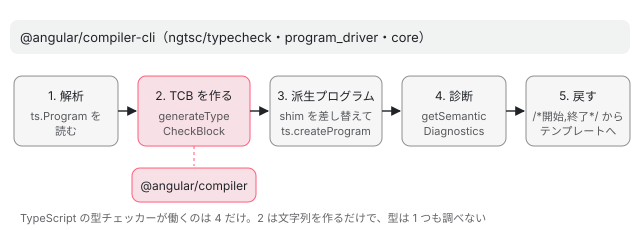

[目次](../README.md) › [テンプレート型チェックの内側](README.md) › 第 1 回 / 全 20 回

# テンプレート型チェックの全体像：TCB を作って TypeScript に任せる

> typecheck の README が書く 5 つの手順（解析 → TCB の生成 → 派生 ts.Program → 診断 → テンプレートへの対応付け）と、compiler パッケージ（TCB の生成）と compiler-cli（置き場所・プログラム・診断）の分担。ページの上で本物の generateTypeCheckBlock を動かし、テンプレートから TCB を作る。spec の置き場と、type\_check\_block\_spec が使う tcb() という助け。

angular/angular · 読了 約 12 分 · 基礎 · [サイトで読む（デモが動きます）](https://angular-deep-dive-cyan.vercel.app/chapter/typecheck-overview)

---

テンプレートの型チェックは「テンプレートを TypeScript の関数（TCB）に書き直して、TypeScript 自身に型を検査させる」仕組みです。この章では、その全体を 5 つの手順として README の行で確かめ、どの手順を `@angular/compiler` と `@angular/compiler-cli` のどちらが受け持つかを数えます。ページの上では本物の `generateTypeCheckBlock` を動かしてテンプレートから TCB を作り、最後にこのシリーズで何度も使う「テストの地図」と走らせ方を見ます。

読む対象は `compiler-cli/src/ngtsc/typecheck/README.md`、`ngtsc/core/src/compiler.ts` の `getTemplateDiagnostics`、`ngtsc/typecheck/src/checker.ts` の `getDiagnosticsForFile`、テストの助け `typecheck/testing/index.ts` と `test/ngtsc/env.ts` です。TCB の中身の基本（`this`・要素・式・`@if`・`@for`）は[テンプレートコンパイラ シリーズ第 17 回](../compiler/17-compiler-typecheck.md)に書いたので、ここでは繰り返しません。

1. **1. 全体像**（この章）
2. [2. 設定](02-typecheck-config.md)
3. [3. TCB の置き場所](03-typecheck-context.md)
4. [4. 派生プログラム](04-typecheck-program-driver.md)
5. [5. Environment](05-typecheck-environment.md)
6. [6. Scope と TcbOp](06-typecheck-scope.md)
7. [7. 式](07-typecheck-expressions.md)
8. [8. 要素と DOM](08-typecheck-elements-dom.md)
9. [9. 型コンストラクタ](09-typecheck-type-constructor.md)
10. [10. 入力](10-typecheck-inputs.md)
11. [11. 出力とイベント](11-typecheck-outputs-events.md)
12. [12. 双方向](12-typecheck-two-way.md)
13. [13. 制御フロー](13-typecheck-control-flow.md)
14. [14. ng-template のガード](14-typecheck-template-guards.md)
15. [15. 参照と pipe](15-typecheck-refs-pipes.md)
16. [16. 診断の対応付け](16-typecheck-diagnostics-mapping.md)
17. [17. 帯域外の診断](17-typecheck-oob.md)
18. [18. 拡張診断](18-typecheck-extended.md)
19. [19. TemplateTypeChecker](19-typecheck-template-type-checker.md)
20. [20. issue と PR を読む](20-typecheck-issues.md)

## 1. README が書く 5 つの手順

compiler-cli の型チェックのディレクトリには、設計を説明した README があります。まずここを読むのが一番の近道です。

📄 `angular/packages/compiler-cli/src/ngtsc/typecheck/README.md` L3–13 （▶ の行: 5, 7–11, 13）

```md
 3 │ The `typecheck` package is concerned with template type-checking, the process by which the compiler determines and understands the TypeScript types of constructs within component templates. It's used to perform actual type checking of templates (similarly to how TypeScript checks code for type errors). It also provides the `TemplateTypeChecker` API which is a conceptual analogue to TypeScript's own `ts.TypeChecker`, exposing various semantic details about template types to consumers such as the Angular Language Service.
 4 │ 
 5 ▶ The template type-checking engine is complex, as TypeScript itself is not very pluggable when it comes to the type system. The main algorithm for template type-checking is as follows:
 6 │ 
 7 ▶ 1. The input `ts.Program` is analyzed, and information about directives/pipes as well as candidate templates is collected.
 8 ▶ 2. Each candidate template is converted into a "type-check block", or TCB, a TypeScript function that semantically describes the operations in the template as well as their types.
 9 ▶ 3. A derivative `ts.Program` is created from the user's input program from step 1, plus the newly generated TCBs.
10 ▶ 4. TypeScript is asked to produce diagnostics for the TCBs, which arise from type errors within the template.
11 ▶ 5. TCB diagnostics are converted to template diagnostics and reported to the user.
12 │ 
13 ▶ This algorithm relies extensively on TypeScript's ability to rapidly type check incremental changes in a `ts.Program` for its performance characteristics. Much of its design is optimized to ensure TypeScript has to do the minimum incremental work to check the new `ts.Program`.
```
*typecheck/README.md の冒頭*

5 行目に「TypeScript の型システムはあまり差し込めるようになっていない（not very pluggable）」とあります。だから Angular は TypeScript に「テンプレート」という新しい言語を教えるのではなく、テンプレートを TypeScript のコードに**訳して**渡します。その手順が 7〜11 行目です。

1. **7 行目：入力の `ts.Program` を解析する**

   `ts.Program` は TypeScript が「このコンパイルに含まれる全ファイルと、その型情報」を持つオブジェクトです。Angular はこのプログラムのクラスからデコレータを読み、ディレクティブ・pipe・テンプレートの情報を集めます（[コンパイラの入口](../compiler/02-compiler-entry.md)）。
2. **8 行目：テンプレートごとに TCB を作る**

   TCB（type-check block）は、テンプレートの操作と型を表す TypeScript の関数です。作るのは `@angular/compiler` の `generateTypeCheckBlock` です（3 節でページの上で動かします）。
3. **9 行目：TCB を足した「派生した」`ts.Program` を作る**

   ユーザーのプログラムに TCB 入りのファイルを足した、2 つ目のプログラムです。置き場所は[第 3 回](03-typecheck-context.md)、プログラムの作り方は[第 4 回](04-typecheck-program-driver.md)で読みます。
4. **10 行目：TypeScript に TCB の診断を出させる**

   テンプレートの型の誤りは、TCB の中の TypeScript の型エラーとして現れます。
5. **11 行目：TCB の診断をテンプレートの診断に直す**

   TCB の中の位置を、元のテンプレートの位置に戻して利用者に見せます（5 節と[第 16 回](16-typecheck-diagnostics-mapping.md)）。

13 行目が設計の背骨です。**性能は「TypeScript が差分だけを手早く型チェックできること」に頼っていて、設計の多くは TypeScript の差分の仕事を最小にするためにある**、と書いています。第 3 回・第 4 回で出てくる「ファイルの集合を揃えておく」「前回の結果を引き継ぐ」は、すべてこの 1 文から来ています。



*README の 5 手順と、それを受け持つパッケージ*

## 2. compiler パッケージと compiler-cli の分担

5 手順のうち、TCB の文字列を作る 2 だけが `@angular/compiler` にあり、残りは `@angular/compiler-cli` にあります。ファイル数と行数を `wc` で数えると次のとおりです（../angular の 8576f161ae4。テストを除く）。

| 場所 | ファイル数 / 行数 | 受け持つこと | このシリーズ |
| --- | --- | --- | --- |
| `compiler/src/typecheck/`（`ops/` の 26 ファイルを含む） | 33 / 6,587 | TCB の文字列を作る（`type_check_block.ts`・`expression.ts`・`ops/*.ts`）。帯域外の診断とスキーマはインタフェースだけ | 第 5〜15 回 |
| `compiler-cli/src/ngtsc/typecheck/src/` | 21 / 7,361（うち `checker.ts` が 2,258） | TCB の置き場所（`context.ts`・`type_check_file.ts`・`shim.ts`）、TypeScript の宣言をメタデータに移す（`tcb_adapter.ts`）、診断の対応付け、`TemplateTypeCheckerImpl` | 第 3・5・16・19 回 |
| `compiler-cli/src/ngtsc/typecheck/api/` | 7 / 1,273 | `TemplateTypeChecker`・`TypeCheckContext`・シンボルの型 | 第 3・19 回 |
| `compiler-cli/src/ngtsc/typecheck/extended/`（test を除く） | 22 / 2,188 | 拡張診断（16 の検査） | 第 18 回 |
| `compiler-cli/src/ngtsc/typecheck/diagnostics/`・`template_semantics/` | 3 / 292・2 / 196 | 診断の作り方、テンプレート変数への代入の検査 | 第 16・17 回 |
| `compiler-cli/src/ngtsc/program_driver/` | 3 / 385 | 派生した `ts.Program` を作る | 第 4 回 |
| `compiler-cli/src/ngtsc/core/src/compiler.ts` | （1 ファイル） | 設定（`getTypeCheckingConfig`）と入口（`getTemplateDiagnostics`） | 第 1・2 回 |

📄 `angular/packages/compiler-cli/src/ngtsc/typecheck/README.md` L17–31 （▶ の行: 19, 25, 27, 29）

```md
17 │ To understand and check the types of various operations and structures within templates, the `typecheck` system maps them to TypeScript code, encoding them in such a way as to express the intent of the operation within the type system.
18 │ 
19 ▶ TCBs are not ever emitted, nor are they referenced from any other code (they're unused code as far as TypeScript is concerned). Their _runtime_ effect is therefore unimportant. What matters is that they express to TypeScript the type relationships of directives, bindings, and other entities in the template. Type errors within TCBs translate directly to type errors in the original template.
20 │ 
21 │ ### AST-Free Metadata & Preprocessor Integration
22 │ 
23 │ As Angular evolves toward supporting alternative compilation pipelines (such as a native Rust compiler or a fast native TS parser like `ts-go`), the mechanism for providing information about components, directives, and pipes to the TCB generator has been abstracted.
24 │ 
25 ▶ Instead of directly passing TypeScript AST nodes representing the original program (`ts.Node`, `ts.Declaration`, `ClassDeclaration`, etc.), the type checking system relies on "AST-free" metadata interfaces (e.g., `TcbDirectiveMetadata`, `TcbReferenceMetadata`).
26 │ 
27 ▶ When operating in the traditional TypeScript compiler (`ngc`), a "TCB Adapter" translates the internal TS-bound metadata into these AST-free structures.
28 │ 
29 ▶ When operating in an environment where the Angular application is analyzed by a separate preprocessor process (whether `ts-go` or Rust), the indexer performs the analysis and serializes this exact same AST-free metadata over an IPC boundary directly to the TS-based TCB generator. This enables the existing, robust TS-based template type checker (which heavily relies on TypeScript's inference engines) to continue functioning without needing to port the entire template type checking and `TcbOp` implementation to the native preprocessor.
30 │ 
31 │ **Note on AST Generation:** While the metadata is "AST-free" in the sense that it is entirely disconnected from the original user's `ts.Program`, the TCB generation process is still fundamentally tied to TypeScript factory APIs. Because of this, certain metadata fields (such as `TcbInputMapping.transformType` and `TcbComponentMetadata.typeParameters`) are passed as strings which are parsed into AST nodes by the TCB generator. In a hybrid architecture, the native preprocessor is expected to serialize these scopes and types as strings, and the TypeScript coordinator (Node.js) is responsible for parsing these strings back into detached TypeScript AST nodes before passing them to the TCB generator. This avoids unnecessary serialization costs when the TCB generator runs directly within the existing TypeScript codebase.
```

19 行目、**TCB は出力（emit）されず、他のどのコードからも参照されません**。TypeScript から見れば「使われていないコード」で、実行時に何が起きるかは関係なく、型の関係を表すことだけが大事です。

25〜29 行目が分担の理由の 1 つです。TCB を作る側には TypeScript の AST（`ts.Node` など）を渡さず、「AST を持たないメタデータ」（`TcbDirectiveMetadata` など）だけを渡します。ngc ではアダプタ（`tcb_adapter.ts`）が移し替え、Rust や `ts-go` のような別の前処理系からは同じメタデータをプロセスの境界越しに送れるようにするためです。中身は[第 5 回](05-typecheck-environment.md)で読みます。

## 3. デモ：本物の generateTypeCheckBlock でテンプレートから TCB を作る

> **🧪 DEMO — このページの @angular/compiler 22.1.6 の generateTypeCheckBlock**
>
> ボタンを押すと `@angular/compiler` を読み込み、`parseTemplate` → `R3TargetBinder`（`<user-card>` を入力 `size` を持つコンポーネント `UserCard` として登録）→ `generateTypeCheckBlock` の順に呼びます。テンプレートは自由に書き換えられます。コンポーネント（`this` の型）の名前は `DemoCmp` です。
>
> ▶ [このデモはサイトで動かせます](https://angular-deep-dive-cyan.vercel.app/chapter/typecheck-overview)

これは再現ではなく、このサイトが使っている本物の `generateTypeCheckBlock` が返した文字列です。ただし ngtsc と違うところが 1 つあります。compiler-cli の `Environment`（[第 5 回](05-typecheck-environment.md)）の代わりに簡単な差し替えを渡しているので、クラスは名前のまま（本物は `i0.DemoCmp` のように import を通す）、型コンストラクタは `_ctor_名前`、pipe は `_pipe_名前` と書かれます。帯域外の診断（`OutOfBandDiagnosticRecorder`）と DOM のスキーマの検査（`DomSchemaChecker`）も、呼ばれたメソッドの名前を記録するだけの差し替えです。

出力の読み方を 1 つずつ確かめます。「補間」のプリセットで出る TCB を前提にします。

1. **`function _tcb1(this: DemoCmp)`：`this` がコンポーネント**

   TCB は 1 つのテンプレートにつき 1 つの関数です。`this` 引数の型だけを宣言するので、`user` は `(this).user` になり、コンポーネントのプロパティの型で検査されます（[compiler-typecheck](../compiler/17-compiler-typecheck.md) の 3 節）。
2. **`if (true) { … }`：テンプレート全体の囲み**

   テンプレートの文は必ずこの囲みの中に並びます。ホストバインディングがあると、同じ関数の中に別の囲みが足されます（[第 8 回](08-typecheck-elements-dom.md)）。
3. **`/*6,10*/`：テンプレートの中の文字位置**

   `(this).user /*6,10*/` は「この式はテンプレートの 6〜10 文字目（`user`）」という印です。TypeScript がここにエラーを出すと、この数字でテンプレートの位置に戻します（5 節、[第 16 回](16-typecheck-diagnostics-mapping.md)）。`/*T:DIR:0*/` や `/*D:ignore*/` のような英字の印も同じ仕組みで、第 16 回で読みます。
4. **`"" + (…)`：補間は文字列の足し算**

   `{{…}}` は `"" + 式` になります。実行はされません。TypeScript に式の型を求めさせるためだけの文です。

ほかのプリセットでは、`[prop]` が `var _t1 = null! as UserCard` と `_t1.size = (this).count`（入力への代入。[第 10 回](10-typecheck-inputs.md)）に、`(event)` が `document.createElement("button")` と `addEventListener("click", ($event): any => …)`（[第 11 回](11-typecheck-outputs-events.md)）に、`@if` が本物の `if` 文（[第 13 回](13-typecheck-control-flow.md)）になるのが見えます。DomSchemaChecker の列は「呼ばれたメソッド」の記録なので、要素が 1 つあれば `checkElement` が 1 つ並びます（その要素が正しいかを判断するのは本物の `RegistryDomSchemaChecker`。[第 8 回](08-typecheck-elements-dom.md)）。OutOfBandDiagnosticRecorder のメソッドは 1 つ 1 つがエラーの種類なので、`{{ x | nope }}` のように知らない pipe を書くと `missingPipe` が出ます（[第 17 回](17-typecheck-oob.md)）。

## 4. 入口：NgCompiler から TemplateTypeChecker へ

5 手順を実際に回し始めるのは `NgCompiler`（ngtsc の本体。[コンパイラの入口](../compiler/02-compiler-entry.md)）の診断の関数です。

📄 `angular/packages/compiler-cli/src/ngtsc/core/src/compiler.ts` L1210–1230 （▶ の行: 1215–1216, 1221, 1225–1227）

```ts
1210 │   private getTemplateDiagnostics(): ReadonlyArray<ts.Diagnostic> {
1211 │     const compilation = this.ensureAnalyzed();
1212 │     const diagnostics: ts.Diagnostic[] = [];
1213 │ 
1214 │     // Get diagnostics for all files.
1215 ▶     for (const sf of this.inputProgram.getSourceFiles()) {
1216 ▶       if (sf.isDeclarationFile || this.adapter.isShim(sf)) {
1217 │         continue;
1218 │       }
1219 │ 
1220 │       diagnostics.push(
1221 ▶         ...compilation.templateTypeChecker.getDiagnosticsForFile(sf, OptimizeFor.WholeProgram),
1222 │       );
1223 │     }
1224 │ 
1225 ▶     const program = this.programDriver.getProgram();
1226 ▶     this.incrementalStrategy.setIncrementalState(this.incrementalCompilation.state, program);
1227 ▶     this.currentProgram = program;
1228 │ 
1229 │     return diagnostics;
1230 │   }
```

1215〜1222 行目、入力のプログラムのファイルを 1 つずつ回し、`.d.ts` と shim（型チェック用に足したファイル。第 3 回）を除いて、`templateTypeChecker.getDiagnosticsForFile(sf, OptimizeFor.WholeProgram)` を呼びます。1225〜1227 行目、終わったら `programDriver.getProgram()`（TCB を足した派生プログラム）を「いまのプログラム」として覚えます。次の差分ビルドはこのプログラムの上から作られます（[第 4 回](04-typecheck-program-driver.md)）。

📄 `angular/packages/compiler-cli/src/ngtsc/typecheck/src/checker.ts` L657–682 （▶ の行: 658, 660, 663, 671, 674, 678）

```ts
657 │   getDiagnosticsForFile(sf: ts.SourceFile, optimizeFor: OptimizeFor): ts.Diagnostic[] {
658 ▶     switch (optimizeFor) {
659 │       case OptimizeFor.WholeProgram:
660 ▶         this.ensureAllShimsForAllFiles();
661 │         break;
662 │       case OptimizeFor.SingleFile:
663 ▶         this.ensureAllShimsForOneFile(sf);
664 │         break;
665 │     }
666 │ 
667 │     return this.perf.inPhase(PerfPhase.TtcDiagnostics, () => {
668 │       const sfPath = absoluteFromSourceFile(sf);
669 │       const fileRecord = this.state.get(sfPath)!;
670 │ 
671 ▶       const typeCheckProgram = this.programDriver.getProgram();
672 │ 
673 │       const diagnostics: (ts.Diagnostic | null)[] = [];
674 ▶       if (fileRecord.hasInlines) {
675 │         const inlineSf = getSourceFileOrError(typeCheckProgram, sfPath);
676 │         diagnostics.push(
677 │           ...typeCheckProgram
678 ▶             .getSemanticDiagnostics(inlineSf)
679 │             .map((diag) => convertDiagnostic(diag, fileRecord.sourceManager)),
680 │         );
681 │       }
682 │ 
```

658〜665 行目が手順 1〜3 です。`WholeProgram` なら全ファイル、`SingleFile` ならそのファイルだけの TCB を作り、派生プログラムを用意します（中身は第 4 回）。671 行目でその派生プログラムを取り、674〜681 行目と、この続き（shim ファイルの分。[compiler-typecheck](../compiler/17-compiler-typecheck.md) の 9 節に引用）で `getSemanticDiagnostics`（手順 4）を呼び、`convertDiagnostic` でテンプレートの診断に直します（手順 5）。674 行目の `hasInlines` は「元のファイルの中に TCB を差し込んだ」印で、そのときは元のファイルの診断も見ます（[第 3 回](03-typecheck-context.md)）。

📄 `angular/packages/compiler-cli/src/ngtsc/typecheck/README.md` L608–620 （▶ の行: 610, 614–618, 620）

```md
608 │ ## The type checking workflow
609 │ 
610 ▶ Like TypeScript's `ts.TypeChecker`, the `TemplateTypeChecker`'s operations are lazy. TCB code for a given template is only generated on demand, to satisfy a query for information about that specific template. Once generated, future queries regarding that template can be answered using the existing TCB structure.
611 │ 
612 │ The lazy algorithm used by the `TemplateTypeChecker` is as follows.
613 │ 
614 ▶ 1. Given a query, determine which (if any) components need TCBs generated.
615 ▶ 2. Request sufficient information about those components and any used directives/pipes from the main compiler.
616 ▶ 3. Generate TCB source text.
617 ▶ 4. Obtain a `ts.Program` containing the new, generated TCBs.
618 ▶ 5. Use TypeScript APIs against this program and the TCBs to answer the query.
619 │ 
620 ▶ To enable the most flexibility for integrating the template type checking engine into various compilation workflows, steps 2 and 4 are abstracted behind interfaces.
```

610 行目、`TemplateTypeChecker` は `ts.TypeChecker` と同じく**怠惰（lazy）**で、問い合わせが来てから TCB を作ります。614〜618 行目の手順のうち 2（テンプレートの情報を集める）と 4（`ts.Program` を得る）は、620 行目のとおりインタフェースの後ろに隠されています。2 が `ProgramTypeCheckAdapter`（第 3 回）、4 が `ProgramDriver`（第 4 回）です。ngc と言語サービスでプログラムの作り方が違うため、ここを差し替えられるようにしてあります。

### ここまでの呼び出しを 1 本に

- 👤 `ng build` / `ngc`
  - `NgCompiler.getDiagnostics()` — core/src/compiler.ts
    - `getTemplateDiagnostics()` — compiler.ts 1210 — *ファイルごとに WholeProgram で*
      - `TemplateTypeCheckerImpl.getDiagnosticsForFile()` — typecheck/src/checker.ts 657
        - `ensureAllShimsForAllFiles()` — checker.ts — *手順 1〜3（第 4 回）*
          - `TraitCompiler.typeCheck()` → `ComponentDecoratorHandler.typeCheck()` — transform / annotations — *第 3 回*
            - `TypeCheckContextImpl.addDirective()` — typecheck/src/context.ts — *置き場所を決める*
              - `generateTypeCheckBlock()` — compiler/src/typecheck/type\_check\_block.ts — *手順 2（3 節のデモ）*
          - `ProgramDriver.updateFiles()` → `ts.createProgram()` — program\_driver/ — *手順 3（第 4 回）*
        - `getSemanticDiagnostics(shimSf)` → `convertDiagnostic()` — checker.ts — *手順 4・5（第 16 回）*

## 5. 位置を戻す仕組みの入口

📄 `angular/packages/compiler-cli/src/ngtsc/typecheck/README.md` L459–476 （▶ の行: 461, 463, 465–466, 472, 476）

```md
459 │ #### `TemplateId`
460 │ 
461 ▶ As multiple TCBs can be present in a single typecheck file, an additional layer of mapping is necessary to determine the component and template for a given TCB diagnostic.
462 │ 
463 ▶ During TCB generation, a numeric `TemplateId` is assigned to each template declared within a given input file. These `TemplateId` are attached in a comment to the TCBs for each template within the corresponding typecheck files. So the full algorithm for mapping a diagnostic back to the original template involves two steps:
464 │ 
465 ▶ 1. Locate the top level TCB function declaration that contains the TCB node in error, extract its `TemplateId`, and use that to locate the component and template in question.
466 ▶ 2. Locate the closest source map comment to the TCB node in error, and combine that with knowledge of the template to locate the template node in error to produce the template diagnostic.
467 │ 
468 │ #### Ignore markers
469 │ 
470 │ Occasionally, code needs to be generated in the TCB that should not produce diagnostics. For example, a safe property navigation operation `a?.b` is mapped to a TypeScript ternary operation `a ? a.b : undefined` (the actual code here may be more complex). If the original `a` expression is in error, then redundant diagnostics would be produced from both instances of `a` in the generated TCB code.
471 │ 
472 ▶ To avoid this, generated code can be marked with a special comment indicating that any diagnostics produced within should be ignored and not converted into template diagnostics.
473 │ 
474 │ #### Why not real sourcemaps?
475 │ 
476 ▶ TypeScript unfortunately cannot consume sourcemaps, only produce them. Therefore, it's impossible to generate a source map to go along with the TCB code and feed it to TypeScript.
```

461 行目、1 つの型チェック用のファイルにはいくつもの TCB が入るので、まず「どのコンポーネントの TCB か」を引く必要があります。463 行目、そのためにテンプレートごとに `TemplateId` を振り、TCB の前にコメントで書きます。デモの出力の先頭の `/*tcb1*/` がそれです。465〜466 行目、診断の位置を戻す手順は「TCB の関数を見つけて id を読む」→「いちばん近い位置のコメントを探す」の 2 段です。472 行目は 3 節で見た `/*D:ignore*/` のような「ここの診断は捨てる」印の説明です。

476 行目、本物の source map（ソースの対応表）を使わない理由は「TypeScript は source map を作れるが、読み込めない」からです。だから位置はコメントとして TCB の文字列そのものに埋め込みます。仕組みの全体は[第 16 回](16-typecheck-diagnostics-mapping.md)です。

## テストと直し方

このシリーズの各章の最後には、その仕組みを確かめている spec と走らせ方を置きます。ここではその前提になる「テストの地図」をまとめます。

### spec の置き場

| 置き場 | 主な spec（`it(` の行数、grep） | 形 | bazel のターゲット |
| --- | --- | --- | --- |
| `compiler-cli/src/ngtsc/typecheck/test/` | `type_check_block_spec.ts`（198）・`span_comments_spec.ts`（32）・`diagnostics_spec.ts`（69）・`type_checker_spec.ts`（10）・`type_checker__get_symbol_of_template_node_spec.ts`（86）・`program_spec.ts`（6）ほか。`input_signal_diagnostics_spec.ts` など 3 本は、`test_case_helper.ts` の `generateDiagnoseJasmineSpecs` が表の 1 行から it を 2 本（通常と `--strict`）作ります | `tcb()` で TCB の文字列を見る / `setup()`・`diagnose()` で `TemplateTypeChecker` を直接動かす | `//packages/compiler-cli/src/ngtsc/typecheck/test:test` |
| `compiler-cli/src/ngtsc/typecheck/extended/test/checks/<検査名>/` | 16 の検査に 1 ディレクトリずつ | `setup()` で拡張診断を走らせる | `…/extended/test/checks/<検査名>:test`（[第 18 回](18-typecheck-extended.md)） |
| `compiler-cli/test/ngtsc/` | `template_typecheck_spec.ts`（9,492 行・307 本）・`incremental_typecheck_spec.ts`・`extended_template_diagnostics_spec.ts`・`template_mapping_spec.ts` など | `NgtscTestEnvironment` で本物の ngtsc を通す | `//packages/compiler-cli/test/ngtsc:ngtsc`（4 shard） |

### 形 1：tcb() で TCB の文字列を見る

📄 `angular/packages/compiler-cli/src/ngtsc/typecheck/testing/index.ts` L406–431 （▶ の行: 407, 414, 428–429）

```ts
406 │   const rootFilePath = absoluteFrom('/synthetic.ts');
407 ▶   const {program, host} = makeProgram([
408 │     {name: rootFilePath, contents: codeLines.join('\n'), isRoot: true},
409 │   ]);
410 │ 
411 │   const sf = getSourceFileOrError(program, rootFilePath);
412 │   const clazz = getClass(sf, 'Test');
413 │   const templateUrl = 'synthetic.html';
414 ▶   const {nodes, errors} = parseTemplate(template, templateUrl, templateParserOptions);
415 │   const selectorlessEnabled = templateParserOptions?.enableSelectorless ?? false;
416 │ 
417 │   if (errors !== null) {
418 │     throw new Error('Template parse errors: \n' + errors.join('\n'));
419 │   }
420 │ 
421 │   const {matcher, pipes, foreignMatcher} = prepareDeclarations(
422 │     declarations,
423 │     (decl) => getClass(sf, decl.name),
424 │     new Map(),
425 │     selectorlessEnabled,
426 │     foreignComponents,
427 │   );
428 ▶   const binder = new R3TargetBinder<DirectiveMeta>(matcher, foreignMatcher);
429 ▶   const boundTarget = binder.bind({template: nodes});
430 │ 
431 │   const id = 'tcb' as TypeCheckId;
```

📄 `angular/packages/compiler-cli/src/ngtsc/typecheck/testing/index.ts` L480–497 （▶ の行: 480, 482, 491, 493–494, 497）

```ts
480 ▶   const env = new TypeCheckFile(fileName, fullConfig, refEmmiter, host);
481 │ 
482 ▶   env.addTypeCheckBlock(
483 │     new Reference(clazz),
484 │     meta,
485 │     new NoopSchemaChecker(),
486 │     new NoopOobRecorder(),
487 │     TcbGenericContextBehavior.UseEmitter,
488 │     reflectionHost,
489 │   );
490 │ 
491 ▶   let rendered = env.render();
492 │ 
493 ▶   if (!options.emitSpans) {
494 ▶     rendered = rendered.replace(/\s+\/\*[\s\S]*?\*\//g, '');
495 │   }
496 │ 
497 ▶   return rendered.replace(/\s+/g, ' ');
```

`tcb(template, declarations, config)` はデモとほぼ同じことを本物の compiler-cli の部品でします。407 行目で `/synthetic.ts` 1 ファイルの `ts.Program` を作り、414 行目でテンプレートをパースし、428〜429 行目で照合します。480 行目は 3 節のデモと違って本物の `TypeCheckFile`（第 3 回）を使い、482 行目で TCB を足し、491 行目で shim の文字列にします。493〜494 行目で位置のコメントを消し、497 行目で空白を 1 つに詰めるので、spec の期待値は `expect(tcb('{{hello}}')).toContain('"" + (((this).hello))…')` のような 1 行で書けます（[compiler-typecheck](../compiler/17-compiler-typecheck.md) の 1 節）。TypeScript の型チェックは走りません。**TCB の形を変える修正は、まずこの形の spec で確かめます。**

### 形 2：NgtscTestEnvironment で ngtsc を丸ごと通す

📄 `angular/packages/compiler-cli/test/ngtsc/template_typecheck_spec.ts` L66–85 （▶ の行: 67, 80, 82–84）

```ts
66 │     it('should have accurate diagnostics in a template using crlf line endings', () => {
67 ▶       env.write(
68 │         'test.ts',
69 │         `
70 │         import {Component} from '@angular/core';
71 │ 
72 │         @Component({
73 │           selector: 'test',
74 │           templateUrl: './test.html',
75 │           standalone: false,
76 │         })
77 │         class TestCmp {}
78 │       `,
79 │       );
80 ▶       env.write('test.html', '<span>\r\n{{does_not_exist}}\r\n</span>');
81 │ 
82 ▶       const diags = env.driveDiagnostics();
83 ▶       expect(diags.length).toBe(1);
84 ▶       expect(getSourceCodeForDiagnostic(diags[0])).toBe('does_not_exist');
85 │     });
```

📄 `angular/packages/compiler-cli/test/ngtsc/env.ts` L280–309 （▶ の行: 280, 289–290, 308）

```ts
280 ▶   driveDiagnostics(expectedExitCode?: number): ReadonlyArray<ts.Diagnostic> {
281 │     // ngtsc only produces ts.Diagnostic messages.
282 │     let reuseProgram: {program: Program | undefined} | undefined = undefined;
283 │     if (this.multiCompileHostExt !== null) {
284 │       reuseProgram = {
285 │         program: this.oldProgram || undefined,
286 │       };
287 │     }
288 │ 
289 ▶     const {exitCode, diagnostics} = mainDiagnosticsForTest(
290 ▶       this.commandLineArgs,
291 │       undefined,
292 │       reuseProgram,
293 │       this.changedResources,
294 │     );
295 │     if (expectedExitCode !== undefined) {
296 │       expect(exitCode)
297 │         .withContext(
298 │           `Expected program to exit with code ${expectedExitCode}, but it actually exited with code ${exitCode}.`,
299 │         )
300 │         .toBe(expectedExitCode);
301 │     }
302 │ 
303 │     if (this.multiCompileHostExt !== null) {
304 │       this.oldProgram = reuseProgram!.program!;
305 │     }
306 │ 
307 │     // In ngtsc, only `ts.Diagnostic`s are produced.
308 ▶     return diagnostics as ReadonlyArray<ts.Diagnostic>;
309 │   }
```

こちらは本物のファイルを仮想のファイルシステムに書いて（80 行目の `env.write`）、82 行目の `env.driveDiagnostics()` でコンパイラを最後まで走らせます。その中身が env.ts の 289〜294 行目で、ngc のコマンドラインと同じ `mainDiagnosticsForTest` を呼び、308 行目で `ts.Diagnostic` の配列を返します。83〜84 行目のように、診断の数と「どの文字列に付いたか」を確かめます。**利用者に見える診断（文言・位置・件数）を変える修正は、この形で確かめます。**

📄 `angular/packages/compiler-cli/src/ngtsc/file_system/testing/src/test_helper.ts` L34–52 （▶ の行: 38, 41, 49–50）

```ts
34 │ const FS_NATIVE = 'Native';
35 │ const FS_OS_X = 'OS/X';
36 │ const FS_UNIX = 'Unix';
37 │ const FS_WINDOWS = 'Windows';
38 ▶ const FS_ALL = [FS_OS_X, FS_WINDOWS, FS_UNIX, FS_NATIVE];
39 │ 
40 │ function runInEachFileSystemFn(callback: (os: string) => void) {
41 ▶   FS_ALL.forEach((os) => runInFileSystem(os, callback, false));
42 │ }
43 │ 
44 │ // Jasmine require to have distinct top suite names.
45 │ // Since this function creates top level suites, we need to ensure that they have distinct names.
46 │ // We use a counter to ensure that each suite has a unique name, even if the same file system is tested multiple times.
47 │ let counter = 0;
48 │ function runInFileSystem(os: string, callback: (os: string) => void, error: boolean) {
49 ▶   describe(`<<FileSystem: ${os}>>/${counter++}`, () => {
50 ▶     beforeEach(() => initMockFileSystem(os));
51 │     afterEach(() => setFileSystem(new InvalidFileSystem()));
52 │     callback(os);
```

件数を読むときの注意です。多くの spec は `runInEachFileSystem` で包まれていて、38・41 行目のとおり OS/X・Windows・Unix・Native の 4 つの仮想ファイルシステムで**同じ it を 4 回**走らせます（49〜50 行目で describe を分け、毎回ファイルシステムを作り直す）。だから 1 本の it が「4 specs」と数えられます。`type_check_block_spec.ts` は包まれていないので 1 回です。

📄 `angular/packages/compiler-cli/src/ngtsc/typecheck/test/BUILD.bazel` L30–43 （▶ の行: 37–38, 40）

```python
30 │         "//packages/compiler-cli/src/ngtsc/typecheck/api",
31 │         "//packages/compiler-cli/src/ngtsc/typecheck/diagnostics",
32 │         "//packages/compiler-cli/src/ngtsc/typecheck/testing",
33 │         "//packages/compiler-cli/src/ngtsc/util",
34 │     ],
35 │ )
36 │ 
37 ▶ jasmine_test(
38 ▶     name = "test",
39 │     data = [
40 ▶         ":test_lib",
41 │         "//packages/core:npm_package",
42 │     ],
43 │ )
```

37〜38 行目、typecheck/test のディレクトリ全体が 1 つの `jasmine_test` ターゲット `:test` です（Node の jasmine で走るので、`--test_arg=--filter=…` で絞れます）。

### 手元で走らせる

📄 `ターミナル`

```
cd ~/angular-research/angular
pnpm bazel test //packages/compiler-cli/src/ngtsc/typecheck/test:test \
  --nocache_test_results --test_output=all
pnpm bazel test //packages/compiler-cli/test/ngtsc:ngtsc \
  --nocache_test_results --test_output=all \
  "--test_arg=--filter=accurate diagnostics in a template using crlf"
```

📄 `出力 1（2026-11-02 に実行。抜粋）`

```
==================== Test output for //packages/compiler-cli/src/ngtsc/typecheck/test:test:
Randomized with seed 24964
Started
.......................................................................（中略）
1747 specs, 0 failures
Finished in 5.393 seconds
INFO: Elapsed time: 6.456s, Critical Path: 6.22s
//packages/compiler-cli/src/ngtsc/typecheck/test:test                    PASSED in 6.2s
```

📄 `出力 2（2026-11-02 に実行。抜粋）`

```
==================== Test output for //packages/compiler-cli/test/ngtsc:ngtsc (shard 2 of 4):
Ran 0 of 6750 specs
0 specs, 0 failures
==================== Test output for //packages/compiler-cli/test/ngtsc:ngtsc (shard 4 of 4):
Ran 0 of 6750 specs
==================== Test output for //packages/compiler-cli/test/ngtsc:ngtsc (shard 1 of 4):
Ran 0 of 6750 specs
==================== Test output for //packages/compiler-cli/test/ngtsc:ngtsc (shard 3 of 4):
....
Ran 4 of 6754 specs
4 specs, 0 failures
INFO: Elapsed time: 2.685s, Critical Path: 2.25s
//packages/compiler-cli/test/ngtsc:ngtsc                                 PASSED in 2.1s
  Stats over 4 runs: max = 2.1s, min = 1.8s, avg = 1.9s, dev = 0.1s
```

1. **typecheck/test は全部走らせても速い**

   1 本目は 1,747 specs が 5.4 秒（bazel の表示で 6.2 秒）で通りました。ビルドはキャッシュ済みの状態です。
2. **test/ngtsc は必ず絞る。そして件数を見る**

   2 本目は `--filter` に it の名前の一部を渡しました。4 つの shard（ターゲットを 4 つに分けて並べて走らせる仕組み）のうち 3 つは `Ran 0 of 6750 specs` で、shard 3 だけが `Ran 4`（1 本の it × 4 つのファイルシステム）でした。**どの shard も 0 件でも、結果は PASSED になります。**名前を打ち間違えても緑になるので、「Ran N of M」を足して期待した数かを必ず確かめます。`--filter` は正規表現として扱われるので、`"a|b"` のように 2 つを同時に選べます（第 4 回で使います）。
3. **直すとしたら、どこに spec を足すか**

   TCB の形を変えるなら `type_check_block_spec.ts` に `tcb()` の it を、TypeScript の診断が出るかどうかなら `diagnostics_spec.ts` の `diagnose()` か `template_typecheck_spec.ts` に、プログラムの作り直しなら `program_spec.ts` や `incremental_typecheck_spec.ts` に足します。どれを使うかは各章の「テストと直し方」に書きます。本家に PR を出すことはこのシリーズでは勧めません。まず手元で spec を足して走らせ、issue を読むときの手がかりにします（[第 20 回](20-typecheck-issues.md)）。

## 聞かれそうな質問

**Q. なぜ TypeScript のプラグインとして型チェックしないのですか？**

README の 5 行目が「TypeScript の型システムはあまり差し込めるようになっていない」と書いているとおり、TypeScript の型チェッカーに新しい言語（テンプレート）を足す口がありません。だから 8〜9 行目のとおりテンプレートを TypeScript の関数に訳し、それを足した普通の `ts.Program` を作って普通に型チェックさせます。位置の対応も同じ理由で、476 行目のとおり TypeScript は source map を読めないので、コメントとして埋め込みます。

**Q. TCB は出力される JS に入りますか？**

入りません。README の 19 行目に「TCB は決して emit されない」とあります。TCB を入れるファイル（`.ngtypecheck.ts`）は shim として `shouldEmit = false` です（[compiler-typecheck](../compiler/17-compiler-typecheck.md) の 2 節）。元のファイルの中に TCB を差し込む場合でも、差し込むのは型チェック用のプログラムの中のコピーだけです（[第 3 回](03-typecheck-context.md)の質問で、実際にこのサイトを ngc に通して確かめます）。

**Q. `ng serve` でも保存のたびに型チェックが走りますか？**

走ります。ただし全部ではありません。CLI の `AotCompilation` は前回から影響を受けたファイルを求め、1 つだけなら `OptimizeFor.SingleFile`、それ以外は `WholeProgram` で `getDiagnosticsForFile` を呼び、影響を受けないファイルは前回の結果を使います（[cli-angular-compilation](../cli/03-cli-angular-compilation.md) の 4 節と 6 節）。型チェックは esbuild のバンドルと並んで別のスレッドで進みます。ngtsc の側でも、変わっていないファイルの TCB は前回の分を引き継ぎます（[第 4 回](04-typecheck-program-driver.md)）。

**Q. TCB を作るときに型は調べないのですか？**

調べません。`generateTypeCheckBlock` は文字列を返すだけです（3 節のデモはブラウザの上で TypeScript を動かさずに TCB を作っています）。型を調べるのは手順 4 の `getSemanticDiagnostics`（checker.ts 678 行目など）で、TypeScript の仕事です。ただし、TypeScript では見つけられない誤り（知らない pipe、知らない要素など）は、TCB を作りながら別に記録します（デモの 2 つの列。[第 17 回](17-typecheck-oob.md)）。

**Q. 言語サービス（エディタの赤い波線）も同じ仕組みですか？**

同じ `TemplateTypeChecker` を使います。README の 610 行目の「怠惰」な作りと、620 行目の「プログラムの作り方を差し替えられる」作りは、言語サービスのためでもあります。言語サービスでは TCB の置き場所の方式とプログラムの作り方が違います（[第 3 回](03-typecheck-context.md)・[第 4 回](04-typecheck-program-driver.md)・[第 19 回](19-typecheck-template-type-checker.md)）。

## 読み終えて

- テンプレートの型チェックは「解析 → TCB → 派生プログラム → 診断 → 戻す」の 5 手順で、TypeScript の型チェッカーが働くのは 4 だけ。
- TCB の文字列を作るのは `@angular/compiler`、置き場所・プログラム・診断の対応付けは `@angular/compiler-cli`。間は AST を持たないメタデータでつながる。
- TCB は emit されない「使われないコード」で、位置はコメントとして埋め込まれる。
- spec は `tcb()`（形を見る）と `NgtscTestEnvironment`（ngtsc を丸ごと通す）の 2 つの形。件数は 4 つのファイルシステムで 4 倍になり、絞って 0 件でも PASSED になる。

---

← 前: [issue と PR を読む：Angular Aria の今](../aria/20-aria-issues.md)  
次: [strictTemplates が TypeCheckingConfig になるまで](02-typecheck-config.md) →
