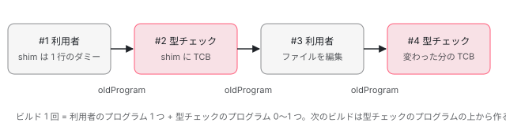

[目次](../README.md) › [テンプレート型チェックの内側](README.md) › 第 4 回 / 全 20 回

# 派生した ts.Program と、作り直しの節約

> ProgramDriver（TsCreateProgramDriver）が、元のプログラムに TCB の入った shim を足した ts.Program を作る行。前回のプログラムを oldProgram に渡して TypeScript に差分だけを見させる仕組み、shim の再利用、言語サービスでのファイルの差し替え。incremental\_typecheck\_spec が確かめていること。

angular/angular · 読了 約 12 分 · 発展 · [サイトで読む（デモが動きます）](https://angular-deep-dive-cyan.vercel.app/chapter/typecheck-program-driver)

---

TCB の文字列ができても、TypeScript に型を調べさせるには、それを含む `ts.Program` が要ります。この章では、`ProgramDriver` というインタフェースと ngc の実装 `TsCreateProgramDriver` が、利用者のプログラムに TCB 入りのファイルを差し替えた「派生プログラム」を作る行を読み、作り直しを節約する仕組み（前のプログラムを `oldProgram` に渡す、shim を使い回す、前回の型チェックの結果を引き継ぐ）を 1 つずつ確かめます。最後に、このサイトを手元で 3 回ビルドして、実際に何が作り直されたかを見ます。

読む対象は `compiler-cli/src/ngtsc/program_driver/`（3 ファイル・385 行の全部）、`shims/src/` の 2 か所、`ngtsc/program.ts`、`core/src/compiler.ts` の 2 か所、`typecheck/src/checker.ts` のうちプログラムを作り直す部分、`incremental/` の型チェックに関わる行、spec の `program_spec.ts`・`type_checker_spec.ts`・`incremental_typecheck_spec.ts` です。

1. [1. 全体像](01-typecheck-overview.md)
2. [2. 設定](02-typecheck-config.md)
3. [3. TCB の置き場所](03-typecheck-context.md)
4. **4. 派生プログラム**（この章）
5. [5. Environment](05-typecheck-environment.md)
6. [6. Scope と TcbOp](06-typecheck-scope.md)
7. [7. 式](07-typecheck-expressions.md)
8. [8. 要素と DOM](08-typecheck-elements-dom.md)
9. [9. 型コンストラクタ](09-typecheck-type-constructor.md)
10. [10. 入力](10-typecheck-inputs.md)
11. [11. 出力とイベント](11-typecheck-outputs-events.md)
12. [12. 双方向](12-typecheck-two-way.md)
13. [13. 制御フロー](13-typecheck-control-flow.md)
14. [14. ng-template のガード](14-typecheck-template-guards.md)
15. [15. 参照と pipe](15-typecheck-refs-pipes.md)
16. [16. 診断の対応付け](16-typecheck-diagnostics-mapping.md)
17. [17. 帯域外の診断](17-typecheck-oob.md)
18. [18. 拡張診断](18-typecheck-extended.md)
19. [19. TemplateTypeChecker](19-typecheck-template-type-checker.md)
20. [20. issue と PR を読む](20-typecheck-issues.md)

## 1. プログラムは交互に積み重なる

📄 `angular/packages/compiler-cli/src/ngtsc/program_driver/README.md` L3–12 （▶ の行: 3, 5, 7–10, 12）

```md
 3 ▶ `ProgramDriver` is a small but important interface which allows the template type-checking machinery to request changes to the current `ts.Program`, and to receive a new `ts.Program` with those changes applied. This is used to add template type-checking code to the current `ts.Program`, eventually allowing for diagnostics to be produced within that code. This operation is abstracted behind this interface because different clients create `ts.Program`s differently. The Language Service, for example, creates `ts.Program`s from the current editor state on request, while the TS compiler API creates them explicitly.
 4 │ 
 5 ▶ When running using the TS APIs, it's important that each new `ts.Program` be created incrementally from the previous `ts.Program`. Under a normal compilation, this means that programs alternate between template type checking programs and user programs:
 6 │ 
 7 ▶ - `ts.Program#1` is created from user input (the user's source files).
 8 ▶ - `ts.Program#2` is created incrementally on top of #1 for template type-checking, and adds private TCB code.
 9 ▶ - `ts.Program#3` is created incrementally on top of #2 when the user makes changes to files on disk (incremental build).
10 ▶ - `ts.Program#4` is created incrementally on top of #3 to adjust template type-checking code according to the user's changes.
11 │ 
12 ▶ The `TsCreateProgramDriver` performs this operation for template type-checking `ts.Program`s built by the command-line compiler or by the CLI. The latest template type-checking program is then exposed via the `NgCompiler`'s `getCurrentProgram()` operation, and new user programs are expected to be created incrementally on top of the previous template type-checking program.
```

3 行目、`ProgramDriver` は「いまの `ts.Program` に変更を頼み、変更を当てた新しい `ts.Program` を受け取る」だけの小さなインタフェースです。抽象にしてあるのは、言語サービスと ngc でプログラムの作り方が違うからです。5〜10 行目が ngc のときの流れで、**新しいプログラムは必ず 1 つ前のプログラムの上に差分で作ります**。



*ビルドごとに「利用者のプログラム」と「型チェックのプログラム」が交互に積み重なる（README の 7〜10 行目）*

12 行目、最新の型チェックのプログラムは `NgCompiler.getCurrentProgram()` で公開され、次の利用者のプログラムはその上に作るのが約束です。[第 1 回](01-typecheck-overview.md)の 4 節の `getTemplateDiagnostics` の最後で `currentProgram` を差し替えていたのはこのためです。

## 2. ProgramDriver インタフェース

📄 `angular/packages/compiler-cli/src/ngtsc/program_driver/src/api.ts` L44–77 （▶ の行: 48, 54, 59, 65, 76）

```ts
44 │ export interface ProgramDriver {
45 │   /**
46 │    * How this strategy handles operations that require inlining.
47 │    */
48 ▶   readonly inliningMode: InliningMode;
49 │ 
50 │   /**
51 │    * Whether this strategy supports modifying user files (inline modifications) in addition to
52 │    * modifying type-checking shims.
53 │    */
54 ▶   readonly supportsInlineOperations: boolean;
55 │ 
56 │   /**
57 │    * Retrieve the latest version of the program, containing all the updates made thus far.
58 │    */
59 ▶   getProgram(): ts.Program;
60 │ 
61 │   /**
62 │    * Incorporate a set of changes to either augment or completely replace the type-checking code
63 │    * included in the type-checking program.
64 │    */
65 ▶   updateFiles(contents: Map<AbsoluteFsPath, FileUpdate>, updateMode: UpdateMode): void;
66 │ 
67 │   /**
68 │    * Retrieve a string version for a given `ts.SourceFile`, which much change when the contents of
69 │    * the file have changed.
70 │    *
71 │    * If this method is present, the compiler will use these versions in addition to object identity
72 │    * for `ts.SourceFile`s to determine what's changed between two incremental programs. This is
73 │    * valuable for some clients (such as the Language Service) that treat `ts.SourceFile`s as mutable
74 │    * objects.
75 │    */
76 ▶   getSourceFileVersion?(sf: ts.SourceFile): string;
77 │ }
```

📄 `angular/packages/compiler-cli/src/ngtsc/program_driver/src/api.ts` L79–92 （▶ の行: 85, 91）

```ts
79 │ export enum UpdateMode {
80 │   /**
81 │    * A complete update creates a completely new overlay of type-checking code on top of the user's
82 │    * original program, which doesn't include type-checking code from previous calls to
83 │    * `updateFiles`.
84 │    */
85 ▶   Complete,
86 │ 
87 │   /**
88 │    * An incremental update changes the contents of some files in the type-checking program without
89 │    * reverting any prior changes.
90 │    */
91 ▶   Incremental,
92 │ }
```

1. **48・54 行目：inline をどう扱うか**

   `inliningMode` と `supportsInlineOperations`（元のファイルを書き換えられるか）。[第 3 回](03-typecheck-context.md)の 3 つの方式と、[第 2 回](02-typecheck-config.md)の `useInlineTypeConstructors` はここから来ます。
2. **59 行目：いまのプログラム**

   これまでの変更を全部当てた最新の `ts.Program` を返します。
3. **65 行目：変更を当てる**

   「パス → `FileUpdate`（新しい中身）」の表を受け取ります。第 3 回の `finalize` の戻り値がそのまま入ります。`UpdateMode` は 85 行目の `Complete`（それまでの変更を捨てて、元のプログラムの上に重ね直す）と 91 行目の `Incremental`（それまでの変更を残して足す）の 2 つです。
4. **76 行目：ファイルの版（任意）**

   言語サービスのように `ts.SourceFile` を書き換えて使い回す相手のために、オブジェクトの同一性の代わりに版の文字列で「変わったか」を判断させる口です。

## 3. ngc の側：TsCreateProgramDriver を作るまで

📄 `angular/packages/compiler-cli/src/ngtsc/program.ts` L71–96 （▶ の行: 71–72, 79, 83, 91）

```ts
71 ▶     const reuseProgram = oldProgram?.compiler.getCurrentProgram();
72 ▶     this.host = NgCompilerHost.wrap(delegateHost, rootNames, options, reuseProgram ?? null);
73 │ 
74 │     if (reuseProgram !== undefined) {
75 │       // Prior to reusing the old program, restore shim tagging for all its `ts.SourceFile`s.
76 │       // TypeScript checks the `referencedFiles` of `ts.SourceFile`s for changes when evaluating
77 │       // incremental reuse of data from the old program, so it's important that these match in order
78 │       // to get the most benefit out of reuse.
79 ▶       retagAllTsFiles(reuseProgram);
80 │     }
81 │ 
82 │     this.tsProgram = perfRecorder.inPhase(PerfPhase.TypeScriptProgramCreate, () =>
83 ▶       ts.createProgram(this.host.inputFiles, options, this.host, reuseProgram),
84 │     );
85 │ 
86 │     perfRecorder.phase(PerfPhase.Unaccounted);
87 │     perfRecorder.memory(PerfCheckpoint.TypeScriptProgramCreate);
88 │ 
89 │     this.host.postProgramCreationCleanup();
90 │ 
91 ▶     const programDriver = new TsCreateProgramDriver(
92 │       this.tsProgram,
93 │       this.host,
94 │       this.options,
95 │       this.host.shimExtensionPrefixes,
96 │     );
```

71 行目、前回の `NgtscProgram` があれば、その `getCurrentProgram()`（前回の型チェックのプログラム）を `reuseProgram` にします。83 行目でそれを `oldProgram` にして利用者のプログラムを作ります。72 行目の `NgCompilerHost.wrap` は shim を足すホストで、ここにも前のプログラムを渡します（下の adapter.ts）。91〜96 行目、できた利用者のプログラムから `TsCreateProgramDriver` を作ります。**ドライバはビルドごとに新しく作られます**。

📄 `angular/packages/compiler-cli/src/ngtsc/shims/src/reference_tagger.ts` L45–78 （▶ の行: 46, 49, 60–61, 67, 69, 76）

```ts
45 │   tag(sf: ts.SourceFile): void {
46 ▶     if (
47 │       !this.enabled ||
48 │       sf.isDeclarationFile ||
49 ▶       isShim(sf) ||
50 │       this.tagged.has(sf) ||
51 │       !isNonDeclarationTsPath(sf.fileName)
52 │     ) {
53 │       return;
54 │     }
55 │ 
56 │     const ext = sfExtensionData(sf);
57 │ 
58 │     // If this file has never been tagged before, capture its `referencedFiles` in the extension
59 │     // data.
60 ▶     if (ext.originalReferencedFiles === null) {
61 ▶       ext.originalReferencedFiles = sf.referencedFiles;
62 │     }
63 │ 
64 │     const referencedFiles = [...ext.originalReferencedFiles];
65 │ 
66 │     const sfPath = absoluteFromSourceFile(sf);
67 ▶     for (const suffix of this.suffixes) {
68 │       referencedFiles.push({
69 ▶         fileName: makeShimFileName(sfPath, suffix),
70 │         pos: 0,
71 │         end: 0,
72 │       });
73 │     }
74 │ 
75 │     ext.taggedReferenceFiles = referencedFiles;
76 ▶     sf.referencedFiles = referencedFiles;
77 │     this.tagged.add(sf);
78 │   }
```

shim がプログラムに入る仕組みです。TypeScript はルートのファイルから参照をたどってファイルを集めます。そこで `ShimReferenceTagger` が、元のファイルの `referencedFiles`（`/// <reference path>` と同じ扱いの一覧）に、67〜73 行目で `app.component.ngtypecheck.ts` のような shim の名前を足します。76 行目で書き換えた配列を `sf.referencedFiles` に入れ、60〜61 行目で元の配列も覚えておきます（emit の前に元へ戻すため。`untagAllTsFiles`）。49 行目のとおり shim 自身には付けません。

📄 `angular/packages/compiler-cli/src/ngtsc/shims/src/adapter.ts` L206–220 （▶ の行: 212, 216, 220）

```ts
206 │   private generateSpecific(
207 │     fileName: AbsoluteFsPath,
208 │     generator: PerFileShimGenerator,
209 │     inputFile: ts.SourceFile,
210 │   ): ts.SourceFile {
211 │     let priorShimSf: ts.SourceFile | null = null;
212 ▶     if (this.priorShims.has(fileName)) {
213 │       // In the previous program a shim with this name already existed. It's passed to the shim
214 │       // generator which may reuse it instead of generating a fresh shim.
215 │ 
216 ▶       priorShimSf = this.priorShims.get(fileName)!;
217 │       this.priorShims.delete(fileName);
218 │     }
219 │ 
220 ▶     const shimSf = generator.generateShimForFile(inputFile, fileName, priorShimSf);
```

212〜216 行目、前のプログラムに同じ名前の shim があれば、それを 220 行目の `generateShimForFile` に渡します。shim.ts はそれを「古いかもしれないが、使い回す」と決めています（[compiler-typecheck](../compiler/17-compiler-typecheck.md) の 2 節に引用した shim.ts）。前のプログラムは型チェックのプログラムなので、**前回の TCB 入りの shim が、次の利用者のプログラムにそのまま入ります**。これが 7 節の「前回の結果を引き継ぐ」が成り立つ前提です。

## 4. updateFiles：派生プログラムを作る

📄 `angular/packages/compiler-cli/src/ngtsc/program_driver/src/ts_create_program_driver.ts` L193–224 （▶ の行: 200, 205, 210, 213, 215）

```ts
193 │ export class TsCreateProgramDriver implements ProgramDriver {
194 │   /**
195 │    * A map of source file paths to replacement `ts.SourceFile`s for those paths.
196 │    *
197 │    * Effectively, this tracks the delta between the user's program (represented by the
198 │    * `originalHost`) and the template type-checking program being managed.
199 │    */
200 ▶   private sfMap = new Map<string, ts.SourceFile>();
201 │ 
202 │   private program: ts.Program;
203 │ 
204 │   constructor(
205 ▶     private originalProgram: ts.Program,
206 │     private originalHost: ts.CompilerHost,
207 │     private options: ts.CompilerOptions,
208 │     private shimExtensionPrefixes: string[],
209 │   ) {
210 ▶     this.program = this.originalProgram;
211 │   }
212 │ 
213 ▶   inliningMode = InliningMode.InlineOps;
214 │ 
215 ▶   get supportsInlineOperations(): boolean {
216 │     return (
217 │       this.inliningMode === InliningMode.InlineOps ||
218 │       this.inliningMode === InliningMode.CopySourceToTcb
219 │     );
220 │   }
221 │ 
222 │   getProgram(): ts.Program {
223 │     return this.program;
224 │   }
```

200 行目の `sfMap` が「元のプログラムとの差分」で、差し替えた `ts.SourceFile` だけを持ちます。210 行目、最初の `program` は元のプログラムそのものです。213 行目、ngc は `InlineOps`（元のファイルに差し込める）で、215〜219 行目の `supportsInlineOperations` は真です。

📄 `angular/packages/compiler-cli/src/ngtsc/program_driver/src/ts_create_program_driver.ts` L226–256 （▶ の行: 227, 232, 238–239, 242–243, 246, 248, 251）

```ts
226 │   updateFiles(contents: Map<AbsoluteFsPath, FileUpdate>, updateMode: UpdateMode): void {
227 ▶     if (contents.size === 0) {
228 │       // No changes have been requested. Is it safe to skip updating entirely?
229 │       // If UpdateMode is Incremental, then yes. If UpdateMode is Complete, then it's safe to skip
230 │       // only if there are no active changes already (that would be cleared by the update).
231 │ 
232 ▶       if (updateMode !== UpdateMode.Complete || this.sfMap.size === 0) {
233 │         // No changes would be made to the `ts.Program` anyway, so it's safe to do nothing here.
234 │         return;
235 │       }
236 │     }
237 │ 
238 ▶     if (updateMode === UpdateMode.Complete) {
239 ▶       this.sfMap.clear();
240 │     }
241 │ 
242 ▶     for (const [filePath, {newText, originalFile}] of contents.entries()) {
243 ▶       const sf = ts.createSourceFile(filePath, newText, ts.ScriptTarget.Latest, true);
244 │ 
245 │       if (originalFile !== null) {
246 ▶         (sf as MaybeSourceFileWithOriginalFile)[NgOriginalFile] = originalFile;
247 │       }
248 ▶       this.sfMap.set(filePath, sf);
249 │     }
250 │ 
251 ▶     const host = new UpdatedProgramHost(
252 │       this.sfMap,
253 │       this.originalProgram,
254 │       this.originalHost,
255 │       this.shimExtensionPrefixes,
256 │     );
```

📄 `angular/packages/compiler-cli/src/ngtsc/program_driver/src/ts_create_program_driver.ts` L257–282 （▶ の行: 257, 261, 263, 265, 267, 269, 274, 281）

```ts
257 ▶     const oldProgram = this.program;
258 │ 
259 │     // Retag the old program's `ts.SourceFile`s with shim tags, to allow TypeScript to reuse the
260 │     // most data.
261 ▶     retagAllTsFiles(oldProgram);
262 │ 
263 ▶     this.program = ts.createProgram({
264 │       host,
265 ▶       rootNames: this.program.getRootFileNames(),
266 │       options: this.options,
267 ▶       oldProgram,
268 │     });
269 ▶     host.postProgramCreationCleanup();
270 │ 
271 │     // Only untag the old program. The new program needs to keep the tagged files, because as of
272 │     // TS 5.5 not having the files tagged while producing diagnostics can lead to errors. See:
273 │     // https://github.com/microsoft/TypeScript/pull/58398
274 ▶     untagAllTsFiles(oldProgram);
275 │ 
276 │     // Re-tag the new program's files. Since TS reuses SourceFile objects between old and new
277 │     // programs, untagging the old program also untags shared files in the new program.
278 │     // Without re-tagging, getSemanticDiagnostics() crashes with "Cannot destructure property
279 │     // 'pos' of 'file.referencedFiles[index]'" because fileProcessingDiagnostics recorded
280 │     // indices into the tagged (longer) referencedFiles array during program creation.
281 ▶     retagAllTsFiles(this.program);
282 │   }
```

1. **227〜236 行目：変更が無ければ何もしない**

   `Incremental` で空なら、または `Complete` でも差分がもともと無ければ、プログラムを作りません。232 行目の条件です。`Complete` で差分が残っているときだけ、空の変更でも「差分を捨てる」ために作り直します。
2. **238〜240 行目：Complete なら差分を捨てる**

   `sfMap.clear()`。ngtsc の型チェックは `Incremental` しか使いません（6 節の 1098 行目）。
3. **242〜249 行目：新しい中身を構文木にする**

   243 行目、文字列から `ts.createSourceFile` で新しい `ts.SourceFile` を作り、248 行目で `sfMap` に入れます。246 行目、元のファイルの差し替え（inline）なら、元の `ts.SourceFile` を `NgOriginalFile` という記号で付けておきます（診断を戻すとき元のファイルを引くため）。
4. **251〜268 行目：oldProgram を渡して作る**

   251 行目で差し替えを知っているホスト（下の `UpdatedProgramHost`）を作り、257 行目でいまのプログラムを `oldProgram` に、263〜268 行目で `ts.createProgram` を呼びます。265 行目のとおりルートのファイルは同じです。
5. **261・274・281 行目：shim の印を付け直す**

   TypeScript は `referencedFiles` が前と同じかでファイルの集合を比べるので、261 行目で古いプログラムにも印を付け直してから作ります。274 行目で古いプログラムの印を外し、281 行目で新しいプログラムに付け直します。276〜280 行目のコメントのとおり、古いプログラムと新しいプログラムは同じ `ts.SourceFile` のオブジェクトを共有しているので、外すと新しいほうからも消えてしまうからです。この 281 行目は 2026-07 の修正（PR #69548、issue #68164「`getSemanticDiagnostics()` が TS 5.9 で落ちる」）で足されました。

📄 `angular/packages/compiler-cli/src/ngtsc/program_driver/src/ts_create_program_driver.ts` L137–174 （▶ の行: 145, 149, 162–164, 170, 172）

```ts
137 │   getSourceFile(
138 │     fileName: string,
139 │     languageVersionOrOptions: ts.ScriptTarget | ts.CreateSourceFileOptions,
140 │     onError?: ((message: string) => void) | undefined,
141 │     shouldCreateNewSourceFile?: boolean | undefined,
142 │   ): ts.SourceFile | undefined {
143 │     // Try to use the same `ts.SourceFile` as the original program, if possible. This guarantees
144 │     // that program reuse will be as efficient as possible.
145 ▶     let delegateSf: ts.SourceFile | undefined = this.originalProgram.getSourceFile(fileName);
146 │     if (delegateSf === undefined) {
147 │       // Something went wrong and a source file is being requested that's not in the original
148 │       // program. Just in case, try to retrieve it from the delegate.
149 ▶       delegateSf = this.delegate.getSourceFile(
150 │         fileName,
151 │         languageVersionOrOptions,
152 │         onError,
153 │         shouldCreateNewSourceFile,
154 │       )!;
155 │     }
156 │     if (delegateSf === undefined) {
157 │       return undefined;
158 │     }
159 │ 
160 │     // Look for replacements.
161 │     let sf: ts.SourceFile;
162 ▶     if (this.sfMap.has(fileName)) {
163 ▶       sf = this.sfMap.get(fileName)!;
164 ▶       copyFileShimData(delegateSf, sf);
165 │     } else {
166 │       sf = delegateSf;
167 │     }
168 │     // TypeScript doesn't allow returning redirect source files. To avoid unforeseen errors we
169 │     // return the original source file instead of the redirect target.
170 ▶     sf = toUnredirectedSourceFile(sf);
171 │ 
172 ▶     this.shimTagger.tag(sf);
173 │     return sf;
174 │   }
```

派生プログラムのファイルの集め方です。145 行目、まず**元のプログラムの `ts.SourceFile` をそのまま**取り、162〜164 行目、`sfMap` に差し替えがあればそちらを返します。つまり差し替えた shim（と inline のファイル）以外は、利用者のプログラムと同じオブジェクトです。TypeScript は同じオブジェクトなら作り直さずに使い回せます（143〜144 行目のコメント）。172 行目、ここでも shim の印を付けます。

## 5. NgCompiler と TemplateTypeChecker をつなぐ

📄 `angular/packages/compiler-cli/src/ngtsc/core/src/compiler.ts` L1658–1684 （▶ の行: 1660, 1663–1664, 1669, 1671, 1677）

```ts
1658 │     // Template type-checking may use the `ProgramDriver` to produce new `ts.Program`(s). If this
1659 │     // happens, they need to be tracked by the `NgCompiler`.
1660 ▶     const notifyingDriver = new NotifyingProgramDriverWrapper(
1661 │       this.programDriver,
1662 │       (program: ts.Program) => {
1663 ▶         this.incrementalStrategy.setIncrementalState(this.incrementalCompilation.state, program);
1664 ▶         this.currentProgram = program;
1665 │       },
1666 │     );
1667 │ 
1668 │     const typeCheckingConfig = this.getTypeCheckingConfig();
1669 ▶     const templateTypeChecker = new TemplateTypeCheckerImpl(
1670 │       this.inputProgram,
1671 ▶       notifyingDriver,
1672 │       traitCompiler,
1673 │       typeCheckingConfig,
1674 │       refEmitter,
1675 │       reflector,
1676 │       this.adapter,
1677 ▶       this.incrementalCompilation,
1678 │       metaReader,
1679 │       localMetaReader,
1680 │       ngModuleIndex,
1681 │       scopeReader,
1682 │       typeCheckScopeRegistry,
1683 │       this.delegatingPerfRecorder,
1684 │     );
```

📄 `angular/packages/compiler-cli/src/ngtsc/core/src/compiler.ts` L1895–1921 （▶ の行: 1902, 1917–1919）

```ts
1895 │ class NotifyingProgramDriverWrapper implements ProgramDriver {
1896 │   getSourceFileVersion: ProgramDriver['getSourceFileVersion'];
1897 │ 
1898 │   constructor(
1899 │     private delegate: ProgramDriver,
1900 │     private notifyNewProgram: (program: ts.Program) => void,
1901 │   ) {
1902 ▶     this.getSourceFileVersion = this.delegate.getSourceFileVersion?.bind(this);
1903 │   }
1904 │ 
1905 │   get inliningMode(): InliningMode {
1906 │     return this.delegate.inliningMode;
1907 │   }
1908 │ 
1909 │   get supportsInlineOperations() {
1910 │     return this.delegate.supportsInlineOperations;
1911 │   }
1912 │ 
1913 │   getProgram(): ts.Program {
1914 │     return this.delegate.getProgram();
1915 │   }
1916 │ 
1917 ▶   updateFiles(contents: Map<AbsoluteFsPath, FileUpdate>, updateMode: UpdateMode): void {
1918 ▶     this.delegate.updateFiles(contents, updateMode);
1919 ▶     this.notifyNewProgram(this.delegate.getProgram());
1920 │   }
1921 │ }
```

1669 行目で `TemplateTypeCheckerImpl` を作るとき、ドライバをそのまま渡さず、1660 行目の `NotifyingProgramDriverWrapper` で包みます。1917〜1920 行目、`updateFiles` のたびに新しいプログラムを 1663〜1664 行目の関数に知らせ、`NgCompiler` が `currentProgram` と差分ビルドの状態を更新します。言語サービスの問い合わせのように、`getTemplateDiagnostics` を通らずにプログラムが作られても、`getCurrentProgram()` が最新になるようにするためです。1677 行目の `incrementalCompilation` は 7 節の「前回の結果」の出どころです。

> [!NOTE]
> **ポイント**
>
> 1902 行目は `this.delegate.getSourceFileVersion?.bind(this)` で、`this`（包みのほう）に結んでいます。いまの実装は言語サービスの `getSourceFileVersion` が `this` を使わない（引数の `sf` と外の変数だけを使う）ので動きは変わりませんが、`delegate` に結ぶつもりだったのかは、この行だけでは分かりません。

## 6. TemplateTypeChecker の側：いつ updateFiles を呼ぶか

📄 `angular/packages/compiler-cli/src/ngtsc/typecheck/src/checker.ts` L982–1011 （▶ の行: 983, 986, 989–990, 999, 1003, 1008–1009）

```ts
 982 │   private ensureAllShimsForAllFiles(): void {
 983 ▶     if (this.isComplete) {
 984 │       return;
 985 │     }
 986 ▶     this.maybeAdoptPriorResults();
 987 │ 
 988 │     this.perf.inPhase(PerfPhase.TcbGeneration, () => {
 989 ▶       const host = new WholeProgramTypeCheckingHost(this);
 990 ▶       const ctx = this.newContext(host);
 991 │ 
 992 │       for (const sf of this.originalProgram.getSourceFiles()) {
 993 │         if (sf.isDeclarationFile || isShim(sf)) {
 994 │           continue;
 995 │         }
 996 │ 
 997 │         const sfPath = absoluteFromSourceFile(sf);
 998 │         const fileData = this.getFileData(sfPath);
 999 ▶         if (fileData.isComplete) {
1000 │           continue;
1001 │         }
1002 │ 
1003 ▶         this.typeCheckAdapter.typeCheck(sf, ctx);
1004 │ 
1005 │         fileData.isComplete = true;
1006 │       }
1007 │ 
1008 ▶       this.updateFromContext(ctx);
1009 ▶       this.isComplete = true;
1010 │     });
1011 │   }
```

📄 `angular/packages/compiler-cli/src/ngtsc/typecheck/src/checker.ts` L1092–1102 （▶ の行: 1093, 1098–1100）

```ts
1092 │   private updateFromContext(ctx: TypeCheckContextImpl): void {
1093 ▶     const updates = ctx.finalize();
1094 │     return this.perf.inPhase(PerfPhase.TcbUpdateProgram, () => {
1095 │       if (updates.size > 0) {
1096 │         this.perf.eventCount(PerfEvent.UpdateTypeCheckProgram);
1097 │       }
1098 ▶       this.programDriver.updateFiles(updates, UpdateMode.Incremental);
1099 ▶       this.priorBuild.recordSuccessfulTypeCheck(this.state);
1100 ▶       this.perf.memory(PerfCheckpoint.TtcUpdateProgram);
1101 │     });
1102 │   }
```

1. **983 行目：一度全部そろったら何もしない**

   `isComplete` が立っていれば帰ります。`WholeProgram` の問い合わせが 2 回目以降に速いのはこのためです（8 節の spec）。
2. **986 行目：前回の結果を引き継ぐ**

   `maybeAdoptPriorResults`（7 節）。
3. **989〜1006 行目：1 つの context に全ファイルを入れる**

   990 行目で `TypeCheckContextImpl` を 1 つ作り（[第 3 回](03-typecheck-context.md)）、999 行目、引き継いだファイルは飛ばし、1003 行目で残りのファイルを `TraitCompiler.typeCheck` に渡します。
4. **1008 行目 → 1093〜1098 行目：1 回だけ updateFiles**

   `finalize()` の表をまとめて `programDriver.updateFiles(updates, UpdateMode.Incremental)` に渡します。**全ファイル分で派生プログラムは 1 つ**です。1099 行目で結果（ファイルごとの `FileTypeCheckingData`）を次のビルドへ渡し、1100 行目でメモリの使用量を記録します（9 節の計測）。

`SingleFile` の問い合わせ（`ensureAllShimsForOneFile`）や 1 つのコンポーネントの問い合わせ（`ensureShimForComponent`）も、同じく context を 1 つ作って `updateFromContext` を呼びます。違うのは context に渡すホストで、どのクラスを型チェックするかを絞ります。

📄 `angular/packages/compiler-cli/src/ngtsc/typecheck/src/context.ts` L175–194 （▶ の行: 182）

```ts
175 │   /**
176 │    * Whether a particular class should be included in the current type-checking pass.
177 │    *
178 │    * Not all classes offered to the `TypeCheckContext` for checking may require processing. For
179 │    * example, the directive may have results already available from a prior pass or from a previous
180 │    * program.
181 │    */
182 ▶   shouldCheckClass(node: ts.ClassDeclaration): boolean;
183 │ 
184 │   /**
185 │    * Report data from a shim generated from the given input file path.
186 │    */
187 │   recordShimData(sfPath: AbsoluteFsPath, data: ShimTypeCheckingData): void;
188 │ 
189 │   /**
190 │    * Record that all of the classes within the given input file path had code generated - that
191 │    * is, coverage for the file can be considered complete.
192 │    */
193 │   recordComplete(sfPath: AbsoluteFsPath): void;
194 │ }
```

182 行目の `shouldCheckClass` が、context の `addDirective` の最初で呼ばれる「このクラスを今回やるか」の問いです（第 3 回の 1 節）。テストと直し方の節で、この名前に関わる気づきを書きます。

## 7. 作り直しの節約：前回の結果を引き継ぐ

📄 `angular/packages/compiler-cli/src/ngtsc/typecheck/src/checker.ts` L950–980 （▶ の行: 956, 964, 970–971, 975–976）

```ts
950 │   private maybeAdoptPriorResults() {
951 │     if (this.priorResultsAdopted) {
952 │       return;
953 │     }
954 │ 
955 │     for (const sf of this.originalProgram.getSourceFiles()) {
956 ▶       if (sf.isDeclarationFile || isShim(sf)) {
957 │         continue;
958 │       }
959 │ 
960 │       const sfPath = absoluteFromSourceFile(sf);
961 │       if (this.state.has(sfPath)) {
962 │         const existingResults = this.state.get(sfPath)!;
963 │ 
964 ▶         if (existingResults.isComplete) {
965 │           // All data for this file has already been generated, so no need to adopt anything.
966 │           continue;
967 │         }
968 │       }
969 │ 
970 ▶       const previousResults = this.priorBuild.priorTypeCheckingResultsFor(sf);
971 ▶       if (previousResults === null || !previousResults.isComplete) {
972 │         continue;
973 │       }
974 │ 
975 ▶       this.perf.eventCount(PerfEvent.ReuseTypeCheckFile);
976 ▶       this.state.set(sfPath, previousResults);
977 │     }
978 │ 
979 │     this.priorResultsAdopted = true;
980 │   }
```

📄 `angular/packages/compiler-cli/src/ngtsc/incremental/src/incremental.ts` L339–374 （▶ の行: 353–354, 361, 369–370）

```ts
339 │   priorTypeCheckingResultsFor(sf: ts.SourceFile): FileTypeCheckingData | null {
340 │     if (this.phase.kind !== PhaseKind.TypeCheckAndEmit) {
341 │       throw new Error(`AssertionError: Expected successfully analyzed compilation.`);
342 │     }
343 │ 
344 │     if (this.step === null) {
345 │       return null;
346 │     }
347 │ 
348 │     const sfPath = absoluteFromSourceFile(sf);
349 │ 
350 │     // If the file has logically changed, or its template type-checking results have semantically
351 │     // changed, then past type-checking results cannot be reused.
352 │     if (
353 ▶       this.step.logicallyChangedTsFiles.has(sfPath) ||
354 ▶       this.phase.needsTypeCheckEmit.has(sfPath)
355 │     ) {
356 │       return null;
357 │     }
358 │ 
359 │     // Past results also cannot be reused if they're not available.
360 │     if (
361 ▶       this.step.priorState.typeCheckResults === null ||
362 │       !this.step.priorState.typeCheckResults.has(sfPath)
363 │     ) {
364 │       return null;
365 │     }
366 │ 
367 │     const priorResults = this.step.priorState.typeCheckResults.get(sfPath)!;
368 │     // If the past results relied on inlining, they're not safe for reuse.
369 ▶     if (priorResults.hasInlines) {
370 ▶       return null;
371 │     }
372 │ 
373 │     return priorResults;
374 │   }
```

955〜977 行目、元のファイルを 1 つずつ見て、970 行目で `IncrementalCompilation.priorTypeCheckingResultsFor` に前回の結果を尋ね、完全なら 976 行目でそのまま自分の状態にします。前回の結果を返さない条件は 3 つです。

- **353 行目**：そのファイルが論理的に変わった（下の incremental.ts 201〜216 行目）。
- **354 行目**：そのファイルの TCB が、使っているディレクティブや pipe の変更で作り直しになった（`needsTypeCheckEmit`。下の graph.ts）。
- **369〜371 行目**：前回の結果が inline を使っていた。inline の差し込みは元のファイルの中身に依存するので、使い回すのは安全でない、という判断です。

📄 `angular/packages/compiler-cli/src/ngtsc/incremental/src/incremental.ts` L201–216 （▶ の行: 204, 214–215）

```ts
201 │       // Use the prior dependency graph to project physical changes into a set of logically changed
202 │       // files.
203 │       const depGraph = new FileDependencyGraph();
204 ▶       const logicallyChangedTsFiles = depGraph.updateWithPhysicalChanges(
205 │         priorAnalysis.depGraph,
206 │         physicallyChangedTsFiles,
207 │         deletedTsFiles,
208 │         changedResourceFiles,
209 │       );
210 │ 
211 │       // Physically changed files aren't necessarily counted as logically changed by the dependency
212 │       // graph (files do not have edges to themselves), so add them to the logical changes
213 │       // explicitly.
214 ▶       for (const sfPath of physicallyChangedTsFiles) {
215 ▶         logicallyChangedTsFiles.add(sfPath);
216 │       }
```

204 行目、「論理的に変わった」は、実際に変わったファイルに加えて、前回の解析の依存グラフでそれに依存しているファイルも含みます。214〜216 行目で、実際に変わったファイル自身も足します。

📄 `angular/packages/compiler-cli/src/ngtsc/incremental/semantic_graph/src/graph.ts` L215–246 （▶ の行: 222, 239, 241）

```ts
215 │   private determineInvalidatedTypeCheckFiles(priorGraph: SemanticDepGraph): Set<AbsoluteFsPath> {
216 │     const isTypeCheckApiAffected = new Set<SemanticSymbol>();
217 │ 
218 │     // The first phase is to collect all symbols which have their public API affected. Any symbols
219 │     // that cannot be matched up with a symbol from the prior graph are considered affected.
220 │     for (const symbol of this.newGraph.symbolByDecl.values()) {
221 │       const previousSymbol = priorGraph.getEquivalentSymbol(symbol);
222 ▶       if (previousSymbol === null || symbol.isTypeCheckApiAffected(previousSymbol)) {
223 │         isTypeCheckApiAffected.add(symbol);
224 │       }
225 │     }
226 │ 
227 │     // The second phase is to find all symbols for which the emit result is affected, either because
228 │     // their used declarations have changed or any of those used declarations has had its public API
229 │     // affected as determined in the first phase.
230 │     const needsTypeCheckEmit = new Set<AbsoluteFsPath>();
231 │     for (const symbol of this.newGraph.symbolByDecl.values()) {
232 │       if (symbol.isTypeCheckBlockAffected === undefined) {
233 │         continue;
234 │       }
235 │ 
236 │       const previousSymbol = priorGraph.getEquivalentSymbol(symbol);
237 │       if (
238 │         previousSymbol === null ||
239 ▶         symbol.isTypeCheckBlockAffected(previousSymbol, isTypeCheckApiAffected)
240 │       ) {
241 ▶         needsTypeCheckEmit.add(symbol.path);
242 │       }
243 │     }
244 │ 
245 │     return needsTypeCheckEmit;
246 │   }
```

`needsTypeCheckEmit` の求め方です。1 段目（222 行目）で「型チェックに効く API が変わったシンボル」を集めます。ディレクティブなら入力・出力のクラスのプロパティ名、型引数、`ngTemplateContextGuard` などのメタデータです（annotations/directive/src/symbol.ts の `isTypeCheckApiAffected`）。2 段目（239 行目）で、それを使うコンポーネントの TCB を作り直しの対象にします（component/src/symbol.ts の `isTypeCheckBlockAffected`）。たとえば入力のクラスのプロパティ名だけを変えると、テンプレートは同じでも TCB の `_t1.旧名 = …` が変わるので、使う側のファイルが 241 行目で対象になります。

📄 `angular/packages/compiler-cli/src/ngtsc/typecheck/src/type_check_file.ts` L103–116 （▶ の行: 104–108）

```ts
103 │   render(): string {
104 ▶     // NOTE: We are conditionally adding imports whenever we discover signal inputs. This has a
105 ▶     // risk of changing the import graph of the TypeScript program, degrading incremental program
106 ▶     // re-use due to program structure changes. For type check block files, we are ensuring an
107 ▶     // import to e.g. `@angular/core` always exists to guarantee a stable graph.
108 ▶     ensureTypeCheckFilePreparationImports(this);
109 │ 
110 │     const importChanges = this.importManager.finalize();
111 │     if (importChanges.updatedImports.size > 0) {
112 │       throw new Error(
113 │         'AssertionError: Expected no imports to be updated for a new type check file.',
114 │       );
115 │     }
116 │ 
```

TypeScript の側の節約も壊さない工夫です。104〜107 行目のコメントのとおり、signal の入力を見つけたときだけ `@angular/core` の import を足すと、shim の import の形が変わり、TypeScript のプログラムの再利用が落ちます。そこで 108 行目、型チェックのファイルには必ず決まった import を入れておき、ファイル同士のつながりの形を毎回同じにします。8 節の incremental\_typecheck\_spec の「program re-use」の 2 本がこれを確かめています。

## 8. デモ：ビルドを繰り返す（シミュレーション）

> **🧪 DEMO — ビルドのたびに積み重なる ts.Program**
>
> これは本物の ngtsc を動かすものではなく、3〜7 節の行の規則でプログラムの積み重なりを数えるシミュレーションです。ファイルは `a.component.ts`（コンポーネント）、`b.component.ts`（コンポーネント）、`util.ts`（コンポーネント無し）の 3 つです。ボタンでビルドを 1 回ずつ進め、ログに通った行を出します。9 節に、このサイトで本物を 3 回ビルドした結果があります。
>
> 「ビルド」を押してください。
>
> ▶ [このデモはサイトで動かせます](https://angular-deep-dive-cyan.vercel.app/chapter/typecheck-program-driver)

inline の印を外して何も変えずに 2 回ビルドすると、2 回目は全ファイルの結果を引き継ぎ、`updateFiles` が空で帰るので、型チェックのプログラムが 1 つも増えません。印を付けると、2 回目以降も `b.component.ts` だけは毎回作り直しになり、そのたびに型チェックのプログラムが 1 つ増えます。

## 9. 本物で確かめる：このサイトを 3 回ビルドする

このサイト（compiler-cli 22.1.6）を手元で ngc の API に通し、1 回目は前回なし、2 回目は何も変えず、3 回目は `zoneless-default.ts` の末尾に 1 行コメントを足して、前回の `NgtscProgram` を渡して作り直しました。比べたのは、利用者のプログラムと型チェックのプログラムで `ts.SourceFile` のオブジェクトが違うファイルです（2026-11-02）。

📄 `出力（抜粋）`

```
build1 ms 9930 same? false
build2 (no change) ms 6448 newTcProgram? true userProgram reused struct 2
build2 changed in tc program [
  'app/pages/chapters/compiler-ingest.ngtypecheck.ts',
  'app/pages/chapters/compiler-ingest.ts',
  'app/pages/chapters/forms-value-accessor.ngtypecheck.ts',
  'app/pages/chapters/forms-value-accessor.ts',
  'app/pages/chapters/testing-create-component.ngtypecheck.ts',
  'app/pages/chapters/testing-create-component.ts',
  'app/pages/chapters/testing-component-bindings.ngtypecheck.ts',
  'app/pages/chapters/testing-component-bindings.ts',
  'app/pages/chapters/testing-debug-element.ngtypecheck.ts',
  'app/pages/chapters/testing-debug-element.ts'
]
build3 (edit chapters/zoneless-default.ts) ms 6301 newTcProgram? true tc structureIsReused 2
build3 changed in tc program [
  'app/pages/series/zoneless-series.ngtypecheck.ts',
  'app/pages/chapters/zoneless-default.ngtypecheck.ts',
  …（build2 と同じ 10 ファイル）
]
logicallyChanged [ 'app/pages/chapters/zoneless-default.ts', 'app/pages/series/zoneless-series.ts' ]
needsTypeCheckEmit []
```

1. **何も変えなくても 10 ファイルを作り直す**

   2 回目に差し替わったのは、export していないデモのコンポーネントを持つ 5 ファイル（[第 3 回](03-typecheck-context.md)の 7 節）と、その shim の合わせて 10 個でした。7 節の 369〜371 行目のとおり inline を使った結果は引き継がれず、毎回 TCB を作り直して派生プログラムを作ります。ほかの 384 個の TCB 入りの shim は、前回のものがそのまま入っています。
2. **1 ファイルを変えると、それに依存するファイルも**

   3 回目は、2 回目の 10 個に `zoneless-default.ngtypecheck.ts` と `zoneless-series.ngtypecheck.ts` が加わりました。内部の状態を覗くと、`logicallyChangedTsFiles` が `zoneless-default.ts` と、それを使うシリーズのページ `zoneless-series.ts` の 2 つで（7 節の 204 行目の依存グラフ）、`needsTypeCheckEmit` は空でした（コメントでは API は変わらない）。
3. **TypeScript の構文木の使い回し**

   型チェックのプログラムの `structureIsReused`（TypeScript の内部の値。0 = Not、1 = SafeModules、2 = Completely）は、3 回目で 2（Completely）でした。1 回目は 1（SafeModules）でした。1 回目は shim の中身が 1 行のダミーから import を持つ TCB に変わり、2 回目以降は前回の TCB 入りの shim から始まる、という違いがあります。

1 回目のビルドを ngc（コマンド）に `tracePerformance` を付けて走らせた計測の抜粋です。

📄 `tracePerformance の出力（抜粋。2026-11-02）`

```
"events": {
  "AnalyzeComponent": 448,
  "GenerateTcb": 449,
  "UpdateTypeCheckProgram": 1,
  "EmitSourceFile": 759
},
"phases": {            // マイクロ秒
  "TypeScriptProgramCreate": 635929,
  "TcbGeneration": 321853,
  "TcbUpdateProgram": 367366,
  "TtcDiagnostics": 5086050
},
"memory": {            // process.memoryUsage().heapUsed（バイト）
  "TypeScriptProgramCreate": 272917416,
  "Resolve": 1137018192,
  "TtcUpdateProgram": 1377074056
}
```

`UpdateTypeCheckProgram` は 1 で、6 節のとおり全コンポーネント（`GenerateTcb` 449 回）に対して派生プログラムは 1 つです。時間は TCB の文字列を作るのが 0.32 秒、派生プログラムを作るのが 0.37 秒、TypeScript が TCB を型チェックするのが 5.09 秒でした。

## テストと直し方

📄 `angular/packages/compiler-cli/src/ngtsc/typecheck/test/program_spec.ts` L40–52 （▶ の行: 42, 46, 48, 51）

```ts
40 │     it('should have complete reuse if no structural changes are made to shims', () => {
41 │       const {program, host, options, typecheckPath} = makeSingleFileProgramWithTypecheckShim();
42 ▶       const programStrategy = new TsCreateProgramDriver(program, host, options, ['ngtypecheck']);
43 │ 
44 │       // Update /main.ngtypecheck.ts without changing its shape. Verify that the old program was
45 │       // reused completely.
46 ▶       programStrategy.updateFiles(
47 │         new Map([[typecheckPath, createUpdate('export const VERSION = 2;')]]),
48 ▶         UpdateMode.Complete,
49 │       );
50 │ 
51 ▶       expectCompleteReuse(programStrategy.getProgram());
52 │     });
```

program\_spec.ts の `describe('template type-checking program')` は `TsCreateProgramDriver` を直接使います。42 行目でドライバを作り、46〜49 行目で shim の中身を「形を変えずに」差し替え、51 行目の `expectCompleteReuse` で TypeScript の `structureIsReused` が `Completely` かを見ます。同じ describe に、印の付け直し（4 節の 281 行目）を確かめる `it('should retain shim tags on shared SourceFiles after updateFiles')`（program\_spec.ts:68）などがあります。

📄 `angular/packages/compiler-cli/src/ngtsc/typecheck/test/type_checker_spec.ts` L41–70 （▶ の行: 51, 57, 61, 67, 69）

```ts
41 │     it('should not batch diagnostic operations when requested in SingleFile mode', () => {
42 │       const file1 = absoluteFrom('/file1.ts');
43 │       const file2 = absoluteFrom('/file2.ts');
44 │       const {program, templateTypeChecker, programStrategy} = setup([
45 │         {fileName: file1, templates: {'Cmp1': '<div></div>'}},
46 │         {fileName: file2, templates: {'Cmp2': '<span></span>'}},
47 │       ]);
48 │ 
49 │       templateTypeChecker.getDiagnosticsForFile(
50 │         getSourceFileOrError(program, file1),
51 ▶         OptimizeFor.SingleFile,
52 │       );
53 │       const ttcProgram1 = programStrategy.getProgram();
54 │ 
55 │       // ttcProgram1 should not contain a type check block for Cmp2.
56 │       const ttcSf2Before = getSourceFileOrError(ttcProgram1, absoluteFrom('/file2.ngtypecheck.ts'));
57 ▶       expect(ttcSf2Before.text).not.toContain('Cmp2');
58 │ 
59 │       templateTypeChecker.getDiagnosticsForFile(
60 │         getSourceFileOrError(program, file2),
61 ▶         OptimizeFor.SingleFile,
62 │       );
63 │       const ttcProgram2 = programStrategy.getProgram();
64 │ 
65 │       // ttcProgram2 should now contain a type check block for Cmp2.
66 │       const ttcSf2After = getSourceFileOrError(ttcProgram2, absoluteFrom('/file2.ngtypecheck.ts'));
67 ▶       expect(ttcSf2After.text).toContain('Cmp2');
68 │ 
69 ▶       expect(ttcProgram1).not.toBe(ttcProgram2);
70 │     });
```

type\_checker\_spec.ts の `it('should not batch diagnostic operations when requested in SingleFile mode')` です。51 行目の `SingleFile` で file1 だけを頼むと、57 行目のとおり file2 の shim に `Cmp2` の TCB はまだ無く、61 行目で file2 を頼むと 67 行目で入り、69 行目でプログラムが別物になります。その 1 つ前の it（:19）は `WholeProgram` なら 2 回目の問い合わせでプログラムが同じ（6 節の 983 行目）ことを確かめています。

📄 `angular/packages/compiler-cli/test/ngtsc/incremental_typecheck_spec.ts` L1995–2016 （▶ の行: 1995, 2008, 2012, 2014–2015）

```ts
1995 ▶         env.driveMain();
1996 │ 
1997 │         // introduce the signal input.
1998 │         env.write(
1999 │           'dir.ts',
2000 │           `
2001 │           import {Directive, input} from '@angular/core';
2002 │ 
2003 │           @Directive({
2004 │             selector: '[dir]',
2005 │             standalone: false,
2006 │           })
2007 │           export class Dir {
2008 ▶             dir = input.required<string>();
2009 │           }
2010 │         `,
2011 │         );
2012 ▶         env.driveMain();
2013 │ 
2014 ▶         expectCompleteReuse(env.getTsProgram());
2015 ▶         expectCompleteReuse(env.getReuseTsProgram());
2016 │       });
```

incremental\_typecheck\_spec.ts は `NgtscTestEnvironment` の `enableMultipleCompilations()` で 2 回ビルドする形です。1995 行目で 1 回目、2008 行目で最初の signal の入力を入れて 2012 行目で 2 回目を走らせ、2014〜2015 行目で利用者のプログラムと型チェックのプログラムの両方が完全に再利用されたかを見ます（7 節の 108 行目の効き目）。この spec の 25 本の it は 4 つの describe に分かれています。

| describe | it の数 | 確かめていること | 関係する行 |
| --- | --- | --- | --- |
| `type-check api surface` | 12 | 入力・出力のクラスのプロパティ名の変更、signal の入力への変更、readonly、`ngAcceptInputType`、`ngTemplateContextGuard` / `ngTemplateGuard_` の追加や変更で、使う側の TCB が作り直されて正しく型チェックされる | 7 節の graph.ts（1 段目） |
| `type parameters` | 6 | ディレクティブがジェネリックになる・型引数が増減する・制約が足される・制約が間接的に変わる | 同上（`areTypeParametersEqual`） |
| `inheritance` | 5 | 親・祖父母のクラスの API が変わったら、派生したディレクティブを使う TCB を作り直す | graph.ts の 2 段目（継承の鎖をたどる） |
| `program re-use` | 2 | signal の入力を初めて入れても（import が増えても）、プログラムを完全に再利用する。inline の型コンストラクタを持つディレクティブでも同じ | 7 節の type\_check\_file.ts 108 行目 |

📄 `ターミナル`

```
cd ~/angular-research/angular
pnpm bazel test //packages/compiler-cli/test/ngtsc:ngtsc \
  --nocache_test_results --test_output=all \
  "--test_arg=--filter=incremental compilation .template typecheck"
pnpm bazel test //packages/compiler-cli/src/ngtsc/typecheck/test:test \
  --nocache_test_results --test_output=all \
  "--test_arg=--filter=template type-checking program|batch diagnostic operations"
```

📄 `出力（2026-11-02 に実行。抜粋）`

```
==================== Test output for //packages/compiler-cli/test/ngtsc:ngtsc (shard 3 of 4):
Ran 25 of 6679 specs
Finished in 1.639 seconds
（shard 4・2・1 も Ran 25 of 6679 specs）
INFO: Elapsed time: 3.674s, Critical Path: 3.43s
//packages/compiler-cli/test/ngtsc:ngtsc                                 PASSED in 3.4s

Ran 32 of 1747 specs
32 specs, 0 failures
Finished in 0.196 seconds
//packages/compiler-cli/src/ngtsc/typecheck/test:test                    PASSED in 1.0s
```

1. **件数を確かめる**

   1 本目は 4 つの shard がどれも 25 で合計 100 = 25 本 × 4 つのファイルシステム、3.4 秒。2 本目は `--filter` の正規表現の `|` で program\_spec の 6 本と type\_checker\_spec の batch の 2 本を選び、(6 + 2) × 4 = 32 specs、0.2 秒でした。
2. **読んでいて気づいたこと：SingleShimTypeCheckingHost の shouldCheckNode**

   📄 `angular/packages/compiler-cli/src/ngtsc/typecheck/src/checker.ts` L1921–1945 （▶ の行: 1931, 1938）

   ```ts
   1921 │ class SingleShimTypeCheckingHost extends SingleFileTypeCheckingHost {
   1922 │   constructor(
   1923 │     sfPath: AbsoluteFsPath,
   1924 │     fileData: FileTypeCheckingData,
   1925 │     impl: TemplateTypeCheckerImpl,
   1926 │     private shimPath: AbsoluteFsPath,
   1927 │   ) {
   1928 │     super(sfPath, fileData, impl);
   1929 │   }
   1930 │ 
   1931 ▶   shouldCheckNode(node: ts.ClassDeclaration): boolean {
   1932 │     if (this.sfPath !== absoluteFromSourceFile(node.getSourceFile())) {
   1933 │       return false;
   1934 │     }
   1935 │ 
   1936 │     // Only generate a TCB for the component if it maps to the requested shim file.
   1937 │     const shimPath = TypeCheckShimGenerator.shimFor(this.sfPath);
   1938 ▶     if (shimPath !== this.shimPath) {
   1939 │       return false;
   1940 │     }
   1941 │ 
   1942 │     // Only need to generate a TCB for the class if no shim exists for it currently.
   1943 │     return !this.fileData.shimData.has(shimPath);
   1944 │   }
   1945 │ }
   ```

   `ensureShimForComponent` が使うホストです。1931 行目のメソッドの名前は `shouldCheckNode` ですが、6 節の 182 行目のとおりインタフェースの名前は `shouldCheckClass` なので、**このメソッドはどこからも呼ばれません**（`grep -rn shouldCheckNode` で定義の 1 件だけ）。実際には親クラス `SingleFileTypeCheckingHost` の `shouldCheckClass` が使われます。1938 行目の「shim が違えば飛ばす」は、shim がファイルごとに 1 つ（`TypeCheckShimGenerator.shimFor(this.sfPath)` と同じ値をコンストラクタに渡す）なので、もともと常に偽で、動きは変わりません。git をたどると、2020-07 のコミット d8c07b83c3d（#38105）で足されたときからインタフェースは `shouldCheckComponent`、このメソッドだけ `shouldCheckNode` でした（2025-02 の 5af15a6d50e で `shouldCheckClass` に改名）。手元で確かめるなら、名前を `override shouldCheckClass` に変えて typecheck/test を走らせます（私たちは ../angular を変えないので**試していません**）。
3. **直すとしたら**

   プログラムの作り方は ts\_create\_program\_driver.ts の `updateFiles` と `UpdatedProgramHost`、shim の印は shims/src/expando.ts と reference\_tagger.ts、引き継ぎの判断は checker.ts の `maybeAdoptPriorResults` と incremental.ts の `priorTypeCheckingResultsFor`、作り直しの対象は semantic\_graph と各シンボルの `isTypeCheckApiAffected` です。ドライバ単体なら program\_spec.ts、`TemplateTypeChecker` の問い合わせの単位なら type\_checker\_spec.ts、ビルドをまたぐ話なら incremental\_typecheck\_spec.ts に足します。
4. **issue を読むときの手がかり**

   閉じた #68164 は 4 節の 281 行目、閉じた #42667（2021、「差分ビルドで ngtypecheck が TS1110」）は差分ビルドで shim が壊れた例です。開いている #43131（型チェックをビルドの経路から外す提案、コメント 25）は、9 節の「型チェックが 5 秒」の話の延長です。[第 20 回](20-typecheck-issues.md)で一覧にします。

## 聞かれそうな質問

**Q. なぜ TypeScript のプログラムを 2 つ作るのですか？最初から TCB を入れておけばよいのでは？**

TCB はテンプレートを解析してからでないと作れず、解析には利用者のプログラム（クラスの型）が要るからです（[第 1 回](01-typecheck-overview.md)の README の 7〜9 行目）。また出力（emit）は利用者のプログラムから行います（[第 3 回](03-typecheck-context.md)の質問）。そこで最初のプログラムには 1 行のダミーの shim だけを入れてファイルの集合を揃えておき、2 つ目は 4 節の 145 行目と 162〜164 行目のとおり、shim などの差し替えたファイル以外を 1 つ目と共有する形で作ります。

**Q. メモリは 2 倍になりますか？**

構文木は 2 倍になりません。9 節の 1 回目の計測で、型チェックのプログラムの 1,965 個の `ts.SourceFile` のうち 1,571 個は利用者のプログラムと同じオブジェクトでした（4 節の 145 行目）。ただし TCB 自体は大きく、このサイトでは shim の文字数の合計（約 826 万字）が元の `.ts` の合計（約 799 万字）を上回りました（位置のコメントを含む）。`tracePerformance` の `heapUsed` は、解決の直後が約 1.14 GB、派生プログラムを作った直後（6 節の 1100 行目）が約 1.38 GB でした。これは GC の時期にも左右される瞬間の値で、派生プログラムだけの大きさではありません。TypeScript が型の情報をどう持つかはこの章の範囲では確かめていません。

**Q. TCB が 1 つ変わると、全部やり直しになりますか？**

Angular の側ではなりません。7 節のとおり、変わったファイル・それに依存するファイル・API が変わったディレクティブを使うファイル・inline を使ったファイルだけ TCB を作り直し、残りは前回の shim がそのまま入ります。派生プログラムは 4 節の `sfMap` の分だけ差し替えて作ります（9 節の 3 回目は 12 ファイル）。ただし同じファイルの中のコンポーネントは全部まとめて作り直します。README は「shim の中身を変える固定の費用が大きいので、ファイルの TCB は全部作る」と説明しています。

**Q. 言語サービスではどう違いますか？**

言語サービス（language-service/src/language\_service.ts の `createProgramDriver`）は `inliningMode: CopySourceToTcb`・`supportsInlineOperations: false` で、`updateFiles` は `ts.createProgram` を呼ばず、tsserver の `ScriptInfo` の中身を書き換えるだけです。プログラムは tsserver が自分で作り直し、`getSourceFileVersion`（2 節の 76 行目）にはスクリプトの版を返します。中身は[第 19 回](19-typecheck-template-type-checker.md)で読みます。

**Q. README に出てくる TypeCheckingProgramStrategy や ReusedProgramStrategy はどこですか？**

このスナップショットにはその名前のクラスはありません。typecheck/README.md の最後の節はその名前で書かれていますが、実物は `ProgramDriver`（2 節）と `TsCreateProgramDriver`（4 節）で、説明も program\_driver/README.md（1 節）のほうが新しいです。

## 読み終えて

- 派生プログラムは `TsCreateProgramDriver.updateFiles` が、差分（`sfMap`）だけを新しい構文木にし、残りは元のプログラムの `ts.SourceFile` を共有して `ts.createProgram({oldProgram})` で作る。
- ビルドごとに「利用者」→「型チェック」のプログラムが交互に積み重なり、次のビルドは前回の型チェックのプログラムの上から作る。前回の TCB 入りの shim はそのまま次に入る。
- 前回の型チェックの結果は、論理的に変わらず・TCB の作り直しの対象にならず・inline を使っていないファイルだけ引き継ぐ。このサイトでは inline の 5 ファイルが毎回作り直しになる。
- 全コンポーネント分で派生プログラムは 1 つ（`UpdateTypeCheckProgram` 1 回）。時間の大半は TypeScript が TCB を型チェックする部分。

---

← 前: [TypeCheckContext：TCB をどこに置くか](03-typecheck-context.md)  
次: [Environment と TCB アダプタ：参照を TypeScript の式にする](05-typecheck-environment.md) →
