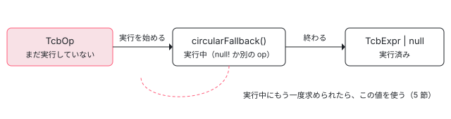

[目次](../README.md) › [テンプレート型チェックの内側](README.md) › 第 6 回 / 全 20 回

# Scope と TcbOp：遅れて実行される操作の表

> Scope.forNodes がテンプレートの各ノードを TcbOp の列にし、render が頭から、resolve が必要になったものを先に実行する仕組み。optional な op（要素・参照）は求められたときだけ書かれる。循環したときの circularFallback（null! と、型コンストラクタをもう 1 回呼ぶ op）、op の種類の一覧、ネストした Scope と、名前ではなくノードで引いて親へたどる探し方。

angular/angular · 読了 約 13 分 · 中核 · [サイトで読む（デモが動きます）](https://angular-deep-dive-cyan.vercel.app/chapter/typecheck-scope)

---

テンプレートは `{{ r.value }} <input #r>` のように、後ろで宣言する名前を前で使えます。TypeScript ではそれができません。TCB の生成器は、テンプレートをまず **TcbOp（TCB に文を足す操作）の列**にし、あとから「必要になった op を先に実行する」ことでこの差を埋めます。この章では、その列を持つ `Scope` が、どんな表を持ち、名前をどう探し、循環をどう断つかを、行を指して読みます。

読む対象は `packages/compiler/src/typecheck/ops/scope.ts`（1112 行）と `ops/context.ts`、ops/ の 26 ファイルの `class … extends TcbOp` です。

1. [1. 全体像](01-typecheck-overview.md)
2. [2. 設定](02-typecheck-config.md)
3. [3. TCB の置き場所](03-typecheck-context.md)
4. [4. 派生プログラム](04-typecheck-program-driver.md)
5. [5. Environment](05-typecheck-environment.md)
6. **6. Scope と TcbOp**（この章）
7. [7. 式](07-typecheck-expressions.md)
8. [8. 要素と DOM](08-typecheck-elements-dom.md)
9. [9. 型コンストラクタ](09-typecheck-type-constructor.md)
10. [10. 入力](10-typecheck-inputs.md)
11. [11. 出力とイベント](11-typecheck-outputs-events.md)
12. [12. 双方向](12-typecheck-two-way.md)
13. [13. 制御フロー](13-typecheck-control-flow.md)
14. [14. ng-template のガード](14-typecheck-template-guards.md)
15. [15. 参照と pipe](15-typecheck-refs-pipes.md)
16. [16. 診断の対応付け](16-typecheck-diagnostics-mapping.md)
17. [17. 帯域外の診断](17-typecheck-oob.md)
18. [18. 拡張診断](18-typecheck-extended.md)
19. [19. TemplateTypeChecker](19-typecheck-template-type-checker.md)
20. [20. issue と PR を読む](20-typecheck-issues.md)

> [!TIP]
> **新卒エンジニアへ**
>
> `appendNode` がノードの種類ごとに op を積むこと、`render` が列を頭から実行すること、`executeOp` が実行した op を結果で置き換えることは [compiler-typecheck](../compiler/17-compiler-typecheck.md) の 4 節で引用しました。この章はその周りの、表・名前の探し方・循環を読みます。

## 1. Scope は「1 つのテンプレート分の op の列」

📄 `angular/packages/compiler/src/typecheck/ops/scope.ts` L74–101 （▶ の行: 77–79, 81–82, 85, 91–93, 95–96, 101）

```ts
 74 │ /**
 75 │  * Local scope within the type check block for a particular template.
 76 │  *
 77 ▶  * The top-level template and each nested `<ng-template>` have their own `Scope`, which exist in a
 78 ▶  * hierarchy. The structure of this hierarchy mirrors the syntactic scopes in the generated type
 79 ▶  * check block, where each nested template is encased in an `if` structure.
 80 │  *
 81 ▶  * As a template's `TcbOp`s are executed in a given `Scope`, statements are added via
 82 ▶  * `addStatement()`. When this processing is complete, the `Scope` can be turned into a `ts.Block`
 83 │  * via `renderToBlock()`.
 84 │  *
 85 ▶  * If a `TcbOp` requires the output of another, it can call `resolve()`.
 86 │  */
 87 │ export class Scope {
 88 │   /**
 89 │    * A queue of operations which need to be performed to generate the TCB code for this scope.
 90 │    *
 91 ▶    * This array can contain either a `TcbOp` which has yet to be executed, or a `TcbExpr|null`
 92 ▶    * representing the memoized result of executing the operation. As operations are executed, their
 93 ▶    * results are written into the `opQueue`, overwriting the original operation.
 94 │    *
 95 ▶    * If an operation is in the process of being executed, it is temporarily overwritten here with
 96 ▶    * `INFER_TYPE_FOR_CIRCULAR_OP_EXPR`. This way, if a cycle is encountered where an operation
 97 │    * depends transitively on its own result, the inner operation will infer the least narrow type
 98 │    * that fits instead. This has the same semantics as TypeScript itself when types are referenced
 99 │    * circularly.
100 │    */
101 ▶   private opQueue: (TcbOp | TcbExpr | null)[] = [];
```

1. **77〜79 行目：Scope は入れ子になる**

   いちばん外のテンプレートと、入れ子の `<ng-template>` ごとに 1 つずつ。TCB の中では入れ子のテンプレートが `{ … }` や `if` のブロックになり、Scope の親子とブロックの親子が同じ形になります。
2. **81〜82・85 行目：文を足す・他の op の結果を求める**

   op は実行されると `addStatement()` で文を足し、別の op の結果が要るときは `resolve()`（4 節）を呼びます。
3. **91〜93・101 行目：opQueue**

   配列の要素は、まだ実行していない `TcbOp` か、実行した結果の `TcbExpr | null` です。実行すると、その場所を結果で上書きします。`null` は「実行済みで、返す値が無い」の印です（`TcbExpressionOp` のように文を足すだけの op）。
4. **95〜96 行目：実行中の印**

   実行している間は、その場所を一時的に別の値に置き換えます。同じ op が自分の結果を（間接的に）求めても無限に回らないようにするためです（5 節）。

## 2. Scope が持つ表

📄 `angular/packages/compiler/src/typecheck/ops/scope.ts` L103–140 （▶ の行: 106, 111, 116, 122, 127, 133, 140）

```ts
103 │   /**
104 │    * A map of `Element`s to the index of their `TcbElementOp` in the `opQueue`
105 │    */
106 ▶   private elementOpMap = new Map<Element, number>();
107 │ 
108 │   /**
109 │    * A map of `HostElement`s to the index of their `TcbHostElementOp` in the `opQueue`
110 │    */
111 ▶   private hostElementOpMap = new Map<HostElement, number>();
112 │ 
113 │   /**
114 │    * A map of `Component`s to the index of their `TcbComponentNodeOp` in the `opQueue`
115 │    */
116 ▶   private componentNodeOpMap = new Map<Component, number>();
117 │ 
118 │   /**
119 │    * A map of maps which tracks the index of `TcbDirectiveCtorOp`s in the `opQueue` for each
120 │    * directive on a `Element` or `Template` node.
121 │    */
122 ▶   private directiveOpMap = new Map<DirectiveOwner, Map<TcbDirectiveMetadata, number>>();
123 │ 
124 │   /**
125 │    * A map of `Reference`s to the index of their `TcbReferenceOp` in the `opQueue`
126 │    */
127 ▶   private referenceOpMap = new Map<Reference, number>();
128 │ 
129 │   /**
130 │    * Map of immediately nested <ng-template>s (within this `Scope`) represented by `Template`
131 │    * nodes to the index of their `TcbTemplateContextOp`s in the `opQueue`.
132 │    */
133 ▶   private templateCtxOpMap = new Map<Template, number>();
134 │ 
135 │   /**
136 │    * Map of variables declared on the template that created this `Scope` (represented by
137 │    * `Variable` nodes) to the index of their `TcbVariableOp`s in the `opQueue`, or to
138 │    * pre-resolved variable identifiers.
139 │    */
140 ▶   private varMap = new Map<Variable, number | TcbExpr>();
```

どの表も「テンプレートのノード → opQueue の番号」です。番号を覚えておくので、あとでそのノードを求められたら、その番号の op を実行する（実行済みなら結果を返す）だけで済みます。

| 行 | 表 | キー | 番号の先の op |
| --- | --- | --- | --- |
| 106 | `elementOpMap` | `Element` | `TcbElementOp`（[第 8 回](08-typecheck-elements-dom.md)） |
| 111 | `hostElementOpMap` | `HostElement` | `TcbHostElementOp`（第 8 回） |
| 116 | `componentNodeOpMap` | selectorless の `Component` | `TcbComponentNodeOp`（第 8 回） |
| 122 | `directiveOpMap` | 要素など + ディレクティブ | ディレクティブの型の op（[第 9 回](09-typecheck-type-constructor.md)） |
| 127 | `referenceOpMap` | `Reference`（#ref） | `TcbReferenceOp`（[第 15 回](15-typecheck-refs-pipes.md)） |
| 133 | `templateCtxOpMap` | 直下の `Template` | `TcbTemplateContextOp`（[第 14 回](14-typecheck-template-guards.md)） |
| 140 | `varMap` | `Variable`（let- など） | 変数の op、または先に決めた名前 |

このほか、`@let` を**名前**で引く `letDeclOpMap` と、op が足した文を溜める `statements` があります。

## 3. Scope.forNodes：Scope を作って op を積む

📄 `angular/packages/compiler/src/typecheck/ops/scope.ts` L187–216 （▶ の行: 187, 190, 194, 196, 198, 203, 207, 209, 213, 215）

```ts
187 ▶   static forNodes(
188 │     tcb: Context,
189 │     parentScope: Scope | null,
190 ▶     scopedNode: Template | IfBlockBranch | ForLoopBlock | HostElement | BoundaryErrorBlock | null,
191 │     children: Node[] | null,
192 │     guard: TcbExpr | null,
193 │   ): Scope {
194 ▶     const scope = new Scope(tcb, parentScope, guard);
195 │ 
196 ▶     if (parentScope === null && tcb.env.config.enableTemplateTypeChecker) {
197 │       // Add an autocompletion point for the component context.
198 ▶       scope.opQueue.push(new TcbComponentContextCompletionOp(scope));
199 │     }
200 │ 
201 │     // If given an actual `Template` instance, then process any additional information it
202 │     // has.
203 ▶     if (scopedNode instanceof Template) {
204 │       // The template's variable declarations need to be added as `TcbVariableOp`s.
205 │       const varMap = new Map<string, Variable>();
206 │ 
207 ▶       for (const v of scopedNode.variables) {
208 │         // Validate that variables on the `Template` are only declared once.
209 ▶         if (!varMap.has(v.name)) {
210 │           varMap.set(v.name, v);
211 │         } else {
212 │           const firstDecl = varMap.get(v.name)!;
213 ▶           tcb.oobRecorder.duplicateTemplateVar(tcb.id, v, firstDecl);
214 │         }
215 ▶         Scope.registerVariable(scope, v, new TcbTemplateVariableOp(tcb, scope, scopedNode, v));
216 │       }
```

📄 `angular/packages/compiler/src/typecheck/ops/scope.ts` L268–291 （▶ の行: 268–269, 271, 273, 278–279, 281–282, 289–290）

```ts
268 ▶     } else if (scopedNode instanceof HostElement) {
269 ▶       scope.appendNode(scopedNode);
270 │     }
271 ▶     if (children !== null) {
272 │       for (const node of children) {
273 ▶         scope.appendNode(node);
274 │       }
275 │     }
276 │     // Once everything is registered, we need to check if there are `@let`
277 │     // declarations that conflict with other local symbols defined after them.
278 ▶     for (const variable of scope.varMap.keys()) {
279 ▶       Scope.checkConflictingLet(scope, variable);
280 │     }
281 ▶     for (const ref of scope.referenceOpMap.keys()) {
282 ▶       Scope.checkConflictingLet(scope, ref);
283 │     }
284 │     return scope;
285 │   }
286 │ 
287 │   /** Registers a local variable with a scope. */
288 │   private static registerVariable(scope: Scope, variable: Variable, op: TcbOp): void {
289 ▶     const opIndex = scope.opQueue.push(op) - 1;
290 ▶     scope.varMap.set(variable, opIndex);
291 │   }
```

1. **194 行目：Scope を作る**

   親（`parentScope`）と guard（型を絞り込む式。6 節）を持たせます。いちばん外は type\_check\_block.ts が `Scope.forNodes(tcb, null, null, テンプレートのノード, null)` で呼び、親は `null` です。
2. **196〜199 行目：補完のための op**

   言語サービス用の `enableTemplateTypeChecker` のときだけ、いちばん外の Scope の先頭に補完の位置を足します（[第 19 回](19-typecheck-template-type-checker.md)）。
3. **203〜216 行目：`<ng-template>` の変数を登録する**

   `let-item` のような変数ごとに `TcbTemplateVariableOp` を作り、215 行目で登録します。209〜214 行目、同じ名前が 2 回あると帯域外の診断 `duplicateTemplateVar` を記録し、それでも両方の op を登録します。
4. **（216 行目の続き）`@if` の別名・`@boundary`・`@for` の変数**

   ブロックの子の Scope の変数の登録です。[第 13 回](13-typecheck-control-flow.md)で読みます。
5. **268〜270 行目：ホストバインディングの Scope**

   ホストの要素だけは子ではなく、それ自身を `appendNode` します（[第 8 回](08-typecheck-elements-dom.md)）。
6. **271〜275 行目：子のノードを順に appendNode**

   ここで op が**テンプレートの順に**積まれます。実行はまだです。
7. **278〜283 行目：`@let` と名前がぶつかっていないか**

   全部積んだあとで、変数と #ref の名前が同じ Scope の `@let` と同じなら `conflictingDeclaration` を記録します。
8. **288〜291 行目：registerVariable**

   op を push し、その番号を `varMap` に入れる。2 節の表はすべてこの「push して番号を覚える」で埋まります。

## 4. resolve：必要になった op を、親までたどって実行する

📄 `angular/packages/compiler/src/typecheck/ops/scope.ts` L293–324 （▶ の行: 303–307, 309, 313, 315, 318, 320, 322）

```ts
293 │   /**
294 │    * Look up a `ts.Expression` representing the value of some operation in the current `Scope`,
295 │    * including any parent scope(s). This method always returns a mutable clone of the
296 │    * `ts.Expression` with the comments cleared.
297 │    *
298 │    * @param node a `Node` of the operation in question. The lookup performed will depend on
299 │    * the type of this node:
300 │    *
301 │    * Assuming `directive` is not present, then `resolve` will return:
302 │    *
303 ▶    * * `Element` - retrieve the expression for the element DOM node
304 ▶    * * `Template` - retrieve the template context variable
305 ▶    * * `Variable` - retrieve a template let- variable
306 ▶    * * `LetDeclaration` - retrieve a template `@let` declaration
307 ▶    * * `Reference` - retrieve variable created for the local ref
308 │    *
309 ▶    * @param directive if present, a directive type on a `Element` or `Template` to
310 │    * look up instead of the default for an element or template node.
311 │    */
312 │ 
313 ▶   resolve(node: LocalSymbol, directive?: TcbDirectiveMetadata): TcbExpr {
314 │     // Attempt to resolve the operation locally.
315 ▶     const res = this.resolveLocal(node, directive);
316 │     if (res !== null) {
317 │       return res;
318 ▶     } else if (this.parent !== null) {
319 │       // Check with the parent.
320 ▶       return this.parent.resolve(node, directive);
321 │     } else {
322 ▶       throw new Error(`Could not resolve ${node} / ${directive}`);
323 │     }
324 │   }
```

315 行目でまず自分の Scope の表を引き、無ければ 318〜320 行目で親の `resolve` を呼びます。いちばん外まで行っても無ければ 322 行目で `Could not resolve … / …` を投げます。ここで渡される `node` は名前ではなく、BoundTarget（[compiler-binder](../compiler/09-compiler-binder.md)）が「この名前はこのノードを指す」と決めた**ノードそのもの**です。だから子の Scope と親の Scope に同じ名前があっても、指しているノードの Scope で見つかります。

📄 `angular/packages/compiler/src/typecheck/ops/scope.ts` L404–423 （▶ の行: 405–409, 412–415, 417–419, 423）

```ts
404 │   private resolveLocal(ref: LocalSymbol, directive?: TcbDirectiveMetadata): TcbExpr | null {
405 ▶     if (ref instanceof Reference && this.referenceOpMap.has(ref)) {
406 ▶       return this.resolveOp(this.referenceOpMap.get(ref)!);
407 ▶     } else if (ref instanceof LetDeclaration && this.letDeclOpMap.has(ref.name)) {
408 ▶       return this.resolveOp(this.letDeclOpMap.get(ref.name)!.opIndex);
409 ▶     } else if (ref instanceof Variable && this.varMap.has(ref)) {
410 │       // Resolving a context variable for this template.
411 │       // Execute the `TcbVariableOp` associated with the `Variable`.
412 ▶       const opIndexOrNode = this.varMap.get(ref)!;
413 ▶       return typeof opIndexOrNode === 'number'
414 ▶         ? this.resolveOp(opIndexOrNode)
415 ▶         : new TcbExpr(opIndexOrNode.print(true /* ignoreComments */));
416 │     } else if (
417 ▶       ref instanceof Template &&
418 ▶       directive === undefined &&
419 ▶       this.templateCtxOpMap.has(ref)
420 │     ) {
421 │       // Resolving the context of the given sub-template.
422 │       // Execute the `TcbTemplateContextOp` for the template.
423 ▶       return this.resolveOp(this.templateCtxOpMap.get(ref)!);
```

📄 `angular/packages/compiler/src/typecheck/ops/scope.ts` L424–446 （▶ の行: 425, 430–431, 434–436, 438–439, 441, 444）

```ts
424 │     } else if (
425 ▶       (ref instanceof Element ||
426 │         ref instanceof Template ||
427 │         ref instanceof Component ||
428 │         ref instanceof Directive ||
429 │         ref instanceof HostElement) &&
430 ▶       directive !== undefined &&
431 ▶       this.directiveOpMap.has(ref)
432 │     ) {
433 │       // Resolving a directive on an element or sub-template.
434 ▶       const dirMap = this.directiveOpMap.get(ref)!;
435 ▶       return dirMap.has(directive) ? this.resolveOp(dirMap.get(directive)!) : null;
436 ▶     } else if (ref instanceof Element && this.elementOpMap.has(ref)) {
437 │       // Resolving the DOM node of an element in this template.
438 ▶       return this.resolveOp(this.elementOpMap.get(ref)!);
439 ▶     } else if (ref instanceof Component && this.componentNodeOpMap.has(ref)) {
440 │       return this.resolveOp(this.componentNodeOpMap.get(ref)!);
441 ▶     } else if (ref instanceof HostElement && this.hostElementOpMap.has(ref)) {
442 │       return this.resolveOp(this.hostElementOpMap.get(ref)!);
443 │     } else {
444 ▶       return null;
445 │     }
446 │   }
```

1. **405〜406 行目：#ref**

   `referenceOpMap` の番号の op を実行します。
2. **407〜408 行目：`@let` は名前で引く**

   ここだけキーが `ref.name` です。同じ Scope に同じ名前の `@let` は 1 つという前提です（3 節の 278〜283 行目で、ぶつかれば診断）。
3. **409〜415 行目：変数は 2 通り**

   番号なら op を実行し（414 行目）、`TcbExpr` なら先に決めた名前をコメントを消して写します（415 行目）。後者は `@for` の item のように、ループを作るときに名前が決まるものです（第 13 回）。
4. **416〜423 行目：テンプレートの context**

   ディレクティブの指定が無い（418 行目）ときだけ、`<ng-template>` の context の変数を返します。
5. **424〜435 行目：ノードの上のディレクティブ**

   ディレクティブが指定された（430 行目）ら `directiveOpMap` を引きます。そのノードにそのディレクティブが無ければ 435 行目で `null` を返し、4 節の 318 行目で親へ回ります。
6. **436〜442 行目：要素・コンポーネント・ホストの要素**

   ディレクティブの指定が無い要素なら DOM の要素の op（`document.createElement`）を実行します。

📄 `angular/packages/compiler/src/typecheck/ops/scope.ts` L448–472 （▶ の行: 451–454, 467–469, 472）

```ts
448 │   /**
449 │    * Like `executeOp`, but assert that the operation actually returned `TcbExpr`.
450 │    */
451 ▶   private resolveOp(opIndex: number): TcbExpr {
452 ▶     const res = this.executeOp(opIndex, /* skipOptional */ false);
453 ▶     if (res === null) {
454 ▶       throw new Error(`Error resolving operation, got null`);
455 │     }
456 │     return res;
457 │   }
458 │ 
459 │   /**
460 │    * Execute a particular `TcbOp` in the `opQueue`.
461 │    *
462 │    * This method replaces the operation in the `opQueue` with the result of execution (once done)
463 │    * and also protects against a circular dependency from the operation to itself by temporarily
464 │    * setting the operation's result to a special expression.
465 │    */
466 │   private executeOp(opIndex: number, skipOptional: boolean): TcbExpr | null {
467 ▶     const op = this.opQueue[opIndex];
468 ▶     if (!(op instanceof TcbOp)) {
469 ▶       return op === null ? null : new TcbExpr(op.print(true /* ignoreComments */));
470 │     }
471 │ 
472 ▶     if (skipOptional && op.optional) {
```

resolve の経路は必ず 452 行目を通り、`skipOptional` を **false** にして `executeOp` を呼びます。render が列を頭から実行するときは optional（任意）な op を飛ばしますが（472 行目）、誰かが求めたときは飛ばしません。「使われた要素だけ `document.createElement` が出る」のはこの組み合わせです。468〜469 行目、実行済みなら結果のコピーを返し、`null`（値を返さない op）なら 453 行目で「null が返った」と投げます。値を返さない op を resolve することは、コードの誤りだからです。続く行（[compiler-typecheck](../compiler/17-compiler-typecheck.md) 4 節で引用）で、実行前に opQueue のその場所を `op.circularFallback()` に置き換え、実行が終わったら結果で上書きします。



*opQueue の 1 つの場所の状態。resolve は TcbOp を見たら実行し、TcbExpr を見たらそれを返す*

## 5. 循環を断つ：circularFallback

grep すると、`circularFallback` を書いているのは基底の TcbOp（ops/base.ts。`new TcbExpr('null!')` を返す。[compiler-typecheck](../compiler/17-compiler-typecheck.md) 4 節で引用）と、ジェネリックなディレクティブの型コンストラクタを呼ぶ `TcbDirectiveCtorOp`（directive\_constructor.ts。`TcbDirectiveCtorCircularFallbackOp` を返す）の 2 つだけです。下のデモの 2 つのプリセットで、それぞれが働く形を作れます。

1. **`<div dir #d="dir" [input]="d">`（Dir はジェネリック）**

   入力の op が `d` を訳す → #d の op が実行中（場所は `null!`）→ #d の op が Dir の型コンストラクタの op を求める → 型コンストラクタの op が自分の入力 `d` を訳す → #d の場所にある `null!` が返る。結果は `var _t2 = _ctor_Dir({ "input": (null!) }); var _t1 = _t2;`。spec の it('should generate a circular directive reference correctly') の期待値と同じ形です。
2. **`<div dir #d="dir" [a]="x" [b]="d">`**

   入力の op は 1 つ目の入力 `x` を訳したあと Dir を求める → 型コンストラクタの op が実行中（場所は `TcbDirectiveCtorCircularFallbackOp`）→ 2 つ目の入力 `d` を訳す → #d の op → Dir を求める → 場所にあるのは TcbOp なので**それを実行** → `var _t3 = _ctor_Dir(null!)`（入力を何も渡さない、いちばん広い型）。そのあとで本物の `var _t1 = _ctor_Dir({ "a": …, "b": (_t2) })` が書かれます。README の「Breaking cycles」の節が書いている形（`ctor1(null!)` を先に置く）は、こちらです。ただし README がその例に使っているテンプレート `<generic-cmp #ref [in]="ref.value">`（入力が 1 つ）をデモで訳すと、1 つ目の形（`_ctor_GenericCmp({ "in": (((null!).value)) })`）になりました。

どちらも型の上だけの循環です。実行時にはディレクティブが先に作られ、入力はあとで入るので、循環はありません。

## 6. guard：入れ子の Scope の絞り込み

📄 `angular/packages/compiler/src/typecheck/ops/scope.ts` L346–371 （▶ の行: 354, 357, 359–360, 363, 369）

```ts
346 │   /**
347 │    * Returns an expression of all template guards that apply to this scope, including those of
348 │    * parent scopes. If no guards have been applied, null is returned.
349 │    */
350 │   guards(): TcbExpr | null {
351 │     let parentGuards: TcbExpr | null = null;
352 │     if (this.parent !== null) {
353 │       // Start with the guards from the parent scope, if present.
354 ▶       parentGuards = this.parent.guards();
355 │     }
356 │ 
357 ▶     if (this.guard === null) {
358 │       // This scope does not have a guard, so return the parent's guards as is.
359 ▶       return parentGuards;
360 ▶     } else if (parentGuards === null) {
361 │       // There's no guards from the parent scope, so this scope's guard represents all available
362 │       // guards.
363 ▶       return typeof this.guard === 'string' ? new TcbExpr(this.guard) : this.guard;
364 │     } else {
365 │       // Both the parent scope and this scope provide a guard, so create a combination of the two.
366 │       // It is important that the parent guard is used as left operand, given that it may provide
367 │       // narrowing that is required for this scope's guard to be valid.
368 │       const guard = typeof this.guard === 'string' ? this.guard : this.guard.print();
369 ▶       return new TcbExpr(`(${parentGuards.print()}) && (${guard})`);
370 │     }
371 │   }
```

Scope は作られるときに guard（`@if` の条件のような、型を絞り込む式）を持てます。`guards()` は 354 行目で親の guard を先に取り、369 行目で `(親) && (自分)` にします。親を左に置くのは、親の絞り込みが自分の guard を書ける前提になることがあるからです（366〜367 行目のコメント）。grep で呼ぶ場所を探すと events.ts の 1 か所で、イベントのハンドラ（アロー関数の中では外側の if の絞り込みが届かない）にこの式で if をもう一度書くために使われます（[compiler-typecheck](../compiler/17-compiler-typecheck.md) 7 節、[第 11 回](11-typecheck-outputs-events.md)）。

## 7. \_t の番号は「実行した順」

📄 `angular/packages/compiler/src/typecheck/ops/context.ts` L65–80 （▶ の行: 71–72）

```ts
65 │   /**
66 │    * Allocate a new variable name for use within the `Context`.
67 │    *
68 │    * Currently this uses a monotonically increasing counter, but in the future the variable name
69 │    * might change depending on the type of data being stored.
70 │    */
71 ▶   allocateId(): string {
72 ▶     return `_t${this.nextId++}`;
73 │   }
74 │ 
75 │   getPipeByName(name: string): TcbPipeMetadata | null {
76 │     if (this.pipes === null || !this.pipes.has(name)) {
77 │       return null;
78 │     }
79 │     return this.pipes.get(name)!;
80 │   }
```

72 行目、変数の名前は `_t` と 1 から増える番号です。番号は op が `execute()` の中で `allocateId()` を呼んだときに振られます。だから TCB の `_t1`・`_t2` の順は op が**実行された順**で、テンプレートの順とも、TCB に文が書かれた順とも限りません。`Context` は TCB 1 つに 1 つなので、入れ子の Scope でも番号は通しです。

📄 `angular/packages/compiler-cli/src/ngtsc/typecheck/test/type_check_block_spec.ts` L568–594 （▶ の行: 570–571, 574, 580–581, 592）

```ts
568 │   it('should generate a forward element reference correctly', () => {
569 │     const TEMPLATE = `
570 ▶       {{ i.value }}
571 ▶       <input #i>
572 │     `;
573 │     expect(tcb(TEMPLATE)).toContain(
574 ▶       'var _t2 = document.createElement("input"); var _t1 = _t2; "" + (((_t1).value));',
575 │     );
576 │   });
577 │ 
578 │   it('should generate a forward directive reference correctly', () => {
579 │     const TEMPLATE = `
580 ▶       {{d.value}}
581 ▶       <div dir #d="dir"></div>
582 │     `;
583 │     const DIRECTIVES: TestDeclaration[] = [
584 │       {
585 │         type: 'directive',
586 │         name: 'Dir',
587 │         selector: '[dir]',
588 │         exportAs: ['dir'],
589 │       },
590 │     ];
591 │     expect(tcb(TEMPLATE, DIRECTIVES)).toContain(
592 ▶       'var _t2 = null! as i0.Dir; ' + 'var _t1 = _t2; ' + '"" + (((_t1).value));',
593 │     );
594 │   });
```

574 行目、テンプレートでは `{{ i.value }}`（570 行目）が先ですが、TCB では要素の宣言 `var _t2 = document.createElement("input")` と参照の `var _t1 = _t2` が先に書かれます。補間の op が実行を始め、#i の op（`_t1` を取る）→ 要素の op（`_t2` を取り、文を足す）→ #i の op が文を足す → 補間の op が文を足す、の順だからです。592 行目はディレクティブへの参照で、要素の代わりに `null! as i0.Dir`（[第 9 回](09-typecheck-type-constructor.md)）になります。

## 8. ページの上で：宣言の順を見る

> **🧪 テンプレートの順と TCB の宣言の順**
>
> 補間の op が先に実行され、その中で #r の op と要素の op が呼ばれる
>
> ボタンを押すと、このサイトに入っている @angular/compiler 22.1.6 の generateTypeCheckBlock が動きます。
>
> ▶ [このデモはサイトで動かせます](https://angular-deep-dive-cyan.vercel.app/chapter/typecheck-scope)

「子の Scope から親の #ref」では、`var _t4 = document.createElement("input")` と `var _t3 = _t4` が子のブロック `{ … }` の**外**（親の Scope の文）に書かれます。子の Scope の表に `r` が無いので 4 節の 320 行目で親へ回り、親の op が親の `addStatement` で文を足すからです。子のブロックはそのあとで親の文として足されます。

## 9. TcbOp の一覧

ops/\*.ts を `grep -n "extends Tcb"` で探すと 32 個の class があり、抽象クラスの `TcbDirectiveTypeOpBase` を除いた 31 個が次の表です。「optional」は render で飛ばされる op（4 節の 472 行目。誰かに求められたときだけ実行）です。

| op | ファイル | optional | 何を書くか | 読む章 |
| --- | --- | --- | --- | --- |
| `TcbElementOp` | element.ts | ○ | `var _t1 = document.createElement("…")` | [第 8 回](08-typecheck-elements-dom.md) |
| `TcbHostElementOp` | host.ts | ○ | ホストの要素 | 第 8 回 |
| `TcbComponentNodeOp` | selectorless.ts | ○ | selectorless のコンポーネントの要素 | 第 8 回 |
| `TcbDomSchemaCheckerOp` | schema.ts |   | （文なし。DomSchemaChecker を呼ぶ） | 第 8 回 |
| `TcbUnclaimedInputsOp` | inputs.ts |   | どのディレクティブも受けない \[prop\] の式 | 第 8 回・[第 10 回](10-typecheck-inputs.md) |
| `TcbDirectiveInputsOp` | inputs.ts |   | 入力への代入 | 第 10 回 |
| `TcbNonGenericDirectiveTypeOp` / `TcbGenericDirectiveTypeWithAnyParamsOp` | directive\_type.ts | ○ | `var _t1 = null! as Dir` | [第 9 回](09-typecheck-type-constructor.md) |
| `TcbDirectiveCtorOp` / `TcbDirectiveCtorCircularFallbackOp` | directive\_constructor.ts | ○ / | `_ctor1({…})` / `_ctor1(null!)` | 第 9 回・5 節 |
| `TcbDirectiveOutputsOp` / `TcbUnclaimedOutputsOp` | events.ts |   | `.subscribe(…)` / `addEventListener(…)` | [第 11 回](11-typecheck-outputs-events.md) |
| `TcbNativeFieldOp` / `TcbNativeRadioButtonFieldOp` | signal\_forms.ts |   | signal forms のネイティブの要素 | [第 12 回](12-typecheck-two-way.md) |
| `TcbExpressionOp` / `TcbConditionOp` | expression.ts |   | 補間などの式 / `if (式) {}` | [第 7 回](07-typecheck-expressions.md)・第 13 回 |
| `TcbIfBlockOp`・`TcbForOfOp`・`TcbSwitchOp`・`TcbBoundaryOp`・`TcbLetDeclarationOp`・`TcbIntersectionObserverOp` | if\_block.ts ほか |   | ブロック・`@let`・`@defer` の trigger | [第 13 回](13-typecheck-control-flow.md) |
| `TcbTemplateContextOp` / `TcbTemplateBodyOp` | template.ts | ○ / | context の変数 / 子の Scope のブロック | [第 14 回](14-typecheck-template-guards.md) |
| `TcbTemplateVariableOp`・`TcbBlockVariableOp` / `TcbBlockImplicitVariableOp` | variables.ts | / ○ | let- の変数・ブロックの変数 | 第 13 回・第 14 回 |
| `TcbReferenceOp` / `TcbInvalidReferenceOp` | references.ts | ○ | #ref の変数 | [第 15 回](15-typecheck-refs-pipes.md) |
| `TcbControlFlowContentProjectionOp` | content\_projection.ts |   | （文なし。投影できない子を診断） | [第 17 回](17-typecheck-oob.md) |
| `TcbComponentContextCompletionOp` | completions.ts |   | 補完の位置 | [第 19 回](19-typecheck-template-type-checker.md) |

- `generateTypeCheckBlock()` — type\_check\_block.ts
  - `Scope.forNodes(tcb, null, null, nodes, null)` — scope.ts:187 — *op をテンプレートの順に積む*
    - `appendNode(node)` — scope.ts — *表に番号を入れる*
  - `scope.render()` — scope.ts — *頭から executeOp（optional は飛ばす）*
    - `op.execute()` — ops/\*.ts
      - `scope.resolve(node)` — scope.ts:313 — *自分の表 → 親*
        - `resolveOp(i)` → `executeOp(i, false)` — scope.ts:451 — *optional でも実行。実行中なら circularFallback*
          - `tcb.allocateId()` — context.ts:71 — *\_t の番号*

## テストと直し方

この章の仕組みを確かめている spec は、すべて `type_check_block_spec.ts` の `describe('type check blocks')`（:27）の中にあります。

- `it('should generate a forward element reference correctly')`（:568）と `it('should generate a forward directive reference correctly')`（:578）— 7 節の引用。
- `it('should generate a circular directive reference correctly')`（:628、ジェネリックでない Dir）と `describe('type constructors')`（:250）の中の同じ名前の it（:310、ジェネリックな Dir）、`it('should generate circular references between two directives correctly')`（:646）— 5 節の 1 つ目の形。
- `it('should only generate code for DOM elements that are actually referenced')`（:445）— optional の op（[第 8 回](08-typecheck-elements-dom.md)で引用）。

📄 `ターミナル`

```
cd ~/angular-research/angular
pnpm bazel test //packages/compiler-cli/src/ngtsc/typecheck/test:test \
  --nocache_test_results --test_output=all \
  '--test_arg=--filter=type check blocks'
```

📄 `出力（抜粋。2026-11-02 に実行。ログは scratchpad/tc-logs/b-tcb.log）`

```
Ran 239 of 1747 specs
239 specs, 0 failures
//packages/compiler-cli/src/ngtsc/typecheck/test:test      PASSED in 1.1s
```

1. **確かめられていない所**

   type\_check\_block\_spec.ts を `_ctor1(null!)` や `(null!)` で grep しても、5 節の 2 つ目の形（`TcbDirectiveCtorCircularFallbackOp` が働く形）の期待値は見つかりませんでした。デモでは 22.1.6 で `var _t3 = _ctor_Dir(null!)` が出ます。spec を足すなら、`describe('type constructors')` にジェネリックな Dir と `[a]="x" [b]="d"` のテンプレートで `tcb()` を呼ぶ it が入口です。
2. **直すとしたら**

   名前の探し方は scope.ts の `resolve`（313 行目）と `resolveLocal`（404 行目）、実行の順は `resolveOp`（451 行目）と `executeOp`（466 行目）、新しいノードの op を積むのは `appendNode` です。形の確かめは `tcb()` の `toContain` で、番号（`_t1`・`_t2`）まで含めた文字列で書くのがこの spec の書き方です。
3. **issue を読むときの手がかり**

   `Could not resolve [object Object] / undefined` は 4 節の 322 行目のメッセージです。閉じた #39744（2020-11、Angular 11 の AOT で出た）と #49931（2023-04、`[ngForTrackBy]` を `*ngFor` と一緒に書くと出る。2025-08 に not planned で閉じた）がこの文字列で報告されています。「BoundTarget はノードを返したが、Scope の表にそのノードが無い」ときに出るので、どのノードの op が積まれなかったかを appendNode から探すのが読み方です（[第 20 回](20-typecheck-issues.md)）。

## 聞かれそうな質問

**Q. なぜ op を積んでから遅れて実行するのですか？**

テンプレートは後ろで宣言する #ref や `@let` を前で使えますが、TypeScript では宣言の前に使うとエラーになるからです。手元で TypeScript 6.0.3（../angular の node\_modules）に読ませると、`var` なら TS2454（used before being assigned）、`const` なら TS2448 が出ました。type\_check\_block\_spec.ts 574 行目のように、使う側の op の実行の途中で宣言の op を先に実行し、宣言を先に書きます。もう 1 つの理由は optional な op で、使われない要素の宣言を書かずに済みます（scope.ts 452 行目と 472 行目の組み合わせ）。

**Q. 循環はいつ起きますか？**

ある op を実行している途中で、その op 自身の結果が（間接的に）要るときです。典型は `<div dir #d="dir" [input]="d">` のように、ディレクティブの入力にそのディレクティブ自身の参照を渡す形です。circularFallback を持つ op は grep で 2 つ（基底の `null!` と `TcbDirectiveCtorOp`）で、どちらが効くかは 5 節のとおり、どの op から実行が始まったかで決まります。

**Q. 子の Scope と親の Scope に同じ名前の変数があると、どちらが使われますか？**

名前で探していないので「どちらか」ではなく、BoundTarget がその式に結び付けたノードが使われます。resolve は 315 行目で自分の Scope の表をノードで引き、無ければ 320 行目で親へ回ります。例外は `@let` で、407〜408 行目のとおり名前で引きます。

**Q. 22.1.6（このサイトのデモ）と読んでいる版で scope.ts は何が違いますか？**

diff（262 行）の scope.ts の部分を見ると、読んでいる版にだけ `@boundary`（`BoundaryBlock` と `BoundaryErrorBlock`。forNodes の子の変数の登録と、appendNode の `TcbBoundaryOp`）と、keyed defer のブロック名を見て `deferredComponentUsedEagerly` に渡す行があります（f7597cb7d93・7d9f55da113。[第 13 回](13-typecheck-control-flow.md)）。残りは import の並べ替えです。だからデモでは `@boundary` の TCB は作れません。この章で扱った resolve・resolveLocal・executeOp は同じです。

## 読み終えて

- Scope はテンプレート 1 つ分の opQueue と「ノード → op の番号」の表を持ち、入れ子のテンプレートごとに子の Scope ができる。
- forNodes はテンプレートの順に op を積むだけで、実行は render と resolve が行う。resolve は自分の表 → 親の順にノードで引く。
- resolve から実行される op は optional でも実行される。だから使われた要素や参照だけが宣言される。
- 実行中の op の場所には circularFallback が入り、`null!` か、型コンストラクタをもう 1 回呼ぶ op で循環を断つ。
- `_t` の番号は op が実行された順。TCB を読むときは番号の順ではなく、文の並びで読む。

---

← 前: [Environment と TCB アダプタ：参照を TypeScript の式にする](05-typecheck-environment.md)  
次: [テンプレートの式を TypeScript の式に書き直す](07-typecheck-expressions.md) →
