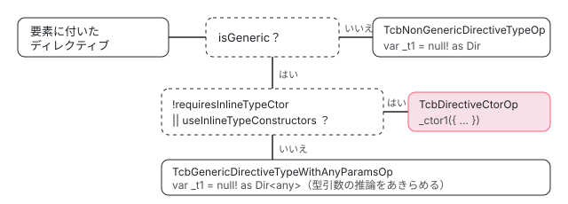

[目次](../README.md) › [テンプレート型チェックの内側](README.md) › 第 9 回 / 全 20 回

# 型コンストラクタ：ジェネリックなディレクティブの型を推論させる

> ジェネリックなディレクティブ（NgForOf&lt;T&gt; など）の T を、入力の値から TypeScript に推論させる「型コンストラクタ」の形と、TcbDirectiveCtorOp・TcbDirectiveTypeOp の使い分け。型引数を TCB に書き出せるかを決める TypeParameterEmitter、書き出せないときに inline に回るか any にする仕組み。

angular/angular · 読了 約 13 分 · 発展 · [サイトで読む（デモが動きます）](https://angular-deep-dive-cyan.vercel.app/chapter/typecheck-type-constructor)

---

`<li *ngFor="let u of users">` の `u` に `User` 型が付くのは、`NgForOf<T>` の `T` を、TCB の中で TypeScript に推論させているからです。そのために TCB は、ディレクティブを `null! as NgForOf` と宣言するのではなく、「入力の値を引数に取り、ディレクティブの型を返す関数」を呼びます。これを型コンストラクタ（type constructor）と呼びます。この章では、ジェネリックかどうかで op が 3 つに分かれる行、型コンストラクタの呼び出しと宣言の形、そして型引数の制約を TCB に書き出せないときに inline に回るか `any` にするかの分かれ道を読みます。

読む対象は compiler の `typecheck/ops/directive_constructor.ts`・`ops/directive_type.ts`・`ops/scope.ts` の `getDirectiveOp`・`ops/context.ts`、compiler-cli の `ngtsc/typecheck/src/environment.ts`・`type_constructor.ts`・`type_parameter_emitter.ts`、core の `authoring/input/input_type_checking.ts`、テストは `type_check_block_spec.ts`・`type_constructor_spec.ts`・`type_parameter_emitter_spec.ts` です。

1. [1. 全体像](01-typecheck-overview.md)
2. [2. 設定](02-typecheck-config.md)
3. [3. TCB の置き場所](03-typecheck-context.md)
4. [4. 派生プログラム](04-typecheck-program-driver.md)
5. [5. Environment](05-typecheck-environment.md)
6. [6. Scope と TcbOp](06-typecheck-scope.md)
7. [7. 式](07-typecheck-expressions.md)
8. [8. 要素と DOM](08-typecheck-elements-dom.md)
9. **9. 型コンストラクタ**（この章）
10. [10. 入力](10-typecheck-inputs.md)
11. [11. 出力とイベント](11-typecheck-outputs-events.md)
12. [12. 双方向](12-typecheck-two-way.md)
13. [13. 制御フロー](13-typecheck-control-flow.md)
14. [14. ng-template のガード](14-typecheck-template-guards.md)
15. [15. 参照と pipe](15-typecheck-refs-pipes.md)
16. [16. 診断の対応付け](16-typecheck-diagnostics-mapping.md)
17. [17. 帯域外の診断](17-typecheck-oob.md)
18. [18. 拡張診断](18-typecheck-extended.md)
19. [19. TemplateTypeChecker](19-typecheck-template-type-checker.md)
20. [20. issue と PR を読む](20-typecheck-issues.md)

> [!NOTE]
> **ポイント**
>
> TCB の基本（Scope が op を積んで実行する、要素は `document.createElement`、式は `this.` を補う）は[テンプレートコンパイラ第 17 回](../compiler/17-compiler-typecheck.md)と[第 6 回](06-typecheck-scope.md)にあります。この章はディレクティブの「インスタンスの変数」を作る op だけを読みます。入力への代入は[第 10 回](10-typecheck-inputs.md)です。

## 1. どの op でディレクティブの変数を作るか

要素にディレクティブが付いていると、Scope は入力の op（[第 10 回](10-typecheck-inputs.md)）の前に、ディレクティブのインスタンスを表す変数を作る op を 1 つ積みます。どの op にするかを決めるのが `getDirectiveOp` です。

📄 `angular/packages/compiler/src/typecheck/ops/scope.ts` L825–845 （▶ の行: 831, 834–835, 839, 844）

```ts
825 │   private getDirectiveOp(
826 │     dir: TcbDirectiveMetadata,
827 │     node: DirectiveOwner,
828 │     customFieldType: CustomFormControlType | null,
829 │     directiveIndex?: number,
830 │   ): TcbOp {
831 ▶     if (!dir.isGeneric) {
832 │       // The most common case is that when a directive is not generic, we use the normal
833 │       // `TcbNonDirectiveTypeOp`.
834 ▶       return new TcbNonGenericDirectiveTypeOp(this.tcb, this, node, dir, directiveIndex);
835 ▶     } else if (!dir.requiresInlineTypeCtor || this.tcb.env.config.useInlineTypeConstructors) {
836 │       // For generic directives, we use a type constructor to infer types. If a directive requires
837 │       // an inline type constructor, then inlining must be available to use the
838 │       // `TcbDirectiveCtorOp`. If not we, we fallback to using `any` – see below.
839 ▶       return new TcbDirectiveCtorOp(this.tcb, this, node, dir, customFieldType, directiveIndex);
840 │     }
841 │ 
842 │     // If inlining is not available, then we give up on inferring the generic params, and use
843 │     // `any` type for the directive's generic parameters.
844 ▶     return new TcbGenericDirectiveTypeWithAnyParamsOp(this.tcb, this, node, dir, directiveIndex);
845 │   }
```

| 条件 | op | TCB の形 |
| --- | --- | --- |
| 831 行目：ジェネリックでない | `TcbNonGenericDirectiveTypeOp`（834 行目） | `var _t1 = null! as Dir;` |
| 835 行目：ジェネリックで、inline が要らないか、inline が使える | `TcbDirectiveCtorOp`（839 行目） | `var _t1 = _ctor1({ "items": ..., "selected": 0 as any });` |
| それ以外：inline が要るのに使えない | `TcbGenericDirectiveTypeWithAnyParamsOp`（844 行目） | `var _t1 = null! as Dir<any>;` |



*getDirectiveOp の分かれ道。ジェネリックなディレクティブだけが型コンストラクタで型引数を推論させる*

`isGeneric` は、ディレクティブのクラスに型引数があるかです（ngtsc の metadata の `reflector.getGenericArityOfClass` が 0 より大きいか）。`requiresInlineTypeCtor` と `useInlineTypeConstructors` は 6 節と 7 節で読みます。

## 2. ジェネリックでなければ `null! as Dir`

📄 `angular/packages/compiler/src/typecheck/ops/directive_type.ts` L34–73 （▶ の行: 34, 38, 42, 46–47, 51, 53–54, 56, 69, 72）

```ts
34 ▶   override get optional() {
35 │     // The statement generated by this operation is only used to declare the directive's type and
36 │     // won't report diagnostics by itself, so the operation is marked as optional to avoid
37 │     // generating declarations for directives that don't have any inputs/outputs.
38 ▶     return true;
39 │   }
40 │ 
41 │   override execute(): TcbExpr {
42 ▶     const rawType = this.tcb.env.referenceTcbValue(this.dir.ref);
43 │ 
44 │     let type: TcbExpr;
45 │     let span: ParseSourceSpan;
46 ▶     if (
47 ▶       this.dir.isGeneric === false ||
48 │       this.dir.typeParameters === null ||
49 │       this.dir.typeParameters.length === 0
50 │     ) {
51 ▶       type = rawType;
52 │     } else {
53 ▶       const typeArguments = Array(this.dir.typeParameters?.length ?? 0)
54 ▶         .fill('any')
55 │         .join(', ');
56 ▶       type = new TcbExpr(`${rawType.print()}<${typeArguments}>`);
57 │     }
58 │ 
59 │     if (this.node instanceof HostElement) {
60 │       span = this.node.sourceSpan;
61 │     } else {
62 │       span = this.node.startSourceSpan || this.node.sourceSpan;
63 │     }
64 │ 
65 │     const identifier =
66 │       this.dir.matchSource === MatchSource.HostDirective
67 │         ? ExpressionIdentifier.HOST_DIRECTIVE
68 │         : ExpressionIdentifier.DIRECTIVE;
69 ▶     const id = new TcbExpr(this.tcb.allocateId())
70 │       .addExpressionIdentifier(identifier, this.directiveIndex)
71 │       .addParseSpanInfo(span);
72 ▶     this.scope.addStatement(declareVariable(id, type));
73 │     return id;
```

1. **34〜38 行目 optional**

   この op の文は型を宣言するだけで、それ自体は診断を出しません。だから optional（誰かに参照されたときだけ実行される。第 6 回）です。入力も出力も参照も無いディレクティブは、TCB に変数すら書かれません。
2. **42 行目 クラスへの参照**

   `referenceTcbValue` は、shim ファイルから見たクラスの名前（必要なら import を足した `i0.Dir`）を返します。置き場所の話は[第 5 回](05-typecheck-environment.md)です。
3. **46〜51 行目と 53〜56 行目 型引数を any で埋めるか**

   ジェネリックでなければ型はクラスそのもの（51 行目）。ジェネリックなら 53〜56 行目で型引数の数だけ `any` を並べ、`Dir<any, any>` にします。これが 1 節の 3 つ目の op の形です。
4. **69〜72 行目 変数の宣言**

   `declareVariable` は `var _t1 = null! as 型` を書きます。値は無く、型だけがある変数です。

📄 `angular/packages/compiler/src/typecheck/ops/directive_type.ts` L77–97 （▶ の行: 79–81, 92–93）

```ts
77 │ /**
78 │  * A `TcbOp` which constructs an instance of a non-generic directive _without_ setting any of its
79 ▶  * inputs. Inputs are later set in the `TcbDirectiveInputsOp`. Type checking was found to be
80 ▶  * faster when done in this way as opposed to `TcbDirectiveCtorOp` which is only necessary when the
81 ▶  * directive is generic.
82 │  *
83 │  * Executing this operation returns a reference to the directive instance variable with its inferred
84 │  * type.
85 │  */
86 │ export class TcbNonGenericDirectiveTypeOp extends TcbDirectiveTypeOpBase {
87 │   /**
88 │    * Creates a variable declaration for this op's directive of the argument type. Returns the id of
89 │    * the newly created variable.
90 │    */
91 │   override execute(): TcbExpr {
92 ▶     if (this.dir.isGeneric) {
93 ▶       throw new Error(`Assertion Error: expected ${this.dir.ref.name} not to be generic.`);
94 │     }
95 │     return super.execute();
96 │   }
97 │ }
```

79〜81 行目のコメントのとおり、ジェネリックでないディレクティブにも型コンストラクタを使えますが、`null! as Dir` にしたほうが型検査が速かったので分けています。92〜93 行目は、1 節の分岐を間違えて呼んだら止める見張りです。

## 3. ジェネリックなら TcbDirectiveCtorOp

📄 `angular/packages/compiler/src/typecheck/ops/directive_constructor.ts` L23–53 （▶ の行: 24–27, 29–30, 47, 50）

```ts
23 │ /**
24 ▶  * A `TcbOp` which constructs an instance of a directive with types inferred from its inputs. The
25 ▶  * inputs themselves are not checked here; checking of inputs is achieved in `TcbDirectiveInputsOp`.
26 ▶  * Any errors reported in this statement are ignored, as the type constructor call is only present
27 ▶  * for type-inference.
28 │  *
29 ▶  * When a Directive is generic, it is required that the TCB generates the instance using this method
30 ▶  * in order to infer the type information correctly.
31 │  *
32 │  * Executing this operation returns a reference to the directive instance variable with its inferred
33 │  * type.
34 │  */
35 │ export class TcbDirectiveCtorOp extends TcbOp {
36 │   constructor(
37 │     private tcb: Context,
38 │     private scope: Scope,
39 │     private node: DirectiveOwner,
40 │     private dir: TcbDirectiveMetadata,
41 │     private customFormControlType: CustomFormControlType | null,
42 │     private directiveIndex?: number,
43 │   ) {
44 │     super();
45 │   }
46 │ 
47 ▶   override get optional() {
48 │     // The statement generated by this operation is only used to infer the directive's type and
49 │     // won't report diagnostics by itself, so the operation is marked as optional.
50 ▶     return true;
51 │   }
52 │ 
53 │   override execute(): TcbExpr {
```

24〜27 行目がこの op の約束です。**入力の型の検査はここではしない**（それは TcbDirectiveInputsOp の仕事）。ここで出たエラーは捨てる。型コンストラクタの呼び出しは、型引数を推論させるためだけにある。29〜30 行目、ジェネリックなディレクティブは、この方法で作らないと型が正しく推論されません。47〜51 行目、これも optional です。

📄 `angular/packages/compiler/src/typecheck/ops/directive_constructor.ts` L86–124 （▶ の行: 88, 91, 94, 98, 100, 112–114, 120–122）

```ts
 86 │     for (const attr of boundAttrs) {
 87 │       // Skip text attributes if configured to do so.
 88 ▶       if (!this.tcb.env.config.checkTypeOfAttributes && typeof attr.value === 'string') {
 89 │         continue;
 90 │       }
 91 ▶       for (const {fieldName, isTwoWayBinding} of attr.inputs) {
 92 │         // Skip the field if an attribute has already been bound to it; we can't have a duplicate
 93 │         // key in the type constructor call.
 94 ▶         if (genericInputs.has(fieldName)) {
 95 │           continue;
 96 │         }
 97 │ 
 98 ▶         const expression = translateInput(attr.value, this.tcb, this.scope);
 99 │ 
100 ▶         genericInputs.set(fieldName, {
101 │           type: 'binding',
102 │           field: fieldName,
103 │           expression,
104 │           originalExpression: attr.value,
105 │           sourceSpan: attr.sourceSpan,
106 │           isTwoWayBinding,
107 │         });
108 │       }
109 │     }
110 │ 
111 │     // Add unset directive inputs for each of the remaining unset fields.
112 ▶     for (const {classPropertyName} of this.dir.inputs) {
113 ▶       if (!genericInputs.has(classPropertyName)) {
114 ▶         genericInputs.set(classPropertyName, {type: 'unset', field: classPropertyName});
115 │       }
116 │     }
117 │ 
118 │     // Call the type constructor of the directive to infer a type, and assign the directive
119 │     // instance.
120 ▶     const typeCtor = tcbCallTypeCtor(this.dir, this.tcb, Array.from(genericInputs.values()));
121 ▶     typeCtor.markIgnoreDiagnostics();
122 ▶     this.scope.addStatement(new TcbExpr(`var ${id.print()} = ${typeCtor.print()}`));
123 │     return id;
124 │   }
```

1. **86〜109 行目 書かれた入力を集める**

   `boundAttrs`（`getBoundAttributes` が集めた、このディレクティブの入力に当たるバインディング。[第 10 回](10-typecheck-inputs.md)）を回し、98 行目で式を TCB の式に訳して、入力のクラスのプロパティ名をキーに `genericInputs` に入れます。88 行目、`checkTypeOfAttributes` が偽なら `size="3"` のような文字列の属性は入れません。94 行目、同じ入力に 2 回書いたら最初の 1 つだけを使います（オブジェクトリテラルに同じキーを 2 つ書けないため）。
2. **112〜116 行目 書かれなかった入力は unset**

   ディレクティブの入力のうち、テンプレートに書かれなかったものを `{type: 'unset'}` として足します。型コンストラクタは「全部の入力」を引数に取るからです（次の引用の 196〜197 行目）。
3. **120〜122 行目 呼んで、エラーは捨てる**

   `tcbCallTypeCtor` が呼び出しの式を作り、121 行目で `markIgnoreDiagnostics`（`/*D:ignore*/` の印。[第 16 回](16-typecheck-diagnostics-mapping.md)）を付けます。122 行目で `var _t1 = 呼び出し`。`_t1` の型は、TypeScript が推論した `MyList<User>` になります。

📄 `angular/packages/compiler/src/typecheck/ops/directive_constructor.ts` L170–208 （▶ の行: 175, 181, 186, 188–189, 192, 196–198, 208）

```ts
170 │ function tcbCallTypeCtor(
171 │   dir: TcbDirectiveMetadata,
172 │   tcb: Context,
173 │   inputs: TcbDirectiveInput[],
174 │ ): TcbExpr {
175 ▶   const typeCtor = tcb.env.typeCtorFor(dir);
176 │   let literal = '{ ';
177 │ 
178 │   // Construct an object literal containing each directive input.
179 │   for (let i = 0; i < inputs.length; i++) {
180 │     const input = inputs[i];
181 ▶     const propertyName = TcbExpr.quoteAndEscape(input.field);
182 │     const isLast = i === inputs.length - 1;
183 │ 
184 │     if (input.type === 'binding') {
185 │       // For bound inputs, the property is assigned the binding expression.
186 ▶       let expr = widenBinding(input.expression, tcb, input.originalExpression);
187 │ 
188 ▶       if (input.isTwoWayBinding && tcb.env.config.allowSignalsInTwoWayBindings) {
189 ▶         expr = unwrapWritableSignal(expr, tcb);
190 │       }
191 │ 
192 ▶       const assignment = new TcbExpr(`${propertyName}: ${expr.wrapForTypeChecker().print()}`);
193 │       assignment.addParseSpanInfo(input.sourceSpan);
194 │       literal += assignment.print();
195 │     } else {
196 ▶       // A type constructor is required to be called with all input properties, so any unset
197 ▶       // inputs are simply assigned a value of type `any` to ignore them.
198 ▶       literal += `${propertyName}: 0 as any`;
199 │     }
200 │ 
201 │     literal += `${isLast ? '' : ','} `;
202 │   }
203 │ 
204 │   literal += '}';
205 │ 
206 │   // Call the `ngTypeCtor` method on the directive class, with an object literal argument created
207 │   // from the matched inputs.
208 ▶   return new TcbExpr(`${typeCtor.print()}(${literal})`);
```

175 行目で、呼ぶ関数の名前を Environment に尋ねます（4 節）。各入力は 181 行目の `"items": 式` の形で、式は 186 行目の `widenBinding`（設定によって `as any` や `!` を付ける。[第 17 回](../compiler/17-compiler-typecheck.md)）を通ります。188〜189 行目は `[(x)]` のときに signal の中身を取り出す行です（[第 12 回](12-typecheck-two-way.md)）。**196〜198 行目、書かれなかった入力は `0 as any`**。この 1 行が「テストと直し方」で読む issue の原因になります。

📄 `angular/packages/compiler-cli/src/ngtsc/typecheck/test/type_check_block_spec.ts` L250–272 （▶ の行: 252, 259–260, 262, 267, 270）

```ts
250 │   describe('type constructors', () => {
251 │     it('should handle missing property bindings', () => {
252 ▶       const TEMPLATE = `<div dir [inputA]="foo"></div>`;
253 │       const DIRECTIVES: TestDeclaration[] = [
254 │         {
255 │           type: 'directive',
256 │           name: 'Dir',
257 │           selector: '[dir]',
258 │           inputs: {
259 ▶             fieldA: 'inputA',
260 ▶             fieldB: 'inputB',
261 │           },
262 ▶           isGeneric: true,
263 │         },
264 │       ];
265 │       const actual = tcb(TEMPLATE, DIRECTIVES);
266 │       expect(actual).toContain(
267 ▶         'const _ctor1: <T extends string = any>(init: Pick<i0.Dir<T>, "fieldA" | "fieldB">) => i0.Dir<T> = null!;',
268 │       );
269 │       expect(actual).toContain(
270 ▶         'var _t1 = _ctor1({ "fieldA": (((this).foo)), "fieldB": 0 as any });',
271 │       );
272 │     });
```
*type\_check\_block\_spec.ts（テスト用の tcb() は本物の Environment を使うので、型コンストラクタの宣言も文字列に入る）*

252 行目のテンプレートは `[inputA]` だけを書き、ディレクティブには fieldA と fieldB の 2 つの入力があります（259〜260 行目）。270 行目、fieldB は `0 as any` です。267 行目が、次の節で読む宣言の形です。

## 4. 呼ぶ関数の名前：Environment.typeCtorFor

📄 `angular/packages/compiler-cli/src/ngtsc/typecheck/src/environment.ts` L63–99 （▶ の行: 70–71, 74, 77, 81, 85, 87, 94–96）

```ts
63 │   /**
64 │    * Get an expression referring to a type constructor for the given directive.
65 │    *
66 │    * Depending on the shape of the directive itself, this could be either a reference to a declared
67 │    * type constructor, or to an inline type constructor.
68 │    */
69 │   typeCtorFor(dir: TcbDirectiveMetadata): TcbExpr {
70 ▶     if (this.typeCtors.has(dir.ref.key)) {
71 ▶       return new TcbExpr(this.typeCtors.get(dir.ref.key)!);
72 │     }
73 │ 
74 ▶     if (dir.requiresInlineTypeCtor) {
75 │       // The constructor has already been created inline, we just need to construct a reference to
76 │       // it.
77 ▶       const typeCtorExpr = `${this.referenceTcbValue(dir.ref).print()}.ngTypeCtor`;
78 │       this.typeCtors.set(dir.ref.key, typeCtorExpr);
79 │       return new TcbExpr(typeCtorExpr);
80 │     } else {
81 ▶       const fnName = `_ctor${this.nextIds.typeCtor++}`;
82 │       const nodeTypeRef = this.referenceTcbValue(dir.ref);
83 │       const meta: TypeCtorMetadata = {
84 │         fnName,
85 ▶         body: true,
86 │         fields: {
87 ▶           inputs: dir.inputs,
88 │           // TODO: support queries
89 │         },
90 │         coercedInputFields: dir.coercedInputFields,
91 │       };
92 │ 
93 │       const typeParams = dir.typeParameters || undefined;
94 ▶       const typeCtor = generateTypeCtorDeclarationFn(this, meta, nodeTypeRef, typeParams);
95 ▶       this.typeCtorStatements.push(typeCtor);
96 ▶       this.typeCtors.set(dir.ref.key, fnName);
97 │       return new TcbExpr(fnName);
98 │     }
99 │   }
```

1. **70〜72 行目 1 つのディレクティブに 1 つ**

   同じディレクティブを何度使っても、型コンストラクタは 1 つです。キャッシュのキーはクラスへの参照です。
2. **74〜79 行目 inline の型コンストラクタ**

   クラスの中に `static ngTypeCtor` を差し込む必要がある（6 節）ディレクティブなら、名前は `Dir.ngTypeCtor`。メソッドそのものは context.ts がクラスに差し込みます（[第 3 回](03-typecheck-context.md)）。
3. **81〜96 行目 宣言の型コンストラクタ**

   それ以外は `_ctor1`・`_ctor2`…。85 行目 `body: true`、87 行目の入力の一覧を渡して宣言の文を作り（94 行目）、95 行目で `typeCtorStatements` に貯めます。貯めた文は TCB の関数の前に並べられます（同じファイルの `getPreludeStatements`）。

> [!TIP]
> **新卒エンジニアへ**
>
> このページのデモの Environment は、本物の代わりに `_ctor_<名前>` と書くだけの差し替えです。本物は上の 81 行目のとおり `_ctor1` と番号を振り、宣言を TCB の前に置きます。

## 5. 宣言の形：Pick と = any

📄 `angular/packages/compiler-cli/src/ngtsc/typecheck/src/type_constructor.ts` L24–44 （▶ の行: 30, 32–33, 36–38, 40）

```ts
24 │ export function generateTypeCtorDeclarationFn(
25 │   env: ReferenceEmitEnvironment,
26 │   meta: TypeCtorMetadata,
27 │   nodeTypeRef: TcbExpr,
28 │   typeParams: TcbTypeParameter[] | undefined,
29 │ ): TcbExpr {
30 ▶   const typeArgs = generateGenericArgs(typeParams);
31 │   const typeRefWithGenerics = `${nodeTypeRef.print()}${typeArgs}`;
32 ▶   const initParam = constructTypeCtorParameter(env, meta, nodeTypeRef.print(), typeRefWithGenerics);
33 ▶   const typeParameters = typeParametersWithDefaultTypes(typeParams);
34 │   let source: string;
35 │ 
36 ▶   if (meta.body) {
37 ▶     const fnType = `${typeParameters}(${initParam}) => ${typeRefWithGenerics}`;
38 ▶     source = `const ${meta.fnName}: ${fnType} = null!`;
39 │   } else {
40 ▶     source = `declare function ${meta.fnName}${typeParameters}(${initParam}): ${typeRefWithGenerics}`;
41 │   }
42 │ 
43 │   return new TcbExpr(source);
44 │ }
```

4 節は `body: true` で呼ぶので、36〜38 行目の `const _ctor1: <T = any>(init: ...) => MyList<T> = null!` になります。40 行目の `declare function` は body が偽のときの形です。32 行目の `init` の型が、推論の材料になる部分です。

📄 `angular/packages/compiler-cli/src/ngtsc/typecheck/src/type_constructor.ts` L124–151 （▶ の行: 130–134, 136, 139–140, 150）

```ts
124 │   let initType: string | null = null;
125 │ 
126 │   const plainKeys: string[] = [];
127 │   const coercedKeys: string[] = [];
128 │   const signalInputKeys: string[] = [];
129 │ 
130 ▶   for (const {classPropertyName, transformType, isSignal} of meta.fields.inputs) {
131 ▶     if (isSignal) {
132 ▶       signalInputKeys.push(TcbExpr.quoteAndEscape(classPropertyName));
133 ▶     } else if (!meta.coercedInputFields.has(classPropertyName)) {
134 ▶       plainKeys.push(TcbExpr.quoteAndEscape(classPropertyName));
135 │     } else {
136 ▶       const propName = `ngAcceptInputType_${classPropertyName}`;
137 │       const isUnsafe = isUnsafeObjectKey(classPropertyName);
138 │       const access = isUnsafe ? `[${TcbExpr.quoteAndEscape(propName)}]` : `.${propName}`;
139 ▶       const coercionType =
140 ▶         transformType !== undefined ? transformType : `typeof ${typeRef}${access}`;
141 │ 
142 │       coercedKeys.push(
143 │         `${isUnsafe ? TcbExpr.quoteAndEscape(classPropertyName) : classPropertyName}: ${coercionType}`,
144 │       );
145 │     }
146 │   }
147 │ 
148 │   if (plainKeys.length > 0) {
149 │     // Construct a union of all the field names.
150 ▶     initType = `Pick<${typeRefWithGenerics}, ${plainKeys.join(' | ')}>`;
151 │   }
```

📄 `angular/packages/compiler-cli/src/ngtsc/typecheck/src/type_constructor.ts` L152–179 （▶ の行: 158, 164, 168–169, 174, 178）

```ts
152 │   if (coercedKeys.length > 0) {
153 │     let coercedLiteral = '{\n';
154 │     for (const key of coercedKeys) {
155 │       coercedLiteral += `${key};\n`;
156 │     }
157 │     coercedLiteral += '}';
158 ▶     initType = initType !== null ? `${initType} & ${coercedLiteral}` : coercedLiteral;
159 │   }
160 │   if (signalInputKeys.length > 0) {
161 │     const keyTypeUnion = signalInputKeys.join(' | ');
162 │ 
163 │     // Construct the UnwrapDirectiveSignalInputs<rawType, keyTypeUnion>.
164 ▶     const unwrapRef = env.referenceExternalSymbol(
165 │       R3Identifiers.UnwrapDirectiveSignalInputs.moduleName,
166 │       R3Identifiers.UnwrapDirectiveSignalInputs.name,
167 │     );
168 ▶     const unwrapExpr = `${unwrapRef.print()}<${typeRefWithGenerics}, ${keyTypeUnion}>`;
169 ▶     initType = initType !== null ? `${initType} & ${unwrapExpr}` : unwrapExpr;
170 │   }
171 │ 
172 │   if (initType === null) {
173 │     // Special case - no inputs, outputs, or other fields which could influence the result type.
174 ▶     initType = '{}';
175 │   }
176 │ 
177 │   // Create the 'init' parameter itself.
178 ▶   return `init: ${initType}`;
179 │ }
```

1. **133〜134 行目・150 行目 普通の入力は Pick**

   `Pick<MyList<T>, "items" | "selected">`。`items: T[]` に `User[]` を渡すと、TypeScript は `T = User` と推論します。これが型コンストラクタの仕組みのすべてです。
2. **136〜144 行目・158 行目 coercion の入力**

   `static ngAcceptInputType_x` がある入力や transform のある入力は、プロパティの型ではなく「受け付ける型」で受けます。139〜140 行目、transform の型があればそれ、無ければ `typeof MyList.ngAcceptInputType_x`。158 行目で Pick と `&` でつなぎます。
3. **131〜132 行目・160〜169 行目 signal の入力**

   `input()` の入力は、プロパティの型が `InputSignal<T>` なので Pick では受けられません。168 行目で `ɵUnwrapDirectiveSignalInputs<MyList<T>, "items">` を使います（下の引用）。
4. **172〜175 行目 入力が無い**

   `init: {}`。型引数は推論できず、5 節の最後の引用の既定値になります。

📄 `angular/packages/core/src/authoring/input/input_type_checking.ts` L11–21 （▶ の行: 12–13, 19–20）

```ts
11 │ /** Retrieves the write type of an `InputSignal` and `InputSignalWithTransform`. */
12 ▶ export type ɵUnwrapInputSignalWriteType<Field> =
13 ▶   Field extends InputSignalWithTransform<any, infer WriteT> ? WriteT : never;
14 │ 
15 │ /**
16 │  * Unwraps all `InputSignal`/`InputSignalWithTransform` class fields of
17 │  * the given directive.
18 │  */
19 ▶ export type ɵUnwrapDirectiveSignalInputs<Dir, Fields extends keyof Dir> = {
20 ▶   [P in Fields]: ɵUnwrapInputSignalWriteType<Dir[P]>;
21 │ };
```

12〜13 行目、`InputSignalWithTransform<any, infer WriteT>` から「書き込みの型」を取り出し、19〜20 行目でそれを入力ごとに並べた型を作ります。書き込みの型の印（`ɵINPUT_SIGNAL_BRAND_WRITE_TYPE`）そのものは[signals シリーズ](../signals/12-signals-input-compile.md)で読んだとおりです。

📄 `angular/packages/compiler-cli/src/ngtsc/typecheck/test/type_constructor_spec.ts` L265–281 （▶ の行: 265, 278–279）

```ts
265 ▶             coercedInputFields: new Set(['bar', 'baz']),
266 │           },
267 │         );
268 │         const programStrategy = new TsCreateProgramDriver(program, host, options, []);
269 │         programStrategy.updateFiles(ctx.finalize(), UpdateMode.Complete);
270 │         const TestClassWithCtor = getDeclaration(
271 │           programStrategy.getProgram(),
272 │           _('/main.ts'),
273 │           'TestClass',
274 │           isNamedClassDeclaration,
275 │         );
276 │         const typeCtor = TestClassWithCtor.members.find(isTypeCtor)!;
277 │         const ctorText = typeCtor.getText().replace(/[ \r\n]+/g, ' ');
278 ▶         expect(ctorText).toContain(
279 ▶           'init: Pick<TestClass, "foo"> & { bar: typeof TestClass.ngAcceptInputType_bar; baz: boolean | string; }',
280 │         );
281 │       });
```
*type\_constructor\_spec.ts（foo は普通、bar は ngAcceptInputType、baz は transform の型）*

📄 `angular/packages/compiler-cli/src/ngtsc/typecheck/src/type_constructor.ts` L221–251 （▶ の行: 222, 225, 229–230, 236, 241, 250）

````ts
221 │  * This correctly infers the type `NgFor<number>` for `_t1`, since `T` is inferred from the
222 ▶  * assignment of type `number[]` to `ngForOf`'s type `T[]`. However, if `any` is passed instead:
223 │  *
224 │  * ```ts
225 ▶  * var _t2 = ctor({ngForOf: [1, 2] as any, ngForTrackBy: null as any, ngForTemplate: null as
226 │  * any});
227 │  * ```
228 │  *
229 ▶  * then inference for `T` fails (it cannot be inferred from `T[] = any`). In this case, `T`
230 ▶  * takes the type `{}`, and so `_t2` is inferred as `NgFor<{}>`. This is obviously wrong.
231 │  *
232 │  * Adding a default type to the generic declaration in the constructor solves this problem, as
233 │  * the default type will be used in the event that inference fails.
234 │  *
235 │  * ```ts
236 ▶  * declare function ctor<T = any>(o: Pick<NgFor<T>, 'ngForOf'>): NgFor<T>;
237 │  *
238 │  * var _t3 = ctor({ngForOf: [1, 2] as any});
239 │  * ```
240 │  *
241 ▶  * This correctly infers `T` as `any`, and therefore `_t3` as `NgFor<any>`.
242 │  */
243 │ function typeParametersWithDefaultTypes(
244 │   params: ReadonlyArray<TcbTypeParameter> | undefined,
245 │ ): string {
246 │   if (params === undefined || params.length === 0) {
247 │     return '';
248 │   }
249 │ 
250 ▶   return `<${params.map((param) => param.representationWithDefault).join(', ')}>`;
251 │ }
````

型引数には必ず既定値が付きます。229〜230 行目のとおり、`any` から推論すると失敗して `T` が `{}` になり、`NgFor<{}>` という間違った型になるからです。236 行目の `T = any` を付けておけば、推論できないときは `any` になります。250 行目の `representationWithDefault` は、元の宣言に既定値があればそれ、無ければ `= any` を足した文字列です（tcb\_util.ts の `generateTcbTypeParameters`）。

## 6. 制約を書き出せないとき：inline の型コンストラクタ

5 節の宣言は shim ファイル（`app.component.ngtypecheck.ts`）に書かれます。`class MyList<T extends Row>` のように型引数に制約があると、宣言にも `<T extends Row = any>` と書く必要があり、shim ファイルから `Row` を import できなければ書けません。

📄 `angular/packages/compiler-cli/src/ngtsc/typecheck/src/type_constructor.ts` L181–197 （▶ の行: 189, 194–196）

```ts
181 │ function generateGenericArgs(typeParameters: ReadonlyArray<TcbTypeParameter> | undefined): string {
182 │   if (typeParameters === undefined || typeParameters.length === 0) {
183 │     return '';
184 │   }
185 │ 
186 │   return `<${typeParameters.map((param) => param.name).join(', ')}>`;
187 │ }
188 │ 
189 ▶ export function requiresInlineTypeCtor(
190 │   node: ClassDeclaration<ts.ClassDeclaration>,
191 │   host: ReflectionHost,
192 │   canReferenceType: (ref: Reference) => boolean,
193 │ ): boolean {
194 ▶   // The class requires an inline type constructor if it has generic type bounds that can not be
195 ▶   // emitted into the provided type-check environment.
196 ▶   return !checkIfGenericTypeBoundsCanBeEmitted(node, host, canReferenceType);
197 │ }
```

📄 `angular/packages/compiler-cli/src/ngtsc/typecheck/src/type_parameter_emitter.ts` L23–61 （▶ の行: 28–30, 33, 35–36, 49–52, 55–56）

```ts
23 │   /**
24 │    * Determines whether the type parameters can be emitted. If this returns true, then a call to
25 │    * `emit` is known to succeed. Vice versa, if false is returned then `emit` should not be
26 │    * called, as it would fail.
27 │    */
28 ▶   canEmit(canEmitReference: (ref: Reference) => boolean): boolean {
29 ▶     if (this.typeParameters === undefined) {
30 ▶       return true;
31 │     }
32 │ 
33 ▶     return this.typeParameters.every((typeParam) => {
34 │       return (
35 ▶         this.canEmitType(typeParam.constraint, canEmitReference) &&
36 ▶         this.canEmitType(typeParam.default, canEmitReference)
37 │       );
38 │     });
39 │   }
40 │ 
41 │   private canEmitType(
42 │     type: ts.TypeNode | undefined,
43 │     canEmitReference: (ref: Reference) => boolean,
44 │   ): boolean {
45 │     if (type === undefined) {
46 │       return true;
47 │     }
48 │ 
49 ▶     return canEmitType(type, (typeReference) => {
50 ▶       const reference = this.resolveTypeReference(typeReference);
51 ▶       if (reference === null) {
52 ▶         return false;
53 │       }
54 │ 
55 ▶       if (reference instanceof Reference) {
56 ▶         return canEmitReference(reference);
57 │       }
58 │ 
59 │       return true;
60 │     });
61 │   }
```

📄 `angular/packages/compiler-cli/src/ngtsc/typecheck/src/type_parameter_emitter.ts` L89–119 （▶ の行: 93, 97–98, 103–104, 115）

```ts
 89 │   private resolveTypeReference(
 90 │     type: ts.TypeReferenceNode,
 91 │   ): Reference | ts.TypeReferenceNode | null {
 92 │     const target = ts.isIdentifier(type.typeName) ? type.typeName : type.typeName.right;
 93 ▶     const declaration = this.reflector.getDeclarationOfIdentifier(target);
 94 │ 
 95 │     // If no declaration could be resolved or does not have a `ts.Declaration`, the type cannot be
 96 │     // resolved.
 97 ▶     if (declaration === null || declaration.node === null) {
 98 ▶       return null;
 99 │     }
100 │ 
101 │     // If the declaration corresponds with a local type parameter, the type reference can be used
102 │     // as is.
103 ▶     if (this.isLocalTypeParameter(declaration.node)) {
104 ▶       return type;
105 │     }
106 │ 
107 │     let owningModule: OwningModule | null = null;
108 │     if (typeof declaration.viaModule === 'string') {
109 │       owningModule = {
110 │         specifier: declaration.viaModule,
111 │         resolutionContext: type.getSourceFile().fileName,
112 │       };
113 │     }
114 │ 
115 ▶     return new Reference(
116 │       declaration.node,
117 │       declaration.viaModule === AmbientImport ? AmbientImport : owningModule,
118 │     );
119 │   }
```

1. **196 行目 書き出せなければ inline が要る**

   `checkIfGenericTypeBoundsCanBeEmitted`（tcb\_util.ts）は `new TypeParameterEmitter(...).canEmit(...)` を返すだけです。
2. **33〜38 行目 制約と既定値を全部見る**

   型引数ごとに、`extends` の型（35 行目）と `=` の既定の型（36 行目）の両方が書き出せるか。
3. **49〜60 行目 型の中の参照を 1 つずつ**

   translator の `canEmitType` は型を再帰で歩き、`import('module')` 型があれば不可、型の参照があればこの関数に尋ねます。93 行目で宣言を探し、見つからなければ不可（97〜99 行目）。103〜105 行目、同じクラスの別の型引数（`U extends Iterable<T>` の T）はそのまま書けます。それ以外は 115 行目で Reference にし、56 行目の `canEmitReference`（Environment の `canReferenceType`：shim ファイルから import を作れるか）で決めます。

📄 `angular/packages/compiler-cli/src/ngtsc/typecheck/test/type_parameter_emitter_spec.ts` L217–242 （▶ の行: 219–220, 223, 228–229, 231, 238–239, 241）

```ts
217 │     it('can emit references to local, exported declarations', () => {
218 │       const emitter = createEmitter(`
219 ▶           class Local {};
220 ▶           export {Local};
221 │           export class TestClass<T extends Local> {}`);
222 │ 
223 ▶       expect(emit(emitter)).toEqual('<T extends i0.Local>');
224 │     });
225 │ 
226 │     it('cannot emit references to non-exported local declarations', () => {
227 │       const emitter = createEmitter(`
228 ▶           class Local {};
229 ▶           export class TestClass<T extends Local> {}`);
230 │ 
231 ▶       expect(() => emit(emitter)).toThrow();
232 │     });
233 │ 
234 │     it('cannot emit references to local declarations as nested type arguments', () => {
235 │       const emitter = createEmitter(`
236 │           import {NgIterable} from '@angular/core';
237 │ 
238 ▶           class Local {};
239 ▶           export class TestClass<T extends NgIterable<Local>> {}`);
240 │ 
241 ▶       expect(() => emit(emitter)).toThrow();
242 │     });
```
*type\_parameter\_emitter\_spec.ts*

219〜223 行目、同じファイルのクラスでも export されていれば `i0.Local` と書けます。228〜231 行目、export されていなければ書けません。238〜241 行目、`NgIterable<Local>` のように型引数の奥にあっても同じです。

📄 `angular/packages/compiler-cli/src/ngtsc/typecheck/src/type_constructor.ts` L81–107 （▶ の行: 89, 91–93, 102, 106）

```ts
 81 │ export function generateInlineTypeCtor(
 82 │   env: ReferenceEmitEnvironment,
 83 │   node: ClassDeclaration<ts.ClassDeclaration>,
 84 │   meta: TypeCtorMetadata,
 85 │ ): string {
 86 │   // Build rawType, a `ts.TypeNode` of the class with its generic parameters passed through from
 87 │   // the definition without any type bounds. For example, if the class is
 88 │   // `FooDirective<T extends Bar>`, its rawType would be `FooDirective<T>`.
 89 ▶   const typeRef = node.name.text;
 90 │   const sourceFile = node.getSourceFile();
 91 ▶   const tcbTypeParams =
 92 ▶     node.typeParameters && node.typeParameters.length > 0
 93 ▶       ? generateTcbTypeParameters(node.typeParameters, sourceFile)
 94 │       : undefined;
 95 │ 
 96 │   const typeRefWithGenerics = `${typeRef}${generateGenericArgs(tcbTypeParams)}`;
 97 │   const initParam = constructTypeCtorParameter(env, meta, typeRef, typeRefWithGenerics);
 98 │ 
 99 │   // If this constructor is being generated into a .ts file, then it needs a fake body. The body
100 │   // is set to a return of `null!`. If the type constructor is being generated into a .d.ts file,
101 │   // it needs no body.
102 ▶   const body = `{ return null!; }`;
103 │   const typeParams = typeParametersWithDefaultTypes(tcbTypeParams);
104 │ 
105 │   // Create the type constructor method declaration.
106 ▶   return `static ${meta.fnName}${typeParams}(${initParam}): ${typeRefWithGenerics} ${body}`;
107 │ }
```

書き出せないときは、ディレクティブのクラスの中に 106 行目の `static ngTypeCtor<T extends Row = any>(init: ...): MyList<T> { return null!; }` を差し込みます。91〜93 行目、型引数はクラスの宣言の文字列をそのまま使います。クラスの中なら `Row` はいつでも見えるので、制約を書き直す必要がありません。差し込む判断と差し込む場所は context.ts（[第 3 回](03-typecheck-context.md)）で、元のファイルを書き換えた派生プログラムになるのは[第 4 回](04-typecheck-program-driver.md)の話です。

## 7. inline が使えない環境：any に回る

📄 `angular/packages/compiler-cli/src/ngtsc/typecheck/test/type_check_block_spec.ts` L1655–1688 （▶ の行: 1668–1669, 1682, 1684–1686）

```ts
1655 │   it(
1656 │     'should use `any` type for type constructors with bound generic params ' +
1657 │       'when `useInlineTypeConstructors` is `false`',
1658 │     () => {
1659 │       const template = `
1660 │     <div dir
1661 │       [inputA]='foo'
1662 │       [inputB]='bar'
1663 │       ></div>
1664 │     `;
1665 │       const declarations: TestDeclaration[] = [
1666 │         {
1667 │           code: `
1668 ▶            interface PrivateInterface{};
1669 ▶            export class Dir<T extends PrivateInterface, U extends string> {};
1670 │         `,
1671 │           type: 'directive',
1672 │           name: 'Dir',
1673 │           selector: '[dir]',
1674 │           inputs: {
1675 │             inputA: 'inputA',
1676 │             inputB: 'inputB',
1677 │           },
1678 │           isGeneric: true,
1679 │         },
1680 │       ];
1681 │ 
1682 ▶       const renderedTcb = tcb(template, declarations, {useInlineTypeConstructors: false});
1683 │ 
1684 ▶       expect(renderedTcb).toContain(`var _t1 = null! as i0.Dir<any, any>;`);
1685 ▶       expect(renderedTcb).toContain(`_t1.inputA = (((this).foo));`);
1686 ▶       expect(renderedTcb).toContain(`_t1.inputB = (((this).bar));`);
1687 │     },
1688 │   );
```
*type\_check\_block\_spec.ts*

1668〜1669 行目の `PrivateInterface` は export されていないので、6 節のとおり宣言の型コンストラクタは書けません。1682 行目で `useInlineTypeConstructors: false` にすると、1 節の 835 行目の条件が両方偽になり、844 行目の op で `Dir<any, any>` になります（1684 行目）。入力の代入（1685〜1686 行目）は残るので、入力の式そのものは検査されます。失うのは型引数の推論だけです。

`useInlineTypeConstructors` は、compiler.ts の `getTypeCheckingConfig` で `programDriver.supportsInlineOperations` から決まります（[第 2 回](02-typecheck-config.md)）。ngc の `TsCreateProgramDriver` は真、言語サービスの `createProgramDriver`（language-service/src/language\_service.ts）は `supportsInlineOperations: false` を返します。

## 8. コンポーネント自身の型引数：TcbGenericContextBehavior

ここまではテンプレートの中で使うディレクティブの話でした。TCB の関数の `this` の型になるコンポーネント自身がジェネリック（`class Table<T extends Row>`）なときも、同じ「制約を書き出せるか」の問題があります。その扱いを決めるのがこの enum です。

📄 `angular/packages/compiler/src/typecheck/ops/context.ts` L15–41 （▶ の行: 24, 33, 40）

```ts
15 │ /**
16 │  * Controls how generics for the component context class will be handled during TCB generation.
17 │  */
18 │ export enum TcbGenericContextBehavior {
19 │   /**
20 │    * References to generic parameter bounds will be emitted via the `TypeParameterEmitter`.
21 │    *
22 │    * The caller must verify that all parameter bounds are emittable in order to use this mode.
23 │    */
24 ▶   UseEmitter,
25 │ 
26 │   /**
27 │    * Generic parameter declarations will be copied directly from the `ts.ClassDeclaration` of the
28 │    * component class.
29 │    *
30 │    * The caller must only use the generated TCB code in a context where such copies will still be
31 │    * valid, such as an inline type check block.
32 │    */
33 ▶   CopyClassNodes,
34 │ 
35 │   /**
36 │    * Any generic parameters for the component context class will be set to `any`.
37 │    *
38 │    * Produces a less useful type, but is always safe to use.
39 │    */
40 ▶   FallbackToAny,
41 │ }
```

- **UseEmitter**（24 行目）：TypeParameterEmitter で制約を書き出し、`function _tcb1<T extends i0.Row>(this: i0.Table<T>)` にする。shim ファイルに置く普通の TCB。
- **CopyClassNodes**（33 行目）：クラスの宣言の型引数をそのまま写す。TCB をクラスの隣に置く inline の TCB のときだけ。
- **FallbackToAny**（40 行目）：型引数を全部 `any` にする。inline が要るのに使えないとき、または `strictContextGenerics`（`useContextGenericType`）が偽のとき。

どれを使うかは context.ts の `addDirective` が決め（[第 3 回](03-typecheck-context.md)）、tcb\_adapter.ts の `adaptGenerics` が型引数の文字列にします（[第 5 回](05-typecheck-environment.md)）。テンプレートの中で使うディレクティブ（コンポーネント自身を除く）は、tcb\_adapter.ts で常に UseEmitter として扱われ、書き出せないときの扱いは 1 節の `requiresInlineTypeCtor` の側で決まります。

## 9. デモ：本物の generateTypeCheckBlock で型コンストラクタを見る

> **🧪 DEMO — このページの @angular/compiler（22.1.6）の generateTypeCheckBlock**
>
> プリセットを押すと、テンプレートとディレクティブの定義を切り替えて TCB を作ります。テンプレートは書き換えてから「TCB を作る」を押しても動きます。ディレクティブの定義は固定です。強調した行が、この章で読んだ op の出力です。この 3 ファイル（directive\_constructor.ts・directive\_type.ts・scope.ts の getDirectiveOp）は 22.1.6 と読んでいるソースで同じです。
>
> ▶ [このデモはサイトで動かせます](https://angular-deep-dive-cyan.vercel.app/chapter/typecheck-type-constructor)

2026-11-02 に Node で同じ関数を呼んで確かめた出力の要点です（`/*T:DIR:0*/`・`/*D:ignore*/` などの印のコメントは省いた）。

- **ジェネリック**：`var _t1 = _ctor_MyList({ "items": (((this).users)), "selected": 0 as any });` の直後に `_t1.items = (((this).users));`。3 節の 24〜27 行目のとおり、推論と検査が別の文です。
- **ジェネリックを外す**：`var _t1 = null! as MyList;`。2 節の 51 行目の形です。
- **入力を書かない**：`if (true) { }` の中が空。optional な op は誰にも呼ばれていません。
- **#ref から読むだけ**：`var _t2 = _ctor_MyList({ "items": 0 as any, "selected": 0 as any }); var _t1 = _t2;`。参照の変数 `_t1` が op を呼び出しました。

**inline が要るのに使えない**：ディレクティブを `requiresInlineTypeCtor: true`、設定を `useInlineTypeConstructors: false` にすると、`var _t1 = null! as MyList<any>;` と `_t1.items = (((this).users));` になります。1 節の 844 行目の op で、7 節の spec の 1684 行目と同じ形です。`requiresInlineTypeCtor: true` のまま設定を既定（真）に戻すと、835 行目の条件が真になり、型コンストラクタに戻ります。

## 10. 呼び出しの連なり

- 👤 `<ul myList [items]="users">` — 利用者のテンプレート
  - `Scope.appendDirectiveInputs` — ops/scope.ts L794 — *第 10 回*
    - `getDirectiveOp` — ops/scope.ts L825 — *isGeneric → TcbDirectiveCtorOp*
  - `TcbDirectiveInputsOp.execute` — ops/inputs.ts — *\_t1.items = ... のために scope.resolve*
    - `TcbDirectiveCtorOp.execute` — ops/directive\_constructor.ts L53 — *optional なので、ここで初めて実行*
      - `tcbCallTypeCtor` — ops/directive\_constructor.ts L170 — *書かれない入力は 0 as any*
        - `Environment.typeCtorFor` — ngtsc/typecheck/src/environment.ts L69 — *\_ctor1 か Dir.ngTypeCtor*
          - `generateTypeCtorDeclarationFn` — type\_constructor.ts L24 — *const \_ctor1: &lt;T = any&gt;(init: Pick&lt;...&gt;) =&gt; Dir&lt;T&gt; = null!*

## テストと直し方

この仕組みを確かめている spec は 3 つのファイルにあります（行番号は `grep -n` で確かめたもの）。

- type\_check\_block\_spec.ts の `describe('type constructors')`（:250）→ `it('should handle missing property bindings')`（:251）。3 節で引用した `0 as any` の期待値。同じ describe に `it('should generate a circular directive reference correctly')`（:310）。
- 同じファイルの ``it('should use `any` type for type constructors with bound generic params when `useInlineTypeConstructors` is `false`')``（:1655）。7 節。
- type\_constructor\_spec.ts の `describe('ngtsc typechecking')`（:41）→ `describe('ctors')`（:68）の `it('compiles a basic type constructor')`（:69）と、`describe('input type coercion')`（:195）の `it('should coerce input types')`（:196）。inline の型コンストラクタを本物の TypeCheckContextImpl で作る形です。
- type\_parameter\_emitter\_spec.ts の `describe('type parameter emitter')`（:31）。it は 24 個（`grep -cE '^\s+it\(' ` で数えた数）。

📄 `ターミナル`

```
cd ~/angular-research/angular
pnpm bazel test //packages/compiler-cli/src/ngtsc/typecheck/test:test \
  --nocache_test_results --test_output=all \
  '--test_arg=--filter=type constructors|type parameter emitter|ngtsc typechecking|useInlineTypeConstructors|circular'
```

📄 `出力（抜粋。2026-11-02 に実行。ログは scratchpad/tc-logs/c-ctor.log）`

```
==================== Test output for //packages/compiler-cli/src/ngtsc/typecheck/test:test:
Randomized with seed 66563
Started
Ran 124 of 1747 specs
124 specs, 0 failures
INFO: Elapsed time: 1.848s, Critical Path: 1.19s
//packages/compiler-cli/src/ngtsc/typecheck/test:test                    PASSED in 1.1s
```

フィルタは jasmine の正規表現で、spec の名前（describe と it をつないだ文字列）に合うものだけを走らせます。`circular` や `ngtsc typechecking` は他の spec にも合うので、124 件はこの章の spec より多めです。

1. **開いている issue：#57644 入力の一部が無いとジェネリックの型が any になる**

   2024-09-03 に開かれ、ラベルは `state: has PR`・P3・`compiler: template type-checking`。報告は `<mat-calendar (selectedChange)="...">` の `$event` が null になりうるのにエラーにならない、というものです。同じ日の JoostK のコメントは「`MatCalendar` がジェネリックなので必要になる型コンストラクタの、今の作り方の不運な結果」。原因は 3 節の 196〜198 行目の `0 as any` です。`T` の推論の候補に `any` が入ると、TypeScript は `T = any` に決めます。
2. **手元で確かめる**

   TCB を手で写した TypeScript を、../angular の TypeScript（6.0.3）で検査しました。

📄 `ctor.ts（TCB の形を手で写したもの）`

```
class MyList<T> {
  items!: T[];
  selected!: T | null;
}
declare const users: { name: string }[];
declare const me: { name: string };

// typeCtorFor が作る宣言と同じ形
const _ctor1: <T = any>(init: Pick<MyList<T>, 'items' | 'selected'>) => MyList<T> = null!;

// [items] だけ書いたとき（selected は 0 as any で埋まる）
var _t1 = _ctor1({ items: users, selected: 0 as any });
// [items] と [selected] を両方書いたとき
var _t2 = _ctor1({ items: users, selected: me });

const a: number = _t1.items[0];
const b: number = _t2.items[0];
```

📄 `出力（2026-11-02 に実行）`

```
$ node ~/angular-research/angular/node_modules/typescript/bin/tsc --noEmit --strict \
    --target es2022 --lib es2022,dom ctor.ts
ctor.ts(17,7): error TS2322: Type '{ name: string; }' is not assignable to type 'number'.
```

`selected` を `0 as any` で埋めた側の `const a` はエラーにならず、両方書いた側の `const b`（出力の `(17,7)`）だけがエラーになりました。`_t1` は `MyList<any>` です。

1. **出された PR と、閉じられた理由**

   #57724（JoostK、2024-09-08、2026-04-17 にマージされずに閉じられた）は、`0 as any` の代わりに `never`（推論の候補を作らない型）を渡す案でした。PR の説明に「この変更はたぶん破壊的すぎる」とあります。#69819（2026-07-16、2026-09-03 に閉じられた）は、signal と model の入力だけを型コンストラクタから外す案で、#69373（model の `NoInfer`。[第 12 回](12-typecheck-two-way.md)）の修正として出されました。作者は閉じたあと #69373 に「signal だけの回避策で正しい修正ではない。根の原因は `0 as any` で、#57644 と同じ」と書いています。
2. **直すとしたら**

   触る場所は directive\_constructor.ts の `tcbCallTypeCtor`（196〜198 行目）か、type\_constructor.ts の `constructTypeCtorParameter`（Pick を `Partial` にするなど。#57724 の説明に、それで `undefined` が推論に混ざってテストが落ちたとあります）。TCB の形は type\_check\_block\_spec.ts の `describe('type constructors')` に、推論の結果（エラーが出るか）は test/ngtsc/template\_typecheck\_spec.ts か typecheck/test の diagnostics\_spec.ts に足すのが入口です。#57724 が閉じられた理由のとおり、`any` に頼って型検査を事実上切っていたアプリが壊れるので、本家に出すかは issue の議論を読んでから考えます。issue の読み方は[第 20 回](20-typecheck-issues.md)です。

## 聞かれそうな質問

**Q. 型コンストラクタは実行時に呼ばれますか？**

呼ばれません。宣言の形は 5 節の 38 行目のとおり `= null!` で、inline の形も 6 節の 102 行目の `{ return null!; }` です。TCB の関数そのものが実行されないので、型コンストラクタは TypeScript に推論させるためだけにあります。inline の `ngTypeCtor` は型検査用の派生プログラムの中にだけあり、出力される .js には入りません（[第 4 回](04-typecheck-program-driver.md)）。

**Q. 型コンストラクタで推論したあと、入力の型はどこで検査されますか？**

TcbDirectiveInputsOp が `_t1.items = 式` を別に書いたところです（9 節のデモで、型コンストラクタの呼び出しのすぐ下の文）。3 節の 121 行目で型コンストラクタの呼び出しのエラーは捨てるので、検査はそちらに任せています。`_t1` の型は推論された `MyList<User>` なので、代入はその型に対して検査されます。

**Q. ジェネリックなディレクティブで、入力を書いていないのに型が any になるのはなぜですか？**

書かなかった入力が 3 節の 198 行目で `0 as any` として渡され、その `any` が型引数の推論の候補になるからです。「テストと直し方」の再現では、`items` に `User[]` を渡しても `T` は `any` になりました。開いている #57644 がこれです。

**Q. ng build ではエラーになるのに、エディタ（言語サービス）では出ないことがあるのはなぜですか？**

原因の 1 つが 7 節です。言語サービスのプログラムドライバは `supportsInlineOperations: false` なので `useInlineTypeConstructors` が偽になり、制約を書き出せないジェネリックなディレクティブは 1 節の 844 行目で `Dir<any>` になります。ngc では 839 行目の型コンストラクタで推論されるので、推論された型によるエラーは ngc でだけ出ます。

**Q. export していない型を制約に使うと何が起きますか？**

6 節の canEmit が偽になり（type\_parameter\_emitter\_spec.ts の 226〜231 行目）、ngc ではディレクティブのクラスに `static ngTypeCtor` を差し込む inline の型コンストラクタになります。元のファイルにメソッドを足した版が型検査用の派生プログラムに入ります（[第 3 回](03-typecheck-context.md)・[第 4 回](04-typecheck-program-driver.md)）。出力は元のプログラムから作られるので、.js には入りません。

## 読み終えて

- ディレクティブの変数を作る op は 3 つ。ジェネリックでなければ `null! as Dir`、ジェネリックなら型コンストラクタ、inline が要るのに使えなければ `Dir<any>`（scope.ts L831-844）。
- 型コンストラクタは「入力を引数に取り、ディレクティブの型を返す関数」。`init: Pick<Dir<T>, 入力>` に値を渡して T を推論させる（type\_constructor.ts L130-178）。
- 呼び出しのエラーは捨て、入力の検査は TcbDirectiveInputsOp が別の文でする（directive\_constructor.ts L24-27・L121）。
- 書かれなかった入力は `0 as any`（L196-198）。これが開いている #57644 と #69373 の原因。
- 型引数の制約を shim ファイルに書き出せないと（TypeParameterEmitter.canEmit）、クラスの中の `static ngTypeCtor` に回り、それも使えなければ `any`。

---

← 前: [要素・DOM のスキーマ・ホストバインディング](08-typecheck-elements-dom.md)  
次: [入力の型チェック：代入・coercion・transform・input()](10-typecheck-inputs.md) →
